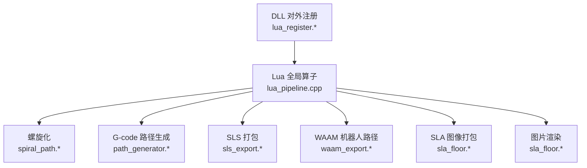
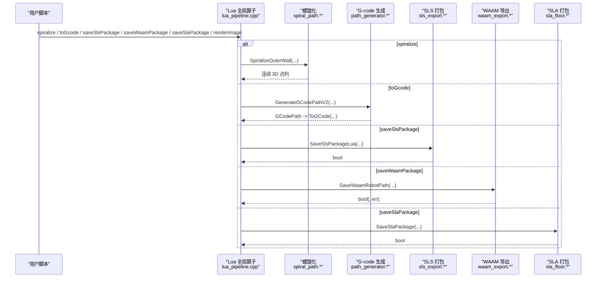
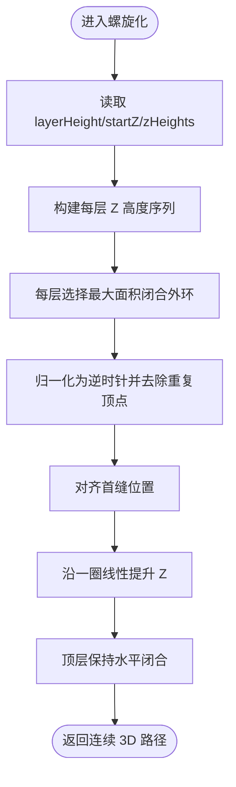
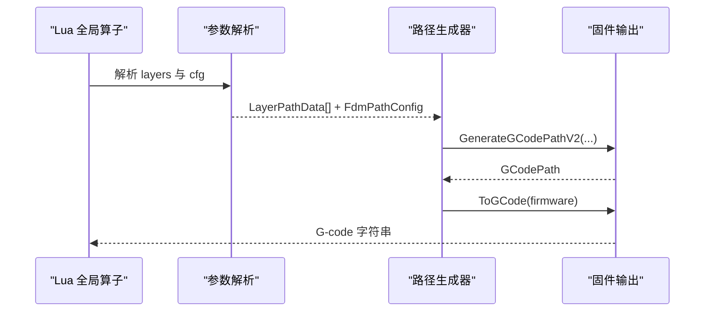
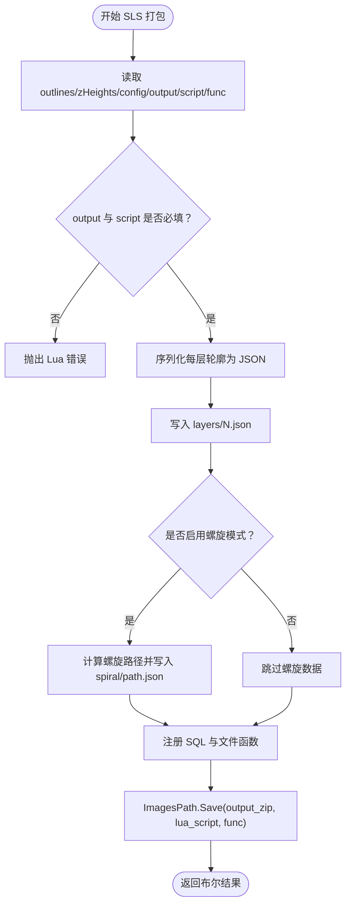
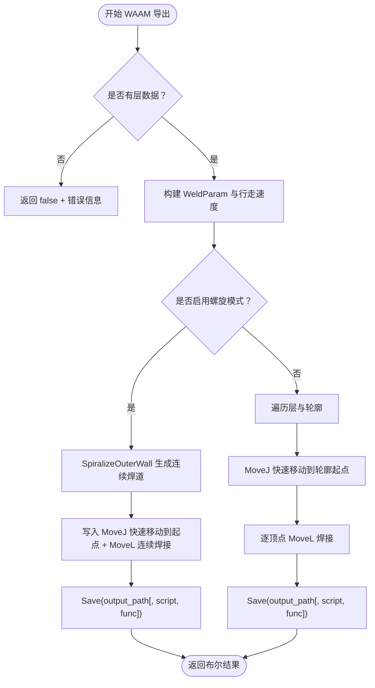
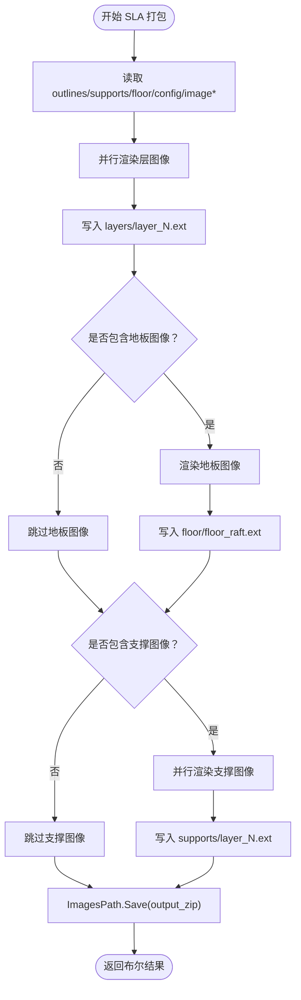
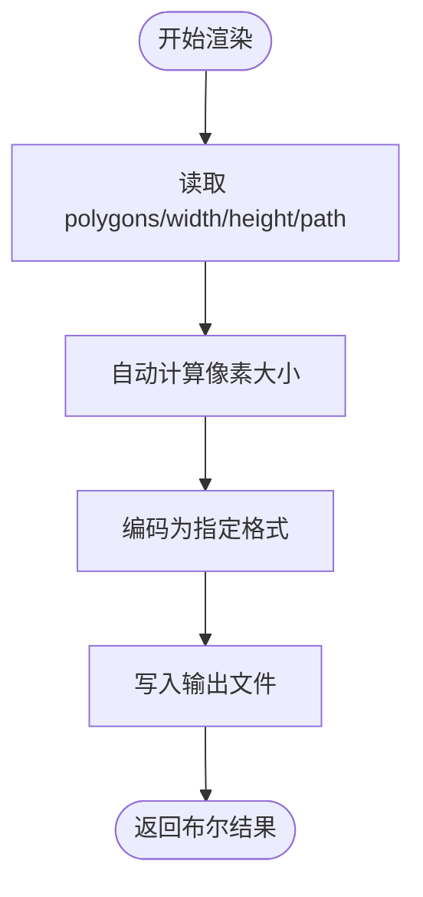
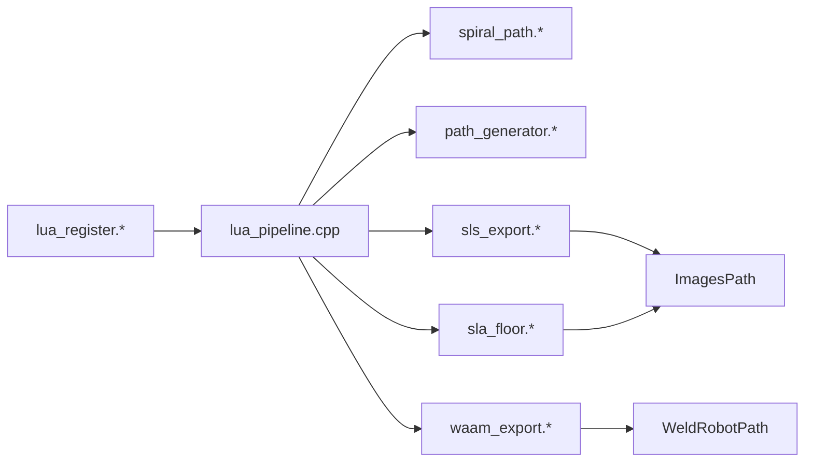

# 路径与导出函数

<cite>
**本文引用的文件**   
- [LibHsBaSlicer/Extends/lua_pipeline.cpp](file://LibHsBaSlicer/Extends/lua_pipeline.cpp)
- [LibHsBaSlicer/Path/path_generator.hpp](file://LibHsBaSlicer/Path/path_generator.hpp)
- [LibHsBaSlicer/Path/path_generator.cpp](file://LibHsBaSlicer/Path/path_generator.cpp)
- [LibHsBaSlicer/Path/spiral_path.hpp](file://LibHsBaSlicer/Path/spiral_path.hpp)
- [LibHsBaSlicer/Path/spiral_path.cpp](file://LibHsBaSlicer/Path/spiral_path.cpp)
- [LibHsBaSlicer/Path/sls_export.hpp](file://LibHsBaSlicer/Path/sls_export.hpp)
- [LibHsBaSlicer/Path/sls_export.cpp](file://LibHsBaSlicer/Path/sls_export.cpp)
- [LibHsBaSlicer/Path/waam_export.hpp](file://LibHsBaSlicer/Path/waam_export.hpp)
- [LibHsBaSlicer/Path/waam_export.cpp](file://LibHsBaSlicer/Path/waam_export.cpp)
- [LibHsBaSlicer/Floor/sla_floor.hpp](file://LibHsBaSlicer/Floor/sla_floor.hpp)
- [LibHsBaSlicer/Floor/sla_floor.cpp](file://LibHsBaSlicer/Floor/sla_floor.cpp)
- [DllHsBaSlicer/lua_register.h](file://DllHsBaSlicer/lua_register.h)
- [DllHsBaSlicer/lua_register.cpp](file://DllHsBaSlicer/lua_register.cpp)
- [docs/zh/lua_pipeline_api.md](file://docs/zh/lua_pipeline_api.md)
</cite>

## 目录
1. [引言](#引言)
2. [项目结构](#项目结构)
3. [核心组件](#核心组件)
4. [架构总览](#架构总览)
5. [详细组件分析](#详细组件分析)
6. [依赖关系分析](#依赖关系分析)
7. [性能考虑](#性能考虑)
8. [故障排除指南](#故障排除指南)
9. [结论](#结论)
10. [附录](#附录)

## 引言
本文聚焦 HsBa 全局算子中与“路径生成”和“文件导出”相关的核心能力，包括：
- 螺旋化（spiralize）
- G-code 生成（toGcode）
- SLS/SLM/LOM/TDP 打包（saveSlsPackage）
- WAAM 机器人路径（saveWaamPackage）
- SLA 打包（saveSlaPackage）
- 图片渲染（renderImage）

文档从源码出发，说明各函数的输入输出、参数规格、内部处理流程、性能特征以及不同导出场景的最佳实践与常见问题排查。

## 项目结构
围绕本主题的关键代码分布在以下模块：
- Lua 全局算子入口：`LibHsBaSlicer/Extends/lua_pipeline.cpp`
- FDM/G-code 路径生成：`LibHsBaSlicer/Path/path_generator.{hpp,cpp}`
- 螺旋外壁算法：`LibHsBaSlicer/Path/spiral_path.{hpp,cpp}`
- SLS 打包导出：`LibHsBaSlicer/Path/sls_export.{hpp,cpp}`
- WAAM 机器人路径导出：`LibHsBaSlicer/Path/waam_export.{hpp,cpp}`
- SLA 图像打包：`LibHsBaSlicer/Floor/sla_floor.{hpp,cpp}`
- DLL 对外注册接口：`DllHsBaSlicer/lua_register.{h,cpp}`
- 官方 API 文档片段：`docs/zh/lua_pipeline_api.md`

**图示来源**
- [LibHsBaSlicer/Extends/lua_pipeline.cpp:580-858](file://LibHsBaSlicer/Extends/lua_pipeline.cpp#L580-L858)
- [LibHsBaSlicer/Path/spiral_path.hpp:1-63](file://LibHsBaSlicer/Path/spiral_path.hpp#L1-L63)
- [LibHsBaSlicer/Path/path_generator.hpp:1-96](file://LibHsBaSlicer/Path/path_generator.hpp#L1-L96)
- [LibHsBaSlicer/Path/sls_export.hpp:1-61](file://LibHsBaSlicer/Path/sls_export.hpp#L1-L61)
- [LibHsBaSlicer/Path/waam_export.hpp:1-77](file://LibHsBaSlicer/Path/waam_export.hpp#L1-L77)
- [LibHsBaSlicer/Floor/sla_floor.hpp:118-200](file://LibHsBaSlicer/Floor/sla_floor.hpp#L118-L200)
- [DllHsBaSlicer/lua_register.h:1-38](file://DllHsBaSlicer/lua_register.h#L1-L38)

**章节来源**
- [LibHsBaSlicer/Extends/lua_pipeline.cpp:580-858](file://LibHsBaSlicer/Extends/lua_pipeline.cpp#L580-L858)
- [DllHsBaSlicer/lua_register.h:1-38](file://DllHsBaSlicer/lua_register.h#L1-L38)

## 核心组件
本节概述各全局算子的职责与调用契约。

| 全局算子 | 返回类型 | 主要用途 | 关键参数要点 |
|---|---|---|---|
| `HsBa.spiralize(sections[, cfg])` | 数组 `{x,y,z}` | 将逐层闭合轮廓合并为一条连续上升的 3D 螺旋路径 | `cfg.layerHeight`、`cfg.startZ`、`cfg.zHeights`（优先） |
| `HsBa.toGcode(layers, cfg)` | 字符串（G-code） | 根据每层 outlines/fills/supports 生成多固件 G-code | `layerHeight`、`lineWidth`、`printSpeed`、`travelSpeed`、`extrusionMultiplier`、`firmware`、喷嘴/耗材/温度/回抽等 |
| `HsBa.saveSlsPackage(tbl)` | 布尔值 | 将切片轮廓与配置打包为 zip，交由 Lua 脚本完成最终导出 | `outlines`、`zHeights`、`config`、`output`（必填）、`script`（必填）、`func`（默认 `export_sls`） |
| `HsBa.saveWaamPackage(tbl)` | 布尔值或布尔+错误信息 | 生成 ABB/KUKA/FANUC 机器人程序 | `outlines`、`zHeights`、`weld`、`robotType`、`beadWidth`、`config`、`output`（必填）、可选 `script`/`func` |
| `HsBa.saveSlaPackage(tbl)` | 布尔值 | 将层图像、地板、支撑图像打包为 zip | `outlines`、`supports`、`floor`、`config`、`output`（必填）、`imageWidth`、`imageHeight`、`imageExtension` |
| `HsBa.renderImage(polygons, width, height, path)` | 布尔值 | 将多边形渲染为图像文件 | 像素宽高、输出路径扩展名决定格式 |

**章节来源**
- [docs/zh/lua_pipeline_api.md:118-132](file://docs/zh/lua_pipeline_api.md#L118-L132)
- [LibHsBaSlicer/Extends/lua_pipeline.cpp:580-858](file://LibHsBaSlicer/Extends/lua_pipeline.cpp#L580-L858)

## 架构总览
下图展示从 Lua 全局算子到具体导出实现的调用链。

**图示来源**
- [LibHsBaSlicer/Extends/lua_pipeline.cpp:580-858](file://LibHsBaSlicer/Extends/lua_pipeline.cpp#L580-L858)
- [LibHsBaSlicer/Path/spiral_path.cpp:88-164](file://LibHsBaSlicer/Path/spiral_path.cpp#L88-L164)
- [LibHsBaSlicer/Path/path_generator.cpp:97-140](file://LibHsBaSlicer/Path/path_generator.cpp#L97-L140)
- [LibHsBaSlicer/Path/sls_export.cpp:79-143](file://LibHsBaSlicer/Path/sls_export.cpp#L79-L143)
- [LibHsBaSlicer/Path/waam_export.cpp:61-189](file://LibHsBaSlicer/Path/waam_export.cpp#L61-L189)
- [LibHsBaSlicer/Floor/sla_floor.cpp:468-529](file://LibHsBaSlicer/Floor/sla_floor.cpp#L468-L529)

## 详细组件分析

### 螺旋化（spiralize）
- 功能：将每层的外轮廓合并成一条连续的 3D 螺旋路径，适用于 FDM/WAAM/3DP 连续挤出。
- 输入：
  - `sections`：逐层闭合轮廓集合。
  - `cfg`：可选配置，包含 `layerHeight`、`startZ`、`zHeights`（若提供则优先使用）。
- 输出：`{x,y,z}` 数组形式的连续路径。
- 内部实现要点：
  - 选择每层面积最大的闭合外环。
  - 统一首缝位置，避免层间跳变。
  - 沿每层一圈线性插值 Z，形成连续上升路径。
  - 顶层保持水平走一圈以闭合。

**图示来源**
- [LibHsBaSlicer/Path/spiral_path.cpp:88-164](file://LibHsBaSlicer/Path/spiral_path.cpp#L88-L164)
- [LibHsBaSlicer/Path/spiral_path.hpp:16-58](file://LibHsBaSlicer/Path/spiral_path.hpp#L16-L58)

**章节来源**
- [LibHsBaSlicer/Extends/lua_pipeline.cpp:580-620](file://LibHsBaSlicer/Extends/lua_pipeline.cpp#L580-L620)
- [LibHsBaSlicer/Path/spiral_path.cpp:88-164](file://LibHsBaSlicer/Path/spiral_path.cpp#L88-L164)
- [LibHsBaSlicer/Path/spiral_path.hpp:16-58](file://LibHsBaSlicer/Path/spiral_path.hpp#L16-L58)

### G-code 生成（toGcode）
- 功能：根据每层的 outlines/fills/supports 与打印参数生成 G-code 字符串。
- 输入：
  - `layers`：每层包含 `outlines`、`fills`、`supports`、`zHeight`。
  - `cfg`：FDM 路径与打印机配置，如层高、线宽、速度、挤出倍率、固件类型、喷嘴/耗材/温度、回抽等。
- 输出：G-code 字符串。
- 内部实现要点：
  - 解析 Lua 表为 `LayerPathData` 与 `FdmPathConfig`。
  - 通过 `GenerateGCodePathV2` 生成带固件输出的 `GCodePath`。
  - 调用 `ToGCode(firmware)` 输出目标固件的 G-code。

**图示来源**
- [LibHsBaSlicer/Extends/lua_pipeline.cpp:622-691](file://LibHsBaSlicer/Extends/lua_pipeline.cpp#L622-L691)
- [LibHsBaSlicer/Path/path_generator.cpp:97-118](file://LibHsBaSlicer/Path/path_generator.cpp#L97-L118)

**章节来源**
- [LibHsBaSlicer/Extends/lua_pipeline.cpp:622-691](file://LibHsBaSlicer/Extends/lua_pipeline.cpp#L622-L691)
- [LibHsBaSlicer/Path/path_generator.hpp:20-62](file://LibHsBaSlicer/Path/path_generator.hpp#L20-L62)
- [LibHsBaSlicer/Path/path_generator.cpp:14-118](file://LibHsBaSlicer/Path/path_generator.cpp#L14-L118)

### SLS/SLM/LOM/TDP 打包（saveSlsPackage）
- 功能：将切片轮廓与配置打包为 zip，并由 Lua 脚本完成最终导出逻辑。
- 输入：
  - `outlines`：每层轮廓。
  - `zHeights`：可选每层 Z 高度。
  - `config`：JSON 配置内容。
  - `output`：输出 zip 路径（必填）。
  - `script`：Lua 导出脚本路径（必填）。
  - `func`：Lua 函数名（默认 `export_sls`）。
- 输出：布尔值表示是否成功。
- 内部实现要点：
  - 将每层轮廓序列化为 JSON，并以 `layers/N.json` 形式写入。
  - 支持 `spiral_mode` 时额外输出 `spiral/path.json`。
  - 注册 SQL 适配器与外部文件函数供 Lua 脚本使用。
  - 调用 `ImagesPath.Save(...)` 完成打包。

**图示来源**
- [LibHsBaSlicer/Extends/lua_pipeline.cpp:695-728](file://LibHsBaSlicer/Extends/lua_pipeline.cpp#L695-L728)
- [LibHsBaSlicer/Path/sls_export.cpp:79-143](file://LibHsBaSlicer/Path/sls_export.cpp#L79-L143)

**章节来源**
- [LibHsBaSlicer/Extends/lua_pipeline.cpp:695-728](file://LibHsBaSlicer/Extends/lua_pipeline.cpp#L695-L728)
- [LibHsBaSlicer/Path/sls_export.hpp:17-56](file://LibHsBaSlicer/Path/sls_export.hpp#L17-L56)
- [LibHsBaSlicer/Path/sls_export.cpp:26-143](file://LibHsBaSlicer/Path/sls_export.cpp#L26-L143)

### WAAM 机器人路径（saveWaamPackage）
- 功能：生成 ABB/KUKA/FANUC 机器人程序，支持螺旋连续焊接与逐层逐轮廓沉积两种模式。
- 输入：
  - `outlines`：每层沉积轮廓。
  - `zHeights`：可选每层 Z 高度。
  - `weld`：焊接参数（电流、电压、送丝速度、气体流量、行走速度、工艺类型）。
  - `robotType`：机器人品牌（0=ABB，1=KUKA，2=FANUC）。
  - `beadWidth`：焊道宽度（用于层内间距）。
  - `config`：可选配置侧车内容。
  - `output`：输出机器人程序路径（必填）。
  - 可选 `script`/`func`：自定义后处理脚本与函数名。
- 输出：布尔值；失败时可返回第二参数错误详情。
- 内部实现要点：
  - 校验层数非空。
  - 若启用 `spiral_mode`，则生成连续上升焊道（无抬枪/断弧），否则按层/轮廓逐段沉积。
  - 将 `WeldParam` 映射到机器人路径点，并调用 `WeldRobotPath.Save(...)`。

**图示来源**
- [LibHsBaSlicer/Extends/lua_pipeline.cpp:730-787](file://LibHsBaSlicer/Extends/lua_pipeline.cpp#L730-L787)
- [LibHsBaSlicer/Path/waam_export.cpp:61-189](file://LibHsBaSlicer/Path/waam_export.cpp#L61-L189)

**章节来源**
- [LibHsBaSlicer/Extends/lua_pipeline.cpp:730-787](file://LibHsBaSlicer/Extends/lua_pipeline.cpp#L730-L787)
- [LibHsBaSlicer/Path/waam_export.hpp:17-72](file://LibHsBaSlicer/Path/waam_export.hpp#L17-L72)
- [LibHsBaSlicer/Path/waam_export.cpp:21-189](file://LibHsBaSlicer/Path/waam_export.cpp#L21-L189)

### SLA 打包（saveSlaPackage）
- 功能：将层图像、地板图像、支撑图像与配置打包为 zip。
- 输入：
  - `outlines`：每层轮廓。
  - `supports`：每层支撑多边形。
  - `floor`：地板多边形。
  - `config`：JSON 配置内容。
  - `output`：输出 zip 路径（必填）。
  - `imageWidth`、`imageHeight`：图像尺寸（0 表示自动）。
  - `imageExtension`：图像扩展名（`.png`、`.jpg`、`.svg`）。
- 输出：布尔值。
- 内部实现要点：
  - 并行渲染层图像与支撑图像。
  - 可选渲染地板图像。
  - 使用 `ImagesPath` 写入 `layers/`、`floor/`、`supports/` 目录。
  - 支持 Lua 定制导出逻辑（`SaveSlaPackageLua`）。

**图示来源**
- [LibHsBaSlicer/Extends/lua_pipeline.cpp:789-816](file://LibHsBaSlicer/Extends/lua_pipeline.cpp#L789-L816)
- [LibHsBaSlicer/Floor/sla_floor.cpp:468-529](file://LibHsBaSlicer/Floor/sla_floor.cpp#L468-L529)

**章节来源**
- [LibHsBaSlicer/Extends/lua_pipeline.cpp:789-816](file://LibHsBaSlicer/Extends/lua_pipeline.cpp#L789-L816)
- [LibHsBaSlicer/Floor/sla_floor.hpp:157-195](file://LibHsBaSlicer/Floor/sla_floor.hpp#L157-L195)
- [LibHsBaSlicer/Floor/sla_floor.cpp:468-609](file://LibHsBaSlicer/Floor/sla_floor.cpp#L468-L609)

### 图片渲染（renderImage）
- 功能：将多边形渲染为图像文件。
- 输入：
  - `polygons`：待渲染的多边形集合。
  - `width`、`height`：像素宽高。
  - `path`：输出文件路径（扩展名决定格式）。
- 输出：布尔值。
- 内部实现要点：
  - 自动根据边界框与请求尺寸计算像素大小。
  - 支持 PNG/JPG/SVG 等格式。

**图示来源**
- [LibHsBaSlicer/Extends/lua_pipeline.cpp:818-828](file://LibHsBaSlicer/Extends/lua_pipeline.cpp#L818-L828)
- [LibHsBaSlicer/Floor/sla_floor.hpp:122-151](file://LibHsBaSlicer/Floor/sla_floor.hpp#L122-L151)

**章节来源**
- [LibHsBaSlicer/Extends/lua_pipeline.cpp:818-828](file://LibHsBaSlicer/Extends/lua_pipeline.cpp#L818-L828)
- [LibHsBaSlicer/Floor/sla_floor.hpp:122-151](file://LibHsBaSlicer/Floor/sla_floor.hpp#L122-L151)

## 依赖关系分析
- Lua 全局算子集中暴露 API，内部委托给 C++ 实现。
- 螺旋化算法被 G-code 螺旋模式、SLS 螺旋数据、WAAM 螺旋焊接共同复用。
- SLS/WAAM/SLA 打包均依赖 `ImagesPath` 进行 zip 打包与 Lua 脚本执行。
- DLL 对外注册接口允许外部扩展 2D/3D/文件函数与事件回调。

**图示来源**
- [LibHsBaSlicer/Extends/lua_pipeline.cpp:580-858](file://LibHsBaSlicer/Extends/lua_pipeline.cpp#L580-L858)
- [LibHsBaSlicer/Path/spiral_path.cpp:88-164](file://LibHsBaSlicer/Path/spiral_path.cpp#L88-L164)
- [LibHsBaSlicer/Path/sls_export.cpp:79-143](file://LibHsBaSlicer/Path/sls_export.cpp#L79-L143)
- [LibHsBaSlicer/Path/waam_export.cpp:61-189](file://LibHsBaSlicer/Path/waam_export.cpp#L61-L189)
- [LibHsBaSlicer/Floor/sla_floor.cpp:468-609](file://LibHsBaSlicer/Floor/sla_floor.cpp#L468-L609)
- [DllHsBaSlicer/lua_register.cpp:1-43](file://DllHsBaSlicer/lua_register.cpp#L1-L43)

**章节来源**
- [DllHsBaSlicer/lua_register.h:1-38](file://DllHsBaSlicer/lua_register.h#L1-L38)
- [DllHsBaSlicer/lua_register.cpp:1-43](file://DllHsBaSlicer/lua_register.cpp#L1-L43)

## 性能考虑
- 螺旋化算法对每层仅选择最大面积外环，时间复杂度近似 O(N·M)，其中 N 为层数，M 为每层顶点数；适合均匀截面模型。
- G-code 生成采用 V2 接口，先聚合每层多边形再交给固件输出，减少中间数据结构拷贝。
- SLA 打包在桌面端并行渲染层图像与支撑图像，显著降低 I/O 与编码瓶颈。
- SLS/WAAM/SLA 打包统一通过 `ImagesPath` 写入 zip，避免多次磁盘访问。

[本节为通用性能建议，不直接分析具体文件]

## 故障排除指南
- `saveSlsPackage` 缺少必填字段：
  - 现象：Lua 报错提示 `output` 与 `script` 必填。
  - 排查：确保传入表中包含 `output` 与 `script`。
- `saveWaamPackage` 无层数据：
  - 现象：返回 false 并附带错误信息 “WAAM package has no layers”。
  - 排查：检查 `outlines` 是否为空。
- `saveWaamPackage` 螺旋模式退化：
  - 现象：未生成连续焊道，回退到逐层逐轮廓沉积。
  - 排查：确认每层至少有一个有效闭合外环。
- `toGcode` 路径生成失败：
  - 现象：Lua 报错 “failed to generate path”。
  - 排查：检查 `layers` 结构与 `cfg` 参数是否完整。
- `saveSlaPackage` 输出为空：
  - 现象：zip 中缺少层/地板/支撑图像。
  - 排查：检查 `imageWidth`/`imageHeight` 与 `imageExtension`，确认渲染缓冲区非空。

**章节来源**
- [LibHsBaSlicer/Extends/lua_pipeline.cpp:721-724](file://LibHsBaSlicer/Extends/lua_pipeline.cpp#L721-L724)
- [LibHsBaSlicer/Path/waam_export.cpp:67-75](file://LibHsBaSlicer/Path/waam_export.cpp#L67-L75)
- [LibHsBaSlicer/Extends/lua_pipeline.cpp:683-687](file://LibHsBaSlicer/Extends/lua_pipeline.cpp#L683-L687)
- [LibHsBaSlicer/Floor/sla_floor.cpp:468-529](file://LibHsBaSlicer/Floor/sla_floor.cpp#L468-L529)

## 结论
HsBa 的全局算子在路径生成与文件导出方面提供了统一的 Lua 接口，底层由 C++ 实现高性能算法与多格式输出。螺旋化算法贯穿 FDM/WAAM/SLS 多种场景，显著提升连续挤出质量；G-code 生成支持多固件；SLS/WAAM/SLA 打包通过 `ImagesPath` 与 Lua 脚本实现灵活可扩展的导出流程。合理配置参数与启用并行渲染，可在保证质量的同时获得良好性能。

[本节为总结性内容，不直接分析具体文件]

## 附录
- 官方 API 参考片段：
  - [docs/zh/lua_pipeline_api.md:118-132](file://docs/zh/lua_pipeline_api.md#L118-L132)

[本节为补充信息，不直接分析具体文件]