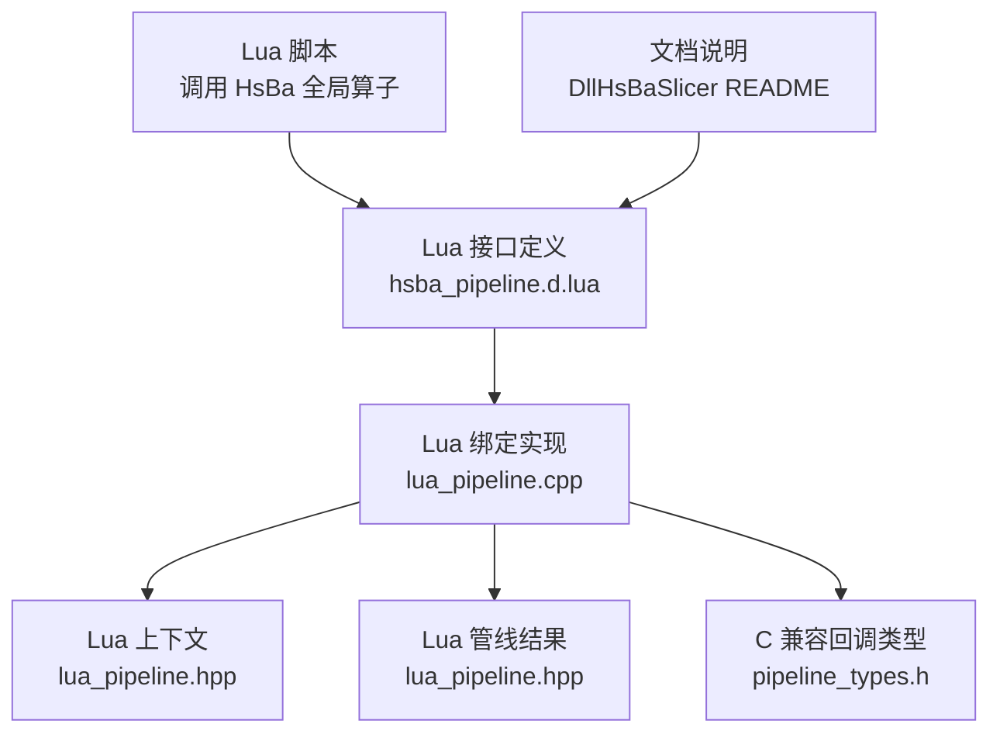
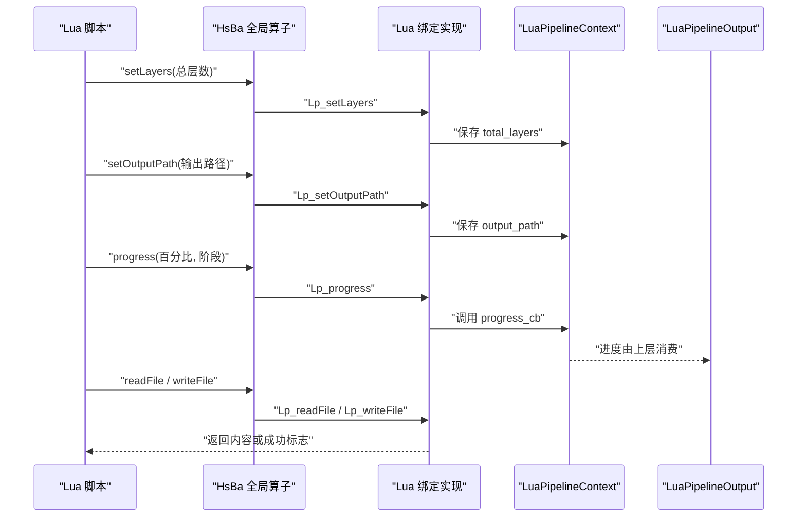
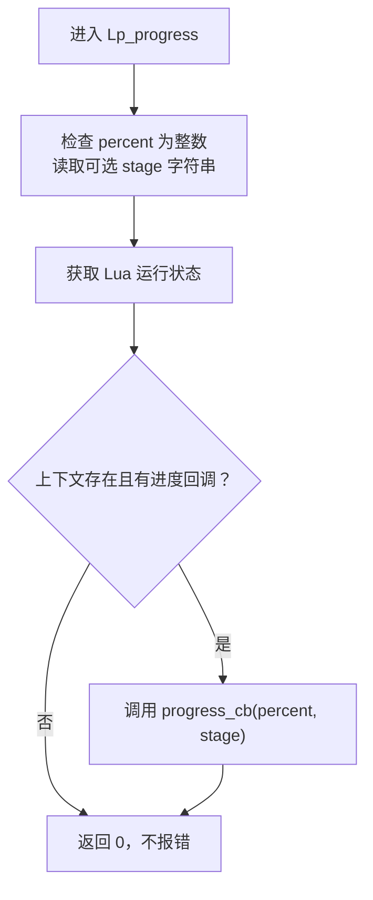
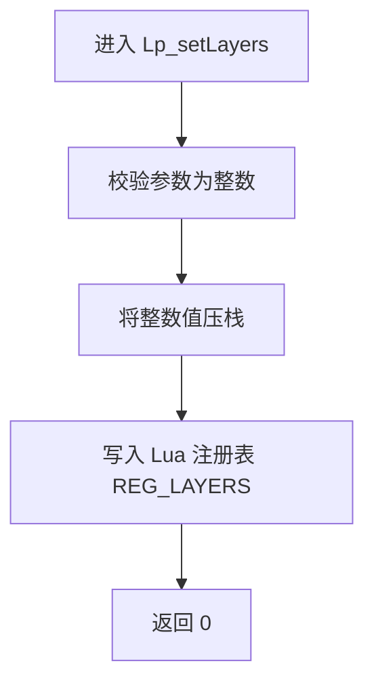
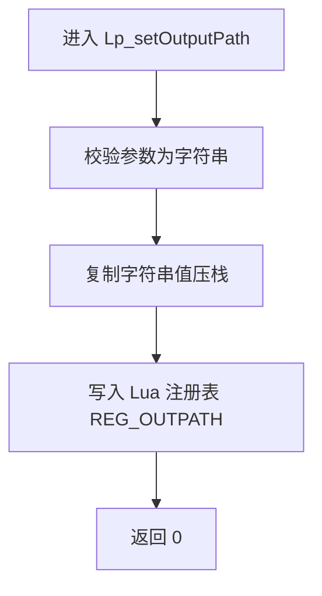
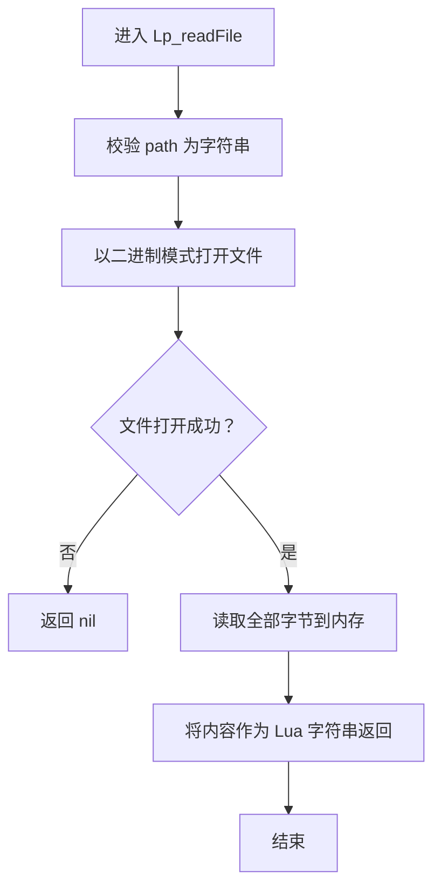
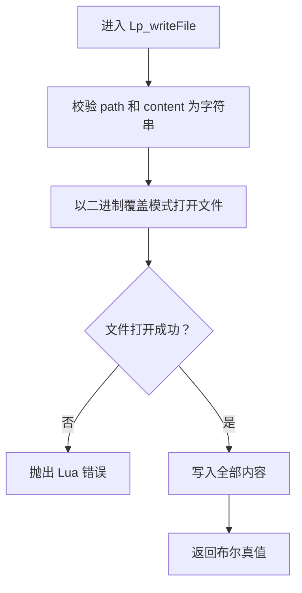

# 进度与配置函数

<cite>
**本文引用的文件**   
- [lua_pipeline.cpp](file://LibHsBaSlicer/Extends/lua_pipeline.cpp)
- [lua_pipeline.hpp](file://LibHsBaSlicer/Extends/lua_pipeline.hpp)
- [hsba_pipeline.d.lua](file://types/hsba_pipeline.d.lua)
- [pipeline_types.h](file://pipelinetypes/pipeline_types.h)
- [README.md](file://docs/en/DllHsBaSlicer/README.md)
</cite>

## 目录
1. [引言](#引言)
2. [项目结构定位](#项目结构定位)
3. [核心组件](#核心组件)
4. [架构总览](#架构总览)
5. [详细组件分析](#详细组件分析)
6. [依赖关系分析](#依赖关系分析)
7. [性能与并发特性](#性能与并发特性)
8. [错误处理与异常行为](#错误处理与异常行为)
9. [最佳实践](#最佳实践)
10. [故障排除](#故障排除)
11. [结论](#结论)

## 引言
本文聚焦 HsBa 全局算子中的进度上报与配置管理相关能力，包括：
- 进度上报：`HsBa.progress(percent, stage?)`
- 总层数设置：`HsBa.setLayers(n)`
- 输出路径设置：`HsBa.setOutputPath(path)`
- 基础文件操作：`HsBa.readFile(path)`、`HsBa.writeFile(path, content)`

这些函数主要出现在 Lua 驱动的自定义流水线环境中。脚本通过 `HsBa` 表向 C++ 侧报告进度、声明总层数和最终输出路径，并读写辅助文件。C++ 侧则把这些信息映射到上下文和结果对象中，供上层调用方使用。

## 项目结构定位
与进度和配置相关的实现集中在以下位置：
- Lua 接口定义：`types/hsba_pipeline.d.lua`
- Lua 绑定实现：`LibHsBaSlicer/Extends/lua_pipeline.cpp`
- Lua 上下文与输出类型：`LibHsBaSlicer/Extends/lua_pipeline.hpp`
- C 兼容管线类型与回调类型：`pipelinetypes/pipeline_types.h`
- 文档说明：`docs/en/DllHsBaSlicer/README.md`

**图表来源**
- [hsba_pipeline.d.lua:290-318](file://types/hsba_pipeline.d.lua#L290-L318)
- [lua_pipeline.cpp:228-288](file://LibHsBaSlicer/Extends/lua_pipeline.cpp#L228-L288)
- [lua_pipeline.hpp:29-51](file://LibHsBaSlicer/Extends/lua_pipeline.hpp#L29-L51)
- [pipeline_types.h:689-727](file://pipelinetypes/pipeline_types.h#L689-L727)
- [README.md:486-501](file://docs/en/DllHsBaSlicer/README.md#L486-L501)

**章节来源**
- [hsba_pipeline.d.lua:290-318](file://types/hsba_pipeline.d.lua#L290-L318)
- [lua_pipeline.cpp:228-288](file://LibHsBaSlicer/Extends/lua_pipeline.cpp#L228-L288)
- [lua_pipeline.hpp:29-51](file://LibHsBaSlicer/Extends/lua_pipeline.hpp#L29-L51)
- [pipeline_types.h:689-727](file://pipelinetypes/pipeline_types.h#L689-L727)
- [README.md:486-501](file://docs/en/DllHsBaSlicer/README.md#L486-L501)

## 核心组件
本节从“对外 API”“内部存储”“回调机制”三个维度说明进度与配置函数的作用。

| 函数 | 参数 | 返回值 | 作用 |
|---|---|---|---|
| `HsBa.progress(percent, stage?)` | `percent` 整数百分比；`stage` 可选阶段描述字符串 | 无 | 向 C++ 侧上报当前进度和阶段信息 |
| `HsBa.setLayers(n)` | `n` 整数总层数 | 无 | 将脚本计算的总层数写入上下文 |
| `HsBa.setOutputPath(path)` | `path` 字符串输出路径 | 无 | 将脚本选择的输出路径写入上下文 |
| `HsBa.readFile(path)` | `path` 字符串文件路径 | 字符串或 `nil` | 以二进制模式读取文件内容，失败返回 `nil` |
| `HsBa.writeFile(path, content)` | `path` 字符串路径；`content` 字符串内容 | 布尔值 | 以二进制覆盖模式写入文件，打开失败抛出 Lua 错误 |

这些函数共同构成脚本与 C++ 之间的“轻量配置通道”：脚本负责业务逻辑，C++ 负责环境、资源、并发和结果收集。

**章节来源**
- [hsba_pipeline.d.lua:296-318](file://types/hsba_pipeline.d.lua#L296-L318)
- [lua_pipeline.cpp:228-288](file://LibHsBaSlicer/Extends/lua_pipeline.cpp#L228-L288)
- [lua_pipeline.hpp:29-51](file://LibHsBaSlicer/Extends/lua_pipeline.hpp#L29-L51)

## 架构总览
下图展示脚本调用 `HsBa` 全局算子后，数据如何在 Lua 层、绑定层、上下文层和结果层之间流动。

**图表来源**
- [lua_pipeline.cpp:228-288](file://LibHsBaSlicer/Extends/lua_pipeline.cpp#L228-L288)
- [lua_pipeline.hpp:29-51](file://LibHsBaSlicer/Extends/lua_pipeline.hpp#L29-L51)

## 详细组件分析

### 进度上报：`HsBa.progress(percent, stage?)`
`progress` 是脚本主动上报进度的入口。它接收一个整数百分比和一个可选的阶段描述字符串，并通过上下文中的进度回调传递给 C++ 侧。

关键行为：
- 第一个参数必须是整数；第二个参数可选，若未提供则为空字符串。
- 如果上下文存在且包含进度回调，则直接调用该回调。
- 如果上下文不存在或没有进度回调，则静默忽略，不会报错。

**图表来源**
- [lua_pipeline.cpp:228-239](file://LibHsBaSlicer/Extends/lua_pipeline.cpp#L228-L239)

**章节来源**
- [lua_pipeline.cpp:228-239](file://LibHsBaSlicer/Extends/lua_pipeline.cpp#L228-L239)
- [lua_pipeline.hpp:38-39](file://LibHsBaSlicer/Extends/lua_pipeline.hpp#L38-L39)
- [pipeline_types.h:721-727](file://pipelinetypes/pipeline_types.h#L721-L727)

### 总层数设置：`HsBa.setLayers(n)`
`setLayers` 用于让脚本声明整个切片流程的总层数。C++ 侧将其保存到 Lua 运行环境的注册表中，并最终反映到 `LuaPipelineOutput::total_layers`。

关键行为：
- 参数必须为整数。
- 值被存入 Lua 注册表的固定索引位置。
- 成功后返回 0，不返回具体数值。

**图表来源**
- [lua_pipeline.cpp:241-248](file://LibHsBaSlicer/Extends/lua_pipeline.cpp#L241-L248)
- [lua_pipeline.hpp:47-48](file://LibHsBaSlicer/Extends/lua_pipeline.hpp#L47-L48)

**章节来源**
- [lua_pipeline.cpp:241-248](file://LibHsBaSlicer/Extends/lua_pipeline.cpp#L241-L248)
- [lua_pipeline.hpp:47-48](file://LibHsBaSlicer/Extends/lua_pipeline.hpp#L47-L48)

### 输出路径设置：`HsBa.setOutputPath(path)`
`setOutputPath` 用于让脚本声明最终输出路径。C++ 侧将其保存到 Lua 注册表，并最终反映到 `LuaPipelineOutput::output_path`。

关键行为：
- 参数必须是字符串。
- 值被存入 Lua 注册表的固定索引位置。
- 成功后返回 0，不返回具体路径。

**图表来源**
- [lua_pipeline.cpp:250-256](file://LibHsBaSlicer/Extends/lua_pipeline.cpp#L250-L256)
- [lua_pipeline.hpp:47-48](file://LibHsBaSlicer/Extends/lua_pipeline.hpp#L47-L48)

**章节来源**
- [lua_pipeline.cpp:250-256](file://LibHsBaSlicer/Extends/lua_pipeline.cpp#L250-L256)
- [lua_pipeline.hpp:47-48](file://LibHsBaSlicer/Extends/lua_pipeline.hpp#L47-L48)

### 文件读取：`HsBa.readFile(path)`
`readFile` 以二进制模式读取指定路径的文件内容，并将完整内容作为 Lua 字符串返回；如果无法打开文件，则返回 `nil`。

关键行为：
- 参数必须是字符串。
- 使用二进制模式打开文件。
- 打开失败时返回 `nil`。
- 成功时返回文件内容的字符串。

**图表来源**
- [lua_pipeline.cpp:258-273](file://LibHsBaSlicer/Extends/lua_pipeline.cpp#L258-L273)

**章节来源**
- [lua_pipeline.cpp:258-273](file://LibHsBaSlicer/Extends/lua_pipeline.cpp#L258-L273)

### 文件写入：`HsBa.writeFile(path, content)`
`writeFile` 以二进制覆盖模式写入文件内容，成功返回布尔真值；如果无法打开文件，则抛出 Lua 错误。

关键行为：
- 两个参数都必须是字符串。
- 使用二进制覆盖模式打开目标文件。
- 打开失败时抛出 Lua 错误，而不是返回布尔假值。
- 写入成功后返回布尔真值。

**图表来源**
- [lua_pipeline.cpp:275-288](file://LibHsBaSlicer/Extends/lua_pipeline.cpp#L275-L288)

**章节来源**
- [lua_pipeline.cpp:275-288](file://LibHsBaSlicer/Extends/lua_pipeline.cpp#L275-L288)

## 依赖关系分析
进度与配置函数依赖以下层次：

| 层次 | 职责 | 相关文件 |
|---|---|---|
| Lua 类型声明 | 定义 `HsBa` 全局算子的 Lua 类型签名 | `types/hsba_pipeline.d.lua` |
| Lua 绑定实现 | 实现 `progress`、`setLayers`、`setOutputPath`、`readFile`、`writeFile` | `LibHsBaSlicer/Extends/lua_pipeline.cpp` |
| 上下文与输出 | 保存进度回调、总层数、输出路径等 | `LibHsBaSlicer/Extends/lua_pipeline.hpp` |
| C 兼容类型 | 定义自定义管线配置、结果和进度回调类型 | `pipelinetypes/pipeline_types.h` |
| 文档 | 说明 `HsBa` 全局算子在 Dll 环境中的可用能力 | `docs/en/DllHsBaSlicer/README.md` |

**图表来源**
- [hsba_pipeline.d.lua:290-318](file://types/hsba_pipeline.d.lua#L290-L318)
- [lua_pipeline.cpp:228-288](file://LibHsBaSlicer/Extends/lua_pipeline.cpp#L228-L288)
- [lua_pipeline.hpp:29-51](file://LibHsBaSlicer/Extends/lua_pipeline.hpp#L29-L51)
- [pipeline_types.h:689-727](file://pipelinetypes/pipeline_types.h#L689-L727)
- [README.md:486-501](file://docs/en/DllHsBaSlicer/README.md#L486-L501)

**章节来源**
- [hsba_pipeline.d.lua:290-318](file://types/hsba_pipeline.d.lua#L290-L318)
- [lua_pipeline.cpp:228-288](file://LibHsBaSlicer/Extends/lua_pipeline.cpp#L228-L288)
- [lua_pipeline.hpp:29-51](file://LibHsBaSlicer/Extends/lua_pipeline.hpp#L29-L51)
- [pipeline_types.h:689-727](file://pipelinetypes/pipeline_types.h#L689-L727)
- [README.md:486-501](file://docs/en/DllHsBaSlicer/README.md#L486-L501)

## 性能与并发特性
- `progress` 本身只是把百分比和阶段字符串交给回调函数，不涉及 I/O 或复杂计算。
- `setLayers` 和 `setOutputPath` 只进行参数校验和注册表写入，开销很小。
- `readFile` 会一次性将整个文件读入内存，适合中小体积配置文件或辅助数据；超大文件不建议通过该接口读取。
- `writeFile` 使用二进制覆盖模式写入，适合生成 G-code、中间文件或打包前的临时文件。
- 在并行流水线中，进度回调通常按块触发，避免每个线程频繁调用 UI 或日志系统造成竞争和抖动。

[本节为通用性能讨论，不直接分析具体代码行]

## 错误处理与异常行为
| 函数 | 异常情况 | 行为 |
|---|---|---|
| `HsBa.progress` | 上下文为空或没有进度回调 | 静默忽略，不报错 |
| `HsBa.progress` | `percent` 不是整数 | 参数校验失败，Lua 侧抛错 |
| `HsBa.setLayers` | `n` 不是整数 | 参数校验失败，Lua 侧抛错 |
| `HsBa.setOutputPath` | `path` 不是字符串 | 参数校验失败，Lua 侧抛错 |
| `HsBa.readFile` | 文件不存在或无法打开 | 返回 `nil` |
| `HsBa.writeFile` | 文件无法打开 | 抛出 Lua 错误 |
| `HsBa.writeFile` | 写入过程中发生底层 I/O 错误 | 当前实现先判断能否打开文件，再写入；成功返回布尔真值 |

需要注意：
- `readFile` 的错误路径返回 `nil`，脚本应显式检查返回值。
- `writeFile` 的错误路径直接抛出 Lua 错误，脚本可通过 `pcall` 捕获。
- `progress` 对缺失回调的处理是“安全失败”，便于脚本在未启用进度上报的环境中也能正常运行。

**章节来源**
- [lua_pipeline.cpp:228-288](file://LibHsBaSlicer/Extends/lua_pipeline.cpp#L228-L288)

## 最佳实践
### 进度上报
- 在脚本开始处调用 `HsBa.setProgress` 前，确保已正确初始化 Lua 管线环境。
- 将长耗时任务拆分为多个阶段，例如“加载模型”“计算层数”“切片”“生成路径”“打包输出”。
- 百分比建议单调递增，避免 UI 回退造成用户困惑。
- 阶段描述应简洁明确，例如“正在切片第 120 层”“正在生成 G-code”。

### 总层数设置
- 总层数应在脚本完成模型分析和层数计算后设置一次即可。
- 如果后续步骤改变了层数，应重新调用 `setLayers` 更新。
- 不要将每层进度误当作总层数；总层数是“预期总量”，进度是“已完成量”。

### 输出路径设置
- 输出路径应由脚本根据业务规则决定，例如根据工艺类型、设备型号或用户选择。
- 建议在写入文件之前先设置输出路径，以便上层能提前知道最终产物位置。
- 路径可以是绝对路径或相对路径，但需保证执行环境可访问。

### 文件读写
- 读取小文件时使用 `readFile`；大文件建议使用更合适的流式接口或外部工具。
- 写入文件时使用 `writeFile`，并在关键路径上增加幂等保护，例如先写临时文件再原子替换。
- 对可能失败的 I/O 操作，建议用 `pcall` 包裹，以便区分脚本逻辑错误和文件系统错误。

[本节为通用实践建议，不直接分析具体代码行]

## 故障排除
| 现象 | 可能原因 | 处理方法 |
|---|---|---|
| 进度始终不更新 | 未设置进度回调，或上下文未正确初始化 | 检查 Lua 管线环境是否创建成功，确认 `progress_cb` 是否存在 |
| `setLayers` 无效 | 脚本未调用，或调用时机太晚 | 在层数确定后立即调用，并确保最终结果对象能读取该值 |
| `setOutputPath` 无效 | 脚本未调用，或路径格式不正确 | 检查路径是否为字符串，并确保写入权限存在 |
| `readFile` 返回 `nil` | 文件不存在或路径错误 | 检查路径、工作目录和权限 |
| `writeFile` 抛出 Lua 错误 | 目标路径不可写、磁盘空间不足或权限不足 | 检查目录权限、磁盘空间和路径合法性 |
| 进度回调频繁触发导致卡顿 | 回调过于密集或回调逻辑过重 | 合并进度上报，减少 UI 刷新频率 |

**章节来源**
- [lua_pipeline.cpp:228-288](file://LibHsBaSlicer/Extends/lua_pipeline.cpp#L228-L288)

## 结论
HsBa 全局算子中的进度与配置函数提供了脚本与 C++ 之间的轻量协作通道：
- `progress` 负责进度上报；
- `setLayers` 负责声明总层数；
- `setOutputPath` 负责声明输出路径；
- `readFile` 和 `writeFile` 提供基础文件读写能力。

它们的设计原则是“脚本灵活、C++ 稳定”：脚本可以自由选择何时上报进度、如何组织阶段、如何决定输出路径；C++ 侧则负责参数校验、上下文存储、回调分发和结果收集。对于生产环境，建议结合明确的阶段划分、合理的进度粒度、稳健的错误处理和清晰的输出路径策略，使自定义流水线既灵活又可靠。

[本节为总结性内容，不直接分析具体代码行]