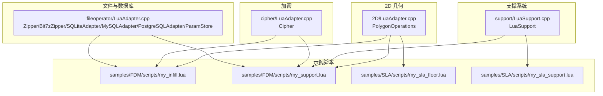
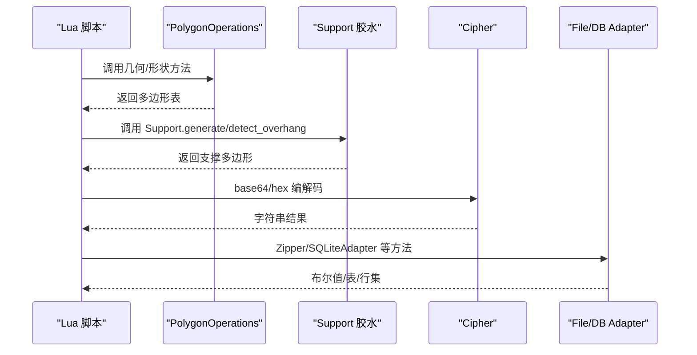
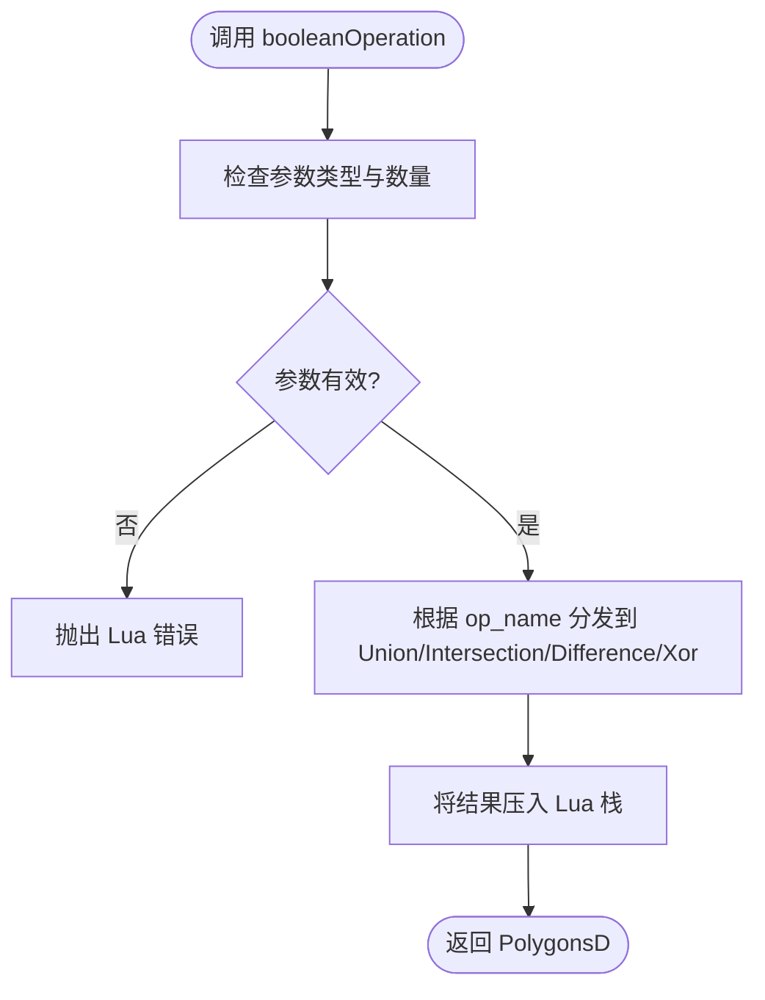
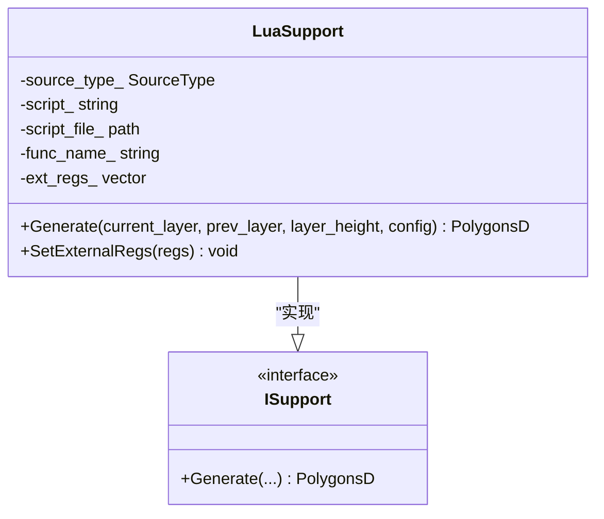
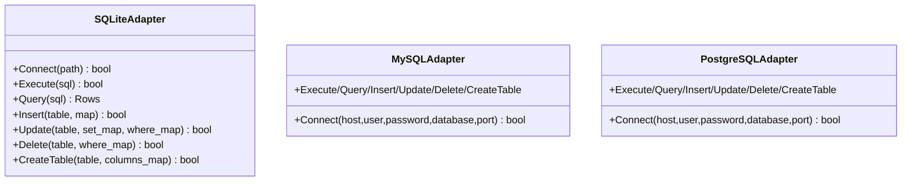
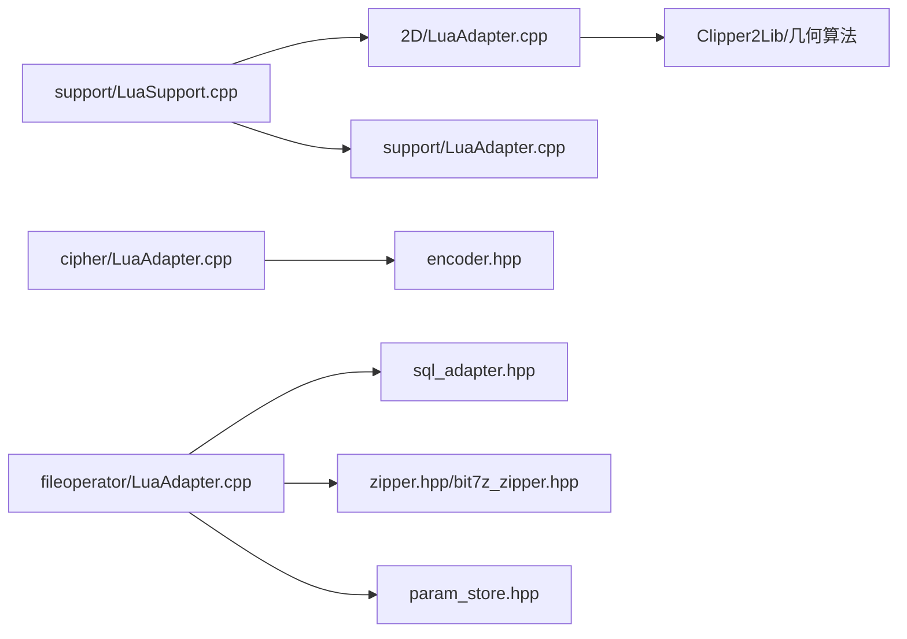

# Lua API 参考

<cite>
**本文引用的文件**   
- [2D/LuaAdapter.hpp](file://2D/LuaAdapter.hpp)
- [2D/LuaAdapter.cpp](file://2D/LuaAdapter.cpp)
- [support/LuaSupport.hpp](file://support/LuaSupport.hpp)
- [support/LuaSupport.cpp](file://support/LuaSupport.cpp)
- [cipher/LuaAdapter.hpp](file://cipher/LuaAdapter.hpp)
- [cipher/LuaAdapter.cpp](file://cipher/LuaAdapter.cpp)
- [fileoperator/LuaAdapter.hpp](file://fileoperator/LuaAdapter.hpp)
- [fileoperator/LuaAdapter.cpp](file://fileoperator/LuaAdapter.cpp)
- [samples/FDM/scripts/my_infill.lua](file://samples/FDM/scripts/my_infill.lua)
- [samples/FDM/scripts/my_support.lua](file://samples/FDM/scripts/my_support.lua)
- [samples/SLA/scripts/my_sla_floor.lua](file://samples/SLA/scripts/my_sla_floor.lua)
- [samples/SLA/scripts/my_sla_support.lua](file://samples/SLA/scripts/my_sla_support.lua)
- [tests/PolygonFill/lua_polygon_operations_test.cpp](file://tests/PolygonFill/lua_polygon_operations_test.cpp)
- [tests/Cipher/cipher_lua_adapter_test.cpp](file://tests/Cipher/cipher_lua_adapter_test.cpp)
- [tests/FilesOperator/sqlite_test.cpp](file://tests/FilesOperator/sqlite_test.cpp)
</cite>

## 目录
1. [简介](#简介)
2. [项目结构](#项目结构)
3. [核心组件](#核心组件)
4. [架构总览](#架构总览)
5. [详细组件分析](#详细组件分析)
6. [依赖关系分析](#依赖关系分析)
7. [性能与最佳实践](#性能与最佳实践)
8. [故障排除指南](#故障排除指南)
9. [结论](#结论)
10. [附录：API 速查表](#附录api-速查表)

## 简介
本参考文档面向 HsBaSlicer 的 Lua 脚本扩展点，系统性说明所有对外暴露的 Lua API，包括：
- 全局算子表 PolygonOperations（几何布尔运算、偏移、凸包/凹包、面积、形状工厂、文本转多边形等）
- 填充算法接口 PolygonFill（直线、锯齿形、偏移填充）
- 支撑生成 Support（FDM/SLA 支撑生成器、悬垂检测、默认配置）
- 路径优化 PathOptimize（由上层管线调用，Lua 侧通过自定义路径脚本参与）
- 压缩归档 Zipper / Bit7zZipper（文件打包/解包）
- 加密 Cipher（Base64/Hex 编解码）
- 数据库访问 SQLiteAdapter / MySQLAdapter / PostgreSQLAdapter（CRUD、建表、执行 SQL）
- 参数存储 ParamStore（流程参数的持久化与加载）

文档以源码为依据，给出函数签名、参数类型、返回值、错误行为与使用示例路径，并辅以架构图、类图与时序图帮助理解。

## 项目结构
HsBaSlicer 将 Lua 绑定按功能模块拆分到不同子系统中：
- 2D 几何与多边形操作：2D/LuaAdapter.*
- 支撑生成：support/LuaSupport.*
- 加密：cipher/LuaAdapter.*
- 文件与数据库：fileoperator/LuaAdapter.*
- 示例脚本：samples/*/*.lua
- 测试用例：tests/*/*_test.cpp

**图示来源**
- [2D/LuaAdapter.cpp:311-329](file://2D/LuaAdapter.cpp#L311-L329)
- [support/LuaSupport.cpp:67-90](file://support/LuaSupport.cpp#L67-L90)
- [cipher/LuaAdapter.cpp:85-96](file://cipher/LuaAdapter.cpp#L85-L96)
- [fileoperator/LuaAdapter.cpp:1109-1145](file://fileoperator/LuaAdapter.cpp#L1109-L1145)

**章节来源**
- [2D/LuaAdapter.hpp:1-84](file://2D/LuaAdapter.hpp#L1-L84)
- [support/LuaSupport.hpp:1-85](file://support/LuaSupport.hpp#L1-L85)
- [cipher/LuaAdapter.hpp:1-18](file://cipher/LuaAdapter.hpp#L1-L18)
- [fileoperator/LuaAdapter.hpp:1-74](file://fileoperator/LuaAdapter.hpp#L1-L74)

## 核心组件
本节概述各模块在 Lua 层暴露的全局对象与方法族，便于快速定位。

- PolygonOperations：几何布尔运算、偏移、凸包/凹包、面积、形状工厂、文本转多边形、调试导出（可选）。
- PolygonFill：填充算法（直线、锯齿形、偏移填充），供地板/填充脚本调用。
- Support：支撑生成器抽象与内置实现（平面、树状、蜂窝、SLA），并提供悬垂检测与默认配置。
- Cipher：Base64/Hex 编解码。
- Zipper / Bit7zZipper：通用与 Bit7z 实现的压缩归档。
- SQLiteAdapter / MySQLAdapter / PostgreSQLAdapter：SQL 适配器。
- ParamStore：流程参数表的统一存取。

**章节来源**
- [2D/LuaAdapter.cpp:311-329](file://2D/LuaAdapter.cpp#L311-L329)
- [support/LuaSupport.cpp:67-90](file://support/LuaSupport.cpp#L67-L90)
- [cipher/LuaAdapter.cpp:85-96](file://cipher/LuaAdapter.cpp#L85-L96)
- [fileoperator/LuaAdapter.cpp:1109-1145](file://fileoperator/LuaAdapter.cpp#L1109-L1145)

## 架构总览
下图展示 Lua 脚本如何与底层 C++ 模块交互，以及数据在 Lua 栈与 C++ 对象之间的转换路径。

**图示来源**
- [2D/LuaAdapter.cpp:311-329](file://2D/LuaAdapter.cpp#L311-L329)
- [support/LuaSupport.cpp:113-177](file://support/LuaSupport.cpp#L113-L177)
- [cipher/LuaAdapter.cpp:13-96](file://cipher/LuaAdapter.cpp#L13-L96)
- [fileoperator/LuaAdapter.cpp:1109-1145](file://fileoperator/LuaAdapter.cpp#L1109-L1145)

## 详细组件分析

### PolygonOperations（几何算子表）
- 注册入口：RegisterLuaPolygonOperations(L)，在 Lua 中创建全局表 `PolygonOperations`。
- 数据类型约定：
  - 单多边形：table，元素为 {x=number, y=number} 的点序列。
  - 多边形集合：table，元素为上述多边形 table。
  - 坐标精度：部分函数走整数化路径（单位 mm × integerization），如 offsetOperation 的 delta 单位为整数化空间单位。
- 主要方法（签名与行为）：
  - booleanOperation(left_polys, right_polys, op_name) → PolygonsD
    - op_name ∈ {"union","intersection","difference","xor"}
    - 参数校验失败抛出 Lua 错误。
  - union(left_polys, right_polys) → PolygonsD
  - intersection(left_polys, right_polys) → PolygonsD
  - difference(left_polys, right_polys) → PolygonsD
  - xor(left_polys, right_polys) → PolygonsD
  - offsetOperation(polys_int, delta) → Polygons（整数化坐标）
    - delta 单位为整数化空间单位；1.0 mm = integerization 单位。
  - convexHullOperation(polys_d) → PolygonsD
  - concaveHullOperation(polys_d, additional_points) → PolygonsD
  - area(poly_d) → number
  - makeRectangle(x, y, width, height) → PolygonsD（单元素）
  - makeCircle(cx, cy, radius [, segments]) → PolygonsD（segments 默认 64）
  - makeEllipse(cx, cy, rx, ry [, segments [, rotation]]) → PolygonsD
  - makeRegularPolygon(cx, cy, radius, sides [, rotation]) → PolygonsD
  - textToPolygons(text, font_file, font_size [, x [, y [, curve_segments]]]) → PolygonsD
  - dumpPolygon(poly, filename [, close_path]) → void（条件编译 HSBA_POLYGON_DUMP）
  - dumpPolygons(polys, filename [, close_path]) → void（条件编译 HSBA_POLYGON_DUMP）

- 错误处理：
  - 参数类型或数量不合法时，统一通过 l_booleanError 抛出带函数名的 Lua 错误。
  - 未知 op_name 会触发“Unknown operation”错误。

- 使用示例路径：
  - [tests/PolygonFill/lua_polygon_operations_test.cpp:129-191](file://tests/PolygonFill/lua_polygon_operations_test.cpp#L129-L191)

**图示来源**
- [2D/LuaAdapter.cpp:22-54](file://2D/LuaAdapter.cpp#L22-L54)

**章节来源**
- [2D/LuaAdapter.hpp:76-81](file://2D/LuaAdapter.hpp#L76-L81)
- [2D/LuaAdapter.cpp:22-329](file://2D/LuaAdapter.cpp#L22-L329)
- [tests/PolygonFill/lua_polygon_operations_test.cpp:129-191](file://tests/PolygonFill/lua_polygon_operations_test.cpp#L129-L191)

### PolygonFill（填充算法）
- 暴露方式：在 SLA 地板脚本示例中直接调用 `PolygonFill.zigzagFill`、`lineFill`、`offsetFill`。
- 典型方法（从示例脚本可见）：
  - zigzagFill(polys, spacing, angle, lineThickness) → PolygonsD
  - lineFill(polys, spacing, angle, lineThickness) → PolygonsD
  - offsetFill(polys, spacing) → PolygonsD
- 使用示例路径：
  - [samples/SLA/scripts/my_sla_floor.lua:26-30](file://samples/SLA/scripts/my_sla_floor.lua#L26-L30)
  - [samples/SLA/scripts/my_sla_floor.lua:53-60](file://samples/SLA/scripts/my_sla_floor.lua#L53-L60)

**章节来源**
- [samples/SLA/scripts/my_sla_floor.lua:1-64](file://samples/SLA/scripts/my_sla_floor.lua#L1-L64)

### Support（支撑生成）
- LuaSupport 类提供基于 Lua 的自定义支撑生成器，支持内联脚本或外部脚本文件，并在 Lua 环境中注入：
  - current_layer、prev_layer、layer_height、config
  - 调用 RegisterLuaSupport 注入 Support 模块（new_plane/new_tree/new_honeycomb/new_sla/generate/detect_overhang/default_config）
- Generate(current_layer, prev_layer, layer_height, config) → PolygonsD
  - 内部流程：创建 Lua 状态 → 初始化环境 → 注册 2D+3D 扩展 → 加载脚本 → 执行 chunk → 可选调用指定函数 → 解析返回的多边形表。
- 错误处理：
  - Lua 状态创建失败、脚本加载失败、运行时错误、函数调用失败均抛出 RuntimeError。

**图示来源**
- [support/LuaSupport.hpp:40-81](file://support/LuaSupport.hpp#L40-L81)
- [support/LuaSupport.cpp:113-177](file://support/LuaSupport.cpp#L113-L177)

**章节来源**
- [support/LuaSupport.hpp:1-85](file://support/LuaSupport.hpp#L1-L85)
- [support/LuaSupport.cpp:1-180](file://support/LuaSupport.cpp#L1-L180)
- [samples/FDM/scripts/my_support.lua:1-83](file://samples/FDM/scripts/my_support.lua#L1-L83)
- [samples/SLA/scripts/my_sla_support.lua:1-76](file://samples/SLA/scripts/my_sla_support.lua#L1-L76)

### Cipher（加密模块）
- 全局表：Cipher
- 方法：
  - base64_encode(data: string) → string
  - base64_decode(data: string) → string
  - hex_encode(data: string) → string
  - hex_decode(data: string) → string
- 错误处理：
  - 异常被捕获后通过 lua_error 抛出，例如 hex_decode 对非法十六进制输入会报错。
- 使用示例路径：
  - [tests/Cipher/cipher_lua_adapter_test.cpp:66-127](file://tests/Cipher/cipher_lua_adapter_test.cpp#L66-L127)

**章节来源**
- [cipher/LuaAdapter.hpp:1-18](file://cipher/LuaAdapter.hpp#L1-L18)
- [cipher/LuaAdapter.cpp:1-98](file://cipher/LuaAdapter.cpp#L1-L98)
- [tests/Cipher/cipher_lua_adapter_test.cpp:1-130](file://tests/Cipher/cipher_lua_adapter_test.cpp#L1-L130)

### FileOperator（Zipper/Bit7zZipper）
- Zipper（通用）：
  - new() → Zipper
  - AddFile(name, path) → bool
  - AddByteFile(name, data) → bool
  - Save(path) → bool
- Bit7zZipper（条件编译 HSBA_USE_BIT7Z）：
  - new(format, dll_path?, password?) → Bit7zZipper
  - format ∈ {"Zip","SevenZip","XZ","BZIP2","GZIP","TAR","TarGz","TarXz"}
  - AddFile/AddByteFile/Save 同 Zipper
- 错误处理：
  - 无效对象指针或底层 RuntimeError 会被转换为 Lua 错误。

**章节来源**
- [fileoperator/LuaAdapter.cpp:52-139](file://fileoperator/LuaAdapter.cpp#L52-L139)
- [fileoperator/LuaAdapter.cpp:142-302](file://fileoperator/LuaAdapter.cpp#L142-L302)
- [fileoperator/LuaAdapter.cpp:1109-1145](file://fileoperator/LuaAdapter.cpp#L1109-L1145)
- [fileoperator/LuaAdapter.cpp:1147-1185](file://fileoperator/LuaAdapter.cpp#L1147-L1185)

### Database Adapters（SQLiteAdapter / MySQLAdapter / PostgreSQLAdapter）
- SQLiteAdapter：
  - new() → SQLiteAdapter
  - Connect(path) → bool
  - Execute(sql) → bool
  - Query(sql) → table[]（每行是一个字段名→值的表）
  - Insert(table, row_map) → bool
  - Update(table, set_map, where_map) → bool
  - Delete(table, where_map) → bool
  - CreateTable(table, columns_map) → bool
- MySQLAdapter / PostgreSQLAdapter（条件编译 HSBA_USE_MYSQL / HSBA_USE_PGSQL）：
  - new() → Adapter
  - Connect(host, user, password, database, port?) → bool
  - Execute/Query/Insert/Update/Delete/CreateTable 同 SQLiteAdapter
- 错误处理：
  - 所有方法在底层抛出 RuntimeError 时，都会转为 Lua 错误。

**图示来源**
- [fileoperator/LuaAdapter.cpp:304-565](file://fileoperator/LuaAdapter.cpp#L304-L565)
- [fileoperator/LuaAdapter.cpp:567-835](file://fileoperator/LuaAdapter.cpp#L567-L835)
- [fileoperator/LuaAdapter.cpp:836-1105](file://fileoperator/LuaAdapter.cpp#L836-L1105)

**章节来源**
- [fileoperator/LuaAdapter.cpp:304-565](file://fileoperator/LuaAdapter.cpp#L304-L565)
- [fileoperator/LuaAdapter.cpp:567-835](file://fileoperator/LuaAdapter.cpp#L567-L835)
- [fileoperator/LuaAdapter.cpp:836-1105](file://fileoperator/LuaAdapter.cpp#L836-L1105)
- [tests/FilesOperator/sqlite_test.cpp:59-123](file://tests/FilesOperator/sqlite_test.cpp#L59-L123)
- [tests/FilesOperator/sqlite_test.cpp:125-185](file://tests/FilesOperator/sqlite_test.cpp#L125-L185)
- [tests/FilesOperator/sqlite_test.cpp:187-249](file://tests/FilesOperator/sqlite_test.cpp#L187-L249)

### ParamStore（参数存储）
- 全局表：ParamStore
- 方法：
  - new(adapter) → ParamStore（adapter 为任意 SQL 适配器对象）
  - EnsureSchema() → bool
  - Save(table_or_tag, key, config_table) → id
  - Load(table_or_tag, key) → (bool, config_table | error)
  - List(table_or_tag, where_json?) → table[]
  - Update/Delete 等（由注册表定义）
- 行为细节：
  - table_or_tag 支持短标签（如 "fdm"）或完整表名（如 "hsba_param_fdm"），内部映射到具体 PipelineConfigTag 与默认表名。
  - config_table 字段按反射 schema 进行类型收敛（double/int64/text）。
- 错误处理：
  - 未知表名或空 adapter 会抛出 Lua 错误。

**章节来源**
- [fileoperator/LuaAdapter.cpp:1353-1466](file://fileoperator/LuaAdapter.cpp#L1353-L1466)
- [fileoperator/LuaAdapter.cpp:1468-1587](file://fileoperator/LuaAdapter.cpp#L1468-L1587)

### 路径优化（PathOptimize）
- 路径优化通常由上层管线（PathGenerator/PathOptimizer）驱动，Lua 侧可通过自定义路径脚本参与（例如 WAAM 示例中的 my_waam_path.lua）。
- 当前仓库未直接暴露名为 PathOptimize 的全局 Lua 表；相关逻辑更多体现在 C++ 路径生成与优化阶段。若需扩展，可在对应管线注册自定义 Lua 钩子。

[本节为概念性说明，不直接分析具体源码文件]

## 依赖关系分析
- 2D/LuaAdapter 依赖 Clipper2Lib 与内部几何算法（Union/Intersection/Difference/Xor/Offset/ConvexHull/ConcaveHullSimulation/MakeRectangle/MakeCircle/MakeEllipse/MakeRegularPolygon/TextToPolygons）。
- support/LuaSupport 依赖 2D/LuaAdapter（注册 PolygonOperations）、support/LuaAdapter（注册 Support 模块）、utils/LuaNewObject（Lua 对象封装）。
- cipher/LuaAdapter 依赖 encoder.hpp（Encoder::base64_encode/decode/hex_encode/decode）。
- fileoperator/LuaAdapter 依赖 sql_adapter.hpp、zipper.hpp、bit7z_zipper.hpp、param_store.hpp、param_reflect.hpp、param_schema.hpp。

**图示来源**
- [2D/LuaAdapter.cpp:9-10](file://2D/LuaAdapter.cpp#L9-L10)
- [support/LuaSupport.cpp:10-13](file://support/LuaSupport.cpp#L10-L13)
- [cipher/LuaAdapter.cpp:6-7](file://cipher/LuaAdapter.cpp#L6-L7)
- [fileoperator/LuaAdapter.cpp:6-10](file://fileoperator/LuaAdapter.cpp#L6-L10)

**章节来源**
- [2D/LuaAdapter.cpp:9-10](file://2D/LuaAdapter.cpp#L9-L10)
- [support/LuaSupport.cpp:10-13](file://support/LuaSupport.cpp#L10-L13)
- [cipher/LuaAdapter.cpp:6-7](file://cipher/LuaAdapter.cpp#L6-L7)
- [fileoperator/LuaAdapter.cpp:6-10](file://fileoperator/LuaAdapter.cpp#L6-L10)

## 性能与最佳实践
- 几何计算：
  - 优先使用双精度 PolygonOperations 方法（area/make*）避免缩放误差；仅在需要整数化偏移时使用 offsetOperation，并注意 delta 的单位。
  - 大量布尔运算时，尽量合并输入多边形以减少调用次数。
- 填充算法：
  - 合理设置 spacing/angle/lineThickness，避免过密导致内存与时间开销激增。
- 支撑生成：
  - 使用 Support.detect_overhang 先裁剪区域，再选择合适生成器（平面/树状/蜂窝/SLA）。
  - 首层跳过支撑生成可节省计算。
- 文件与数据库：
  - 批量插入/更新时尽量合并为单次事务（由底层 SQL 适配器负责）。
  - 使用 Bit7zZipper 时选择合适的格式与压缩级别，避免过大 DLL 依赖。
- 加密：
  - 仅对必要数据进行 Base64/Hex 编码，避免在热路径频繁编解码。

[本节为通用指导，不直接分析具体源码文件]

## 故障排除指南
- PolygonOperations 参数错误：
  - 现象：调用时报错“Expected ...”。
  - 排查：确认传入的是 table 且元素为 {x,y}；booleanOperation 的第三个参数必须是已知操作名。
  - 参考：[2D/LuaAdapter.cpp:16-54](file://2D/LuaAdapter.cpp#L16-L54)
- offsetOperation 单位误解：
  - 现象：偏移量效果不符合预期。
  - 原因：delta 单位为整数化空间单位（mm × integerization）。
  - 参考：[tests/PolygonFill/lua_polygon_operations_test.cpp:160-162](file://tests/PolygonFill/lua_polygon_operations_test.cpp#L160-L162)
- Support 脚本加载失败：
  - 现象：抛出“LuaSupport load/runtime/function call error”。
  - 排查：检查脚本路径/内容、函数名是否存在、返回是否为多边形表。
  - 参考：[support/LuaSupport.cpp:130-177](file://support/LuaSupport.cpp#L130-L177)
- Cipher 编解码异常：
  - 现象：hex_decode 非法输入抛错。
  - 排查：确保输入为合法十六进制字符串。
  - 参考：[tests/Cipher/cipher_lua_adapter_test.cpp:96-108](file://tests/Cipher/cipher_lua_adapter_test.cpp#L96-L108)
- SQLiteAdapter 连接/查询失败：
  - 现象：Connect/Query 抛错。
  - 排查：确认数据库文件存在、权限正确、SQL 语法无误。
  - 参考：[tests/FilesOperator/sqlite_test.cpp:59-123](file://tests/FilesOperator/sqlite_test.cpp#L59-L123)

**章节来源**
- [2D/LuaAdapter.cpp:16-54](file://2D/LuaAdapter.cpp#L16-L54)
- [tests/PolygonFill/lua_polygon_operations_test.cpp:160-162](file://tests/PolygonFill/lua_polygon_operations_test.cpp#L160-L162)
- [support/LuaSupport.cpp:130-177](file://support/LuaSupport.cpp#L130-L177)
- [tests/Cipher/cipher_lua_adapter_test.cpp:96-108](file://tests/Cipher/cipher_lua_adapter_test.cpp#L96-L108)
- [tests/FilesOperator/sqlite_test.cpp:59-123](file://tests/FilesOperator/sqlite_test.cpp#L59-L123)

## 结论
HsBaSlicer 的 Lua API 围绕几何、填充、支撑、文件、加密与数据库六大能力构建，提供了稳定且可扩展的脚本化工作流。开发者可通过 PolygonOperations 与 PolygonFill 完成复杂几何与填充设计，借助 Support 灵活定制支撑策略，利用 Cipher 与 Zipper 处理数据与资源，并通过 SQLiteAdapter/MySQLAdapter/PostgreSQLAdapter 与 ParamStore 实现参数与数据的持久化。遵循本文档的签名、参数与错误处理规范，可高效集成与扩展 HsBaSlicer 的流水线。

[本节为总结性内容，不直接分析具体源码文件]

## 附录：API 速查表

### PolygonOperations
- booleanOperation(left, right, op) → PolygonsD
- union(left, right) → PolygonsD
- intersection(left, right) → PolygonsD
- difference(left, right) → PolygonsD
- xor(left, right) → PolygonsD
- offsetOperation(polys, delta) → Polygons（整数化坐标）
- convexHullOperation(polys) → PolygonsD
- concaveHullOperation(polys, additional_points) → PolygonsD
- area(poly) → number
- makeRectangle(x, y, w, h) → PolygonsD
- makeCircle(cx, cy, r [, seg]) → PolygonsD
- makeEllipse(cx, cy, rx, ry [, seg [, rot]]) → PolygonsD
- makeRegularPolygon(cx, cy, r, sides [, rot]) → PolygonsD
- textToPolygons(text, font, size [, x [, y [, seg]]]) → PolygonsD
- dumpPolygon(poly, file [, close]) → void（HSBA_POLYGON_DUMP）
- dumpPolygons(polys, file [, close]) → void（HSBA_POLYGON_DUMP）

**章节来源**
- [2D/LuaAdapter.cpp:22-329](file://2D/LuaAdapter.cpp#L22-L329)

### PolygonFill
- zigzagFill(polys, spacing, angle, thickness) → PolygonsD
- lineFill(polys, spacing, angle, thickness) → PolygonsD
- offsetFill(polys, spacing) → PolygonsD

**章节来源**
- [samples/SLA/scripts/my_sla_floor.lua:26-30](file://samples/SLA/scripts/my_sla_floor.lua#L26-L30)

### Support
- Support.new_plane() / new_tree() / new_honeycomb() / new_sla()
- Support.generate(obj, current, prev, height, cfg) → PolygonsD
- Support.detect_overhang(current, prev, height, angle) → PolygonsD
- Support.default_config() → table

**章节来源**
- [support/LuaSupport.cpp:67-90](file://support/LuaSupport.cpp#L67-L90)
- [samples/FDM/scripts/my_support.lua:19-27](file://samples/FDM/scripts/my_support.lua#L19-L27)
- [samples/SLA/scripts/my_sla_support.lua:24-28](file://samples/SLA/scripts/my_sla_support.lua#L24-L28)

### Cipher
- base64_encode(data) → string
- base64_decode(data) → string
- hex_encode(data) → string
- hex_decode(data) → string

**章节来源**
- [cipher/LuaAdapter.cpp:13-96](file://cipher/LuaAdapter.cpp#L13-L96)

### Zipper / Bit7zZipper
- Zipper.new() → Zipper
- Zipper.AddFile(name, path) → bool
- Zipper.AddByteFile(name, data) → bool
- Zipper.Save(path) → bool
- Bit7zZipper.new(format, dll_path?, password?) → Bit7zZipper
- Bit7zZipper.AddFile/AddByteFile/Save 同上

**章节来源**
- [fileoperator/LuaAdapter.cpp:52-139](file://fileoperator/LuaAdapter.cpp#L52-L139)
- [fileoperator/LuaAdapter.cpp:142-302](file://fileoperator/LuaAdapter.cpp#L142-L302)
- [fileoperator/LuaAdapter.cpp:1109-1185](file://fileoperator/LuaAdapter.cpp#L1109-L1185)

### SQLiteAdapter / MySQLAdapter / PostgreSQLAdapter
- new() → Adapter
- Connect(...) → bool
- Execute(sql) → bool
- Query(sql) → Rows
- Insert(table, map) → bool
- Update(table, set_map, where_map) → bool
- Delete(table, where_map) → bool
- CreateTable(table, columns_map) → bool

**章节来源**
- [fileoperator/LuaAdapter.cpp:304-565](file://fileoperator/LuaAdapter.cpp#L304-L565)
- [fileoperator/LuaAdapter.cpp:567-835](file://fileoperator/LuaAdapter.cpp#L567-L835)
- [fileoperator/LuaAdapter.cpp:836-1105](file://fileoperator/LuaAdapter.cpp#L836-L1105)

### ParamStore
- new(adapter) → ParamStore
- EnsureSchema() → bool
- Save(tag_or_table, key, config_table) → id
- Load(tag_or_table, key) → (bool, config_table | error)
- List(tag_or_table, where_json?) → table[]

**章节来源**
- [fileoperator/LuaAdapter.cpp:1353-1466](file://fileoperator/LuaAdapter.cpp#L1353-L1466)
- [fileoperator/LuaAdapter.cpp:1468-1587](file://fileoperator/LuaAdapter.cpp#L1468-L1587)