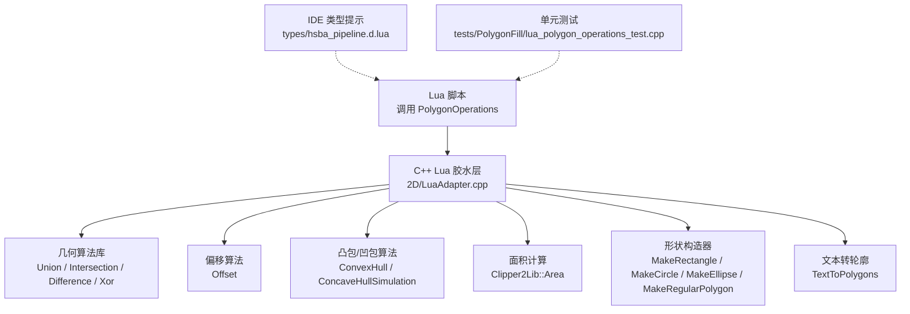
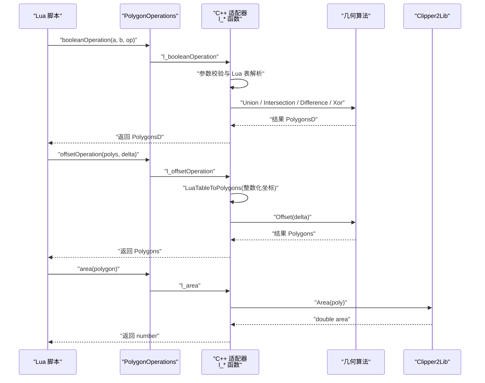
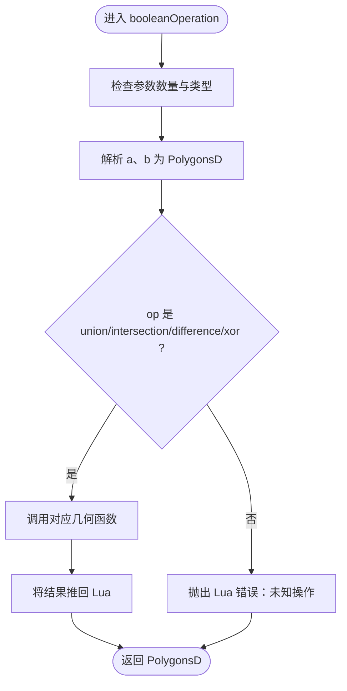
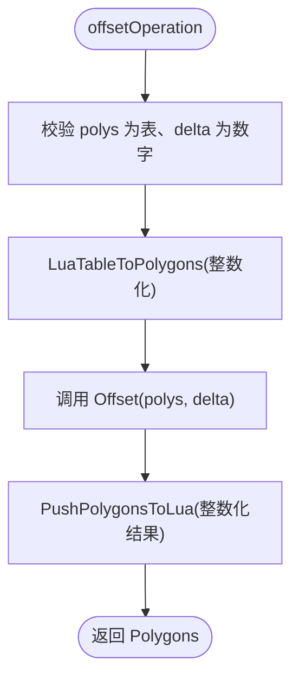
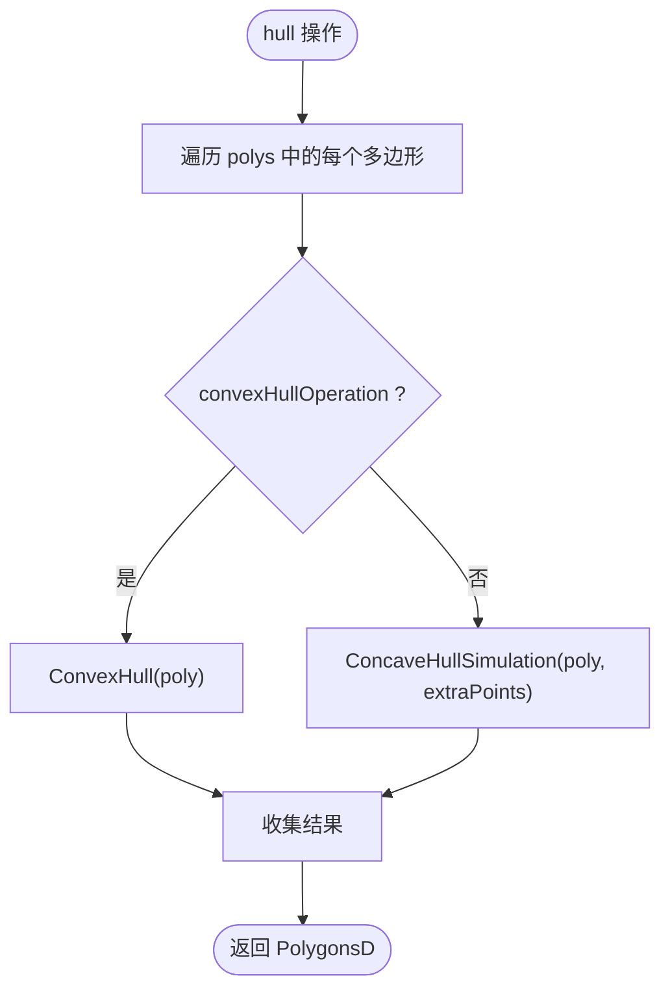
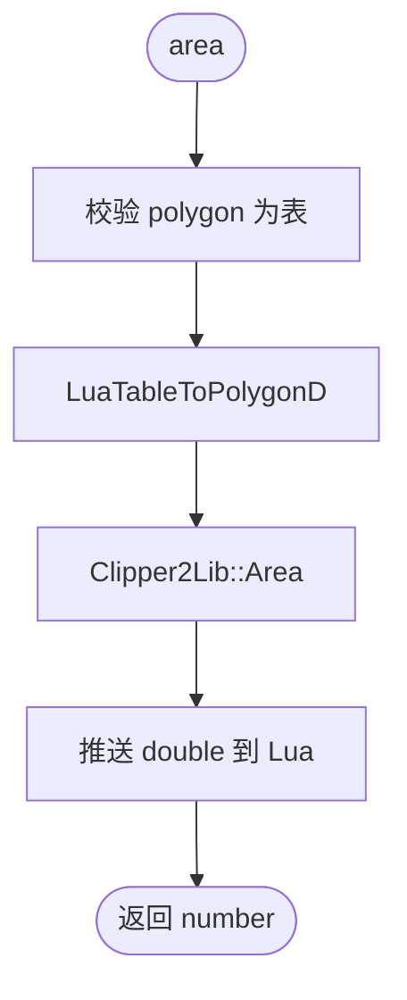
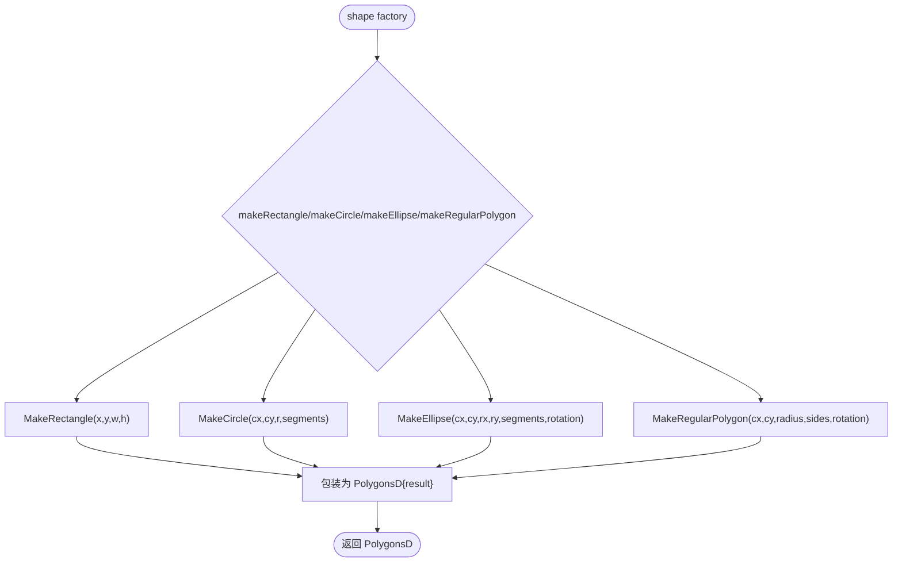
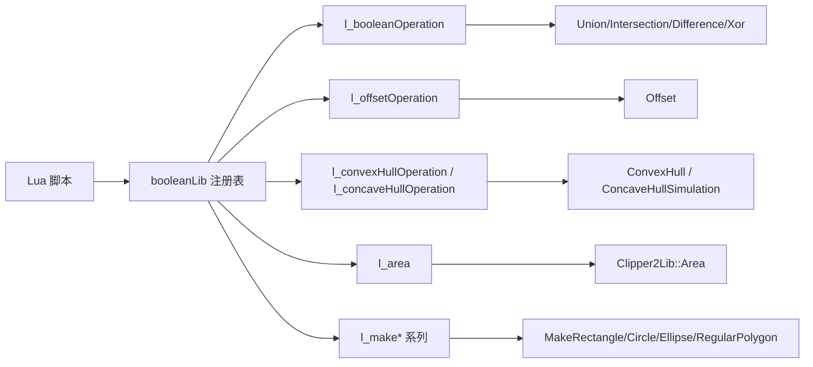
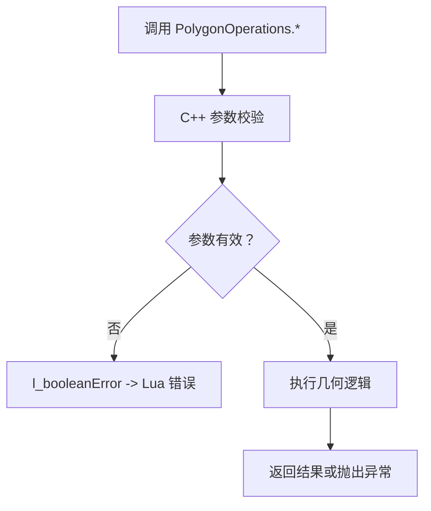

# 几何操作 API

<cite>
**本文引用的文件**   
- [LuaAdapter.cpp](file://2D/LuaAdapter.cpp)
- [hsba_pipeline.d.lua](file://types/hsba_pipeline.d.lua)
- [lua_polygon_operations_test.cpp](file://tests/PolygonFill/lua_polygon_operations_test.cpp)
- [lua_pipeline_api.md](file://docs/en/lua_pipeline_api.md)
</cite>

## 目录
1. [简介](#简介)
2. [项目结构](#项目结构)
3. [核心组件](#核心组件)
4. [架构总览](#架构总览)
5. [详细组件分析](#详细组件分析)
6. [依赖关系分析](#依赖关系分析)
7. [性能与精度注意事项](#性能与精度注意事项)
8. [错误处理与调试](#错误处理与调试)
9. [最佳实践](#最佳实践)
10. [结论](#结论)
11. [附录：API 参考表](#附录api-参考表)

## 简介
本页面为 HsBaSlicer 中 `PolygonOperations` Lua API 的完整技术文档。该接口暴露一组二维多边形几何函数，包括布尔运算、偏移、凸包与凹包计算、面积计算以及常用形状构造器。它通过 C++ 胶水层将底层几何算法暴露给 Lua 脚本，供 FDM/SLA/SLS/SLM/LOM/TDP/WAAM 等流水线中的自定义脚本调用。

## 项目结构
`PolygonOperations` 的核心实现位于 2D 几何模块的 Lua 适配器中，类型定义位于 Lua IDE 类型声明文件，行为验证由单元测试覆盖。

图表来源
- [LuaAdapter.cpp:22-273](file://2D/LuaAdapter.cpp#L22-L273)
- [hsba_pipeline.d.lua:36-51](file://types/hsba_pipeline.d.lua#L36-L51)
- [lua_polygon_operations_test.cpp:129-191](file://tests/PolygonFill/lua_polygon_operations_test.cpp#L129-L191)

章节来源
- [LuaAdapter.cpp:1-493](file://2D/LuaAdapter.cpp#L1-L493)
- [hsba_pipeline.d.lua:36-51](file://types/hsba_pipeline.d.lua#L36-L51)
- [lua_pipeline_api.md:140-153](file://docs/en/lua_pipeline_api.md#L140-L153)

## 核心组件
`PolygonOperations` 在 Lua 侧是一个全局表，提供以下能力：
- 通用布尔运算分发器：`booleanOperation(a, b, op)`
- 专用布尔运算：`union`、`intersection`、`difference`、`xor`
- 偏移：`offsetOperation(polys, delta)`
- 凸包与凹包：`convexHullOperation(polys)`、`concaveHullOperation(polys, extraPoints)`
- 面积：`area(polygon)`
- 形状构造器：`makeRectangle`、`makeCircle`、`makeEllipse`、`makeRegularPolygon`
- 文本转轮廓：`textToPolygons(text, fontPath, size, x?, y?, curve_segments?)`

这些方法在 C++ 中注册为 `booleanLib`，并通过 `RegisterLuaPolygonOperations` 挂载到全局 `PolygonOperations`。

章节来源
- [LuaAdapter.cpp:311-329](file://2D/LuaAdapter.cpp#L311-L329)
- [LuaAdapter.cpp:487-491](file://2D/LuaAdapter.cpp#L487-L491)
- [hsba_pipeline.d.lua:36-51](file://types/hsba_pipeline.d.lua#L36-L51)

## 架构总览
下图展示从 Lua 脚本到 C++ 几何实现的调用链。

图表来源
- [LuaAdapter.cpp:22-53](file://2D/LuaAdapter.cpp#L22-L53)
- [LuaAdapter.cpp:108-119](file://2D/LuaAdapter.cpp#L108-L119)
- [LuaAdapter.cpp:155-165](file://2D/LuaAdapter.cpp#L155-L165)

## 详细组件分析

### 布尔运算
- `booleanOperation(a, b, op)`
  - 输入：两个多边形集合 `a`、`b`，以及字符串操作名 `op`
  - 支持操作名：`union`、`intersection`、`difference`、`xor`
  - 输出：新的多边形集合
  - 行为：内部根据 `op` 分派到对应几何函数；未知操作名会抛出 Lua 错误
- `union(a, b)`、`intersection(a, b)`、`difference(a, b)`、`xor(a, b)`
  - 语义与通用分发器一致，但直接调用对应算法，避免字符串判断开销

图表来源
- [LuaAdapter.cpp:22-53](file://2D/LuaAdapter.cpp#L22-L53)

章节来源
- [LuaAdapter.cpp:22-106](file://2D/LuaAdapter.cpp#L22-L106)
- [lua_polygon_operations_test.cpp:148-158](file://tests/PolygonFill/lua_polygon_operations_test.cpp#L148-L158)

### 偏移操作
- `offsetOperation(polys, delta)`
  - 输入：多边形集合 `polys`，偏移量 `delta`
  - 输出：偏移后的多边形集合
  - 坐标空间说明：该方法走整数化坐标路径，`delta` 的单位与内部整数化比例相关；测试表明正偏移扩大面积，负偏移缩小面积
  - 典型用法：外扩或内缩轮廓以生成壁厚、间隙或填充边界

图表来源
- [LuaAdapter.cpp:108-119](file://2D/LuaAdapter.cpp#L108-L119)

章节来源
- [LuaAdapter.cpp:108-119](file://2D/LuaAdapter.cpp#L108-L119)
- [lua_polygon_operations_test.cpp:160-162](file://tests/PolygonFill/lua_polygon_operations_test.cpp#L160-L162)

### 凸包与凹包
- `convexHullOperation(polys)`
  - 对每个多边形计算凸包，返回新的多边形集合
- `concaveHullOperation(polys, extraPoints)`
  - 对每个多边形执行凹包模拟，`extraPoints` 控制额外点数，影响凹度与顶点数

图表来源
- [LuaAdapter.cpp:121-153](file://2D/LuaAdapter.cpp#L121-L153)

章节来源
- [LuaAdapter.cpp:121-153](file://2D/LuaAdapter.cpp#L121-L153)
- [lua_polygon_operations_test.cpp:164-168](file://tests/PolygonFill/lua_polygon_operations_test.cpp#L164-L168)

### 面积计算
- `area(polygon)`
  - 输入：单个多边形（点数组）
  - 输出：面积数值
  - 实现：使用 `Clipper2Lib::Area` 计算有向面积，通常取绝对值用于物理面积

图表来源
- [LuaAdapter.cpp:155-165](file://2D/LuaAdapter.cpp#L155-L165)

章节来源
- [LuaAdapter.cpp:155-165](file://2D/LuaAdapter.cpp#L155-L165)
- [lua_polygon_operations_test.cpp:145-146](file://tests/PolygonFill/lua_polygon_operations_test.cpp#L145-L146)

### 形状创建函数
- `makeRectangle(x, y, w, h)`
  - 返回包含一个矩形的 `PolygonsD`
- `makeCircle(cx, cy, r, segments?)`
  - 可选 `segments` 控制圆近似分段数，默认 64
- `makeEllipse(cx, cy, rx, ry, segments?, rotation?)`
  - 可选 `segments` 和 `rotation`，分别控制椭圆分段与旋转角度
- `makeRegularPolygon(cx, cy, radius, sides, rotation?)`
  - 可选 `rotation`，控制正多边形初始旋转

图表来源
- [LuaAdapter.cpp:167-244](file://2D/LuaAdapter.cpp#L167-L244)

章节来源
- [LuaAdapter.cpp:167-244](file://2D/LuaAdapter.cpp#L167-L244)
- [lua_polygon_operations_test.cpp:170-174](file://tests/PolygonFill/lua_polygon_operations_test.cpp#L170-L174)

### 文本转轮廓
- `textToPolygons(text, fontPath, size, x?, y?, curve_segments?)`
  - 将文本渲染为轮廓多边形集合
  - 可选参数：起始位置 `x`、`y`，曲线分段数 `curve_segments`
  - 注意：需要字体文件存在，单元测试中有意跳过该函数以避免环境依赖

章节来源
- [LuaAdapter.cpp:246-273](file://2D/LuaAdapter.cpp#L246-L273)

## 依赖关系分析
`PolygonOperations` 的 Lua 绑定依赖以下内部组件：
- 几何算法：`Union`、`Intersection`、`Difference`、`Xor`、`Offset`、`ConvexHull`、`ConcaveHullSimulation`
- 面积库：`Clipper2Lib::Area`
- 形状构造器：`MakeRectangle`、`MakeCircle`、`MakeEllipse`、`MakeRegularPolygon`
- 文本转轮廓：`TextToPolygons`
- Lua 表转换辅助：`LuaTableToPolygonD`、`LuaTableToPolygonsD`、`PushPolygonsDToLua`、`PushPolygonsToLua`

图表来源
- [LuaAdapter.cpp:311-329](file://2D/LuaAdapter.cpp#L311-L329)
- [LuaAdapter.cpp:22-273](file://2D/LuaAdapter.cpp#L22-L273)

章节来源
- [LuaAdapter.cpp:22-273](file://2D/LuaAdapter.cpp#L22-L273)
- [LuaAdapter.cpp:311-329](file://2D/LuaAdapter.cpp#L311-L329)

## 性能与精度注意事项
- 坐标空间差异
  - 布尔运算、面积、形状构造器、凸/凹包使用浮点多边形（`PolygonsD`），适合高精度几何计算
  - 偏移操作使用整数化坐标（`Polygons`），`delta` 的单位与内部缩放比例相关；测试显示 1.0 mm 对应 1e6 单位
- 分段数与复杂度
  - `makeCircle`、`makeEllipse`、`makeRegularPolygon` 的分段数越大，顶点越多，后续布尔运算与填充成本越高
  - 建议根据视觉需求与性能预算选择合适的分段数
- 批量操作
  - 对多层或多对象进行布尔运算时，尽量合并预处理步骤，减少中间数据结构复制
- 文本转轮廓
  - `textToPolygons` 涉及字体解析与曲线采样，可能较慢；建议在离线阶段生成并缓存结果

[本节为通用指导，不直接分析具体文件]

## 错误处理与调试
- 参数校验
  - 所有 `l_*` 函数在进入逻辑前都会检查参数个数与类型；不符合预期时会调用 `l_booleanError` 抛出 Lua 错误
  - 例如：`booleanOperation` 要求两个表和一个字符串；`offsetOperation` 要求表和数字；`area` 要求单个多边形表
- 已知错误分支
  - 单元测试验证了非法参数会触发 Lua 错误，可通过 `pcall` 捕获
- 调试导出
  - 当编译启用 `HSBA_POLYGON_DUMP` 时，可调用 `dumpPolygon`、`dumpPolygons` 将多边形导出为 SVG，便于可视化调试

图表来源
- [LuaAdapter.cpp:16-19](file://2D/LuaAdapter.cpp#L16-L19)
- [LuaAdapter.cpp:22-53](file://2D/LuaAdapter.cpp#L22-L53)
- [lua_polygon_operations_test.cpp:176-180](file://tests/PolygonFill/lua_polygon_operations_test.cpp#L176-L180)

章节来源
- [LuaAdapter.cpp:16-19](file://2D/LuaAdapter.cpp#L16-L19)
- [LuaAdapter.cpp:22-273](file://2D/LuaAdapter.cpp#L22-L273)
- [lua_polygon_operations_test.cpp:176-180](file://tests/PolygonFill/lua_polygon_operations_test.cpp#L176-L180)

## 最佳实践
- 优先使用专用布尔函数
  - 若操作固定为 `union`、`intersection`、`difference`、`xor`，直接调用专用函数可减少字符串判断开销
- 合理选择偏移单位
  - 使用 `offsetOperation` 时注意其整数化坐标体系，按测试经验调整 `delta` 大小
- 控制形状分段数
  - 对圆形、椭圆、正多边形，使用满足视觉需求的最低分段数，以降低后续几何计算成本
- 预处理与缓存
  - 对重复使用的文本轮廓、基础形状，预先计算并缓存，避免重复调用 `textToPolygons` 或构造器
- 错误处理
  - 在 Lua 中使用 `pcall` 包裹关键几何调用，捕获参数错误或运行时异常，提升脚本健壮性
- 调试可视化
  - 在开发阶段启用 `HSBA_POLYGON_DUMP`，使用 `dumpPolygon`、`dumpPolygons` 输出 SVG，快速定位拓扑问题

[本节为通用指导，不直接分析具体文件]

## 结论
`PolygonOperations` 提供了完整的二维多边形几何工具集，覆盖布尔运算、偏移、凸/凹包、面积与常用形状构造。其 C++ 胶水层严格校验参数，并通过统一的错误处理机制向 Lua 暴露稳定接口。在实际流水线中，应结合精度、性能与调试需求，选择合适的 API 与参数配置。

[本节为总结性内容，不直接分析具体文件]

## 附录：API 参考表

### 布尔运算
- `booleanOperation(a, b, op)`
  - 参数：`a`（多边形集合）、`b`（多边形集合）、`op`（字符串：`union`/`intersection`/`difference`/`xor`）
  - 返回：多边形集合
- `union(a, b)`、`intersection(a, b)`、`difference(a, b)`、`xor(a, b)`
  - 参数：两个多边形集合
  - 返回：多边形集合

章节来源
- [LuaAdapter.cpp:22-106](file://2D/LuaAdapter.cpp#L22-L106)
- [hsba_pipeline.d.lua:37-41](file://types/hsba_pipeline.d.lua#L37-L41)
- [lua_pipeline_api.md:144-145](file://docs/en/lua_pipeline_api.md#L144-L145)

### 偏移与凸/凹包
- `offsetOperation(polys, delta)`
  - 参数：`polys`（多边形集合）、`delta`（数字）
  - 返回：多边形集合
- `convexHullOperation(polys)`
  - 参数：`polys`（多边形集合）
  - 返回：多边形集合
- `concaveHullOperation(polys, extraPoints)`
  - 参数：`polys`（多边形集合）、`extraPoints`（整数）
  - 返回：多边形集合

章节来源
- [LuaAdapter.cpp:108-153](file://2D/LuaAdapter.cpp#L108-L153)
- [hsba_pipeline.d.lua:42-44](file://types/hsba_pipeline.d.lua#L42-L44)
- [lua_pipeline_api.md:146-147](file://docs/en/lua_pipeline_api.md#L146-L147)

### 面积与形状构造
- `area(polygon)`
  - 参数：`polygon`（点数组）
  - 返回：数字
- `makeRectangle(x, y, w, h)`
  - 返回：单元素 `PolygonsD`
- `makeCircle(cx, cy, r, segments?)`
  - 可选 `segments`，默认 64
- `makeEllipse(cx, cy, rx, ry, segments?, rotation?)`
  - 可选 `segments`、`rotation`
- `makeRegularPolygon(cx, cy, radius, sides, rotation?)`
  - 可选 `rotation`

章节来源
- [LuaAdapter.cpp:155-244](file://2D/LuaAdapter.cpp#L155-L244)
- [hsba_pipeline.d.lua:45-50](file://types/hsba_pipeline.d.lua#L45-L50)
- [lua_pipeline_api.md:148-153](file://docs/en/lua_pipeline_api.md#L148-L153)

### 文本转轮廓
- `textToPolygons(text, fontPath, size, x?, y?, curve_segments?)`
  - 参数：文本、字体路径、字号，可选位置与曲线分段
  - 返回：多边形集合

章节来源
- [LuaAdapter.cpp:246-273](file://2D/LuaAdapter.cpp#L246-L273)
- [hsba_pipeline.d.lua:50](file://types/hsba_pipeline.d.lua#L50)