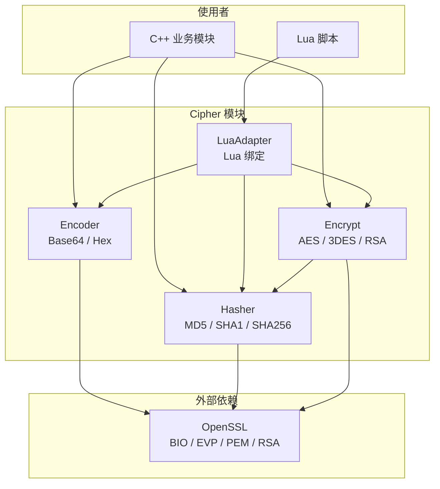
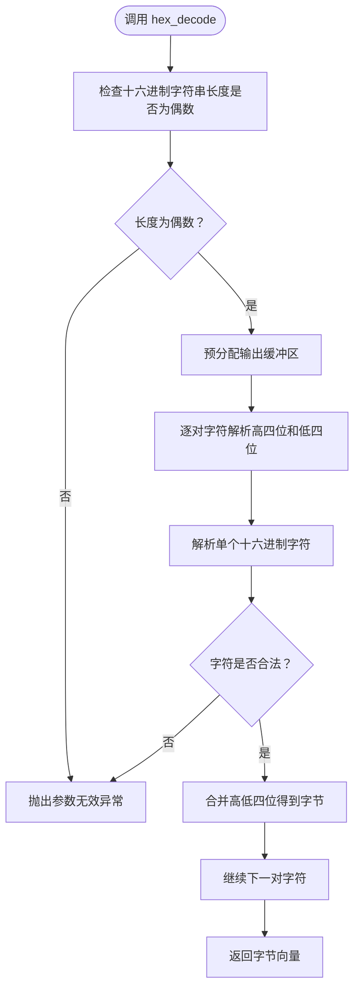
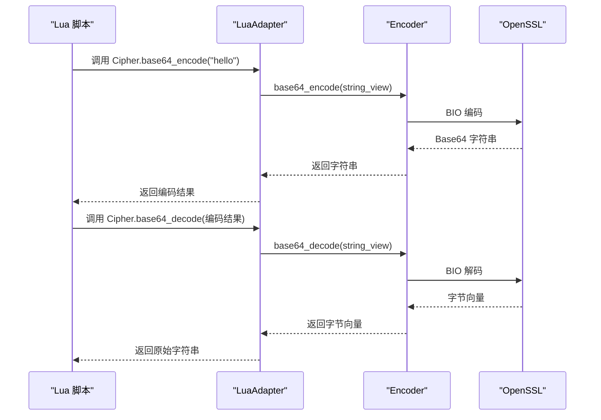

# 加密工具 API

<cite>
**本文引用的文件**   
- [encoder.hpp](file://cipher/encoder.hpp)
- [encoder.cpp](file://cipher/encoder.cpp)
- [LuaAdapter.hpp](file://cipher/LuaAdapter.hpp)
- [LuaAdapter.cpp](file://cipher/LuaAdapter.cpp)
- [encrypt.hpp](file://cipher/encrypt.hpp)
- [encrypt.cpp](file://cipher/encrypt.cpp)
- [hasher.hpp](file://cipher/hasher.hpp)
- [hasher.cpp](file://cipher/hasher.cpp)
- [cipher_test.cpp](file://tests/Cipher/cipher_test.cpp)
- [cipher_lua_adapter_test.cpp](file://tests/Cipher/cipher_lua_adapter_test.cpp)
</cite>

## 目录
1. [项目概述与快速开始](#项目概述与快速开始)
2. [架构总览](#架构总览)
3. [核心概念](#核心概念)
4. [核心模块详解](#核心模块详解)
5. [高级主题](#高级主题)
6. [Lua 脚本系统](#lua-脚本系统)
7. [API 参考文档](#api-参考文档)
8. [集成指南](#集成指南)
9. [开发·测试与贡献](#开发测试与贡献)
10. [扩展开发指南](#扩展开发指南)
11. [示例与教程](#示例与教程)
12. [部署·故障排除与FAQ](#部署故障排除与faq)
13. [附录](#附录)

## 项目概述与快速开始
HsBaSlicer 的 Cipher 模块提供三类能力：
- 编码转换：Base64 与十六进制编码、解码。
- 数据加密：AES-256、3DES、RSA，支持密码派生密钥、显式 IV、PEM 公钥/私钥。
- 哈希摘要：MD5、SHA1、SHA256，返回十六进制摘要字符串。

本页面聚焦 **Cipher 模块中的编码工具**，重点说明 `base64_encode`、`base64_decode`、`hex_encode`、`hex_decode` 的使用方法、编码格式特点、性能考虑、流水线最佳实践，以及与其它模块交换数据时的编码注意事项。

### 快速上手
- C++ 调用：通过 `HsBa::Slicer::Cipher::Encoder` 类直接操作字节向量或字符串视图。
- Lua 调用：在 Lua 中通过全局表 `Cipher.base64_encode`、`Cipher.base64_decode`、`Cipher.hex_encode`、`Cipher.hex_decode` 使用。
- 典型场景：将二进制数据（如加密密文、模型片段、日志快照）转换为可安全传输或存储的文本格式。

**章节来源**
- [encoder.hpp:11-55](file://cipher/encoder.hpp#L11-L55)
- [LuaAdapter.cpp:85-96](file://cipher/LuaAdapter.cpp#L85-L96)

## 架构总览
Cipher 模块采用“无状态工具类 + OpenSSL 后端”的结构：
- `Encoder`：纯编码/解码工具，不持有状态。
- `Hasher`：基于 OpenSSL EVP 的哈希工具，返回十六进制摘要。
- `Encrypt`：对称与非对称加密工具，内部依赖 `Hasher` 做密码派生。
- `LuaAdapter`：将 `Encoder`、`Hasher`、`Encrypt` 暴露给 Lua 脚本。

**图表来源**
- [encoder.hpp:11-55](file://cipher/encoder.hpp#L11-L55)
- [hasher.hpp:11-42](file://cipher/hasher.hpp#L11-L42)
- [encrypt.hpp:10-79](file://cipher/encrypt.hpp#L10-L79)
- [LuaAdapter.hpp:11-15](file://cipher/LuaAdapter.hpp#L11-L15)

**章节来源**
- [encoder.hpp:11-55](file://cipher/encoder.hpp#L11-L55)
- [hasher.hpp:11-42](file://cipher/hasher.hpp#L11-L42)
- [encrypt.hpp:10-79](file://cipher/encrypt.hpp#L10-L79)
- [LuaAdapter.hpp:11-15](file://cipher/LuaAdapter.hpp#L11-L15)

## 核心概念
- Base64：将任意二进制数据映射为 ASCII 字符集，适合在网络协议、JSON、配置文件等文本环境中传输。
- 十六进制：将每个字节映射为两个十六进制字符，便于人类阅读和调试，常用于日志、校验、序列化。
- 编码 vs 加密：编码不是加密；Base64 和十六进制不提供机密性，仅改变表示形式。
- 字节流语义：所有编码函数以字节为单位处理数据，不应假设输入是 UTF-8 文本。

**章节来源**
- [encoder.hpp:14-51](file://cipher/encoder.hpp#L14-L51)
- [encoder.cpp:44-142](file://cipher/encoder.cpp#L44-L142)

## 核心模块详解

### Encoder：Base64 与十六进制编码工具
`Encoder` 是无状态的静态工具类，提供以下能力：
- Base64 编码：`base64_encode(vector)`、`base64_encode(string_view)`。
- Base64 解码：`base64_decode(string_view)`、`base64_decode_to_string(string_view)`。
- 十六进制编码：`hex_encode(vector)`、`hex_encode(string_view)`。
- 十六进制解码：`hex_decode(string_view)`、`hex_decode_to_string(string_view)`。

#### 接口概览
| 方法 | 输入 | 输出 | 行为说明 |
|---|---|---|---|
| `base64_encode` | 字节向量或字符串视图 | Base64 字符串 | 使用 OpenSSL BIO 进行 Base64 编码，默认不换行 |
| `base64_decode` | Base64 字符串 | 字节向量 | 解码后返回原始字节序列 |
| `base64_decode_to_string` | Base64 字符串 | 字符串 | 先解码为字节向量，再构造字符串 |
| `hex_encode` | 字节向量或字符串视图 | 十六进制字符串 | 小写十六进制，每字节两位 |
| `hex_decode` | 十六进制字符串 | 字节向量 | 要求长度为偶数，非法字符抛出异常 |
| `hex_decode_to_string` | 十六进制字符串 | 字符串 | 先解码为字节向量，再构造字符串 |

#### 实现要点
- Base64 使用 OpenSSL 的 `BIO_f_base64()`，并设置 `BIO_FLAGS_BASE64_NO_NL`，确保输出不含换行符。
- 空输入是合法情况：Base64 编码空数据返回空字符串；Base64 解码空字符串返回空字节向量。
- 十六进制编码使用固定小写字母表，时间复杂度为 O(n)，空间复杂度为 O(n)。
- 十六进制解码会检查长度是否为偶数，并对非法字符抛出异常。

**图表来源**
- [encoder.cpp:127-142](file://cipher/encoder.cpp#L127-L142)
- [encoder.cpp:26-41](file://cipher/encoder.cpp#L26-L41)

**章节来源**
- [encoder.hpp:14-51](file://cipher/encoder.hpp#L14-L51)
- [encoder.cpp:44-142](file://cipher/encoder.cpp#L44-L142)

### Hasher：哈希摘要工具
`Hasher` 提供 MD5、SHA1、SHA256 的十六进制摘要计算，底层使用 OpenSSL EVP。虽然本页面重点是编码工具，但 `Hasher` 被 `Encrypt` 用于从密码派生密钥和初始化向量。

- 输入：字节向量或字符串视图。
- 输出：十六进制摘要字符串。
- 用途：密码派生、数据完整性校验、指纹生成。

**章节来源**
- [hasher.hpp:14-39](file://cipher/hasher.hpp#L14-L39)
- [hasher.cpp:20-76](file://cipher/hasher.cpp#L20-L76)

### Encrypt：数据加密工具
`Encrypt` 提供对称加密 AES-256、3DES 和非对称加密 RSA，支持：
- 密码派生密钥：内部使用 `Hasher::sha256_hex` 派生密钥和 IV。
- 显式 IV：CBC 模式需要正确长度的 IV。
- PEM 密钥：RSA 使用 PEM 格式的公钥/私钥。

虽然本页面重点是编码工具，但理解 `Encrypt` 有助于理解“编码 + 加密”的组合用法：通常先加密得到二进制密文，再用 Base64 或十六进制编码以便传输或存储。

**章节来源**
- [encrypt.hpp:12-76](file://cipher/encrypt.hpp#L12-L76)
- [encrypt.cpp:24-45](file://cipher/encrypt.cpp#L24-L45)
- [encrypt.cpp:60-660](file://cipher/encrypt.cpp#L60-L660)

## 高级主题

### Base64 与十六进制的性能对比
- Base64：
  - 编码体积膨胀约 33%。
  - 适合网络传输、JSON、配置等文本环境。
  - 实现使用 OpenSSL BIO，适合通用场景。
- 十六进制：
  - 编码体积膨胀 100%。
  - 更适合人类可读、调试、日志、校验。
  - 实现为线性扫描，常数开销较小。

### 编码选择建议
| 场景 | 推荐编码 | 理由 |
|---|---|---|
| JSON 字段中的二进制数据 | Base64 | 标准、广泛支持、体积适中 |
| 日志中的二进制片段 | 十六进制 | 人类可读、便于定位问题 |
| 跨语言序列化 | Base64 | 多数语言有标准库支持 |
| 调试与校验 | 十六进制 | 直观、易比对 |

### 编码与加密的组合
典型流程：
1. 明文 → 加密 → 二进制密文。
2. 二进制密文 → Base64 或十六进制 → 文本。
3. 接收方：文本 → 解码 → 二进制密文 → 解密 → 明文。

注意：编码不是加密，不要误以为 Base64 或十六进制能保护数据机密性。

**章节来源**
- [encoder.cpp:44-142](file://cipher/encoder.cpp#L44-L142)
- [encrypt.cpp:24-45](file://cipher/encrypt.cpp#L24-L45)

## Lua 脚本系统
Cipher 模块通过 `RegisterLuaCipher` 将编码函数注册到 Lua 全局表 `Cipher`：
- `Cipher.base64_encode`
- `Cipher.base64_decode`
- `Cipher.hex_encode`
- `Cipher.hex_decode`

Lua 绑定层负责：
- 从 Lua 字符串读取输入。
- 调用 C++ `Encoder` 方法。
- 将结果推回 Lua 字符串。
- 捕获 C++ 异常并转为 Lua 错误。

**图表来源**
- [LuaAdapter.cpp:13-47](file://cipher/LuaAdapter.cpp#L13-L47)
- [LuaAdapter.cpp:49-83](file://cipher/LuaAdapter.cpp#L49-L83)
- [encoder.cpp:44-112](file://cipher/encoder.cpp#L44-L112)

**章节来源**
- [LuaAdapter.hpp:11-15](file://cipher/LuaAdapter.hpp#L11-L15)
- [LuaAdapter.cpp:13-96](file://cipher/LuaAdapter.cpp#L13-L96)

## API 参考文档

### C++ Encoder API
| 方法 | 参数 | 返回值 | 说明 |
|---|---|---|---|
| `base64_encode` | `std::vector<unsigned char>` 或 `std::string_view` | `std::string` | Base64 编码 |
| `base64_decode` | `std::string_view` | `std::vector<unsigned char>` | Base64 解码 |
| `base64_decode_to_string` | `std::string_view` | `std::string` | Base64 解码为字符串 |
| `hex_encode` | `std::vector<unsigned char>` 或 `std::string_view` | `std::string` | 十六进制编码 |
| `hex_decode` | `std::string_view` | `std::vector<unsigned char>` | 十六进制解码 |
| `hex_decode_to_string` | `std::string_view` | `std::string` | 十六进制解码为字符串 |

**章节来源**
- [encoder.hpp:21-51](file://cipher/encoder.hpp#L21-L51)

### Lua Cipher API
| 函数 | 输入 | 输出 | 说明 |
|---|---|---|---|
| `Cipher.base64_encode` | 字符串 | 字符串 | Base64 编码 |
| `Cipher.base64_decode` | 字符串 | 字符串 | Base64 解码 |
| `Cipher.hex_encode` | 字符串 | 字符串 | 十六进制编码 |
| `Cipher.hex_decode` | 字符串 | 字符串 | 十六进制解码 |

**章节来源**
- [LuaAdapter.cpp:85-96](file://cipher/LuaAdapter.cpp#L85-L96)

## 集成指南

### 在 C++ 中使用编码工具
- 当需要从二进制数据生成可打印字符串时，优先选择 Base64。
- 当需要人类可读的二进制片段时，选择十六进制。
- 注意：解码后的结果可能是任意字节，不应直接当作 UTF-8 文本处理。

### 在 Lua 中使用编码工具
- 使用 `Cipher.base64_encode` 和 `Cipher.base64_decode` 处理文本化二进制数据。
- 使用 `Cipher.hex_encode` 和 `Cipher.hex_decode` 处理调试或校验场景。
- 捕获 Lua 错误：非法十六进制字符会导致解码失败。

### 在流水线中使用加密数据的最佳实践
1. 明确数据边界：编码前后都要记录原始长度，避免截断。
2. 统一编码格式：同一流水线内尽量保持编码格式一致。
3. 分离关注点：编码只负责表示转换，加密负责机密性。
4. 错误处理：解码失败时应视为数据损坏或传输错误。
5. 日志脱敏：不要在日志中输出完整 Base64 或十六进制密文。

### 与其他模块的数据交换注意事项
- 如果下游模块期望 UTF-8 文本，请先确认解码后的字节确实是 UTF-8。
- 如果下游模块期望二进制，应直接传递字节向量，不要经过 Base64 或十六进制。
- 如果通过 JSON 或配置文件传输，优先使用 Base64。
- 如果通过日志或调试接口传输，优先使用十六进制。

**章节来源**
- [encoder.cpp:44-142](file://cipher/encoder.cpp#L44-L142)
- [LuaAdapter.cpp:13-83](file://cipher/LuaAdapter.cpp#L13-L83)

## 开发·测试与贡献

### 单元测试覆盖
- `cipher_test.cpp` 验证编码器往返、AES、3DES、RSA、哈希等核心功能。
- `cipher_lua_adapter_test.cpp` 验证 Lua 绑定的 Base64 与十六进制编码解码，以及错误路径。

关键测试用例：
- Base64 与十六进制往返。
- Lua 中 `Cipher.base64_encode`、`Cipher.base64_decode`、`Cipher.hex_encode`、`Cipher.hex_decode`。
- 空输入边界情况。
- 非法十六进制字符触发 Lua 错误。

**章节来源**
- [cipher_test.cpp:68-80](file://tests/Cipher/cipher_test.cpp#L68-L80)
- [cipher_test.cpp:202-226](file://tests/Cipher/cipher_test.cpp#L202-L226)
- [cipher_lua_adapter_test.cpp:66-127](file://tests/Cipher/cipher_lua_adapter_test.cpp#L66-L127)

## 扩展开发指南
如需扩展编码能力：
- 新增编码类型时，建议在 `Encoder` 中增加静态方法，保持无状态设计。
- 若需暴露给 Lua，应在 `LuaAdapter` 中新增绑定函数，并加入 `cipherLib` 注册表。
- 新增方法应补充单元测试，覆盖正常路径、空输入、非法输入。

**章节来源**
- [encoder.hpp:18-52](file://cipher/encoder.hpp#L18-L52)
- [LuaAdapter.cpp:85-96](file://cipher/LuaAdapter.cpp#L85-L96)

## 示例与教程

### 示例一：Base64 编码与解码
- 输入：原始字节数据。
- 步骤：调用 `Encoder::base64_encode` 得到 Base64 字符串；调用 `Encoder::base64_decode` 恢复原始字节。
- 适用场景：将二进制数据放入 JSON、URL、配置文件。

**章节来源**
- [cipher_test.cpp:68-80](file://tests/Cipher/cipher_test.cpp#L68-L80)

### 示例二：十六进制编码与解码
- 输入：原始字节数据。
- 步骤：调用 `Encoder::hex_encode` 得到十六进制字符串；调用 `Encoder::hex_decode` 恢复原始字节。
- 适用场景：日志、调试、校验。

**章节来源**
- [cipher_test.cpp:68-80](file://tests/Cipher/cipher_test.cpp#L68-L80)

### 示例三：Lua 中编码与解码
- 在 Lua 中调用 `Cipher.base64_encode` 和 `Cipher.base64_decode`。
- 在 Lua 中调用 `Cipher.hex_encode` 和 `Cipher.hex_decode`。
- 注意：非法十六进制字符会触发 Lua 错误。

**章节来源**
- [cipher_lua_adapter_test.cpp:66-127](file://tests/Cipher/cipher_lua_adapter_test.cpp#L66-L127)

## 部署·故障排除与FAQ

### 常见问题
- 为什么 Base64 解码后不是预期文本？  
  因为 Base64 解码返回的是原始字节，不一定是 UTF-8 文本。
- 为什么十六进制解码报错？  
  十六进制字符串长度必须为偶数，且只能包含合法十六进制字符。
- Base64 和十六进制哪个更安全？  
  两者都不是加密算法，都不具备机密性；安全性取决于是否配合真正的加密算法。
- 能否在流水线中混用 Base64 和十六进制？  
  可以，但应明确标注格式，避免接收方误解。

### 错误处理建议
- 解码失败时，应记录原始输入长度和格式标识。
- 对于十六进制解码，优先检查长度奇偶性和字符合法性。
- 对于 Base64 解码，优先检查输入是否包含非 Base64 字符或换行符。

**章节来源**
- [encoder.cpp:127-142](file://cipher/encoder.cpp#L127-L142)
- [LuaAdapter.cpp:49-83](file://cipher/LuaAdapter.cpp#L49-L83)

## 附录

### 编码体积对比
| 原始字节数 | Base64 近似长度 | 十六进制长度 |
|---|---|---|
| 3 | 4 | 6 |
| 4 | 8 | 8 |
| 16 | 24 | 32 |
| 100 | 136 | 200 |

### 推荐实践清单
- 明确数据是文本还是二进制。
- 文本传输优先 Base64。
- 调试日志优先十六进制。
- 编码前不假设字符编码。
- 编码后不假设内容语义。
- 解码失败视为数据异常。
- 不在日志中输出完整密文。

**章节来源**
- [encoder.cpp:44-142](file://cipher/encoder.cpp#L44-L142)