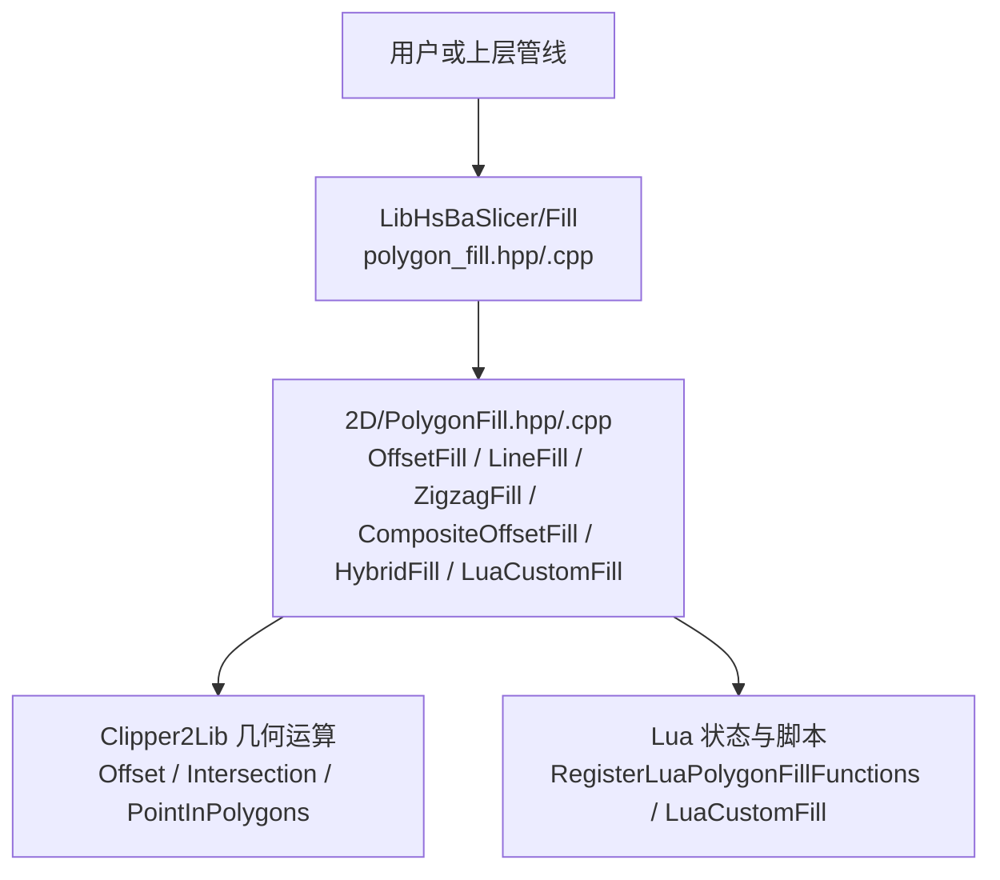
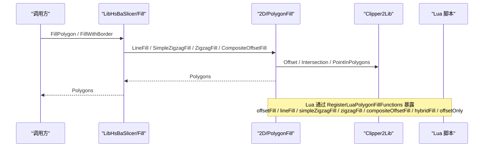
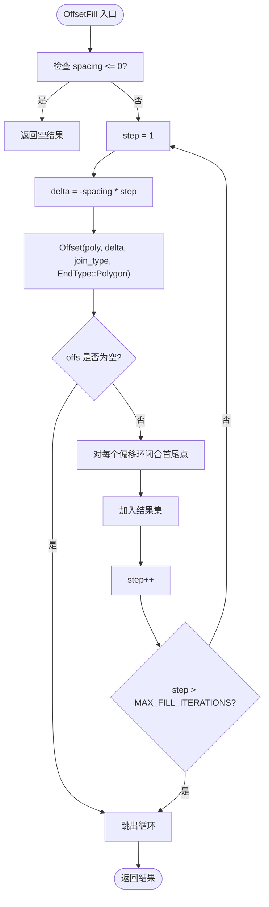
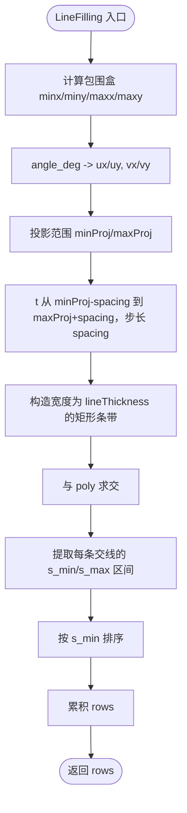
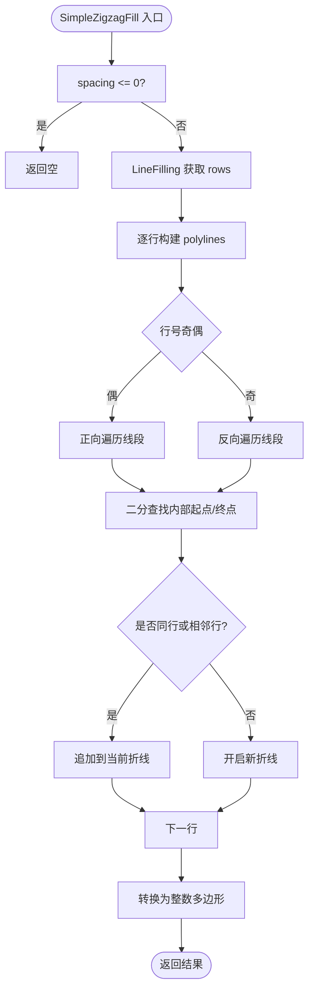
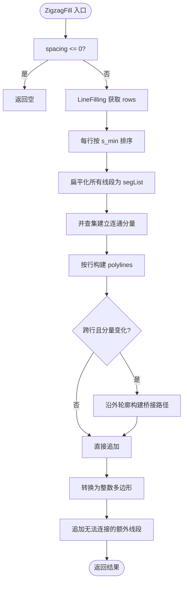
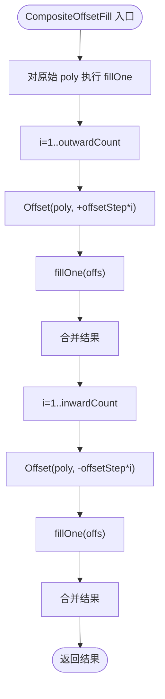
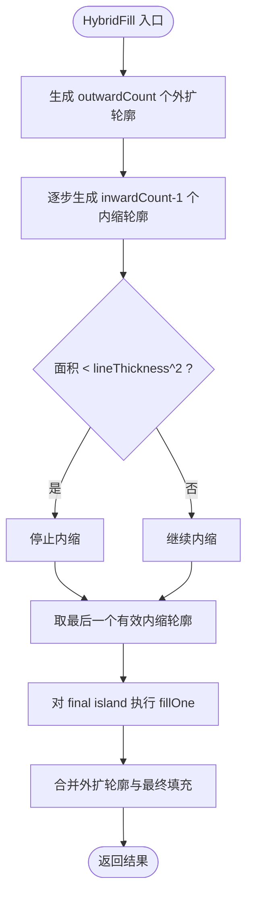
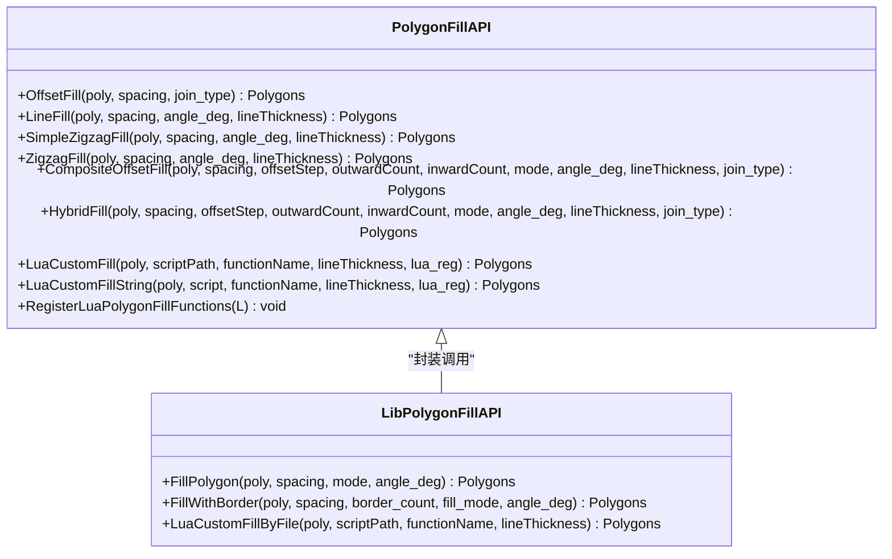
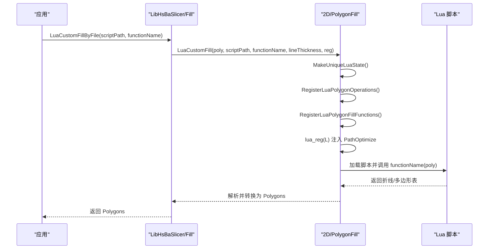

# 填充算法 API

<cite>
**本文引用的文件**   
- [2D/PolygonFill.hpp](file://2D/PolygonFill.hpp)
- [2D/PolygonFill.cpp](file://2D/PolygonFill.cpp)
- [LibHsBaSlicer/Fill/polygon_fill.hpp](file://LibHsBaSlicer/Fill/polygon_fill.hpp)
- [LibHsBaSlicer/Fill/polygon_fill.cpp](file://LibHsBaSlicer/Fill/polygon_fill.cpp)
- [tests/PolygonFill/polygon_fill_test.cpp](file://tests/PolygonFill/polygon_fill_test.cpp)
</cite>

## 目录
1. [引言](#引言)
2. [项目结构](#项目结构)
3. [核心组件](#核心组件)
4. [架构总览](#架构总览)
5. [详细组件分析](#详细组件分析)
6. [依赖关系分析](#依赖关系分析)
7. [性能与参数影响](#性能与参数影响)
8. [自定义填充开发指南](#自定义填充开发指南)
9. [故障排除](#故障排除)
10. [结论](#结论)

## 引言
本文面向 HsBaSlicer 的 PolygonFill 填充系统，系统性说明以下能力：
- 各种填充模式：offsetFill、lineFill、simpleZigzagFill、zigzagFill、compositeOffsetFill、hybridFill、offsetOnly。
- 关键参数：填充间距 spacing、角度 angle_deg、线宽 lineThickness、偏移步长 offsetStep、外扩/内缩层数 outwardCount/inwardCount、角点连接方式 join_type。
- 不同模式的视觉效果、适用场景和性能特征。
- 基于源码的自定义填充开发与集成方法，包括 Lua 脚本扩展与 LibHsBaSlicer C++ 封装调用。

本说明以 2D/PolygonFill.* 为核心实现，LibHsBaSlicer/Fill/* 为对外 C++ API 包装，测试用例提供行为约束与边界条件验证依据。

## 项目结构
PolygonFill 相关代码主要分布在两个层次：
- 2D 几何填充引擎：2D/PolygonFill.hpp 与 2D/PolygonFill.cpp，提供 OffsetFill、LineFill、SimpleZigzagFill、ZigzagFill、CompositeOffsetFill、HybridFill、LuaCustomFill 等函数，以及向 Lua 暴露的 PolygonFill.* 绑定。
- LibHsBaSlicer 封装层：LibHsBaSlicer/Fill/polygon_fill.hpp 与 polygon_fill.cpp，提供 FillPolygon、FillWithBorder、LuaCustomFillByFile 等更高层 API，并复用 2D 填充引擎。

**图示来源**
- [2D/PolygonFill.hpp:20-136](file://2D/PolygonFill.hpp#L20-L136)
- [LibHsBaSlicer/Fill/polygon_fill.hpp:17-53](file://LibHsBaSlicer/Fill/polygon_fill.hpp#L17-L53)

**章节来源**
- [2D/PolygonFill.hpp:20-136](file://2D/PolygonFill.hpp#L20-L136)
- [LibHsBaSlicer/Fill/polygon_fill.hpp:17-53](file://LibHsBaSlicer/Fill/polygon_fill.hpp#L17-L53)

## 核心组件
- 基础填充模式枚举 FillMode：Line、SimpleZigzag、Zigzag。
- 核心填充函数：
  - OffsetFill：向内嵌套闭合环，直到多边形消失。
  - LineFill：生成独立直线段（每段两个顶点）。
  - SimpleZigzagFill：按扫描行交替方向连接线段，形成简单蛇形路径。
  - ZigzagFill：改进版锯齿填充，支持连通分量识别、桥接、沿轮廓绕行。
  - CompositeOffsetFill：先对原始区域填充，再对向外/向内偏移的多边形分别填充。
  - HybridFill：先生成若干外扩和内缩轮廓，最后仅对最内层有效岛屿进行填充。
  - OffsetOnly：纯偏移层输出，返回结果同时附带最终内/外偏移结果供 Lua 使用。
- Lua 绑定：offsetFill、lineFill、simpleZigzagFill、zigzagFill、compositeOffsetFill、hybridFill、offsetOnly。
- LibHsBaSlicer 封装：FillPolygon、FillWithBorder、LuaCustomFillByFile。

**章节来源**
- [2D/PolygonFill.hpp:20-136](file://2D/PolygonFill.hpp#L20-L136)
- [2D/PolygonFill.cpp:504-541](file://2D/PolygonFill.cpp#L504-L541)
- [2D/PolygonFill.cpp:543-564](file://2D/PolygonFill.cpp#L543-L564)
- [2D/PolygonFill.cpp:566-800](file://2D/PolygonFill.cpp#L566-L800)
- [2D/PolygonFill.cpp:803-1370](file://2D/PolygonFill.cpp#L803-L1370)
- [2D/PolygonFill.cpp:1372-1428](file://2D/PolygonFill.cpp#L1372-L1428)
- [2D/PolygonFill.cpp:1430-1491](file://2D/PolygonFill.cpp#L1430-L1491)
- [2D/PolygonFill.cpp:434-486](file://2D/PolygonFill.cpp#L434-L486)
- [LibHsBaSlicer/Fill/polygon_fill.hpp:17-53](file://LibHsBaSlicer/Fill/polygon_fill.hpp#L17-L53)
- [LibHsBaSlicer/Fill/polygon_fill.cpp:13-49](file://LibHsBaSlicer/Fill/polygon_fill.cpp#L13-L49)

## 架构总览
PolygonFill 的调用链从 LibHsBaSlicer 封装层进入 2D 填充引擎，再由 Lua 绑定暴露给脚本层。

**图示来源**
- [LibHsBaSlicer/Fill/polygon_fill.cpp:13-49](file://LibHsBaSlicer/Fill/polygon_fill.cpp#L13-L49)
- [2D/PolygonFill.cpp:488-502](file://2D/PolygonFill.cpp#L488-L502)
- [2D/PolygonFill.cpp:504-541](file://2D/PolygonFill.cpp#L504-L541)
- [2D/PolygonFill.cpp:543-564](file://2D/PolygonFill.cpp#L543-L564)
- [2D/PolygonFill.cpp:566-800](file://2D/PolygonFill.cpp#L566-L800)
- [2D/PolygonFill.cpp:803-1370](file://2D/PolygonFill.cpp#L803-L1370)
- [2D/PolygonFill.cpp:1372-1428](file://2D/PolygonFill.cpp#L1372-L1428)
- [2D/PolygonFill.cpp:1430-1491](file://2D/PolygonFill.cpp#L1430-L1491)

## 详细组件分析

### 偏移填充：OffsetFill 与 offsetOnly
- OffsetFill：按固定间距向内做多次 Offset，每次将偏移结果闭合后加入结果集；当偏移结果为空或达到最大迭代次数时停止。非正间距直接返回空结果。
- offsetOnly：纯偏移层输出，支持 inner/outer 层数控制，并在 Lua 侧额外返回最终内/外偏移结果，便于脚本进一步处理。

**图示来源**
- [2D/PolygonFill.cpp:504-541](file://2D/PolygonFill.cpp#L504-L541)

**章节来源**
- [2D/PolygonFill.cpp:504-541](file://2D/PolygonFill.cpp#L504-L541)
- [2D/PolygonFill.cpp:162-221](file://2D/PolygonFill.cpp#L162-L221)
- [2D/PolygonFill.cpp:434-486](file://2D/PolygonFill.cpp#L434-L486)
- [tests/PolygonFill/polygon_fill_test.cpp:177-200](file://tests/PolygonFill/polygon_fill_test.cpp#L177-L200)

### 平行线填充：LineFill
- 原理：计算扫描方向向量与法向量，按 spacing 步进生成矩形条带，与输入多边形求交得到多个线段区间；最终输出独立的直线段集合。
- 特点：适合快速生成稀疏平行线；不保证路径连通性。

**图示来源**
- [2D/PolygonFill.cpp:44-160](file://2D/PolygonFill.cpp#L44-L160)
- [2D/PolygonFill.cpp:543-564](file://2D/PolygonFill.cpp#L543-L564)

**章节来源**
- [2D/PolygonFill.cpp:44-160](file://2D/PolygonFill.cpp#L44-L160)
- [2D/PolygonFill.cpp:543-564](file://2D/PolygonFill.cpp#L543-L564)

### 简单锯齿填充：SimpleZigzagFill
- 原理：复用 LineFilling 的行扫描结果，按行奇偶方向交替遍历线段，仅在同行或相邻行之间连接，形成蛇形路径；使用二分查找确定线段在多边形内的起止点。
- 特点：比 LineFill 更紧凑，路径连通性较好；但复杂凹形区域的桥接能力有限。

**图示来源**
- [2D/PolygonFill.cpp:566-800](file://2D/PolygonFill.cpp#L566-L800)

**章节来源**
- [2D/PolygonFill.cpp:566-800](file://2D/PolygonFill.cpp#L566-L800)

### 高级锯齿填充：ZigzagFill
- 原理：
  - 对每行线段排序，扁平化为统一列表，并使用并查集根据区间重叠建立连通分量。
  - 按行顺序构建折线，仅允许同行或相邻行连接；若跨行且连通分量变化，尝试沿外轮廓绕行构建桥接路径。
  - 使用 point_inside 与二分查找裁剪线段端点到多边形内部；失败时回退为独立线段。
- 特点：更适合复杂凹形、孤岛或多连通域；桥接逻辑避免穿越空洞，提升路径质量。

**图示来源**
- [2D/PolygonFill.cpp:803-1370](file://2D/PolygonFill.cpp#L803-L1370)

**章节来源**
- [2D/PolygonFill.cpp:803-1370](file://2D/PolygonFill.cpp#L803-L1370)
- [tests/PolygonFill/polygon_fill_test.cpp:542-647](file://tests/PolygonFill/polygon_fill_test.cpp#L542-L647)

### 复合偏移填充：CompositeOffsetFill
- 原理：
  - 对原始多边形执行一次内部填充。
  - 对 outwardCount 次外扩偏移分别填充。
  - 对 inwardCount 次内缩偏移分别填充。
  - 所有结果合并输出。
- 适用场景：需要边框与内部填充组合，例如 SLA 层板的外围轮廓强化与内部支撑填充。

**图示来源**
- [2D/PolygonFill.cpp:1372-1428](file://2D/PolygonFill.cpp#L1372-L1428)

**章节来源**
- [2D/PolygonFill.cpp:1372-1428](file://2D/PolygonFill.cpp#L1372-L1428)

### 混合填充：HybridFill
- 原理：
  - 生成 outwardCount 个外扩轮廓并闭合。
  - 逐步生成 inwardCount-1 个内缩轮廓，遇到面积过小则停止。
  - 对最后一个有效内缩轮廓（island）执行内部填充。
- 特点：强调“先轮廓、后填充”，适合需要稳定外围边界且只在最内层区域进行密集填充的场景。

**图示来源**
- [2D/PolygonFill.cpp:1430-1491](file://2D/PolygonFill.cpp#L1430-L1491)

**章节来源**
- [2D/PolygonFill.cpp:1430-1491](file://2D/PolygonFill.cpp#L1430-L1491)

### Lua 绑定与脚本接口
- 注册函数：RegisterLuaPolygonFillFunctions 将 PolygonFill.* 暴露给 Lua。
- 支持的绑定：offsetFill、lineFill、simpleZigzagFill、zigzagFill、compositeOffsetFill、hybridFill、offsetOnly。
- 参数约定：
  - offsetFill：poly_table、spacing、可选 join_type。
  - lineFill/simpleZigzagFill/zigzagFill：poly_table、spacing、angle_deg、lineThickness。
  - compositeOffsetFill/hybridFill：poly_table、spacing、offsetStep、outwardCount、inwardCount、mode、angle_deg、lineThickness、可选 join_type。
  - offsetOnly：poly_table、delta、inner、outer、可选 join_type；返回三个值：结果、最终内偏移、最终外偏移。

**章节来源**
- [2D/PolygonFill.cpp:231-486](file://2D/PolygonFill.cpp#L231-L486)
- [2D/PolygonFill.cpp:488-502](file://2D/PolygonFill.cpp#L488-L502)
- [tests/PolygonFill/polygon_fill_test.cpp:202-210](file://tests/PolygonFill/polygon_fill_test.cpp#L202-L210)

## 依赖关系分析
- 2D/PolygonFill.hpp 定义公共 API 与 FillMode 枚举。
- 2D/PolygonFill.cpp 实现具体算法，依赖 Clipper2Lib 进行几何运算，依赖 LuaAdapter 与 LuaNewObject 进行 Lua 数据转换。
- LibHsBaSlicer/Fill/polygon_fill.hpp/.cpp 提供高层 API，复用 2D 填充引擎，并注入 PathOptimize 等优化函数到 Lua 环境。

**图示来源**
- [2D/PolygonFill.hpp:20-136](file://2D/PolygonFill.hpp#L20-L136)
- [LibHsBaSlicer/Fill/polygon_fill.hpp:17-53](file://LibHsBaSlicer/Fill/polygon_fill.hpp#L17-L53)
- [LibHsBaSlicer/Fill/polygon_fill.cpp:13-49](file://LibHsBaSlicer/Fill/polygon_fill.cpp#L13-L49)

**章节来源**
- [2D/PolygonFill.hpp:20-136](file://2D/PolygonFill.hpp#L20-L136)
- [LibHsBaSlicer/Fill/polygon_fill.hpp:17-53](file://LibHsBaSlicer/Fill/polygon_fill.hpp#L17-L53)
- [LibHsBaSlicer/Fill/polygon_fill.cpp:13-49](file://LibHsBaSlicer/Fill/polygon_fill.cpp#L13-L49)

## 性能与参数影响
- 填充间距 spacing：
  - 越小，扫描行数越多，LineFilling 与 Zigzag/SimpleZigzag 的计算量越大；OffsetFill 的嵌套环数量也增加。
  - 过大可能导致填充不足，过小可能产生大量短路径，增加后续路径优化压力。
- 角度 angle_deg：
  - 改变扫描方向，影响与多边形边界的相交情况；极端角度可能使扫描效率下降。
- 线宽 lineThickness：
  - 影响 LineFilling 的矩形条带宽度；在 ZigzagFill 中用于桥接采样步长与最小面积阈值判断。
- 偏移步长 offsetStep：
  - 控制 Composite/Hybrid 偏移层的密度；步长过小会增加偏移次数与填充开销。
- 外扩/内缩层数 outwardCount/inwardCount：
  - 增大层数会显著增加偏移与填充次数；HybridFill 会在面积过小时提前终止。
- 角点连接方式 join_type：
  - Square/Bevel/Round/Miter 影响偏移角的形状；Round 通常更平滑但计算成本更高。

性能建议：
- 对于大面积平坦区域，优先使用 ZigzagFill 以获得更好的连通性与较少的断点。
- 对于需要边框强化的层板，使用 CompositeOffsetFill 或 LibHsBaSlicer 的 FillWithBorder。
- 对于仅需轮廓输出的场景，使用 HybridFill 或 offsetOnly。
- 合理设置 spacing 与 lineThickness，避免过度细分导致路径数量爆炸。

[本节为通用指导，不直接分析具体文件]

## 自定义填充开发指南
- 使用 Lua 脚本自定义填充：
  - 通过 LuaCustomFill 或 LuaCustomFillString 加载脚本，调用指定函数（默认 generate_fill），传入多边形表，返回多段折线或多边形表。
  - 脚本可访问 PolygonFill.* 内置函数与多边形操作函数；LibHsBaSlicer 封装还会注入 PathOptimize 优化函数。
- 集成步骤：
  - 编写脚本文件，实现 generate_fill(poly) 函数，返回折线或面片数组。
  - 调用 LibHsBaSlicer 的 LuaCustomFillByFile，传入脚本路径与函数名。
  - 如需在脚本中使用路径优化，确保通过 reg 回调注册 PathOptimize 函数（封装层已自动完成）。

**图示来源**
- [LibHsBaSlicer/Fill/polygon_fill.cpp:35-49](file://LibHsBaSlicer/Fill/polygon_fill.cpp#L35-L49)
- [2D/PolygonFill.cpp:1493-1585](file://2D/PolygonFill.cpp#L1493-L1585)
- [2D/PolygonFill.cpp:1587-1669](file://2D/PolygonFill.cpp#L1587-L1669)

**章节来源**
- [2D/PolygonFill.cpp:1493-1585](file://2D/PolygonFill.cpp#L1493-L1585)
- [2D/PolygonFill.cpp:1587-1669](file://2D/PolygonFill.cpp#L1587-L1669)
- [LibHsBaSlicer/Fill/polygon_fill.cpp:35-49](file://LibHsBaSlicer/Fill/polygon_fill.cpp#L35-L49)
- [tests/PolygonFill/polygon_fill_test.cpp:522-540](file://tests/PolygonFill/polygon_fill_test.cpp#L522-L540)

## 故障排除
常见问题与定位要点：
- OffsetFill 返回空：
  - 检查 spacing 是否为非正值；源码中对 spacing <= 0 直接返回空。
  - 参考测试用例确认行为。
- ZigzagFill 出现断点或异常顶点：
  - 检查 clamp_segment 回退逻辑与 extraLines 追加；测试覆盖凹形 U 型与多岛场景。
- Lua 脚本错误：
  - 检查脚本路径、函数名是否存在；确保返回值为表；关注 RuntimeError 抛出位置。
- JoinType 字符串无效：
  - 确保传递 Square/Bevel/Round/Miter 之一；否则可能使用默认 Square。

**章节来源**
- [2D/PolygonFill.cpp:504-541](file://2D/PolygonFill.cpp#L504-L541)
- [2D/PolygonFill.cpp:1157-1179](file://2D/PolygonFill.cpp#L1157-L1179)
- [2D/PolygonFill.cpp:1493-1585](file://2D/PolygonFill.cpp#L1493-L1585)
- [tests/PolygonFill/polygon_fill_test.cpp:177-200](file://tests/PolygonFill/polygon_fill_test.cpp#L177-L200)
- [tests/PolygonFill/polygon_fill_test.cpp:542-647](file://tests/PolygonFill/polygon_fill_test.cpp#L542-L647)

## 结论
HsBaSlicer 的 PolygonFill 提供了从基础偏移、平行线到高级锯齿填充的完整填充体系，并通过 Composite/Hybrid 组合模式满足边框与内部填充的多样化需求。Lua 脚本扩展机制允许用户在不修改 C++ 的情况下定制填充策略，并与路径优化模块无缝集成。在实际应用中，应根据模型几何特征、打印工艺与性能要求选择合适的填充模式与参数配置。

[本节为总结性内容，不直接分析具体文件]