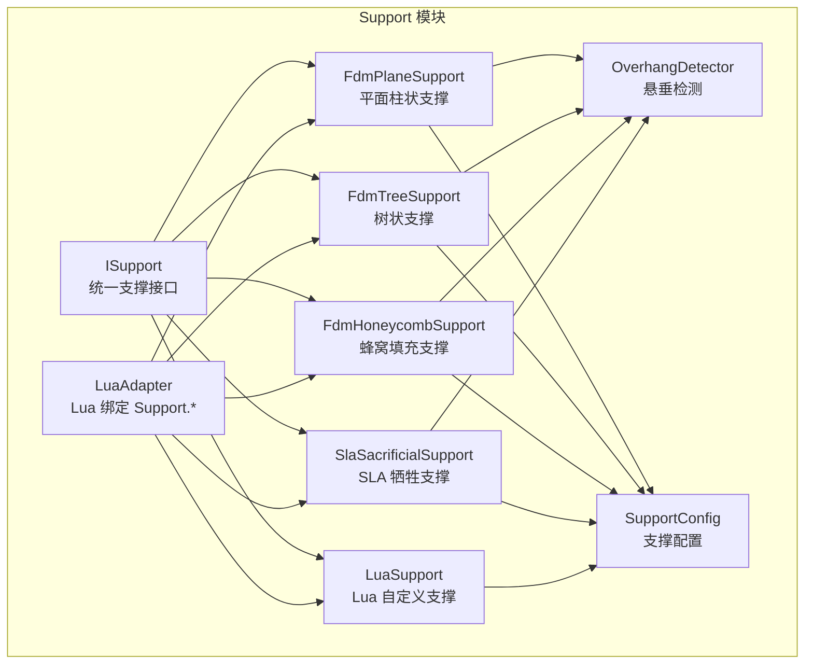
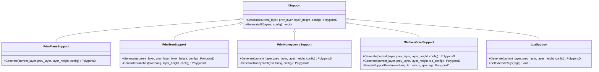
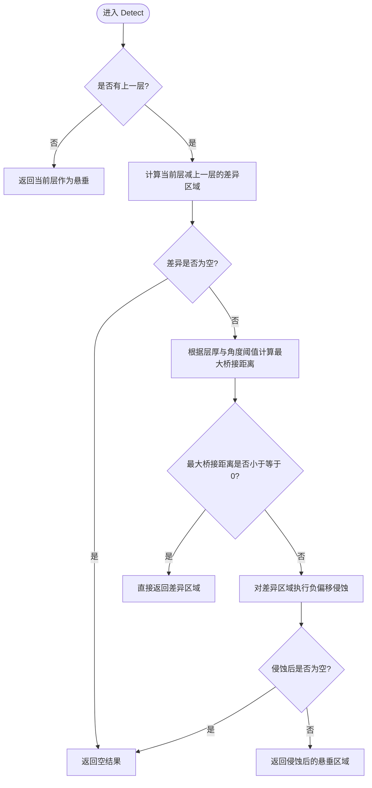
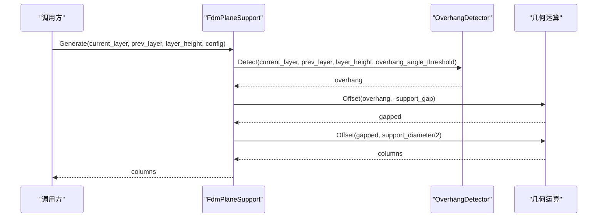
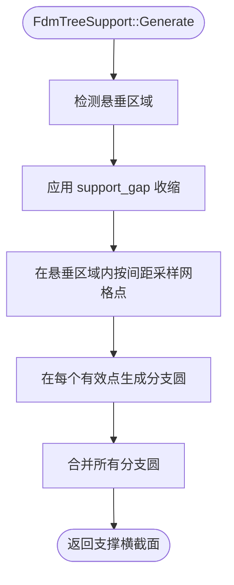
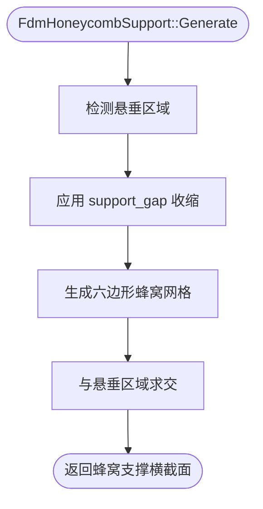
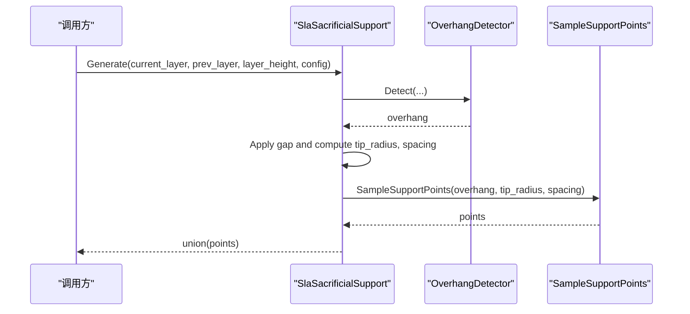
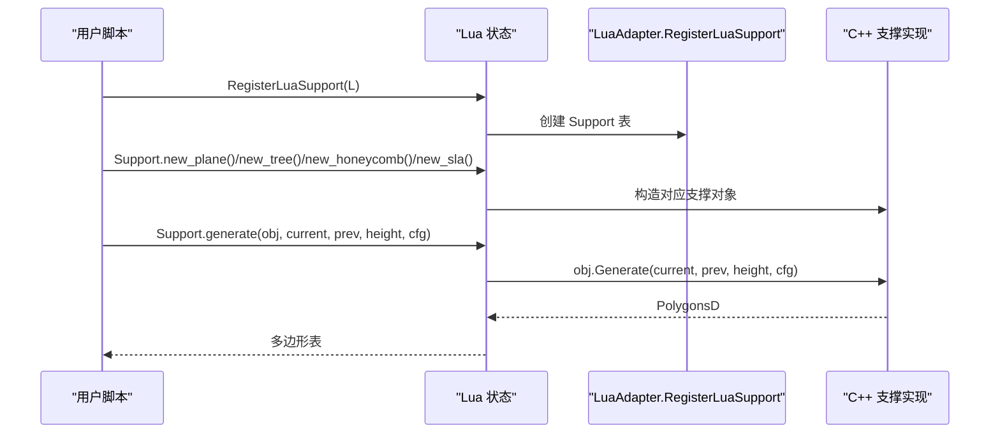
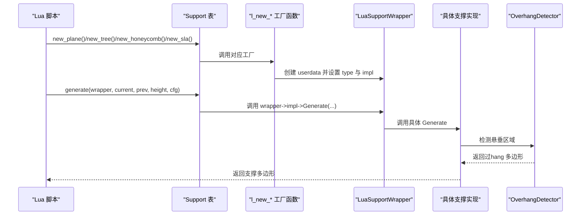
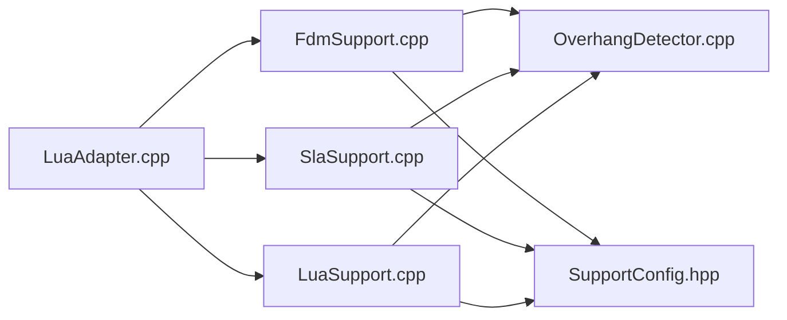

# 支撑生成 API

<cite>
**本文引用的文件**   
- [ISupport.hpp](file://support/ISupport.hpp)
- [FdmSupport.hpp](file://support/FdmSupport.hpp)
- [FdmSupport.cpp](file://support/FdmSupport.cpp)
- [SlaSupport.hpp](file://support/SlaSupport.hpp)
- [SlaSupport.cpp](file://support/SlaSupport.cpp)
- [LuaSupport.hpp](file://support/LuaSupport.hpp)
- [LuaSupport.cpp](file://support/LuaSupport.cpp)
- [OverhangDetector.hpp](file://support/OverhangDetector.hpp)
- [OverhangDetector.cpp](file://support/OverhangDetector.cpp)
- [SupportConfig.hpp](file://support/SupportConfig.hpp)
- [LuaAdapter.hpp](file://support/LuaAdapter.hpp)
- [LuaAdapter.cpp](file://support/LuaAdapter.cpp)
- [hsba_pipeline.d.lua](file://types/hsba_pipeline.d.lua)
- [support_test.cpp](file://tests\Support\support_test.cpp)
</cite>

## 目录
1. [引言](#引言)
2. [项目结构与定位](#项目结构与定位)
3. [核心概念与抽象接口](#核心概念与抽象接口)
4. [悬垂检测机制](#悬垂检测机制)
5. FDM 支撑类型
   - [平面柱状支撑 new_plane](#平面柱状支撑-new_plane)
   - [树状支撑 new_tree](#树状支撑-new_tree)
   - [蜂窝填充支撑 new_honeycomb](#蜂窝填充支撑-new_honeycomb)
6. SLA 牺牲支撑 new_sla
7. Lua 自定义支撑脚本开发指南
8. 支撑配置参数详解
9. 架构与调用流程
10. 依赖关系分析
11. 性能与优化建议
12. 故障排除
13. 结论
14. [附录：API 速查表](#附录api-速查表)

## 引言
本文件面向 HsBaSlicer 的 Support 模块，目标是完整说明 FDM 支撑（new_plane、new_tree、new_honeycomb）和 SLA 支撑（new_sla）的创建、使用方式，解释悬垂检测 detect_overhang 的行为，并给出支撑配置参数的含义、调整方法与不同支撑类型的效果对比和优化建议。文档同时提供 Lua 自定义支撑脚本的开发指南，帮助高级用户替换或扩展内置支撑算法。

## 项目结构与定位
Support 模块位于 support 目录，主要职责是：
- 定义支撑生成的统一抽象接口 ISupport。
- 实现 FDM 平面、树状、蜂窝三种支撑策略。
- 实现 SLA 牺牲支撑策略。
- 暴露 Lua 绑定 Support.new_plane / new_tree / new_honeycomb / new_sla / generate / detect_overhang / default_config。
- 提供 OverhangDetector 用于计算需要支撑的悬垂区域。
- 通过 SupportConfig 系列结构体集中管理支撑参数。

**图表来源**
- [ISupport.hpp:22-45](file://support/ISupport.hpp#L22-L45)
- [FdmSupport.hpp:19-63](file://support/FdmSupport.hpp#L19-L63)
- [SlaSupport.hpp:20-42](file://support/SlaSupport.hpp#L20-L42)
- [LuaSupport.hpp:40-81](file://support/LuaSupport.hpp#L40-L81)
- [OverhangDetector.hpp:20-50](file://support/OverhangDetector.hpp#L20-L50)
- [SupportConfig.hpp:14-43](file://support/SupportConfig.hpp#L14-L43)
- [LuaAdapter.hpp:13-30](file://support/LuaAdapter.hpp#L13-L30)

**章节来源**
- [ISupport.hpp:22-45](file://support/ISupport.hpp#L22-L45)
- [FdmSupport.hpp:19-63](file://support/FdmSupport.hpp#L19-L63)
- [SlaSupport.hpp:20-42](file://support/SlaSupport.hpp#L20-L42)
- [LuaSupport.hpp:40-81](file://support/LuaSupport.hpp#L40-L81)
- [OverhangDetector.hpp:20-50](file://support/OverhangDetector.hpp#L20-L50)
- [SupportConfig.hpp:14-43](file://support/SupportConfig.hpp#L14-L43)
- [LuaAdapter.hpp:13-30](file://support/LuaAdapter.hpp#L13-L30)

## 核心概念与抽象接口
ISupport 是所有支撑生成器的统一接口，核心方法如下：
- Generate(current_layer, prev_layer, layer_height, config)：对单层轮廓生成当前层的支撑横截面多边形。
- GenerateAll(layers, config)：默认实现按层迭代调用 Generate，返回每层支撑多边形集合。

该设计使 FDM、SLA、Lua 自定义支撑共享相同的输入输出契约，便于在切片管线中统一调度。

**图表来源**
- [ISupport.hpp:22-45](file://support/ISupport.hpp#L22-L45)
- [FdmSupport.hpp:19-63](file://support/FdmSupport.hpp#L19-L63)
- [SlaSupport.hpp:20-42](file://support/SlaSupport.hpp#L20-L42)
- [LuaSupport.hpp:40-81](file://support/LuaSupport.hpp#L40-L81)

**章节来源**
- [ISupport.hpp:22-45](file://support/ISupport.hpp#L22-L45)

## 悬垂检测机制
OverhangDetector 负责根据相邻两层轮廓计算需要支撑的区域。其关键逻辑包括：
- 若没有上一层，则当前层整体视为悬垂。
- 否则用当前层减去上一层得到差异区域。
- 根据层厚与悬垂角度阈值计算最大桥接距离。
- 对差异区域进行负偏移（侵蚀），过滤掉可桥接的小悬垂。
- 返回最终需要支撑的多边形区域。

**图表来源**
- [OverhangDetector.cpp:23-87](file://support/OverhangDetector.cpp#L23-L87)

**章节来源**
- [OverhangDetector.hpp:20-50](file://support/OverhangDetector.hpp#L20-L50)
- [OverhangDetector.cpp:23-87](file://support/OverhangDetector.cpp#L23-L87)

## FDM 支撑类型

### 平面柱状支撑 new_plane
FdmPlaneSupport 是最基础的 FDM 支撑策略：
- 先调用 OverhangDetector 检测悬垂区域。
- 应用 support_gap 将悬垂区域向内收缩，形成模型与支撑之间的间隙。
- 以 support_diameter 为直径对收缩后的区域膨胀，生成柱状支撑横截面。
- 返回合并后的圆形支撑点集合。

适用场景：简单悬垂、快速生成、支撑体积适中。

**图表来源**
- [FdmSupport.cpp:48-76](file://support/FdmSupport.cpp#L48-L76)
- [OverhangDetector.cpp:41-87](file://support/OverhangDetector.cpp#L41-L87)

**章节来源**
- [FdmSupport.hpp:19-24](file://support/FdmSupport.hpp#L19-L24)
- [FdmSupport.cpp:48-76](file://support/FdmSupport.cpp#L48-L76)

### 树状支撑 new_tree
FdmTreeSupport 生成树状分支支撑：
- 同样基于 OverhangDetector 检测悬垂。
- 应用 support_gap 收缩悬垂区域。
- 在悬垂区域内按间距采样网格点，并在每个有效点生成小圆作为分支尖端。
- 合并所有分支圆，形成树状支撑横截面。

适用场景：大悬垂面、减少支撑接触面积、便于后期去除。

**图表来源**
- [FdmSupport.cpp:81-168](file://support/FdmSupport.cpp#L81-L168)

**章节来源**
- [FdmSupport.hpp:26-44](file://support/FdmSupport.hpp#L26-L44)
- [FdmSupport.cpp:81-168](file://support/FdmSupport.cpp#L81-L168)

### 蜂窝填充支撑 new_honeycomb
FdmHoneycombSupport 在悬垂区域内填充六边形蜂窝图案：
- 检测悬垂并应用 support_gap。
- 根据 honeycomb_cell_size 生成平顶六边形网格。
- 将六边形网格与悬垂区域求交，得到蜂窝支撑横截面。

适用场景：需要轻量化但具有一定刚性的支撑，适合大面积悬垂。

**图表来源**
- [FdmSupport.cpp:173-267](file://support/FdmSupport.cpp#L173-L267)

**章节来源**
- [FdmSupport.hpp:46-63](file://support/FdmSupport.hpp#L46-L63)
- [FdmSupport.cpp:173-267](file://support/FdmSupport.cpp#L173-L267)

## SLA 牺牲支撑 new_sla
SlaSacrificialSupport 专为树脂打印设计：
- 检测悬垂并应用 support_gap。
- 使用 tip_diameter 作为支撑尖端直径，spacing 由 support_diameter * 2 决定。
- 在悬垂区域内采样支撑点，生成小圆并合并。
- 支持两种 Generate 重载：一个接受 SupportConfig，另一个接受 SlaSupportConfig。

适用场景：树脂打印中需要细小易去除的支撑点，底部接触面积较大以保证附着。

**图表来源**
- [SlaSupport.cpp:38-133](file://support/SlaSupport.cpp#L38-L133)

**章节来源**
- [SlaSupport.hpp:20-42](file://support/SlaSupport.hpp#L20-L42)
- [SlaSupport.cpp:38-133](file://support/SlaSupport.cpp#L38-L133)

## Lua 自定义支撑脚本开发指南
LuaSupport 允许用户通过 Lua 脚本完全替换内置支撑算法。脚本运行时可获得以下全局变量：
- current_layer：当前层多边形数组。
- prev_layer：上一层多边形数组。
- layer_height：层厚。
- config：包含 overhang_angle_threshold、layer_height、support_gap、support_diameter、support_density、support_pattern、tree_branch_angle、tree_max_branch_radius、honeycomb_cell_size 等字段。

脚本可以：
- 在主块中直接返回支撑多边形表。
- 定义函数 generate_support 或其他指定函数名，返回支撑多边形表。
- 使用 2D/LuaAdapter 提供的多边形操作辅助函数。
- 通过 SetExternalRegs 注入额外的 C++ 注册函数到 Lua 环境。

Lua 绑定 Support 表对外暴露：
- Support.new_plane()
- Support.new_tree()
- Support.new_honeycomb()
- Support.new_sla()
- Support.new_lua(script[, funcName])
- Support.new_lua_file(path, funcName)
- Support.generate(support_obj, current_layer, prev_layer, layer_height, config_table)
- Support.detect_overhang(current_layer, prev_layer, layer_height, angle)
- Support.default_config()

**图表来源**
- [LuaAdapter.cpp:110-144](file://support/LuaAdapter.cpp#L110-L144)
- [LuaAdapter.cpp:253-276](file://support/LuaAdapter.cpp#L253-L276)
- [LuaSupport.cpp:67-90](file://support/LuaSupport.cpp#L67-L90)
- [LuaSupport.cpp:113-178](file://support/LuaSupport.cpp#L113-L178)

**章节来源**
- [LuaSupport.hpp:21-81](file://support/LuaSupport.hpp#L21-L81)
- [LuaSupport.cpp:19-90](file://support/LuaSupport.cpp#L19-L90)
- [LuaSupport.cpp:113-178](file://support/LuaSupport.cpp#L113-L178)
- [LuaAdapter.hpp:13-30](file://support/LuaAdapter.hpp#L13-L30)
- [LuaAdapter.cpp:110-144](file://support/LuaAdapter.cpp#L110-L144)
- [LuaAdapter.cpp:253-276](file://support/LuaAdapter.cpp#L253-L276)
- [hsba_pipeline.d.lua:91-105](file://types/hsba_pipeline.d.lua#L91-L105)

## 支撑配置参数详解
SupportConfig 是所有支撑生成器共享的配置结构，默认值如下：
- overhang_angle_threshold：悬垂角度阈值，单位度，默认 45.0。
- layer_height：层厚，单位毫米，默认 0.2。
- support_gap：支撑与模型之间的间隙，单位毫米，默认 0.5。
- support_diameter：支撑柱直径，单位毫米，默认 2.0。
- support_density：支撑填充密度，范围 [0,1]，默认 0.3。
- support_pattern：支撑模式，0=Plane，1=Tree，2=Honeycomb。
- tree_branch_angle：树状支撑分支角度，单位度，默认 30.0。
- tree_max_branch_radius：树状支撑最大分支半径，单位毫米，默认 5.0。
- honeycomb_cell_size：蜂窝单元尺寸，单位毫米，默认 5.0。

FdmSupportConfig 继承 SupportConfig，新增：
- interface_layers：支撑与模型之间的界面层数，默认 2。
- interface_density：界面层填充密度，范围 [0,1]，默认 0.5。

SlaSupportConfig 继承 SupportConfig，新增：
- tip_diameter：支撑尖端直径，单位毫米，默认 0.3。
- raft_thickness：底板厚度，单位毫米，默认 0.5。

这些参数直接影响悬垂检测、支撑形状、支撑密度与可去除性。

**章节来源**
- [SupportConfig.hpp:14-43](file://support/SupportConfig.hpp#L14-L43)

## 架构与调用流程
从 Lua 脚本到 C++ 支撑实现的典型调用链如下：

**图表来源**
- [LuaAdapter.cpp:110-144](file://support/LuaAdapter.cpp#L110-L144)
- [LuaAdapter.cpp:253-276](file://support/LuaAdapter.cpp#L253-L276)
- [FdmSupport.cpp:48-76](file://support/FdmSupport.cpp#L48-L76)
- [FdmSupport.cpp:145-168](file://support/FdmSupport.cpp#L145-L168)
- [FdmSupport.cpp:244-267](file://support/FdmSupport.cpp#L244-L267)
- [SlaSupport.cpp:81-133](file://support/SlaSupport.cpp#L81-L133)
- [OverhangDetector.cpp:41-87](file://support/OverhangDetector.cpp#L41-L87)

**章节来源**
- [LuaAdapter.cpp:110-144](file://support/LuaAdapter.cpp#L110-L144)
- [LuaAdapter.cpp:253-276](file://support/LuaAdapter.cpp#L253-L276)

## 依赖关系分析
Support 模块内部依赖关系清晰：
- 所有支撑实现依赖 OverhangDetector 进行悬垂检测。
- 所有支撑实现依赖 SupportConfig 获取参数。
- LuaAdapter 将 C++ 支撑类暴露给 Lua 脚本，并提供 Support 表。
- LuaSupport 除了调用 C++ 支撑实现外，还负责 Lua 环境初始化、脚本加载与结果解析。

**图表来源**
- [LuaAdapter.cpp:110-144](file://support/LuaAdapter.cpp#L110-L144)
- [FdmSupport.cpp:48-76](file://support/FdmSupport.cpp#L48-L76)
- [SlaSupport.cpp:81-133](file://support/SlaSupport.cpp#L81-L133)
- [LuaSupport.cpp:113-178](file://support/LuaSupport.cpp#L113-L178)
- [OverhangDetector.cpp:41-87](file://support/OverhangDetector.cpp#L41-L87)
- [SupportConfig.hpp:14-43](file://support/SupportConfig.hpp#L14-L43)

**章节来源**
- [LuaAdapter.cpp:110-144](file://support/LuaAdapter.cpp#L110-L144)
- [FdmSupport.cpp:48-76](file://support/FdmSupport.cpp#L48-L76)
- [SlaSupport.cpp:81-133](file://support/SlaSupport.cpp#L81-L133)
- [LuaSupport.cpp:113-178](file://support/LuaSupport.cpp#L113-L178)
- [OverhangDetector.cpp:41-87](file://support/OverhangDetector.cpp#L41-L87)
- [SupportConfig.hpp:14-43](file://support/SupportConfig.hpp#L14-L43)

## 性能与优化建议
- 合理设置 overhang_angle_threshold：角度阈值越小，越容易触发悬垂检测；过大可能忽略必要支撑，过小会增加支撑体积。
- 调整 support_gap：增大间隙可减少支撑与模型粘连，但可能导致悬垂支撑不足；减小间隙可提高支撑强度，但增加去除难度。
- 调整 support_diameter：直径越大支撑越强，但材料消耗和去除成本上升。
- 调整 support_density：密度影响支撑填充程度，通常与支撑模式配合使用。
- 选择合适支撑模式：
  - Plane：简单稳定，适合中小悬垂。
  - Tree：减少接触面积，适合大悬垂面，易于去除。
  - Honeycomb：轻量且刚性较好，适合大面积悬垂。
- SLA 支撑 tip_diameter 要足够小以便去除，spacing 由 support_diameter 控制，避免支撑点过密导致树脂浪费。
- 对于复杂模型，优先使用 Tree 或 Honeycomb 以减少支撑体积，再结合 interface_layers 与 interface_density 提升界面质量。

[本节为通用指导，不直接分析具体源码文件]

## 故障排除
常见问题与排查方向：
- 未检测到悬垂：检查 prev_layer 是否为空；确认 layer_height 与 overhang_angle_threshold 设置是否合理；查看 MaxBridgeDistance 计算是否导致全部被过滤。
- 支撑为空：检查 support_gap 是否过大导致收缩后区域消失；确认 support_diameter 或 tip_diameter 是否过小。
- Lua 脚本错误：检查脚本语法、函数名是否正确；确认 current_layer、prev_layer、config 字段是否传递正确；查看 RuntimeError 中的错误信息。
- 测试用例验证：可通过 tests\Support\support_test.cpp 中的 register_and_drive_support_bindings 用例验证 Support 表与各个工厂函数、generate、detect_overhang 是否正常工作。

**章节来源**
- [OverhangDetector.cpp:23-87](file://support/OverhangDetector.cpp#L23-L87)
- [LuaSupport.cpp:113-178](file://support/LuaSupport.cpp#L113-L178)
- [support_test.cpp:362-385](file://tests\Support\support_test.cpp#L362-L385)

## 结论
HsBaSlicer 的 Support 模块提供了统一的支撑生成抽象接口，实现了 FDM 平面、树状、蜂窝支撑以及 SLA 牺牲支撑，并通过 Lua 绑定暴露 Support.new_plane / new_tree / new_honeycomb / new_sla / generate / detect_overhang / default_config。OverhangDetector 基于层厚与角度阈值计算悬垂区域，所有支撑实现均依赖该检测结果。通过合理调整支撑配置参数，用户可以在支撑强度、材料消耗与可去除性之间取得平衡。Lua 自定义支撑脚本为高级用户提供扩展能力，可在不修改 C++ 代码的情况下实现个性化支撑策略。

[本节为总结性内容，不直接分析具体源码文件]

## 附录：API 速查表
- Support.new_plane()：创建 FDM 平面柱状支撑对象。
- Support.new_tree()：创建 FDM 树状支撑对象。
- Support.new_honeycomb()：创建 FDM 蜂窝填充支撑对象。
- Support.new_sla()：创建 SLA 牺牲支撑对象。
- Support.new_lua(script[, funcName])：创建 Lua 自定义支撑对象。
- Support.new_lua_file(path, funcName)：从文件加载 Lua 自定义支撑对象。
- Support.generate(obj, current_layer, prev_layer, layer_height, config_table)：调用支撑对象的 Generate 方法，返回支撑多边形表。
- Support.detect_overhang(current_layer, prev_layer, layer_height, angle)：检测悬垂区域，返回多边形表。
- Support.default_config()：返回默认支撑配置表。

**章节来源**
- [LuaAdapter.hpp:13-30](file://support/LuaAdapter.hpp#L13-L30)
- [LuaAdapter.cpp:253-276](file://support/LuaAdapter.cpp#L253-L276)
- [hsba_pipeline.d.lua:91-105](file://types/hsba_pipeline.d.lua#L91-L105)