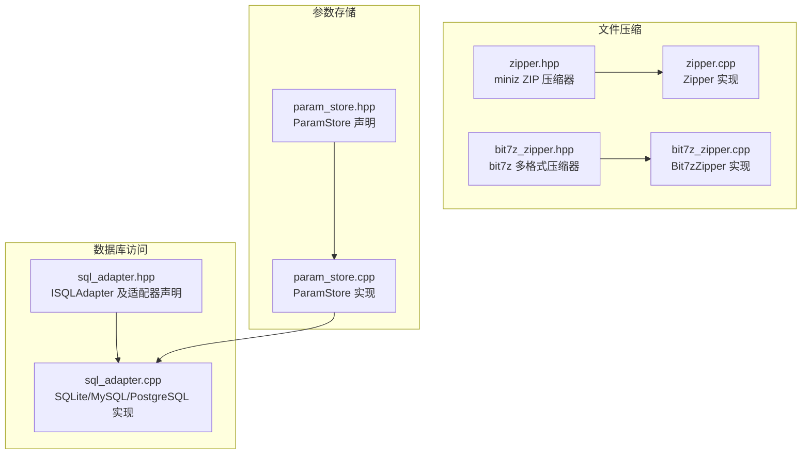
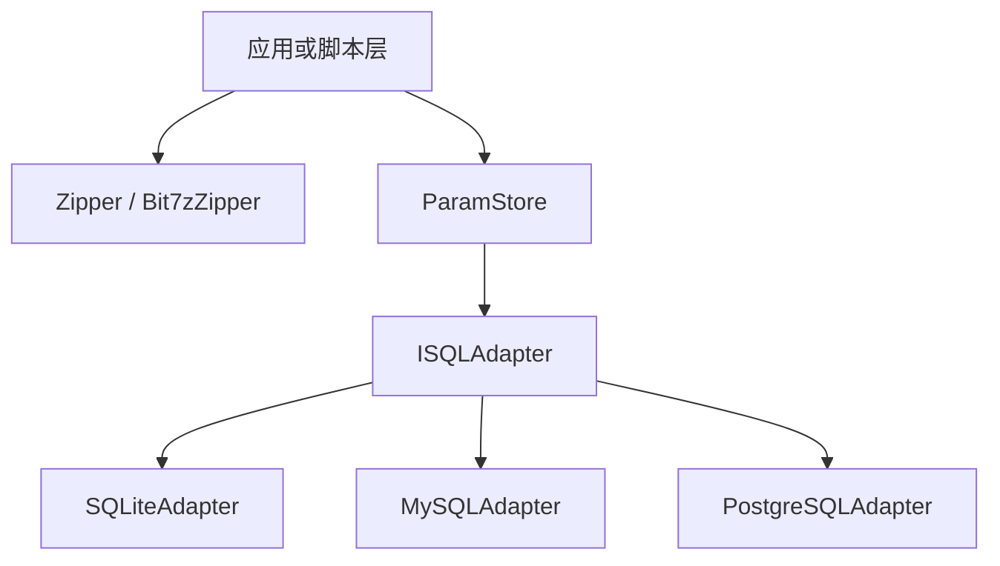
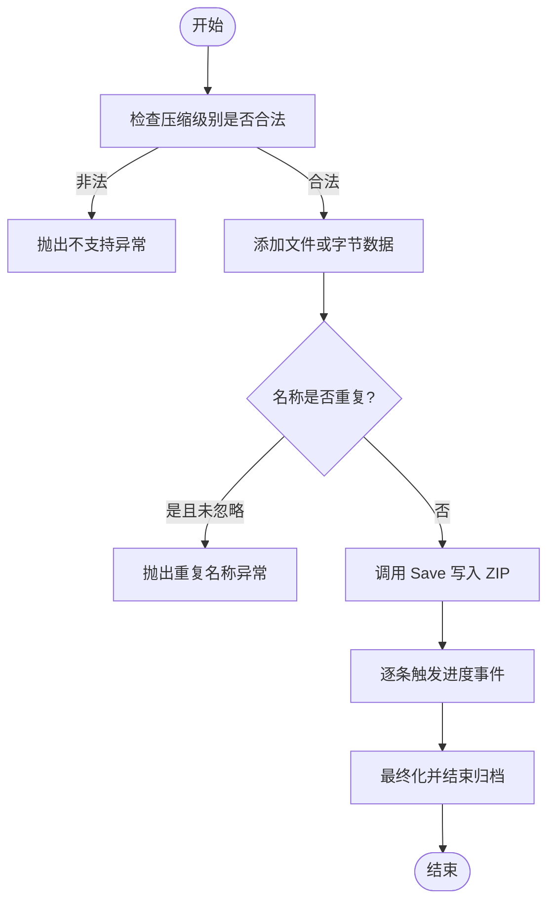
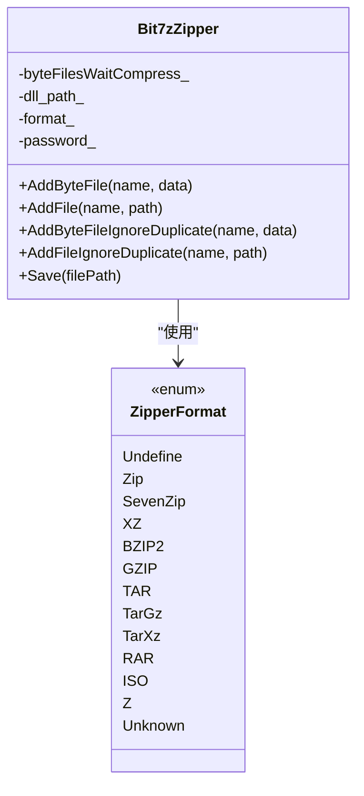
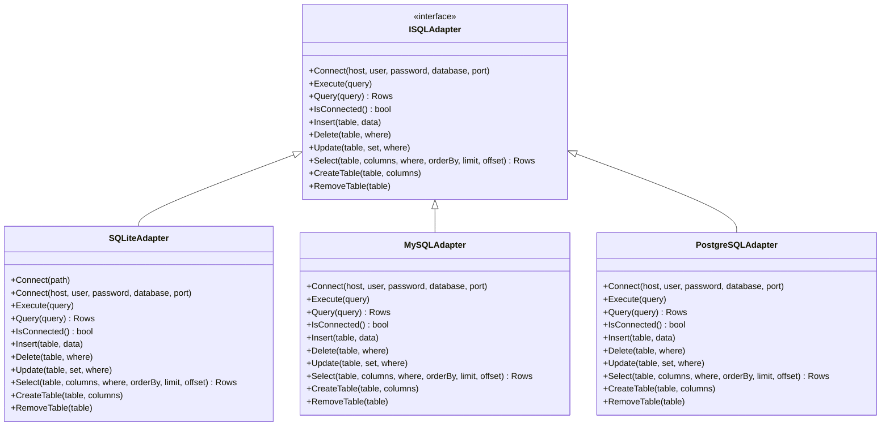
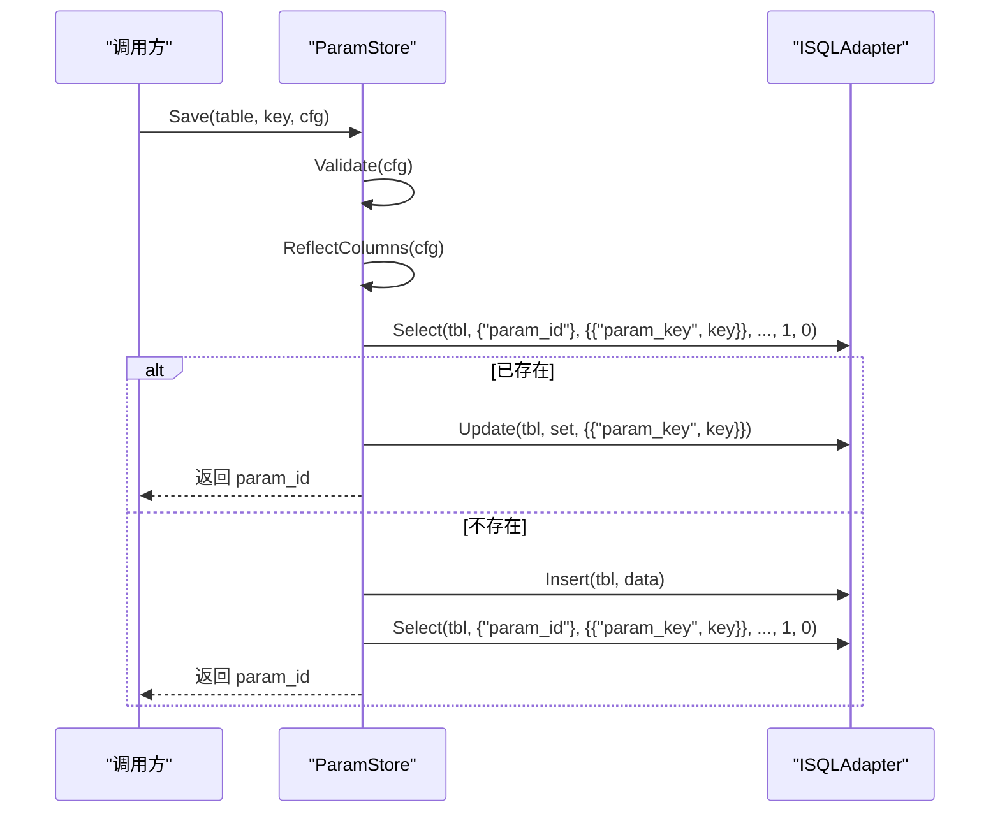
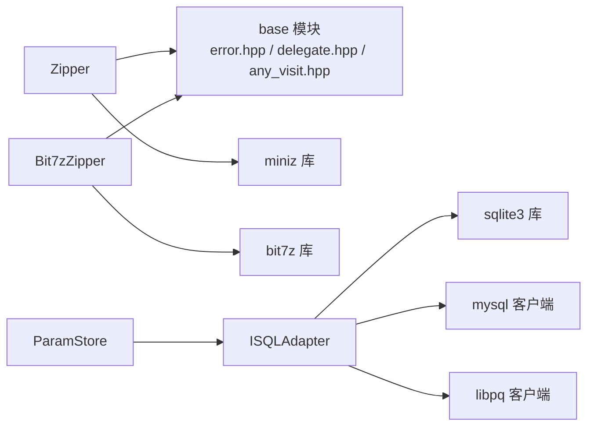

# 文件与数据库 API

<cite>
**本文引用的文件**   
- [zipper.hpp](file://fileoperator/zipper.hpp)
- [zipper.cpp](file://fileoperator/zipper.cpp)
- [bit7z_zipper.hpp](file://fileoperator/bit7z_zipper.hpp)
- [bit7z_zipper.cpp](file://fileoperator/bit7z_zipper.cpp)
- [sql_adapter.hpp](file://fileoperator/sql_adapter.hpp)
- [sql_adapter.cpp](file://fileoperator/sql_adapter.cpp)
- [param_store.hpp](file://fileoperator/param_store.hpp)
- [param_store.cpp](file://fileoperator/param_store.cpp)
</cite>

## 目录
1. [引言](#引言)
2. [项目结构](#项目结构)
3. [核心组件](#核心组件)
4. [架构总览](#架构总览)
5. [详细组件分析](#详细组件分析)
6. [依赖关系分析](#依赖关系分析)
7. [性能考虑](#性能考虑)
8. [故障排除指南](#故障排除指南)
9. [结论](#结论)

## 引言
本文件面向 HsBaSlicer 的文件与数据库操作 API，重点覆盖以下能力：
- 压缩包创建与管理：基于 miniz 的 Zipper 与基于 bit7z 的 Bit7zZipper，支持添加内存字节、磁盘文件、忽略重复名保存。
- 数据库适配器：ISQLAdapter 抽象接口及其 SQLiteAdapter、MySQLAdapter、PostgreSQLAdapter 实现，提供连接、查询、插入、更新、删除、建表、删表等统一 API。
- 参数存储：ParamStore 将任意 PipelineConfig 对象持久化到后端数据库，提供 EnsureSchema、Save、Load、List、Update、Delete 以及事务性批量保存。
- 错误处理、事务管理与性能优化建议贯穿各组件，帮助在 Lua 或 C++ 调用侧稳定使用。

## 项目结构
本节聚焦 fileoperator 模块中与压缩、SQL 适配器和参数存储相关的头文件与实现文件。

**图表来源**
- [zipper.hpp:1-104](file://fileoperator/zipper.hpp#L1-L104)
- [zipper.cpp:1-270](file://fileoperator/zipper.cpp#L1-L270)
- [bit7z_zipper.hpp:1-130](file://fileoperator/bit7z_zipper.hpp#L1-L130)
- [bit7z_zipper.cpp:1-303](file://fileoperator/bit7z_zipper.cpp#L1-L303)
- [sql_adapter.hpp:1-610](file://fileoperator/sql_adapter.hpp#L1-L610)
- [sql_adapter.cpp:1-800](file://fileoperator/sql_adapter.cpp#L1-L800)
- [param_store.hpp:1-109](file://fileoperator/param_store.hpp#L1-L109)
- [param_store.cpp:1-416](file://fileoperator/param_store.cpp#L1-L416)

**章节来源**
- [zipper.hpp:1-104](file://fileoperator/zipper.hpp#L1-L104)
- [bit7z_zipper.hpp:1-130](file://fileoperator/bit7z_zipper.hpp#L1-L130)
- [sql_adapter.hpp:1-610](file://fileoperator/sql_adapter.hpp#L1-L610)
- [param_store.hpp:1-109](file://fileoperator/param_store.hpp#L1-L109)

## 核心组件
- Zipper：基于 miniz 的 ZIP 压缩器，支持内存字节和磁盘文件添加，支持忽略重复名，输出进度事件。
- Bit7zZipper：基于 bit7z 的多格式压缩器，支持 Zip、SevenZip、XZ、BZIP2、GZIP、TAR、TarGz、TarXz 等格式，支持密码保护与两阶段打包 tar.gz/tar.xz。
- ISQLAdapter：统一的 SQL 适配器接口，定义 Connect、Execute、Query、Insert、Delete、Update、Select、CreateTable、RemoveTable 等方法。
- SQLiteAdapter、MySQLAdapter、PostgreSQLAdapter：分别对应 SQLite、MySQL、PostgreSQL 的具体实现，封装连接、语句执行、结果映射与线程安全。
- ParamStore：面向 PipelineConfig 的参数持久化层，负责校验、反射、类型转换、Upsert、批处理事务、迁移钩子与进度回调。

**章节来源**
- [zipper.hpp:20-87](file://fileoperator/zipper.hpp#L20-L87)
- [bit7z_zipper.hpp:48-126](file://fileoperator/bit7z_zipper.hpp#L48-L126)
- [sql_adapter.hpp:30-129](file://fileoperator/sql_adapter.hpp#L30-L129)
- [param_store.hpp:30-105](file://fileoperator/param_store.hpp#L30-L105)

## 架构总览
下图展示文件压缩与数据库访问的整体交互关系：上层业务通过 Zipper/Bit7zZipper 生成归档文件；通过 ParamStore 对配置进行持久化；ParamStore 内部委托给 ISQLAdapter 及其具体实现完成 CRUD。

**图表来源**
- [zipper.hpp:40-87](file://fileoperator/zipper.hpp#L40-L87)
- [bit7z_zipper.hpp:74-126](file://fileoperator/bit7z_zipper.hpp#L74-L126)
- [sql_adapter.hpp:30-129](file://fileoperator/sql_adapter.hpp#L30-L129)
- [param_store.hpp:30-105](file://fileoperator/param_store.hpp#L30-L105)

## 详细组件分析

### Zipper：miniz ZIP 压缩器
- 构造与压缩级别：支持无压缩、快速压缩、最大压缩等级；非法等级会抛出异常。
- 添加文件：
  - AddByteFile：添加内存字节数据，重复名称抛出异常。
  - AddFile：添加磁盘文件路径，重复名称抛出异常。
  - AddByteFileIgnoreDuplicate：若名称冲突自动追加后缀 "_duplicate"。
  - AddFileIgnoreDuplicate：同上，针对磁盘路径。
- 保存：Save 将所有待压缩条目写入 ZIP 文件，并在每个条目完成后触发进度事件；失败时抛出 IO 错误。
- 提取工具：MiniZExtractFile 与 MiniZExtractFileToBuffer 提供解压到目录或内存缓冲区的辅助函数。

**图表来源**
- [zipper.cpp:21-42](file://fileoperator/zipper.cpp#L21-L42)
- [zipper.cpp:50-129](file://fileoperator/zipper.cpp#L50-L129)
- [zipper.cpp:137-174](file://fileoperator/zipper.cpp#L137-L174)

**章节来源**
- [zipper.hpp:20-87](file://fileoperator/zipper.hpp#L20-L87)
- [zipper.cpp:1-270](file://fileoperator/zipper.cpp#L1-L270)

### Bit7zZipper：bit7z 多格式压缩器
- 支持的容器格式：Zip、SevenZip、XZ、BZIP2、GZIP、TAR、TarGz、TarXz；RAR、ISO、Z 仅支持解压。
- 构造：默认 SevenZip 格式与平台库路径；可指定库路径、目标格式与密码。
- 添加文件：
  - AddByteFile（字节向量或字符串）：重复名称抛出异常。
  - AddFile：重复名称抛出异常。
  - AddByteFileIgnoreDuplicate / AddFileIgnoreDuplicate：冲突时自动追加 "_duplicate"。
- 保存：根据格式选择写入方式；TarGz/TarXz 采用两阶段内存打包（先 tar，再压缩）。
- 解压工具：Bit7zExtract 支持解压到目录或内存缓冲区，并对压缩 tar 进行内层 tar 识别与一次性展开。

**图表来源**
- [bit7z_zipper.hpp:48-126](file://fileoperator/bit7z_zipper.hpp#L48-L126)
- [bit7z_zipper.cpp:129-303](file://fileoperator/bit7z_zipper.cpp#L129-L303)

**章节来源**
- [bit7z_zipper.hpp:1-130](file://fileoperator/bit7z_zipper.hpp#L1-L130)
- [bit7z_zipper.cpp:1-303](file://fileoperator/bit7z_zipper.cpp#L1-L303)

### ISQLAdapter 与数据库适配器
- ISQLAdapter 接口：
  - 连接：Connect(host, user, password, database, port)。
  - 执行：Execute(query)。
  - 查询：Query(query)，返回 Rows（行集合，每行是列名到 std::any 的映射）。
  - 状态：IsConnected()。
  - 增删改查：Insert(table, data)、Delete(table, where)、Update(table, set, where)、Select(table, columns, where, orderBy, limit, offset)。
  - 表管理：CreateTable(table, columns)、RemoveTable(table)。
- SQLiteAdapter：
  - 连接 SQLite 文件；重载 Connect 以兼容接口。
  - 所有方法加锁保证线程安全；失败抛出 SQLAdapterNotConnectedError、SQLAdapterQueryError 等。
  - 参数绑定支持 int64_t、double、string、blob、null。
- MySQLAdapter：
  - 连接 MySQL 服务器；失败抛出 SQLAdapterConnectionError。
  - 查询结果转换为 Rows；失败抛出 SQLAdapterQueryError。
- PostgreSQLAdapter：
  - 连接 PostgreSQL 服务器；失败抛出 SQLAdapterConnectionError。
  - 字段类型常量用于类型判断与转换。

**图表来源**
- [sql_adapter.hpp:30-129](file://fileoperator/sql_adapter.hpp#L30-L129)
- [sql_adapter.hpp:216-328](file://fileoperator/sql_adapter.hpp#L216-L328)
- [sql_adapter.cpp:42-142](file://fileoperator/sql_adapter.cpp#L42-L142)
- [sql_adapter.cpp:734-800](file://fileoperator/sql_adapter.cpp#L734-L800)

**章节来源**
- [sql_adapter.hpp:1-610](file://fileoperator/sql_adapter.hpp#L1-L610)
- [sql_adapter.cpp:1-800](file://fileoperator/sql_adapter.cpp#L1-L800)

### ParamStore：参数存储与事务
- 初始化：传入 ISQLAdapter 与可选 Backend；Backend 可通过 ParamSchema::DetectBackend 自动检测。
- 模式与表：
  - EnsureSchema：为所有注册的 PipelineConfig 类型确保表存在。
  - EnsureTable(tag)：为特定 tag 确保表存在，不存在则创建。
- 保存流程：
  - Validate：校验类型是否注册。
  - Reflect & Coerce：反射字段并转换为标准类型。
  - Upsert：按 param_key 判断是否存在，存在则 Update，否则 Insert。
  - 特殊处理：FileTransfer 类型额外序列化 file_paths 为 JSON TEXT。
- 批处理：SaveBatch 包裹 BEGIN/COMMIT/ROLLBACK 事务，失败回滚并抛出原始异常。
- 读取与更新：
  - Load：按 key 加载到 AnyObject，缺失列保持原值。
  - Update：只更新 changedFields 列表中的字段。
  - Delete：按 key 删除，返回是否命中。
- 进度与迁移：
  - SetProgressCallback：回调进度百分比与阶段描述。
  - SetMigrationHook：迁移钩子，当前保留指针以便扩展。

**图表来源**
- [param_store.cpp:177-239](file://fileoperator/param_store.cpp#L177-L239)
- [param_store.cpp:242-287](file://fileoperator/param_store.cpp#L242-L287)

**章节来源**
- [param_store.hpp:1-109](file://fileoperator/param_store.hpp#L1-L109)
- [param_store.cpp:1-416](file://fileoperator/param_store.cpp#L1-L416)

## 依赖关系分析
- Zipper 依赖 miniz 库与 base 模块的错误与模板工具。
- Bit7zZipper 依赖 bit7z 库与 base 模块的编码转换与错误处理。
- ParamStore 依赖 ISQLAdapter 抽象接口，并通过 ParamSchema、ParamConvert、ParamReflect 完成模式与类型转换。
- SQL 适配器依赖各自数据库客户端库（sqlite3、mysql、libpq），并通过 base 模块的类型访问与错误体系统一异常。

**图表来源**
- [zipper.cpp:1-20](file://fileoperator/zipper.cpp#L1-L20)
- [bit7z_zipper.cpp:1-23](file://fileoperator/bit7z_zipper.cpp#L1-L23)
- [sql_adapter.cpp:1-24](file://fileoperator/sql_adapter.cpp#L1-L24)
- [param_store.cpp:1-15](file://fileoperator/param_store.cpp#L1-L15)

**章节来源**
- [zipper.cpp:1-270](file://fileoperator/zipper.cpp#L1-L270)
- [bit7z_zipper.cpp:1-303](file://fileoperator/bit7z_zipper.cpp#L1-L303)
- [sql_adapter.cpp:1-800](file://fileoperator/sql_adapter.cpp#L1-L800)
- [param_store.cpp:1-416](file://fileoperator/param_store.cpp#L1-L416)

## 性能考虑
- 压缩器
  - Zipper：选择合适的压缩级别；Fast 适合大量小文件，Tight 适合追求体积但耗时较长。
  - Bit7zZipper：TarGz/TarXz 的两阶段内存打包会增加内存占用，建议在内存充足时使用；避免频繁创建大对象，复用 ByteFiles 缓存。
- 数据库
  - 使用预处理语句与参数绑定（已在适配器中实现），避免 SQL 注入与重复编译开销。
  - 批量操作优先使用 SaveBatch，利用事务减少提交次数。
  - 分页查询：Select 的 limit/offset 应合理设置，避免全表扫描。
  - 索引与 WHERE 条件：尽量使用精确匹配与范围查询，减少不必要的列选择。
- 参数存储
  - EnsureSchema 仅在启动或首次使用时调用，避免重复建表。
  - FileTransfer 类型的 JSON 序列化仅在必要时进行，避免多余开销。

[本节为通用指导，不直接分析具体文件]

## 故障排除指南
- 压缩相关
  - 重复名称：AddByteFile/AddFile 抛出 InvalidArgumentError；如需允许重复，请使用 IgnoreDuplicate 系列方法。
  - 压缩失败：Save 抛出 IOError；检查路径权限、磁盘空间与压缩库可用性。
  - 解压失败：MiniZExtractFile/Bit7zExtract 抛出 IOError；检查归档完整性与密码是否正确。
- 数据库相关
  - 未连接：调用 Execute/Query/Insert/Update/Delete/Select/CreateTable/RemoveTable 前需确保 IsConnected 为真；否则抛出 SQLAdapterNotConnectedError。
  - 连接失败：抛出 SQLAdapterConnectionError；检查主机、端口、用户名、密码与数据库名。
  - 查询失败：抛出 SQLAdapterQueryError；检查 SQL 语法、列名与数据类型。
  - 权限问题：抛出 SQLAdapterPermissionDeniedError；检查用户权限与表结构。
  - 超时：抛出 SQLAdapterTimeoutError；调整网络或数据库服务器配置。
- 参数存储
  - 类型未注册：Save/Load/Update 抛出 SQLAdapterInvalidArgumentError；确保类型已注册。
  - 表名缺失：List/Delete 抛出 SQLAdapterInvalidArgumentError；请提供有效 table。
  - 事务回滚失败：SaveBatch 捕获回滚异常但不掩盖原始异常；检查底层 SQL 错误信息。

**章节来源**
- [zipper.cpp:21-42](file://fileoperator/zipper.cpp#L21-L42)
- [zipper.cpp:114-129](file://fileoperator/zipper.cpp#L114-L129)
- [bit7z_zipper.cpp:191-255](file://fileoperator/bit7z_zipper.cpp#L191-L255)
- [sql_adapter.cpp:70-83](file://fileoperator/sql_adapter.cpp#L70-L83)
- [sql_adapter.cpp:149-189](file://fileoperator/sql_adapter.cpp#L149-L189)
- [param_store.cpp:92-120](file://fileoperator/param_store.cpp#L92-L120)
- [param_store.cpp:177-239](file://fileoperator/param_store.cpp#L177-L239)
- [param_store.cpp:242-287](file://fileoperator/param_store.cpp#L242-L287)

## 结论
HsBaSlicer 的文件与数据库 API 提供了清晰的分层与统一的抽象：
- Zipper 与 Bit7zZipper 覆盖了从轻量 ZIP 到多格式归档的需求，并提供进度事件与重复名处理。
- ISQLAdapter 及其实现屏蔽了不同数据库的差异，提供一致的 CRUD 接口与异常体系。
- ParamStore 将复杂的配置持久化流程封装为 Validate -> Reflect -> Coerce -> Upsert，并以事务保障批量操作的原子性。
在实际使用中，建议结合性能优化与故障排除指南，确保系统在高并发与大数据量场景下的稳定性与可扩展性。