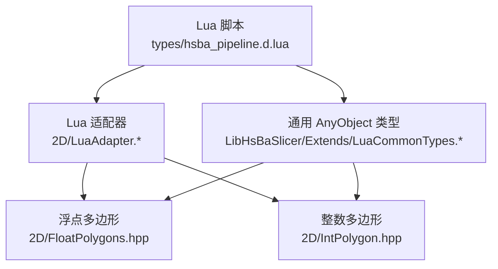
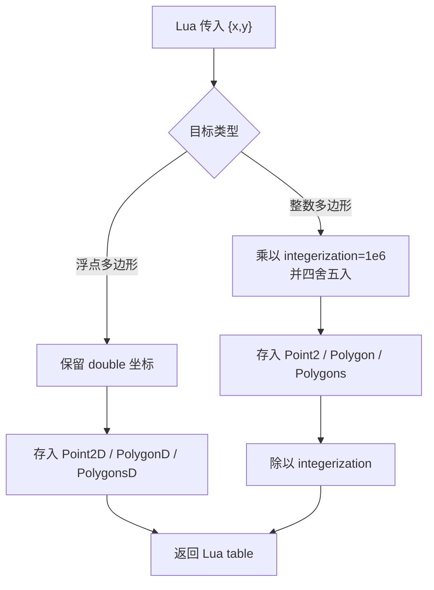
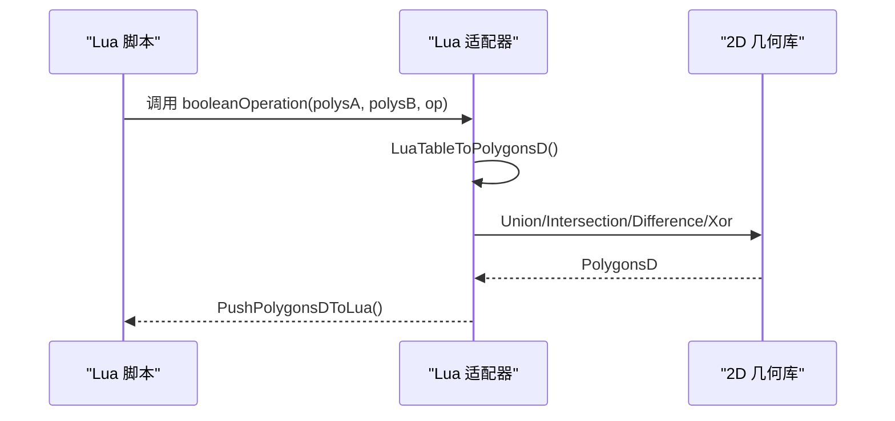

# 核心数据类型

<cite>
**本文引用的文件**   
- [types/hsba_pipeline.d.lua](file://types/hsba_pipeline.d.lua)
- [2D/LuaAdapter.hpp](file://2D/LuaAdapter.hpp)
- [2D/LuaAdapter.cpp](file://2D/LuaAdapter.cpp)
- [2D/FloatPolygons.hpp](file://2D/FloatPolygons.hpp)
- [2D/IntPolygon.hpp](file://2D/IntPolygon.hpp)
- [LibHsBaSlicer/Extends/LuaCommonTypes.hpp](file://LibHsBaSlicer/Extends/LuaCommonTypes.hpp)
- [LibHsBaSlicer/Extends/LuaCommonTypes.cpp](file://LibHsBaSlicer/Extends/LuaCommonTypes.cpp)
</cite>

## 目录
1. [引言](#引言)
2. [项目结构中的类型位置](#项目结构中的类型位置)
3. [核心数据类型总览](#核心数据类型总览)
4. [坐标系统与精度模型](#坐标系统与精度模型)
5. [基础几何类型：Point2D、Point3D、Quaternion](#基础几何类型point2dpoint3dquaternion)
6. [多边形类型：Polygon、Polygons、LayerList](#多边形类型polygonpolygonslayerlist)
7. [Lua API 与 C++ 数据转换规则](#lua-api-与-c-数据转换规则)
8. [流水线使用模式](#流水线使用模式)
9. [性能与精度权衡](#性能与精度权衡)
10. [常见问题与排错](#常见问题与排错)
11. [结论](#结论)

## 引言
本文聚焦 HsBaSlicer Lua API 的核心数据类型，目标是让使用者准确理解以下概念：
- Lua 层暴露的 `Point2D`、`Point3D`、`Quaternion`、`Polygon`、`Polygons`、`LayerList` 的结构定义。
- 这些类型在 C++ 底层对应的几何类型、坐标系统、精度单位和转换方式。
- 在不同流水线阶段（Preprocess、Slice、Support、Fill、Export）中如何创建、传递和消费这些数据。
- 浮点坐标与整数坐标之间的转换机制、舍入行为以及性能影响。

该文档不直接粘贴源码片段，而是通过“文件路径 + 行号”的方式指向实现位置，便于读者对照源码验证。

## 项目结构中的类型位置
HsBaSlicer 的核心几何类型分布在两个主要区域：
- 2D 几何算法区：定义浮点与整数两种多边形类型、布尔运算、偏移、面积、形状生成等。
- Lua 扩展区：把 C++ 类型注册到 Lua，提供 `new_<类型>` 与 `cast_<类型>` 能力，并把 Polygon/Polygons 暴露为 Lua table。

**图表来源**
- [types/hsba_pipeline.d.lua:20-30](file://types/hsba_pipeline.d.lua#L20-L30)
- [2D/LuaAdapter.hpp:1-82](file://2D/LuaAdapter.hpp#L1-L82)
- [2D/LuaAdapter.cpp:332-485](file://2D/LuaAdapter.cpp#L332-L485)
- [2D/FloatPolygons.hpp:18-26](file://2D/FloatPolygons.hpp#L18-L26)
- [2D/IntPolygon.hpp:16-26](file://2D/IntPolygon.hpp#L16-L26)
- [LibHsBaSlicer/Extends/LuaCommonTypes.hpp:125-140](file://LibHsBaSlicer/Extends/LuaCommonTypes.hpp#L125-L140)

**章节来源**
- [types/hsba_pipeline.d.lua:20-30](file://types/hsba_pipeline.d.lua#L20-L30)
- [2D/LuaAdapter.hpp:1-82](file://2D/LuaAdapter.hpp#L1-L82)
- [2D/LuaAdapter.cpp:332-485](file://2D/LuaAdapter.cpp#L332-L485)
- [2D/FloatPolygons.hpp:18-26](file://2D/FloatPolygons.hpp#L18-L26)
- [2D/IntPolygon.hpp:16-26](file://2D/IntPolygon.hpp#L16-L26)
- [LibHsBaSlicer/Extends/LuaCommonTypes.hpp:125-140](file://LibHsBaSlicer/Extends/LuaCommonTypes.hpp#L125-L140)

## 核心数据类型总览
Lua 类型定义集中在 IDE 类型声明文件中，它明确定义了 HsBaSlicer Lua API 使用的核心几何别名：

| Lua 类型 | 含义 | 内部结构说明 |
|---|---|---|
| `Point2D` | 二维点 | `{ x: number, y: number }` |
| `Point3D` | 三维点 | `{ x: number, y: number, z: number }` |
| `Quaternion` | 四元数 | `{ x: number, y: number, z: number, w: number }` |
| `Polygon` | 单个多边形 | `Point2D[]`，即点的有序数组 |
| `Polygons` | 多边形集合 | `Polygon[]`，通常表示一层轮廓或一组路径 |
| `LayerList` | 多层多边形集合 | `Polygons[]`，外层索引对应层序 |

这些别名是 Lua 侧的类型契约；C++ 侧则分别映射到 Clipper2 的浮点与整数几何类型，并通过 Lua 适配器进行双向转换。

**章节来源**
- [types/hsba_pipeline.d.lua:24-29](file://types/hsba_pipeline.d.lua#L24-L29)

## 坐标系统与精度模型
HsBaSlicer 在 2D 几何处理中使用两套坐标体系：

| 体系 | C++ 类型 | Lua 表现 | 精度特点 |
|---|---|---|---|
| 浮点坐标 | `Point2D`、`PolygonD`、`PolygonsD` | Lua 中 `x`、`y` 为 `number` | 适合输入、可视化、文本转轮廓、布尔运算中间结果 |
| 整数坐标 | `Point2`、`Polygon`、`Polygons` | Lua 中仍表现为 `number`，但内部按缩放因子转换 | 用于 Clipper2 精确布尔运算、偏移、填充等数值稳定计算 |

关键缩放因子：
- 整数化缩放因子定义为 `integerization = 1e6`。
- 从 Lua 传入的浮点坐标进入整数多边形时，会乘以 `integerization` 并四舍五入。
- 从整数多边形输出到 Lua 时，会把整数坐标除以 `integerization`，恢复为毫米级浮点显示值。

**图表来源**
- [2D/IntPolygon.hpp:16-17](file://2D/IntPolygon.hpp#L16-L17)
- [2D/LuaAdapter.cpp:362-369](file://2D/LuaAdapter.cpp#L362-L369)
- [2D/LuaAdapter.cpp:454-458](file://2D/LuaAdapter.cpp#L454-L458)
- [2D/FloatPolygons.hpp:196-221](file://2D/FloatPolygons.hpp#L196-L221)

**章节来源**
- [2D/IntPolygon.hpp:16-17](file://2D/IntPolygon.hpp#L16-L17)
- [2D/LuaAdapter.cpp:362-369](file://2D/LuaAdapter.cpp#L362-L369)
- [2D/LuaAdapter.cpp:454-458](file://2D/LuaAdapter.cpp#L454-L458)
- [2D/FloatPolygons.hpp:196-221](file://2D/FloatPolygons.hpp#L196-L221)

## 基础几何类型：Point2D、Point3D、Quaternion
### Point2D
Lua 层定义：
- `Point2D` 是一个包含 `x`、`y` 两个 `number` 字段的表。

C++ 层定义：
- `Point2D` 是 `Clipper2Lib::PointD`，即双精度二维点。
- 在通用 AnyObject 类型注册中，`Point2D` 被注册为可反射类型，字段名为 `x`、`y`。

使用方式：
- 作为 `Polygon` 的点元素。
- 作为 `makeRectangle`、`makeCircle`、`makeEllipse`、`makeRegularPolygon` 等构造函数的输入。
- 作为切片结果、填充结果、支撑结果中的坐标单位。

**章节来源**
- [types/hsba_pipeline.d.lua:24](file://types/hsba_pipeline.d.lua#L24)
- [2D/FloatPolygons.hpp:18-19](file://2D/FloatPolygons.hpp#L18-L19)
- [LibHsBaSlicer/Extends/LuaCommonTypes.hpp:125-126](file://LibHsBaSlicer/Extends/LuaCommonTypes.hpp#L125-L126)
- [LibHsBaSlicer/Extends/LuaCommonTypes.cpp:205-216](file://LibHsBaSlicer/Extends/LuaCommonTypes.cpp#L205-L216)

### Point3D
Lua 层定义：
- `Point3D` 是一个包含 `x`、`z`、`y` 三个 `number` 字段的表。
- 主要用于 3D 模型变换，例如平移、旋转、缩放时的位移向量。

C++ 层映射：
- 在通用 AnyObject 类型注册中，`Point3D` 没有直接以同名注册；但 3D 相关操作通常使用 `Point3D` 语义的 Lua 表，并在 C++ 胶水层转换为 3D 几何对象。
- 在类型定义文件中，`Point3D` 仅作为 Lua 类型别名存在，供 IDE 补全和静态检查使用。

使用方式：
- `HsBa.translateModel(name, offset)` 的 `offset` 使用 `Point3D`。
- 机器人路径、螺旋化路径、G-code 输出等 3D 坐标场景会使用 `Point3D`。

**章节来源**
- [types/hsba_pipeline.d.lua:25](file://types/hsba_pipeline.d.lua#L25)
- [types/hsba_pipeline.d.lua:333-346](file://types/hsba_pipeline.d.lua#L333-L346)

### Quaternion
Lua 层定义：
- `Quaternion` 是一个包含 `x`、`y`、`z`、`w` 四个 `number` 字段的表。
- 用于表示 3D 旋转，避免欧拉角万向锁问题。

C++ 层映射：
- 通用 AnyObject 类型注册了 `Eigen::Quaternionf` 与 `Eigen::Quaterniond`，字段顺序为 `x`、`y`、`z`、`w`。
- Lua 读取四元数时，会将 Lua 表的 `x`、`y`、`z`、`w` 映射到 Eigen 四元数的分量，并注意 Eigen 构造函数参数顺序。

使用方式：
- `HsBa.rotateModel(name, quaternion)` 使用 `Quaternion`。
- 自定义 CAD 模型、机器人姿态、SLA/SLS 导出等场景中可能间接使用。

**章节来源**
- [types/hsba_pipeline.d.lua:26](file://types/hsba_pipeline.d.lua#L26)
- [types/hsba_pipeline.d.lua:338-341](file://types/hsba_pipeline.d.lua#L338-L341)
- [LibHsBaSlicer/Extends/LuaCommonTypes.hpp:121-123](file://LibHsBaSlicer/Extends/LuaCommonTypes.hpp#L121-L123)
- [LibHsBaSlicer/Extends/LuaCommonTypes.cpp:106-125](file://LibHsBaSlicer/Extends/LuaCommonTypes.cpp#L106-L125)

## 多边形类型：Polygon、Polygons、LayerList
### Polygon
Lua 层定义：
- `Polygon` 是 `Point2D[]`，即一个由 `Point2D` 组成的有序数组。
- 每个 `Point2D` 必须包含 `x`、`y` 两个数字字段。

C++ 层定义：
- 浮点版本：`PolygonD`，对应 `Clipper2Lib::PathD`。
- 整数版本：`Polygon`，对应 `Clipper2Lib::Path64`。

数据结构复杂度：
- 时间复杂度：遍历一个 `Polygon` 为 O(n)，n 为顶点数。
- 空间复杂度：O(n)。

典型用途：
- 单层轮廓。
- 填充路径。
- 支撑截面。
- 文字轮廓。
- 矩形、圆形、椭圆、正多边形等构造结果。

**章节来源**
- [types/hsba_pipeline.d.lua:27](file://types/hsba_pipeline.d.lua#L27)
- [2D/FloatPolygons.hpp:21-22](file://2D/FloatPolygons.hpp#L21-L22)
- [2D/IntPolygon.hpp:22-23](file://2D/IntPolygon.hpp#L22-L23)

### Polygons
Lua 层定义：
- `Polygons` 是 `Polygon[]`，即多个 `Polygon` 的数组。
- 通常表示一层中的所有轮廓，包括外轮廓和内孔。

C++ 层定义：
- 浮点版本：`PolygonsD`，对应 `Clipper2Lib::PathsD`。
- 整数版本：`Polygons`，对应 `Clipper2Lib::Paths64`。

数据结构复杂度：
- 时间复杂度：遍历所有多边形为 O(N + n_total)，N 为多边形数量，n_total 为所有顶点总数。
- 空间复杂度：O(N + n_total)。

典型用途：
- Slice 步骤返回的单层切片结果。
- Fill 步骤生成的填充路径。
- Support 步骤生成的支撑路径。
- Boolean 运算、Offset、ConvexHull、ConcaveHull 等操作的结果。

**章节来源**
- [types/hsba_pipeline.d.lua:28](file://types/hsba_pipeline.d.lua#L28)
- [2D/FloatPolygons.hpp:24-25](file://2D/FloatPolygons.hpp#L24-L25)
- [2D/IntPolygon.hpp:25-26](file://2D/IntPolygon.hpp#L25-L26)

### LayerList
Lua 层定义：
- `LayerList` 是 `Polygons[]`，即多层多边形集合。
- 外层索引通常对应层序号，内层对应每层的多个轮廓。

C++ 层映射：
- 在 Lua API 中，`LayerList` 通常作为批量层数据的容器，例如 SLA/SLS/SLM/LOM/TDP/WAAM 打包接口。
- 它不是独立的 C++ 类型别名，而是对 `Polygons[]` 的语义命名。

数据结构复杂度：
- 时间复杂度：遍历所有层和所有轮廓为 O(L + n_total)，L 为层数。
- 空间复杂度：O(L + n_total)。

典型用途：
- `HsBa.fdmSupport(layers, config)` 输入。
- `HsBa.slaSupport(layers, config)` 输入。
- `HsBa.saveSlsPackage(input.outlines)` 输入。
- `HsBa.saveWaamPackage(input.outlines)` 输入。
- `HsBa.saveSlaPackage(input.outlines)` 输入。

**章节来源**
- [types/hsba_pipeline.d.lua:29](file://types/hsba_pipeline.d.lua#L29)
- [types/hsba_pipeline.d.lua:406-416](file://types/hsba_pipeline.d.lua#L406-L416)
- [types/hsba_pipeline.d.lua:442-455](file://types/hsba_pipeline.d.lua#L442-L455)

## Lua API 与 C++ 数据转换规则
### Lua table 到 C++ 多边形
Lua 中的 `Polygon` 是一个表数组，每个元素是 `{x, y}` 表。C++ 适配器会根据目标类型决定使用浮点还是整数坐标：

| 目标类型 | Lua 读取方式 | 转换规则 |
|---|---|---|
| `PolygonD` | 读取 `x`、`y` 为 `number` | 直接使用 double |
| `Polygon` | 读取 `x`、`y` 为 `number` | 乘以 `integerization` 并四舍五入为 int64 |

**图表来源**
- [2D/LuaAdapter.cpp:22-53](file://2D/LuaAdapter.cpp#L22-L53)
- [2D/LuaAdapter.cpp:385-434](file://2D/LuaAdapter.cpp#L385-L434)
- [2D/LuaAdapter.cpp:332-356](file://2D/LuaAdapter.cpp#L332-L356)

**章节来源**
- [2D/LuaAdapter.cpp:22-53](file://2D/LuaAdapter.cpp#L22-L53)
- [2D/LuaAdapter.cpp:385-434](file://2D/LuaAdapter.cpp#L385-L434)
- [2D/LuaAdapter.cpp:332-356](file://2D/LuaAdapter.cpp#L332-L356)

### C++ 到 Lua table
当 C++ 返回多边形给 Lua 时：
- 浮点多边形：直接写入 `x`、`y` 为 double。
- 整数多边形：先除以 `integerization`，再写入 Lua。

这意味着 Lua 看到的坐标始终是浮点数，即使底层使用整数几何进行精确计算。

**章节来源**
- [2D/LuaAdapter.cpp:332-382](file://2D/LuaAdapter.cpp#L332-L382)

### AnyObject 通用类型转换
通用 AnyObject 类型系统为更多几何类型提供 `new_<Name>` 和 `cast_<Name>` 能力，包括：
- Eigen 向量：`Vector2f`、`Vector3f`、`Vector4f`、`Vector2d`、`Vector3d`、`Vector4d`、`Vector2i`、`Vector3i`、`Vector4i`。
- Eigen 矩阵：`Matrix2d`、`Matrix3d`、`Matrix4d`、`MatrixXf`、`MatrixXi`。
- Eigen 四元数：`Quaternionf`、`Quaterniond`。
- Clipper2 点：`Point2D`、`Point2`。
- Clipper2 多边形：`PolygonD`、`PolygonsD`、`Polygon`、`Polygons`。

这种设计使得 Lua 脚本可以通过统一的 `AnyObject` 机制访问 C++ 类型，同时保持 Lua table 的可读性。

**章节来源**
- [LibHsBaSlicer/Extends/LuaCommonTypes.hpp:110-140](file://LibHsBaSlicer/Extends/LuaCommonTypes.hpp#L110-L140)
- [LibHsBaSlicer/Extends/LuaCommonTypes.cpp:438-466](file://LibHsBaSlicer/Extends/LuaCommonTypes.cpp#L438-L466)

## 流水线使用模式
### Preprocess 阶段
在预处理阶段，用户加载模型并进行平移、旋转、缩放。这些操作使用 `Point3D` 和 `Quaternion`：

| 操作 | 输入类型 | 说明 |
|---|---|---|
| `HsBa.loadModel` | `string name`, `string path` | 将模型加入模型池 |
| `HsBa.modelInfo` | `string name` | 获取包围盒、体积等信息 |
| `HsBa.translateModel` | `string name`, `Point3D offset` | 沿 XYZ 平移 |
| `HsBa.rotateModel` | `string name`, `Quaternion` | 使用四元数旋转 |
| `HsBa.scaleModel` | `string name`, `number` 或 `Point3D` | 统一缩放或逐轴缩放 |

**章节来源**
- [types/hsba_pipeline.d.lua:322-354](file://types/hsba_pipeline.d.lua#L322-L354)

### Slice 阶段
切片阶段返回 `Polygons`，即单层的浮点多边形集合：

| 操作 | 输入 | 输出 | 说明 |
|---|---|---|---|
| `HsBa.layerCount` | `name`, `layerHeight`, `firstLayerHeight` | `integer` | 计算总层数 |
| `HsBa.layerZ` | `index`, `layerHeight`, `firstLayerHeight` | `number` | 计算第 index 层的 Z 高度 |
| `HsBa.slice` | `name`, `z` | `Polygons` | 安全切片，返回闭合轮廓 |
| `HsBa.sliceUnsafe` | `name`, `z` | `Polygons` | 不安全切片，可能丢弃开放轮廓 |

**章节来源**
- [types/hsba_pipeline.d.lua:358-382](file://types/hsba_pipeline.d.lua#L358-L382)

### Support 阶段
支撑生成接受 `LayerList`，返回 `LayerList`：

| 操作 | 输入 | 输出 | 说明 |
|---|---|---|---|
| `HsBa.fdmSupport` | `LayerList`, `SupportOptions?` | `LayerList` | FDM 支撑 |
| `HsBa.slaSupport` | `LayerList`, `SupportOptions?` | `LayerList` | SLA 支撑 |

**章节来源**
- [types/hsba_pipeline.d.lua:406-416](file://types/hsba_pipeline.d.lua#L406-L416)

### Fill 阶段
填充阶段接受 `Polygons`，返回 `Polygons`：

| 操作 | 输入 | 输出 | 说明 |
|---|---|---|---|
| `HsBa.fill` | `Polygons`, `FillOptions?` | `Polygons` | 生成填充路径 |

**章节来源**
- [types/hsba_pipeline.d.lua:396-402](file://types/hsba_pipeline.d.lua#L396-L402)

### Export 阶段
导出阶段通常使用 `LayerList` 作为输入，打包为 zip 或其他格式：

| 操作 | 输入 | 输出 | 说明 |
|---|---|---|---|
| `HsBa.saveSlsPackage` | `SlsPackageInput` | `boolean` | SLS/SLM/LOM/TDP 打包 |
| `HsBa.saveWaamPackage` | `WaamPackageInput` | `boolean, string?` | WAAM 机器人路径打包 |
| `HsBa.saveSlaPackage` | `SlaPackageInput` | `boolean` | SLA 层图、地板、支撑打包 |

**章节来源**
- [types/hsba_pipeline.d.lua:442-455](file://types/hsba_pipeline.d.lua#L442-L455)

## 性能与精度权衡
### 浮点多边形的优势
- 适合直接接收外部输入，如 CAD 模型、图像转轮廓、文本转轮廓。
- 不需要整数化缩放，减少一次乘法和舍入。
- 适合可视化、渲染、调试输出。

### 整数多边形的优势
- Clipper2 基于整数坐标进行布尔运算、偏移、填充，数值稳定性更好。
- 避免浮点误差累积导致的拓扑错误。
- 适合高精度几何计算，如布尔差集、偏移、填充线生成。

### 转换成本
- 每次从 Lua 到 C++ 的多边形转换都会遍历所有点和所有多边形。
- 整数化过程涉及乘法、四舍五入、类型转换。
- 输出回 Lua 时，整数坐标需要除法恢复为浮点。

建议：
- 如果只需要可视化或简单处理，优先使用浮点多边形。
- 如果需要布尔运算、偏移、填充，尽量在 C++ 层完成整数化后再计算。
- 避免在 Lua 层频繁进行大量多边形转换，尤其是大模型或多层数据。

**章节来源**
- [2D/IntPolygon.hpp:16-17](file://2D/IntPolygon.hpp#L16-L17)
- [2D/LuaAdapter.cpp:362-369](file://2D/LuaAdapter.cpp#L362-L369)
- [2D/LuaAdapter.cpp:454-458](file://2D/LuaAdapter.cpp#L454-L458)
- [2D/FloatPolygons.hpp:196-221](file://2D/FloatPolygons.hpp#L196-L221)

## 常见问题与排错
### 问题：Lua 传入的 Polygon 为空
原因：
- Lua table 不是数组形式。
- 点表缺少 `x` 或 `y`。
- `x`、`y` 不是数字类型。

排查方法：
- 检查 `Polygon` 是否为 `Point2D[]`。
- 检查每个 `Point2D` 是否包含 `x`、`y`。
- 确认坐标值为数字。

**章节来源**
- [2D/LuaAdapter.cpp:385-412](file://2D/LuaAdapter.cpp#L385-L412)
- [2D/LuaAdapter.cpp:437-464](file://2D/LuaAdapter.cpp#L437-L464)

### 问题：坐标精度丢失
原因：
- 浮点到整数转换时使用 `llround(x * integerization)`。
- 如果原始坐标非常小或非常大，可能超出预期精度范围。
- 多次往返转换可能引入微小误差。

排查方法：
- 检查输入坐标是否在合理范围内。
- 避免在 Lua 层反复进行 `toInt`、`toDouble` 转换。
- 在 C++ 层尽量保持一种精度类型。

**章节来源**
- [2D/LuaAdapter.cpp:454-458](file://2D/LuaAdapter.cpp#L454-L458)
- [2D/IntPolygon.hpp:16-17](file://2D/IntPolygon.hpp#L16-L17)

### 问题：Boolean 运算结果为空
原因：
- 输入多边形不闭合。
- 多边形自相交。
- 两个多边形无交集。
- 浮点精度导致边界判断异常。

排查方法：
- 使用 `area` 检查多边形面积。
- 使用 `MakeSimple` 简化多边形。
- 在 C++ 层使用整数多边形进行布尔运算。
- 检查多边形顶点顺序和闭合情况。

**章节来源**
- [2D/LuaAdapter.cpp:22-53](file://2D/LuaAdapter.cpp#L22-L53)
- [2D/FloatPolygons.hpp:27-41](file://2D/FloatPolygons.hpp#L27-L41)
- [2D/IntPolygon.hpp:28-42](file://2D/IntPolygon.hpp#L28-L42)

## 结论
HsBaSlicer 的 Lua API 核心数据类型围绕 `Point2D`、`Point3D`、`Quaternion`、`Polygon`、`Polygons`、`LayerList` 构建。它们既是 Lua 脚本的数据契约，也是 C++ 几何算法的输入输出载体。

关键点总结：
- Lua 层使用简单的 table 结构表达几何类型。
- C++ 层区分浮点与整数两种精度体系。
- `integerization = 1e6` 是浮点与整数坐标转换的核心。
- 不同流水线阶段对数据类型有不同偏好：Slice/Fill/Support 常用 `Polygons`，Export 常用 `LayerList`。
- 性能与精度需要在 Lua 与 C++ 之间合理分配，避免不必要的重复转换。

掌握这些类型及其转换规则后，用户可以更可靠地编写自定义流水线脚本，并在不同工艺路径中复用相同的几何数据结构。