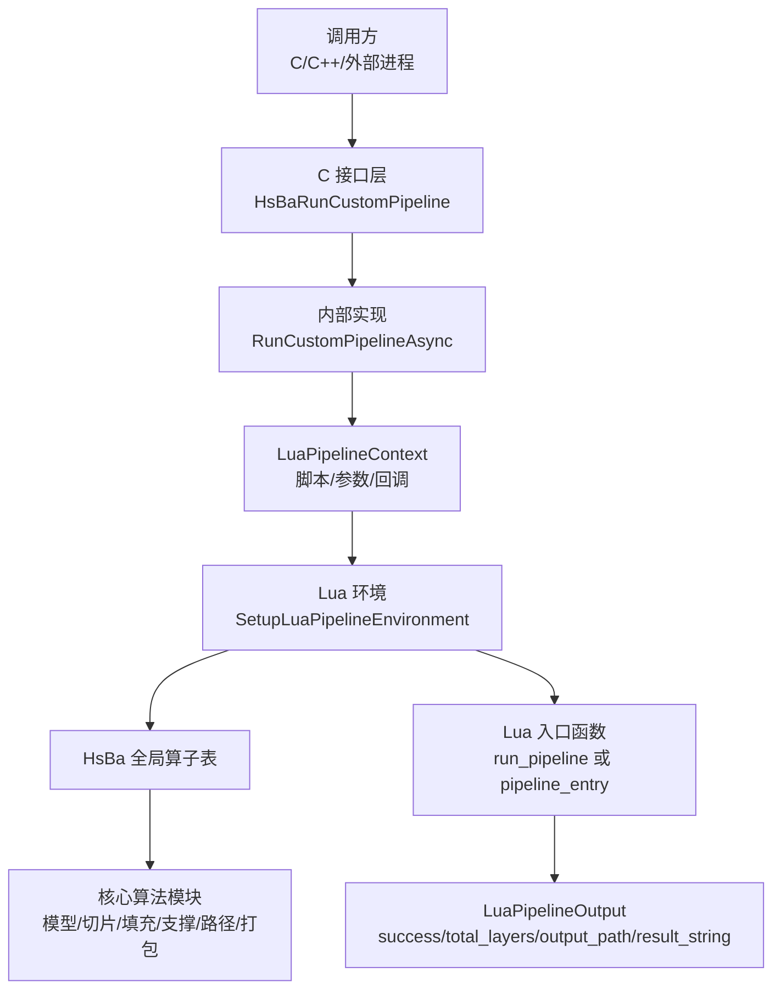
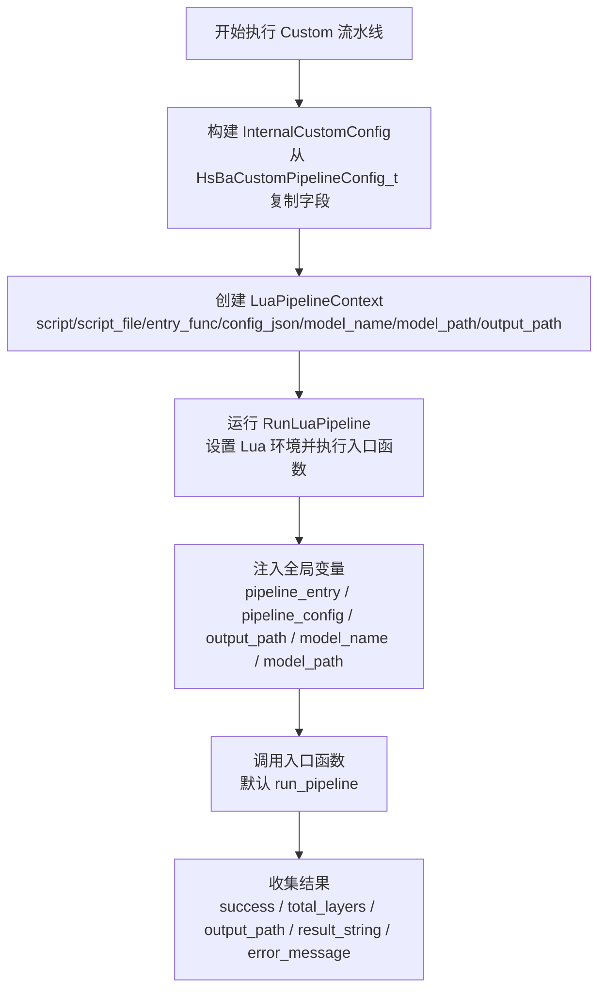
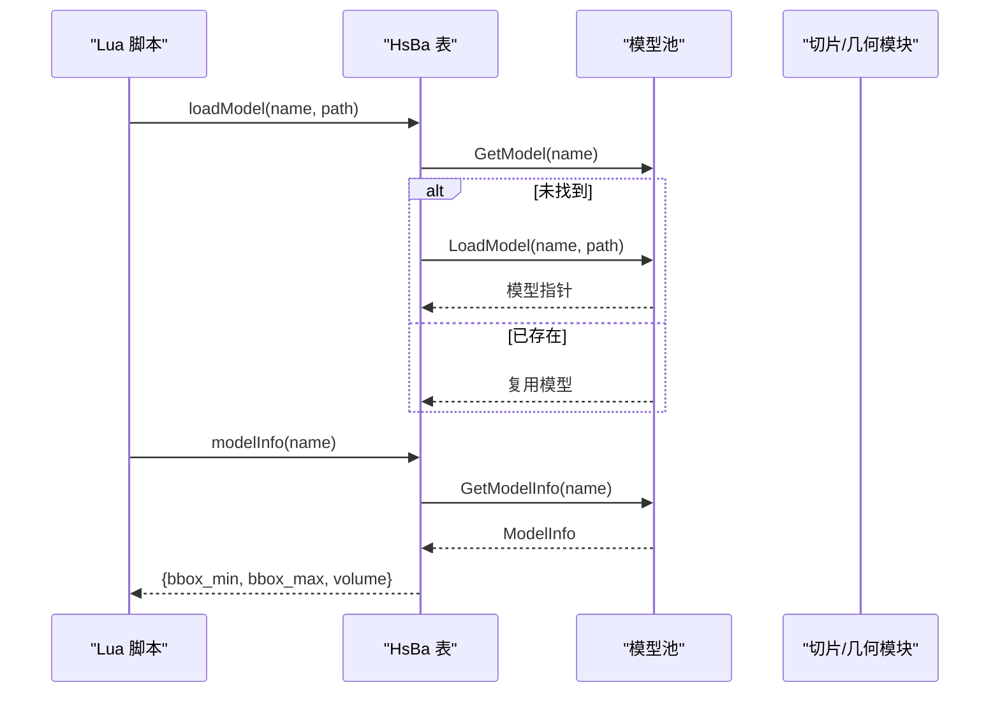
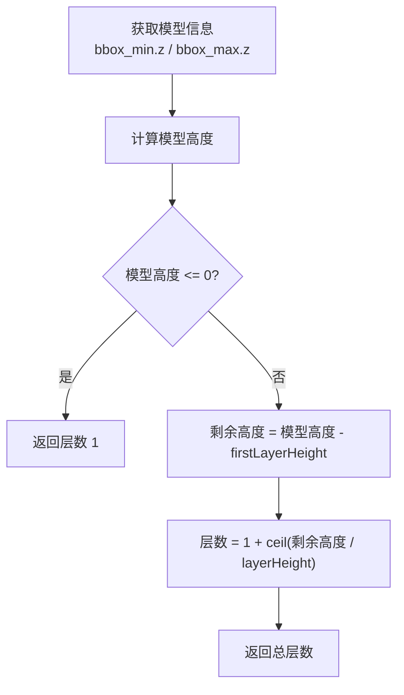
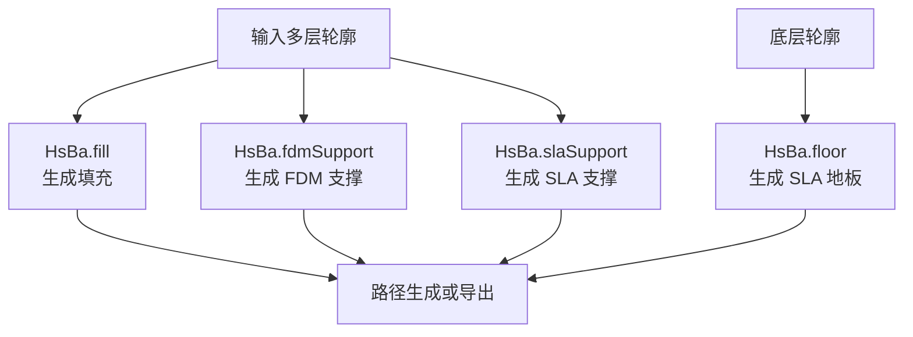
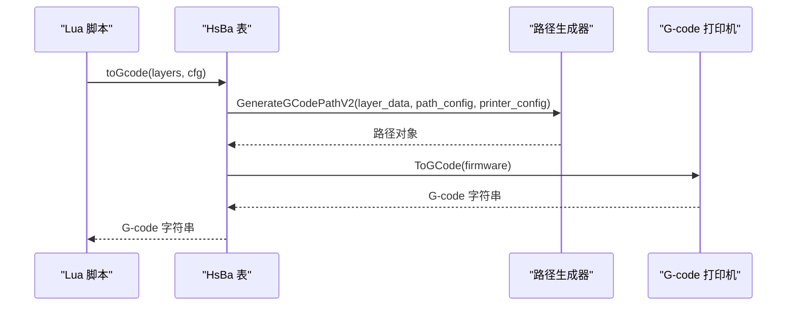
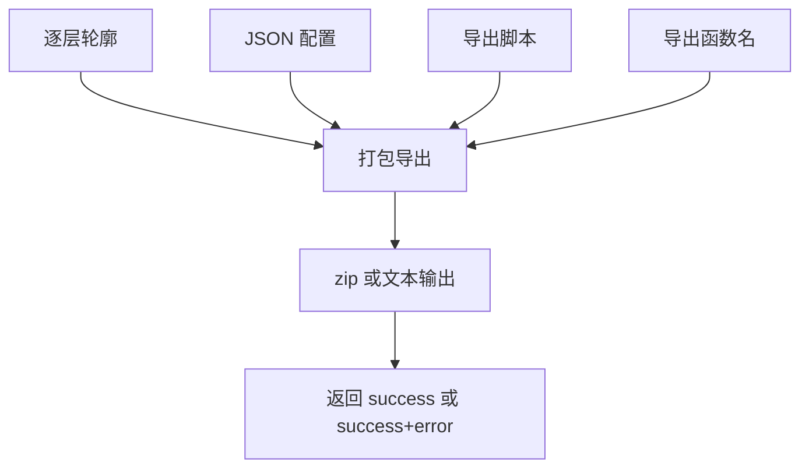
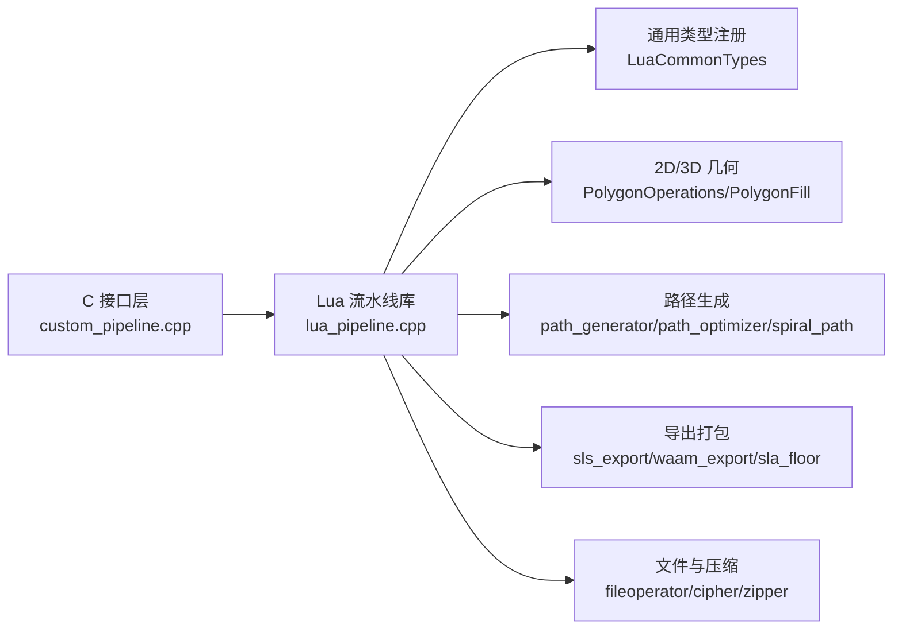

# Custom 流水线环境

<cite>
**本文引用的文件**   
- [custom_pipeline.cpp](file://DllHsBaSlicer/custom_pipeline.cpp)
- [lua_pipeline.hpp](file://LibHsBaSlicer/Extends/lua_pipeline.hpp)
- [lua_pipeline.cpp](file://LibHsBaSlicer/Extends/lua_pipeline.cpp)
- [pipeline_types.h](file://pipelinetypes/pipeline_types.h)
- [custom_pipeline.proto](file://proto/custom_pipeline.proto)
- [hsba_pipeline.d.lua](file://types/hsba_pipeline.d.lua)
- [lua_register.cpp](file://DllHsBaSlicer/lua_register.cpp)
- [LuaAddFunction.cpp](file://LibHsBaSlicer/Extends/LuaAddFunction.cpp)
- [LuaSupport.cpp](file://support/LuaSupport.cpp)
- [main.cpp](file://samples/Custom/main.cpp)
- [lua_pipeline_api.md](file://docs/zh/lua_pipeline_api.md)
</cite>

## 目录
1. [引言](#引言)
2. [项目结构与定位](#项目结构与定位)
3. [核心概念：Custom 流水线与内置流水线阶段的区别](#核心概念custom-流水线与内置流水线阶段的区别)
4. [全局变量与环境注入](#全局变量与环境注入)
5. [HsBa 全局算子表总览](#hsba-全局算子表总览)
6. [模型操作 API](#模型操作-api)
7. [切片与坐标转换 API](#切片与坐标转换-api)
8. [填充、支撑与地板 API](#填充支撑与地板-api)
9. [路径输出与 G-code API](#路径输出与-g-code-api)
10. [打包导出 API](#打包导出-api)
11. [自定义流水线编写规范](#自定义流水线编写规范)
12. [完整示例与调试技巧](#完整示例与调试技巧)
13. [依赖关系分析](#依赖关系分析)
14. [性能与错误处理](#性能与错误处理)
15. [常见问题排查](#常见问题排查)
16. [结论](#结论)

## 引言
Custom 流水线是 HsBaSlicer 中完全由 Lua 脚本编排的 3D 打印工作流。与 FDM、SLA、SLS 等内置流水线不同，Custom 流水线的阶段顺序、输入数据、中间处理和最终输出都由 Lua 入口函数决定；C++ 侧只负责提供运行环境和一组可复用的流水线算子，并通过 `HsBa` 全局表暴露给脚本。

本文面向希望编写自定义流水线、扩展工艺流程或集成第三方后处理的开发者，重点说明：
- Custom 流水线的配置方式与生命周期。
- `pipeline_entry`、`pipeline_config`、`output_path`、`model_name`、`model_path` 等全局变量的作用。
- `HsBa` 全局算子表的模型、切片、填充、支撑、路径和打包能力。
- 自定义流水线的最佳实践、常见错误和调试方法。

## 项目结构与定位
Custom 流水线涉及 C++ 接口层、Lua 环境层、类型定义层以及示例程序四个层面：

| 层次 | 主要职责 | 关键文件 |
|------|----------|----------|
| C ABI 层 | 对外暴露 `HsBaRunCustomPipeline`、`HsBaRunCustomPipelineAsync`、结果释放等接口 | [custom_pipeline.cpp](file://DllHsBaSlicer/custom_pipeline.cpp)、[pipeline_types.h](file://pipelinetypes/pipeline_types.h) |
| Lua 环境层 | 创建 Lua 状态、注册 `HsBa` 表、执行入口函数、收集进度和输出 | [lua_pipeline.hpp](file://LibHsBaSlicer/Extends/lua_pipeline.hpp)、[lua_pipeline.cpp](file://LibHsBaSlicer/Extends/lua_pipeline.cpp) |
| 类型定义层 | 定义 C 结构体、枚举、默认值、Proto 消息 | [pipeline_types.h](file://pipelinetypes/pipeline_types.h)、[custom_pipeline.proto](file://proto/custom_pipeline.proto) |
| IDE 类型提示 | 为 Lua 脚本提供补全和文档注解 | [hsba_pipeline.d.lua](file://types/hsba_pipeline.d.lua) |
| 示例程序 | 演示同步、异步、内联源码、Protobuf 调用等用法 | [main.cpp](file://samples/Custom/main.cpp) |

**图表来源**
- [custom_pipeline.cpp:118-163](file://DllHsBaSlicer/custom_pipeline.cpp#L118-L163)
- [lua_pipeline.hpp:29-51](file://LibHsBaSlicer/Extends/lua_pipeline.hpp#L29-L51)
- [lua_pipeline.cpp:224-238](file://LibHsBaSlicer/Extends/lua_pipeline.cpp#L224-L238)

**章节来源**
- [custom_pipeline.cpp:1-213](file://DllHsBaSlicer/custom_pipeline.cpp#L1-L213)
- [lua_pipeline.hpp:1-88](file://LibHsBaSlicer/Extends/lua_pipeline.hpp#L1-L88)
- [pipeline_types.h:676-732](file://pipelinetypes/pipeline_types.h#L676-L732)

## 核心概念：Custom 流水线与内置流水线阶段的区别
HsBaSlicer 中的 Lua 脚本存在两种用途：

| 环境 | 控制范围 | 典型触发方式 | 可用能力 |
|------|----------|--------------|----------|
| **Custom 自定义流水线** | 整个工作流：加载模型、切片、支撑、填充、路径、写文件、打包 | C++ 调用 `run_pipeline` 或 `pipeline_entry` 指定的入口函数 | 完整 `HsBa` 算子表 + 上下文全局变量 + 通用共享库 |
| **内置流水线阶段替换** | 仅替换某个固定阶段（支撑、填充、地板、导出） | 对应内置流水线在阶段处加载用户脚本并调用约定函数 | 该阶段注入的全局变量 + 通用共享库，没有完整 `HsBa` 表 |

Custom 流水线的核心思想是：**C++ 提供算子，Lua 决定流程**。因此，同一个 `HsBa` 表可以被用于重建 FDM、SLA、SLS、SLM、LOM、TDP、WAAM 等不同工艺，也可以组合出任意非标准流程。

**章节来源**
- [lua_pipeline_api.md:19-28](file://docs/zh/lua_pipeline_api.md#L19-L28)
- [hsba_pipeline.d.lua:189-191](file://types/hsba_pipeline.d.lua#L189-L191)

## 全局变量与环境注入
Custom 流水线启动时，C++ 会把以下信息注入到 Lua 全局环境中：

| 全局变量 | 类型 | 含义 | 是否必填 |
|----------|------|------|----------|
| `pipeline_entry` | string | 入口函数名，默认 `"run_pipeline"` | 否；可由 C++ 的 `entry_func` 覆盖 |
| `pipeline_config` | string | C++ 传入的 JSON 配置字符串，原样透传给脚本 | 否；可为空 |
| `output_path` | string | C++ 传入的默认输出路径，可能为空串 | 否；脚本可重写 |
| `model_name` | string | C++ 传入的模型名称，可能为空串 | 否；脚本可忽略或自行命名 |
| `model_path` | string | C++ 传入的模型文件路径，可能为空串 | 否；脚本可忽略或自行读取 |

这些全局变量来自 `LuaPipelineContext` 和 `HsBaCustomPipelineConfig_t`，并由 `custom_pipeline.proto` 统一描述字段编号。

**图表来源**
- [custom_pipeline.cpp:86-99](file://DllHsBaSlicer/custom_pipeline.cpp#L86-L99)
- [custom_pipeline.cpp:118-151](file://DllHsBaSlicer/custom_pipeline.cpp#L118-L151)
- [lua_pipeline.hpp:29-39](file://LibHsBaSlicer/Extends/lua_pipeline.hpp#L29-L39)
- [custom_pipeline.proto:9-18](file://proto/custom_pipeline.proto#L9-L18)

**章节来源**
- [lua_pipeline.hpp:29-51](file://LibHsBaSlicer/Extends/lua_pipeline.hpp#L29-L51)
- [pipeline_types.h:689-719](file://pipelinetypes/pipeline_types.h#L689-L719)
- [custom_pipeline.proto:9-30](file://proto/custom_pipeline.proto#L9-L30)
- [hsba_pipeline.d.lua:465-487](file://types/hsba_pipeline.d.lua#L465-L487)

## HsBa 全局算子表总览
`HsBa` 是 Custom 流水线环境的唯一入口表。它把 C++ 提供的模型、切片、填充、支撑、路径、打包能力封装成 Lua 可调用的函数。

| 分类 | 主要 API | 返回值或副作用 |
|------|----------|----------------|
| 控制与 IO | `progress`、`setLayers`、`setOutputPath`、`readFile`、`writeFile` | 上报进度、回填层数/输出路径、读写文件 |
| 模型管理 | `loadModel`、`modelInfo`、`translateModel`、`rotateModel`、`scaleModel`、`removeModel`、`modelNames` | 加载/查询/变换/移除模型 |
| 切片 | `layerCount`、`layerZ`、`slice`、`sliceUnsafe` | 计算层数、Z 高度、截面多边形 |
| 坐标转换 | `toInt`、`toDouble` | 整型与浮点多边形互转 |
| 填充 | `fill` | 返回填充多边形 |
| 支撑与地板 | `fdmSupport`、`slaSupport`、`floor` | 返回逐层支撑或多边形地板 |
| 路径输出 | `spiralize`、`toGcode` | 返回 3D 螺旋路径或 G-code 字符串 |
| 打包导出 | `saveSlsPackage`、`saveWaamPackage`、`saveSlaPackage`、`renderImage` | 返回成功标志或附加错误信息 |

IDE 类型定义位于 `types/hsba_pipeline.d.lua`，实际实现位于 `LibHsBaSlicer/Extends/lua_pipeline.cpp`。

**章节来源**
- [hsba_pipeline.d.lua:290-463](file://types/hsba_pipeline.d.lua#L290-L463)
- [lua_pipeline.cpp:224-800](file://LibHsBaSlicer/Extends/lua_pipeline.cpp#L224-L800)

## 模型操作 API
模型操作集中在 `HsBa.loadModel`、`HsBa.modelInfo`、`HsBa.translateModel`、`HsBa.rotateModel`、`HsBa.scaleModel`、`HsBa.removeModel`、`HsBa.modelNames`。

| API | 参数 | 行为 |
|-----|------|------|
| `loadModel(name, path)` | 模型名、模型路径 | 若模型池中没有同名模型则加载；失败抛出 Lua 错误 |
| `modelInfo(name)` | 模型名 | 返回 `{ bbox_min={x,y,z}, bbox_max={x,y,z}, volume }` |
| `translateModel(name, {x,y,z})` | 模型名、位移向量 | 对模型池中的模型执行平移 |
| `rotateModel(name, {x,y,z,w})` | 模型名、四元数 | 按四元数旋转模型 |
| `scaleModel(name, s)` | 模型名、标量或 `{x,y,z}` | 统一缩放或逐轴缩放 |
| `removeModel(name)` | 模型名 | 从模型池移除 |
| `modelNames()` | 无 | 返回模型池中所有模型名的数组 |

注意：
- `loadModel` 不会重复加载同名模型，而是复用已有实例。
- `modelInfo` 不存在的模型会抛出错误。
- 四元数使用 `{x, y, z, w}` 形式。
- 缩放既支持标量，也支持三维向量。

**图表来源**
- [lua_pipeline.cpp:292-340](file://LibHsBaSlicer/Extends/lua_pipeline.cpp#L292-L340)

**章节来源**
- [lua_pipeline.cpp:292-397](file://LibHsBaSlicer/Extends/lua_pipeline.cpp#L292-L397)
- [hsba_pipeline.d.lua:322-354](file://types/hsba_pipeline.d.lua#L322-L354)

## 切片与坐标转换 API
切片相关 API 包括 `layerCount`、`layerZ`、`slice`、`sliceUnsafe`、`toInt`、`toDouble`。

| API | 参数 | 返回值 | 说明 |
|-----|------|--------|------|
| `layerCount(name, layerHeight, firstLayerHeight)` | 模型名、层高、首层层高 | 整数 | 根据模型 Z 范围和首层层高计算总层数 |
| `layerZ(index, layerHeight, firstLayerHeight)` | 0 基索引、层高、首层层高 | 数字 | 返回第 index 层的 Z 高度 |
| `slice(name, z)` | 模型名、绝对 Z 高度 | 多边形集合 | 安全切片，返回闭合轮廓 |
| `sliceUnsafe(name, z)` | 模型名、绝对 Z 高度 | 多边形集合 | 非安全切片，可能丢弃开放轮廓 |
| `toInt(polys)` | 浮点多边形 | 整型多边形 | 用于布尔运算和填充内部精度 |
| `toDouble(polys)` | 整型多边形 | 浮点多边形 | 将整型结果还原为浮点 |

关键点：
- `layerCount` 使用模型 `bbox_max.z - bbox_min.z` 作为模型高度。
- `layerZ` 的首层 Z 是 `firstLayerHeight`，后续层按 `firstLayerHeight + index * layerHeight` 计算。
- `slice` 返回浮点多边形，适合直接参与后续路径生成。
- `sliceUnsafe` 返回归一化后的多边形，但可能丢失开口轮廓。

**图表来源**
- [lua_pipeline.cpp:401-422](file://LibHsBaSlicer/Extends/lua_pipeline.cpp#L401-L422)

**章节来源**
- [lua_pipeline.cpp:399-478](file://LibHsBaSlicer/Extends/lua_pipeline.cpp#L399-L478)
- [hsba_pipeline.d.lua:356-394](file://types/hsba_pipeline.d.lua#L356-L394)

## 填充、支撑与地板 API
### 填充
`HsBa.fill` 接收多边形集合和可选配置，返回填充路径多边形。

| 配置字段 | 类型 | 默认值 | 含义 |
|----------|------|--------|------|
| `spacing` | number | 0.4 | 填充间距 |
| `mode` | string | `"zigzag"` | 填充模式：`"line"`、`"simpleZigzag"`、`"zigzag"` |
| `angle` | number | 45.0 | 填充角度（度） |
| `borderCount` | integer | 0 | 壁厚圈数；大于 0 时生成壁厚+填充 |

当 `borderCount > 0` 时，系统先生成外壁再填充；否则直接对输入多边形进行填充。

### 支撑
`HsBa.fdmSupport` 和 `HsBa.slaSupport` 都接收逐层多边形和配置，返回逐层支撑。

| 配置字段 | FDM | SLA | 默认值 |
|----------|-----|-----|--------|
| `overhang_angle` | ✅ | ✅ | 45.0 |
| `layer_height` | ✅ | ✅ | 0.2 |
| `support_gap` | ✅ | ✅ | 0.5 |
| `support_diameter` | ✅ | ✅ | 2.0 |
| `support_density` | ✅ | ✅ | 0.3 |
| `support_pattern` | ✅ | ✅ | 由结构体默认值决定 |
| `tree_branch_angle` | ✅ | ✅ | 30.0 |
| `tree_max_branch_radius` | ✅ | ✅ | 5.0 |
| `honeycomb_cell_size` | ✅ | ✅ | 5.0 |
| `interface_layers` | ✅ | ❌ | FDM 专用 |
| `interface_density` | ✅ | ❌ | FDM 专用 |
| `tip_diameter` | ❌ | ✅ | SLA 专用 |
| `raft_thickness` | ❌ | ✅ | SLA 专用 |

### 地板
`HsBa.floor` 用于 SLA 底部地板或 Raft 生成，输入底层多边形和配置，返回多边形。

| 配置字段 | 类型 | 含义 |
|----------|------|------|
| `raft_offset` | number | 地板向外偏移 |
| `border_width` | number | 地板边框宽度 |
| `fill_spacing` | number | 地板填充间距 |
| `fill_angle_deg` | number | 地板填充角度 |
| `border_count` | integer | 边框圈数 |
| `use_convex_hull` | boolean | 是否使用凸包 |
| `concave_hull_points` | integer | 凹包点数 |

**图表来源**
- [lua_pipeline.cpp:480-556](file://LibHsBaSlicer/Extends/lua_pipeline.cpp#L480-L556)

**章节来源**
- [lua_pipeline.cpp:480-556](file://LibHsBaSlicer/Extends/lua_pipeline.cpp#L480-L556)
- [hsba_pipeline.d.lua:198-227](file://types/hsba_pipeline.d.lua#L198-L227)
- [hsba_pipeline.d.lua:396-424](file://types/hsba_pipeline.d.lua#L396-L424)

## 路径输出与 G-code API
### 螺旋化
`HsBa.spiralize` 将逐层闭合轮廓合并为一条连续上升的 3D 路径，常用于花瓶模式或连续挤出工艺。

| 配置字段 | 类型 | 含义 |
|----------|------|------|
| `layerHeight` | number | 默认层高 |
| `startZ` | number | 起始 Z 高度 |
| `zHeights` | number[] | 每层 Z 高度数组；优先级高于 `layerHeight` 和 `startZ` |

返回值是 `{x, y, z}` 点数组，表示一条连续的 3D 路径。

### G-code 生成
`HsBa.toGcode` 接收每层路径数据和打印机配置，返回 G-code 字符串。

| 输入字段 | 类型 | 含义 |
|----------|------|------|
| `outlines` | Polygons | 外层轮廓 |
| `fills` | Polygons | 填充路径 |
| `supports` | Polygons | 支撑路径 |
| `zHeight` | number | 当前层 Z 高度 |

| 配置字段 | 类型 | 默认值 | 含义 |
|----------|------|--------|------|
| `layerHeight` | number | 路径配置默认值 | 层高 |
| `lineWidth` | number | 路径配置默认值 | 线宽 |
| `printSpeed` | number | 路径配置默认值 | 打印速度 |
| `travelSpeed` | number | 路径配置默认值 | 移动速度 |
| `extrusionMultiplier` | number | 路径配置默认值 | 挤出倍率 |
| `firmware` | string | `"marlin"` | 固件目标：`"marlin"`、`"reprap"`、`"klipper"` |
| `nozzleDiameter` | number | 打印机配置默认值 | 喷嘴直径 |
| `filamentDiameter` | number | 打印机配置默认值 | 耗材直径 |
| `nozzleTemp` | number | 打印机配置默认值 | 喷嘴温度 |
| `bedTemp` | number | 打印机配置默认值 | 热床温度 |
| `retractLength` | number | 打印机配置默认值 | 回抽长度 |
| `retractSpeed` | number | 打印机配置默认值 | 回抽速度 |

**图表来源**
- [lua_pipeline.cpp:622-690](file://LibHsBaSlicer/Extends/lua_pipeline.cpp#L622-L690)

**章节来源**
- [lua_pipeline.cpp:558-690](file://LibHsBaSlicer/Extends/lua_pipeline.cpp#L558-L690)
- [hsba_pipeline.d.lua:228-251](file://types/hsba_pipeline.d.lua#L228-L251)
- [hsba_pipeline.d.lua:426-438](file://types/hsba_pipeline.d.lua#L426-L438)

## 打包导出 API
### SLS/SLM/LOM/TDP 打包
`HsBa.saveSlsPackage` 将逐层轮廓、Z 高度、JSON 配置、导出脚本和函数名打包为 zip。

| 字段 | 类型 | 必填 | 默认值 | 含义 |
|------|------|------|--------|------|
| `outlines` | LayerList | 是 | — | 逐层轮廓 |
| `zHeights` | number[] | 否 | — | 每层 Z 高度 |
| `config` | string | 否 | — | JSON 配置内容 |
| `output` | string | 是 | — | 输出 zip 路径 |
| `script` | string | 是 | — | 导出 Lua 脚本路径 |
| `func` | string | 否 | `"export_sls"` | 导出函数名 |

### WAAM 机器人路径打包
`HsBa.saveWaamPackage` 生成机器人语言程序，失败时可返回第二个错误字符串。

| 字段 | 类型 | 必填 | 默认值 | 含义 |
|------|------|------|--------|------|
| `outlines` | LayerList | 是 | — | 逐层轮廓 |
| `zHeights` | number[] | 否 | — | 每层 Z 高度 |
| `weld` | table | 否 | — | 焊接参数 |
| `robotType` | integer | 否 | 0 | 机器人类型：ABB/KUKA/FANUC |
| `beadWidth` | number | 否 | 1.2 | 焊道宽度 |
| `config` | string | 否 | — | JSON 配置 |
| `output` | string | 是 | — | 输出文件路径 |
| `script` | string | 否 | — | 自定义代码生成脚本 |
| `func` | string | 否 | `"export_waam"` | 导出函数名 |

`weld` 支持 `current`、`voltage`、`wireFeedSpeed`、`gasFlowRate`、`travelSpeed`、`process`。

### SLA 图像打包
`HsBa.saveSlaPackage` 将层图、支撑、地板、配置打包为 zip。

| 字段 | 类型 | 必填 | 默认值 | 含义 |
|------|------|------|--------|------|
| `outlines` | LayerList | 是 | — | 逐层轮廓 |
| `supports` | LayerList | 否 | — | 逐层支撑 |
| `floor` | Polygons | 否 | — | 地板多边形 |
| `config` | string | 否 | — | JSON 配置 |
| `output` | string | 是 | — | 输出 zip 路径 |
| `imageWidth` | integer | 否 | — | 图片宽度 |
| `imageHeight` | integer | 否 | — | 图片高度 |
| `imageExtension` | string | 否 | `".png"` | 图片扩展名 |

此外，`HsBa.renderImage` 可将多边形渲染为图片文件。

**图表来源**
- [lua_pipeline.cpp:693-800](file://LibHsBaSlicer/Extends/lua_pipeline.cpp#L693-L800)

**章节来源**
- [lua_pipeline.cpp:693-800](file://LibHsBaSlicer/Extends/lua_pipeline.cpp#L693-L800)
- [hsba_pipeline.d.lua:253-289](file://types/hsba_pipeline.d.lua#L253-L289)
- [hsba_pipeline.d.lua:440-463](file://types/hsba_pipeline.d.lua#L440-L463)

## 自定义流水线编写规范
### 入口函数约定
- 默认入口函数名为 `run_pipeline`。
- 可通过 C++ 的 `entry_func` 或全局变量 `pipeline_entry` 指定其他函数名。
- 返回非空字符串表示成功，并作为 `result_string` 上报；返回 `true` 表示成功但无结果文本；返回 `false`、`nil` 或抛出错误表示失败。

### 进度与输出回报
- 使用 `HsBa.progress(percent, stage)` 向 C++ 上报进度。
- 使用 `HsBa.setLayers(n)` 上报总层数。
- 使用 `HsBa.setOutputPath(path)` 上报实际输出路径。

### 模型生命周期
- 使用 `HsBa.loadModel` 加载模型。
- 使用 `HsBa.modelInfo` 获取包围盒和体积。
- 使用 `HsBa.translateModel`、`HsBa.rotateModel`、`HsBa.scaleModel` 调整模型。
- 使用 `HsBa.removeModel` 释放模型。
- 使用 `HsBa.modelNames` 查看模型池。

### 数据处理建议
- 切片优先使用 `HsBa.slice`，需要稳定闭合轮廓时使用安全切片。
- 填充前可使用 `HsBa.toInt` 转换为整型多边形，填充后再用 `HsBa.toDouble` 恢复浮点。
- 支撑和地板应分别针对 FDM 和 SLA 使用对应 API。
- 路径输出时，每层数据结构必须包含 `outlines`、`fills`、`supports`、`zHeight`。

### 导出建议
- SLS/SLM/LOM/TDP 使用 `HsBa.saveSlsPackage`。
- WAAM 使用 `HsBa.saveWaamPackage`。
- SLA 使用 `HsBa.saveSlaPackage`。
- 导出脚本应严格返回预期结构，避免覆盖 zip 文件或产生空输出。

**章节来源**
- [hsba_pipeline.d.lua:465-487](file://types/hsba_pipeline.d.lua#L465-L487)
- [lua_pipeline_api.md:48-65](file://docs/zh/lua_pipeline_api.md#L48-L65)
- [lua_pipeline_api.md:67-132](file://docs/zh/lua_pipeline_api.md#L67-L132)

## 完整示例与调试技巧
### 最小自定义流水线示例
一个最小可运行的 Custom 流水线通常包含以下步骤：
1. 从全局变量读取 `model_name`、`model_path`、`output_path`。
2. 调用 `HsBa.loadModel` 加载模型。
3. 调用 `HsBa.layerCount` 计算层数，并用 `HsBa.setLayers` 上报。
4. 循环调用 `HsBa.layerZ` 和 `HsBa.slice` 获取每层轮廓。
5. 调用 `HsBa.fill` 生成填充。
6. 构造每层路径数据并调用 `HsBa.toGcode`。
7. 调用 `HsBa.writeFile` 写出 G-code。
8. 调用 `HsBa.setOutputPath` 上报输出路径。
9. 调用 `HsBa.removeModel` 清理模型。
10. 返回结果字符串。

参考路径：
- [lua_pipeline_api.md:283-331](file://docs/zh/lua_pipeline_api.md#L283-L331)

### C++ 调用示例
示例程序展示了多种调用方式：
- 通过脚本文件运行 FDM 流水线。
- 通过脚本文件运行 SLS 流水线。
- 通过内联 Lua 源码运行统计层面积的流水线。
- 异步运行 SLA 打包流水线。
- 通过 Protobuf 字节流传递配置和执行结果。

参考路径：
- [main.cpp:97-131](file://samples/Custom/main.cpp#L97-L131)
- [main.cpp:134-165](file://samples/Custom/main.cpp#L134-L165)
- [main.cpp:267-314](file://samples/Custom/main.cpp#L267-L314)
- [main.cpp:316-354](file://samples/Custom/main.cpp#L316-L354)
- [main.cpp:509-589](file://samples/Custom/main.cpp#L509-L589)

### 调试技巧
| 问题 | 排查方法 |
|------|----------|
| 流水线未执行 | 检查 `pipeline_lua_script` 或 `pipeline_lua_source` 是否为空 |
| 入口函数未找到 | 确认 `entry_func` 与脚本中定义的函数名一致 |
| 模型加载失败 | 检查 `model_path` 是否存在，或脚本是否正确调用 `loadModel` |
| 层数为 0 | 检查模型 Z 范围、`layerHeight`、`firstLayerHeight` |
| G-code 为空 | 检查每层 `outlines`、`fills`、`supports`、`zHeight` 是否完整 |
| 打包失败 | 检查 `output`、`script` 是否填写，导出脚本返回值是否符合约定 |
| 进度不更新 | 检查脚本是否调用 `HsBa.progress`，C++ 是否注册进度回调 |

**章节来源**
- [main.cpp:97-354](file://samples/Custom/main.cpp#L97-L354)
- [main.cpp:509-589](file://samples/Custom/main.cpp#L509-L589)
- [custom_pipeline.cpp:118-163](file://DllHsBaSlicer/custom_pipeline.cpp#L118-L163)

## 依赖关系分析
Custom 流水线的依赖关系可以划分为三层：

| 层级 | 组件 | 依赖关系 |
|------|------|----------|
| 调用层 | `HsBaRunCustomPipeline`、`HsBaRunCustomPipelineAsync` | 依赖内部异步任务和结果转换 |
| 环境层 | `RunLuaPipeline`、`SetupLuaPipelineEnvironment` | 依赖 Lua 状态、`HsBa` 表、通用类型注册 |
| 算法层 | 模型、切片、填充、支撑、路径、打包 | 依赖 2D/3D 几何、路径生成、文件 IO、压缩、数据库适配器 |

**图表来源**
- [custom_pipeline.cpp:118-163](file://DllHsBaSlicer/custom_pipeline.cpp#L118-L163)
- [lua_pipeline.cpp:1-40](file://LibHsBaSlicer/Extends/lua_pipeline.cpp#L1-L40)

**章节来源**
- [custom_pipeline.cpp:1-213](file://DllHsBaSlicer/custom_pipeline.cpp#L1-L213)
- [lua_pipeline.cpp:1-40](file://LibHsBaSlicer/Extends/lua_pipeline.cpp#L1-L40)
- [lua_register.cpp:1-43](file://DllHsBaSlicer/lua_register.cpp#L1-L43)
- [LuaAddFunction.cpp:1-68](file://LibHsBaSlicer/Extends/LuaAddFunction.cpp#L1-L68)

## 性能与错误处理
### 性能考虑
- 模型加载和切片属于 CPU 密集操作，应避免在脚本中频繁重复加载同一模型。
- 填充和支撑算法复杂度随层数和轮廓复杂度增长，建议先缩小模型规模或使用合理层高。
- G-code 生成和打包会分配大量字符串和缓冲区，应在流水线末尾集中写入，避免逐层写小文件。
- 异步执行适合 UI 场景，可减少主线程阻塞。

### 错误处理
- `loadModel` 失败会抛出 Lua 错误，脚本应捕获或确保路径正确。
- `slice`、`sliceUnsafe` 在未加载模型时会报错。
- `toGcode` 路径生成失败会抛出错误。
- `saveSlsPackage`、`saveWaamPackage`、`saveSlaPackage` 缺少必填字段时会抛出错误或返回失败。
- 自定义流水线整体失败时，`LuaPipelineOutput.error_message` 会携带 Lua 错误或异常信息。

**章节来源**
- [lua_pipeline.cpp:292-340](file://LibHsBaSlicer/Extends/lua_pipeline.cpp#L292-L340)
- [lua_pipeline.cpp:435-460](file://LibHsBaSlicer/Extends/lua_pipeline.cpp#L435-L460)
- [lua_pipeline.cpp:622-690](file://LibHsBaSlicer/Extends/lua_pipeline.cpp#L622-L690)
- [lua_pipeline.cpp:693-800](file://LibHsBaSlicer/Extends/lua_pipeline.cpp#L693-L800)
- [lua_pipeline.hpp:41-51](file://LibHsBaSlicer/Extends/lua_pipeline.hpp#L41-L51)

## 常见问题排查
| 现象 | 可能原因 | 解决方案 |
|------|----------|----------|
| 自定义流水线直接失败 | 未提供 `pipeline_lua_script` 或 `pipeline_lua_source` | 至少提供一个脚本文件或内联源码 |
| 入口函数未执行 | `entry_func` 与脚本函数名不一致 | 改为 `run_pipeline` 或匹配脚本中的函数名 |
| `pipeline_config` 为空 | C++ 未设置 `config_json` | 在 `HsBaCustomPipelineConfig_t.config_json` 中传入 JSON |
| `output_path` 未被 C++ 结果接收 | 脚本未调用 `HsBa.setOutputPath` | 在脚本末尾调用 `HsBa.setOutputPath` |
| `total_layers` 为 0 | 脚本未调用 `HsBa.setLayers` | 在计算层数后调用 `HsBa.setLayers` |
| 模型不存在 | 未调用 `loadModel` 或模型名不匹配 | 先调用 `loadModel`，再使用相同模型名 |
| 切片结果为空 | 层高或首层层高不合理 | 检查 `layerHeight`、`firstLayerHeight` 和模型 Z 范围 |
| G-code 生成失败 | 层数据不完整或路径生成失败 | 检查每层 `outlines`、`fills`、`supports`、`zHeight` |
| 打包 zip 为空 | 导出脚本返回值错误或未正确写入文件 | 检查导出脚本返回值结构和文件写入逻辑 |
| 进度不显示 | 未调用 `HsBa.progress` 或未注册进度回调 | 在脚本中调用进度上报，C++ 侧注册回调 |

**章节来源**
- [custom_pipeline.cpp:127-133](file://DllHsBaSlicer/custom_pipeline.cpp#L127-L133)
- [lua_pipeline.cpp:228-256](file://LibHsBaSlicer/Extends/lua_pipeline.cpp#L228-L256)
- [lua_pipeline.cpp:292-340](file://LibHsBaSlicer/Extends/lua_pipeline.cpp#L292-L340)
- [lua_pipeline.cpp:401-460](file://LibHsBaSlicer/Extends/lua_pipeline.cpp#L401-L460)
- [lua_pipeline.cpp:622-800](file://LibHsBaSlicer/Extends/lua_pipeline.cpp#L622-L800)

## 结论
Custom 流水线是 HsBaSlicer 中最灵活的扩展方式：C++ 提供稳定的模型、切片、填充、支撑、路径和打包能力，Lua 脚本自由编排这些能力以适配不同工艺和后处理需求。

对于使用者而言，最重要的三个点是：
1. 正确理解 `pipeline_entry`、`pipeline_config`、`output_path`、`model_name`、`model_path` 的作用和生命周期。
2. 熟练使用 `HsBa` 全局算子表完成模型加载、切片、填充、支撑、路径和打包。
3. 遵循脚本编写规范，合理使用进度上报、错误处理和资源清理。

对于扩展开发者而言，`HsBa` 表已经覆盖了主流 3D 打印流程的核心环节；如果需要新增能力，可以通过 Lua 扩展函数注册机制向特定维度注入新函数，并在 Custom 流水线中复用。