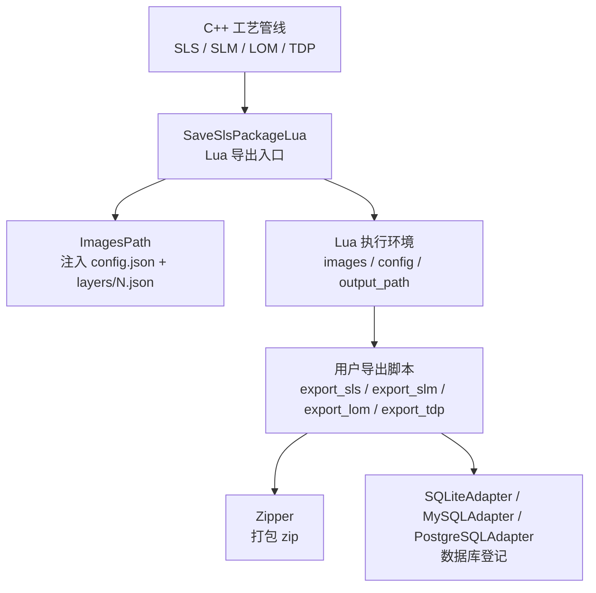
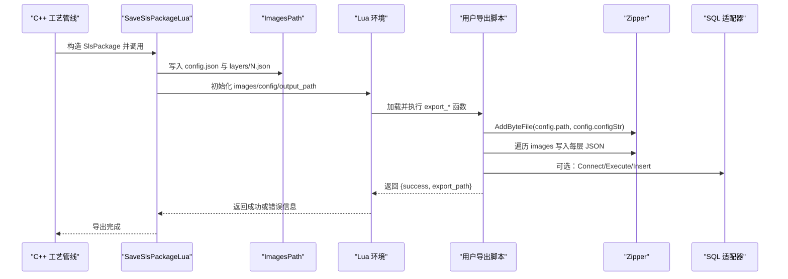
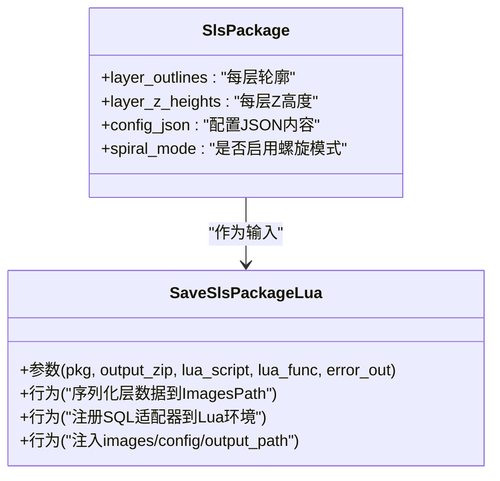
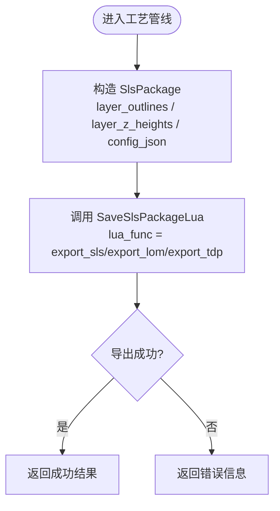
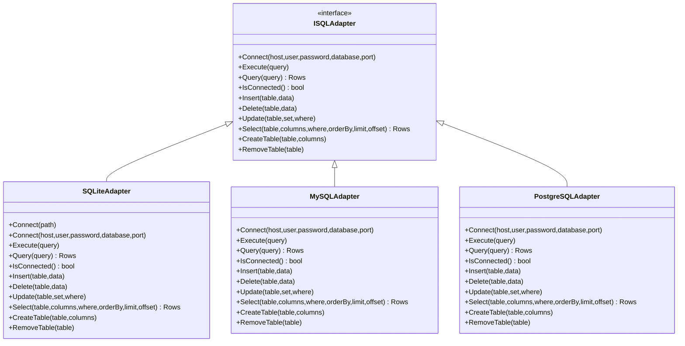
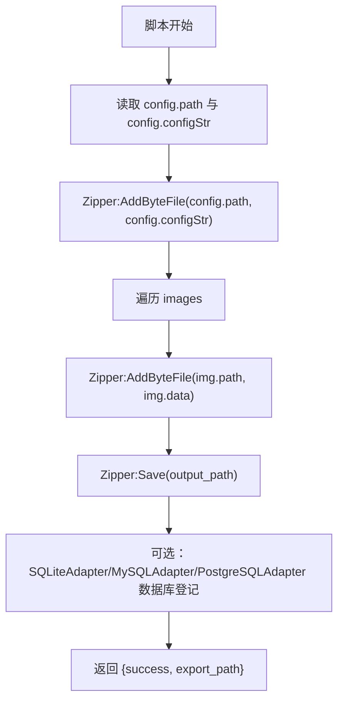
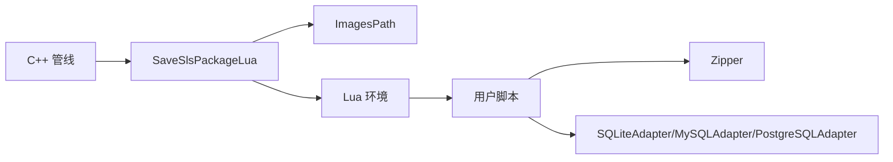

# Export 阶段环境

<cite>
**本文引用的文件**   
- [sls_export.hpp](file://LibHsBaSlicer/Path/sls_export.hpp)
- [sls_export.cpp](file://LibHsBaSlicer/Path/sls_export.cpp)
- [pipeline_types.h](file://pipelinetypes/pipeline_types.h)
- [hsba_slicer.cppm](file://ModuleHsBaSlicer/hsba_slicer.cppm)
- [lom_pipeline.cpp](file://DllHsBaSlicer/lom_pipeline.cpp)
- [tdp_pipeline.cpp](file://DllHsBaSlicer/tdp_pipeline.cpp)
- [sql_adapter.hpp](file://fileoperator/sql_adapter.hpp)
- [sql_adapter.cpp](file://fileoperator/sql_adapter.cpp)
- [my_sls_export.lua](file://samples/SLS/scripts/my_sls_export.lua)
- [my_slm_export.lua](file://samples/SLM/scripts/my_slm_export.lua)
- [my_lom_export.lua](file://samples/LOM/scripts/my_lom_export.lua)
- [my_tdp_export.lua](file://samples/TDP/scripts/my_tdp_export.lua)
- [my_sls_export.lua](file://samples/Custom/scripts/my_sls_export.lua)
</cite>

## 目录
1. [引言](#引言)
2. [项目结构](#项目结构)
3. [核心组件](#核心组件)
4. [架构总览](#架构总览)
5. [详细组件分析](#详细组件分析)
6. [依赖关系分析](#依赖关系分析)
7. [性能与序列化最佳实践](#性能与序列化最佳实践)
8. [故障排除指南](#故障排除指南)
9. [结论](#结论)
10. [附录：导出脚本编写规范](#附录导出脚本编写规范)

## 引言
本文聚焦 SLS、SLM、LOM、TDP 四种工艺在 Export（导出）阶段的环境与约定。该阶段的共同点是：C++ 流水线负责切片、生成每层轮廓与配置 JSON，并通过统一的 Lua 导出接口把数据交给用户自定义脚本；脚本负责打包输出（通常是 zip）、可选地注册数据库记录，并返回结构化结果。本文解释 export_sls()、export_slm()、export_lom()、export_tdp() 的编写规范，说明 images、funcName、config 等变量的使用方式，给出 ExportConfig 与 ExportImage 的数据语义，梳理 SQLiteAdapter、MySQLAdapter、PostgreSQLAdapter 的操作方法，并提供不同工艺类型的导出脚本示例路径与打包、序列化最佳实践。

## 项目结构
Export 相关代码分布在以下位置：
- LibHsBaSlicer/Path：SLS 导出包类型与 SaveSlsPackageLua 接口定义及实现。
- ModuleHsBaSlicer：各工艺管线（SLS/SLM/LOM/TDP）调用 SaveSlsPackageLua 的入口。
- DllHsBaSlicer：部分管线在构建配置 JSON 后调用 SaveSlsPackageLua。
- fileoperator：SQL 适配器抽象与 SQLite/MySQL/PostgreSQL 实现，供 Lua 侧注册数据库能力。
- samples：每种工艺的导出脚本示例，展示 images/config/output_path 的使用与 zip 打包、数据库登记流程。

**图表来源**
- [sls_export.hpp:24-56](file://LibHsBaSlicer/Path/sls_export.hpp#L24-L56)
- [sls_export.cpp:79-123](file://LibHsBaSlicer/Path/sls_export.cpp#L79-L123)
- [hsba_slicer.cppm:875-886](file://ModuleHsBaSlicer/hsba_slicer.cppm#L875-L886)
- [lom_pipeline.cpp:260-301](file://DllHsBaSlicer/lom_pipeline.cpp#L260-L301)
- [tdp_pipeline.cpp:266-307](file://DllHsBaSlicer/tdp_pipeline.cpp#L266-L307)

**章节来源**
- [sls_export.hpp:17-56](file://LibHsBaSlicer/Path/sls_export.hpp#L17-L56)
- [sls_export.cpp:79-123](file://LibHsBaSlicer/Path/sls_export.cpp#L79-L123)
- [hsba_slicer.cppm:875-974](file://ModuleHsBaSlicer/hsba_slicer.cppm#L875-L974)
- [lom_pipeline.cpp:260-301](file://DllHsBaSlicer/lom_pipeline.cpp#L260-L301)
- [tdp_pipeline.cpp:266-307](file://DllHsBaSlicer/tdp_pipeline.cpp#L266-L307)

## 核心组件
- SlsPackage：统一承载每层轮廓、Z 高度、配置 JSON 以及可选螺旋模式数据的导出包。
- SaveSlsPackageLua：将 SlsPackage 序列化为 ImagesPath（包含 config.json 和 layers/N.json），并在 Lua 环境中暴露 images、config、output_path，同时注册 SQL 适配器库。
- 各工艺管线：SLS/SLM/LOM/TDP 在 C++ 侧构造 SlsPackage，并调用 SaveSlsPackageLua，传入对应默认导出函数名（如 export_sls、export_lom、export_tdp）。
- SQL 适配器：ISQLAdapter 抽象接口，提供 SQLiteAdapter、MySQLAdapter、PostgreSQLAdapter 三种后端，支持 Connect/Execute/Query/Insert/Delete/Update/Select/CreateTable/RemoveTable 等统一操作。

**章节来源**
- [sls_export.hpp:24-56](file://LibHsBaSlicer/Path/sls_export.hpp#L24-L56)
- [sls_export.cpp:79-123](file://LibHsBaSlicer/Path/sls_export.cpp#L79-L123)
- [sql_adapter.hpp:30-129](file://fileoperator/sql_adapter.hpp#L30-L129)

## 架构总览
Export 阶段的核心交互如下：
- C++ 管线根据模型与配置计算层数与每层轮廓，填充 SlsPackage。
- SaveSlsPackageLua 将 SlsPackage 转换为 ImagesPath，并把每个层的 PolygonsD 序列化为 JSON，写入 layers/N.json；同时将配置 JSON 写入 config.json。
- 在 Lua 环境中，脚本可访问全局变量：
  - config：table，包含 path="config.json" 与 configStr=JSON 内容。
  - images：数组，每个元素为 {path="layers/N.json", data="<polygon JSON>"}。
  - output_path：字符串，由 C++ 传入的输出文件路径。
- 脚本负责创建 zip（Zipper）、归档配置文件与层数据，并可调用 SQLiteAdapter/MySQLAdapter/PostgreSQLAdapter 进行数据库登记。
- 脚本必须返回 table{success=true/false, export_path="..."}；若返回字符串，C++ 会将其覆盖写入 output_path，从而破坏已生成的 zip。

**图表来源**
- [sls_export.cpp:79-123](file://LibHsBaSlicer/Path/sls_export.cpp#L79-L123)
- [my_sls_export.lua:23-79](file://samples/SLS/scripts/my_sls_export.lua#L23-L79)
- [my_slm_export.lua:15-62](file://samples/SLM/scripts/my_slm_export.lua#L15-L62)
- [my_lom_export.lua:10-57](file://samples/LOM/scripts/my_lom_export.lua#L10-L57)
- [my_tdp_export.lua:15-62](file://samples/TDP/scripts/my_tdp_export.lua#L15-L62)

## 详细组件分析

### SlsPackage 与 SaveSlsPackageLua
- SlsPackage 字段：
  - layer_outlines：每层多边形轮廓。
  - layer_z_heights：每层 Z 高度（毫米）。
  - config_json：配置 JSON 内容。
  - spiral_mode：是否额外暴露连续上升的外壁螺旋路径（spiral/path.json）。
- SaveSlsPackageLua 行为：
  - 将 config_json 以 config.json 形式写入 ImagesPath。
  - 将每层 PolygonsD 序列化为 JSON，并以 layers/N.json 形式写入。
  - 当 spiral_mode 为真时，计算外壁螺旋路径并写入 spiral/path.json。
  - 在 Lua 环境中注册 SQL 适配器库（SQLite/MySQL/PostgreSQL），使脚本可调用数据库 API。
  - 向脚本注入 images、config、output_path 三个全局变量。

**图表来源**
- [sls_export.hpp:24-56](file://LibHsBaSlicer/Path/sls_export.hpp#L24-L56)
- [sls_export.cpp:79-123](file://LibHsBaSlicer/Path/sls_export.cpp#L79-L123)

**章节来源**
- [sls_export.hpp:24-56](file://LibHsBaSlicer/Path/sls_export.hpp#L24-L56)
- [sls_export.cpp:79-123](file://LibHsBaSlicer/Path/sls_export.cpp#L79-L123)

### 各工艺管线对 SaveSlsPackageLua 的调用
- SLS：默认导出函数名为 export_sls。
- SLM：默认导出函数名为 export_lom（注意：当前模块中默认函数名指向 export_lom，需按实际脚本命名调整）。
- LOM：默认导出函数名为 export_lom。
- TDP：默认导出函数名为 export_tdp。

**图表来源**
- [hsba_slicer.cppm:875-886](file://ModuleHsBaSlicer/hsba_slicer.cppm#L875-L886)
- [hsba_slicer.cppm:893-947](file://ModuleHsBaSlicer/hsba_slicer.cppm#L893-L947)
- [hsba_slicer.cppm:953-974](file://ModuleHsBaSlicer/hsba_slicer.cppm#L953-L974)
- [lom_pipeline.cpp:260-301](file://DllHsBaSlicer/lom_pipeline.cpp#L260-L301)
- [tdp_pipeline.cpp:266-307](file://DllHsBaSlicer/tdp_pipeline.cpp#L266-L307)

**章节来源**
- [hsba_slicer.cppm:875-974](file://ModuleHsBaSlicer/hsba_slicer.cppm#L875-L974)
- [lom_pipeline.cpp:260-301](file://DllHsBaSlicer/lom_pipeline.cpp#L260-L301)
- [tdp_pipeline.cpp:266-307](file://DllHsBaSlicer/tdp_pipeline.cpp#L266-L307)

### SQL 适配器接口与实现
- ISQLAdapter：统一抽象接口，定义 Connect/Execute/Query/IsConnected/Insert/Delete/Update/Select/CreateTable/RemoveTable 等方法。
- SQLiteAdapter：面向 SQLite 文件数据库的实现，线程安全，支持事件通知。
- MySQLAdapter：面向 MySQL 服务器的实现（编译条件 HSBA_USE_MYSQL）。
- PostgreSQLAdapter：面向 PostgreSQL 服务器的实现（编译条件 HSBA_USE_PGSQL）。

**图表来源**
- [sql_adapter.hpp:30-129](file://fileoperator/sql_adapter.hpp#L30-L129)
- [sql_adapter.hpp:216-328](file://fileoperator/sql_adapter.hpp#L216-L328)

**章节来源**
- [sql_adapter.hpp:30-129](file://fileoperator/sql_adapter.hpp#L30-L129)
- [sql_adapter.hpp:216-328](file://fileoperator/sql_adapter.hpp#L216-L328)
- [sql_adapter.cpp:42-142](file://fileoperator/sql_adapter.cpp#L42-L142)
- [sql_adapter.cpp:149-189](file://fileoperator/sql_adapter.cpp#L149-L189)
- [sql_adapter.cpp:191-278](file://fileoperator/sql_adapter.cpp#L191-L278)
- [sql_adapter.cpp:285-369](file://fileoperator/sql_adapter.cpp#L285-L369)
- [sql_adapter.cpp:371-489](file://fileoperator/sql_adapter.cpp#L371-L489)
- [sql_adapter.cpp:491-665](file://fileoperator/sql_adapter.cpp#L491-L665)
- [sql_adapter.cpp:667-731](file://fileoperator/sql_adapter.cpp#L667-L731)
- [sql_adapter.cpp:733-800](file://fileoperator/sql_adapter.cpp#L733-L800)

### 导出脚本环境与变量
- config：table，包含 path="config.json" 与 configStr=JSON 内容。脚本应通过 Zipper:AddByteFile(config.path, config.configStr) 归档配置。
- images：数组，每个元素为 {path="layers/N.json", data="<polygon JSON>"}。脚本应遍历 images 并将每层 JSON 归档到 zip。
- output_path：字符串，由 C++ 传入的输出文件路径。脚本应使用 Zipper:Save(output_path) 写出 zip。
- 返回值：必须返回 table{success=true/false, export_path="..."}；切勿返回字符串，否则会覆盖已写出的 zip。

**图表来源**
- [my_sls_export.lua:23-79](file://samples/SLS/scripts/my_sls_export.lua#L23-L79)
- [my_slm_export.lua:15-62](file://samples/SLM/scripts/my_slm_export.lua#L15-L62)
- [my_lom_export.lua:10-57](file://samples/LOM/scripts/my_lom_export.lua#L10-L57)
- [my_tdp_export.lua:15-62](file://samples/TDP/scripts/my_tdp_export.lua#L15-L62)

**章节来源**
- [my_sls_export.lua:23-79](file://samples/SLS/scripts/my_sls_export.lua#L23-L79)
- [my_slm_export.lua:15-62](file://samples/SLM/scripts/my_slm_export.lua#L15-L62)
- [my_lom_export.lua:10-57](file://samples/LOM/scripts/my_lom_export.lua#L10-L57)
- [my_tdp_export.lua:15-62](file://samples/TDP/scripts/my_tdp_export.lua#L15-L62)

## 依赖关系分析
- C++ 管线依赖 SaveSlsPackageLua 来统一处理导出逻辑。
- SaveSlsPackageLua 依赖 ImagesPath 进行数据序列化，并依赖 Lua 环境注册 SQL 适配器。
- 用户脚本依赖 Zipper 进行压缩归档，依赖 SQL 适配器进行数据库登记。
- SQL 适配器依赖具体后端（SQLite/MySQL/PostgreSQL）实现。

**图表来源**
- [sls_export.cpp:79-123](file://LibHsBaSlicer/Path/sls_export.cpp#L79-L123)
- [sql_adapter.hpp:216-328](file://fileoperator/sql_adapter.hpp#L216-L328)

**章节来源**
- [sls_export.cpp:79-123](file://LibHsBaSlicer/Path/sls_export.cpp#L79-L123)
- [sql_adapter.hpp:216-328](file://fileoperator/sql_adapter.hpp#L216-L328)

## 性能与序列化最佳实践
- 避免在脚本中进行重型计算：层轮廓与配置已由 C++ 侧准备好，脚本应专注于归档与登记。
- 使用 Zipper:AddByteFile 直接写入内存字节，减少临时文件 I/O。
- 数据库登记应包裹 pcall 或等价错误捕获，确保失败不影响 zip 输出。
- 对于大模型，优先使用批量 Insert/Update，避免逐行频繁提交。
- 合理使用 limit/offset 分页查询，避免一次性加载大量结果。
- 在螺旋模式下，仅当需要时才启用 spiral_mode，以减少额外计算与数据体积。

[本节为通用指导，不直接分析具体文件]

## 故障排除指南
- 脚本返回字符串导致 zip 被覆盖：检查 export_* 函数的返回值是否为 table；参考示例脚本返回结构。
- 数据库连接失败：确认 SQLite 文件路径正确，或 MySQL/PostgreSQL 主机、用户名、密码、端口与数据库名配置正确；查看异常类型（SQLAdapterConnectionError/SQLAdapterQueryError）。
- 未注册 SQL 适配器：确认 SaveSlsPackageLua 已注册相应适配器；检查编译宏 HSBA_USE_MYSQL/HSBA_USE_PGSQL 是否启用。
- 层数据缺失：检查 SlsPackage.layer_outlines 与 layer_z_heights 是否正确填充；确认 ImagesPath.AddImage 是否成功写入 layers/N.json。

**章节来源**
- [my_sls_export.lua:50-79](file://samples/SLS/scripts/my_sls_export.lua#L50-L79)
- [my_slm_export.lua:35-62](file://samples/SLM/scripts/my_slm_export.lua#L35-L62)
- [my_lom_export.lua:30-57](file://samples/LOM/scripts/my_lom_export.lua#L30-L57)
- [my_tdp_export.lua:35-62](file://samples/TDP/scripts/my_tdp_export.lua#L35-L62)
- [sql_adapter.hpp:131-197](file://fileoperator/sql_adapter.hpp#L131-L197)
- [sql_adapter.cpp:62-83](file://fileoperator/sql_adapter.cpp#L62-L83)
- [sql_adapter.cpp:771-800](file://fileoperator/sql_adapter.cpp#L771-L800)

## 结论
Export 阶段通过统一的 SlsPackage 与 SaveSlsPackageLua 接口，将 C++ 切片的层轮廓与配置传递给 Lua 脚本，脚本负责最终输出格式与数据库登记。不同工艺（SLS/SLM/LOM/TDP）共享同一套导出环境，差异主要体现在默认导出函数名与配置 JSON 的内容。SQL 适配器提供统一的数据库操作接口，便于脚本扩展历史记录、审计与统计功能。遵循本文的编写规范与最佳实践，可以稳定、高效地完成各类工艺的导出任务。

[本节为总结性内容，不直接分析具体文件]

## 附录：导出脚本编写规范

### 函数签名与命名
- export_sls()：SLS 导出脚本入口。
- export_slm()：SLM 导出脚本入口。
- export_lom()：LOM 导出脚本入口。
- export_tdp()：TDP/3DP 导出脚本入口。

**章节来源**
- [my_sls_export.lua:23-79](file://samples/SLS/scripts/my_sls_export.lua#L23-L79)
- [my_slm_export.lua:15-62](file://samples/SLM/scripts/my_slm_export.lua#L15-L62)
- [my_lom_export.lua:10-57](file://samples/LOM/scripts/my_lom_export.lua#L10-L57)
- [my_tdp_export.lua:15-62](file://samples/TDP/scripts/my_tdp_export.lua#L15-L62)

### 环境变量与数据结构
- config：table，包含 path 与 configStr。
- images：数组，元素为 {path, data}。
- output_path：字符串，输出文件路径。
- SlsPackage：C++ 侧导出数据包，包含 layer_outlines、layer_z_heights、config_json、spiral_mode。

**章节来源**
- [sls_export.hpp:24-56](file://LibHsBaSlicer/Path/sls_export.hpp#L24-L56)
- [sls_export.cpp:79-123](file://LibHsBaSlicer/Path/sls_export.cpp#L79-L123)

### 数据库适配器使用方法
- SQLiteAdapter：new() 后调用 Connect(path)，然后 Execute/Insert/Query 等。
- MySQLAdapter：new() 后调用 Connect(host,user,password,database,port)。
- PostgreSQLAdapter：new() 后调用 Connect(host,user,password,database,port)。

**章节来源**
- [sql_adapter.hpp:216-328](file://fileoperator/sql_adapter.hpp#L216-L328)
- [sql_adapter.cpp:149-189](file://fileoperator/sql_adapter.cpp#L149-L189)
- [sql_adapter.cpp:733-800](file://fileoperator/sql_adapter.cpp#L733-L800)

### 打包与序列化最佳实践
- 使用 Zipper:AddByteFile 写入 config.configStr 与 images[i].data。
- 写入 README.txt 说明包内容与层 JSON 格式。
- 使用 Zipper:Save(output_path) 写出最终 zip。
- 数据库登记失败不应中断 zip 输出，建议用 pcall 包裹。

**章节来源**
- [my_sls_export.lua:23-79](file://samples/SLS/scripts/my_sls_export.lua#L23-L79)
- [my_slm_export.lua:15-62](file://samples/SLM/scripts/my_slm_export.lua#L15-L62)
- [my_lom_export.lua:10-57](file://samples/LOM/scripts/my_lom_export.lua#L10-L57)
- [my_tdp_export.lua:15-62](file://samples/TDP/scripts/my_tdp_export.lua#L15-L62)

### 示例脚本路径
- SLS：[my_sls_export.lua](file://samples/SLS/scripts/my_sls_export.lua)
- SLM：[my_slm_export.lua](file://samples/SLM/scripts/my_slm_export.lua)
- LOM：[my_lom_export.lua](file://samples/LOM/scripts/my_lom_export.lua)
- TDP：[my_tdp_export.lua](file://samples/TDP/scripts/my_tdp_export.lua)
- Custom（SLS 示例）：[my_sls_export.lua](file://samples/Custom/scripts/my_sls_export.lua)