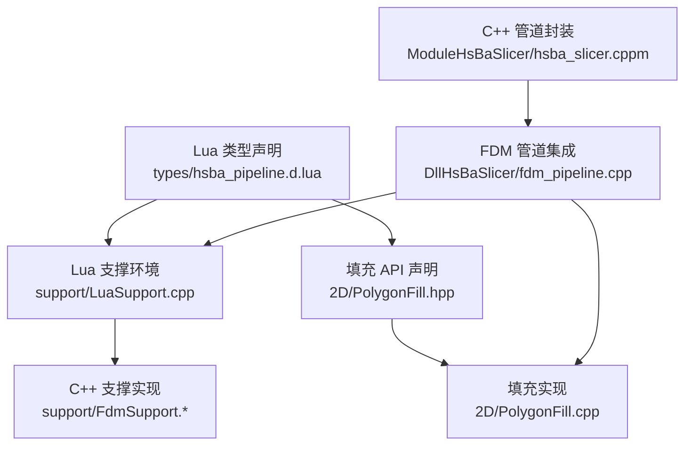
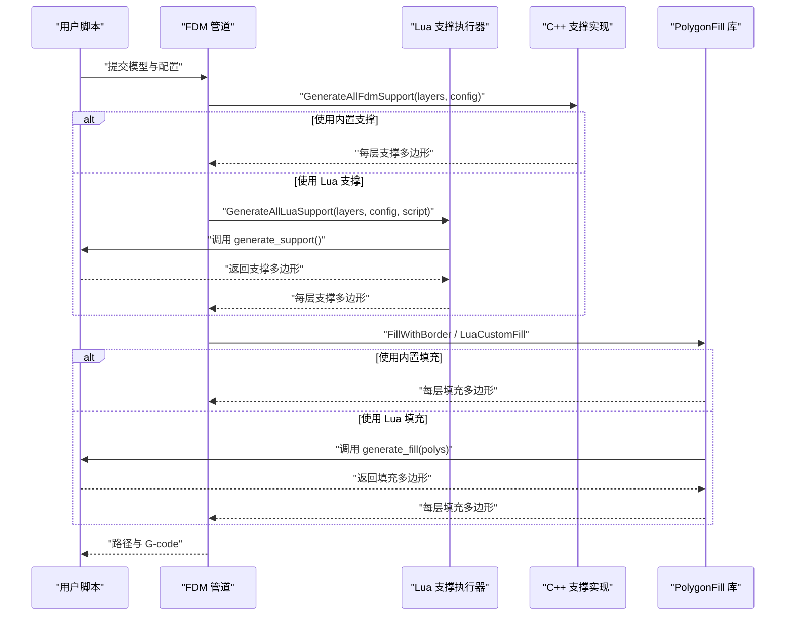
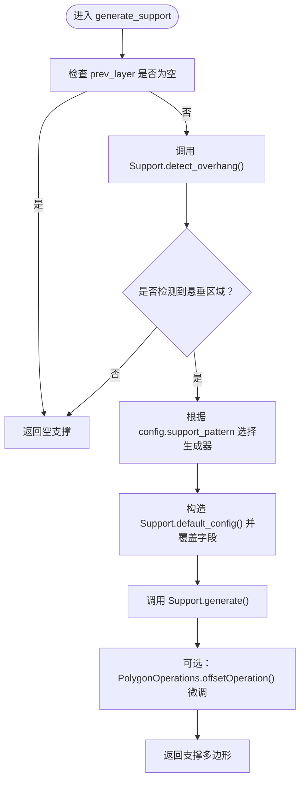
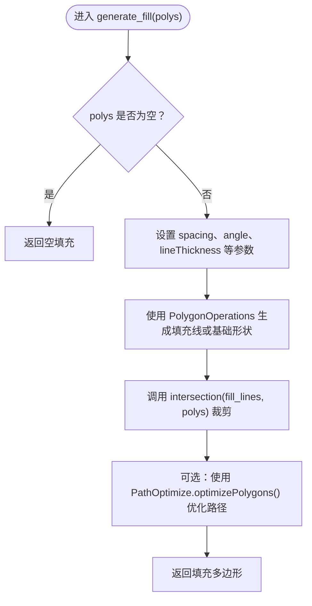
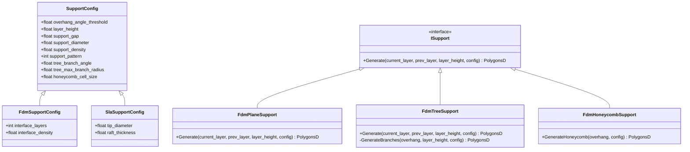
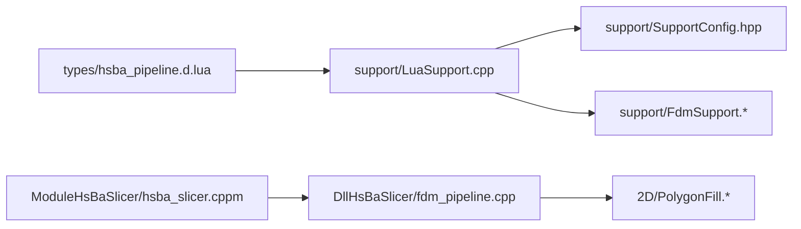

# FDM 阶段环境

<cite>
**本文引用的文件**   
- [support/SupportConfig.hpp](file://support/SupportConfig.hpp)
- [support/LuaSupport.cpp](file://support/LuaSupport.cpp)
- [types/hsba_pipeline.d.lua](file://types/hsba_pipeline.d.lua)
- [samples/FDM/scripts/my_support.lua](file://samples/FDM/scripts/my_support.lua)
- [samples/FDM/scripts/my_infill.lua](file://samples/FDM/scripts/my_infill.lua)
- [2D/PolygonFill.hpp](file://2D/PolygonFill.hpp)
- [2D/PolygonFill.cpp](file://2D/PolygonFill.cpp)
- [LibHsBaSlicer/fdm_support.hpp](file://LibHsBaSlicer/fdm_support.hpp)
- [LibHsBaSlicer/fdm_support.cpp](file://LibHsBaSlicer/fdm_support.cpp)
- [support/FdmSupport.hpp](file://support/FdmSupport.hpp)
- [support/FdmSupport.cpp](file://support/FdmSupport.cpp)
- [ModuleHsBaSlicer/hsba_slicer.cppm](file://ModuleHsBaSlicer/hsba_slicer.cppm)
- [DllHsBaSlicer/fdm_pipeline.cpp](file://DllHsBaSlicer/fdm_pipeline.cpp)
- [tests/PolygonFill/polygon_fill_test.cpp](file://tests/PolygonFill/polygon_fill_test.cpp)
</cite>

## 目录
1. [引言](#引言)
2. [项目结构定位](#项目结构定位)
3. [核心概念：FDM Support 与 Fill 阶段](#核心概念fdm-support-与-fill-阶段)
4. [架构总览](#架构总览)
5. [详细组件分析](#详细组件分析)
6. [依赖关系分析](#依赖关系分析)
7. [性能考虑](#性能考虑)
8. [故障排除指南](#故障排除指南)
9. [结论](#结论)
10. [附录：配置参数与函数参考](#附录配置参数与函数参考)

## 引言
本文聚焦 FDM 切片流水线中的 **Support（支撑）** 和 **Fill（填充）** 两个阶段，重点说明：
- Lua 脚本环境中的 `generate_support()` 与 `generate_fill(polys)` 编写规范。
- 全局变量 `current_layer`、`prev_layer`、`layer_height`、`config` 的语义与使用方式。
- `SupportConfig` 配置参数的含义、默认值及扩展点。
- `PolygonOperations` 与 `PolygonFill` 库在自定义算法中的作用。
- 如何开发自定义支撑和填充算法，以及性能优化建议、常见错误处理方案。

## 项目结构定位
FDM 的 Support 与 Fill 能力分布在多个模块中：
- **Lua 类型声明**：定义 Support/Fill 阶段的脚本接口与全局变量。
- **Lua 支撑执行器**：将 C++ 层数据注入 Lua 环境，并调用用户脚本。
- **C++ 支撑实现**：提供平面、树状、蜂窝等内置支撑策略。
- **填充库**：提供偏移、直线、折线等填充算法，以及 Lua 自定义填充入口。
- **管道集成层**：串联 Slice → Support → Fill → Path 流程，并支持并行与进度上报。

**图表来源**
- [types/hsba_pipeline.d.lua:494-525](file://types/hsba_pipeline.d.lua#L494-L525)
- [support/LuaSupport.cpp:67-90](file://support/LuaSupport.cpp#L67-L90)
- [support/FdmSupport.hpp:19-37](file://support/FdmSupport.hpp#L19-L37)
- [2D/PolygonFill.hpp:20-136](file://2D/PolygonFill.hpp#L20-L136)
- [DllHsBaSlicer/fdm_pipeline.cpp:308-383](file://DllHsBaSlicer/fdm_pipeline.cpp#L308-L383)
- [ModuleHsBaSlicer/hsba_slicer.cppm:640-670](file://ModuleHsBaSlicer/hsba_slicer.cppm#L640-L670)

**章节来源**
- [types/hsba_pipeline.d.lua:494-525](file://types/hsba_pipeline.d.lua#L494-L525)
- [support/LuaSupport.cpp:67-90](file://support/LuaSupport.cpp#L67-L90)
- [2D/PolygonFill.hpp:20-136](file://2D/PolygonFill.hpp#L20-L136)
- [DllHsBaSlicer/fdm_pipeline.cpp:308-383](file://DllHsBaSlicer/fdm_pipeline.cpp#L308-L383)

## 核心概念：FDM Support 与 Fill 阶段
### Support 阶段
- **目标**：根据当前层轮廓与上一层轮廓，检测悬垂区域并生成支撑截面多边形。
- **输入**：
  - `current_layer`：当前层的多边形集合。
  - `prev_layer`：上一层的多边形集合；首层为空。
  - `layer_height`：层高（毫米）。
  - `config`：支撑配置表，包含悬垂角度阈值、层高、支撑间隙、支撑直径、密度、模式等字段。
- **输出**：当前层的支撑截面多边形集合。
- **Lua 入口**：`generate_support()`。
- **C++ 入口**：`GenerateFdmSupport()`、`GenerateAllFdmSupport()`、`GenerateAllLuaSupport()`。

### Fill 阶段
- **目标**：对已扣除壁厚区域的当前层轮廓进行内部填充。
- **输入**：
  - `polys`：当前层多边形（已扣除壁厚区域）。
- **输出**：填充多边形集合。
- **Lua 入口**：`generate_fill(polys)`。
- **C++ 入口**：`LuaCustomFillByFile()`、`LuaCustomFillString()`、`FillWithBorder()`、`ZigzagFill()` 等。

**章节来源**
- [types/hsba_pipeline.d.lua:494-525](file://types/hsba_pipeline.d.lua#L494-L525)
- [LibHsBaSlicer/fdm_support.hpp:19-67](file://LibHsBaSlicer/fdm_support.hpp#L19-L67)
- [2D/PolygonFill.hpp:106-136](file://2D/PolygonFill.hpp#L106-L136)

## 架构总览
FDM 管道的 Support 与 Fill 阶段由 C++ 管道驱动，同时允许通过 Lua 脚本替换或增强算法。

**图表来源**
- [DllHsBaSlicer/fdm_pipeline.cpp:308-383](file://DllHsBaSlicer/fdm_pipeline.cpp#L308-L383)
- [LibHsBaSlicer/fdm_support.cpp:14-37](file://LibHsBaSlicer/fdm_support.cpp#L14-L37)
- [support/LuaSupport.cpp:113-177](file://support/LuaSupport.cpp#L113-L177)
- [2D/PolygonFill.hpp:106-136](file://2D/PolygonFill.hpp#L106-L136)

## 详细组件分析

### Support 阶段环境与 `generate_support()` 编写规范
#### 全局变量语义
- `current_layer`：当前层多边形，用于计算悬垂区域与支撑位置。
- `prev_layer`：上一层多边形；首层为空，表示没有下层支撑面。
- `layer_height`：层高，影响悬垂角度判断与分支生长步长。
- `config`：支撑配置表，字段包括：
  - `overhang_angle_threshold`：悬垂角度阈值（度）。
  - `layer_height`：层高（mm）。
  - `support_gap`：支撑与模型间隙（mm）。
  - `support_diameter`：支撑柱直径（mm）。
  - `support_density`：支撑填充密度 `[0,1]`。
  - `support_pattern`：支撑模式（0=平面，1=树状，2=蜂窝）。
  - `tree_branch_angle`：树状支撑分支角度（度）。
  - `tree_max_branch_radius`：树状支撑最大分支半径（mm）。
  - `honeycomb_cell_size`：蜂窝支撑单元尺寸（mm）。

#### 返回值约定
- 返回一个多边形表，格式与 `current_layer` 一致。
- 若无需支撑，返回空表。

#### 推荐实现步骤
1. 检查 `prev_layer` 是否为空；首层通常不生成支撑。
2. 使用 `Support.detect_overhang(current_layer, prev_layer, layer_height, angle)` 检测悬垂区域。
3. 根据 `config.support_pattern` 选择内置生成器：`Support.new_plane()`、`Support.new_tree()`、`Support.new_honeycomb()`。
4. 构造 `Support.default_config()` 并覆盖必要字段。
5. 调用 `Support.generate(generator, current_layer, prev_layer, layer_height, support_cfg)` 生成支撑。
6. 可选：使用 `PolygonOperations.offsetOperation(result, delta)` 微调支撑接触面。

**图表来源**
- [support/LuaSupport.cpp:67-90](file://support/LuaSupport.cpp#L67-L90)
- [samples/FDM/scripts/my_support.lua:32-79](file://samples/FDM/scripts/my_support.lua#L32-L79)

**章节来源**
- [support/LuaSupport.cpp:19-49](file://support/LuaSupport.cpp#L19-L49)
- [support/LuaSupport.cpp:67-90](file://support/LuaSupport.cpp#L67-L90)
- [support/SupportConfig.hpp:14-34](file://support/SupportConfig.hpp#L14-L34)
- [samples/FDM/scripts/my_support.lua:32-79](file://samples/FDM/scripts/my_support.lua#L32-L79)

### Fill 阶段环境与 `generate_fill(polys)` 编写规范
#### 输入与输出
- 输入：`polys`，即当前层多边形（已扣除壁厚区域）。
- 输出：填充多边形集合。
- 注意：Fill 阶段不注入 `current_layer`、`prev_layer`、`layer_height`、`config` 等全局变量；所有参数应在脚本内设置默认值。

#### 推荐实现步骤
1. 检查 `polys` 是否为空；空轮廓直接返回空表。
2. 设置填充参数：间距 `spacing`、角度 `angle`、线宽等。
3. 使用 `PolygonOperations` 生成平行线或基础几何形状。
4. 使用 `PolygonOperations.intersection(fill_lines, polys)` 裁剪到有效区域。
5. 返回填充多边形。

#### 可用库
- `PolygonOperations`：提供偏移、交集、并集、差集、圆/矩形/正多边形生成、面积计算等。
- `PathOptimize`：在 Fill 阶段可用，用于路径优化（如 `optimizeRegions`、`optimizePolygons`）。

**图表来源**
- [samples/FDM/scripts/my_infill.lua:20-87](file://samples/FDM/scripts/my_infill.lua#L20-L87)
- [tests/PolygonFill/polygon_fill_test.cpp:516-540](file://tests/PolygonFill/polygon_fill_test.cpp#L516-L540)

**章节来源**
- [samples/FDM/scripts/my_infill.lua:1-89](file://samples/FDM/scripts/my_infill.lua#L1-L89)
- [tests/PolygonFill/polygon_fill_test.cpp:516-540](file://tests/PolygonFill/polygon_fill_test.cpp#L516-L540)

### C++ 支撑实现与 `SupportConfig`
#### 内置支撑类
- `FdmPlaneSupport`：平面支撑，基于悬垂区域膨胀为柱状支撑。
- `FdmTreeSupport`：树状支撑，从底板向上生长分支并在相遇时合并。
- `FdmHoneycombSupport`：蜂窝支撑，基于六边形单元生成支撑网格。

#### 配置结构
- `SupportConfig`：通用支撑配置，包含悬垂角度、层高、间隙、直径、密度、模式、树状参数、蜂窝参数。
- `FdmSupportConfig`：继承 `SupportConfig`，增加界面层数与界面密度。
- `SlaSupportConfig`：SLA 专用支撑配置，包含尖端直径与底板厚度。

#### 关键方法
- `Generate(current_layer, prev_layer, layer_height, config)`：各支撑类的统一接口。
- `GenerateFdmSupport()`：根据 `support_pattern` 选择具体实现。
- `GenerateAllFdmSupport()`：批量生成所有层的支撑。

**图表来源**
- [support/SupportConfig.hpp:14-43](file://support/SupportConfig.hpp#L14-L43)
- [support/FdmSupport.hpp:19-42](file://support/FdmSupport.hpp#L19-L42)

**章节来源**
- [support/SupportConfig.hpp:14-43](file://support/SupportConfig.hpp#L14-L43)
- [support/FdmSupport.hpp:19-42](file://support/FdmSupport.hpp#L19-L42)
- [support/FdmSupport.cpp:145-181](file://support/FdmSupport.cpp#L145-L181)

### PolygonFill 库使用方法
#### 主要函数
- `OffsetFill(poly, spacing, join_type)`：基于偏移的填充。
- `LineFill(poly, spacing, angle_deg, lineThickness)`：平行线填充。
- `SimpleZigzagFill(poly, spacing, angle_deg, lineThickness)`：简单折线填充。
- `ZigzagFill(poly, spacing, angle_deg, lineThickness)`：改进角处理的折线填充。
- `CompositeOffsetFill(...)`：复合偏移填充。
- `HybridFill(...)`：混合填充。
- `LuaCustomFill(scriptPath, functionName, lineThickness, lua_reg)`：Lua 自定义填充。
- `LuaCustomFillString(script, functionName, lineThickness, lua_reg)`：内联 Lua 自定义填充。

#### 使用建议
- 对于规则区域，优先使用 `LineFill` 或 `ZigzagFill`。
- 对于复杂边界，使用 `CompositeOffsetFill` 或 `HybridFill`。
- 自定义算法使用 `LuaCustomFill` 或 `LuaCustomFillString`，并通过 `PolygonOperations` 操作多边形。

**章节来源**
- [2D/PolygonFill.hpp:20-136](file://2D/PolygonFill.hpp#L20-L136)
- [2D/PolygonFill.cpp:1-48](file://2D/PolygonFill.cpp#L1-L48)

## 依赖关系分析
FDM 管道在 Support 与 Fill 阶段的关键依赖如下：

**图表来源**
- [types/hsba_pipeline.d.lua:494-525](file://types/hsba_pipeline.d.lua#L494-L525)
- [support/LuaSupport.cpp:67-90](file://support/LuaSupport.cpp#L67-L90)
- [support/SupportConfig.hpp:14-43](file://support/SupportConfig.hpp#L14-L43)
- [support/FdmSupport.hpp:19-42](file://support/FdmSupport.hpp#L19-L42)
- [DllHsBaSlicer/fdm_pipeline.cpp:308-383](file://DllHsBaSlicer/fdm_pipeline.cpp#L308-L383)
- [ModuleHsBaSlicer/hsba_slicer.cppm:640-670](file://ModuleHsBaSlicer/hsba_slicer.cppm#L640-L670)

**章节来源**
- [DllHsBaSlicer/fdm_pipeline.cpp:308-383](file://DllHsBaSlicer/fdm_pipeline.cpp#L308-L383)
- [ModuleHsBaSlicer/hsba_slicer.cppm:640-670](file://ModuleHsBaSlicer/hsba_slicer.cppm#L640-L670)

## 性能考虑
- **并行填充**：C++ 填充函数（如 `FillWithBorder`）可安全并行执行；Lua 填充因共享解释器需串行执行。
- **避免重复计算**：在 `generate_fill` 中缓存常用参数（如角度弧度、边界框），减少循环内计算。
- **多边形裁剪优化**：优先使用 `PolygonOperations.intersection` 而非手动遍历顶点。
- **支撑密度控制**：通过 `support_density` 和 `honeycomb_cell_size` 平衡支撑强度与材料用量。
- **悬垂检测阈值**：合理设置 `overhang_angle_threshold`，避免过多无效支撑。

[本节为通用性能指导，不直接分析具体源码文件]

## 故障排除指南
### Support 阶段常见问题
- **首层误生成支撑**：检查 `prev_layer` 是否为空；若为空应直接返回空表。
- **悬垂检测无结果**：确认 `layer_height` 与 `overhang_angle_threshold` 设置合理。
- **支撑与模型重叠**：调整 `support_gap`，确保支撑与模型之间留有间隙。
- **Lua 脚本加载失败**：检查脚本语法与函数名是否正确；查看 `RuntimeError` 消息。

**章节来源**
- [support/LuaSupport.cpp:131-177](file://support/LuaSupport.cpp#L131-L177)
- [samples/FDM/scripts/my_support.lua:32-79](file://samples/FDM/scripts/my_support.lua#L32-L79)

### Fill 阶段常见问题
- **未传入全局变量**：Fill 阶段不提供 `current_layer`、`config` 等全局变量；请在脚本内设置默认值。
- **路径优化不可用**：确认脚本中使用了 `PathOptimize.optimizeRegions` 或 `optimizePolygons`，并确保测试用例通过。
- **填充结果为空**：检查 `polys` 是否为空，或 `intersection` 裁剪后是否无有效区域。

**章节来源**
- [samples/FDM/scripts/my_infill.lua:1-89](file://samples/FDM/scripts/my_infill.lua#L1-L89)
- [tests/PolygonFill/polygon_fill_test.cpp:516-540](file://tests/PolygonFill/polygon_fill_test.cpp#L516-L540)

## 结论
FDM 的 Support 与 Fill 阶段提供了灵活的 Lua 脚本扩展点，允许开发者在不修改 C++ 核心的情况下定制支撑与填充算法。通过理解 `current_layer`、`prev_layer`、`layer_height`、`config` 的语义，并结合 `PolygonOperations` 与 `PolygonFill` 库，可以高效实现自定义算法。同时，遵循性能优化建议与故障排除指南，能够显著提升打印质量与运行效率。

[本节为总结性内容，不直接分析具体源码文件]

## 附录：配置参数与函数参考

### SupportConfig 配置参数表
| 参数名 | 类型 | 默认值 | 说明 |
|--------|------|--------|------|
| `overhang_angle_threshold` | float | 45.0 | 悬垂角度阈值（度） |
| `layer_height` | float | 0.2 | 层高（mm） |
| `support_gap` | float | 0.5 | 支撑与模型间隙（mm） |
| `support_diameter` | float | 2.0 | 支撑柱直径（mm） |
| `support_density` | float | 0.3 | 支撑填充密度 `[0,1]` |
| `support_pattern` | int | 0 | 支撑模式（0=平面，1=树状，2=蜂窝） |
| `tree_branch_angle` | float | 30.0 | 树状支撑分支角度（度） |
| `tree_max_branch_radius` | float | 5.0 | 树状支撑最大分支半径（mm） |
| `honeycomb_cell_size` | float | 5.0 | 蜂窝支撑单元尺寸（mm） |

**章节来源**
- [support/SupportConfig.hpp:14-34](file://support/SupportConfig.hpp#L14-L34)

### 关键函数签名参考
- `GenerateFdmSupport(current_layer, prev_layer, layer_height, config)`
- `GenerateAllFdmSupport(layers, config)`
- `GenerateAllLuaSupport(layers, config, script, functionName)`
- `LuaCustomFill(scriptPath, functionName, lineThickness, lua_reg)`
- `LuaCustomFillString(script, functionName, lineThickness, lua_reg)`
- `OffsetFill(poly, spacing, join_type)`
- `LineFill(poly, spacing, angle_deg, lineThickness)`
- `ZigzagFill(poly, spacing, angle_deg, lineThickness)`

**章节来源**
- [LibHsBaSlicer/fdm_support.hpp:19-67](file://LibHsBaSlicer/fdm_support.hpp#L19-L67)
- [2D/PolygonFill.hpp:20-136](file://2D/PolygonFill.hpp#L20-L136)