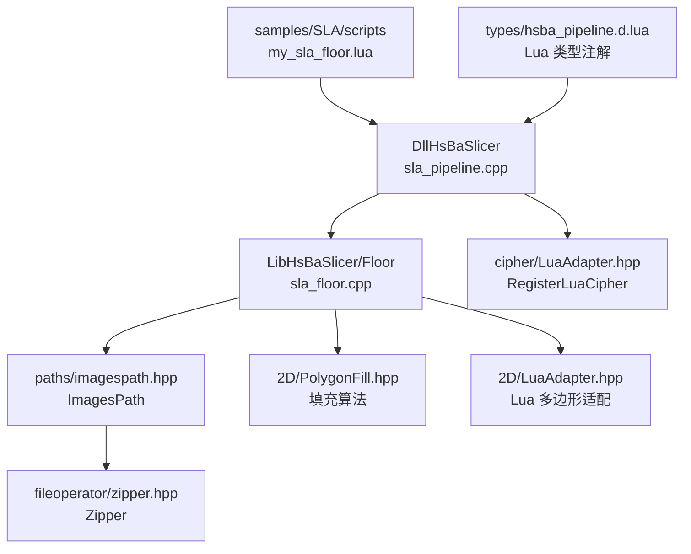
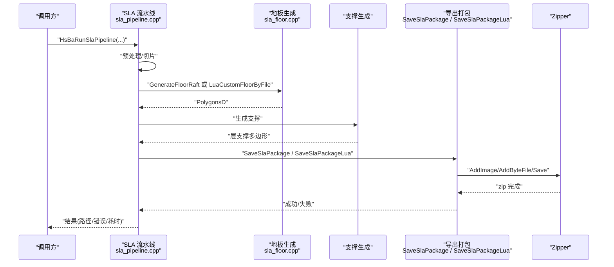
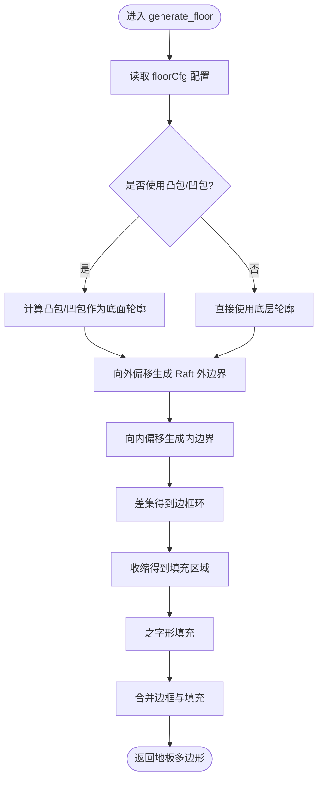
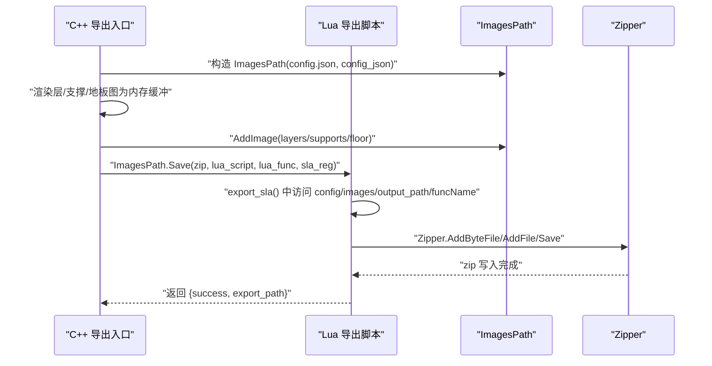
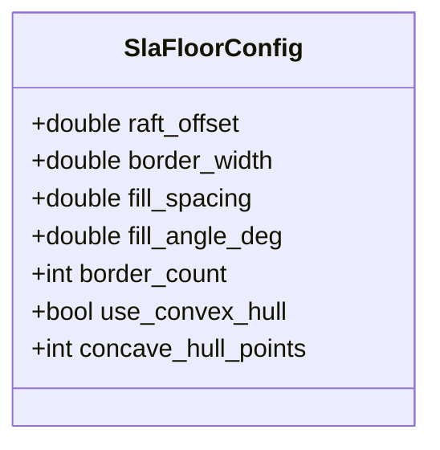
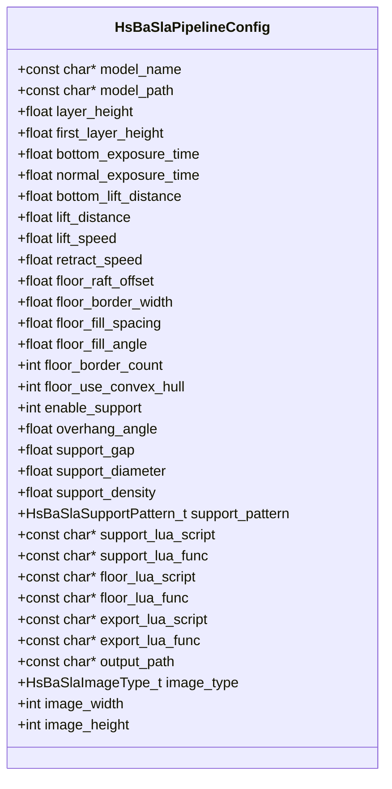
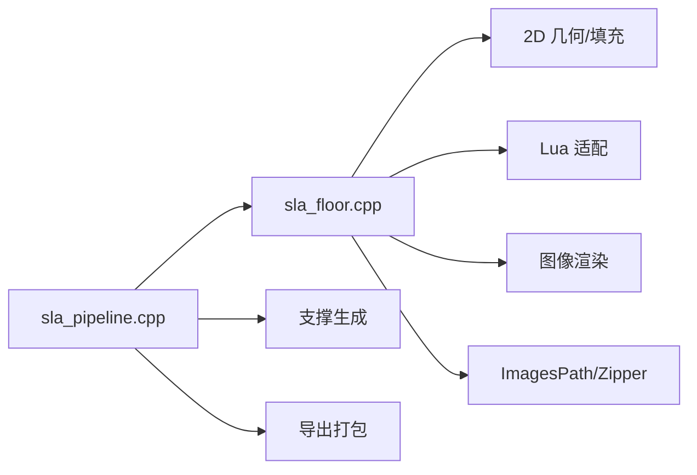
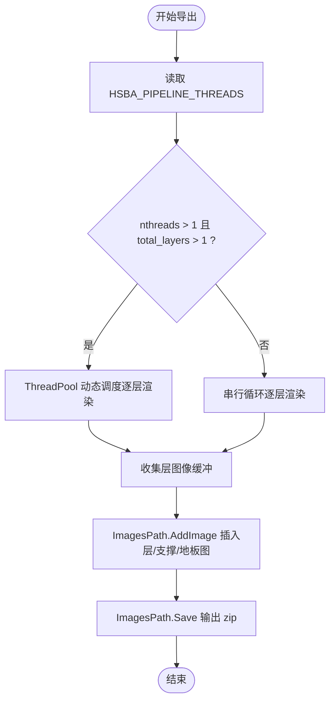
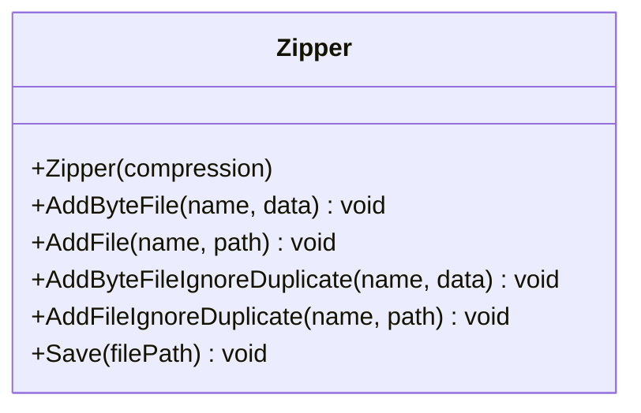
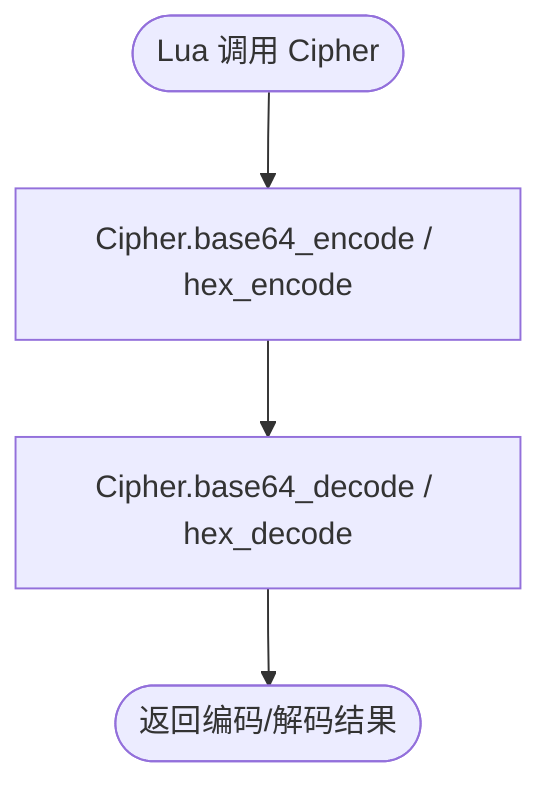

# SLA 阶段环境

<cite>
**本文引用的文件**   
- [sla_floor.hpp](file://LibHsBaSlicer/Floor/sla_floor.hpp)
- [sla_floor.cpp](file://LibHsBaSlicer/Floor/sla_floor.cpp)
- [sla_pipeline.h](file://DllHsBaSlicer/sla_pipeline.h)
- [sla_pipeline.cpp](file://DllHsBaSlicer/sla_pipeline.cpp)
- [pipeline_types.h](file://pipelinetypes/pipeline_types.h)
- [zipper.hpp](file://fileoperator/zipper.hpp)
- [zipper.cpp](file://fileoperator/zipper.cpp)
- [LuaAdapter.hpp](file://cipher/LuaAdapter.hpp)
- [LuaAdapter.cpp](file://cipher/LuaAdapter.cpp)
- [my_sla_floor.lua](file://samples/SLA/scripts/my_sla_floor.lua)
- [hsba_pipeline.d.lua](file://types/hsba_pipeline.d.lua)
</cite>

## 目录
1. [引言](#引言)
2. [项目结构](#项目结构)
3. [核心组件](#核心组件)
4. [架构总览](#架构总览)
5. [详细组件分析](#详细组件分析)
6. [依赖关系分析](#依赖关系分析)
7. [性能与并行处理](#性能与并行处理)
8. [开发指南：自定义地板与导出脚本](#开发指南自定义地板与导出脚本)
9. [Zipper 与 Cipher 工具库使用指南](#zipper-与-cipher-工具库使用指南)
10. [最佳实践](#最佳实践)
11. [故障排除](#故障排除)
12. [结论](#结论)

## 引言
本文聚焦 SLA（立体光刻）流水线中的 Floor（地板/底板）和 Export（导出）两个阶段，围绕以下目标展开：
- 解释 generate_floor(bottomLayer, floorCfg) 与 export_sla() 的调用约定、参数结构与返回值。
- 说明 bottomLayer、floorCfg、images、funcName 等变量在 Lua 阶段环境中的含义与用法。
- 给出基于源码的 FloorConfig 配置字段说明。
- 梳理 Zipper 压缩打包与 Cipher 编码哈希工具在导出阶段的可用能力。
- 提供完整的自定义地板生成与 SLA 导出脚本示例路径，并总结图像处理与数据打包的最佳实践。

## 项目结构
SLA 相关代码主要分布在以下模块：
- DllHsBaSlicer：对外 C ABI 与 SLA 流水线编排（预处理→切片→Floor→支撑→Export）。
- LibHsBaSlicer/Floor：SLA 地板生成、图像渲染与 SLA 包导出 API。
- fileoperator：Zipper ZIP 压缩实现。
- cipher：Cipher 编码/哈希模块及其 Lua 绑定。
- samples/SLA/scripts：自定义 SLA 地板脚本示例。
- types/hsba_pipeline.d.lua：各阶段 Lua 类型注解与全局变量声明。

**图示来源**
- [sla_pipeline.cpp:299-483](file://DllHsBaSlicer/sla_pipeline.cpp#L299-L483)
- [sla_floor.cpp:148-314](file://LibHsBaSlicer/Floor/sla_floor.cpp#L148-L314)
- [zipper.hpp:40-87](file://fileoperator/zipper.hpp#L40-L87)
- [LuaAdapter.cpp:92-96](file://cipher/LuaAdapter.cpp#L92-L96)
- [my_sla_floor.lua:35-63](file://samples/SLA/scripts/my_sla_floor.lua#L35-L63)
- [hsba_pipeline.d.lua:528-591](file://types/hsba_pipeline.d.lua#L528-L591)

**章节来源**
- [sla_pipeline.h:17-56](file://DllHsBaSlicer/sla_pipeline.h#L17-L56)
- [sla_pipeline.cpp:299-483](file://DllHsBaSlicer/sla_pipeline.cpp#L299-L483)
- [sla_floor.hpp:21-195](file://LibHsBaSlicer/Floor/sla_floor.hpp#L21-L195)

## 核心组件
- SLA 流水线 C ABI：提供创建默认配置、同步/异步运行流水线、释放结果的能力。
- Floor 生成：支持内置 raft/border/fill 生成，以及通过 Lua 自定义地板。
- 图像渲染：将多边形自动缩放至指定像素尺寸并输出 PNG/JPG/SVG。
- SLA 包导出：将层轮廓、支撑、地板与 config.json 打包为 zip；支持 Lua 自定义导出。
- Zipper：基于 miniz 的 ZIP 压缩器，支持内存/磁盘文件添加与进度事件。
- Cipher：向 Lua 暴露 base64/hex 编解码能力。

**章节来源**
- [sla_pipeline.h:17-56](file://DllHsBaSlicer/sla_pipeline.h#L17-L56)
- [sla_floor.hpp:21-195](file://LibHsBaSlicer/Floor/sla_floor.hpp#L21-L195)
- [zipper.hpp:40-101](file://fileoperator/zipper.hpp#L40-L101)
- [LuaAdapter.cpp:92-96](file://cipher/LuaAdapter.cpp#L92-L96)

## 架构总览
SLA 流水线整体流程如下：
- 预处理：加载模型、计算包围盒与层数。
- 切片：构建拓扑并按层并行切片。
- Floor：根据底层轮廓生成地板（内置或 Lua 自定义）。
- 支撑：按策略生成支撑（内置或 Lua 自定义）。
- Export：渲染层图、支撑图、地板图，并打包为 zip；可被 Lua 自定义导出逻辑接管。

**图示来源**
- [sla_pipeline.cpp:299-483](file://DllHsBaSlicer/sla_pipeline.cpp#L299-L483)
- [sla_floor.cpp:49-117](file://LibHsBaSlicer/Floor/sla_floor.cpp#L49-L117)
- [sla_floor.cpp:468-606](file://LibHsBaSlicer/Floor/sla_floor.cpp#L468-L606)
- [zipper.cpp:114-129](file://fileoperator/zipper.cpp#L114-L129)

## 详细组件分析

### Floor 阶段：generate_floor(bottomLayer, floorCfg)
- 入口函数签名与调用约定：
  - Lua 侧：function generate_floor(bottomLayer, floorCfg) → Polygons
  - C++ 侧：LuaCustomFloorByFile / LuaCustomFloorByString 负责加载脚本、注入 PolygonOperations 与 PolygonFill、传递 bottom_layer 与 config，并解析返回的多边形表。
- bottomLayer：底层轮廓多边形数组，每个多边形由 {x,y} 点表组成。
- floorCfg：FloorConfig 配置表，包含 raft_offset、border_width、fill_spacing、fill_angle_deg、border_count、use_convex_hull、concave_hull_points。
- 返回值：地板多边形表，格式同 bottomLayer。

**图示来源**
- [my_sla_floor.lua:35-63](file://samples/SLA/scripts/my_sla_floor.lua#L35-L63)
- [sla_floor.cpp:148-314](file://LibHsBaSlicer/Floor/sla_floor.cpp#L148-L314)

**章节来源**
- [sla_floor.hpp:80-116](file://LibHsBaSlicer/Floor/sla_floor.hpp#L80-L116)
- [sla_floor.cpp:148-314](file://LibHsBaSlicer/Floor/sla_floor.cpp#L148-L314)
- [my_sla_floor.lua:1-64](file://samples/SLA/scripts/my_sla_floor.lua#L1-L64)
- [hsba_pipeline.d.lua:528-538](file://types/hsba_pipeline.d.lua#L528-L538)

### Export 阶段：export_sla()
- 入口函数签名与调用约定：
  - Lua 侧：function export_sla() → table{success, export_path}
  - C++ 侧：SaveSlaPackageLua 会注册 2D 与 File 函数，并通过 ImagesPath.Save 执行 Lua 导出脚本。
- 全局变量：
  - config：导出配置 JSON 字符串（ExportConfig），包含 path="config.json" 与 configStr。
  - images：层图片数据数组，每项含 path 与 data（二进制图像字节）。
  - output_path：输出 zip 路径。
  - funcName：当前导出函数名标识。
- 可用库：Zipper、Cipher、SQLite/MySQL/PostgreSQL 适配器（取决于导出环境）。

**图示来源**
- [sla_floor.cpp:531-606](file://LibHsBaSlicer/Floor/sla_floor.cpp#L531-L606)
- [hsba_pipeline.d.lua:547-591](file://types/hsba_pipeline.d.lua#L547-L591)

**章节来源**
- [sla_floor.hpp:157-195](file://LibHsBaSlicer/Floor/sla_floor.hpp#L157-L195)
- [sla_floor.cpp:531-606](file://LibHsBaSlicer/Floor/sla_floor.cpp#L531-L606)
- [hsba_pipeline.d.lua:547-591](file://types/hsba_pipeline.d.lua#L547-L591)

### SlaFloorConfig 配置参数
- raft_offset：Raft 从模型足迹向外扩展的距离（毫米）。
- border_width：边框环宽度（毫米）。
- fill_spacing：内部填充线间距（毫米）。
- fill_angle_deg：填充图案角度（度）。
- border_count：边框偏移环数量。
- use_convex_hull：是否使用凸包替代直接足迹。
- concave_hull_points：凹包简化额外点数（0=禁用）。

**图示来源**
- [sla_floor.hpp:21-33](file://LibHsBaSlicer/Floor/sla_floor.hpp#L21-L33)

**章节来源**
- [sla_floor.hpp:21-33](file://LibHsBaSlicer/Floor/sla_floor.hpp#L21-L33)
- [sla_floor.cpp:121-145](file://LibHsBaSlicer/Floor/sla_floor.cpp#L121-L145)

### SLA 流水线配置（HsBaSlaPipelineConfig_t）
- 模型与切片：model_name、model_path、layer_height、first_layer_height。
- 曝光与提升：bottom_exposure_time、normal_exposure_time、lift_distance、lift_speed、retract_speed。
- Floor：floor_raft_offset、floor_border_width、floor_fill_spacing、floor_fill_angle、floor_border_count、floor_use_convex_hull。
- 支撑：enable_support、overhang_angle、support_gap、support_diameter、support_density、support_pattern。
- Lua 定制：support_lua_script/func、floor_lua_script/func、export_lua_script/func。
- 输出：output_path、image_type、image_width、image_height。

**图示来源**
- [pipeline_types.h:165-218](file://pipelinetypes/pipeline_types.h#L165-L218)

**章节来源**
- [pipeline_types.h:165-218](file://pipelinetypes/pipeline_types.h#L165-L218)
- [sla_pipeline.cpp:244-282](file://DllHsBaSlicer/sla_pipeline.cpp#L244-L282)

## 依赖关系分析
- SLA 流水线编排（sla_pipeline.cpp）依赖：
  - 模型预处理与切片（ModelInfo、BuildSliceTopology、SliceLayer）。
  - Floor 生成（GenerateFloorRaft 或 LuaCustomFloorByFile）。
  - 支撑生成（GenerateAllSlaSupport 或 GenerateAllLuaSupport）。
  - 导出（SaveSlaPackage 或 SaveSlaPackageLua）。
- Floor 模块（sla_floor.cpp）依赖：
  - 2D 几何与填充（ConvexHull、ConcaveHullSimulation、Offset、Difference、ZigzagFill）。
  - Lua 适配（PolygonOperations、PolygonFill）。
  - 图像渲染（ToImage、ToImageBuffer）。
  - 打包（ImagesPath、Zipper）。
- 导出阶段（SaveSlaPackageLua）依赖：
  - 注册 2D 与 File 函数（Get2DFunctions、GetFileFunctions）。
  - ImagesPath.Save 执行 Lua 导出脚本。

**图示来源**
- [sla_pipeline.cpp:299-483](file://DllHsBaSlicer/sla_pipeline.cpp#L299-L483)
- [sla_floor.cpp:148-314](file://LibHsBaSlicer/Floor/sla_floor.cpp#L148-L314)
- [sla_floor.cpp:468-606](file://LibHsBaSlicer/Floor/sla_floor.cpp#L468-L606)

**章节来源**
- [sla_pipeline.cpp:299-483](file://DllHsBaSlicer/sla_pipeline.cpp#L299-L483)
- [sla_floor.cpp:148-314](file://LibHsBaSlicer/Floor/sla_floor.cpp#L148-L314)
- [sla_floor.cpp:468-606](file://LibHsBaSlicer/Floor/sla_floor.cpp#L468-L606)

## 性能与并行处理
- 层渲染并行化：ForLayersParallel 根据 HSBA_PIPELINE_THREADS 环境变量与硬件并发度动态分配线程，对每层独立渲染进行并行处理，异常通过 futures 回传。
- 单线程降级：当线程数为 1 或层数为 1 时退化为串行循环，保证受限平台行为一致。
- 内存缓冲渲染：RenderPolygonsToImageBuffer 避免中间文件往返，减少 IO 开销。

**图示来源**
- [sla_floor.cpp:405-465](file://LibHsBaSlicer/Floor/sla_floor.cpp#L405-L465)
- [sla_floor.cpp:468-529](file://LibHsBaSlicer/Floor/sla_floor.cpp#L468-L529)

**章节来源**
- [sla_floor.cpp:405-465](file://LibHsBaSlicer/Floor/sla_floor.cpp#L405-L465)
- [sla_floor.cpp:468-529](file://LibHsBaSlicer/Floor/sla_floor.cpp#L468-L529)

## 开发指南：自定义地板与导出脚本

### 自定义地板脚本规范
- 文件名与位置：samples/SLA/scripts/my_sla_floor.lua（可作为模板）。
- 函数签名：function generate_floor(bottomLayer, floorCfg) → Polygons
- 输入：
  - bottomLayer：底层多边形表，元素为多边形表，每个多边形为 {x,y} 点表。
  - floorCfg：FloorConfig 表，字段包括 raft_offset、border_width、fill_spacing、fill_angle_deg、border_count、use_convex_hull、concave_hull_points。
- 可用库：
  - PolygonOperations：offsetOperation、union、difference、intersection、convexHullOperation。
  - PolygonFill：zigzagFill、lineFill、offsetFill。
- 输出：地板多边形表，格式同 bottomLayer。

参考示例路径：
- [my_sla_floor.lua:35-63](file://samples/SLA/scripts/my_sla_floor.lua#L35-L63)

**章节来源**
- [my_sla_floor.lua:1-64](file://samples/SLA/scripts/my_sla_floor.lua#L1-L64)
- [sla_floor.hpp:80-116](file://LibHsBaSlicer/Floor/sla_floor.hpp#L80-L116)
- [hsba_pipeline.d.lua:528-538](file://types/hsba_pipeline.d.lua#L528-L538)

### 导出脚本 export_sla() 规范
- 函数签名：function export_sla() → table{success, export_path}
- 全局变量：
  - config：ExportConfig，包含 path="config.json" 与 configStr（JSON 字符串）。
  - images：ExportImage[]，每项含 path（如 "layers/0.png"）与 data（图像字节）。
  - output_path：输出 zip 路径。
  - funcName：当前导出函数名标识。
- 可用库：
  - Zipper：AddByteFile、AddFile、AddByteFileIgnoreDuplicate、AddFileIgnoreDuplicate、Save。
  - Cipher：base64_encode、base64_decode、hex_encode、hex_decode。
  - SQLite/MySQL/PostgreSQL 适配器（视导出环境而定）。

参考类型定义：
- [hsba_pipeline.d.lua:547-591](file://types/hsba_pipeline.d.lua#L547-L591)

**章节来源**
- [hsba_pipeline.d.lua:547-591](file://types/hsba_pipeline.d.lua#L547-L591)
- [LuaAdapter.cpp:92-96](file://cipher/LuaAdapter.cpp#L92-L96)

## Zipper 与 Cipher 工具库使用指南

### Zipper
- 用途：ZIP 压缩归档，支持内存与磁盘文件添加，支持重复名称自动追加 "_duplicate"。
- 关键方法：
  - AddByteFile(name, data)：添加内存数据。
  - AddFile(name, path)：添加磁盘文件。
  - AddByteFileIgnoreDuplicate(name, data)：忽略重复名称冲突。
  - AddFileIgnoreDuplicate(name, path)：忽略重复名称冲突。
  - Save(filePath)：写出 ZIP 文件。
- 事件：继承 EventSource，可在添加文件后触发进度事件。

**图示来源**
- [zipper.hpp:40-87](file://fileoperator/zipper.hpp#L40-L87)
- [zipper.cpp:50-129](file://fileoperator/zipper.cpp#L50-L129)

**章节来源**
- [zipper.hpp:40-101](file://fileoperator/zipper.hpp#L40-L101)
- [zipper.cpp:50-129](file://fileoperator/zipper.cpp#L50-L129)

### Cipher
- 用途：向 Lua 暴露编码/哈希能力，常用 base64 与 hex 编解码。
- Lua 接口：
  - Cipher.base64_encode(data) → string
  - Cipher.base64_decode(data) → string
  - Cipher.hex_encode(data) → string
  - Cipher.hex_decode(data) → string
- 注册方式：RegisterLuaCipher(L) 将 Cipher 表挂到全局。

**图示来源**
- [LuaAdapter.cpp:13-96](file://cipher/LuaAdapter.cpp#L13-L96)

**章节来源**
- [LuaAdapter.hpp:11-14](file://cipher/LuaAdapter.hpp#L11-L14)
- [LuaAdapter.cpp:13-96](file://cipher/LuaAdapter.cpp#L13-L96)

## 最佳实践
- 图像处理：
  - 优先使用 RenderPolygonsToImageBuffer 避免临时文件 IO。
  - 合理设置 image_width/image_height，未指定时自动按多边形包围盒拟合像素尺寸。
  - 选择合适图像格式：PNG（无损）、JPG（体积更小）、SVG（矢量）。
- 数据打包：
  - 使用 ImagesPath 统一写入 config.json 与各层/支撑/地板图像。
  - 在 Lua 导出脚本中使用 Zipper.AddByteFileIgnoreDuplicate 避免命名冲突。
  - 利用 Cipher 对敏感数据进行 base64/hex 编码后再写入 zip。
- 并行与性能：
  - 通过 HSBA_PIPELINE_THREADS 控制导出阶段并行度。
  - 确保 work() 仅访问自身输出槽，避免跨层竞争。
- 自定义脚本：
  - 遵循 generate_floor(bottomLayer, floorCfg) 与 export_sla() 的签名与返回约定。
  - 充分利用 PolygonOperations 与 PolygonFill 提供的几何与填充能力。
  - 在导出脚本中谨慎操作文件系统，尽量使用内存缓冲与 Zipper。

[本节为通用指导，不直接分析具体文件]

## 故障排除
- Lua 地板脚本错误：
  - 检查函数名是否正确（默认 generate_floor）。
  - 确认 bottomLayer 与 floorCfg 字段完整。
  - 查看 RuntimeError 抛出信息（加载脚本、调用函数、解析返回表）。
- 导出失败：
  - 检查 output_path 是否有效。
  - 确认 config.json 内容正确。
  - 若使用 SaveSlaPackageLua，确保 Lua 导出脚本返回 {success, export_path}。
- 并行问题：
  - 调整 HSBA_PIPELINE_THREADS 环境变量。
  - 检查 work() 是否只访问自身输出槽。

**章节来源**
- [sla_floor.cpp:148-314](file://LibHsBaSlicer/Floor/sla_floor.cpp#L148-L314)
- [sla_floor.cpp:468-606](file://LibHsBaSlicer/Floor/sla_floor.cpp#L468-L606)

## 结论
SLA 流水线的 Floor 与 Export 阶段提供了灵活的扩展点：
- Floor 阶段可通过内置算法或 Lua 自定义脚本生成底板，支持凸包/凹包简化、边框环与填充。
- Export 阶段通过 ImagesPath 与 Zipper 将层图、支撑图、地板图与配置打包为 zip，并可完全由 Lua 导出脚本接管。
- 借助 ForLayersParallel 与 RenderPolygonsToImageBuffer，导出阶段具备良好的并行性与性能。
- 开发者应严格遵循 generate_floor 与 export_sla 的调用约定，合理使用 FloorConfig、Zipper 与 Cipher，以获得稳定高效的 SLA 数据处理流程。

[本节为总结性内容，不直接分析具体文件]