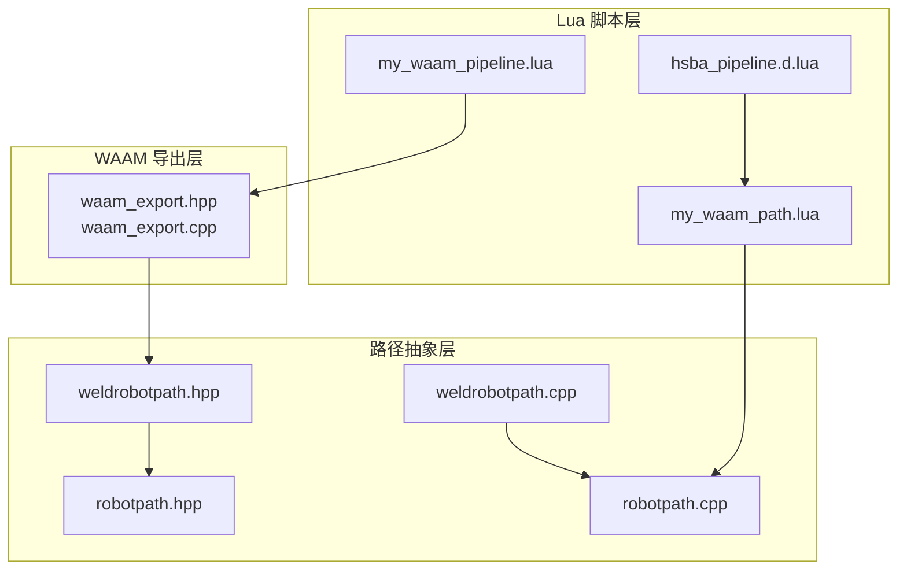
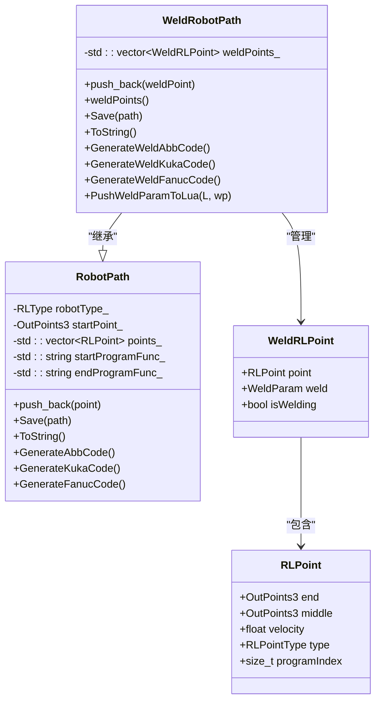
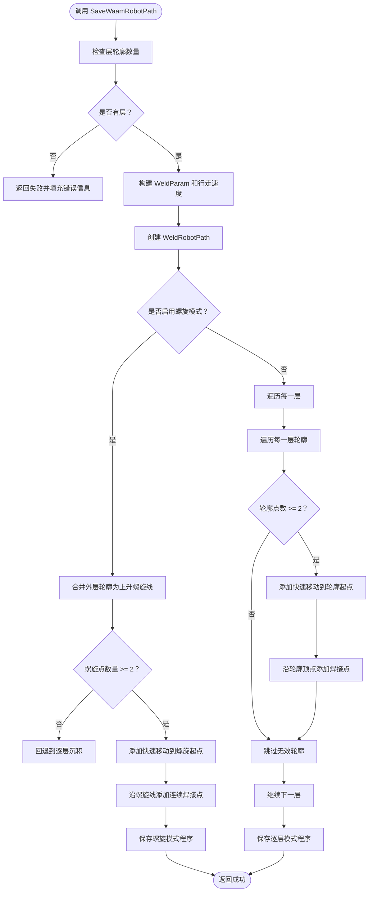
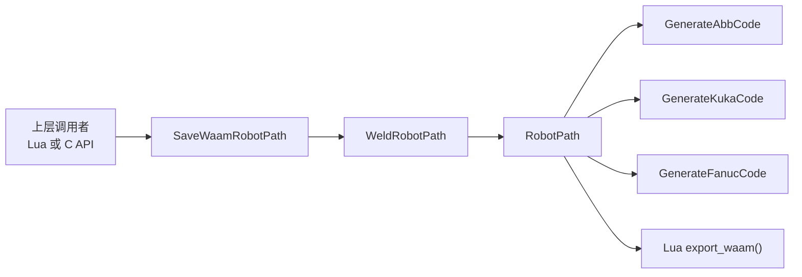

# WAAM 阶段环境

<cite>
**本文引用的文件**   
- [waam_export.hpp](file://LibHsBaSlicer/Path/waam_export.hpp)
- [waam_export.cpp](file://LibHsBaSlicer/Path/waam_export.cpp)
- [robotpath.hpp](file://paths/robotpath.hpp)
- [robotpath.cpp](file://paths/robotpath.cpp)
- [weldrobotpath.hpp](file://paths/weldrobotpath.hpp)
- [weldrobotpath.cpp](file://paths/weldrobotpath.cpp)
- [my_waam_path.lua](file://samples/WAAM/scripts/my_waam_path.lua)
- [my_waam_pipeline.lua](file://samples/Custom/scripts/my_waam_pipeline.lua)
- [hsba_pipeline.d.lua](file://types/hsba_pipeline.d.lua)
</cite>

## 目录
1. [引言](#引言)
2. [项目结构中的 WAAM 路径位置](#项目结构中的-waam-路径位置)
3. [核心数据结构](#核心数据结构)
4. [RobotPath 与 WeldRobotPath 架构](#robotpath-与-weldrobotpath-架构)
5. [export_waam 函数编写规范](#export_waam-函数编写规范)
6. [机器人品牌代码生成方法](#机器人品牌代码生成方法)
7. [完整程序生成流程](#完整程序生成流程)
8. [焊接参数配置与路径优化实践](#焊接参数配置与路径优化实践)
9. [依赖关系分析](#依赖关系分析)
10. [故障排除](#故障排除)
11. [结论](#结论)

## 引言
WAAM（金属丝电弧增材制造）阶段的 RobotPath 环境与 FDM、SLM、SLA 等“床基工艺”不同：它不是输出切片文件或打包数据，而是直接生成目标机器人品牌的可执行机器人语言程序。其核心目标是把逐层沉积轮廓转换为 ABB、KUKA 或 FANUC 的机器人程序，并在需要时通过 Lua 脚本 `export_waam()` 完成自定义代码生成。

本阶段的关键入口是保存 API `SaveWaamRobotPath`，它接收包含每层轮廓、Z 高度、焊接参数和机器人类型的包，内部构建 `WeldRobotPath`，再根据机器人品牌生成对应代码；如果提供 Lua 脚本，则调用用户编写的 `export_waam()` 进行后处理或直接替代内置生成逻辑。

## 项目结构中的 WAAM 路径位置
WAAM 路径相关代码主要分布在以下模块：
- `LibHsBaSlicer/Path/waam_export.*`：对外暴露的 WAAM 导出接口、焊接参数映射、螺旋模式与逐层路径构建。
- `paths/robotpath.*`：通用机器人路径抽象、RLPoint、RLType、RLPointType，以及 ABB/KUKA/FANUC 基础代码生成。
- `paths/weldrobotpath.*`：在 RobotPath 基础上增加焊接参数、起弧/收弧逻辑和品牌特定焊接指令。
- `samples/WAAM/scripts/my_waam_path.lua`：示例自定义 `export_waam()` 脚本。
- `samples/Custom/scripts/my_waam_pipeline.lua`：示例完整 Lua 驱动的 WAAM 流水线，展示如何构造 WaamRobotPackage 并调用保存接口。
- `types/hsba_pipeline.d.lua`：Lua 类型声明，说明 `export_waam()` 的环境契约。

**图表来源**
- [waam_export.hpp:15-72](file://LibHsBaSlicer/Path/waam_export.hpp#L15-L72)
- [waam_export.cpp:61-189](file://LibHsBaSlicer/Path/waam_export.cpp#L61-L189)
- [robotpath.hpp:15-104](file://paths/robotpath.hpp#L15-L104)
- [robotpath.cpp:91-113](file://paths/robotpath.cpp#L91-L113)
- [weldrobotpath.hpp:16-96](file://paths/weldrobotpath.hpp#L16-L96)
- [my_waam_path.lua:1-46](file://samples/WAAM/scripts/my_waam_path.lua#L1-L46)
- [my_waam_pipeline.lua:1-94](file://samples/Custom/scripts/my_waam_pipeline.lua#L1-L94)
- [hsba_pipeline.d.lua:594-623](file://types/hsba_pipeline.d.lua#L594-L623)

**章节来源**
- [waam_export.hpp:15-72](file://LibHsBaSlicer/Path/waam_export.hpp#L15-L72)
- [waam_export.cpp:61-189](file://LibHsBaSlicer/Path/waam_export.cpp#L61-L189)
- [robotpath.hpp:15-104](file://paths/robotpath.hpp#L15-L104)
- [weldrobotpath.hpp:16-96](file://paths/weldrobotpath.hpp#L16-L96)
- [my_waam_path.lua:1-46](file://samples/WAAM/scripts/my_waam_path.lua#L1-L46)
- [my_waam_pipeline.lua:1-94](file://samples/Custom/scripts/my_waam_pipeline.lua#L1-L94)
- [hsba_pipeline.d.lua:594-623](file://types/hsba_pipeline.d.lua#L594-L623)

## 核心数据结构
WAAM 阶段的核心数据围绕“层轮廓 + 焊接参数 + 机器人类型”展开。

| 名称 | 类型/含义 | 关键字段 | 用途 |
|---|---|---|---|
| `WaamWeldParams` | 焊接工艺参数结构体 | `current`、`voltage`、`wire_feed_speed`、`gas_flow_rate`、`travel_speed`、`process` | 描述电弧电流、电压、送丝速度、气体流量、行走速度和焊接工艺类型 |
| `WaamRobotPackage` | WAAM 导出数据包 | `layer_outlines`、`layer_z_heights`、`weld`、`robot_type`、`bead_width`、`config_json`、`spiral_mode` | 向 `SaveWaamRobotPath` 传递完整的路径生成输入 |
| `RLPoint` | 机器人路径点 | `end`、`middle`、`velocity`、`type`、`programIndex` | 表示一次机器人移动或程序块标记 |
| `RLType` | 机器人品牌枚举 | `Unknown`、`Abb`、`Kuka`、`Fanuc`、`Undefine` | 决定最终生成 ABB、KUKA 还是 FANUC 代码 |
| `RLPointType` | 运动/程序命令类型 | `MoveJ`、`MoveL`、`MoveC`、`ProgramLStart`、`ProgramStart`、`ProgramCStart`、`ProgramL`、`ProgramC`、`ProgramLEnd`、`ProgramCEnd` | 区分快速移动、直线插补、圆弧插补以及程序段起止标记 |
| `WeldParam` | 焊接参数 | `current`、`voltage`、`wireFeedSpeed`、`gasFlowRate`、`travelSpeed`、`arcStartCurrent`、`arcStartVoltage`、`craterFillCurrent`、`craterFillVoltage`、`process`、`arcEnd`、`weldSchedule` | 用于 WeldRobotPath 的起弧、连续焊、收弧及品牌特定焊接指令 |
| `WeldRLPoint` | 带焊接参数的机器人点 | `point`、`weld`、`isWelding` | 将普通 RLPoint 与焊接参数绑定，并标记是否处于焊接状态 |

其中，`WaamWeldParams` 是 C ABI 暴露给上层的最小焊接参数子集；`WeldParam` 是内部更完整的焊接参数模型，包含起弧参数、填坑参数、工艺类型和收弧方式。

**章节来源**
- [waam_export.hpp:23-52](file://LibHsBaSlicer/Path/waam_export.hpp#L23-L52)
- [robotpath.hpp:15-52](file://paths/robotpath.hpp#L15-L52)
- [weldrobotpath.hpp:16-57](file://paths/weldrobotpath.hpp#L16-L57)

## RobotPath 与 WeldRobotPath 架构
`RobotPath` 是通用机器人路径抽象，负责累积 `RLPoint` 并根据 `RLType` 生成 ABB、KUKA 或 FANUC 的基础程序文本。`WeldRobotPath` 继承自 `RobotPath`，额外维护 `WeldRLPoint` 列表，并在生成代码时插入起弧、连续焊接、收弧等焊接指令。

**图表来源**
- [robotpath.hpp:44-104](file://paths/robotpath.hpp#L44-L104)
- [weldrobotpath.hpp:51-96](file://paths/weldrobotpath.hpp#L51-L96)

`RobotPath` 的默认 `ToString()` 会根据机器人品牌选择对应的生成函数；当未指定支持的机器人类型时，会抛出“不支持机器人，请使用 Lua 脚本”的错误。`WeldRobotPath` 的默认 `ToString()` 同样按品牌分支，但会优先使用焊接专用生成函数。

**章节来源**
- [robotpath.cpp:91-113](file://paths/robotpath.cpp#L91-L113)
- [weldrobotpath.cpp:79-101](file://paths/weldrobotpath.cpp#L79-L101)

## export_waam 函数编写规范
`export_waam()` 是 Lua 侧自定义机器人程序生成的入口函数。当 WAAM 流水线设置 `path_lua_script` 和 `path_lua_func` 时，系统会加载指定 Lua 脚本，并以 `export_waam` 作为默认函数名执行。

### Lua 环境全局变量
| 变量 | 类型 | 含义 | 使用建议 |
|---|---|---|---|
| `header` | string | 头部说明字符串 | 可用于写入注释、版本信息或平台提示 |
| `startProgramFunc` | string | 起始程序名 | 可能为空；若非空，可在程序开头输出程序头 |
| `endProgramFunc` | string | 结束程序名 | 可能为空；若非空，可在程序结尾输出程序尾 |
| `points` | array | 机器人路径点数组 | 每个元素包含 `end`、`middle`、`velocity`、`type` |
| `funcName` | string | 当前调用的 Lua 函数名 | 在部分 ToString 重载中可用，便于多入口脚本复用 |

### points 数组元素结构
每个 `points[i]` 是一个 Lua table，字段如下：
- `end.x`、`end.y`、`end.z`：终点坐标
- `middle.x`、`middle.y`、`middle.z`：中间点坐标，常用于圆弧或圆形程序段
- `velocity`：移动速度
- `type`：字符串形式的运动类型，如 `"MoveJ"`、`"MoveL"`、`"MoveC"`、`"ProgramLStart"`、`"ProgramStart"`、`"ProgramCStart"`、`"ProgramL"`、`"ProgramC"`、`"ProgramLEnd"`、`"ProgramCEnd"`

### 返回值约定
`export_waam()` 必须返回一个字符串，该字符串会被直接写入机器人程序输出文件。与 zip 导出脚本不同，机器人路径脚本不返回 table，而是返回完整程序文本。

### 推荐实现模式
1. 初始化一个缓冲区。
2. 如果 `startProgramFunc` 非空，输出程序头。
3. 遍历 `points`，根据 `type` 判断是快速移动还是焊接移动。
4. 如果 `endProgramFunc` 非空，输出程序尾。
5. 返回拼接后的字符串。

示例脚本 `my_waam_path.lua` 展示了这一模式：对 `MoveJ` 输出快速移动指令，对其他类型输出带焊接开启标记的直线移动指令。

**章节来源**
- [my_waam_path.lua:1-46](file://samples/WAAM/scripts/my_waam_path.lua#L1-L46)
- [robotpath.cpp:115-225](file://paths/robotpath.cpp#L115-L225)
- [robotpath.cpp:406-493](file://paths/robotpath.cpp#L406-L493)
- [hsba_pipeline.d.lua:594-623](file://types/hsba_pipeline.d.lua#L594-L623)

## 机器人品牌代码生成方法
### ABB 代码生成
`RobotPath::GenerateAbbCode()` 生成类似 ABB RAPID 的程序结构，包括模块定义、主过程、起点移动和逐点移动。对于程序段起止标记，它会插入 `startProgramFunc` 和 `endProgramFunc` 所代表的函数调用。

ABB 生成逻辑要点：
- 起点使用 `MOVEJ`。
- `MoveJ` 输出为 `MOVEJ`。
- `MoveL` 输出为 `MOVEL`。
- `MoveC` 输出为 `MOVEC`，并使用 `middle` 作为中间点。
- 程序段开始/结束标记会插入注释和 `startProgramFunc` / `endProgramFunc`。
- 速度以 `[velocity, ABB_MIN_SPEED, ABB_MAX_SPEED, ABB_HIGH_SPEED]` 形式嵌入。

### KUKA 代码生成
`RobotPath::GenerateKukaCode()` 生成 KRL 风格程序，包含 `DEF main()`、起点定义、LIN/CIRC 指令和程序段注释。

KUKA 生成逻辑要点：
- 起点定义为 `P[0]:="Start"`。
- 直线移动使用 `LIN`。
- 圆弧移动使用 `CIRC`，并通过 `middle` 提供中间点。
- 程序段起止标记通过注释和 `startProgramFunc` / `endProgramFunc` 体现。

### FANUC 代码生成
`RobotPath::GenerateFanucCode()` 生成 FANUC TP 风格程序，包含位置寄存器、J/L/ARC 指令和程序段注释。

FANUC 生成逻辑要点：
- 起点使用位置寄存器赋值。
- 非圆弧移动使用 `J` 或 `L`。
- 圆弧移动使用 `ARC`，并通过 `middle` 作为中间点。
- 程序段起止标记通过注释和 `startProgramFunc` / `endProgramFunc` 体现。

### 焊接代码生成
`WeldRobotPath` 的品牌生成函数会在基础移动指令之外，插入起弧、连续焊接和收弧指令：
- ABB：使用 `ArcLStart`、`ArcL`、`ArcLEnd`，并携带电流、电压、送丝速度和气体流量。
- KUKA：使用 `ARC_Init`、`ARC_SetWeldParam`、`ARC_On`、`ARC_Off`、`ARC_CraterFill` 等 ArcTech 风格指令。
- FANUC：使用 `ARC START`、`L P[...]`、`ARC END[Schedule ...]`，并结合 `weldSchedule`。

**章节来源**
- [robotpath.cpp:227-305](file://paths/robotpath.cpp#L227-L305)
- [robotpath.cpp:308-355](file://paths/robotpath.cpp#L308-L355)
- [robotpath.cpp:358-404](file://paths/robotpath.cpp#L358-L404)
- [weldrobotpath.cpp:225-305](file://paths/weldrobotpath.cpp#L225-L305)
- [weldrobotpath.cpp:307-394](file://paths/weldrobotpath.cpp#L307-L394)
- [weldrobotpath.cpp:396-481](file://paths/weldrobotpath.cpp#L396-L481)

## 完整程序生成流程
`SaveWaamRobotPath` 是 WAAM 路径生成的核心入口。它接收 `WaamRobotPackage`，校验层数，构建基础焊接参数，创建 `WeldRobotPath`，然后进入两种路径模式：螺旋模式和逐层模式。

**图表来源**
- [waam_export.cpp:61-189](file://LibHsBaSlicer/Path/waam_export.cpp#L61-L189)

### 关键步骤说明
1. **层数校验**：如果 `layer_outlines` 为空，直接返回失败，并通过 `error_out` 返回错误信息。
2. **焊接参数构建**：将 `WaamWeldParams` 映射为内部 `WeldParam`，并将 `process=1` 视为激光，其他视为 MIG/MAG。
3. **行走速度**：如果 `travel_speed` 大于 0，使用该值；否则使用默认机器人速度。
4. **螺旋模式**：
   - 将所有层的闭合外轮廓合并为一条 Z 上升的螺旋线。
   - 先添加一个 `MoveJ` 快速移动到螺旋起点。
   - 从第二个螺旋点开始，逐个添加 `MoveL` 焊接点，形成不间断熔覆道。
   - 如果螺旋退化（没有足够闭合轮廓），回退到逐层模式。
5. **逐层模式**：
   - 对每一层、每一轮廓，先添加快速移动到轮廓起点。
   - 对轮廓中每个顶点添加焊接点。
6. **Lua 后处理**：如果提供了 `lua_script` 和 `lua_func`，则调用 `WeldRobotPath.Save(...)` 的 Lua 重载，否则使用内置品牌代码生成。

**章节来源**
- [waam_export.cpp:61-189](file://LibHsBaSlicer/Path/waam_export.cpp#L61-L189)

## 焊接参数配置与路径优化实践
### 焊接参数配置
`WaamWeldParams` 是面向用户的轻量焊接参数结构，适合通过 Lua 流水线或外部配置传入：
- `current`：焊接电流，单位安培。
- `voltage`：电弧电压，单位伏特。
- `wire_feed_speed`：送丝速度，单位米每分钟。
- `gas_flow_rate`：保护气体流量，单位升每分钟。
- `travel_speed`：焊枪行走速度，单位毫米每秒。
- `process`：0 表示电弧焊接，1 表示激光焊接。

在 `my_waam_pipeline.lua` 中，这些参数通过 `machine` 表或默认值读取，并传递给 `HsBa.saveWaamPackage`。实际项目中，应将这些参数集中管理，避免硬编码。

### 路径优化最佳实践
1. **层轮廓质量**：确保每层至少有一个闭合轮廓；否则螺旋模式会回退到逐层模式。
2. **轮廓顶点密度**：轮廓顶点过密会增加机器人程序行数，过疏会影响几何精度。应根据 `bead_width` 和模型曲率调整采样。
3. **行走速度与焊接速度分离**：`travel_speed` 控制焊接行走速度；快速移动可使用默认机器人速度，减少非焊接时间。
4. **螺旋模式适用场景**：适合单壁、连续外轮廓的杯状或柱状结构；不适合多层复杂内腔或多独立轮廓。
5. **品牌差异适配**：内置 ABB/KUKA/FANUC 代码生成是简化版本，实际产线可能需要调整速度、加速度、工具坐标系、工件坐标系和焊接参数格式。
6. **Lua 脚本扩展**：当内置生成器无法满足需求时，使用 `export_waam()` 完全接管程序文本生成，保留 `header`、`startProgramFunc`、`endProgramFunc`、`points` 的语义一致性。

**章节来源**
- [waam_export.hpp:23-52](file://LibHsBaSlicer/Path/waam_export.hpp#L23-L52)
- [waam_export.cpp:77-130](file://LibHsBaSlicer/Path/waam_export.cpp#L77-L130)
- [my_waam_pipeline.lua:56-81](file://samples/Custom/scripts/my_waam_pipeline.lua#L56-L81)

## 依赖关系分析
WAAM 路径生成的依赖链如下：
- 上层 Lua 流水线或 C API 调用 `SaveWaamRobotPath`。
- `SaveWaamRobotPath` 构建 `WeldRobotPath`，并调用其 `Save`。
- `WeldRobotPath` 继承 `RobotPath`，最终由 `RobotPath` 的品牌生成函数输出 ABB/KUKA/FANUC 代码。
- 如果提供 Lua 脚本，则通过 `RobotPath::ToString(script, funcName)` 或 `Save(..., script_file, funcName)` 执行 `export_waam()`。

**图表来源**
- [waam_export.cpp:61-189](file://LibHsBaSlicer/Path/waam_export.cpp#L61-L189)
- [robotpath.cpp:91-113](file://paths/robotpath.cpp#L91-L113)
- [robotpath.cpp:406-523](file://paths/robotpath.cpp#L406-L523)

**章节来源**
- [waam_export.cpp:61-189](file://LibHsBaSlicer/Path/waam_export.cpp#L61-L189)
- [robotpath.cpp:91-113](file://paths/robotpath.cpp#L91-L113)
- [robotpath.cpp:406-523](file://paths/robotpath.cpp#L406-L523)

## 故障排除
### 常见问题
1. **层数为空**：`SaveWaamRobotPath` 检测到 `layer_outlines` 为空时会返回失败，并通过 `error_out` 返回“WAAM package has no layers”。
2. **螺旋模式退化**：如果每层没有闭合轮廓，螺旋化结果不足两个点，系统会回退到逐层沉积。
3. **Lua 脚本加载失败**：如果 Lua 脚本无法加载或运行时出错，会抛出包含详细错误的 `RuntimeError`。
4. **不支持的机器人类型**：如果 `RLType` 不是 ABB、KUKA 或 FANUC，且未提供 Lua 脚本，会抛出“不支持机器人，请使用 Lua 脚本”的错误。
5. **Lua 脚本返回类型错误**：机器人路径脚本必须返回字符串；如果返回 nil 或其他类型，系统会尝试读取全局 `result`，否则返回空字符串。

### 调试建议
- 先使用内置 ABB/KUKA/FANUC 生成器验证路径是否正确。
- 逐步启用 `spiral_mode`，确认每层轮廓是否闭合。
- 在 `export_waam()` 中打印 `points` 的长度和第一个点的 `type`、`velocity`，确认 Lua 环境正确。
- 将 `header`、`startProgramFunc`、`endProgramFunc` 写入输出文件，便于定位程序头尾问题。

**章节来源**
- [waam_export.cpp:67-75](file://LibHsBaSlicer/Path/waam_export.cpp#L67-L75)
- [waam_export.cpp:85-130](file://LibHsBaSlicer/Path/waam_export.cpp#L85-L130)
- [robotpath.cpp:115-225](file://paths/robotpath.cpp#L115-L225)
- [robotpath.cpp:406-493](file://paths/robotpath.cpp#L406-L493)
- [robotpath.cpp:91-113](file://paths/robotpath.cpp#L91-L113)

## 结论
WAAM 阶段的 RobotPath 环境以 `WaamRobotPackage` 为输入，以 `WeldRobotPath` 为核心数据结构，以 `SaveWaamRobotPath` 为统一入口，最终输出 ABB、KUKA 或 FANUC 的机器人程序。`export_waam()` 提供了强大的 Lua 扩展点，允许开发者在不修改 C++ 源码的情况下定制机器人程序文本。

在实际工程中，建议：
- 将焊接参数集中配置，避免散落在多个脚本中。
- 优先验证内置品牌生成器，再切换到自定义 `export_waam()`。
- 针对产线机器人控制器调整速度、坐标系、焊接参数格式和程序结构。
- 对复杂几何使用逐层模式，对简单连续外轮廓使用螺旋模式以提升效率。