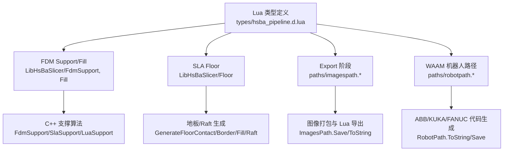
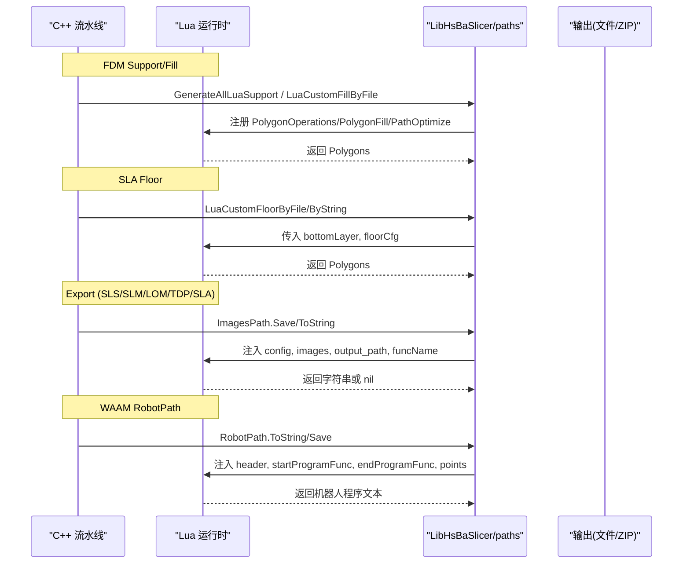
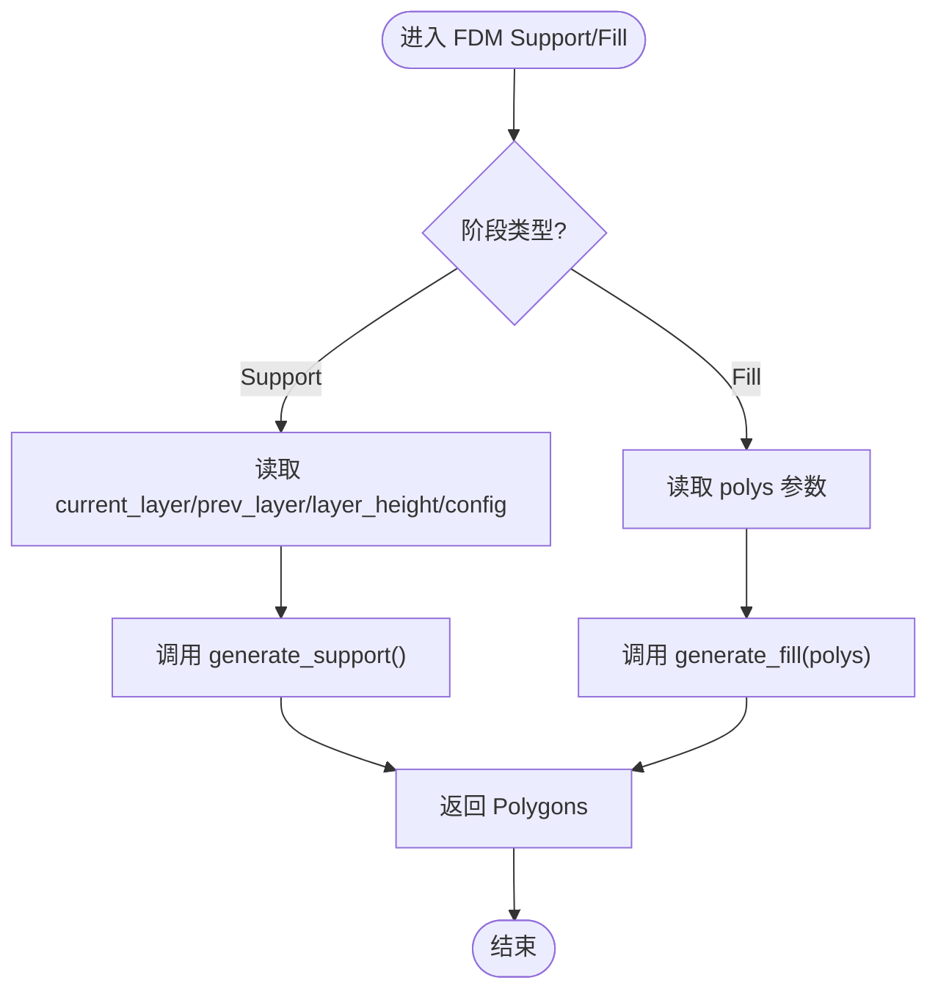
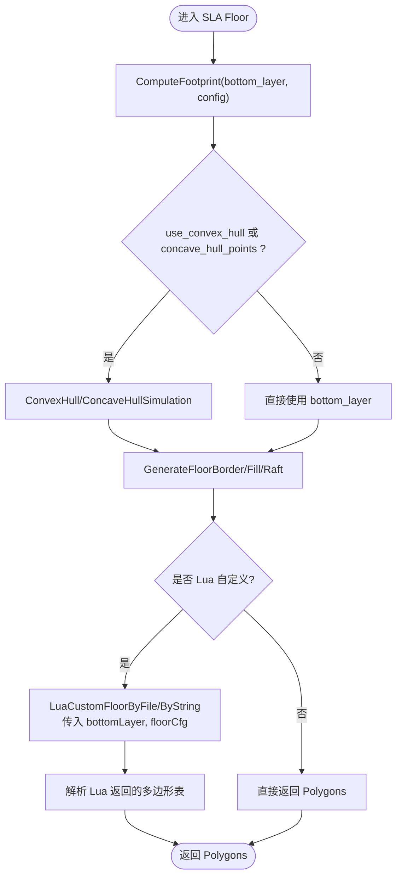
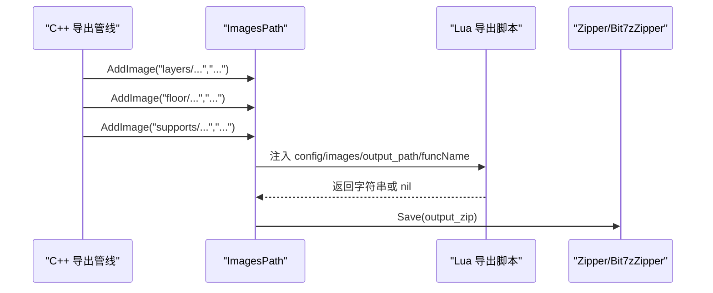
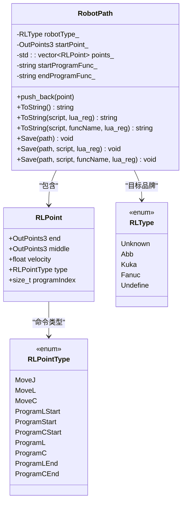
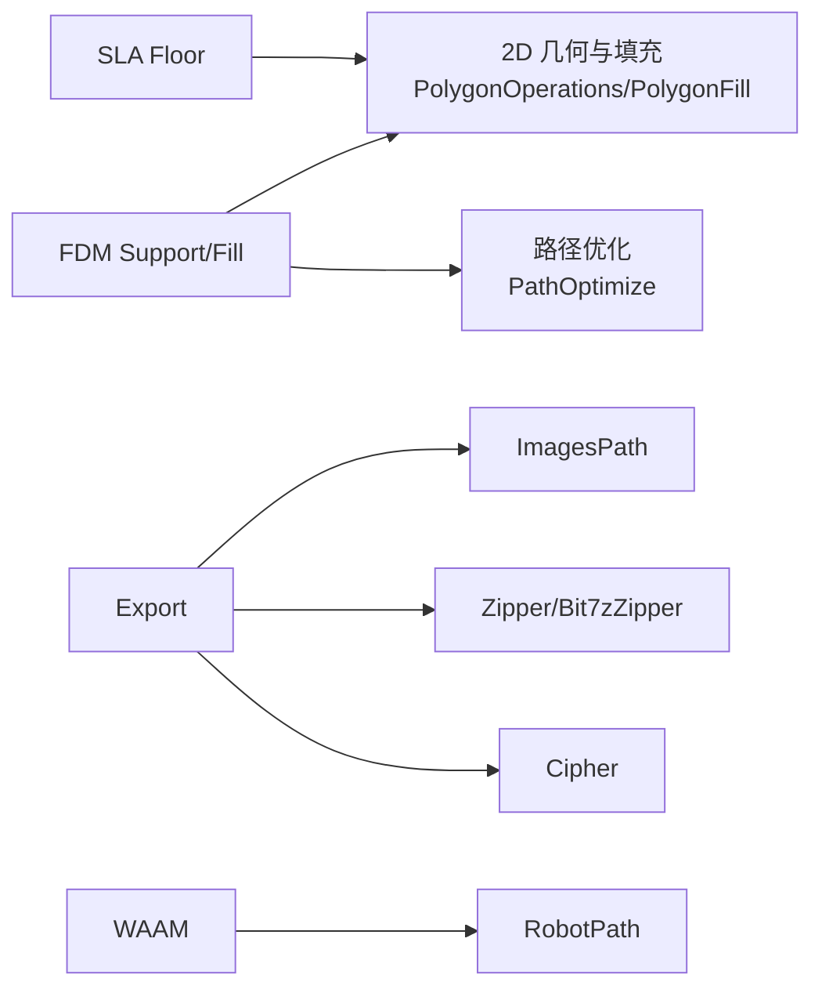

# 内置阶段环境

<cite>
**本文引用的文件**   
- [hsba_pipeline.d.lua](file://types/hsba_pipeline.d.lua)
- [fdm_support.hpp](file://LibHsBaSlicer/FdmSupport/fdm_support.hpp)
- [fdm_support.cpp](file://LibHsBaSlicer/FdmSupport/fdm_support.cpp)
- [polygon_fill.hpp](file://LibHsBaSlicer/Fill/polygon_fill.hpp)
- [polygon_fill.cpp](file://LibHsBaSlicer/Fill/polygon_fill.cpp)
- [sla_floor.hpp](file://LibHsBaSlicer/Floor/sla_floor.hpp)
- [sla_floor.cpp](file://LibHsBaSlicer/Floor/sla_floor.cpp)
- [imagespath.hpp](file://paths/imagespath.hpp)
- [imagespath.cpp](file://paths/imagespath.cpp)
- [robotpath.hpp](file://paths/robotpath.hpp)
- [robotpath.cpp](file://paths/robotpath.cpp)
- [waam_pipeline.proto](file://proto/waam_pipeline.proto)
- [my_waam_path.lua](file://samples/WAAM/scripts/my_waam_path.lua)
</cite>

## 目录
1. [引言](#引言)
2. [项目结构](#项目结构)
3. [核心组件](#核心组件)
4. [架构总览](#架构总览)
5. [详细组件分析](#详细组件分析)
6. [依赖关系分析](#依赖关系分析)
7. [性能与并发特性](#性能与并发特性)
8. [调试与排错指南](#调试与排错指南)
9. [结论](#结论)
10. [附录：各阶段变量速查表](#附录各阶段变量速查表)

## 引言
本文面向 HsBaSlicer 的 Lua 扩展开发者，系统性说明各内置阶段的脚本运行环境。重点覆盖：
- FDM Support / Fill 阶段的 current_layer、prev_layer、layer_height、config 等全局或参数变量；
- SLA Floor 阶段的 bottomLayer、floorCfg 变量；
- Export 阶段的 images、funcName、output_path、config 等变量；
- WAAM 阶段的 header、startProgramFunc、endProgramFunc、points 等变量。

同时给出每个阶段的可用库、数据结构、编程接口、生命周期、数据传递机制以及调试技巧，帮助你在不深入 C++ 源码的情况下正确编写自定义阶段脚本。

## 项目结构
HsBaSlicer 将“流水线阶段”抽象为可插拔的 C++ 实现 + Lua 脚本扩展点。类型定义集中在 types/hsba_pipeline.d.lua，具体阶段逻辑分布在 LibHsBaSlicer 与 paths 模块中：
- FDM Support / Fill：由 LibHsBaSlicer/FdmSupport 与 LibHsBaSlicer/Fill 提供 C++ API，并通过 Lua 暴露 generate_support / generate_fill 入口。
- SLA Floor：由 LibHsBaSlicer/Floor 提供 GenerateFloor* 系列 API 与 LuaCustomFloorByFile/ByString。
- Export（SLS/SLM/LOM/TDP/SLA）：通过 ImagesPath 统一注入 config、images、output_path、funcName 等全局变量，并支持 Zipper/Cipher/Bit7zZipper 等库。
- WAAM RobotPath：由 paths/robotpath.* 提供机器人路径输出，并在 Lua 环境中注入 header、startProgramFunc、endProgramFunc、points 等变量。

**图示来源**
- [hsba_pipeline.d.lua:1-18](file://types/hsba_pipeline.d.lua#L1-L18)
- [fdm_support.hpp:17-67](file://LibHsBaSlicer/FdmSupport/fdm_support.hpp#L17-L67)
- [polygon_fill.hpp:15-53](file://LibHsBaSlicer/Fill/polygon_fill.hpp#L15-L53)
- [sla_floor.hpp:21-116](file://LibHsBaSlicer/Floor/sla_floor.hpp#L21-L116)
- [imagespath.hpp:16-61](file://paths/imagespath.hpp#L16-L61)
- [robotpath.hpp:14-104](file://paths/robotpath.hpp#L14-L104)

**章节来源**
- [hsba_pipeline.d.lua:1-18](file://types/hsba_pipeline.d.lua#L1-L18)

## 核心组件
本节聚焦四个关键阶段的环境与接口：
- FDM Support / Fill：逐层支撑与填充，使用 Polygons/PolygonsD 多边形集合，配合 SupportConfig/FillOptions。
- SLA Floor：底层 Raft/地板生成，使用 SlaFloorConfig，返回 Polygons。
- Export：以 ImagesPath 为中心，向 Lua 注入 config、images、output_path、funcName，并提供 Zipper/Cipher/Bit7zZipper。
- WAAM：以 RobotPath 为中心，向 Lua 注入 header、startProgramFunc、endProgramFunc、points，返回机器人程序文本。

**章节来源**
- [hsba_pipeline.d.lua:490-623](file://types/hsba_pipeline.d.lua#L490-L623)
- [fdm_support.hpp:17-67](file://LibHsBaSlicer/FdmSupport/fdm_support.hpp#L17-L67)
- [polygon_fill.hpp:15-53](file://LibHsBaSlicer/Fill/polygon_fill.hpp#L15-L53)
- [sla_floor.hpp:21-116](file://LibHsBaSlicer/Floor/sla_floor.hpp#L21-L116)
- [imagespath.hpp:16-61](file://paths/imagespath.hpp#L16-L61)
- [robotpath.hpp:14-104](file://paths/robotpath.hpp#L14-L104)

## 架构总览
下图展示从 C++ 流水线到 Lua 脚本的数据流与函数调用链。不同阶段通过不同的 C++ 入口加载 Lua 脚本，并向其注入对应变量与库。

**图示来源**
- [fdm_support.cpp:61-74](file://LibHsBaSlicer/FdmSupport/fdm_support.cpp#L61-L74)
- [polygon_fill.cpp:35-49](file://LibHsBaSlicer/Fill/polygon_fill.cpp#L35-L49)
- [sla_floor.cpp:148-228](file://LibHsBaSlicer/Floor/sla_floor.cpp#L148-L228)
- [imagespath.cpp:49-203](file://paths/imagespath.cpp#L49-L203)
- [robotpath.cpp:115-225](file://paths/robotpath.cpp#L115-L225)

## 详细组件分析

### FDM Support / Fill 阶段
- 入口函数
  - FDM Support：generate_support()
  - FDM Fill：generate_fill(polys)
- 可用库
  - PolygonOperations：布尔运算、偏移、凸包、面积、几何构造等
  - PolygonFill：offsetFill、lineFill、simpleZigzagFill、zigzagFill、compositeOffsetFill、hybridFill、offsetOnly
  - PathOptimize：区域优化、路径顺序优化
  - Support：new_plane/new_tree/new_honeycomb/new_sla/new_lua/new_lua_file/generate/detect_overhang/default_config
- 数据结构
  - Polygons/Polygon：二维多边形集合与单个多边形
  - SupportConfig：overhang_angle_threshold、layer_height、support_gap、support_diameter、support_density、support_pattern、tree_branch_angle、tree_max_branch_radius、honeycomb_cell_size
- 变量与数据传递
  - Support 阶段：current_layer、prev_layer、layer_height、config（SupportConfig）
  - Fill 阶段：polys（已扣除壁厚的当前层多边形），胶水以参数传入，不使用全局变量
- 生命周期
  - 每层调用一次 generate_support()/generate_fill()，C++ 侧循环遍历所有层并收集结果
- 典型流程

**图示来源**
- [hsba_pipeline.d.lua:490-525](file://types/hsba_pipeline.d.lua#L490-L525)
- [fdm_support.hpp:17-67](file://LibHsBaSlicer/FdmSupport/fdm_support.hpp#L17-L67)
- [polygon_fill.hpp:15-53](file://LibHsBaSlicer/Fill/polygon_fill.hpp#L15-L53)

**章节来源**
- [hsba_pipeline.d.lua:490-525](file://types/hsba_pipeline.d.lua#L490-L525)
- [fdm_support.hpp:17-67](file://LibHsBaSlicer/FdmSupport/fdm_support.hpp#L17-L67)
- [fdm_support.cpp:14-74](file://LibHsBaSlicer/FdmSupport/fdm_support.cpp#L14-L74)
- [polygon_fill.hpp:15-53](file://LibHsBaSlicer/Fill/polygon_fill.hpp#L15-L53)
- [polygon_fill.cpp:13-49](file://LibHsBaSlicer/Fill/polygon_fill.cpp#L13-L49)

### SLA Floor 阶段
- 入口函数
  - generate_floor(bottomLayer, floorCfg)
- 可用库
  - PolygonOperations：Union/Difference/Intersection/Offset/ConvexHull/ConcaveHullSimulation 等
  - PolygonFill：offsetFill、lineFill、simpleZigzagFill、zigzagFill、compositeOffsetFill、hybridFill、offsetOnly
- 数据结构
  - SlaFloorConfig：raft_offset、border_width、fill_spacing、fill_angle_deg、border_count、use_convex_hull、concave_hull_points
- 变量与数据传递
  - bottomLayer：底层轮廓多边形（Polygons）
  - floorCfg：地板配置（SlaFloorConfig）
- 内部实现要点
  - ComputeFootprint：根据 use_convex_hull/concave_hull_points 计算接触面
  - GenerateFloorBorder/GenerateFloorFill/GenerateFloorRaft：组合 Offset 与 ZigzagFill 生成边界与填充
  - LuaCustomFloorByFile/ByString：加载用户脚本，传入 bottomLayer 与 floorCfg，解析返回的多边形表

**图示来源**
- [sla_floor.cpp:33-117](file://LibHsBaSlicer/Floor/sla_floor.cpp#L33-L117)
- [sla_floor.cpp:148-228](file://LibHsBaSlicer/Floor/sla_floor.cpp#L148-L228)
- [sla_floor.hpp:21-116](file://LibHsBaSlicer/Floor/sla_floor.hpp#L21-L116)

**章节来源**
- [hsba_pipeline.d.lua:527-538](file://types/hsba_pipeline.d.lua#L527-L538)
- [sla_floor.hpp:21-116](file://LibHsBaSlicer/Floor/sla_floor.hpp#L21-L116)
- [sla_floor.cpp:33-117](file://LibHsBaSlicer/Floor/sla_floor.cpp#L33-L117)
- [sla_floor.cpp:148-228](file://LibHsBaSlicer/Floor/sla_floor.cpp#L148-L228)

### Export 阶段（SLS/SLM/LOM/TDP/SLA）
- 入口函数
  - export_sls() / export_slm() / export_lom() / export_tdp() / export_sla()
- 可用库
  - Zipper/Bit7zZipper：压缩打包
  - Cipher：base64/hex 编解码
  - SQLiteAdapter/MySQLAdapter/PostgreSQLAdapter：数据库访问（需编译启用相应选项）
  - ParamStore：工艺参数持久化
- 数据结构
  - ExportConfig：path、configStr
  - ExportImage：path、data
  - SlaPackage：layer_outlines、layer_supports、floor_polygons、config_json、image_width/height、image_extension、include_floor_images/include_support_images
- 变量与数据传递
  - config：{ path, configStr }
  - images：数组，元素为 { path, data }
  - output_path：输出 ZIP 路径
  - funcName：导出函数名标识
- 生命周期
  - C++ 侧渲染层图/地板/支撑图为图像缓冲，写入 ImagesPath，再调用 ImagesPath.Save/ToString 执行 Lua 脚本
  - Lua 脚本可返回字符串（覆盖默认 ZIP 内容）或返回 table/nil（保持默认行为）

**图示来源**
- [imagespath.cpp:49-203](file://paths/imagespath.cpp#L49-L203)
- [imagespath.cpp:219-350](file://paths/imagespath.cpp#L219-L350)
- [sla_floor.cpp:468-606](file://LibHsBaSlicer/Floor/sla_floor.cpp#L468-L606)

**章节来源**
- [hsba_pipeline.d.lua:540-591](file://types/hsba_pipeline.d.lua#L540-L591)
- [imagespath.hpp:16-61](file://paths/imagespath.hpp#L16-L61)
- [imagespath.cpp:49-203](file://paths/imagespath.cpp#L49-L203)
- [imagespath.cpp:219-350](file://paths/imagespath.cpp#L219-L350)
- [sla_floor.hpp:157-195](file://LibHsBaSlicer/Floor/sla_floor.hpp#L157-L195)
- [sla_floor.cpp:468-606](file://LibHsBaSlicer/Floor/sla_floor.cpp#L468-L606)

### WAAM 阶段（机器人路径）
- 入口函数
  - export_waam()
- 可用库
  - 标准 Lua 库 + 可选 lua_reg 注入的额外函数
- 数据结构
  - RLPoint：end/middle 三维坐标、velocity、type（MoveJ/MoveL/MoveC/Program*）、programIndex
  - RLType：Unknown/Abb/Kuka/Fanuc
- 变量与数据传递
  - header：头部说明（用户脚本时固定为提示头）
  - startProgramFunc/endProgramFunc：起始/结束程序名
  - points：路径点数组，每个元素包含 end/middle/velocity/type
  - startPoint：初始位置（在 ToString(script) 路径下注入）
  - funcName：函数名标识（在 ToString(script, funcName) 路径下注入）
- 生命周期
  - C++ 侧构建 RobotPath，追加 RLPoint，然后 ToString/Save 时加载 Lua 脚本，注入上述变量，执行后取返回值作为机器人程序文本

**图示来源**
- [robotpath.hpp:14-104](file://paths/robotpath.hpp#L14-L104)
- [robotpath.cpp:60-113](file://paths/robotpath.cpp#L60-L113)
- [robotpath.cpp:115-225](file://paths/robotpath.cpp#L115-L225)
- [robotpath.cpp:406-507](file://paths/robotpath.cpp#L406-L507)

**章节来源**
- [hsba_pipeline.d.lua:593-623](file://types/hsba_pipeline.d.lua#L593-L623)
- [robotpath.hpp:14-104](file://paths/robotpath.hpp#L14-L104)
- [robotpath.cpp:60-113](file://paths/robotpath.cpp#L60-L113)
- [robotpath.cpp:115-225](file://paths/robotpath.cpp#L115-L225)
- [robotpath.cpp:406-507](file://paths/robotpath.cpp#L406-L507)
- [waam_pipeline.proto:72-88](file://proto/waam_pipeline.proto#L72-L88)
- [my_waam_path.lua:1-33](file://samples/WAAM/scripts/my_waam_path.lua#L1-L33)

## 依赖关系分析
- FDM Support/Fill
  - 依赖 2D 几何与填充引擎（PolygonOperations/PolygonFill），以及路径优化（PathOptimize）。
  - 支撑算法根据 support_pattern 选择平面/树/蜂窝实现。
- SLA Floor
  - 依赖 2D 几何（ConvexHull/ConcaveHullSimulation/Offset/Difference）与填充（ZigzagFill）。
  - Lua 自定义地板通过 LuaCustomFloorByFile/ByString 注入 PolygonOperations/PolygonFill。
- Export
  - 依赖 ImagesPath 统一封装 config/images/output_path，并通过 Zipper/Cipher/Bit7zZipper 完成打包。
  - SLA 导出还依赖 sla_floor 中的图像渲染与并行处理。
- WAAM
  - 依赖 RobotPath 的品牌代码生成器（ABB/KUKA/FANUC），Lua 脚本可完全替代内置生成逻辑。

**图示来源**
- [fdm_support.cpp:14-74](file://LibHsBaSlicer/FdmSupport/fdm_support.cpp#L14-L74)
- [polygon_fill.cpp:13-49](file://LibHsBaSlicer/Fill/polygon_fill.cpp#L13-L49)
- [sla_floor.cpp:33-117](file://LibHsBaSlicer/Floor/sla_floor.cpp#L33-L117)
- [imagespath.cpp:49-203](file://paths/imagespath.cpp#L49-L203)
- [robotpath.cpp:91-113](file://paths/robotpath.cpp#L91-L113)

**章节来源**
- [fdm_support.cpp:14-74](file://LibHsBaSlicer/FdmSupport/fdm_support.cpp#L14-L74)
- [polygon_fill.cpp:13-49](file://LibHsBaSlicer/Fill/polygon_fill.cpp#L13-L49)
- [sla_floor.cpp:33-117](file://LibHsBaSlicer/Floor/sla_floor.cpp#L33-L117)
- [imagespath.cpp:49-203](file://paths/imagespath.cpp#L49-L203)
- [robotpath.cpp:91-113](file://paths/robotpath.cpp#L91-L113)

## 性能与并发特性
- Export 阶段并行渲染
  - ForLayersParallel 基于 ThreadPool 对层图像进行并行渲染，线程数受 HSBA_PIPELINE_THREADS 环境变量与硬件并发限制控制。
  - 单线程或单层时退化为串行，保证行为一致性与平台兼容性。
- 内存与 IO
  - RenderPolygonsToImageBuffer 避免中间文件，直接将编码后的图像字节写入缓冲区，减少磁盘 IO。
  - ImagesPath.AddImage 将图像以二进制形式加入 ZIP，提升打包效率。

**章节来源**
- [sla_floor.cpp:400-465](file://LibHsBaSlicer/Floor/sla_floor.cpp#L400-L465)
- [sla_floor.cpp:357-381](file://LibHsBaSlicer/Floor/sla_floor.cpp#L357-L381)
- [imagespath.cpp:34-47](file://paths/imagespath.cpp#L34-L47)

## 调试与排错指南
- 常见错误与定位
  - Lua 脚本加载失败：检查脚本路径与语法，查看 RuntimeError 消息。
  - 未找到导出函数：确认 funcName 与脚本中定义的函数名一致。
  - 返回类型不符：Export 阶段必须返回 table 或 nil，切勿返回字符串（会覆盖 ZIP 文件）；WAAM 阶段必须返回字符串。
- 调试技巧
  - 使用 HsBa.progress 上报进度，便于观察流水线阶段。
  - 在 Export 阶段打印 images 长度与 key，确认层图/地板/支撑图是否正确注入。
  - 在 WAAM 阶段打印 points 数量与每个点的 type/velocity，验证路径点是否正确。
  - 利用日志系统（logger）记录关键变量与异常堆栈。

**章节来源**
- [hsba_pipeline.d.lua:296-318](file://types/hsba_pipeline.d.lua#L296-L318)
- [imagespath.cpp:102-127](file://paths/imagespath.cpp#L102-L127)
- [imagespath.cpp:178-203](file://paths/imagespath.cpp#L178-L203)
- [robotpath.cpp:187-225](file://paths/robotpath.cpp#L187-L225)

## 结论
HsBaSlicer 的内置阶段环境通过 C++ 核心与 Lua 脚本解耦，提供了高度可扩展的支撑、填充、地板、导出与机器人路径生成能力。理解各阶段的变量、库与生命周期，有助于快速编写稳定高效的自定义脚本，并在复杂流水线中进行有效调试与性能优化。

## 附录：各阶段变量速查表

- FDM Support / Fill
  - 变量：current_layer、prev_layer、layer_height、config（SupportConfig）
  - 入口：generate_support() / generate_fill(polys)
  - 库：PolygonOperations、PolygonFill、PathOptimize、Support

- SLA Floor
  - 变量：bottomLayer、floorCfg（SlaFloorConfig）
  - 入口：generate_floor(bottomLayer, floorCfg)
  - 库：PolygonOperations、PolygonFill

- Export（SLS/SLM/LOM/TDP/SLA）
  - 变量：config（{ path, configStr }）、images（[{ path, data }]）、output_path、funcName
  - 入口：export_sls/export_slm/export_lom/export_tdp/export_sla
  - 库：Zipper、Bit7zZipper、Cipher、SQLiteAdapter、MySQLAdapter、PostgreSQLAdapter、ParamStore

- WAAM
  - 变量：header、startProgramFunc、endProgramFunc、points（[{ end, middle, velocity, type }]）、startPoint、funcName
  - 入口：export_waam()
  - 库：标准 Lua 库 + 可选 lua_reg 注入函数

**章节来源**
- [hsba_pipeline.d.lua:490-623](file://types/hsba_pipeline.d.lua#L490-L623)
- [fdm_support.hpp:17-67](file://LibHsBaSlicer/FdmSupport/fdm_support.hpp#L17-L67)
- [polygon_fill.hpp:15-53](file://LibHsBaSlicer/Fill/polygon_fill.hpp#L15-L53)
- [sla_floor.hpp:21-116](file://LibHsBaSlicer/Floor/sla_floor.hpp#L21-L116)
- [imagespath.hpp:16-61](file://paths/imagespath.hpp#L16-L61)
- [robotpath.hpp:14-104](file://paths/robotpath.hpp#L14-L104)