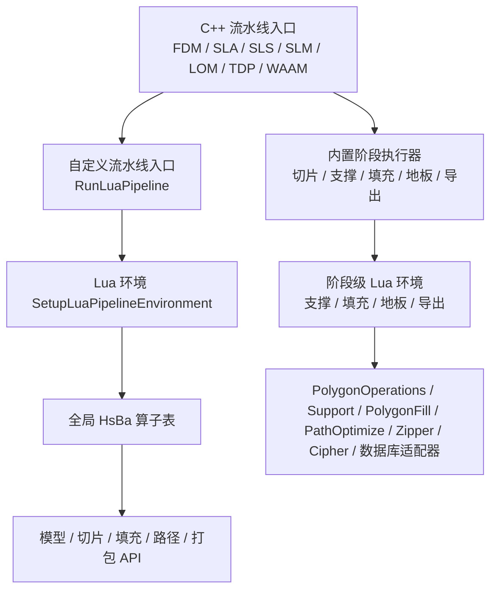
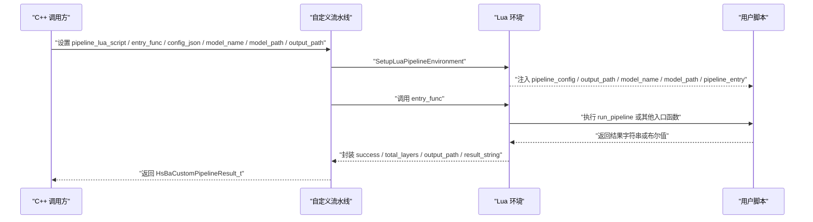
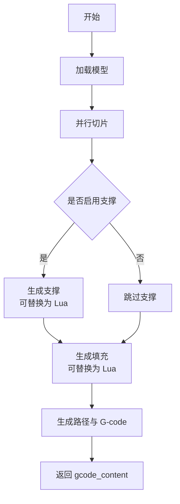
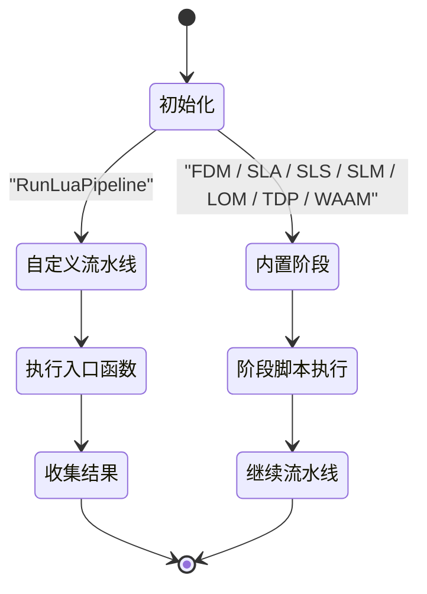
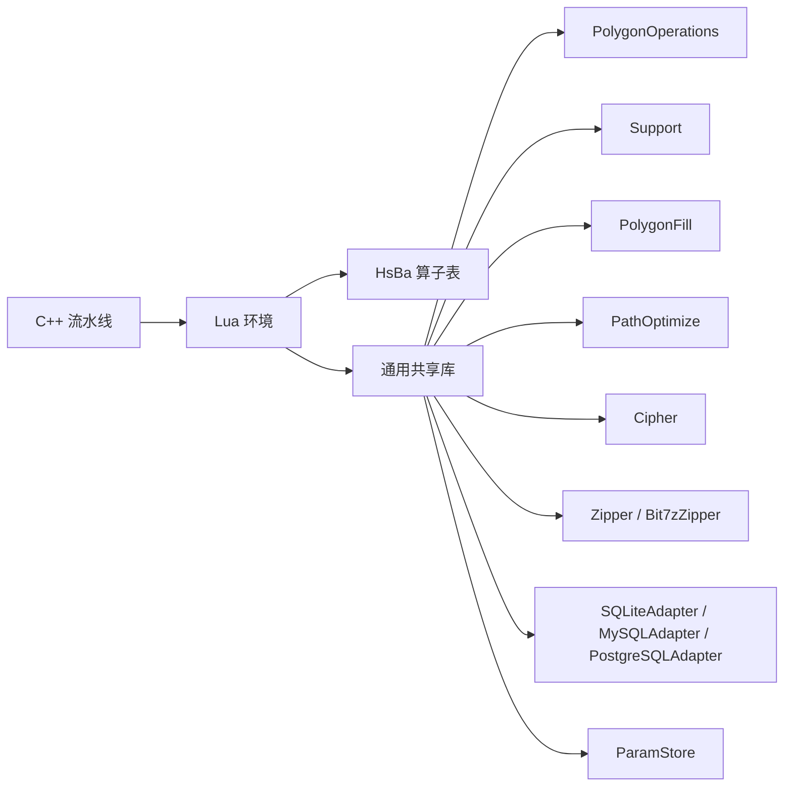

# 流水线环境变量

<cite>
**本文引用的文件**   
- [lua_pipeline_api.md](file://docs/zh/lua_pipeline_api.md)
- [pipeline_types.h](file://pipelinetypes/pipeline_types.h)
- [custom_pipeline.cpp](file://DllHsBaSlicer/custom_pipeline.cpp)
- [lua_pipeline.hpp](file://LibHsBaSlicer/Extends/lua_pipeline.hpp)
- [lua_pipeline.cpp](file://LibHsBaSlicer/Extends/lua_pipeline.cpp)
- [fdm_pipeline.cpp](file://DllHsBaSlicer/fdm_pipeline.cpp)
- [sla_pipeline.cpp](file://DllHsBaSlicer/sla_pipeline.cpp)
- [sls_pipeline.cpp](file://DllHsBaSlicer/sls_pipeline.cpp)
- [slm_pipeline.cpp](file://DllHsBaSlicer/slm_pipeline.cpp)
- [tdp_pipeline.cpp](file://DllHsBaSlicer/tdp_pipeline.cpp)
- [waam_pipeline.cpp](file://DllHsBaSlicer/waam_pipeline.cpp)
- [LuaSupport.cpp](file://support/LuaSupport.cpp)
</cite>

## 目录
1. [引言](#引言)
2. [项目结构与定位](#项目结构与定位)
3. [核心概念：两种 Lua 运行环境](#核心概念两种-lua-运行环境)
4. [自定义流水线全局变量与入口规范](#自定义流水线全局变量与入口规范)
5. [内置阶段脚本环境与约定](#内置阶段脚本环境与约定)
6. [各工艺流水线的数据传递机制](#各工艺流水线的数据传递机制)
7. [生命周期、错误处理与调试技巧](#生命周期错误处理与调试技巧)
8. [依赖关系与扩展点](#依赖关系与扩展点)
9. [性能与可维护性建议](#性能与可维护性建议)
10. [常见问题排查](#常见问题排查)
11. [结论](#结论)

## 引言
本文面向 HsBaSlicer 的流水线用户与扩展开发者，系统化说明 **Custom 自定义流水线** 和 **内置流水线阶段替换脚本** 的环境变量、可用库、全局上下文、入口函数约定、数据传递方式、生命周期以及调试方法。文档内容严格基于源码中的 C++ 流水线实现、Lua 环境注册逻辑与官方 Lua API 参考文档整理而成，避免臆造默认值或接口。

## 项目结构与定位
HsBaSlicer 将“完全由 Lua 驱动的自定义流水线”与“固定阶段 + 可选 Lua 替换”两类场景解耦：
- 自定义流水线通过 `HsBaCustomPipelineConfig` 指定 Lua 脚本、入口函数、JSON 配置、模型名/路径与默认输出路径；C++ 侧负责创建 Lua 环境、注入 `HsBa` 算子表并调用入口函数。
- 内置流水线（FDM、SLA、SLS、SLM、LOM、TDP、WAAM）在 C++ 中控制阶段顺序，但在支撑、填充、地板、导出等阶段可选择加载用户 Lua 脚本进行算法替换。

**图表来源**
- [lua_pipeline.hpp:29-83](file://LibHsBaSlicer/Extends/lua_pipeline.hpp#L29-L83)
- [lua_pipeline.cpp:225-800](file://LibHsBaSlicer/Extends/lua_pipeline.cpp#L225-L800)
- [fdm_pipeline.cpp:216-447](file://DllHsBaSlicer/fdm_pipeline.cpp#L216-L447)
- [sla_pipeline.cpp:298-483](file://DllHsBaSlicer/sla_pipeline.cpp#L298-L483)
- [sls_pipeline.cpp:181-296](file://DllHsBaSlicer/sls_pipeline.cpp#L181-L296)
- [slm_pipeline.cpp:235-348](file://DllHsBaSlicer/slm_pipeline.cpp#L235-L348)
- [tdp_pipeline.cpp:202-316](file://DllHsBaSlicer/tdp_pipeline.cpp#L202-L316)
- [waam_pipeline.cpp:173-284](file://DllHsBaSlicer/waam_pipeline.cpp#L173-L284)

**章节来源**
- [lua_pipeline_api.md:19-28](file://docs/zh/lua_pipeline_api.md#L19-L28)
- [pipeline_types.h:676-732](file://pipelinetypes/pipeline_types.h#L676-L732)

## 核心概念：两种 Lua 运行环境
HsBaSlicer 明确区分两类 Lua 脚本运行环境：

| 环境 | 用途 | 触发方式 | 关键特征 |
|---|---|---|---|
| **自定义流水线** | 由脚本自行决定加载、切片、支撑、填充、路径、写文件的完整流程 | C++ 调用 `run_pipeline` 或由 `entry_func` 指定的入口函数 | 拥有全局 `HsBa` 算子表与上下文全局变量 |
| **内置流水线阶段替换** | 仅替换某个阶段的算法，阶段顺序仍由 C++ 固定 | 对应内置流水线在阶段处加载脚本并调用约定函数 | 该阶段注入少量全局变量，并使用通用共享库 |

两类环境都会注册通用共享库（如 `PolygonOperations`、`Support`、`PolygonFill`、`PathOptimize`、`Cipher`、`Zipper`、数据库适配器等），区别在于只有自定义流水线拥有完整的 `HsBa` 算子表和上下文全局变量。

**章节来源**
- [lua_pipeline_api.md:19-28](file://docs/zh/lua_pipeline_api.md#L19-L28)

## 自定义流水线全局变量与入口规范

### 全局变量
自定义流水线由 C++ 注入以下全局变量：

| 全局变量 | 类型 | 含义 |
|---|---|---|
| `pipeline_config` | string | C++ 传入的 JSON 配置字符串，原样透传给脚本 |
| `output_path` | string | C++ 传入的默认输出路径，可能为空串 |
| `model_name` | string | C++ 传入的模型名，可能为空串 |
| `model_path` | string | C++ 传入的模型文件路径，可能为空串 |
| `pipeline_entry` | string | 入口函数名，默认值为 `run_pipeline` |

此外，C++ 可通过 `pipeline_lua_source` 预置一段前置脚本，在其中定义如 `machine` 等自定义全局表，再加载主脚本文件。

**章节来源**
- [lua_pipeline_api.md:55-65](file://docs/zh/lua_pipeline_api.md#L55-L65)
- [pipeline_types.h:689-704](file://pipelinetypes/pipeline_types.h#L689-L704)
- [lua_pipeline.hpp:29-39](file://LibHsBaSlicer/Extends/lua_pipeline.hpp#L29-L39)

### 入口函数规范
自定义流水线的入口函数由 `entry_func` 指定，默认是 `run_pipeline`。C++ 侧调用该函数并根据返回值判定成败：
- 返回非空字符串 → 成功，该字符串作为结果上报 C++。
- 返回 `true` → 成功但无结果文本。
- 返回 `false`、`nil` 或抛出 Lua 错误 → 失败。

脚本还可通过 `HsBa.setLayers(n)` 上报总层数，通过 `HsBa.setOutputPath(path)` 上报实际输出路径。

**图表来源**
- [custom_pipeline.cpp:117-163](file://DllHsBaSlicer/custom_pipeline.cpp#L117-L163)
- [lua_pipeline.hpp:72-83](file://LibHsBaSlicer/Extends/lua_pipeline.hpp#L72-L83)
- [lua_pipeline.cpp:228-256](file://LibHsBaSlicer/Extends/lua_pipeline.cpp#L228-L256)

**章节来源**
- [lua_pipeline_api.md:48-65](file://docs/zh/lua_pipeline_api.md#L48-L65)
- [custom_pipeline.cpp:117-163](file://DllHsBaSlicer/custom_pipeline.cpp#L117-L163)
- [lua_pipeline.hpp:72-83](file://LibHsBaSlicer/Extends/lua_pipeline.hpp#L72-L83)

## 内置阶段脚本环境与约定

### 支撑阶段（FDM / SLA 自定义支撑）
支撑阶段由 `LuaSupport` 环境提供，注入的全局变量包括：

| 全局变量 | 类型 | 含义 |
|---|---|---|
| `current_layer` | polygons | 当前层多边形 |
| `prev_layer` | polygons | 上一层多边形，首层为空 |
| `layer_height` | number | 层高（mm） |
| `config` | table | 支撑配置，字段与 C++ 支撑配置映射 |

约定入口函数为 `generate_support()`，返回支撑截面多边形表；也可通过全局 `support_polys` 返回结果。可用库包括 `PolygonOperations`、`Support`，以及 C++ 注入的 2D/3D 扩展函数池。

**章节来源**
- [lua_pipeline_api.md:219-232](file://docs/zh/lua_pipeline_api.md#L219-L232)
- [LuaSupport.cpp:19-90](file://support/LuaSupport.cpp#L19-L90)
- [LuaSupport.cpp:113-178](file://support/LuaSupport.cpp#L113-L178)

### 填充阶段
- 约定入口函数：`generate_fill(current_layer)`，当前层多边形以参数传入，返回填充多边形表。
- 该阶段不注入任何全局变量，请使用脚本内默认值。
- 脚本 chunk 只定义函数，不要末尾自调用。
- 可用库：`PolygonOperations`、`PolygonFill`、`PathOptimize`。

**章节来源**
- [lua_pipeline_api.md:234-239](file://docs/zh/lua_pipeline_api.md#L234-L239)
- [fdm_pipeline.cpp:312-383](file://DllHsBaSlicer/fdm_pipeline.cpp#L312-L383)

### 地板阶段（SLA）
- 可用库：`PolygonOperations`、`PolygonFill`。
- 用于自定义 SLA 底部地板/raft 生成逻辑。
- C++ 在 SLA 流水线中根据 `floor_lua_script` 与 `floor_lua_func` 决定是否调用用户脚本。

**章节来源**
- [lua_pipeline_api.md:241-245](file://docs/zh/lua_pipeline_api.md#L241-L245)
- [sla_pipeline.cpp:360-384](file://DllHsBaSlicer/sla_pipeline.cpp#L360-L384)

### 导出阶段（SLS / SLA / SLM / LOM / TDP / WAAM）
导出脚本在打包阶段被调用，注入的全局变量包括：

| 全局变量 | 类型 | 含义 |
|---|---|---|
| `config` | table | `{ path="config.json", configStr="<JSON 内容>" }` |
| `images` | array | 每元素为 `{ path="layers/N.json", data="<多边形 JSON>" }` |
| `output_path` | string | 输出文件路径 |

约定入口函数因工艺而异：
- SLS：默认 `export_sls()`，可由 `func` 字段覆盖。
- WAAM：默认 `export_waam()`。
- SLA：默认 `export_sla()`。
- SLM / LOM / TDP：使用各自导出函数名，例如 `export_slm`、`export_tdp` 等。

返回值应为包含 `success` 与 `export_path` 的结构；若返回类型错误，可能导致 zip 文件被覆盖或写入空内容。可用库包括 `Zipper`、`Bit7zZipper`、`Cipher`、SQLite/MySQL/PostgreSQL 数据库适配器、`ParamStore`。

**章节来源**
- [lua_pipeline_api.md:246-260](file://docs/zh/lua_pipeline_api.md#L246-L260)
- [sls_pipeline.cpp:244-284](file://DllHsBaSlicer/sls_pipeline.cpp#L244-L284)
- [slm_pipeline.cpp:296-334](file://DllHsBaSlicer/slm_pipeline.cpp#L296-L334)
- [tdp_pipeline.cpp:263-302](file://DllHsBaSlicer/tdp_pipeline.cpp#L263-L302)
- [waam_pipeline.cpp:232-270](file://DllHsBaSlicer/waam_pipeline.cpp#L232-L270)

## 各工艺流水线的数据传递机制

### FDM 流水线
FDM 流水线在 C++ 中完成模型加载、切片、支撑、填充、路径生成与 G-code 输出；支撑与填充阶段可选择 Lua 替换。

- 模型名与路径来自 `HsBaFdmPipelineConfig_t::model_name`、`model_path`。
- 输出 G-code 内容通过 `HsBaFdmPipelineResult_t::gcode_content` 返回。
- 支撑阶段支持 `support_lua_script` 与 `support_lua_func`。
- 填充阶段支持 `infill_lua_script` 与 `infill_lua_func`。

**图表来源**
- [fdm_pipeline.cpp:216-447](file://DllHsBaSlicer/fdm_pipeline.cpp#L216-L447)

**章节来源**
- [pipeline_types.h:56-127](file://pipelinetypes/pipeline_types.h#L56-L127)
- [fdm_pipeline.cpp:142-197](file://DllHsBaSlicer/fdm_pipeline.cpp#L142-L197)
- [fdm_pipeline.cpp:216-447](file://DllHsBaSlicer/fdm_pipeline.cpp#L216-L447)

### SLA 流水线
SLA 流水线包含模型预处理、切片、地板/raft、支撑、导出；导出阶段可调用 Lua 脚本生成 zip 包。

- 模型名与路径来自 `HsBaSlaPipelineConfig_t::model_name`、`model_path`。
- 输出 zip 路径通过 `HsBaSlaPipelineResult_t::export_path` 返回。
- 地板阶段支持 `floor_lua_script` 与 `floor_lua_func`。
- 支撑阶段支持 `support_lua_script` 与 `support_lua_func`。
- 导出阶段支持 `export_lua_script` 与 `export_lua_func`。

**章节来源**
- [pipeline_types.h:170-232](file://pipelinetypes/pipeline_types.h#L170-L232)
- [sla_pipeline.cpp:244-282](file://DllHsBaSlicer/sla_pipeline.cpp#L244-L282)
- [sla_pipeline.cpp:298-483](file://DllHsBaSlicer/sla_pipeline.cpp#L298-L483)

### SLS / SLM / LOM / TDP 流水线
这些工艺采用“切片 + Lua 导出”的模式：C++ 负责切片与构建配置 JSON，Lua 导出脚本负责打包与最终输出。

- SLS：必须提供 `export_lua_script`，默认函数名为 `export_sls`。
- SLM：必须提供 `export_lua_script`，默认函数名为 `export_slm`。
- LOM：必须提供 `export_lua_script`，默认函数名为导出函数名。
- TDP：必须提供 `export_lua_script`，默认函数名为 `export_tdp`。

**章节来源**
- [pipeline_types.h:259-297](file://pipelinetypes/pipeline_types.h#L259-L297)
- [pipeline_types.h:359-388](file://pipelinetypes/pipeline_types.h#L359-L388)
- [pipeline_types.h:419-448](file://pipelinetypes/pipeline_types.h#L419-L448)
- [pipeline_types.h:480-508](file://pipelinetypes/pipeline_types.h#L480-L508)
- [sls_pipeline.cpp:181-296](file://DllHsBaSlicer/sls_pipeline.cpp#L181-L296)
- [slm_pipeline.cpp:235-348](file://DllHsBaSlicer/slm_pipeline.cpp#L235-L348)
- [tdp_pipeline.cpp:202-316](file://DllHsBaSlicer/tdp_pipeline.cpp#L202-L316)

### WAAM 流水线
WAAM 的输出是机器人语言程序，而非层图像 zip。C++ 负责切片与机器人路径导出，Lua 路径脚本可选。

- 模型名与路径来自 `HsBaWaamPipelineConfig_t::model_name`、`model_path`。
- 输出机器人程序路径通过 `HsBaWaamPipelineResult_t::output_path` 返回。
- 路径生成阶段支持 `path_lua_script` 与 `path_lua_func`，默认函数名为 `export_waam`。

**章节来源**
- [pipeline_types.h:578-612](file://pipelinetypes/pipeline_types.h#L578-L612)
- [waam_pipeline.cpp:173-284](file://DllHsBaSlicer/waam_pipeline.cpp#L173-L284)

## 生命周期、错误处理与调试技巧

### 生命周期概览
- **自定义流水线**：C++ 创建 Lua 环境 → 注入全局变量与 `HsBa` 算子表 → 执行入口函数 → 收集 `total_layers`、`output_path`、`result_string` → 返回 C++ 结果结构。
- **内置阶段脚本**：C++ 在特定阶段加载脚本 → 注入阶段级全局变量 → 调用约定函数 → 读取返回值或全局变量 → 继续后续阶段。

**图表来源**
- [lua_pipeline.hpp:72-83](file://LibHsBaSlicer/Extends/lua_pipeline.hpp#L72-L83)
- [custom_pipeline.cpp:117-163](file://DllHsBaSlicer/custom_pipeline.cpp#L117-L163)
- [LuaSupport.cpp:113-178](file://support/LuaSupport.cpp#L113-L178)

### 错误处理
- 自定义流水线失败时，`LuaPipelineOutput::error_message` 携带 Lua 错误或异常信息。
- 内置阶段脚本加载或执行失败时，C++ 会捕获 Lua 错误并包装为 RuntimeError。
- 导出脚本返回值类型错误可能导致 zip 文件被覆盖或写入空内容，需严格遵循约定返回结构。

**章节来源**
- [lua_pipeline_api.md:256-260](file://docs/zh/lua_pipeline_api.md#L256-L260)
- [LuaSupport.cpp:141-178](file://support/LuaSupport.cpp#L141-L178)
- [sls_pipeline.cpp:244-284](file://DllHsBaSlicer/sls_pipeline.cpp#L244-L284)
- [slm_pipeline.cpp:296-334](file://DllHsBaSlicer/slm_pipeline.cpp#L296-L334)
- [tdp_pipeline.cpp:263-302](file://DllHsBaSlicer/tdp_pipeline.cpp#L263-L302)
- [waam_pipeline.cpp:232-270](file://DllHsBaSlicer/waam_pipeline.cpp#L232-L270)

### 调试技巧
1. **优先检查全局变量是否存在**：自定义流水线中确认 `pipeline_config`、`output_path`、`model_name`、`model_path`、`pipeline_entry` 是否正确注入。
2. **打印进度与阶段**：自定义流水线中使用 `HsBa.progress(percent, stage)` 上报进度，便于定位卡点。
3. **验证入口函数签名**：支撑阶段使用 `generate_support()`，填充阶段使用 `generate_fill(current_layer)`，导出阶段使用各工艺约定函数名。
4. **检查返回值结构**：导出脚本应返回包含 `success` 与 `export_path` 的结构，避免 zip 文件异常。
5. **利用通用库辅助调试**：使用 `PolygonOperations`、`Support`、`PolygonFill`、`PathOptimize`、`Cipher`、`Zipper`、数据库适配器等进行中间结果验证。

**章节来源**
- [lua_pipeline_api.md:67-133](file://docs/zh/lua_pipeline_api.md#L67-L133)
- [lua_pipeline_api.md:136-213](file://docs/zh/lua_pipeline_api.md#L136-L213)
- [lua_pipeline_api.md:246-260](file://docs/zh/lua_pipeline_api.md#L246-L260)

## 依赖关系与扩展点

### 依赖关系图

**图表来源**
- [lua_pipeline.cpp:225-800](file://LibHsBaSlicer/Extends/lua_pipeline.cpp#L225-L800)
- [lua_pipeline_api.md:136-213](file://docs/zh/lua_pipeline_api.md#L136-L213)

### 扩展点
- **自定义流水线**：通过 `pipeline_lua_script`、`pipeline_lua_source`、`entry_func`、`config_json`、`model_name`、`model_path`、`output_path` 完全控制流水线行为。
- **内置阶段**：通过 `support_lua_script`、`infill_lua_script`、`floor_lua_script`、`export_lua_script`、`path_lua_script` 替换特定阶段算法。
- **通用库扩展**：所有环境均可使用 `PolygonOperations`、`Support`、`PolygonFill`、`PathOptimize`、`Cipher`、`Zipper`、数据库适配器、`ParamStore`。

**章节来源**
- [pipeline_types.h:689-704](file://pipelinetypes/pipeline_types.h#L689-L704)
- [lua_pipeline_api.md:136-213](file://docs/zh/lua_pipeline_api.md#L136-L213)

## 性能与可维护性建议
- **避免在 Lua 填充阶段并行执行**：源码注释指出 Lua 填充使用共享解释器状态，必须串行执行；纯 C++ 填充可并行化。
- **合理设置层高与填充间距**：过小的层高或过密的填充会增加计算量，影响整体性能。
- **复用模型对象**：自定义流水线中通过 `HsBa.loadModel(name, path)` 复用模型池中的模型，避免重复加载。
- **精简导出脚本**：导出脚本应避免不必要的文件读写与复杂计算，优先使用 `Zipper`、`Cipher`、数据库适配器提供的能力。

**章节来源**
- [fdm_pipeline.cpp:329-383](file://DllHsBaSlicer/fdm_pipeline.cpp#L329-L383)
- [lua_pipeline.cpp:292-308](file://LibHsBaSlicer/Extends/lua_pipeline.cpp#L292-L308)

## 常见问题排查
| 问题 | 可能原因 | 排查建议 |
|---|---|---|
| 自定义流水线未执行入口函数 | `entry_func` 未设置或脚本中未定义对应函数 | 检查 `pipeline_entry` 与脚本中函数名是否一致 |
| 支撑脚本返回空结果 | 未返回支撑多边形或未设置 `support_polys` | 检查 `generate_support()` 返回值或全局 `support_polys` |
| 导出脚本生成的 zip 为空 | 返回值结构错误或未正确写出文件 | 检查返回结构是否包含 `success` 与 `export_path` |
| 模型加载失败 | `model_path` 错误或模型格式不支持 | 检查 `model_path` 与模型文件格式 |
| G-code 生成失败 | 路径生成或固件配置错误 | 检查 `toGcode` 配置参数与固件类型 |

**章节来源**
- [lua_pipeline_api.md:256-260](file://docs/zh/lua_pipeline_api.md#L256-L260)
- [LuaSupport.cpp:141-178](file://support/LuaSupport.cpp#L141-L178)
- [lua_pipeline.cpp:292-308](file://LibHsBaSlicer/Extends/lua_pipeline.cpp#L292-L308)

## 结论
HsBaSlicer 的流水线环境变量体系围绕“自定义流水线”与“内置阶段替换”两条主线展开。自定义流水线通过 `HsBa` 算子表与上下文全局变量提供完整控制权，而内置阶段脚本则聚焦于支撑、填充、地板、导出等关键环节的可插拔扩展。理解各环境的生命周期、数据传递机制与错误处理方式，是编写稳定、高性能流水线脚本的基础。