# 路径优化 API

<cite>
**本文引用的文件**   
- [path_optimizer.hpp](file://LibHsBaSlicer/Path/path_optimizer.hpp)
- [path_optimizer.cpp](file://LibHsBaSlicer/Path/path_optimizer.cpp)
- [AreaGraph.hpp](file://utils/AreaGraph.hpp)
- [polygon_fill_test.cpp](file://tests/PolygonFill/polygon_fill_test.cpp)
</cite>

## 目录
1. [简介](#简介)
2. [项目结构与定位](#项目结构与定位)
3. [核心组件与 API](#核心组件与-api)
4. [架构总览](#架构总览)
5. [详细组件分析](#详细组件分析)
6. [依赖关系分析](#依赖关系分析)
7. [算法原理与性能特点](#算法原理与性能特点)
8. [参数调优与实践建议](#参数调优与实践建议)
9. [复杂路径场景优化策略](#复杂路径场景优化策略)
10. [故障排除](#故障排除)
11. [结论](#结论)

## 简介
本页面聚焦 HsBaSlicer 的 PathOptimize 模块，围绕区域级路径顺序优化器 `RegionPathOptimizer`（在 Lua 中通过 `PathOptimize.new()` 暴露）展开。该优化器的目标是：把相互独立的填充区域建模为图节点，选择最优访问顺序，从而减少打印头在区域之间的空移距离；同时根据模式对区域内路径或轮廓进行局部重排，进一步降低跳跃和换向成本。

它支持两种互斥模式：
- **多边形模式（填充前）**：每个区域是一组多边形轮廓，所有顶点都可作为入口/出口门控点；输出按优化顺序排列的多边形集合。
- **填充结果模式（填充后）**：每个区域是一组多段线填充路径，每段的起点和终点作为门控点；输出完整填充路径序列。

## 项目结构与定位
PathOptimize 相关代码位于 LibHsBaSlicer 的 Path 子模块，并通过 utils 中的 AreaGraph 提供“区域-门控”两级图能力；Lua 绑定则暴露给脚本层使用。测试用例位于 PolygonFill 测试中，验证了区域顺序优化、聚簇相邻以及嵌入式脚本调用等行为。

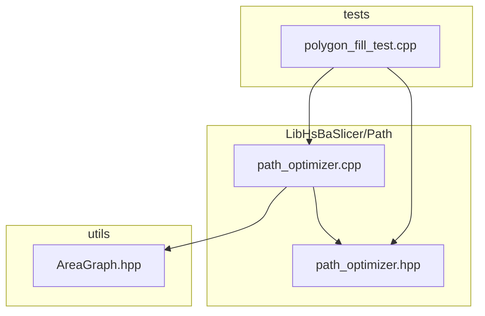

**图表来源**
- [path_optimizer.hpp:21-100](file://LibHsBaSlicer/Path/path_optimizer.hpp#L21-L100)
- [path_optimizer.cpp:45-474](file://LibHsBaSlicer/Path/path_optimizer.cpp#L45-L474)
- [AreaGraph.hpp:95-345](file://utils/AreaGraph.hpp#L95-L345)
- [polygon_fill_test.cpp:383-441](file://tests/PolygonFill/polygon_fill_test.cpp#L383-L441)

**章节来源**
- [path_optimizer.hpp:21-100](file://LibHsBaSlicer/Path/path_optimizer.hpp#L21-L100)
- [path_optimizer.cpp:1-474](file://LibHsBaSlicer/Path/path_optimizer.cpp#L1-L474)
- [AreaGraph.hpp:95-345](file://utils/AreaGraph.hpp#L95-L345)
- [polygon_fill_test.cpp:383-441](file://tests/PolygonFill/polygon_fill_test.cpp#L383-L441)

## 核心组件与 API
### C++ 接口：RegionPathOptimizer
- 构造与析构：默认构造，PImpl 隐藏实现细节。
- 添加区域：
  - `addRegion(regionId, paths)`：填充结果模式，paths 是多段线集合。
  - `addPolygonRegion(regionId, polygons)`：多边形模式，polygons 是轮廓集合。
- 手动路由：
  - `addRoute(fromId, toId, cost)`：对称覆盖自动计算的最近端点距离。
- 优化与构建：
  - `optimizeOrder()`：求解区域访问顺序，返回区域 id 序列。
  - `buildPaths()`：填充结果模式下，按优化顺序输出完整填充路径。
  - `buildPolygons()`：多边形模式下，按优化顺序输出多边形集合。

### Lua 接口：PathOptimize
注册后的全局表 `PathOptimize` 提供：
- `PathOptimize.new()`：创建优化器对象。
- 对象方法：
  - `addRegion(id, paths)`
  - `addPolygons(id, polygons)`
  - `addRoute(from, to, cost)`
  - `optimizeOrder()`
  - `buildPaths()`
  - `buildPolygons()`
- 一次性函数：
  - `PathOptimize.optimizeRegions(regions)`：填充结果模式一键优化。
  - `PathOptimize.optimizePolygons(regions)`：多边形模式一键优化。

此外还提供基于嵌入脚本的路径/多边形优化函数：
- `LuaOptimizeRegionPaths(...)` / `LuaOptimizeRegionPathsString(...)`
- `LuaOptimizeRegionPolygons(...)` / `LuaOptimizeRegionPolygonsString(...)`

**章节来源**
- [path_optimizer.hpp:44-115](file://LibHsBaSlicer/Path/path_optimizer.hpp#L44-L115)
- [path_optimizer.cpp:441-709](file://LibHsBaSlicer/Path/path_optimizer.cpp#L441-L709)

## 架构总览
PathOptimize 的核心流程如下：
1. 用户通过 C++ 或 Lua 添加区域与可选手动路由。
2. 调用 `optimizeOrder()` 时，内部将每个区域建模为 AreaGraph 的一个“区域”，并将区域内的候选门控点加入区域配置。
3. 区域间边由“门控点到门控点”的距离构成，可被手动 `addRoute` 覆盖。
4. 使用 AreaGraph 的最短路径与遗传 TSP 求解区域访问顺序与入口门控。
5. 根据模式分别对区域内路径或多边形进行贪心重排，得到最终输出。

```mermaid
sequenceDiagram
participant User as "用户/Lua 脚本"
participant Opt as "RegionPathOptimizer"
participant Impl as "RegionPathOptimizer : : Impl"
participant AG as "AreaGraph"
User->>Opt : addRegion()/addPolygonRegion()
Opt->>Impl : 记录区域、门控点、模式
User->>Opt : addRoute()
Opt->>Impl : 记录手动对称代价
User->>Opt : optimizeOrder()
Opt->>Impl : buildAreaGraph()
Impl->>AG : addArea()/addRoute()
Impl->>AG : solveTSP(mustVisit)
AG-->>Impl : tour + entryGates
Impl-->>Opt : 返回区域顺序
User->>Opt : buildPaths()/buildPolygons()
Opt->>Impl : arrangeRegionPaths()/arrangeRegionPolygons()
Impl-->>User : 输出优化后的路径/多边形
```

**图表来源**
- [path_optimizer.cpp:68-127](file://LibHsBaSlicer/Path/path_optimizer.cpp#L68-L127)
- [path_optimizer.cpp:129-185](file://LibHsBaSlicer/Path/path_optimizer.cpp#L129-L185)
- [path_optimizer.cpp:252-312](file://LibHsBaSlicer/Path/path_optimizer.cpp#L252-L312)
- [AreaGraph.hpp:197-345](file://utils/AreaGraph.hpp#L197-L345)

## 详细组件分析

### RegionPathOptimizer 类设计
该类采用 PImpl 模式隐藏实现细节，对外仅暴露稳定的 API。其关键职责包括：
- 维护区域列表、手动路由、优化结果缓存。
- 校验重复区域 id 与模式混用。
- 构建 AreaGraph 并求解 TSP。
- 根据模式执行区域内重排。

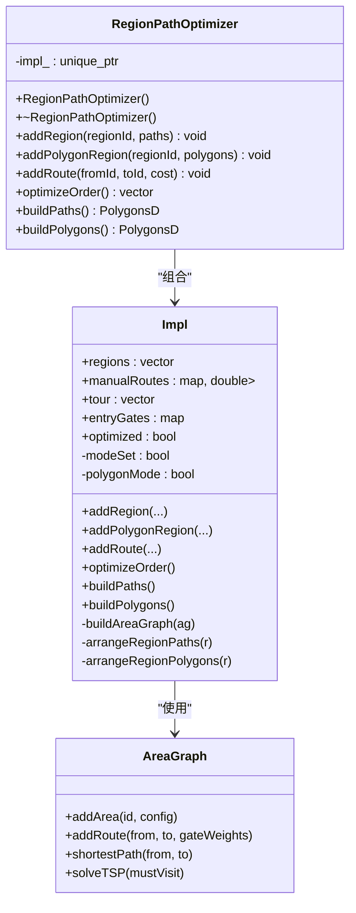

**图表来源**
- [path_optimizer.hpp:44-100](file://LibHsBaSlicer/Path/path_optimizer.hpp#L44-L100)
- [path_optimizer.cpp:45-474](file://LibHsBaSlicer/Path/path_optimizer.cpp#L45-L474)
- [AreaGraph.hpp:95-345](file://utils/AreaGraph.hpp#L95-L345)

**章节来源**
- [path_optimizer.hpp:44-100](file://LibHsBaSlicer/Path/path_optimizer.hpp#L44-L100)
- [path_optimizer.cpp:45-474](file://LibHsBaSlicer/Path/path_optimizer.cpp#L45-L474)

### 区域添加与模式管理
- `addRegion`：
  - 检查重复 regionId。
  - 若已设置模式且为多边形模式，抛出异常（禁止混用）。
  - 设置模式为“填充结果模式”。
  - 为每条非空路径取首尾点作为门控点。
- `addPolygonRegion`：
  - 检查重复 regionId。
  - 若已设置模式且为填充结果模式，抛出异常（禁止混用）。
  - 设置模式为“多边形模式”。
  - 将所有多边形的所有顶点作为门控点，并记录所属多边形索引与顶点索引。

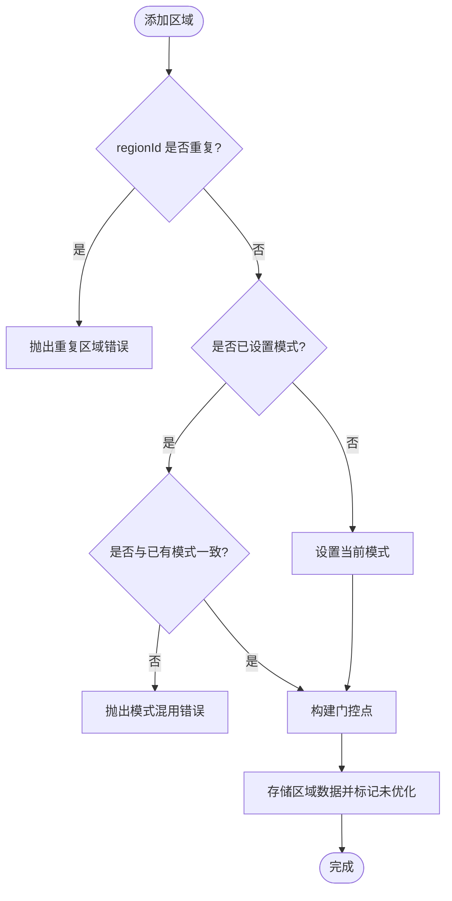

**图表来源**
- [path_optimizer.cpp:68-127](file://LibHsBaSlicer/Path/path_optimizer.cpp#L68-L127)

**章节来源**
- [path_optimizer.cpp:68-127](file://LibHsBaSlicer/Path/path_optimizer.cpp#L68-L127)

### 路由设置与代价模型
- 自动计算：
  - 区域内部：门控点到门控点的直线距离作为内部移动代价。
  - 区域之间：所有门控点对之间的直线距离作为空移代价。
- 手动覆盖：
  - `addRoute(fromId, toId, cost)` 会同时写入对称的两条边，覆盖自动计算的最小端点距离。

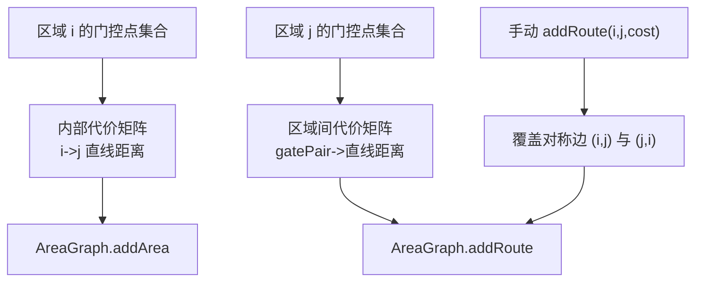

**图表来源**
- [path_optimizer.cpp:252-312](file://LibHsBaSlicer/Path/path_optimizer.cpp#L252-L312)

**章节来源**
- [path_optimizer.cpp:252-312](file://LibHsBaSlicer/Path/path_optimizer.cpp#L252-L312)

### 优化执行流程
- `optimizeOrder()`：
  - 少于两个区域：直接返回插入顺序。
  - 两个区域：比较两个方向的最短路径，选择更优者。
  - 三个及以上区域：构建 AreaGraph，调用 `solveTSP` 求解环游；若失败则回退到插入顺序。
  - 记录每个区域的入口门控点。
- `buildPaths()`：
  - 仅在填充结果模式有效。
  - 按优化顺序遍历区域，对区域内路径进行贪心重排：从入口门控端点出发，每次选择最近的未使用路径端点，必要时反转路径方向。
- `buildPolygons()`：
  - 仅在多边形模式有效。
  - 按优化顺序遍历区域，对区域内多边形进行贪心重排：从入口门控顶点出发，每次选择最近顶点的多边形，旋转使其起点落在最近顶点，不改变环绕方向。

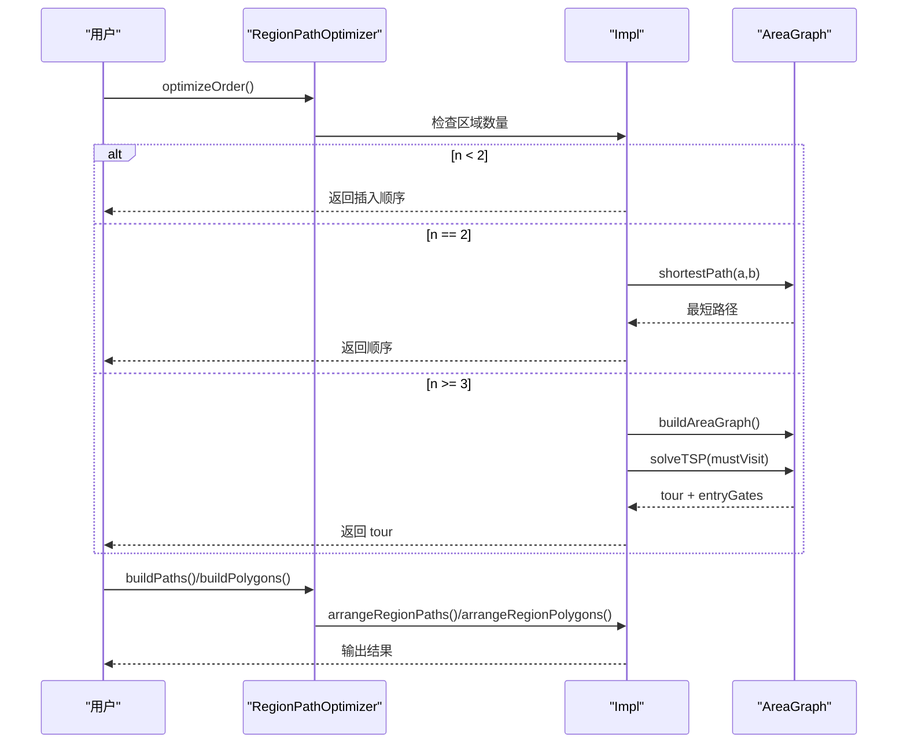

**图表来源**
- [path_optimizer.cpp:129-185](file://LibHsBaSlicer/Path/path_optimizer.cpp#L129-L185)
- [path_optimizer.cpp:187-235](file://LibHsBaSlicer/Path/path_optimizer.cpp#L187-L235)
- [AreaGraph.hpp:197-345](file://utils/AreaGraph.hpp#L197-L345)

**章节来源**
- [path_optimizer.cpp:129-235](file://LibHsBaSlicer/Path/path_optimizer.cpp#L129-L235)

### Lua 绑定与脚本集成
- `RegisterLuaPathOptimizeFunctions` 注册 `PathOptimize` 全局表及其方法。
- 对象元表与方法映射：
  - `addRegion`、`addPolygons`、`addRoute`、`optimizeOrder`、`buildPaths`、`buildPolygons`。
- 一次性函数：
  - `optimizeRegions`：读取 regions 数组，逐区调用 `addRegion`，然后 `optimizeOrder` + `buildPaths`。
  - `optimizePolygons`：读取 regions 数组，逐区调用 `addPolygonRegion`，然后 `optimizeOrder` + `buildPolygons`。
- 脚本环境：
  - 加载标准库、多边形操作函数、填充函数、路径优化函数。
  - 支持从文件或内联字符串加载脚本，并调用指定函数名。

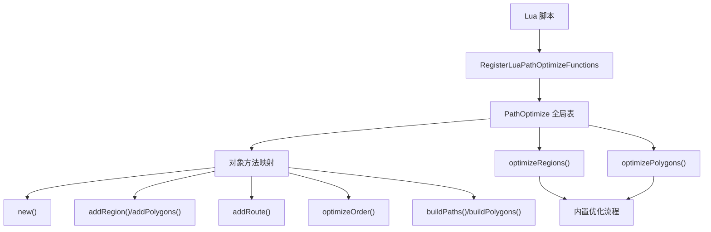

**图表来源**
- [path_optimizer.cpp:479-709](file://LibHsBaSlicer/Path/path_optimizer.cpp#L479-L709)

**章节来源**
- [path_optimizer.cpp:479-709](file://LibHsBaSlicer/Path/path_optimizer.cpp#L479-L709)

## 依赖关系分析
- RegionPathOptimizer 依赖 AreaGraph 提供的区域-门控图能力。
- AreaGraph 内部使用 Boost adjacency_list 构建扩展图，并使用 Dijkstra 求最短路径，结合 GeneticTSP 求解 TSP。
- Lua 绑定依赖 LuaAdapter、PolygonFill 等工具以转换数据结构与提供脚本环境。

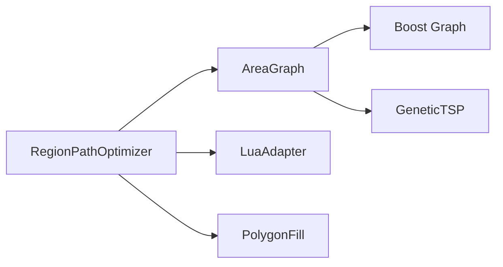

**图表来源**
- [path_optimizer.cpp:17-22](file://LibHsBaSlicer/Path/path_optimizer.cpp#L17-L22)
- [AreaGraph.hpp:10-25](file://utils/AreaGraph.hpp#L10-L25)
- [AreaGraph.hpp:490-592](file://utils/AreaGraph.hpp#L490-L592)

**章节来源**
- [path_optimizer.cpp:17-22](file://LibHsBaSlicer/Path/path_optimizer.cpp#L17-L22)
- [AreaGraph.hpp:10-25](file://utils/AreaGraph.hpp#L10-L25)
- [AreaGraph.hpp:490-592](file://utils/AreaGraph.hpp#L490-L592)

## 算法原理与性能特点

### 区域访问顺序优化
- 建模：
  - 每个独立区域为一个 AreaGraph 的“区域”。
  - 区域内候选门控点：
    - 填充结果模式：每条路径的首尾点。
    - 多边形模式：所有多边形的所有顶点。
- 代价：
  - 区域内：门控点到门控点的直线距离。
  - 区域间：所有门控点对之间的直线距离；可通过 `addRoute` 覆盖。
- 求解：
  - 区域数小于 2：保持插入顺序。
  - 区域数为 2：比较两个方向的直接最短路径。
  - 区域数大于等于 3：调用 AreaGraph 的遗传 TSP 求解环游，并记录每个区域的入口门控点。

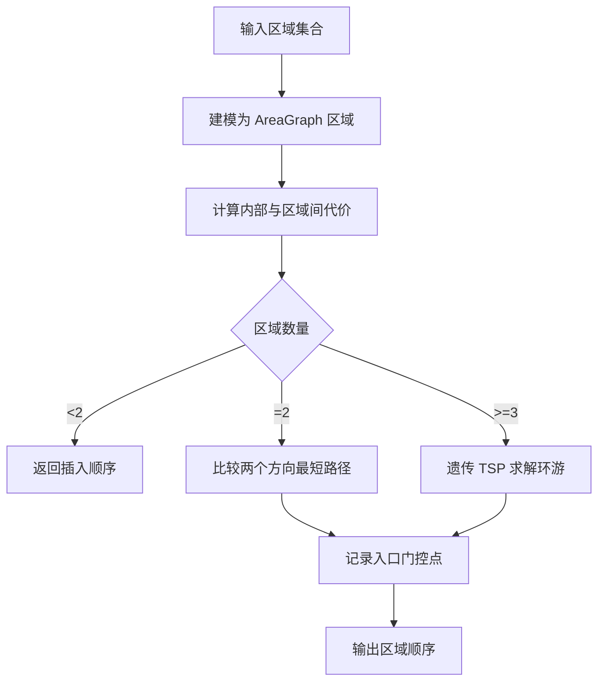

**图表来源**
- [path_optimizer.cpp:129-185](file://LibHsBaSlicer/Path/path_optimizer.cpp#L129-L185)
- [AreaGraph.hpp:267-345](file://utils/AreaGraph.hpp#L267-L345)

**章节来源**
- [path_optimizer.cpp:129-185](file://LibHsBaSlicer/Path/path_optimizer.cpp#L129-L185)
- [AreaGraph.hpp:267-345](file://utils/AreaGraph.hpp#L267-L345)

### 区域内路径/多边形重排
- 填充结果模式：
  - 从入口门控端点开始，贪心选择最近未使用的路径端点，必要时反转路径方向以减少跳跃。
- 多边形模式：
  - 从入口门控顶点开始，贪心选择最近顶点的多边形，旋转使其起点落在最近顶点，保持环绕方向不变。

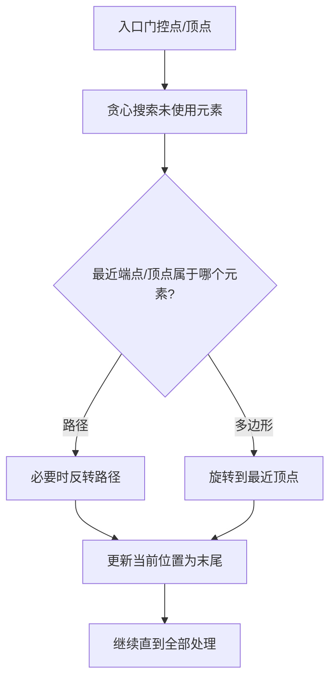

**图表来源**
- [path_optimizer.cpp:314-438](file://LibHsBaSlicer/Path/path_optimizer.cpp#L314-L438)

**章节来源**
- [path_optimizer.cpp:314-438](file://LibHsBaSlicer/Path/path_optimizer.cpp#L314-L438)

### 性能特点
- 时间复杂度：
  - 构建 AreaGraph：O(R^2 * G^2)，其中 R 为区域数，G 为区域内门控点数（区域间所有门控点对）。
  - 最短路径：Dijkstra 在扩展图上运行，复杂度取决于扩展图规模。
  - TSP：遗传算法，受种群大小、最大代数、变异率、交叉率影响。
- 空间复杂度：
  - 扩展图规模随门控点数量增长。
  - 路径缓存用于 TSP 压缩图构建。
- 实际表现：
  - 区域较少时开销较低。
  - 区域较多且门控点多时，应关注遗传算法参数与手动路由优化。

[本节为通用性能讨论，不直接分析具体文件]

## 参数调优与实践建议

### 遗传 TSP 参数
AreaGraph 的 `solveTSP` 提供以下可调参数：
- `populationSize`：种群大小，默认 150。
- `maxGenerations`：最大代数，默认 500。
- `mutationRate`：变异率，默认 0.03。
- `crossoverRate`：交叉率，默认 0.85。

建议：
- 区域数量较大时，适当增大 `populationSize` 与 `maxGenerations` 以提升解质量。
- 对不稳定场景，适度提高 `mutationRate` 以避免陷入局部最优。
- 对稳定场景，提高 `crossoverRate` 以利用优良基因片段。

**章节来源**
- [AreaGraph.hpp:267-269](file://utils/AreaGraph.hpp#L267-L269)

### 手动路由与可达性
- 当某些区域之间存在物理障碍或工艺约束时，可使用 `addRoute` 设置较大的代价，迫使优化器避开该连接。
- 对于必须优先访问的区域，可对目标区域设置较小的入边代价，引导入口门控点选择。

**章节来源**
- [path_optimizer.cpp:122-127](file://LibHsBaSlicer/Path/path_optimizer.cpp#L122-L127)
- [path_optimizer.cpp:279-312](file://LibHsBaSlicer/Path/path_optimizer.cpp#L279-L312)

### 模式选择
- 填充前优化（多边形模式）：适合在填充阶段之前调整轮廓访问顺序，减少填充时的换向与跳跃。
- 填充后优化（填充结果模式）：适合在填充完成后对路径序列进行整体优化，减少打印头空移。

**章节来源**
- [path_optimizer.hpp:23-43](file://LibHsBaSlicer/Path/path_optimizer.hpp#L23-L43)
- [path_optimizer.cpp:68-120](file://LibHsBaSlicer/Path/path_optimizer.cpp#L68-L120)

## 复杂路径场景优化策略

### 多区域聚簇
- 现象：多个区域在空间上形成聚簇，而另一些区域远离聚簇。
- 策略：
  - 让优化器自然发现聚簇相邻性；测试用例表明聚簇区域在环游中通常相邻（含首尾相邻）。
  - 若需要强制聚簇顺序，可使用 `addRoute` 调整聚簇内部与外部之间的代价。

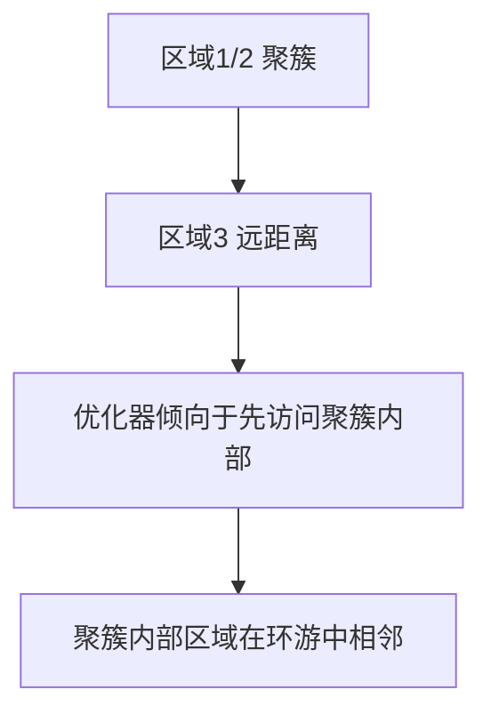

**图表来源**
- [polygon_fill_test.cpp:421-441](file://tests/PolygonFill/polygon_fill_test.cpp#L421-L441)

**章节来源**
- [polygon_fill_test.cpp:421-441](file://tests/PolygonFill/polygon_fill_test.cpp#L421-L441)

### 长距离跨区
- 现象：区域相距很远，空移成本高。
- 策略：
  - 使用 `addRoute` 对远距连接设置高代价，避免不必要的跨区跳转。
  - 合理划分区域，使每个区域内部路径尽量连续。

**章节来源**
- [path_optimizer.cpp:279-312](file://LibHsBaSlicer/Path/path_optimizer.cpp#L279-L312)

### 混合路径与轮廓
- 现象：同一模型既有填充路径又有轮廓。
- 策略：
  - 分别使用填充结果模式与多边形模式进行两次优化，不要混用。
  - 先进行多边形模式优化（填充前），再进行填充结果模式优化（填充后）。

**章节来源**
- [path_optimizer.cpp:68-120](file://LibHsBaSlicer/Path/path_optimizer.cpp#L68-L120)

## 故障排除

### 常见错误
- 重复区域 id：
  - 现象：添加相同 regionId 时报错。
  - 原因：`checkDuplicate` 检测到重复。
  - 解决：确保每个区域 id 唯一。
- 模式混用：
  - 现象：在同一优化器中混用 `addRegion` 与 `addPolygonRegion` 报错。
  - 原因：首次添加决定模式，后续添加必须一致。
  - 解决：拆分优化器实例，分别处理填充结果与多边形。
- 模式不匹配的输出调用：
  - 现象：在填充结果模式调用 `buildPolygons`，或在多边形模式调用 `buildPaths` 报错。
  - 原因：输出方法与模式不一致。
  - 解决：根据模式选择对应输出方法。

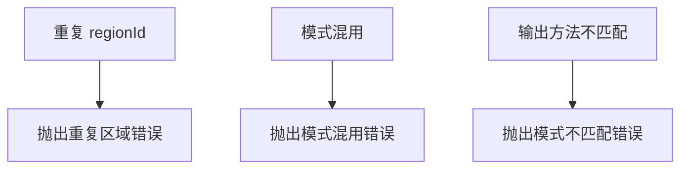

**图表来源**
- [path_optimizer.cpp:241-248](file://LibHsBaSlicer/Path/path_optimizer.cpp#L241-L248)
- [path_optimizer.cpp:187-217](file://LibHsBaSlicer/Path/path_optimizer.cpp#L187-L217)

**章节来源**
- [path_optimizer.cpp:68-120](file://LibHsBaSlicer/Path/path_optimizer.cpp#L68-L120)
- [path_optimizer.cpp:187-217](file://LibHsBaSlicer/Path/path_optimizer.cpp#L187-L217)
- [path_optimizer.cpp:241-248](file://LibHsBaSlicer/Path/path_optimizer.cpp#L241-L248)

### 脚本调用问题
- 现象：Lua 脚本找不到函数或返回类型不正确。
- 原因：函数名不存在或返回值不是表。
- 解决：确认脚本函数名与签名，并确保返回路径/多边形表。

**章节来源**
- [path_optimizer.cpp:661-681](file://LibHsBaSlicer/Path/path_optimizer.cpp#L661-L681)

## 结论
PathOptimize 模块通过“区域-门控”两级图模型，将复杂的区域访问顺序问题转化为可计算的图问题，并结合遗传 TSP 与贪心重排，显著减少打印头空移与路径跳跃。在实际使用中，应根据场景选择合适的模式、合理设置遗传算法参数，并在必要时通过手动路由引导优化方向。测试用例验证了其在聚簇相邻、跨区优化与脚本集成方面的有效性。

[本节为总结性内容，不直接分析具体文件]