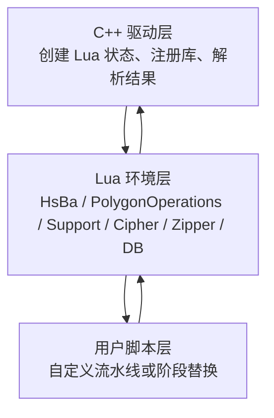
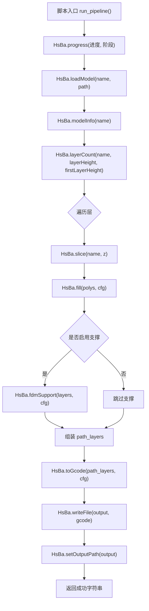
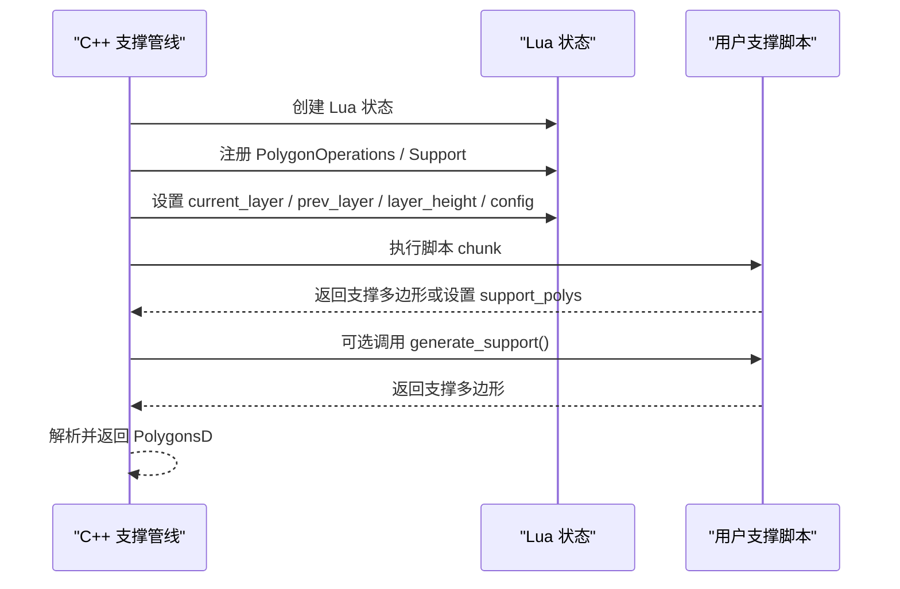
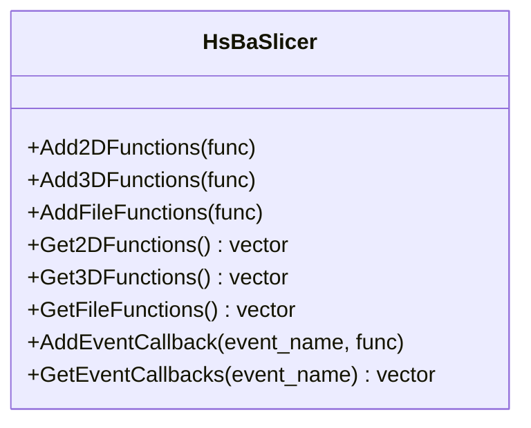
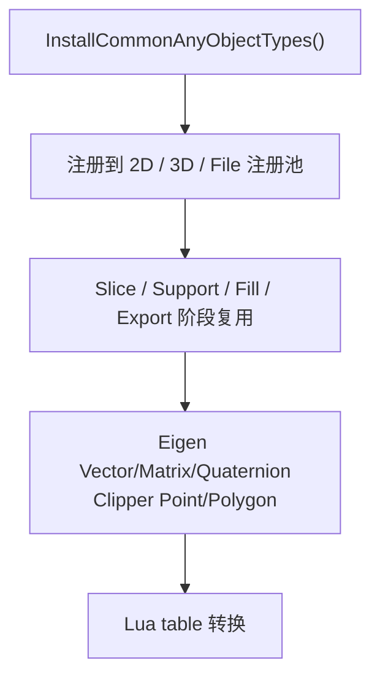
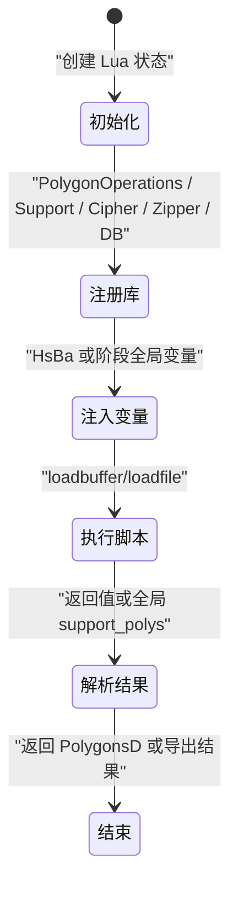
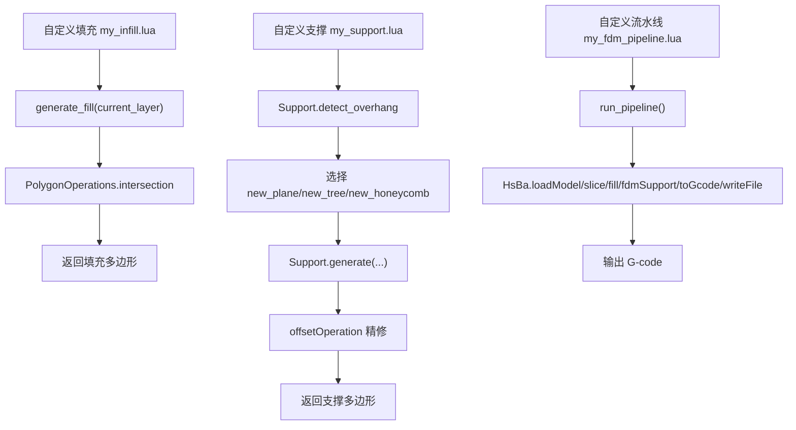

# Lua 脚本系统

<cite>
**本文引用的文件**   
- [lua_pipeline.cpp](file://LibHsBaSlicer/Extends/lua_pipeline.cpp)
- [LuaAddFunction.hpp](file://LibHsBaSlicer/Extends/LuaAddFunction.hpp)
- [LuaCommonTypes.hpp](file://LibHsBaSlicer/Extends/LuaCommonTypes.hpp)
- [LuaAdapter.hpp](file://2D/LuaAdapter.hpp)
- [LuaAdapter.cpp](file://2D/LuaAdapter.cpp)
- [LuaSupport.hpp](file://support/LuaSupport.hpp)
- [LuaSupport.cpp](file://support/LuaSupport.cpp)
- [LuaAdapter.hpp](file://fileoperator/LuaAdapter.hpp)
- [LuaAdapter.cpp](file://fileoperator/LuaAdapter.cpp)
- [LuaAdapter.hpp](file://cipher/LuaAdapter.hpp)
- [LuaAdapter.cpp](file://cipher/LuaAdapter.cpp)
- [my_infill.lua](file://samples/FDM/scripts/my_infill.lua)
- [my_support.lua](file://samples/FDM/scripts/my_support.lua)
- [my_fdm_pipeline.lua](file://samples/Custom/scripts/my_fdm_pipeline.lua)
</cite>

## 目录
1. [项目概述与快速开始](#项目概述与快速开始)
2. [架构总览](#架构总览)
3. [核心概念](#核心概念)
4. [核心模块详解](#核心模块详解)
5. [高级主题](#高级主题)
6. [Lua 脚本系统](#lua-脚本系统)
7. [API 参考文档](#api-参考文档)
8. [集成指南](#集成指南)
9. [开发·测试与贡献](#开发测试与贡献)
10. [扩展开发指南](#扩展开发指南)
11. [示例与教程](#示例与教程)
12. [部署·故障排除与FAQ](#部署故障排除与faq)
13. [附录](#附录)

## 项目概述与快速开始
HsBaSlicer 的 Lua 脚本系统提供两类扩展能力：
- **自定义流水线**：由 Lua 完全控制加载模型、切片、支撑、填充、路径生成与写文件的顺序和策略，并通过全局 `HsBa` 算子表调用 C++ 提供的切片与导出能力。
- **内置流水线阶段替换**：在支撑、填充、地板或导出等固定阶段注入用户脚本，仅替换算法实现，不改变 C++ 控制的阶段顺序。

对于初学者，推荐从以下入口入手：
- 若需要“完全自己决定流水线”，编写一个包含 `run_pipeline()` 的脚本，使用 `HsBa.loadModel`、`HsBa.slice`、`HsBa.fill`、`HsBa.fdmSupport`、`HsBa.toGcode`、`HsBa.writeFile` 完成完整流程。
- 若只需要“替换某个阶段的算法”，例如自定义 FDM 填充或支撑，则按对应阶段的约定定义函数（如 `generate_fill` 或 `generate_support`），并返回多边形表。

本章节为概览性说明；具体 API、数据结构、错误处理与性能建议见后续章节。

## 架构总览
Lua 脚本系统的核心由三部分构成：
- **C++ 驱动层**：负责创建 Lua 状态、注册共享库、解析脚本返回值、管理模型池与流水线上下文。
- **Lua 环境层**：根据运行模式注入不同的全局变量与函数表，包括 `HsBa` 算子表、`PolygonOperations`、`Support`、`Cipher`、`Zipper`、数据库适配器等。
- **用户脚本层**：实现自定义流水线入口或阶段替换函数，通过 Lua table 表示几何数据，并调用 C++ 暴露的算法。

**图示来源**
- [lua_pipeline.cpp:41-63](file://LibHsBaSlicer/Extends/lua_pipeline.cpp#L41-L63)
- [lua_pipeline.cpp:224-288](file://LibHsBaSlicer/Extends/lua_pipeline.cpp#L224-L288)
- [LuaAdapter.cpp:487-491](file://2D/LuaAdapter.cpp#L487-L491)
- [LuaSupport.cpp:67-90](file://support/LuaSupport.cpp#L67-L90)

**章节来源**
- [lua_pipeline.cpp:41-63](file://LibHsBaSlicer/Extends/lua_pipeline.cpp#L41-L63)
- [LuaAddFunction.hpp:21-74](file://LibHsBaSlicer/Extends/LuaAddFunction.hpp#L21-L74)
- [LuaCommonTypes.hpp:146-183](file://LibHsBaSlicer/Extends/LuaCommonTypes.hpp#L146-L183)

## 核心概念
### 两种 Lua 运行环境
| 环境 | 用途 | 触发方式 | 关键特征 |
|------|------|----------|----------|
| 自定义流水线 | 由脚本自行决定加载、切片、支撑、填充、路径、写文件的顺序 | C++ 调用 `run_pipeline` 或 `pipeline_entry` 指定的入口 | 拥有全局 `HsBa` 算子表与上下文全局变量 |
| 内置流水线阶段替换 | 仅替换支撑、填充、地板或导出阶段的算法 | 内置流水线在对应阶段加载脚本并调用约定函数 | 各阶段注入不同全局变量，不暴露 `HsBa` |

### 通用几何数据类型
所有 API 使用统一的 Lua table 表示几何数据：
- 点：`{ x = 1.0, y = 2.0 }`
- 多边形：有序点数组，表示闭合轮廓
- 多边形集合：多边形数组，孔洞作为独立多边形存在
- 层列表：逐层的多边形集合数组
- 3D 点：`{ x = .., y = .., z = .. }`，用于螺旋路径等输出

注意：布尔运算与填充内部按整数精度处理；`HsBa.toInt` / `HsBa.toDouble` 用于整型与浮点多边形之间的转换。

**章节来源**
- [lua_pipeline_api.md:32-45](file://docs/zh/lua_pipeline_api.md#L32-L45)
- [LuaAdapter.cpp:332-485](file://2D/LuaAdapter.cpp#L332-L485)

## 核心模块详解
### 自定义流水线环境：`HsBa` 算子表
`HsBa` 是自定义流水线的唯一全局算子表，提供进度上报、模型管理、切片、坐标转换、填充、支撑、地板、路径与打包导出等功能。其内部通过 `PipelineRunState` 与 Lua registry 绑定当前运行上下文，并将脚本调用的结果回填到 C++ 侧的输出结构。

关键行为：
- 进度与层数：`HsBa.progress`、`HsBa.setLayers`、`HsBa.setOutputPath`
- 文件 IO：`HsBa.readFile`、`HsBa.writeFile`
- 模型管理：`HsBa.loadModel`、`HsBa.modelInfo`、`HsBa.translateModel`、`HsBa.rotateModel`、`HsBa.scaleModel`、`HsBa.removeModel`、`HsBa.modelNames`
- 切片：`HsBa.layerCount`、`HsBa.layerZ`、`HsBa.slice`、`HsBa.sliceUnsafe`
- 填充：`HsBa.toInt`、`HsBa.toDouble`、`HsBa.fill`
- 支撑与地板：`HsBa.fdmSupport`、`HsBa.slaSupport`、`HsBa.floor`
- 路径与 G-code：`HsBa.spiralize`、`HsBa.toGcode`
- 打包导出：`HsBa.saveSlsPackage`、`HsBa.saveWaamPackage`、`HsBa.saveSlaPackage`、`HsBa.renderImage`

**图示来源**
- [lua_pipeline.cpp:228-288](file://LibHsBaSlicer/Extends/lua_pipeline.cpp#L228-L288)
- [lua_pipeline.cpp:290-397](file://LibHsBaSlicer/Extends/lua_pipeline.cpp#L290-L397)
- [lua_pipeline.cpp:401-461](file://LibHsBaSlicer/Extends/lua_pipeline.cpp#L401-L461)
- [lua_pipeline.cpp:463-508](file://LibHsBaSlicer/Extends/lua_pipeline.cpp#L463-L508)
- [lua_pipeline.cpp:510-556](file://LibHsBaSlicer/Extends/lua_pipeline.cpp#L510-L556)
- [lua_pipeline.cpp:577-691](file://LibHsBaSlicer/Extends/lua_pipeline.cpp#L577-L691)

**章节来源**
- [lua_pipeline.cpp:41-63](file://LibHsBaSlicer/Extends/lua_pipeline.cpp#L41-L63)
- [lua_pipeline.cpp:224-800](file://LibHsBaSlicer/Extends/lua_pipeline.cpp#L224-L800)

### 通用共享库：PolygonOperations、Support、Cipher、Zipper、数据库适配器
所有环境均可使用的共享库包括：
- `PolygonOperations`：2D 布尔运算、偏移、凸包/凹包、面积、构造矩形/圆/椭圆/正多边形、文本转多边形
- `Support`：平面/树状/蜂窝/SLA 支撑生成器，悬垂检测，默认配置
- `Cipher`：Base64 与 Hex 编解码
- `Zipper` / `Bit7zZipper`：压缩打包
- SQLite / MySQL / PostgreSQL 适配器：数据库连接、查询、插入、更新、删除、建表
- `ParamStore`：基于反射的参数持久化管线

这些库通过各自的 `RegisterLua*` 函数注册到 Lua 全局表，并在不同流水线阶段按需安装。

**章节来源**
- [LuaAdapter.cpp:311-329](file://2D/LuaAdapter.cpp#L311-L329)
- [LuaAdapter.cpp:487-491](file://2D/LuaAdapter.cpp#L487-L491)
- [LuaSupport.cpp:67-90](file://support/LuaSupport.cpp#L67-L90)
- [LuaAdapter.cpp:92-96](file://cipher/LuaAdapter.cpp#L92-L96)
- [LuaAdapter.cpp:52-139](file://fileoperator/LuaAdapter.cpp#L52-L139)
- [LuaAdapter.cpp:142-302](file://fileoperator/LuaAdapter.cpp#L142-L302)
- [LuaAdapter.cpp:304-565](file://fileoperator/LuaAdapter.cpp#L304-L565)
- [LuaAdapter.cpp:567-800](file://fileoperator/LuaAdapter.cpp#L567-L800)
- [LuaAdapter.hpp:64-72](file://fileoperator/LuaAdapter.hpp#L64-L72)

### 支撑阶段：LuaSupport
`LuaSupport` 允许用 Lua 脚本完全替换内置支撑算法。它创建独立的 Lua 状态，注入 `current_layer`、`prev_layer`、`layer_height`、`config` 等全局变量，并注册 `PolygonOperations` 与 `Support` 模块。脚本可返回支撑多边形或通过全局 `support_polys` 返回。

**图示来源**
- [LuaSupport.cpp:19-49](file://support/LuaSupport.cpp#L19-L49)
- [LuaSupport.cpp:51-90](file://support/LuaSupport.cpp#L51-L90)
- [LuaSupport.cpp:113-178](file://support/LuaSupport.cpp#L113-L178)

**章节来源**
- [LuaSupport.hpp:19-81](file://support/LuaSupport.hpp#L19-L81)
- [LuaSupport.cpp:19-178](file://support/LuaSupport.cpp#L19-L178)

## 高级主题
### 外部函数注册与事件回调
系统支持按维度注册外部 Lua 函数：
- 2D 函数：用于支撑、填充、SLA 输出阶段
- 3D 函数：用于切片、支撑阶段
- 文件函数：用于 SLS/SLA 输出阶段

同时支持命名事件回调，例如 `"zipper.on_add"`、`"db.on_query"`，便于扩展 Zipper、数据库等行为的钩子。

**图示来源**
- [LuaAddFunction.hpp:21-74](file://LibHsBaSlicer/Extends/LuaAddFunction.hpp#L21-L74)

**章节来源**
- [LuaAddFunction.hpp:21-74](file://LibHsBaSlicer/Extends/LuaAddFunction.hpp#L21-L74)

### 通用类型系统与 AnyObject
`LuaCommonTypes` 为 Eigen 向量/矩阵、四元数以及 Clipper2 点/多边形注册反射元数据，并提供 Lua table 与 C++ 类型之间的双向转换。该机制确保几何对象在 Lua 中以稳定名称暴露，并可通过 `cast_<Name>` 方法访问底层类型视图。

**图示来源**
- [LuaCommonTypes.hpp:146-183](file://LibHsBaSlicer/Extends/LuaCommonTypes.hpp#L146-L183)

**章节来源**
- [LuaCommonTypes.hpp:20-45](file://LibHsBaSlicer/Extends/LuaCommonTypes.hpp#L20-L45)
- [LuaCommonTypes.hpp:110-143](file://LibHsBaSlicer/Extends/LuaCommonTypes.hpp#L110-L143)
- [LuaCommonTypes.hpp:146-183](file://LibHsBaSlicer/Extends/LuaCommonTypes.hpp#L146-L183)

## Lua 脚本系统
### 自定义流水线与阶段替换的区别
- 自定义流水线：脚本拥有 `HsBa` 算子表，可自由编排阶段顺序，适合完整工艺定制。
- 阶段替换：仅替换特定阶段算法，适合局部优化，如自定义填充或支撑。

### 脚本生命周期
1. C++ 创建 Lua 状态并注册共享库。
2. 注入上下文全局变量（自定义流水线）或阶段全局变量（支撑/填充/地板/导出）。
3. 加载并执行用户脚本。
4. 解析返回值或全局变量，得到几何数据或导出结果。
5. 将结果回传给 C++ 流水线或上层应用。

**图示来源**
- [LuaSupport.cpp:113-178](file://support/LuaSupport.cpp#L113-L178)
- [lua_pipeline.cpp:228-288](file://LibHsBaSlicer/Extends/lua_pipeline.cpp#L228-L288)

**章节来源**
- [lua_pipeline.cpp:224-800](file://LibHsBaSlicer/Extends/lua_pipeline.cpp#L224-L800)
- [LuaSupport.cpp:67-178](file://support/LuaSupport.cpp#L67-L178)

## API 参考文档
### 自定义流水线 API：`HsBa` 算子表
| 调用 | 返回 | 说明 |
|------|------|------|
| `HsBa.progress(percent[, stage])` | — | 上报进度百分比与阶段名 |
| `HsBa.setLayers(n)` | — | 上报总层数 |
| `HsBa.setOutputPath(path)` | — | 上报实际输出路径 |
| `HsBa.readFile(path)` | string \| nil | 读取文件内容 |
| `HsBa.writeFile(path, content)` | true | 二进制覆盖写入 |
| `HsBa.loadModel(name, path)` | true | 加载模型到模型池 |
| `HsBa.modelInfo(name)` | table | `{ bbox_min, bbox_max, volume }` |
| `HsBa.translateModel(name, {x,y,z})` | — | 平移模型 |
| `HsBa.rotateModel(name, {x,y,z,w})` | — | 四元数旋转 |
| `HsBa.scaleModel(name, s or {x,y,z})` | — | 缩放模型 |
| `HsBa.removeModel(name)` | — | 移除模型 |
| `HsBa.modelNames()` | table | 模型名数组 |
| `HsBa.layerCount(name, layerHeight, firstLayerHeight)` | int | 计算层数 |
| `HsBa.layerZ(index0based, layerHeight, firstLayerHeight)` | number | 第 index 层的 Z |
| `HsBa.slice(name, z)` | polygons | 安全切片（闭合轮廓） |
| `HsBa.sliceUnsafe(name, z)` | polygons | 非安全切片（可能丢弃开口） |
| `HsBa.toInt(polygons)` | polygons | 浮点 → 整型 |
| `HsBa.toDouble(intPolygons)` | polygons | 整型 → 浮点 |
| `HsBa.fill(polygons[, cfg])` | polygons | 填充，cfg 含 spacing/mode/angle/borderCount |
| `HsBa.fdmSupport(layers, cfg)` | layers | FDM 支撑 |
| `HsBa.slaSupport(layers, cfg)` | layers | SLA 支撑 |
| `HsBa.floor(bottomPolygons, cfg)` | polygons | SLA 底部地板 |
| `HsBa.spiralize(sections[, cfg])` | path | 螺旋路径 |
| `HsBa.toGcode(layers, cfg)` | string | 生成 G-code |
| `HsBa.saveSlsPackage(tbl)` | bool | 打包 SLS |
| `HsBa.saveWaamPackage(tbl)` | bool[, err] | 打包 WAAM |
| `HsBa.saveSlaPackage(tbl)` | bool | 打包 SLA |
| `HsBa.renderImage(polygons, width, height, path)` | bool | 渲染图像 |

**章节来源**
- [lua_pipeline.cpp:228-800](file://LibHsBaSlicer/Extends/lua_pipeline.cpp#L228-L800)
- [lua_pipeline_api.md:48-133](file://docs/zh/lua_pipeline_api.md#L48-L133)

### 通用共享库 API
#### PolygonOperations
| 函数 | 说明 |
|------|------|
| `booleanOperation(a, b, op)` | 通用布尔运算 |
| `union(a, b)` / `intersection(a, b)` / `difference(a, b)` / `xor(a, b)` | 并/交/差/异或 |
| `offsetOperation(polys, delta)` | 内外偏移 |
| `convexHullOperation(polys)` / `concaveHullOperation(polys[, ...])` | 凸包/凹包 |
| `area(polygon)` | 面积 |
| `makeRectangle(xmin, ymin, xmax, ymax)` | 矩形 |
| `makeCircle(cx, cy, r)` | 圆形 |
| `makeEllipse(...)` | 椭圆 |
| `makeRegularPolygon(...)` | 正多边形 |
| `textToPolygons(...)` | 文本转多边形 |

#### Support
| 调用 | 说明 |
|------|------|
| `Support.new_plane()` / `new_tree()` / `new_honeycomb()` / `new_sla()` | 创建支撑生成器 |
| `Support.generate(obj, current_layer, prev_layer, layer_height, cfg)` | 生成支撑 |
| `Support.detect_overhang(current, prev, height, angle)` | 检测悬垂区域 |
| `Support.default_config()` | 默认支撑配置 |

#### Cipher
| 函数 | 说明 |
|------|------|
| `Cipher.base64_encode(s)` / `base64_decode(s)` | Base64 编解码 |
| `Cipher.hex_encode(s)` / `hex_decode(s)` | Hex 编解码 |

#### Zipper / Bit7zZipper
| 调用 | 说明 |
|------|------|
| `Zipper.new()` | 创建 zip 对象 |
| `z:AddFile(name, path)` | 添加磁盘文件 |
| `z:AddByteFile(name, data)` | 添加内存字节 |
| `z:Save(path)` | 写出压缩包 |
| `Bit7zZipper.new(format, dll_path)` | 7z 格式压缩 |

#### 数据库适配器
| 类 | 方法 |
|----|------|
| `SQLiteAdapter` / `MySQLAdapter` / `PostgreSQLAdapter` | `Connect`、`Execute`、`Query`、`Insert`、`Update`、`Delete`、`CreateTable` |

**章节来源**
- [LuaAdapter.cpp:311-329](file://2D/LuaAdapter.cpp#L311-L329)
- [LuaAdapter.cpp:487-491](file://2D/LuaAdapter.cpp#L487-L491)
- [LuaSupport.cpp:67-90](file://support/LuaSupport.cpp#L67-L90)
- [LuaAdapter.cpp:92-96](file://cipher/LuaAdapter.cpp#L92-L96)
- [LuaAdapter.cpp:52-139](file://fileoperator/LuaAdapter.cpp#L52-L139)
- [LuaAdapter.cpp:142-302](file://fileoperator/LuaAdapter.cpp#L142-L302)
- [LuaAdapter.cpp:304-565](file://fileoperator/LuaAdapter.cpp#L304-L565)
- [LuaAdapter.cpp:567-800](file://fileoperator/LuaAdapter.cpp#L567-L800)
- [LuaAdapter.hpp:64-72](file://fileoperator/LuaAdapter.hpp#L64-L72)

### 内置阶段替换 API
#### 支撑阶段
- 全局变量：`current_layer`、`prev_layer`、`layer_height`、`config`
- 约定入口：`generate_support()`，返回支撑截面多边形表
- 可用库：`PolygonOperations`、`Support`

#### 填充阶段
- 约定入口：`generate_fill(current_layer)`，返回填充多边形表
- 无全局变量，使用脚本内默认值
- 可用库：`PolygonOperations`、`PolygonFill`、`PathOptimize`

#### 地板阶段（SLA）
- 可用库：`PolygonOperations`、`PolygonFill`

#### 导出阶段（SLS / SLA / SLM / LOM / 3DP / WAAM）
- 全局变量：`config`、`images`、`output_path`
- 约定入口：SLS 为 `export_sls()`，WAAM 为 `export_waam()`
- 返回值：`{ success = true/false, export_path = "..." }`
- 可用库：`Zipper`、`Cipher`、`Bit7zZipper`、数据库适配器、`ParamStore`

**章节来源**
- [lua_pipeline_api.md:215-261](file://docs/zh/lua_pipeline_api.md#L215-L261)

## 集成指南
### 如何在 C++ 中注册外部 Lua 函数
通过 `Add2DFunctions`、`Add3DFunctions`、`AddFileFunctions` 向指定阶段的 Lua 状态注入自定义函数。这些函数会在构建阶段 Lua 环境时被调用，从而对脚本可见。

### 如何扩展事件回调
使用 `AddEventCallback` 将 Lua 回调绑定到命名事件，例如在 Zipper 添加文件或数据库查询时触发。通过 `GetEventCallbacks` 获取已注册的回调列表。

### 如何将自定义类型暴露给 Lua
使用 `RegisterCommonAnyObjectTypes` 或 `InstallCommonAnyObjectTypes` 注册几何类型，使 Eigen 向量、矩阵、四元数与 Clipper2 点在 Lua 中以 table 形式读写。

**章节来源**
- [LuaAddFunction.hpp:21-74](file://LibHsBaSlicer/Extends/LuaAddFunction.hpp#L21-L74)
- [LuaCommonTypes.hpp:146-183](file://LibHsBaSlicer/Extends/LuaCommonTypes.hpp#L146-L183)

## 开发·测试与贡献
### 调试技巧
- 使用 `HsBa.progress` 上报阶段名与百分比，便于在 C++ 侧观察进度。
- 在支撑脚本中使用 `Support.detect_overhang` 先检测悬垂区域，再选择支撑生成器，减少无效计算。
- 使用 `PolygonOperations.area` 与 `offsetOperation` 验证多边形有效性。
- 导出脚本严格返回 `{ success=..., export_path=... }`，避免 zip 被覆盖或写空。

### 性能考虑
- 填充与布尔运算内部按整数精度处理，尽量避免在 Lua 层频繁进行浮点与整型转换。
- 大模型切片时优先使用 `HsBa.slice`（安全切片），仅在确知轮廓有效时使用 `sliceUnsafe`。
- 路径优化建议使用 `PathOptimize.optimizeRegions` 或 `optimizePolygons`，减少手动排序开销。
- 压缩导出优先使用 `Bit7zZipper` 以支持更多格式，但需编译启用相应宏。

### 最佳实践
- 自定义流水线中统一参数来源：优先使用 C++ 注入的 `machine` 表，其次使用脚本默认值。
- 支撑脚本中显式设置 `overhang_angle_threshold`、`layer_height`、`support_gap`、`support_diameter`、`support_density`。
- 填充脚本中明确 `spacing`、`angle`、`mode`，必要时结合 `borderCount` 生成壁厚+填充。
- 导出脚本中校验 `output` 与 `script` 字段，确保打包流程稳定。

**章节来源**
- [lua_pipeline.cpp:228-800](file://LibHsBaSlicer/Extends/lua_pipeline.cpp#L228-L800)
- [LuaSupport.cpp:19-178](file://support/LuaSupport.cpp#L19-L178)
- [lua_pipeline_api.md:264-280](file://docs/zh/lua_pipeline_api.md#L264-L280)

## 扩展开发指南
### 自定义填充算法
参考 `samples/FDM/scripts/my_infill.lua`：
- 定义 `generate_fill(current_layer)`，接收当前层多边形。
- 使用 `PolygonOperations` 构造扫描线并与当前层求交集。
- 返回填充多边形表。

### 自定义支撑生成器
参考 `samples/FDM/scripts/my_support.lua`：
- 定义 `generate_support()`，读取 `current_layer`、`prev_layer`、`layer_height`、`config`。
- 使用 `Support.detect_overhang` 检测悬垂区域。
- 根据 `config.support_pattern` 选择 `new_plane`、`new_tree`、`new_honeycomb`。
- 调用 `Support.generate` 生成支撑，并可进一步用 `offsetOperation` 精修接触点。

### 自定义流水线
参考 `samples/Custom/scripts/my_fdm_pipeline.lua`：
- 定义 `run_pipeline()`，使用 `HsBa` 算子表完成加载、切片、填充、支撑、路径生成与写文件。
- 通过 `param` 函数统一读取机台参数，优先使用 `machine` 表。
- 每层动态调整填充角度，体现 Lua 对工艺策略的完全掌控。

**图示来源**
- [my_infill.lua:18-88](file://samples/FDM/scripts/my_infill.lua#L18-L88)
- [my_support.lua:30-82](file://samples/FDM/scripts/my_support.lua#L30-L82)
- [my_fdm_pipeline.lua:52-171](file://samples/Custom/scripts/my_fdm_pipeline.lua#L52-L171)

**章节来源**
- [my_infill.lua:1-89](file://samples/FDM/scripts/my_infill.lua#L1-L89)
- [my_support.lua:1-83](file://samples/FDM/scripts/my_support.lua#L1-L83)
- [my_fdm_pipeline.lua:1-172](file://samples/Custom/scripts/my_fdm_pipeline.lua#L1-L172)

## 示例与教程
### 最小可运行自定义流水线
一个最小可运行的自定义流水线脚本应包含：
- 入口函数 `run_pipeline()`
- 使用 `HsBa.loadModel` 加载模型
- 使用 `HsBa.layerCount` 与 `HsBa.layerZ` 计算层数与高度
- 使用 `HsBa.slice` 与 `HsBa.fill` 生成轮廓与填充
- 使用 `HsBa.fdmSupport` 生成支撑（可选）
- 使用 `HsBa.toGcode` 生成 G-code
- 使用 `HsBa.writeFile` 与 `HsBa.setOutputPath` 输出结果

**章节来源**
- [lua_pipeline_api.md:283-331](file://docs/zh/lua_pipeline_api.md#L283-L331)
- [my_fdm_pipeline.lua:52-171](file://samples/Custom/scripts/my_fdm_pipeline.lua#L52-L171)

### 常见扩展场景
- 自定义填充算法：通过 `generate_fill` 实现平行线扫描、网格填充或自适应填充。
- 自定义支撑生成器：通过 `Support.detect_overhang` 与 `Support.generate` 组合不同支撑模式。
- 路径优化器：通过 `PathOptimize.optimizeRegions` 或 `optimizePolygons` 优化填充顺序。
- 导出脚本：通过 `Zipper`、`Cipher`、数据库适配器与 `ParamStore` 实现复杂导出逻辑。

**章节来源**
- [lua_pipeline_api.md:136-213](file://docs/zh/lua_pipeline_api.md#L136-L213)
- [lua_pipeline_api.md:215-280](file://docs/zh/lua_pipeline_api.md#L215-L280)

## 部署·故障排除与FAQ
### 常见问题
- **导出脚本返回值错误**：必须返回 `{ success=..., export_path=... }`，否则可能导致 zip 被覆盖或写空。
- **数据库适配器未注册**：MySQL/PostgreSQL/Bit7zZipper 需在编译时启用对应宏。
- **模型未加载**：`HsBa.loadModel` 失败会抛出 Lua 错误，检查模型名与路径。
- **切片结果为空**：确认层高与首层层高为正数，且模型高度大于零。

### 调试建议
- 在支撑脚本中打印 `overhang_regions` 长度，确认悬垂检测是否生效。
- 在填充脚本中打印 `current_layer` 点数，确认输入多边形是否有效。
- 在自定义流水线中打印 `info.volume` 与 `layers`，确认模型信息与层数计算正确。

**章节来源**
- [lua_pipeline_api.md:260-280](file://docs/zh/lua_pipeline_api.md#L260-L280)
- [lua_pipeline.cpp:290-397](file://LibHsBaSlicer/Extends/lua_pipeline.cpp#L290-L397)
- [lua_pipeline.cpp:401-461](file://LibHsBaSlicer/Extends/lua_pipeline.cpp#L401-L461)

## 附录
### 流水线可用性矩阵
| API | 自定义流水线 | 内置阶段脚本 |
|-----|:------------:|:------------:|
| `HsBa` 算子表 | ✅ | ❌ |
| 上下文全局 | ✅ | ❌ |
| `PolygonOperations` | ✅ | ✅ |
| `Support` | ✅ | ✅（支撑阶段） |
| `PolygonFill` | ✅ | ✅（填充/地板阶段） |
| `PathOptimize` | ✅ | ✅（填充阶段） |
| `Cipher` | ✅ | ✅（导出阶段） |
| `Zipper` / `Bit7zZipper` | ✅ | ✅（导出阶段） |
| 数据库适配器 | ✅ | ✅（导出阶段） |
| `ParamStore` | ✅ | ✅（导出阶段） |

**章节来源**
- [lua_pipeline_api.md:264-280](file://docs/zh/lua_pipeline_api.md#L264-L280)