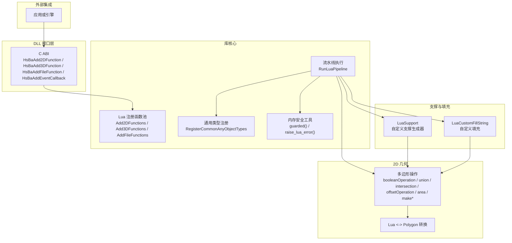
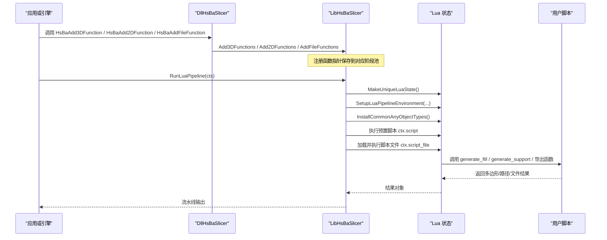
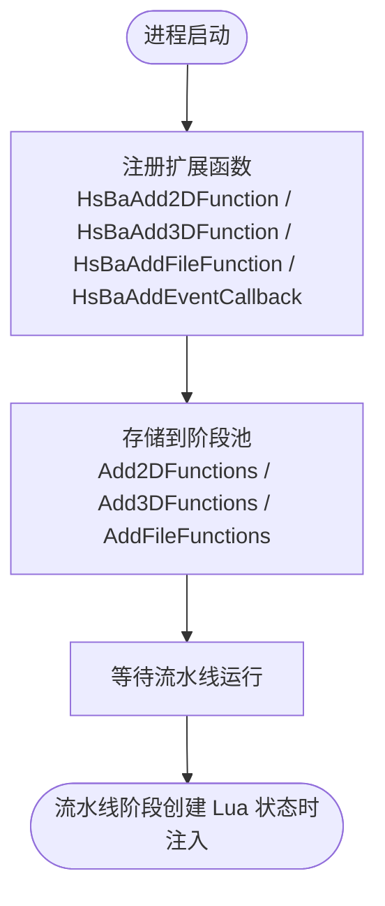
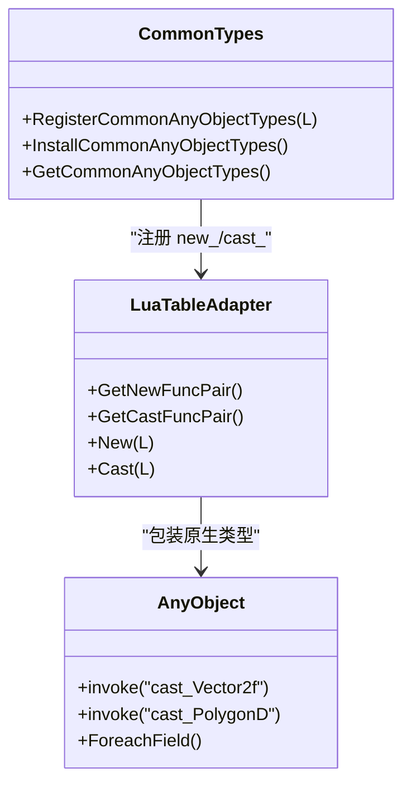
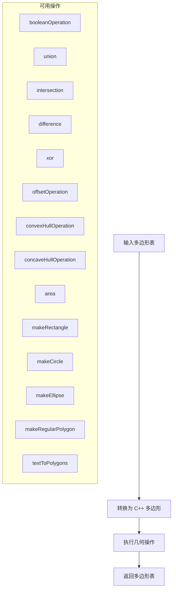
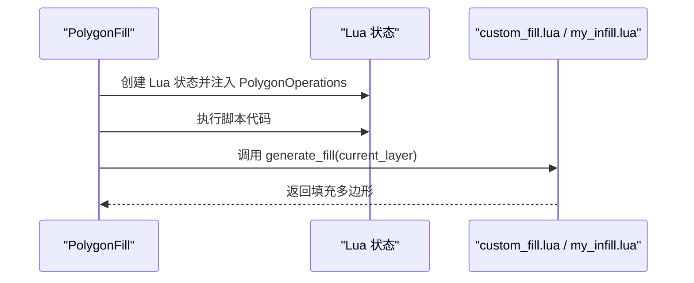
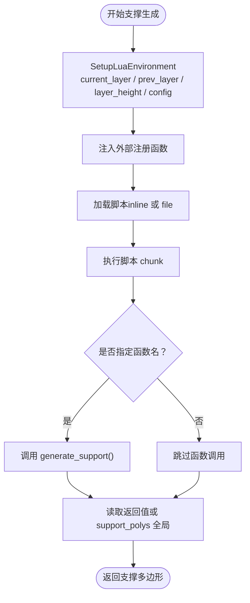
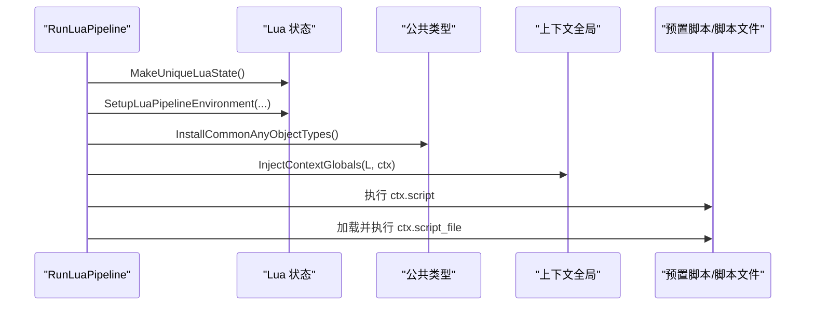
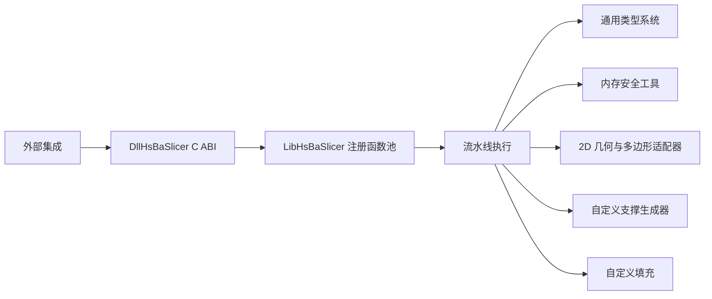

# Lua 脚本系统

<cite>
**本文引用的文件**   
- [lua_register.h](file://DllHsBaSlicer/lua_register.h)
- [lua_register.cpp](file://DllHsBaSlicer/lua_register.cpp)
- [LuaAddFunction.hpp](file://LibHsBaSlicer/Extends/LuaAddFunction.hpp)
- [LuaCommonTypes.hpp](file://LibHsBaSlicer/Extends/LuaCommonTypes.hpp)
- [LuaCommonTypes.cpp](file://LibHsBaSlicer/Extends/LuaCommonTypes.cpp)
- [LuaAdapter.hpp](file://2D/LuaAdapter.hpp)
- [LuaAdapter.cpp](file://2D/LuaAdapter.cpp)
- [PolygonFill.hpp](file://2D/PolygonFill.hpp)
- [LuaSupport.hpp](file://support/LuaSupport.hpp)
- [LuaSupport.cpp](file://support/LuaSupport.cpp)
- [lua_pipeline.cpp](file://LibHsBaSlicer/Extends/lua_pipeline.cpp)
- [custom_fill.lua](file://tests/PolygonFill/custom_fill.lua)
- [my_infill.lua](file://samples/FDM/scripts/my_infill.lua)
- [LuaNewObject.hpp](file://utils/LuaNewObject.hpp)
- [LuaAnyObject.cpp](file://utils/LuaAnyObject.cpp)
- [fileoperator/LuaAdapter.cpp](file://fileoperator/LuaAdapter.cpp)
</cite>

## 更新摘要
**所做更改**
- 新增内存安全与异常处理机制章节，详细说明 longjmp 相关的安全改进
- 更新错误处理部分，反映 std::array 缓冲区替代 std::string 的新实现
- 增强性能优化建议，包含新的内存管理最佳实践
- 添加 guarded() 包装器和 raise_lua_error 函数的详细说明

## 目录
1. [引言](#引言)
2. [项目结构](#项目结构)
3. [核心组件](#核心组件)
4. [架构总览](#架构总览)
5. [详细组件分析](#详细组件分析)
6. [内存安全与异常处理](#内存安全与异常处理)
7. [依赖关系分析](#依赖关系分析)
8. [性能与数据交换](#性能与数据交换)
9. [调试与故障排除](#调试与故障排除)
10. [结论](#结论)
11. [附录：Lua API 参考](#附录lua-api-参考)

## 引言
本文件面向 HsBaSlicer 的 Lua 脚本系统，系统性说明以下主题：
- Lua 脚本接口的注册机制、生命周期与环境初始化
- C++ 与 Lua 之间的数据类型映射与表编码约定
- 几何操作、模型处理、路径生成等可用函数与模块
- 自定义填充算法、支撑生成器与导出脚本的编写方式
- 脚本执行环境、错误处理机制与调试技巧
- **新增**：内存安全改进、longjmp 处理和异常安全保证
- 脚本与 C++ 核心的数据交换格式与性能考虑

## 项目结构
Lua 脚本能力由多个层次协作实现：
- DllHsBaSlicer 提供对外 C ABI 的扩展函数注册入口（2D/3D/File/事件回调）
- LibHsBaSlicer 内部维护按阶段分类的 Lua 注册函数池，并在各流水线阶段创建 Lua 状态时注入
- 2D 层提供多边形与点的 Lua 适配器及几何操作函数
- Support 层提供基于 Lua 的自定义支撑生成器
- PolygonFill 提供基于 Lua 的自定义填充入口
- 通用类型系统通过 AnyObject 反射将常见数学与几何类型暴露给 Lua
- **新增**：utils 层提供内存安全的错误处理工具和对象生命周期管理



**图示来源**
- [lua_register.h:21-31](file://DllHsBaSlicer/lua_register.h#L21-L31)
- [lua_register.cpp:11-40](file://DllHsBaSlicer/lua_register.cpp#L11-L40)
- [LuaAddFunction.hpp:24-74](file://LibHsBaSlicer/Extends/LuaAddFunction.hpp#L24-L74)
- [lua_pipeline.cpp:960-994](file://LibHsBaSlicer/Extends/lua_pipeline.cpp#L960-L994)
- [LuaCommonTypes.cpp:469-531](file://LibHsBaSlicer/Extends/LuaCommonTypes.cpp#L469-L531)
- [LuaAdapter.cpp:311-329](file://2D/LuaAdapter.cpp#L311-L329)
- [LuaSupport.cpp:113-178](file://support/LuaSupport.cpp#L113-L178)
- [PolygonFill.hpp:122-136](file://2D/PolygonFill.hpp#L122-L136)
- [LuaNewObject.hpp:43-93](file://utils/LuaNewObject.hpp#L43-L93)

**章节来源**
- [lua_register.h:1-38](file://DllHsBaSlicer/lua_register.h#L1-L38)
- [lua_register.cpp:1-43](file://DllHsBaSlicer/lua_register.cpp#L1-L43)
- [LuaAddFunction.hpp:1-78](file://LibHsBaSlicer/Extends/LuaAddFunction.hpp#L1-L78)
- [LuaCommonTypes.hpp:20-45](file://LibHsBaSlicer/Extends/LuaCommonTypes.hpp#L20-L45)
- [LuaAdapter.hpp:16-81](file://2D/LuaAdapter.hpp#L16-L81)
- [LuaSupport.hpp:21-67](file://support/LuaSupport.hpp#L21-L67)
- [PolygonFill.hpp:122-136](file://2D/PolygonFill.hpp#L122-L136)
- [LuaNewObject.hpp:1-222](file://utils/LuaNewObject.hpp#L1-L222)

## 核心组件
本节聚焦 Lua 脚本系统的六个关键组件及其职责。

- C ABI 扩展注册入口
  - 提供 HsBaAdd2DFunction、HsBaAdd3DFunction、HsBaAddFileFunction、HsBaAddEventCallback
  - 用于在进程启动或引擎初始化时注册自定义 Lua 函数和事件回调

- 内部注册函数池
  - Add2DFunctions、Add3DFunctions、AddFileFunctions、GetEventCallbacks
  - 保存各阶段的 Lua 注册回调，供流水线阶段创建 Lua 状态时调用

- 通用类型系统
  - RegisterCommonAnyObjectTypes、InstallCommonAnyObjectTypes
  - 将 Eigen 向量/矩阵/四元数、Clipper2 点/多边形、基础标量类型注册为 AnyObject，并暴露 new_*/cast_* 全局函数

- 2D 几何与多边形适配器
  - Push/Pull 多边形与点到 Lua 表
  - 注册 PolygonOperations 命名空间下的布尔运算、偏移、凸包、面积、构造器等函数

- 支撑与填充脚本接口
  - LuaSupport：以 Lua 脚本替换内置支撑算法，支持 inline 或文件脚本，支持外部注册函数注入
  - LuaCustomFillString：以 Lua 脚本替换内置填充算法，返回填充多边形

- **新增**：内存安全工具
  - guarded()：注册安全的包装器，避免 longjmp 导致的内存泄漏和双重释放
  - raise_lua_error()：使用 std::array 缓冲区的异常安全错误抛出
  - NewLuaObject/LuaGC：安全的对象生命周期管理

**章节来源**
- [lua_register.h:21-31](file://DllHsBaSlicer/lua_register.h#L21-L31)
- [LuaAddFunction.hpp:24-74](file://LibHsBaSlicer/Extends/LuaAddFunction.hpp#L24-L74)
- [LuaCommonTypes.hpp:148-183](file://LibHsBaSlicer/Extends/LuaCommonTypes.hpp#L148-L183)
- [LuaCommonTypes.cpp:469-531](file://LibHsBaSlicer/Extends/LuaCommonTypes.cpp#L469-L531)
- [LuaAdapter.hpp:16-81](file://2D/LuaAdapter.hpp#L16-L81)
- [LuaAdapter.cpp:311-329](file://2D/LuaAdapter.cpp#L311-L329)
- [LuaSupport.hpp:21-67](file://support/LuaSupport.hpp#L21-L67)
- [PolygonFill.hpp:122-136](file://2D/PolygonFill.hpp#L122-L136)
- [LuaNewObject.hpp:43-137](file://utils/LuaNewObject.hpp#L43-L137)

## 架构总览
下图展示从外部集成到 Lua 脚本执行的完整流程。



**图示来源**
- [lua_register.cpp:11-40](file://DllHsBaSlicer/lua_register.cpp#L11-L40)
- [LuaAddFunction.hpp:24-74](file://LibHsBaSlicer/Extends/LuaAddFunction.hpp#L24-L74)
- [lua_pipeline.cpp:960-994](file://LibHsBaSlicer/Extends/lua_pipeline.cpp#L960-L994)
- [LuaCommonTypes.cpp:514-531](file://LibHsBaSlicer/Extends/LuaCommonTypes.cpp#L514-L531)

## 详细组件分析

### C ABI 扩展注册机制
- 外部通过 C ABI 注册三类函数和一个事件回调：
  - 2D 函数：支撑、填充、SLA 输出阶段可用
  - 3D 函数：切片、支撑阶段可用
  - File 函数：SLS/SLA 输出阶段可用
  - 事件回调：例如 zipper.on_add、db.on_query
- 内部将回调存入对应阶段池，供流水线阶段创建 Lua 状态时注入



**图示来源**
- [lua_register.h:21-31](file://DllHsBaSlicer/lua_register.h#L21-L31)
- [lua_register.cpp:11-40](file://DllHsBaSlicer/lua_register.cpp#L11-L40)
- [LuaAddFunction.hpp:24-74](file://LibHsBaSlicer/Extends/LuaAddFunction.hpp#L24-L74)

**章节来源**
- [lua_register.h:1-38](file://DllHsBaSlicer/lua_register.h#L1-L38)
- [lua_register.cpp:1-43](file://DllHsBaSlicer/lua_register.cpp#L1-L43)
- [LuaAddFunction.hpp:1-78](file://LibHsBaSlicer/Extends/LuaAddFunction.hpp#L1-L78)

### 通用类型系统与 AnyObject 映射
- 常见类型包括：
  - Eigen 向量 Vector2f/Vector3f/Vector4f、Vector2d/Vector3d/Vector4d、Vector2i/Vector3i/Vector4i
  - Eigen 矩阵 Matrix2d/Matrix3d/Matrix4d/MatrixXf/MatrixXi
  - Eigen 四元数 Quaternionf/Quaterniond
  - Clipper2 点 Point2D/Point2
  - Clipper2 多边形 PolygonD/PolygonsD/Polygon/Polygons
  - 基础标量 int/long/longlong/size_t/double/float/bool/string/cstring
- 每种类型暴露 new_<Name> 与 cast_<Name> 全局函数，以及反射字段 x/y/(z)/(w)
- 表编码约定：
  - 固定向量/四元数：带键 {x, y, (z), (w)}；也接受序列 {v1, v2, ...}
  - 矩阵：嵌套行序列 {{r1}, {r2}, ...}
  - Clipper2 点：{x, y}
  - 多边形/多边形集合：点序列或多边形序列



**图示来源**
- [LuaCommonTypes.hpp:20-45](file://LibHsBaSlicer/Extends/LuaCommonTypes.hpp#L20-L45)
- [LuaCommonTypes.hpp:148-183](file://LibHsBaSlicer/Extends/LuaCommonTypes.hpp#L148-L183)
- [LuaCommonTypes.cpp:342-389](file://LibHsBaSlicer/Extends/LuaCommonTypes.cpp#L342-L389)
- [LuaCommonTypes.cpp:438-531](file://LibHsBaSlicer/Extends/LuaCommonTypes.cpp#L438-L531)

**章节来源**
- [LuaCommonTypes.hpp:20-45](file://LibHsBaSlicer/Extends/LuaCommonTypes.hpp#L20-L45)
- [LuaCommonTypes.hpp:110-143](file://LibHsBaSlicer/Extends/LuaCommonTypes.hpp#L110-L143)
- [LuaCommonTypes.hpp:148-183](file://LibHsBaSlicer/Extends/LuaCommonTypes.hpp#L148-L183)
- [LuaCommonTypes.cpp:30-76](file://LibHsBaSlicer/Extends/LuaCommonTypes.cpp#L30-L76)
- [LuaCommonTypes.cpp:78-200](file://LibHsBaSlicer/Extends/LuaCommonTypes.cpp#L78-L200)
- [LuaCommonTypes.cpp:202-337](file://LibHsBaSlicer/Extends/LuaCommonTypes.cpp#L202-L337)
- [LuaCommonTypes.cpp:342-531](file://LibHsBaSlicer/Extends/LuaCommonTypes.cpp#L342-L531)

### 2D 几何与多边形操作
- 多边形与点在 Lua 中的表示：
  - 点：{x=.., y=..}
  - 多边形：点数组
  - 多边形集合：多边形数组
- 提供的几何函数（均位于 PolygonOperations 命名空间）：
  - booleanOperation(polygons_a, polygons_b, op)
  - union / intersection / difference / xor
  - offsetOperation(polys, delta)
  - convexHullOperation / concaveHullOperation
  - area(poly)
  - makeRectangle(x, y, width, height)
  - makeCircle(cx, cy, radius [, segments])
  - makeEllipse(cx, cy, rx, ry [, segments [, rotation]])
  - makeRegularPolygon(cx, cy, radius, sides [, rotation])
  - textToPolygons(text, font_file, font_size [, x [, y [, curve_segments]]])
  - dumpPolygon / dumpPolygons（可选编译宏 HSBA_POLYGON_DUMP）



**图示来源**
- [LuaAdapter.cpp:22-53](file://2D/LuaAdapter.cpp#L22-L53)
- [LuaAdapter.cpp:56-106](file://2D/LuaAdapter.cpp#L56-L106)
- [LuaAdapter.cpp:108-153](file://2D/LuaAdapter.cpp#L108-L153)
- [LuaAdapter.cpp:155-273](file://2D/LuaAdapter.cpp#L155-L273)
- [LuaAdapter.cpp:311-329](file://2D/LuaAdapter.cpp#L311-L329)
- [LuaAdapter.cpp:487-491](file://2D/LuaAdapter.cpp#L487-L491)

**章节来源**
- [LuaAdapter.hpp:16-81](file://2D/LuaAdapter.hpp#L16-L81)
- [LuaAdapter.cpp:1-518](file://2D/LuaAdapter.cpp#L1-L518)

### 自定义填充算法
- 入口函数：
  - LuaCustomFillString(polygons, script, functionName="generate_fill", lineThickness=0.5, lua_reg)
- 脚本约定：
  - 可定义 generate_fill(poly) 函数，接收当前层多边形，返回填充多边形
  - 可使用 PolygonOperations 进行几何计算
- 示例脚本：
  - tests/PolygonFill/custom_fill.lua：返回两条对角线作为填充
  - samples/FDM/scripts/my_infill.lua：根据角度和间距生成平行线填充，并与轮廓做交集裁剪



**图示来源**
- [PolygonFill.hpp:122-136](file://2D/PolygonFill.hpp#L122-L136)
- [custom_fill.lua:1-16](file://tests/PolygonFill/custom_fill.lua#L1-L16)
- [my_infill.lua:1-89](file://samples/FDM/scripts/my_infill.lua#L1-L89)

**章节来源**
- [PolygonFill.hpp:122-136](file://2D/PolygonFill.hpp#L122-L136)
- [custom_fill.lua:1-16](file://tests/PolygonFill/custom_fill.lua#L1-L16)
- [my_infill.lua:1-89](file://samples/FDM/scripts/my_infill.lua#L1-L89)

### 自定义支撑生成器
- LuaSupport 类：
  - 支持内联脚本或脚本文件
  - 支持指定函数名（默认 generate_support）
  - 支持注入外部 2D+3D 注册函数
- Lua 环境全局变量：
  - current_layer：当前层多边形
  - prev_layer：上一层多边形
  - layer_height：层高
  - config：支撑配置表（overhang_angle_threshold、support_diameter、support_gap、support_density、support_pattern、tree_branch_angle、tree_max_branch_radius、honeycomb_cell_size 等）
- 可用模块：
  - PolygonOperations：几何操作
  - Support：new_plane/new_tree/new_honeycomb/new_sla/generate/detect_overhang/default_config



**图示来源**
- [LuaSupport.cpp:19-90](file://support/LuaSupport.cpp#L19-L90)
- [LuaSupport.cpp:113-178](file://support/LuaSupport.cpp#L113-L178)
- [my_support.lua:1-83](file://samples/FDM/scripts/my_support.lua#L1-L83)

**章节来源**
- [LuaSupport.hpp:21-81](file://support/LuaSupport.hpp#L21-L81)
- [LuaSupport.cpp:1-282](file://support/LuaSupport.cpp#L1-L282)
- [my_support.lua:1-83](file://samples/FDM/scripts/my_support.lua#L1-L83)

### 流水线执行环境与生命周期
- RunLuaPipeline：
  - 创建 Lua 状态
  - 设置环境：安装公共类型、注入上下文全局变量、注册 hsba 表
  - 先执行预置脚本 ctx.script，再加载并执行脚本文件 ctx.script_file
- 生命周期要点：
  - 每个阶段使用独立 Lua 状态
  - 公共类型注册具有 per-state 守卫，避免重复注册
  - 外部注册函数在阶段初始化时注入



**图示来源**
- [lua_pipeline.cpp:950-994](file://LibHsBaSlicer/Extends/lua_pipeline.cpp#L950-L994)
- [LuaCommonTypes.cpp:514-531](file://LibHsBaSlicer/Extends/LuaCommonTypes.cpp#L514-L531)

**章节来源**
- [lua_pipeline.cpp:950-994](file://LibHsBaSlicer/Extends/lua_pipeline.cpp#L950-L994)
- [LuaCommonTypes.cpp:469-531](file://LibHsBaSlicer/Extends/LuaCommonTypes.cpp#L469-L531)

## 内存安全与异常处理

### longjmp 相关的内存安全问题
Lua 的错误处理机制使用 `lua_error` 进行长跳转（longjmp），这在跨平台环境下存在严重的内存安全问题：

- **MSVC x64 行为**：通过 RtlUnwind 路由 longjmp，会执行每个被跳过帧中注册的析构函数
- **POSIX 行为**：直接跳转到目标位置，不执行任何析构函数
- **问题表现**：
  - Windows 上：已销毁的对象被双重释放（double-free）
  - Linux 上：仍存活的对象发生内存泄漏

### 解决方案：std::array 缓冲区与隔离框架

#### guarded() 包装器
`guarded()` 模板函数提供了一个安全的错误抛出框架：

```cpp
template <LuaErrorWorker Worker>
HSBA_NOINLINE int guarded(lua_State* L)
{
    const int results = Worker(L);
    if (results < 0)
    {
        return lua_error(L);  // the worker already pushed the message and left the stack
    }
    return results;
}
```

关键特性：
- 使用 `HSBA_NOINLINE` 确保函数不被内联
- 将实际的错误抛出放在独立的栈帧中
- Worker 函数通过函数指针调用，无法被内联
- 当 Worker 返回负值时，raise 发生在干净的栈帧中

#### raise_lua_error() 函数
使用 `std::array<char, 512>` 替代 `std::string` 缓冲区：

```cpp
template <typename... Args>
inline int raise_lua_error(lua_State* L, std::format_string<Args...> fmt, Args&&... args)
{
    std::array<char, 512> buffer{};
    const auto formatted = std::format_to_n(buffer.data(), buffer.size() - 1, fmt, std::forward<Args>(args)...);
    const size_t length = std::min(static_cast<size_t>(formatted.size), buffer.size() - 1);
    lua_pushlstring(L, buffer.data(), length);
    return lua_error(L);
}
```

优势：
- `std::array` 是 trivially destructible 类型，不会触发析构函数
- 消息格式化后立即复制到 Lua 管理的内存
- 避免在 longjmp 过程中持有任何需要清理的资源

#### 实际应用场景

**2D 几何操作中的错误处理**：
```cpp
void l_booleanError(lua_State* L, std::string_view fname, std::string_view msg, std::string_view quoted_detail = {})
{
    std::array<char, 512> buffer{};
    const auto formatted = std::format_to_n(buffer.data(), buffer.size() - 1, 
        "Error in Lua function '{}': {}", fname, msg);
    const size_t length = std::min(static_cast<size_t>(formatted.size), buffer.size() - 1);
    luaL_where(L, 1);
    lua_pushlstring(L, buffer.data(), length);
    lua_concat(L, 2);
    lua_error(L);
}
```

**ParamStore 操作的 RAII 保护**：
```cpp
struct ConfigGuard {
    Utils::TypeInfo* ti = nullptr;
    void* ptr = nullptr;
    ~ConfigGuard() {
        if (ptr && ti) {
            ti->destroy(ptr);
        }
    }
};
```

**支撑生成器的资源管理**：
```cpp
// 多边形容器必须在 lua_error 的 longjmp 之前释放
{
    PolygonsD const current_layer = LuaTableToPolygonsD(L, 2);
    PolygonsD const prev_layer = LuaTableToPolygonsD(L, 3);
    // ... 处理逻辑 ...
    try {
        // 可能抛出的异常
    } catch (const std::exception& e) {
        lua_pushstring(L, e.what());
    }
} // 作用域结束，自动释放多边形容器
return lua_error(L); // 现在可以安全地抛出错误
```

### 最佳实践指南

1. **使用 guarded() 包装所有可能抛出异常的绑定函数**
2. **使用 raise_lua_error() 替代直接的 lua_error() 调用**
3. **将大型对象的生命周期限制在局部作用域中**
4. **避免在错误路径上持有需要清理的资源**
5. **使用 RAII 包装器管理动态分配的资源**

**章节来源**
- [LuaNewObject.hpp:43-93](file://utils/LuaNewObject.hpp#L43-L93)
- [LuaNewObject.hpp:95-117](file://utils/LuaNewObject.hpp#L95-L117)
- [LuaAdapter.cpp:19-42](file://2D/LuaAdapter.cpp#L19-L42)
- [fileoperator/LuaAdapter.cpp:1389-1402](file://fileoperator/LuaAdapter.cpp#L1389-L1402)
- [fileoperator/LuaAdapter.cpp:1520-1524](file://fileoperator/LuaAdapter.cpp#L1520-L1524)
- [support/LuaAdapter.cpp:184-203](file://support/LuaAdapter.cpp#L184-L203)
- [LuaAnyObject.cpp:22-93](file://utils/LuaAnyObject.cpp#L22-L93)

## 依赖关系分析
- 外部集成依赖 DllHsBaSlicer 的 C ABI 注册函数
- 内部依赖 LibHsBaSlicer 的注册函数池与通用类型系统
- 2D 几何依赖 LuaAdapter 的多边形转换与几何函数
- 支撑与填充依赖各自的 Lua 接口与 PolygonOperations
- **新增**：所有绑定函数都依赖 utils 层的内存安全工具



**图示来源**
- [lua_register.h:21-31](file://DllHsBaSlicer/lua_register.h#L21-L31)
- [LuaAddFunction.hpp:24-74](file://LibHsBaSlicer/Extends/LuaAddFunction.hpp#L24-L74)
- [lua_pipeline.cpp:960-994](file://LibHsBaSlicer/Extends/lua_pipeline.cpp#L960-L994)
- [LuaCommonTypes.cpp:514-531](file://LibHsBaSlicer/Extends/LuaCommonTypes.cpp#L514-L531)
- [LuaAdapter.cpp:487-491](file://2D/LuaAdapter.cpp#L487-L491)
- [LuaSupport.cpp:113-178](file://support/LuaSupport.cpp#L113-L178)
- [PolygonFill.hpp:122-136](file://2D/PolygonFill.hpp#L122-L136)
- [LuaNewObject.hpp:43-93](file://utils/LuaNewObject.hpp#L43-L93)

**章节来源**
- [lua_register.h:1-38](file://DllHsBaSlicer/lua_register.h#L1-L38)
- [LuaAddFunction.hpp:1-78](file://LibHsBaSlicer/Extends/LuaAddFunction.hpp#L1-L78)
- [lua_pipeline.cpp:950-994](file://LibHsBaSlicer/Extends/lua_pipeline.cpp#L950-L994)
- [LuaCommonTypes.cpp:469-531](file://LibHsBaSlicer/Extends/LuaCommonTypes.cpp#L469-L531)
- [LuaAdapter.cpp:1-518](file://2D/LuaAdapter.cpp#L1-L518)
- [LuaSupport.cpp:1-282](file://support/LuaSupport.cpp#L1-L282)
- [PolygonFill.hpp:122-136](file://2D/PolygonFill.hpp#L122-L136)
- [LuaNewObject.hpp:1-222](file://utils/LuaNewObject.hpp#L1-L222)

## 性能与数据交换
- 数据交换格式
  - 多边形与点使用 Lua 表传递，存在多次拷贝与解析开销
  - 大模型建议尽量在 C++ 侧完成复杂计算，仅在必要时将结果以最小必要数据传回 Lua
- 类型转换成本
  - new_/cast_ 会复制值，频繁调用会产生额外内存分配
  - 对大型矩阵或多边形集合，优先使用引用或减少往返次数
- 脚本执行策略
  - 预置脚本仅用于参数预处理，主逻辑放在脚本文件中
  - 避免在每层重复加载脚本，复用已编译的 chunk
- 几何操作优化
  - 使用 PolygonOperations 的批量操作（如 union/intersection）减少中间表数量
  - 合理设置线段分段数（如 makeCircle/makeEllipse 的 segments），平衡精度与性能
- **新增**：内存安全优化
  - 使用 std::array 缓冲区避免动态分配开销
  - guarded() 包装器虽然增加少量函数调用开销，但消除了潜在的内存泄漏风险
  - RAII 模式确保资源在异常情况下也能正确释放

## 调试与故障排除
- 常见错误来源
  - 脚本语法错误或运行时异常：LuaSupport 抛出 RuntimeError，包含 Lua 错误消息
  - 参数类型不匹配：PolygonOperations 函数校验失败，抛出错误
  - 脚本文件打开失败：RunLuaPipeline 返回错误信息
- 调试建议
  - 在脚本中打印中间结果，或使用 dumpPolygon/dumpPolygons（需启用 HSBA_POLYGON_DUMP）
  - 逐步缩小问题范围：先用简单脚本验证环境，再引入复杂逻辑
  - 检查 config 字段是否正确传入，确保支撑生成器的模式与参数一致
- 错误处理机制
  - LuaSupport::Generate 在 load/pcall/函数调用失败时抛出 RuntimeError
  - PolygonOperations 函数在参数校验失败时调用 luaL_error
  - **新增**：所有绑定函数现在使用统一的错误处理模式，提供更一致的错误信息格式

**章节来源**
- [LuaSupport.cpp:131-178](file://support/LuaSupport.cpp#L131-L178)
- [LuaAdapter.cpp:16-53](file://2D/LuaAdapter.cpp#L16-L53)
- [lua_pipeline.cpp:982-994](file://LibHsBaSlicer/Extends/lua_pipeline.cpp#L982-L994)
- [LuaNewObject.hpp:43-93](file://utils/LuaNewObject.hpp#L43-L93)

## 结论
HsBaSlicer 的 Lua 脚本系统通过清晰的注册机制、稳定的类型映射和丰富的几何操作，为自定义填充、支撑生成与导出提供了灵活而强大的扩展能力。**最新的内存安全改进**解决了长期存在的 longjmp 相关内存泄漏和双重释放问题，通过使用 std::array 缓冲区和 guarded() 包装器，确保了跨平台的异常安全性。理解其生命周期、数据交换格式、错误处理机制和内存安全最佳实践，有助于编写高效、可靠且内存安全的脚本，并在生产环境中稳定运行。

## 附录：Lua API 参考

### 几何操作（PolygonOperations）
- booleanOperation(polygons_a, polygons_b, operation)
- union(polygons_a, polygons_b)
- intersection(polygons_a, polygons_b)
- difference(polygons_a, polygons_b)
- xor(polygons_a, polygons_b)
- offsetOperation(polys, delta)
- convexHullOperation(polys)
- concaveHullOperation(polys, additional_points)
- area(poly)
- makeRectangle(x, y, width, height)
- makeCircle(cx, cy, radius [, segments])
- makeEllipse(cx, cy, rx, ry [, segments [, rotation]])
- makeRegularPolygon(cx, cy, radius, sides [, rotation])
- textToPolygons(text, font_file, font_size [, x [, y [, curve_segments]]])
- dumpPolygon(poly, filename [, close_path])（可选）
- dumpPolygons(polys, filename [, close_path])（可选）

**章节来源**
- [LuaAdapter.cpp:22-273](file://2D/LuaAdapter.cpp#L22-L273)
- [LuaAdapter.cpp:311-329](file://2D/LuaAdapter.cpp#L311-L329)
- [LuaAdapter.cpp:487-491](file://2D/LuaAdapter.cpp#L487-L491)

### 支撑生成（Support 模块）
- Support.new_plane()
- Support.new_tree()
- Support.new_honeycomb()
- Support.new_sla()
- Support.generate(generator, current_layer, prev_layer, layer_height, cfg)
- Support.detect_overhang(current_layer, prev_layer, layer_height, angle)
- Support.default_config()

**章节来源**
- [LuaSupport.cpp:67-90](file://support/LuaSupport.cpp#L67-L90)
- [my_support.lua:19-27](file://samples/FDM/scripts/my_support.lua#L19-L27)

### 填充脚本（generate_fill）
- 函数签名：generate_fill(current_layer) -> polygons
- 可用工具：PolygonOperations
- 示例脚本：
  - custom_fill.lua
  - my_infill.lua

**章节来源**
- [custom_fill.lua:1-16](file://tests/PolygonFill/custom_fill.lua#L1-L16)
- [my_infill.lua:1-89](file://samples/FDM/scripts/my_infill.lua#L1-L89)

### 通用类型（AnyObject）
- new_<Type>(table)：从 Lua 表创建 AnyObject
- cast_<Type>()：从 AnyObject 转换为 Lua 表
- 支持类型：
  - Vector2f/Vector3f/Vector4f
  - Vector2d/Vector3d/Vector4d
  - Vector2i/Vector3i/Vector4i
  - Matrix2d/Matrix3d/Matrix4d/MatrixXf/MatrixXi
  - Quaternionf/Quaterniond
  - Point2D/Point2
  - PolygonD/PolygonsD/Polygon/Polygons
  - int/long/longlong/size_t/double/float/bool/string/cstring

**章节来源**
- [LuaCommonTypes.hpp:110-143](file://LibHsBaSlicer/Extends/LuaCommonTypes.hpp#L110-L143)
- [LuaCommonTypes.cpp:391-435](file://LibHsBaSlicer/Extends/LuaCommonTypes.cpp#L391-L435)
- [LuaCommonTypes.cpp:438-531](file://LibHsBaSlicer/Extends/LuaCommonTypes.cpp#L438-L531)

### 内存安全工具（新增）
- guarded<Worker>()：安全的错误抛出包装器
- raise_lua_error(L, fmt, ...)：异常安全的错误抛出
- raise_lua_error_with_where(L, fmt, ...)：带位置信息的错误抛出
- NewLuaObject<T>()：安全的对象创建
- LuaGC<T>()：安全的对象销毁

**章节来源**
- [LuaNewObject.hpp:43-137](file://utils/LuaNewObject.hpp#L43-L137)
- [LuaNewObject.hpp:167-191](file://utils/LuaNewObject.hpp#L167-L191)