# 导出脚本

<cite>
**本文引用的文件**   
- [types/hsba_pipeline.d.lua](file://types/hsba_pipeline.d.lua)
- [samples/Custom/scripts/my_lom_pipeline.lua](file://samples/Custom/scripts/my_lom_pipeline.lua)
- [samples/Custom/scripts/my_slm_pipeline.lua](file://samples/Custom/scripts/my_slm_pipeline.lua)
- [samples/Custom/scripts/my_tdp_pipeline.lua](file://samples/Custom/scripts/my_tdp_pipeline.lua)
- [samples/Custom/scripts/my_waam_pipeline.lua](file://samples/Custom/scripts/my_waam_pipeline.lua)
- [samples/SLS/scripts/my_sls_export.lua](file://samples/SLS/scripts/my_sls_export.lua)
- [samples/LOM/scripts/my_lom_export.lua](file://samples/LOM/scripts/my_lom_export.lua)
- [samples/SLM/scripts/my_slm_export.lua](file://samples/SLM/scripts/my_slm_export.lua)
- [samples/TDP/scripts/my_tdp_export.lua](file://samples/TDP/scripts/my_tdp_export.lua)
- [samples/WAAM/scripts/my_waam_path.lua](file://samples/WAAM/scripts/my_waam_path.lua)
- [DllHsBaSlicer/lom_pipeline.h](file://DllHsBaSlicer/lom_pipeline.h)
- [DllHsBaSlicer/slm_pipeline.h](file://DllHsBaSlicer/slm_pipeline.h)
- [DllHsBaSlicer/sls_pipeline.h](file://DllHsBaSlicer/sls_pipeline.h)
- [DllHsBaSlicer/tdp_pipeline.h](file://DllHsBaSlicer/tdp_pipeline.h)
- [DllHsBaSlicer/waam_pipeline.h](file://DllHsBaSlicer/waam_pipeline.h)
- [DllHsBaSlicer/tdp_pipeline.cpp](file://DllHsBaSlicer/tdp_pipeline.cpp)
- [LibHsBaSlicer/export.h](file://LibHsBaSlicer/export.h)
- [paths/gcodepath.hpp](file://paths/gcodepath.hpp)
- [paths/imagespath.hpp](file://paths/imagespath.hpp)
- [paths/robotpath.hpp](file://paths/robotpath.hpp)
</cite>

## 目录
1. [引言](#引言)
2. [项目结构](#项目结构)
3. [核心组件](#核心组件)
4. [架构总览](#架构总览)
5. [详细组件分析](#详细组件分析)
6. [依赖关系分析](#依赖关系分析)
7. [性能与内存优化](#性能与内存优化)
8. [故障排除指南](#故障排除指南)
9. [结论](#结论)
10. [附录：设备厂商兼容性与扩展建议](#附录设备厂商兼容性与扩展建议)

## 引言
本指南面向需要为多种 3D 打印技术编写导出脚本的开发者，覆盖 LOM、SLM、SLS、TDP（3DP）和 WAAM 等工艺。文档从系统架构出发，解释切片数据如何进入 Lua 环境，如何在不同流水线中生成 G-code、图像序列或机器人路径，并给出每种技术的完整脚本示例与最佳实践。同时说明导出脚本的生命周期管理、错误处理机制、批量处理与内存优化策略，以及不同设备厂商特定格式的兼容性考虑。

## 项目结构
仓库围绕“C++ 流水线 + Lua 导出脚本”的双层架构组织：
- C++ 侧提供各工艺的流水线接口与通用数据结构（如 G-code、图像序列、机器人路径）。
- Lua 侧通过类型定义与样本脚本暴露统一 API，供用户实现具体设备的导出逻辑。

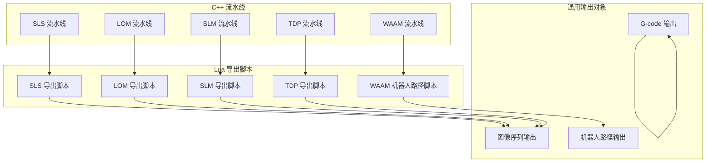

图表来源
- [DllHsBaSlicer/lom_pipeline.h:17-37](file://DllHsBaSlicer/lom_pipeline.h#L17-L37)
- [DllHsBaSlicer/slm_pipeline.h:17-37](file://DllHsBaSlicer/slm_pipeline.h#L17-L37)
- [DllHsBaSlicer/sls_pipeline.h:17-37](file://DllHsBaSlicer/sls_pipeline.h#L17-L37)
- [DllHsBaSlicer/tdp_pipeline.h:17-37](file://DllHsBaSlicer/tdp_pipeline.h#L17-L37)
- [DllHsBaSlicer/waam_pipeline.h:17-37](file://DllHsBaSlicer/waam_pipeline.h#L17-L37)
- [samples/SLS/scripts/my_sls_export.lua:21-45](file://samples/SLS/scripts/my_sls_export.lua#L21-L45)
- [samples/LOM/scripts/my_lom_export.lua:10-28](file://samples/LOM/scripts/my_lom_export.lua#L10-L28)
- [samples/SLM/scripts/my_slm_export.lua:15-33](file://samples/SLM/scripts/my_slm_export.lua#L15-L33)
- [samples/TDP/scripts/my_tdp_export.lua:15-33](file://samples/TDP/scripts/my_tdp_export.lua#L15-L33)
- [samples/WAAM/scripts/my_waam_path.lua:17-42](file://samples/WAAM/scripts/my_waam_path.lua#L17-L42)
- [paths/gcodepath.hpp:62-107](file://paths/gcodepath.hpp#L62-L107)
- [paths/imagespath.hpp:16-60](file://paths/imagespath.hpp#L16-L60)
- [paths/robotpath.hpp:54-104](file://paths/robotpath.hpp#L54-L104)

章节来源
- [DllHsBaSlicer/lom_pipeline.h:17-37](file://DllHsBaSlicer/lom_pipeline.h#L17-L37)
- [DllHsBaSlicer/slm_pipeline.h:17-37](file://DllHsBaSlicer/slm_pipeline.h#L17-L37)
- [DllHsBaSlicer/sls_pipeline.h:17-37](file://DllHsBaSlicer/sls_pipeline.h#L17-L37)
- [DllHsBaSlicer/tdp_pipeline.h:17-37](file://DllHsBaSlicer/tdp_pipeline.h#L17-L37)
- [DllHsBaSlicer/waam_pipeline.h:17-37](file://DllHsBaSlicer/waam_pipeline.h#L17-L37)

## 核心组件
- Lua 流水线 API 类型定义：集中描述多边形、填充、支撑、G-code、打包、数据库适配器等类型与函数，是编写导出脚本的统一契约。
- 各工艺流水线头文件：定义 C ABI 入口、同步/异步运行方式与结果释放方法。
- 通用输出对象：
  - G-code 输出：支持多固件（Marlin/RepRap/Klipper）、连续螺旋外壁、Lua 后处理。
  - 图像序列输出：配置旁路文件 + 命名图像载荷，支持 Lua 后处理。
  - 机器人路径输出：ABB/KUKA/FANUC 品牌代码生成，支持 Lua 自定义程序文本。

章节来源
- [types/hsba_pipeline.d.lua:20-113](file://types/hsba_pipeline.d.lua#L20-L113)
- [types/hsba_pipeline.d.lua:225-328](file://types/hsba_pipeline.d.lua#L225-L328)
- [types/hsba_pipeline.d.lua:330-500](file://types/hsba_pipeline.d.lua#L330-L500)
- [paths/gcodepath.hpp:24-49](file://paths/gcodepath.hpp#L24-L49)
- [paths/gcodepath.hpp:62-107](file://paths/gcodepath.hpp#L62-L107)
- [paths/imagespath.hpp:16-60](file://paths/imagespath.hpp#L16-L60)
- [paths/robotpath.hpp:15-52](file://paths/robotpath.hpp#L15-L52)
- [paths/robotpath.hpp:54-104](file://paths/robotpath.hpp#L54-L104)

## 架构总览
下图展示从模型加载到最终导出的端到端流程，包括 C++ 流水线与 Lua 导出脚本的交互点。

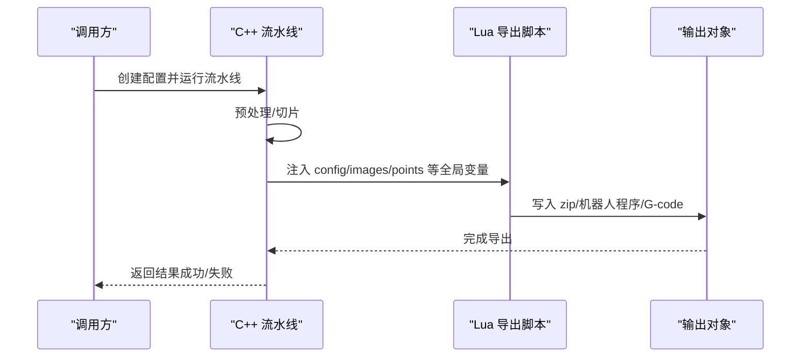

图表来源
- [DllHsBaSlicer/sls_pipeline.h:24-37](file://DllHsBaSlicer/sls_pipeline.h#L24-L37)
- [DllHsBaSlicer/tdp_pipeline.cpp:266-307](file://DllHsBaSlicer/tdp_pipeline.cpp#L266-L307)
- [types/hsba_pipeline.d.lua:476-499](file://types/hsba_pipeline.d.lua#L476-L499)
- [paths/imagespath.hpp:32-48](file://paths/imagespath.hpp#L32-L48)
- [paths/robotpath.hpp:78-91](file://paths/robotpath.hpp#L78-L91)

## 详细组件分析

### LOM（叠层实体制造）导出
- 工艺要点：按片厚逐层切片，每层对应一张板材轮廓；切割/粘结参数由 C++ 侧写入配置 JSON，Lua 导出脚本负责打包与可选数据库登记。
- 数据要求：
  - 层轮廓多边形数组与 Z 高度数组。
  - 配置 JSON（包含层数、片厚、切割速度/功率/偏移、粘结温度/压力/时间、封边与切割模式等）。
- 脚本示例：
  - 完全由 Lua 驱动的 LOM 流水线：加载模型、计算层数、逐层切片、组装配置、调用 saveSlsPackage 打包。
  - LOM 导出脚本：将配置与层轮廓 JSON 写入 zip，并可选登记 SQLite。

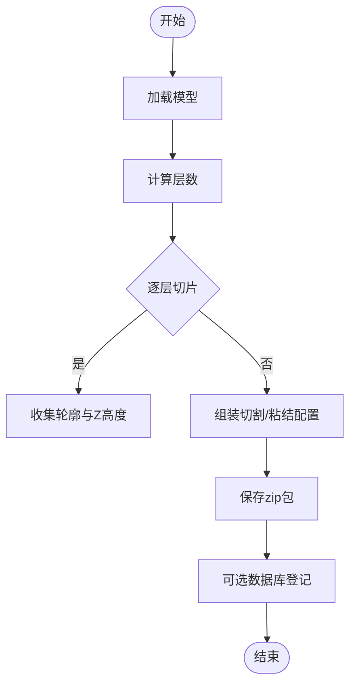

图表来源
- [samples/Custom/scripts/my_lom_pipeline.lua:19-90](file://samples/Custom/scripts/my_lom_pipeline.lua#L19-L90)
- [samples/LOM/scripts/my_lom_export.lua:10-54](file://samples/LOM/scripts/my_lom_export.lua#L10-L54)
- [DllHsBaSlicer/lom_pipeline.h:17-37](file://DllHsBaSlicer/lom_pipeline.h#L17-L37)

章节来源
- [samples/Custom/scripts/my_lom_pipeline.lua:19-90](file://samples/Custom/scripts/my_lom_pipeline.lua#L19-L90)
- [samples/LOM/scripts/my_lom_export.lua:10-54](file://samples/LOM/scripts/my_lom_export.lua#L10-L54)
- [DllHsBaSlicer/lom_pipeline.h:17-37](file://DllHsBaSlicer/lom_pipeline.h#L17-L37)

### SLM（选择性激光熔金属）导出
- 工艺要点：金属粉末床工艺，与 SLS 流程相似；金属相关参数（材料、能量源、保护气）折叠进配置 JSON。
- 数据要求：
  - 层轮廓多边形数组与 Z 高度数组。
  - 配置 JSON（包含层数、层高、激光功率、扫描速度、搭接间距/旋转、材料、床温等）。
- 脚本示例：
  - 完全由 Lua 驱动的 SLM 流水线：加载模型、逐层切片、组装金属工艺配置、调用 saveSlsPackage 打包。
  - SLM 导出脚本：归档配置与层轮廓 JSON，可选登记 SQLite。

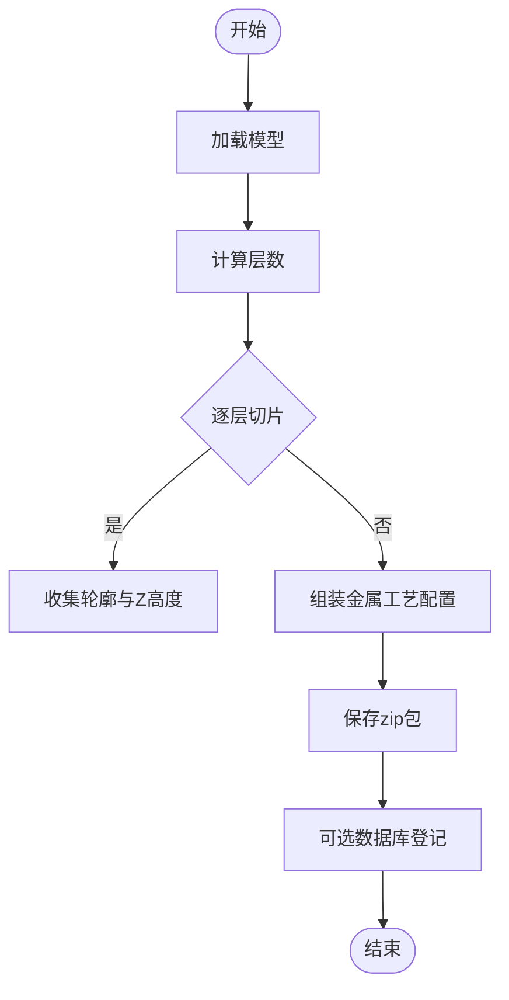

图表来源
- [samples/Custom/scripts/my_slm_pipeline.lua:22-92](file://samples/Custom/scripts/my_slm_pipeline.lua#L22-L92)
- [samples/SLM/scripts/my_slm_export.lua:15-59](file://samples/SLM/scripts/my_slm_export.lua#L15-L59)
- [DllHsBaSlicer/slm_pipeline.h:17-37](file://DllHsBaSlicer/slm_pipeline.h#L17-L37)

章节来源
- [samples/Custom/scripts/my_slm_pipeline.lua:22-92](file://samples/Custom/scripts/my_slm_pipeline.lua#L22-L92)
- [samples/SLM/scripts/my_slm_export.lua:15-59](file://samples/SLM/scripts/my_slm_export.lua#L15-L59)
- [DllHsBaSlicer/slm_pipeline.h:17-37](file://DllHsBaSlicer/slm_pipeline.h#L17-L37)

### SLS（选择性激光烧结）导出
- 工艺要点：无标准输出格式，导出行为完全由 Lua 控制；通常以 zip 包形式归档配置与层轮廓 JSON。
- 数据要求：
  - 层轮廓多边形数组与 Z 高度数组。
  - 配置 JSON（包含切片与激光参数）。
- 脚本示例：
  - SLS 导出脚本：创建 zip，写入配置与层轮廓 JSON，附加 README，可选登记 SQLite。

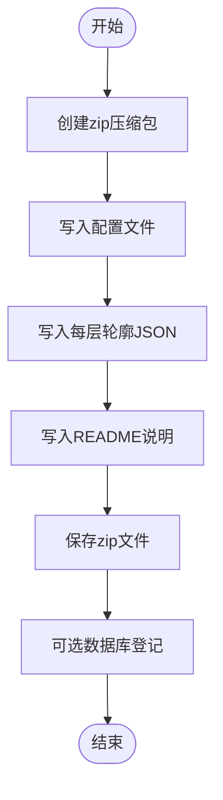

图表来源
- [samples/SLS/scripts/my_sls_export.lua:23-75](file://samples/SLS/scripts/my_sls_export.lua#L23-L75)
- [DllHsBaSlicer/sls_pipeline.h:24-37](file://DllHsBaSlicer/sls_pipeline.h#L24-L37)

章节来源
- [samples/SLS/scripts/my_sls_export.lua:23-75](file://samples/SLS/scripts/my_sls_export.lua#L23-L75)
- [DllHsBaSlicer/sls_pipeline.h:24-37](file://DllHsBaSlicer/sls_pipeline.h#L24-L37)

### TDP / 3DP（粘结剂喷射）导出
- 工艺要点：粉末床 + 液态粘结剂；喷头/液滴/固化参数由 C++ 侧写入配置 JSON，Lua 导出脚本决定最终打包格式。
- 数据要求：
  - 层轮廓多边形数组与 Z 高度数组。
  - 配置 JSON（包含层数、层高、喷头数量、液滴间距、粘结剂饱和度、固化时间、床温、粘结模式等）。
- 脚本示例：
  - 完全由 Lua 驱动的 TDP 流水线：加载模型、逐层切片、组装粘结剂喷射配置、调用 saveSlsPackage 打包。
  - TDP 导出脚本：归档配置与层轮廓 JSON，可选登记 SQLite。

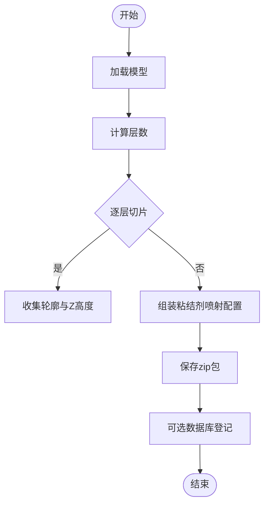

图表来源
- [samples/Custom/scripts/my_tdp_pipeline.lua:20-89](file://samples/Custom/scripts/my_tdp_pipeline.lua#L20-L89)
- [samples/TDP/scripts/my_tdp_export.lua:15-59](file://samples/TDP/scripts/my_tdp_export.lua#L15-L59)
- [DllHsBaSlicer/tdp_pipeline.h:17-37](file://DllHsBaSlicer/tdp_pipeline.h#L17-L37)
- [DllHsBaSlicer/tdp_pipeline.cpp:266-307](file://DllHsBaSlicer/tdp_pipeline.cpp#L266-L307)

章节来源
- [samples/Custom/scripts/my_tdp_pipeline.lua:20-89](file://samples/Custom/scripts/my_tdp_pipeline.lua#L20-L89)
- [samples/TDP/scripts/my_tdp_export.lua:15-59](file://samples/TDP/scripts/my_tdp_export.lua#L15-L59)
- [DllHsBaSlicer/tdp_pipeline.h:17-37](file://DllHsBaSlicer/tdp_pipeline.h#L17-L37)
- [DllHsBaSlicer/tdp_pipeline.cpp:266-307](file://DllHsBaSlicer/tdp_pipeline.cpp#L266-L307)

### WAAM（机器人金属丝沉积）路径导出
- 工艺要点：沿逐层轮廓驱动机器人逐道熔覆焊丝，输出为机器人语言程序（ABB/KUKA/FANUC），而非 zip 包。
- 数据要求：
  - 层轮廓多边形数组与 Z 高度数组。
  - 焊接工艺参数（电流、电压、送丝速度、气体流量、行走速度、焊接工艺编号等）。
  - 机器人类型（0=ABB, 1=KUKA, 2=FANUC）。
- 脚本示例：
  - 完全由 Lua 驱动的 WAAM 流水线：加载模型、逐层切片、组装焊接配置、调用 saveWaamPackage 生成机器人程序。
  - 自定义机器人路径脚本：读取 points 数组，生成机器人程序文本（MoveJ/MoveL 等指令）。

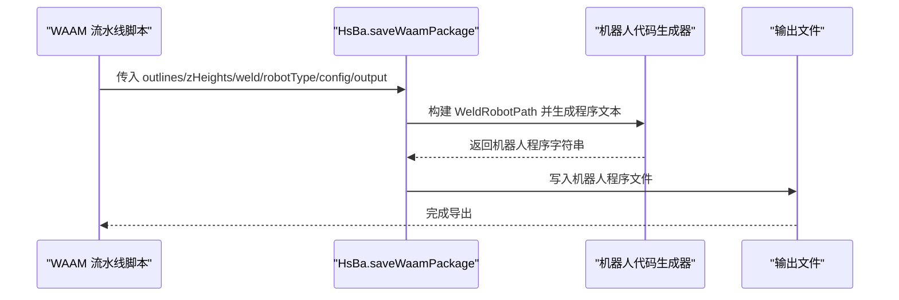

图表来源
- [samples/Custom/scripts/my_waam_pipeline.lua:22-92](file://samples/Custom/scripts/my_waam_pipeline.lua#L22-L92)
- [samples/WAAM/scripts/my_waam_path.lua:17-42](file://samples/WAAM/scripts/my_waam_path.lua#L17-L42)
- [paths/robotpath.hpp:54-104](file://paths/robotpath.hpp#L54-L104)
- [DllHsBaSlicer/waam_pipeline.h:24-37](file://DllHsBaSlicer/waam_pipeline.h#L24-L37)

章节来源
- [samples/Custom/scripts/my_waam_pipeline.lua:22-92](file://samples/Custom/scripts/my_waam_pipeline.lua#L22-L92)
- [samples/WAAM/scripts/my_waam_path.lua:17-42](file://samples/WAAM/scripts/my_waam_path.lua#L17-L42)
- [paths/robotpath.hpp:54-104](file://paths/robotpath.hpp#L54-L104)
- [DllHsBaSlicer/waam_pipeline.h:24-37](file://DllHsBaSlicer/waam_pipeline.h#L24-L37)

### G-code 生成与螺旋化
- 功能要点：
  - 支持 Marlin/RepRap/Klipper 多固件。
  - 支持连续螺旋外壁（花瓶模式），在层间连续上升挤出。
  - 支持 Lua 后处理脚本对生成的 G-code 进行定制。
- 关键类型与方法：
  - GCodeFirmware 枚举（Marlin/RepRap/Klipper）。
  - GCodePrinterConfig 打印机配置（喷嘴直径、线材直径、温度、速度、层高、线宽、回抽等）。
  - ToGCode(firmware)、SaveGCode(path, firmware)、ToGCode(firmware, script, lua_reg)。
  - setContinuousWall(wall)、hasContinuousWall()。

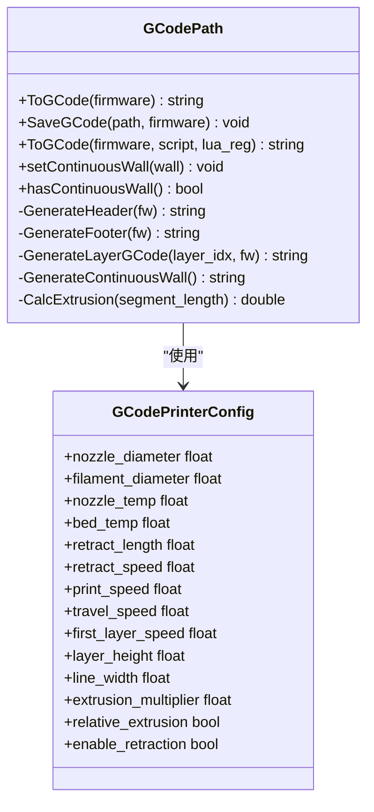

图表来源
- [paths/gcodepath.hpp:24-49](file://paths/gcodepath.hpp#L24-L49)
- [paths/gcodepath.hpp:62-107](file://paths/gcodepath.hpp#L62-L107)

章节来源
- [paths/gcodepath.hpp:24-49](file://paths/gcodepath.hpp#L24-L49)
- [paths/gcodepath.hpp:62-107](file://paths/gcodepath.hpp#L62-L107)

### 图像序列输出（SLA/SLS 等）
- 功能要点：
  - ImagesPath 承载配置旁路文件与命名图像载荷。
  - 支持直接保存或通过 Lua 后处理脚本保存。
- 关键方法：
  - AddImage(path, image_str)。
  - Save(path)、Save(path, script)、ToString(...) 系列重载。

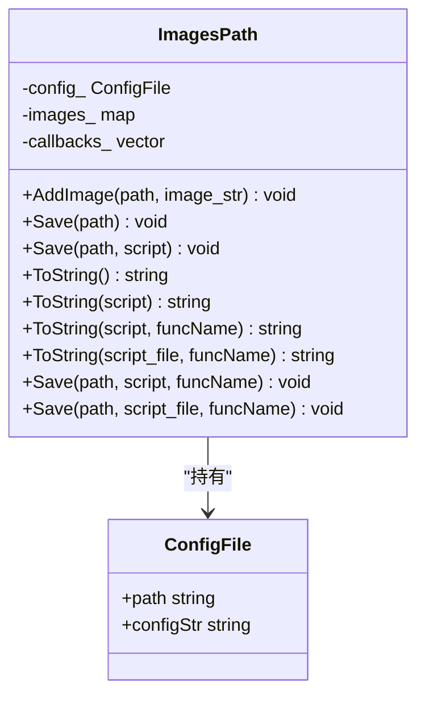

图表来源
- [paths/imagespath.hpp:16-60](file://paths/imagespath.hpp#L16-L60)

章节来源
- [paths/imagespath.hpp:16-60](file://paths/imagespath.hpp#L16-L60)

### 机器人路径输出（WAAM）
- 功能要点：
  - RobotPath 累积 RLPoint 移动，并在 Save/ToString 时按目标品牌（ABB/KUKA/FANUC）生成程序文本。
  - 支持 Lua 后处理脚本替换内置代码生成器。
- 关键类型与方法：
  - RLPointType（MoveJ/MoveL/MoveC/Program...）。
  - RLType（Unknown/Abb/Kuka/Fanuc/Undefine）。
  - push_back(point)、getRobotType()、Save(...)/ToString(...) 系列重载。
  - GenerateAbbCode()/GenerateKukaCode()/GenerateFanucCode()。

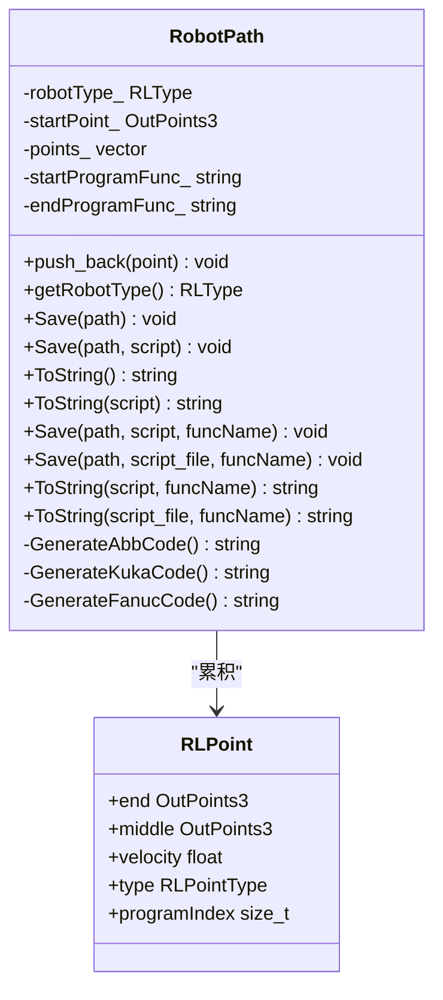

图表来源
- [paths/robotpath.hpp:15-52](file://paths/robotpath.hpp#L15-L52)
- [paths/robotpath.hpp:54-104](file://paths/robotpath.hpp#L54-L104)

章节来源
- [paths/robotpath.hpp:15-52](file://paths/robotpath.hpp#L15-L52)
- [paths/robotpath.hpp:54-104](file://paths/robotpath.hpp#L54-L104)

## 依赖关系分析
- 流水线头文件定义了各工艺的 C ABI 入口与生命周期（创建默认配置、同步/异步运行、释放结果）。
- Lua 类型定义文件提供了统一的 API 契约，确保不同脚本在不同流水线环境中具有一致的能力集。
- 通用输出对象（G-code/ImagesPath/RobotPath）被各流水线复用，形成稳定的数据流与扩展点。

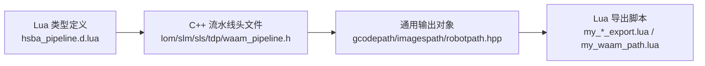

图表来源
- [types/hsba_pipeline.d.lua:20-113](file://types/hsba_pipeline.d.lua#L20-L113)
- [DllHsBaSlicer/lom_pipeline.h:17-37](file://DllHsBaSlicer/lom_pipeline.h#L17-L37)
- [DllHsBaSlicer/slm_pipeline.h:17-37](file://DllHsBaSlicer/slm_pipeline.h#L17-L37)
- [DllHsBaSlicer/sls_pipeline.h:17-37](file://DllHsBaSlicer/sls_pipeline.h#L17-L37)
- [DllHsBaSlicer/tdp_pipeline.h:17-37](file://DllHsBaSlicer/tdp_pipeline.h#L17-L37)
- [DllHsBaSlicer/waam_pipeline.h:17-37](file://DllHsBaSlicer/waam_pipeline.h#L17-L37)
- [paths/gcodepath.hpp:62-107](file://paths/gcodepath.hpp#L62-L107)
- [paths/imagespath.hpp:16-60](file://paths/imagespath.hpp#L16-L60)
- [paths/robotpath.hpp:54-104](file://paths/robotpath.hpp#L54-L104)

章节来源
- [types/hsba_pipeline.d.lua:20-113](file://types/hsba_pipeline.d.lua#L20-L113)
- [DllHsBaSlicer/lom_pipeline.h:17-37](file://DllHsBaSlicer/lom_pipeline.h#L17-L37)
- [DllHsBaSlicer/slm_pipeline.h:17-37](file://DllHsBaSlicer/slm_pipeline.h#L17-L37)
- [DllHsBaSlicer/sls_pipeline.h:17-37](file://DllHsBaSlicer/sls_pipeline.h#L17-L37)
- [DllHsBaSlicer/tdp_pipeline.h:17-37](file://DllHsBaSlicer/tdp_pipeline.h#L17-L37)
- [DllHsBaSlicer/waam_pipeline.h:17-37](file://DllHsBaSlicer/waam_pipeline.h#L17-L37)
- [paths/gcodepath.hpp:62-107](file://paths/gcodepath.hpp#L62-L107)
- [paths/imagespath.hpp:16-60](file://paths/imagespath.hpp#L16-L60)
- [paths/robotpath.hpp:54-104](file://paths/robotpath.hpp#L54-L104)

## 性能与内存优化
- 批量处理：
  - 在流水线循环中定期上报进度（HsBa.progress），避免 UI 卡顿并便于中断。
  - 对大量层数据采用分批写入 zip 或分块处理，减少单次内存峰值。
- 内存管理：
  - 及时移除模型（HsBa.removeModel）释放模型池占用。
  - 使用 Zipper/Bit7zZipper 的 AddByteFile 直接写入字节数据，避免中间临时文件过多。
  - 数据库登记使用 pcall 包裹，失败不影响主导出流程。
- I/O 优化：
  - 优先使用 AddByteFile 写入内存中的 JSON/图像数据，减少磁盘随机写。
  - 对大体积图像序列可考虑压缩策略（Bit7zZipper）以降低包体大小。
- Lua 后处理：
  - 仅在必要时启用 Lua 后处理脚本，避免额外开销。
  - 对 G-code 与机器人路径的后处理应谨慎设计，避免重复解析与拼接。

章节来源
- [samples/Custom/scripts/my_lom_pipeline.lua:30-50](file://samples/Custom/scripts/my_lom_pipeline.lua#L30-L50)
- [samples/Custom/scripts/my_slm_pipeline.lua:33-52](file://samples/Custom/scripts/my_slm_pipeline.lua#L33-L52)
- [samples/Custom/scripts/my_tdp_pipeline.lua:31-50](file://samples/Custom/scripts/my_tdp_pipeline.lua#L31-L50)
- [samples/Custom/scripts/my_waam_pipeline.lua:34-53](file://samples/Custom/scripts/my_waam_pipeline.lua#L34-L53)
- [samples/SLS/scripts/my_sls_export.lua:47-75](file://samples/SLS/scripts/my_sls_export.lua#L47-L75)
- [samples/LOM/scripts/my_lom_export.lua:27-54](file://samples/LOM/scripts/my_lom_export.lua#L27-L54)
- [samples/SLM/scripts/my_slm_export.lua:32-59](file://samples/SLM/scripts/my_slm_export.lua#L32-L59)
- [samples/TDP/scripts/my_tdp_export.lua:32-59](file://samples/TDP/scripts/my_tdp_export.lua#L32-L59)

## 故障排除指南
- 常见错误与定位：
  - 导出脚本返回字符串导致覆盖 zip：导出脚本必须返回 table（或 nil），否则 C++ 会用字符串覆盖 output_path。
  - 缺少 Lua 导出脚本路径：TDP 流水线要求 export_lua_script 非空，否则会报错。
  - 数据库登记失败：使用 pcall 包裹，失败仅记录警告，不影响导出结果。
- 调试建议：
  - 使用 HsBa.progress 分段上报进度，定位卡点。
  - 检查 config.configStr 与 images 数组是否完整。
  - 对机器人路径脚本，确认 points 数组结构与 type 字段正确。

章节来源
- [samples/SLS/scripts/my_sls_export.lua:18-19](file://samples/SLS/scripts/my_sls_export.lua#L18-L19)
- [samples/LOM/scripts/my_lom_export.lua:7-8](file://samples/LOM/scripts/my_lom_export.lua#L7-L8)
- [samples/SLM/scripts/my_slm_export.lua:12-13](file://samples/SLM/scripts/my_slm_export.lua#L12-L13)
- [samples/TDP/scripts/my_tdp_export.lua:12-13](file://samples/TDP/scripts/my_tdp_export.lua#L12-L13)
- [DllHsBaSlicer/tdp_pipeline.cpp:266-271](file://DllHsBaSlicer/tdp_pipeline.cpp#L266-L271)
- [samples/SLS/scripts/my_sls_export.lua:47-75](file://samples/SLS/scripts/my_sls_export.lua#L47-L75)
- [samples/LOM/scripts/my_lom_export.lua:30-54](file://samples/LOM/scripts/my_lom_export.lua#L30-L54)
- [samples/SLM/scripts/my_slm_export.lua:35-59](file://samples/SLM/scripts/my_slm_export.lua#L35-L59)
- [samples/TDP/scripts/my_tdp_export.lua:35-59](file://samples/TDP/scripts/my_tdp_export.lua#L35-L59)

## 结论
本指南系统梳理了 LOM、SLM、SLS、TDP、WAAM 等 3D 打印技术的导出脚本开发方法。通过统一的 Lua API 与通用输出对象，开发者可以高效地将切片数据转换为设备所需的文件格式。实践中应重视生命周期管理、错误处理与性能优化，并结合设备厂商的特定格式进行适配与扩展。

## 附录：设备厂商兼容性与扩展建议
- 多固件 G-code：
  - 根据目标设备选择 Marlin/RepRap/Klipper，调整喷嘴/线材/温度/速度等参数。
  - 对于连续外壁（花瓶模式），设置 continuous_wall 并确保层高与线宽匹配。
- 图像序列：
  - 保持 layers/N.json 命名规范，确保下游设备能按序读取。
  - 如需渲染图片，可使用 HsBa.renderImage 生成位图并加入 zip。
- 机器人路径：
  - 明确 robotType（ABB/KUKA/FANUC），必要时使用自定义 path_lua_script 替换内置生成器。
  - 对 MoveJ/MoveL 指令的速度与轨迹进行调优，避免过冲与碰撞。
- 数据库登记：
  - 使用 SQLiteAdapter/MySQLAdapter/PostgreSQLAdapter 记录导出历史，便于追溯与审计。
  - 失败时使用 pcall 包裹，保证主流程健壮性。

章节来源
- [paths/gcodepath.hpp:24-49](file://paths/gcodepath.hpp#L24-L49)
- [paths/gcodepath.hpp:62-107](file://paths/gcodepath.hpp#L62-L107)
- [paths/imagespath.hpp:16-60](file://paths/imagespath.hpp#L16-L60)
- [paths/robotpath.hpp:15-52](file://paths/robotpath.hpp#L15-L52)
- [paths/robotpath.hpp:54-104](file://paths/robotpath.hpp#L54-L104)
- [types/hsba_pipeline.d.lua:143-223](file://types/hsba_pipeline.d.lua#L143-L223)
- [types/hsba_pipeline.d.lua:493-499](file://types/hsba_pipeline.d.lua#L493-L499)