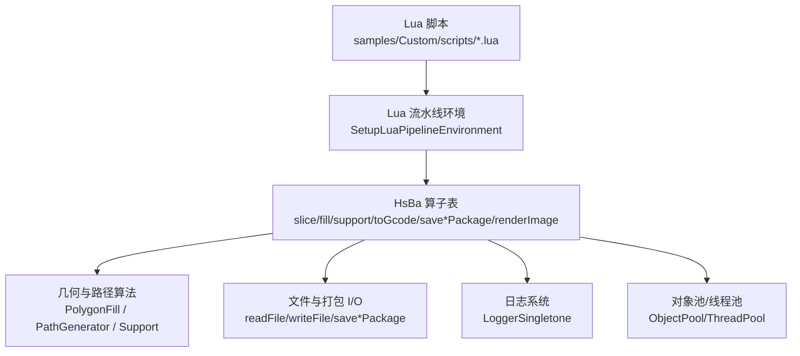
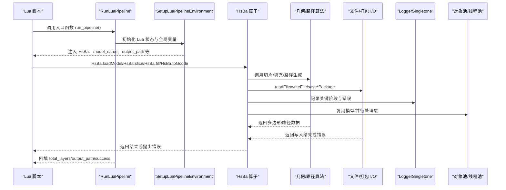
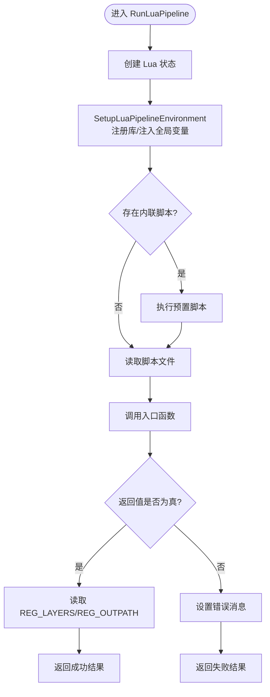
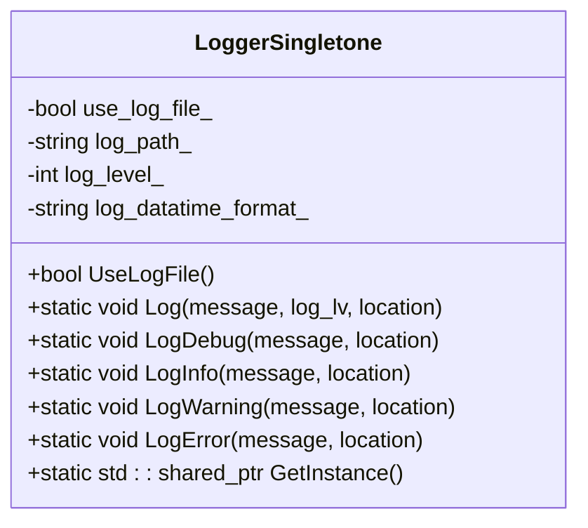
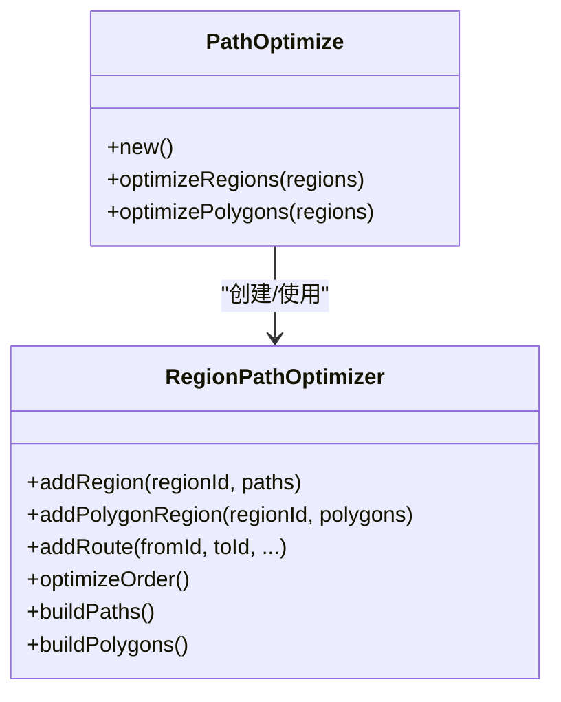
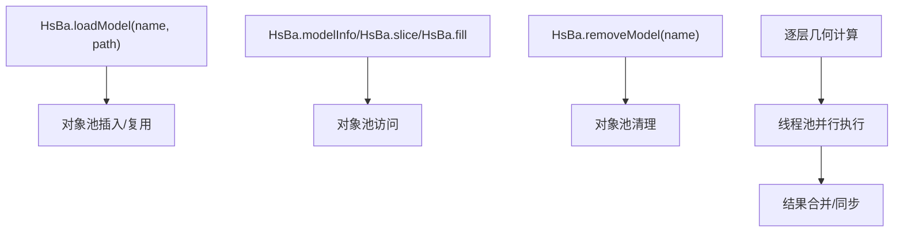
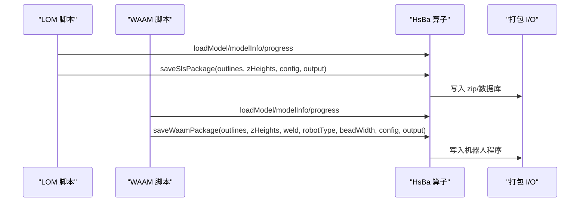

# 性能优化与调试

<cite>
**本文引用的文件**   
- [lua_pipeline.cpp](file://LibHsBaSlicer/Extends/lua_pipeline.cpp)
- [lua_register.cpp](file://DllHsBaSlicer/lua_register.cpp)
- [logger.hpp](file://logger/logger.hpp)
- [logger.cpp](file://logger/logger.cpp)
- [path_optimizer.cpp](file://LibHsBaSlicer/Path/path_optimizer.cpp)
- [object_pool.hpp](file://base/object_pool.hpp)
- [thread_pool.hpp](file://base/thread_pool.hpp)
- [pipeline_parallel.hpp](file://DllHsBaSlicer/pipeline_parallel.hpp)
- [my_lom_pipeline.lua](file://samples/Custom/scripts/my_lom_pipeline.lua)
- [my_waam_pipeline.lua](file://samples/Custom/scripts/my_waam_pipeline.lua)
- [lua_pipeline_api.md](file://docs/zh/lua_pipeline_api.md)
</cite>

## 目录
1. [引言](#引言)
2. [项目结构](#项目结构)
3. [核心组件](#核心组件)
4. [架构总览](#架构总览)
5. [详细组件分析](#详细组件分析)
6. [依赖关系分析](#依赖关系分析)
7. [性能考虑](#性能考虑)
8. [故障排除指南](#故障排除指南)
9. [结论](#结论)
10. [附录](#附录)

## 引言
本文面向 HsBaSlicer 的 Lua 扩展开发者，聚焦脚本执行的性能瓶颈识别、内存使用优化、计算密集型任务优化策略，以及日志系统、性能监控接口和调试方法。文档基于仓库中的 Lua 流水线实现、日志单例、路径优化器、对象池与线程池等源码进行实证分析，帮助开发者编写高效、稳定的 Lua 扩展脚本。

## 项目结构
与 Lua 脚本性能直接相关的代码主要分布在以下位置：
- `LibHsBaSlicer/Extends/lua_pipeline.cpp`：Lua 流水线环境构建、`HsBa` 算子实现、脚本加载与入口调用。
- `DllHsBaSlicer/lua_register.cpp`：向外部暴露的 Lua 函数注册接口。
- `logger/logger.hpp` 与 `logger/logger.cpp`：跨平台日志单例，支持分级输出、文件输出与平台适配。
- `LibHsBaSlicer/Path/path_optimizer.cpp`：路径优化器的 Lua 绑定与垃圾回收钩子。
- `base/object_pool.hpp`：命名对象池，用于模型等共享对象管理。
- `base/thread_pool.hpp`：线程池抽象。
- `DllHsBaSlicer/pipeline_parallel.hpp`：按层并行执行的工作流封装。
- `samples/Custom/scripts/*.lua`：示例脚本，体现典型流水线结构与进度上报模式。
- `docs/zh/lua_pipeline_api.md`：Lua API 中文参考，便于理解可用能力边界。

**图表来源**
- [lua_pipeline.cpp:866-958](file://LibHsBaSlicer/Extends/lua_pipeline.cpp#L866-L958)
- [lua_pipeline.cpp:830-860](file://LibHsBaSlicer/Extends/lua_pipeline.cpp#L830-L860)
- [logger.hpp:35-122](file://logger/logger.hpp#L35-L122)
- [object_pool.hpp:18-238](file://base/object_pool.hpp#L18-L238)
- [pipeline_parallel.hpp:17-23](file://DllHsBaSlicer/pipeline_parallel.hpp#L17-L23)

**章节来源**
- [lua_pipeline.cpp:866-1046](file://LibHsBaSlicer/Extends/lua_pipeline.cpp#L866-L1046)
- [lua_register.cpp:11-41](file://DllHsBaSlicer/lua_register.cpp#L11-L41)
- [logger.hpp:35-122](file://logger/logger.hpp#L35-L122)
- [logger.cpp:136-222](file://logger/logger.cpp#L136-L222)
- [object_pool.hpp:18-238](file://base/object_pool.hpp#L18-L238)
- [pipeline_parallel.hpp:17-23](file://DllHsBaSlicer/pipeline_parallel.hpp#L17-L23)
- [lua_pipeline_api.md:67-96](file://docs/zh/lua_pipeline_api.md#L67-L96)

## 核心组件
本节梳理对 Lua 脚本性能影响最大的核心组件及其职责。

- **Lua 流水线环境与 `HsBa` 算子**
  - 负责创建 Lua 状态、注入全局变量（`HsBa`、`model_name`、`model_path`、`output_path`、`pipeline_config`、`pipeline_entry`），并注册 PolygonOperations、Support、PolygonFill、PathOptimize、Zipper、Cipher、SQLiteAdapter、ParamStore 等库。
  - 提供切片、填充、支撑、地板、G-code 生成、打包导出、图像渲染等高性能算子。
  - 通过 `RunLuaPipeline` 加载脚本、调用入口函数，并将脚本回报的总层数与输出路径回填到 C++ 结果。

- **日志系统**
  - 提供线程安全的跨平台日志单例，支持 trace/debug/info/warning/error/fatal 等级。
  - 默认在 debug 构建中启用较低阈值，release 构建中提高阈值；可配置是否写文件、日志路径与时间格式。
  - 为性能诊断提供结构化输出，避免在热路径上过度打印。

- **路径优化器与对象生命周期**
  - 暴露 `PathOptimize.new()` 与 RegionPathOptimizer userdata，提供区域聚合、路径重排序、多边形优化等方法。
  - 通过元表 `__gc` 钩子确保 C++ 对象正确释放，避免 Lua GC 时的内存泄漏。

- **对象池与线程池**
  - 对象池用于模型等共享资源复用，减少频繁分配与销毁开销。
  - 线程池用于按层并行处理，提升大规模几何计算的吞吐。

**章节来源**
- [lua_pipeline.cpp:866-958](file://LibHsBaSlicer/Extends/lua_pipeline.cpp#L866-L958)
- [lua_pipeline.cpp:960-1046](file://LibHsBaSlicer/Extends/lua_pipeline.cpp#L960-L1046)
- [logger.hpp:35-122](file://logger/logger.hpp#L35-L122)
- [logger.cpp:136-222](file://logger/logger.cpp#L136-L222)
- [path_optimizer.cpp:477-521](file://LibHsBaSlicer/Path/path_optimizer.cpp#L477-L521)
- [object_pool.hpp:18-238](file://base/object_pool.hpp#L18-L238)

## 架构总览
下图展示 Lua 脚本从加载到执行、再到结果回传的完整流程，以及与日志、I/O、几何算法、对象池和线程池的关系。

**图表来源**
- [lua_pipeline.cpp:960-1046](file://LibHsBaSlicer/Extends/lua_pipeline.cpp#L960-L1046)
- [lua_pipeline.cpp:866-958](file://LibHsBaSlicer/Extends/lua_pipeline.cpp#L866-L958)
- [logger.cpp:242-343](file://logger/logger.cpp#L242-L343)
- [pipeline_parallel.hpp:17-23](file://DllHsBaSlicer/pipeline_parallel.hpp#L17-L23)

## 详细组件分析

### Lua 流水线环境与 `HsBa` 算子
- **环境构建**
  - `SetupLuaPipelineEnvironment` 打开标准库、安装公共 AnyObject 类型、注册 2D/3D/File 函数、PolygonOperations、Support、PolygonFill、PathOptimize、Zipper、Cipher、SQLiteAdapter、ParamStore 等。
  - 将运行期状态（上下文与输出）绑定到 Lua registry，供 `HsBa` 各函数访问。
  - 注入全局变量：`pipeline_config`、`output_path`、`model_name`、`model_path`、`pipeline_entry`。

- **脚本执行**
  - `RunLuaPipeline` 创建独立 Lua 状态，先执行内联预置脚本（如有），再读取脚本文件，最后调用入口函数。
  - 入口函数返回值语义：任意真值表示成功；字符串会作为结果载荷回传；返回 `false`/`nil` 或抛出 Lua 错误表示失败。
  - 脚本可通过 `HsBa.setLayers(n)` 与 `HsBa.setOutputPath(path)` 回报总层数和输出路径，C++ 侧在结束后读取 registry 回填。

- **关键算子与性能要点**
  - `HsBa.slice` / `HsBa.sliceUnsafe`：切片返回浮点多边形或归一化多边形，注意选择安全与非安全路径以平衡精度与性能。
  - `HsBa.fill`：根据 spacing/mode/angle/borderCount 生成填充路径，批量处理可减少多次调用开销。
  - `HsBa.fdmSupport` / `HsBa.slaSupport`：支撑生成按层输入，建议一次性传入多层数据以减少 Lua/C++ 边界开销。
  - `HsBa.toGcode`：将多层 outlines/fills/supports 转换为 G-code 字符串，参数较多，建议集中构造配置表。
  - `HsBa.saveSlsPackage` / `HsBa.saveWaamPackage` / `HsBa.saveSlaPackage`：打包导出，涉及 I/O 与序列化，应批量化输出。
  - `HsBa.renderImage`：将多边形渲染为图像，适合离线验证，不应在热路径频繁调用。

**图表来源**
- [lua_pipeline.cpp:960-1046](file://LibHsBaSlicer/Extends/lua_pipeline.cpp#L960-L1046)
- [lua_pipeline.cpp:866-958](file://LibHsBaSlicer/Extends/lua_pipeline.cpp#L866-L958)

**章节来源**
- [lua_pipeline.cpp:866-1046](file://LibHsBaSlicer/Extends/lua_pipeline.cpp#L866-L1046)
- [lua_pipeline_api.md:67-96](file://docs/zh/lua_pipeline_api.md#L67-L96)

### 日志系统与性能诊断
- **日志级别与输出目标**
  - 支持 trace(0)/debug(1)/info(2)/warning(3)/error(4)/fatal(5)。
  - Debug 构建默认阈值较低，Release 构建默认阈值较高；可通过 `logcfg.ini` 配置 `log.log_level_debug`/`log.log_level`、`log.use_log_file`、`log.log_file`、`log_format.log_datatime_format`。
  - 非 Android/iOS 平台使用 Boost.Log，Android 使用内核日志，iOS 使用系统日志。

- **在脚本中的使用建议**
  - 在关键阶段（模型加载、切片、填充、支撑、G-code 生成、打包）使用 `HsBa.progress` 上报进度，结合日志记录耗时与异常。
  - 避免在极热路径（如每点/每边循环）中频繁写日志，以免 I/O 成为瓶颈。
  - 使用结构化日志字段（阶段名、层号、模型名）便于后续分析与自动化报告。

**图表来源**
- [logger.hpp:35-122](file://logger/logger.hpp#L35-L122)
- [logger.cpp:136-222](file://logger/logger.cpp#L136-L222)
- [logger.cpp:242-343](file://logger/logger.cpp#L242-L343)

**章节来源**
- [logger.hpp:35-122](file://logger/logger.hpp#L35-L122)
- [logger.cpp:136-222](file://logger/logger.cpp#L136-L222)
- [logger.cpp:242-343](file://logger/logger.cpp#L242-L343)

### 路径优化器与对象生命周期
- **API 概览**
  - `PathOptimize.new()` 创建优化器对象。
  - `addRegion(id, paths)` / `addPolygons(id, polys)` / `addRoute(fromId, toId, ...)` 添加区域与路线。
  - `optimizeOrder()` / `buildPaths()` / `buildPolygons()` 执行优化与构建结果。
  - 静态方法 `optimizeRegions(regions)` / `optimizePolygons(regions)` 提供一次性优化。

- **内存管理与 GC**
  - 通过元表 `HsBa.RegionPathOptimizer` 与 `__gc` 钩子调用 `LuaGC<RegionPathOptimizer>` 释放 C++ 对象。
  - 建议在脚本中显式释放不再使用的优化器实例，或在作用域结束时由 GC 自动清理。

**图表来源**
- [path_optimizer.cpp:477-521](file://LibHsBaSlicer/Path/path_optimizer.cpp#L477-L521)

**章节来源**
- [path_optimizer.cpp:477-521](file://LibHsBaSlicer/Path/path_optimizer.cpp#L477-L521)

### 对象池与线程池
- **对象池**
  - 命名对象池用于管理共享对象（如模型），支持最大容量、惰性清理、按名称获取/插入/移除等操作。
  - 在脚本中通过 `HsBa.loadModel` 与 `HsBa.removeModel` 控制模型生命周期，避免重复加载与内存膨胀。

- **线程池**
  - 线程池抽象用于并行执行逐层工作，提升吞吐。
  - 在流水线并行封装中，按层分发任务到线程池，注意同步与错误传播。

**图表来源**
- [object_pool.hpp:18-238](file://base/object_pool.hpp#L18-L238)
- [pipeline_parallel.hpp:17-23](file://DllHsBaSlicer/pipeline_parallel.hpp#L17-L23)

**章节来源**
- [object_pool.hpp:18-238](file://base/object_pool.hpp#L18-L238)
- [pipeline_parallel.hpp:17-23](file://DllHsBaSlicer/pipeline_parallel.hpp#L17-L23)

### 示例脚本与最佳实践
- **LOM 流水线示例**
  - 展示如何加载模型、计算层高、上报进度、调用 `saveSlsPackage` 打包。
  - 建议：集中构造参数表、减少中间表创建、合理使用 `HsBa.progress`。

- **WAAM 流水线示例**
  - 展示机器人路径生成与 `saveWaamPackage` 调用，强调层高远大于粉末床工艺。
  - 建议：分层高度与沉积道宽度参数合理设置，避免过多路径段导致 I/O 压力。

**图表来源**
- [my_lom_pipeline.lua:1-35](file://samples/Custom/scripts/my_lom_pipeline.lua#L1-L35)
- [my_waam_pipeline.lua:1-33](file://samples/Custom/scripts/my_waam_pipeline.lua#L1-L33)
- [lua_pipeline.cpp:697-828](file://LibHsBaSlicer/Extends/lua_pipeline.cpp#L697-L828)

**章节来源**
- [my_lom_pipeline.lua:1-35](file://samples/Custom/scripts/my_lom_pipeline.lua#L1-L35)
- [my_waam_pipeline.lua:1-33](file://samples/Custom/scripts/my_waam_pipeline.lua#L1-L33)
- [lua_pipeline.cpp:697-828](file://LibHsBaSlicer/Extends/lua_pipeline.cpp#L697-L828)

## 依赖关系分析
- **组件耦合**
  - `lua_pipeline.cpp` 依赖 2D/3D/LuaAdapter、PolygonFill、Support、PathGenerator、SLS/WAAM/SLA 导出、Preprocess、Slice、Cipher、FileOperator、SQLiteAdapter、ParamStore 等。
  - 日志系统独立于流水线，但被广泛引用用于诊断。
  - 对象池与线程池为底层基础设施，被流水线与算法模块复用。

- **外部依赖**
  - Boost.Log（桌面端）、Android log、iOS os_log。
  - Bit7z（可选压缩）、MySQL/PostgreSQL（可选数据库）。

```mermaid
graph TB
LuaPipeline["lua_pipeline.cpp"] --> TwoD["2D/LuaAdapter.hpp"]
LuaPipeline --> Fill["PolygonFill.hpp"]
LuaPipeline --> Support["support/LuaAdapter.hpp"]
LuaPipeline --> PathGen["Path/path_generator.hpp"]
LuaPipeline --> Export["Path/sls_export.hpp / waam_export.hpp"]
LuaPipeline --> Preprocess["Preprocess/model_preprocess.hpp"]
LuaPipeline --> Slice["Slice/mesh_slice.hpp"]
LuaPipeline --> Cipher["cipher/LuaAdapter.hpp"]
LuaPipeline --> FileOp["fileoperator/LuaAdapter.hpp"]
LuaPipeline --> SQLite["SQLiteAdapter"]
LuaPipeline --> ParamStore["ParamStore"]
LuaPipeline --> Logger["logger.hpp"]
LuaPipeline --> Pool["object_pool.hpp / thread_pool.hpp"]
```

**图表来源**
- [lua_pipeline.cpp:1-39](file://LibHsBaSlicer/Extends/lua_pipeline.cpp#L1-L39)
- [logger.hpp:35-122](file://logger/logger.hpp#L35-L122)
- [object_pool.hpp:18-238](file://base/object_pool.hpp#L18-L238)

**章节来源**
- [lua_pipeline.cpp:1-39](file://LibHsBaSlicer/Extends/lua_pipeline.cpp#L1-L39)
- [logger.hpp:35-122](file://logger/logger.hpp#L35-L122)
- [object_pool.hpp:18-238](file://base/object_pool.hpp#L18-L238)

## 性能考虑
本节提供针对 Lua 脚本性能优化的系统性建议，涵盖瓶颈识别、内存优化、计算密集型任务优化、I/O 批处理、内存泄漏检测与修复、基准测试与 profiling。

- **瓶颈识别**
  - 使用 `HsBa.progress(percent, stage)` 标记关键阶段，并结合日志记录阶段耗时。
  - 在脚本中统计每步调用次数与返回数据大小，定位热点（如逐层切片、填充、支撑、G-code 生成、打包）。
  - 观察日志阈值与输出频率，避免日志 I/O 成为瓶颈。

- **内存使用优化**
  - 复用模型：通过 `HsBa.loadModel` 与 `HsBa.removeModel` 控制模型生命周期，避免重复加载。
  - 减少中间表：尽量批量传递多边形与层数据，减少 Lua/C++ 边界转换开销。
  - 及时释放优化器与临时对象，利用 Lua GC 钩子确保 C++ 对象释放。

- **计算密集型任务优化**
  - 优先使用内置算子（`HsBa.slice`/`HsBa.fill`/`HsBa.fdmSupport`/`HsBa.slaSupport`/`HsBa.toGcode`），避免在 Lua 层重复实现几何算法。
  - 合理选择安全与非安全切片路径，权衡精度与性能。
  - 使用 `PathOptimize` 进行路径重排序与区域聚合，减少无效移动与重叠。

- **I/O 操作批处理**
  - 将多个小文件写入合并为一次大文件写入，或使用 `HsBa.writeFile` 批量写入。
  - 使用 `HsBa.saveSlsPackage`/`HsBa.saveWaamPackage`/`HsBa.saveSlaPackage` 统一打包，减少多次 I/O。
  - 避免在热路径中频繁调用 `HsBa.renderImage`，仅在离线验证时使用。

- **内存泄漏检测与修复**
  - 检查 `PathOptimize` 对象的 `__gc` 钩子是否正确注册，确保 C++ 对象释放。
  - 监控对象池中的活跃对象数量，及时清理不再使用的模型。
  - 使用日志记录对象创建与销毁，辅助定位泄漏点。

- **基准测试与 Profiling**
  - 设计最小可复现脚本，固定输入模型与参数，测量端到端耗时。
  - 分阶段计时：模型加载、切片、填充、支撑、G-code 生成、打包。
  - 对比不同参数组合（spacing、mode、angle、borderCount、layerHeight 等），找到最优配置。
  - 结合日志与系统工具（如 Windows Performance Analyzer、Linux perf）进行 CPU/内存分析。

[本节为通用指导，不直接分析具体文件]

## 故障排除指南
- **常见错误与定位**
  - 脚本入口函数未找到：检查 `pipeline_entry` 是否正确设置，并确保脚本中存在同名函数。
  - 模型未加载或不存在：确认 `HsBa.loadModel` 成功，并使用 `HsBa.modelNames` 检查模型池。
  - 切片或填充失败：检查输入多边形是否闭合、参数是否合法（层高、间距、角度等）。
  - 打包失败：检查输出路径、脚本路径、参数表字段是否齐全。

- **日志与调试技巧**
  - 调整日志阈值与文件输出，捕获关键阶段与异常信息。
  - 在脚本中使用 `print` 与 `HsBa.progress` 配合日志，形成可视化进度与诊断信息。
  - 对于复杂问题，逐步注释脚本逻辑，缩小问题范围。

- **性能问题排查**
  - 若整体耗时高，优先检查 I/O 与打包步骤，尝试批处理与减少中间数据。
  - 若内存增长快，检查对象池与优化器生命周期，确保及时释放。
  - 若 CPU 占用高，检查几何算法调用频率与参数合理性，避免不必要的重复计算。

**章节来源**
- [lua_pipeline.cpp:960-1046](file://LibHsBaSlicer/Extends/lua_pipeline.cpp#L960-L1046)
- [logger.cpp:136-222](file://logger/logger.cpp#L136-L222)
- [logger.cpp:242-343](file://logger/logger.cpp#L242-L343)

## 结论
HsBaSlicer 的 Lua 流水线提供了丰富的算子与基础设施，开发者应充分利用内置几何与路径算法、对象池与线程池、日志系统与打包导出能力，编写高效、稳定的脚本。通过合理的瓶颈识别、内存优化、I/O 批处理、对象生命周期管理与基准测试，可以显著提升脚本性能与可靠性。

[本节为总结性内容，不直接分析具体文件]

## 附录
- **Lua API 参考**
  - 控制与文件 IO：`HsBa.progress`、`HsBa.setLayers`、`HsBa.setOutputPath`、`HsBa.readFile`、`HsBa.writeFile`。
  - 模型管理：`HsBa.loadModel`、`HsBa.modelInfo`、`HsBa.translateModel`、`HsBa.rotateModel`、`HsBa.scaleModel`、`HsBa.removeModel`、`HsBa.modelNames`。
  - 切片与坐标转换：`HsBa.layerCount`、`HsBa.layerZ`、`HsBa.slice`、`HsBa.sliceUnsafe`、`HsBa.toInt`、`HsBa.toDouble`。
  - 填充与支撑：`HsBa.fill`、`HsBa.fdmSupport`、`HsBa.slaSupport`、`HsBa.floor`。
  - 路径与输出：`HsBa.toGcode`、`HsBa.spiralize`、`HsBa.saveSlsPackage`、`HsBa.saveWaamPackage`、`HsBa.saveSlaPackage`、`HsBa.renderImage`。

**章节来源**
- [lua_pipeline_api.md:67-96](file://docs/zh/lua_pipeline_api.md#L67-L96)