# 扩展机制详解

<cite>
**本文引用的文件**   
- [README.md](file://README.md)
- [LuaNewObject.hpp](file://utils/LuaNewObject.hpp)
- [LuaAnyObject.hpp](file://utils/LuaAnyObject.hpp)
- [LuaAnyObject.cpp](file://utils/LuaAnyObject.cpp)
- [LuaCommonTypes.hpp](file://LibHsBaSlicer/Extends/LuaCommonTypes.hpp)
- [LuaCommonTypes.cpp](file://LibHsBaSlicer/Extends/LuaCommonTypes.cpp)
- [LuaAddFunction.hpp](file://LibHsBaSlicer/Extends/LuaAddFunction.hpp)
- [lua_pipeline.cpp](file://LibHsBaSlicer/Extends/lua_pipeline.cpp)
- [LuaSupport.hpp](file://support/LuaSupport.hpp)
- [LuaSupport.cpp](file://support/LuaSupport.cpp)
- [LuaAdapter.hpp](file://2D/LuaAdapter.hpp)
- [LuaAdapter.cpp](file://2D/LuaAdapter.cpp)
- [LuaAdapter.hpp](file://fileoperator/LuaAdapter.hpp)
- [LuaAdapter.cpp](file://fileoperator/LuaAdapter.cpp)
- [LuaAdapter.hpp](file://cipher/LuaAdapter.hpp)
- [LuaAdapter.cpp](file://cipher/LuaAdapter.cpp)
- [lua_register.h](file://DllHsBaSlicer/lua_register.h)
</cite>

## 目录
1. [引言](#引言)
2. [项目结构](#项目结构)
3. [核心组件](#核心组件)
4. [架构总览](#架构总览)
5. [详细组件分析](#详细组件分析)
6. [依赖关系分析](#依赖关系分析)
7. [性能与内存管理](#性能与内存管理)
8. [沙箱安全与错误处理](#沙箱安全与错误处理)
9. [调试与监控](#调试与监控)
10. [扩展开发指南](#扩展开发指南)
11. [结论](#结论)
12. [附录：API 参考速查](#附录api-参考速查)

## 引言
本文件面向高级开发者，系统性解析 HsBaSlicer 的 Lua 扩展机制。内容覆盖 Lua 与 C++ 绑定、脚本执行环境、生命周期与内存管理、对象与回调注册、事件系统、沙箱与安全、错误处理、性能优化、动态加载与插件化扩展点，并提供自定义数据结构绑定、复杂对象交互和异步操作处理的实践指导。

## 项目结构
HsBaSlicer 将 Lua 集成能力分布在多个模块中：
- utils：通用 Lua 绑定基础设施（userdata、元表、垃圾回收、AnyObject 包装）。
- LibHsBaSlicer/Extends：公共类型反射与注册、按维度（2D/3D/File）的函数注册表、流水线上下文与输出。
- support：基于 Lua 的可替换支撑生成器。
- 2D/fileoperator/cipher：各子系统的 Lua 适配器，暴露几何、文件、加密等能力。
- DllHsBaSlicer：对外 C ABI 注册入口，供外部语言或插件调用。

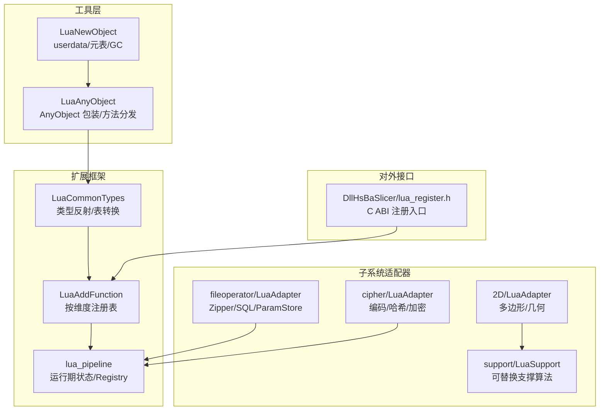

**图示来源**
- [LuaNewObject.hpp:15-115](file://utils/LuaNewObject.hpp#L15-L115)
- [LuaAnyObject.hpp:21-112](file://utils/LuaAnyObject.hpp#L21-L112)
- [LuaCommonTypes.hpp:20-45](file://LibHsBaSlicer/Extends/LuaCommonTypes.hpp#L20-L45)
- [LuaAddFunction.hpp:21-74](file://LibHsBaSlicer/Extends/LuaAddFunction.hpp#L21-L74)
- [lua_pipeline.cpp:50-73](file://LibHsBaSlicer/Extends/lua_pipeline.cpp#L50-L73)
- [LuaAdapter.hpp:16-81](file://2D/LuaAdapter.hpp#L16-L81)
- [LuaAdapter.hpp:21-72](file://fileoperator/LuaAdapter.hpp#L21-L72)
- [LuaAdapter.hpp:11-14](file://cipher/LuaAdapter.hpp#L11-L14)
- [lua_register.h:13-31](file://DllHsBaSlicer/lua_register.h#L13-L31)

**章节来源**
- [README.md:25-39](file://README.md#L25-L39)

## 核心组件
- Lua 对象与生命周期
  - NewLuaObject：在 Lua userdata 中构造 C++ 对象并设置元表。
  - LuaGC：在 GC 时调用析构函数。
  - UniqueLua/MakerUniqueLuaState：RAII 管理 lua_State 生命周期。
- AnyObject 包装与动态方法
  - LuaAnyObject：将任意值包装为 AnyObject，提供 invoke/foreach_field 等方法。
  - RegisterAnyObject：注册 metatable、全局 AnyObject 表及 new_/cast_ 方法。
- 公共类型反射与表转换
  - LuaCommonTypes：为 Eigen/Clipper2 等类型定义 TypeInfo，实现 new_/cast_ 与表编解码。
  - InstallCommonAnyObjectTypes：将公共类型安装到 2D/3D/File 注册池，保证幂等。
- 按维度的函数注册与事件回调
  - LuaAddFunction：维护 2D/3D/File 三类 LuaRegFunc 列表，以及按事件名的回调列表。
- 流水线运行期状态
  - lua_pipeline：使用 LUA_REGISTRYINDEX 保存 PipelineRunState、层数、输出路径等。
- 子系统适配器
  - 2D/LuaAdapter：多边形布尔运算、偏移、凸包、面积、图形构造、文本转多边形等。
  - fileoperator/LuaAdapter：Zipper/Bit7zZipper、SQLite/MySQL/PostgreSQL 适配器、ParamStore。
  - cipher/LuaAdapter：Base64/Hex 编解码。
  - support/LuaSupport：可替换支撑生成器，支持内联脚本或文件脚本。

**章节来源**
- [LuaNewObject.hpp:15-115](file://utils/LuaNewObject.hpp#L15-L115)
- [LuaAnyObject.hpp:21-112](file://utils/LuaAnyObject.hpp#L21-L112)
- [LuaAnyObject.cpp:11-178](file://utils/LuaAnyObject.cpp#L11-L178)
- [LuaCommonTypes.hpp:20-45](file://LibHsBaSlicer/Extends/LuaCommonTypes.hpp#L20-L45)
- [LuaCommonTypes.cpp:438-531](file://LibHsBaSlicer/Extends/LuaCommonTypes.cpp#L438-L531)
- [LuaAddFunction.hpp:21-74](file://LibHsBaSlicer/Extends/LuaAddFunction.hpp#L21-L74)
- [lua_pipeline.cpp:50-73](file://LibHsBaSlicer/Extends/lua_pipeline.cpp#L50-L73)
- [LuaAdapter.cpp:311-490](file://2D/LuaAdapter.cpp#L311-L490)
- [LuaAdapter.cpp:52-300](file://fileoperator/LuaAdapter.cpp#L52-L300)
- [LuaAdapter.cpp:92-96](file://cipher/LuaAdapter.cpp#L92-L96)
- [LuaSupport.cpp:19-177](file://support/LuaSupport.cpp#L19-L177)

## 架构总览
下图展示从外部 C ABI 注册到具体子系统适配器的完整链路，以及运行时脚本执行流程。

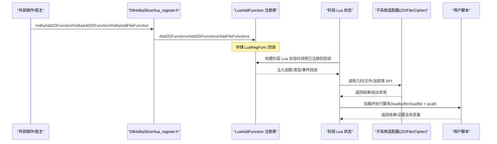

**图示来源**
- [lua_register.h:21-31](file://DllHsBaSlicer/lua_register.h#L21-L31)
- [LuaAddFunction.hpp:21-74](file://LibHsBaSlicer/Extends/LuaAddFunction.hpp#L21-L74)
- [LuaAdapter.cpp:487-490](file://2D/LuaAdapter.cpp#L487-L490)
- [LuaAdapter.cpp:92-96](file://cipher/LuaAdapter.cpp#L92-L96)
- [LuaSupport.cpp:130-177](file://support/LuaSupport.cpp#L130-L177)

## 详细组件分析

### Lua 对象与生命周期管理
- userdata 分配与元表绑定
  - NewLuaObject<T>(L, mt, args...) 在 userdata 中 placement new 构造 T，并设置元表。
  - NewLuaObject<T>(L, TName, args...) 通过编译时常量名查找元表。
- 垃圾回收
  - LuaGC<T>(L, mt) 在 __gc 钩子中调用 T 的析构函数。
- Lua 状态管理
  - MakeUniqueLuaState() 创建 RAII 管理的 lua_State；LuaStateDeleter 确保关闭。

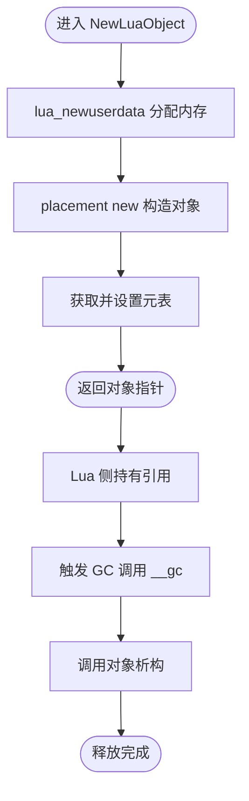

**图示来源**
- [LuaNewObject.hpp:25-53](file://utils/LuaNewObject.hpp#L25-L53)
- [LuaNewObject.hpp:63-87](file://utils/LuaNewObject.hpp#L63-L87)
- [LuaNewObject.hpp:92-115](file://utils/LuaNewObject.hpp#L92-L115)

**章节来源**
- [LuaNewObject.hpp:15-115](file://utils/LuaNewObject.hpp#L15-L115)

### AnyObject 包装与动态方法分发
- metatable 与方法
  - __index 指向自身，__gc 调用 LuaGC<Utils::AnyObject>。
  - 实例方法：invoke(f,args)、foreach_field(fn)。
- 全局 AnyObject 表
  - AnyObject.new / AnyObject.invoke / AnyObject.foreach_field。
  - 对每个注册的类型添加 new_<Type>/cast_<Type>。
- 参数收集与类型推断
  - 支持整数、布尔、浮点、字符串、AnyObject 子对象。
  - 返回值若含类型信息则包装为 AnyObject，否则返回 nil。

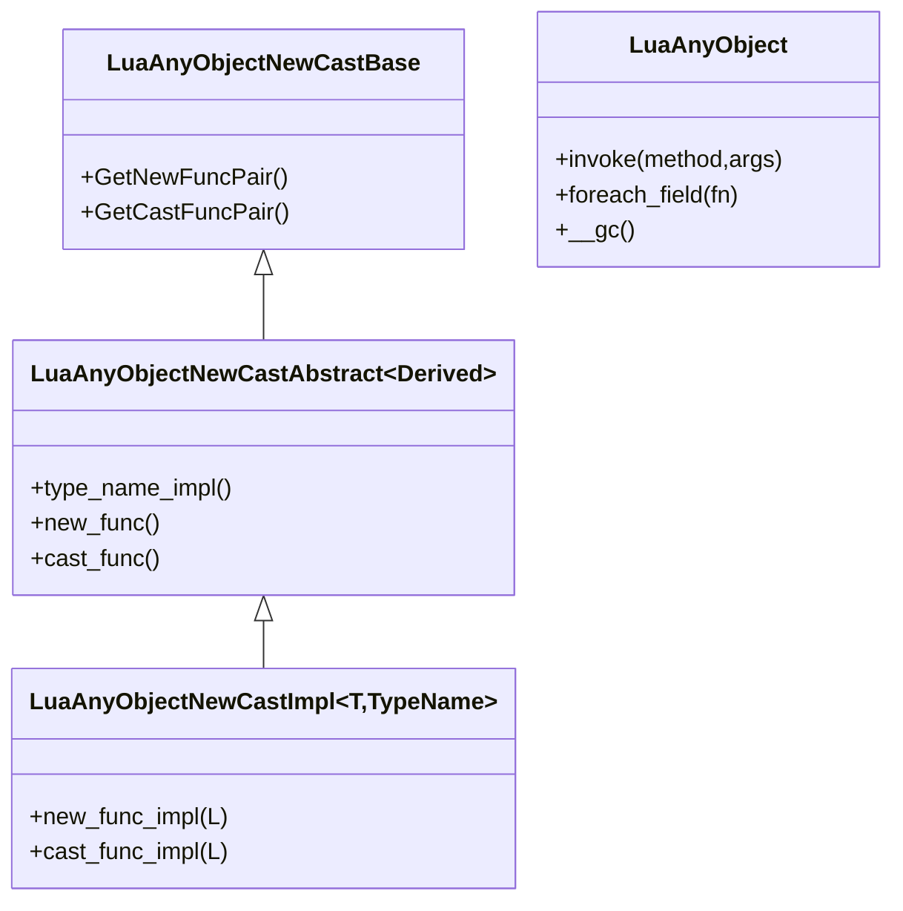

**图示来源**
- [LuaAnyObject.hpp:32-112](file://utils/LuaAnyObject.hpp#L32-L112)
- [LuaAnyObject.cpp:11-178](file://utils/LuaAnyObject.cpp#L11-L178)

**章节来源**
- [LuaAnyObject.hpp:21-112](file://utils/LuaAnyObject.hpp#L21-L112)
- [LuaAnyObject.cpp:11-178](file://utils/LuaAnyObject.cpp#L11-L178)

### 公共类型反射与表转换
- 反射宏
  - HSBA_DEFINE_REFLECTED_TYPEINFO：为连续布局向量/四元数注册字段 x/y/(z)/(w) 与 cast_<Name>。
  - HSBA_DEFINE_OPAQUE_TYPEINFO：为矩阵/多边形容器注册稳定名称与 cast_<Name>。
- 表编码约定
  - 固定向量/四元数：{x,y,(z),(w)} 或序列 {v1,v2,...}。
  - 矩阵：嵌套行序列 {{r1},{r2},...}。
  - Clipper 点：{x,y}。
  - 多边形/多边形集合：点序列/多边形序列。
- 注册与安装
  - GetCommonAnyObjectTypes：返回所有自定义类型的适配器。
  - RegisterCommonAnyObjectTypes：合并内置标量适配器并调用 RegisterAnyObject。
  - InstallCommonAnyObjectTypes：将公共类型安装到 2D/3D/File 注册池，幂等且线程安全。

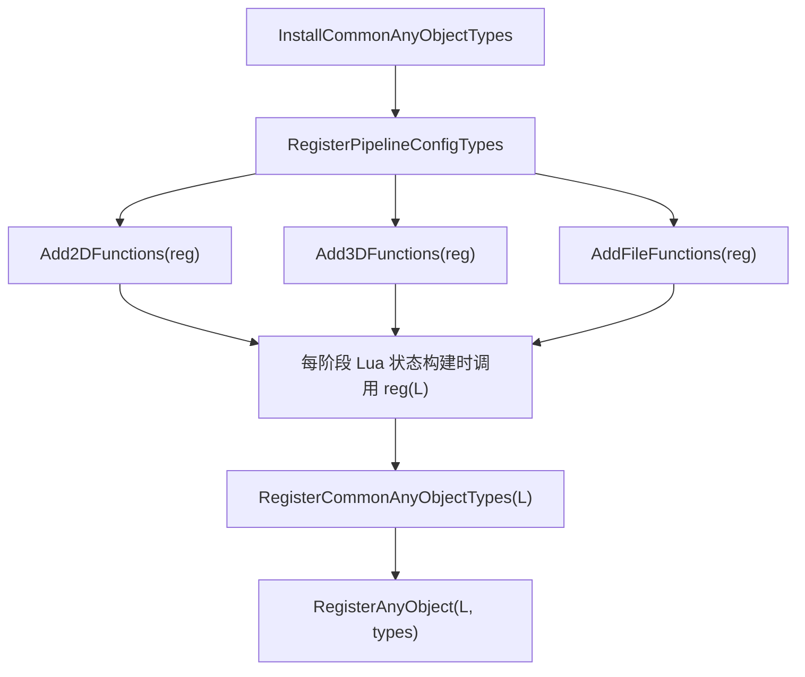

**图示来源**
- [LuaCommonTypes.hpp:84-108](file://LibHsBaSlicer/Extends/LuaCommonTypes.hpp#L84-L108)
- [LuaCommonTypes.cpp:438-531](file://LibHsBaSlicer/Extends/LuaCommonTypes.cpp#L438-L531)

**章节来源**
- [LuaCommonTypes.hpp:20-45](file://LibHsBaSlicer/Extends/LuaCommonTypes.hpp#L20-L45)
- [LuaCommonTypes.cpp:438-531](file://LibHsBaSlicer/Extends/LuaCommonTypes.cpp#L438-L531)

### 按维度函数注册与事件回调
- 三类注册表
  - Add2DFunctions/Add3DFunctions/AddFileFunctions：分别对应不同流水线阶段的可用函数集。
  - Get*Functions：获取已注册的 LuaRegFunc 列表。
- 事件回调
  - AddEventCallback(event_name, func)：按事件名注册回调。
  - GetEventCallbacks(event_name)：查询某事件的回调列表。
- 用途
  - 2D：几何/多边形操作。
  - 3D：切片/支撑相关。
  - File：压缩/数据库/参数存储。

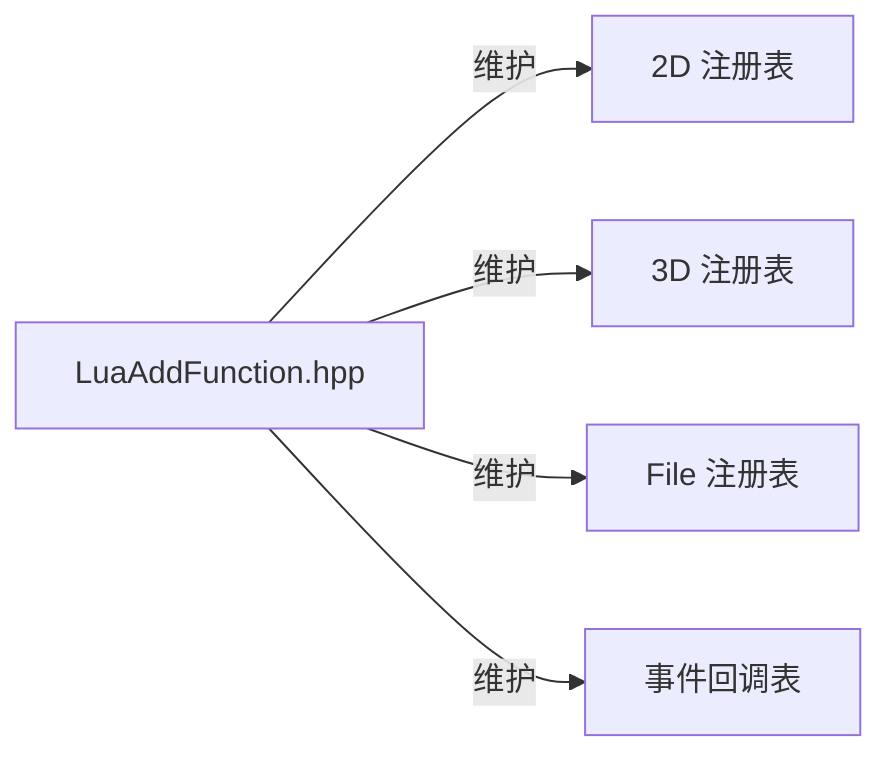

**图示来源**
- [LuaAddFunction.hpp:21-74](file://LibHsBaSlicer/Extends/LuaAddFunction.hpp#L21-L74)

**章节来源**
- [LuaAddFunction.hpp:21-74](file://LibHsBaSlicer/Extends/LuaAddFunction.hpp#L21-L74)

### 流水线运行期状态与 Registry
- 绝对 Registry 键
  - REG_CTX：lightuserdata 指向 PipelineRunState。
  - REG_LAYERS：脚本报告的总层数。
  - REG_OUTPATH：脚本报告的输出路径。
- 访问方式
  - GetState(L) 从 LUA_REGISTRYINDEX 读取当前运行态。

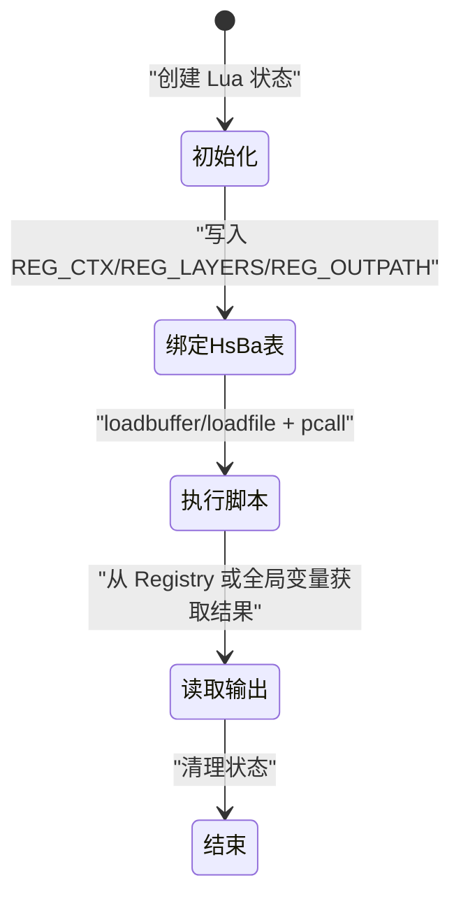

**图示来源**
- [lua_pipeline.cpp:50-73](file://LibHsBaSlicer/Extends/lua_pipeline.cpp#L50-L73)

**章节来源**
- [lua_pipeline.cpp:50-73](file://LibHsBaSlicer/Extends/lua_pipeline.cpp#L50-L73)

### 2D 几何与多边形适配器
- 功能
  - 布尔运算：union/intersection/difference/xor。
  - 偏移与凸包：offsetOperation、convexHullOperation、concaveHullOperation。
  - 几何构造：makeRectangle/makeCircle/makeEllipse/makeRegularPolygon。
  - 文本转多边形：textToPolygons。
  - 可选 dump 调试输出。
- 注册
  - RegisterLuaPolygonOperations 将 PolygonOperations 全局表注入 Lua。

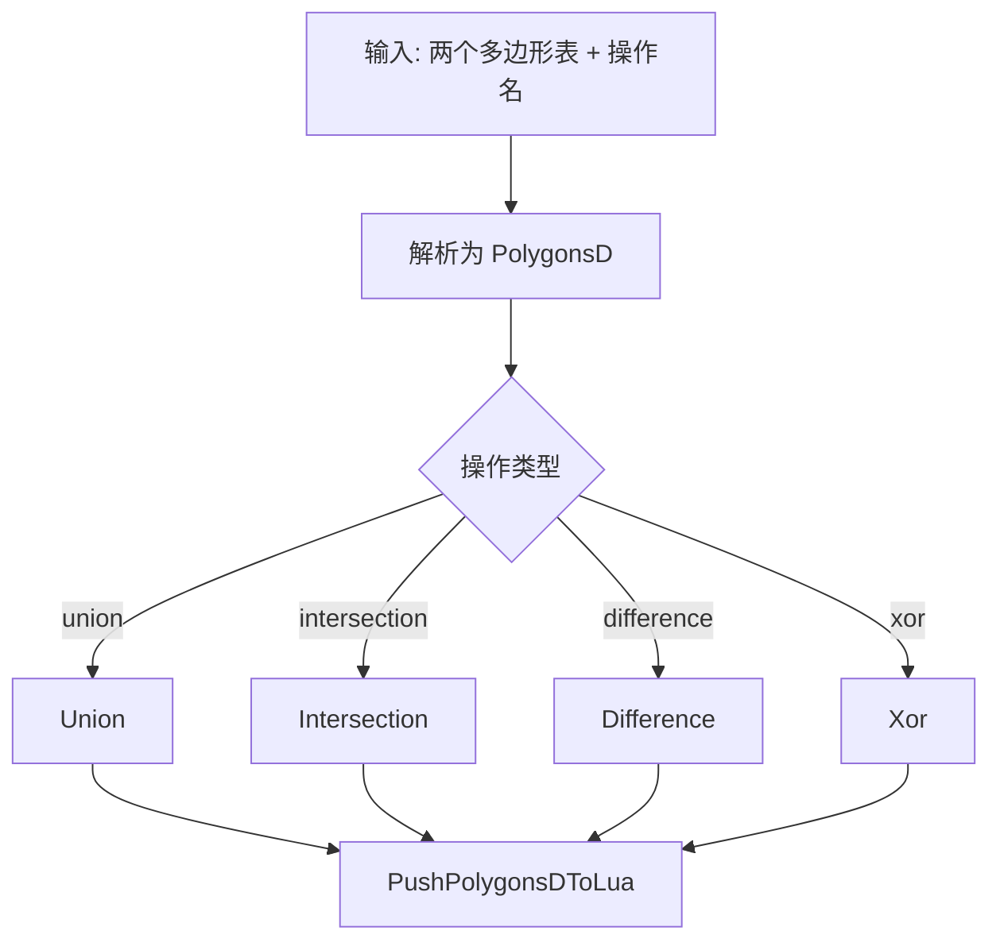

**图示来源**
- [LuaAdapter.cpp:22-54](file://2D/LuaAdapter.cpp#L22-L54)
- [LuaAdapter.cpp:487-490](file://2D/LuaAdapter.cpp#L487-L490)

**章节来源**
- [LuaAdapter.hpp:16-81](file://2D/LuaAdapter.hpp#L16-L81)
- [LuaAdapter.cpp:22-54](file://2D/LuaAdapter.cpp#L22-L54)
- [LuaAdapter.cpp:487-490](file://2D/LuaAdapter.cpp#L487-L490)

### 文件与数据库适配器（Zipper/SQL/ParamStore）
- Zipper/Bit7zZipper
  - 新增文件/字节流、保存归档；支持多种格式（Zip/SevenZip/XZ/BZIP2/GZIP/TAR/TarGz/TarXz）。
- SQL 适配器
  - SQLiteAdapter：Connect/Execute/Query/Insert/Update/Delete/CreateTable。
  - MySQLAdapter/PostgreSQLAdapter：条件编译启用。
- ParamStore
  - 暴露 PascalCase 方法 new/EnsureSchema/Save/Load/List/Update/Delete，首个参数为 SQL adapter userdata。

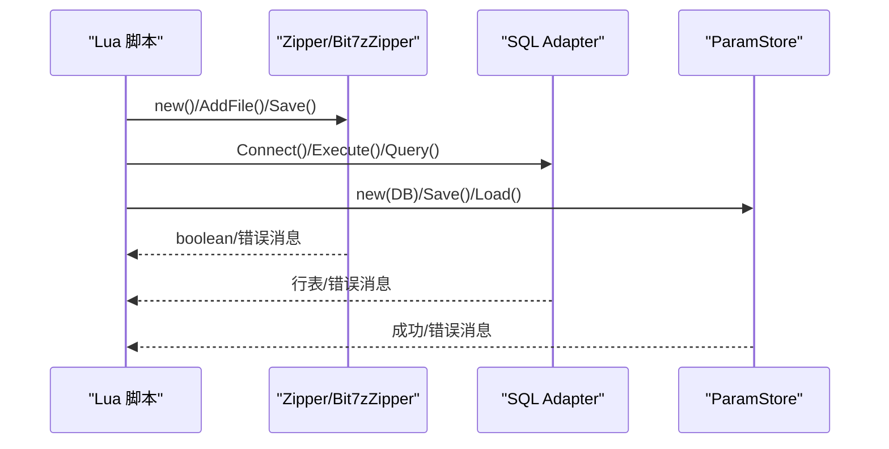

**图示来源**
- [LuaAdapter.cpp:52-139](file://fileoperator/LuaAdapter.cpp#L52-L139)
- [LuaAdapter.cpp:142-300](file://fileoperator/LuaAdapter.cpp#L142-L300)
- [LuaAdapter.cpp:304-565](file://fileoperator/LuaAdapter.cpp#L304-L565)
- [LuaAdapter.hpp:21-72](file://fileoperator/LuaAdapter.hpp#L21-L72)

**章节来源**
- [LuaAdapter.cpp:52-300](file://fileoperator/LuaAdapter.cpp#L52-L300)
- [LuaAdapter.cpp:304-565](file://fileoperator/LuaAdapter.cpp#L304-L565)
- [LuaAdapter.hpp:21-72](file://fileoperator/LuaAdapter.hpp#L21-L72)

### 加密与编码适配器（Cipher）
- 暴露 Cipher 全局表，包含 base64_encode/base64_decode/hex_encode/hex_decode。
- 所有函数均捕获 std::exception 并转为 Lua 错误。

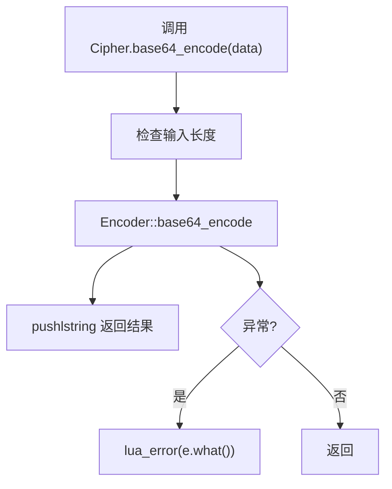

**图示来源**
- [LuaAdapter.cpp:13-28](file://cipher/LuaAdapter.cpp#L13-L28)
- [LuaAdapter.cpp:92-96](file://cipher/LuaAdapter.cpp#L92-L96)

**章节来源**
- [LuaAdapter.cpp:13-28](file://cipher/LuaAdapter.cpp#L13-L28)
- [LuaAdapter.cpp:92-96](file://cipher/LuaAdapter.cpp#L92-L96)

### 可替换支撑生成器（LuaSupport）
- 支持内联脚本或文件脚本，默认函数名为 generate_support。
- 环境注入
  - current_layer/prev_layer：当前/上一层多边形。
  - layer_height：层高。
  - config：支撑配置表。
  - 2D 几何辅助函数与 Support 模块。
- 执行流程
  - 创建 Lua 状态 -> 注入环境 -> 注册外部函数 -> 加载脚本 -> pcall -> 可选调用指定函数 -> 解析结果。

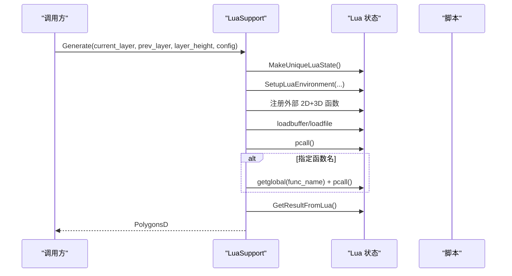

**图示来源**
- [LuaSupport.cpp:19-177](file://support/LuaSupport.cpp#L19-L177)
- [LuaSupport.hpp:21-64](file://support/LuaSupport.hpp#L21-L64)

**章节来源**
- [LuaSupport.hpp:21-64](file://support/LuaSupport.hpp#L21-L64)
- [LuaSupport.cpp:19-177](file://support/LuaSupport.cpp#L19-L177)

## 依赖关系分析
- 低耦合注册机制
  - DllHsBaSlicer 仅暴露 C ABI 注册函数，不直接依赖具体子系统。
  - 子系统通过 Add*Functions 向注册表追加 LuaRegFunc，解耦构建期与运行期。
- 类型反射与表转换
  - LuaCommonTypes 依赖 LuaAnyObject 与 base/any_object，统一类型元数据与转换。
- 脚本执行与状态隔离
  - lua_pipeline 使用 LUA_REGISTRYINDEX 保存运行态，避免跨阶段污染。
- 子系统适配器
  - 2D/fileoperator/cipher 各自独立，通过各自的 RegisterLua* 函数挂载到 Lua 全局。

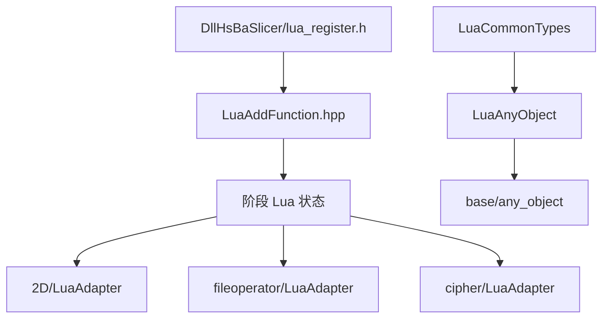

**图示来源**
- [lua_register.h:21-31](file://DllHsBaSlicer/lua_register.h#L21-L31)
- [LuaAddFunction.hpp:21-74](file://LibHsBaSlicer/Extends/LuaAddFunction.hpp#L21-L74)
- [LuaCommonTypes.hpp:20-45](file://LibHsBaSlicer/Extends/LuaCommonTypes.hpp#L20-L45)
- [LuaAnyObject.hpp:21-112](file://utils/LuaAnyObject.hpp#L21-L112)

**章节来源**
- [lua_register.h:21-31](file://DllHsBaSlicer/lua_register.h#L21-L31)
- [LuaAddFunction.hpp:21-74](file://LibHsBaSlicer/Extends/LuaAddFunction.hpp#L21-L74)
- [LuaCommonTypes.hpp:20-45](file://LibHsBaSlicer/Extends/LuaCommonTypes.hpp#L20-L45)
- [LuaAnyObject.hpp:21-112](file://utils/LuaAnyObject.hpp#L21-L112)

## 性能与内存管理
- 对象分配
  - NewLuaObject 使用 placement new，避免额外堆分配；LuaGC 在 GC 时精确析构。
- 表转换开销
  - 大量多边形/矩阵转换会产生临时表与拷贝；建议批量处理与复用中间结果。
- 幂等注册
  - InstallCommonAnyObjectTypes 使用 call_once 与 per-state 标记，避免重复注册带来的开销。
- 状态隔离
  - 每个脚本执行使用独立 Lua 状态（如 LuaSupport），降低锁竞争与状态污染风险。

[本节为通用性能讨论，无需源码引用]

## 沙箱安全与错误处理
- 错误传播
  - 所有 C++ 异常均被捕获并转换为 Lua 错误（lua_error），脚本侧可通过 pcall 捕获。
- 输入校验
  - 多数 C API 先进行类型与参数数量检查，失败即报错，防止非法调用。
- 沙箱限制
  - 未暴露危险的全局函数；脚本仅能访问显式注册的模块（PolygonOperations/Cipher/Support/ParamStore 等）。
- 资源释放
  - 所有 userdata 对象均实现 __gc，确保 C++ 资源正确释放。

**章节来源**
- [LuaAdapter.cpp:22-54](file://2D/LuaAdapter.cpp#L22-L54)
- [LuaAdapter.cpp:13-28](file://cipher/LuaAdapter.cpp#L13-L28)
- [LuaSupport.cpp:130-177](file://support/LuaSupport.cpp#L130-L177)
- [LuaNewObject.hpp:63-87](file://utils/LuaNewObject.hpp#L63-L87)

## 调试与监控
- 多边形调试输出
  - 当启用 HSBA_POLYGON_DUMP 时，提供 dumpPolygon/dumpPolygons 将多边形导出至文件。
- 日志与版本
  - 通过 HsBaSlicer 版本信息与日志模块记录关键运行信息。
- 脚本错误定位
  - LuaSupport 在 load/pcall 失败时携带原始 Lua 错误消息，便于快速定位。

**章节来源**
- [LuaAdapter.cpp:275-309](file://2D/LuaAdapter.cpp#L275-L309)
- [LuaSupport.cpp:130-177](file://support/LuaSupport.cpp#L130-L177)
- [README.md:100-124](file://README.md#L100-L124)

## 扩展开发指南

### 如何注册新的 Lua 函数
- 步骤
  1. 编写 C/C++ 函数，签名符合 int (*)(lua_State*)。
  2. 将该函数放入 luaL_Reg 数组。
  3. 通过 RegisterLua* 函数将模块挂到 Lua 全局（例如 RegisterLuaPolygonOperations）。
  4. 如需按维度注册，使用 Add2DFunctions/Add3DFunctions/AddFileFunctions 注册一个 LuaRegFunc。
- 示例路径
  - 2D 几何：[LuaAdapter.cpp:311-490](file://2D/LuaAdapter.cpp#L311-L490)
  - 文件/数据库：[LuaAdapter.cpp:52-300](file://fileoperator/LuaAdapter.cpp#L52-L300)
  - 加密：[LuaAdapter.cpp:92-96](file://cipher/LuaAdapter.cpp#L92-L96)

**章节来源**
- [LuaAdapter.cpp:311-490](file://2D/LuaAdapter.cpp#L311-L490)
- [LuaAdapter.cpp:52-300](file://fileoperator/LuaAdapter.cpp#L52-L300)
- [LuaAdapter.cpp:92-96](file://cipher/LuaAdapter.cpp#L92-L96)
- [LuaAddFunction.hpp:21-74](file://LibHsBaSlicer/Extends/LuaAddFunction.hpp#L21-L74)

### 如何暴露 C++ 对象
- 使用 NewLuaObject<T>(L, TypeName, args...) 构造 userdata 并绑定元表。
- 在元表中定义方法（如 AddFile/Save/Connect/Query 等）。
- 在 __gc 中调用 LuaGC<T>(L, TypeName) 释放资源。
- 示例路径
  - Zipper/Bit7zZipper：[LuaAdapter.cpp:52-139](file://fileoperator/LuaAdapter.cpp#L52-L139), [LuaAdapter.cpp:142-300](file://fileoperator/LuaAdapter.cpp#L142-L300)
  - SQL 适配器：[LuaAdapter.cpp:304-565](file://fileoperator/LuaAdapter.cpp#L304-L565)

**章节来源**
- [LuaAdapter.cpp:52-139](file://fileoperator/LuaAdapter.cpp#L52-L139)
- [LuaAdapter.cpp:142-300](file://fileoperator/LuaAdapter.cpp#L142-L300)
- [LuaAdapter.cpp:304-565](file://fileoperator/LuaAdapter.cpp#L304-L565)
- [LuaNewObject.hpp:25-53](file://utils/LuaNewObject.hpp#L25-L53)

### 如何处理回调与事件
- 使用 AddEventCallback(event_name, func) 注册事件回调。
- 在需要触发事件的地方，通过 GetEventCallbacks(event_name) 遍历并调用回调。
- 示例路径
  - 事件注册接口：[LuaAddFunction.hpp:60-74](file://LibHsBaSlicer/Extends/LuaAddFunction.hpp#L60-L74)

**章节来源**
- [LuaAddFunction.hpp:60-74](file://LibHsBaSlicer/Extends/LuaAddFunction.hpp#L60-L74)

### 自定义数据结构绑定
- 定义 TypeInfo
  - 使用 HSBA_DEFINE_REFLECTED_TYPEINFO 或 HSBA_DEFINE_OPAQUE_TYPEINFO 注册类型名与字段。
- 实现表转换
  - 在 LuaCommonTypes.cpp 中添加 push_* 与 read_* 函数，并通过 TableAdapter 注册 new_/cast_。
- 安装到注册池
  - 调用 InstallCommonAnyObjectTypes 将公共类型安装到 2D/3D/File 注册池。
- 示例路径
  - 类型反射宏：[LuaCommonTypes.hpp:84-108](file://LibHsBaSlicer/Extends/LuaCommonTypes.hpp#L84-L108)
  - 适配器与安装：[LuaCommonTypes.cpp:339-531](file://LibHsBaSlicer/Extends/LuaCommonTypes.cpp#L339-L531)

**章节来源**
- [LuaCommonTypes.hpp:84-108](file://LibHsBaSlicer/Extends/LuaCommonTypes.hpp#L84-L108)
- [LuaCommonTypes.cpp:339-531](file://LibHsBaSlicer/Extends/LuaCommonTypes.cpp#L339-L531)

### 复杂对象交互
- 通过 AnyObject.invoke 调用动态方法，传递基本类型与 AnyObject 子对象。
- 使用 foreach_field 遍历对象的字段，适合序列化/调试。
- 示例路径
  - 动态方法与字段遍历：[LuaAnyObject.cpp:17-127](file://utils/LuaAnyObject.cpp#L17-L127)

**章节来源**
- [LuaAnyObject.cpp:17-127](file://utils/LuaAnyObject.cpp#L17-L127)

### 异步操作处理
- 当前实现以同步 pcall 为主；对于耗时 IO，建议在 C++ 侧使用线程池/协程封装，再在 Lua 侧通过回调或事件通知结果。
- 可结合 AddEventCallback 在后台任务完成后触发 Lua 回调。
- 示例路径
  - 事件回调：[LuaAddFunction.hpp:60-74](file://LibHsBaSlicer/Extends/LuaAddFunction.hpp#L60-L74)

[本节为概念性指导，无需源码引用]

## 结论
HsBaSlicer 的 Lua 扩展机制以轻量、模块化与高内聚为核心设计目标：通过 userdata 与元表管理对象生命周期，借助 AnyObject 实现动态方法分发，利用按维度的注册表与事件回调实现松耦合扩展，同时提供完善的错误处理与幂等安装机制。该体系既满足高性能切片流水线的稳定性需求，也为高级开发者提供了灵活的扩展空间。

[本节为总结性内容，无需源码引用]

## 附录：API 参考速查
- 生命周期与对象
  - NewLuaObject<T>(L, mt, args...)
  - NewLuaObject<T>(L, TName, args...)
  - LuaGC<T>(L, mt)
  - MakeUniqueLuaState()
- AnyObject
  - AnyObject.new / invoke / foreach_field
  - AnyObject.new_<Type> / cast_<Type>
- 公共类型
  - RegisterCommonAnyObjectTypes(L)
  - InstallCommonAnyObjectTypes()
- 注册与事件
  - Add2DFunctions/Add3DFunctions/AddFileFunctions
  - AddEventCallback(event_name, func)
- 子系统
  - RegisterLuaPolygonOperations(L)
  - RegisterLuaZipper/RegisterLuaBit7zZipper/RegisterLuaSQLiteAdapter/RegisterLuaParamStore
  - RegisterLuaCipher(L)
  - LuaSupport(script/script_file, funcName)

**章节来源**
- [LuaNewObject.hpp:25-115](file://utils/LuaNewObject.hpp#L25-L115)
- [LuaAnyObject.cpp:130-178](file://utils/LuaAnyObject.cpp#L130-L178)
- [LuaCommonTypes.cpp:469-531](file://LibHsBaSlicer/Extends/LuaCommonTypes.cpp#L469-L531)
- [LuaAddFunction.hpp:21-74](file://LibHsBaSlicer/Extends/LuaAddFunction.hpp#L21-L74)
- [LuaAdapter.cpp:487-490](file://2D/LuaAdapter.cpp#L487-L490)
- [LuaAdapter.cpp:52-300](file://fileoperator/LuaAdapter.cpp#L52-L300)
- [LuaAdapter.cpp:92-96](file://cipher/LuaAdapter.cpp#L92-L96)
- [LuaSupport.hpp:43-64](file://support/LuaSupport.hpp#L43-L64)