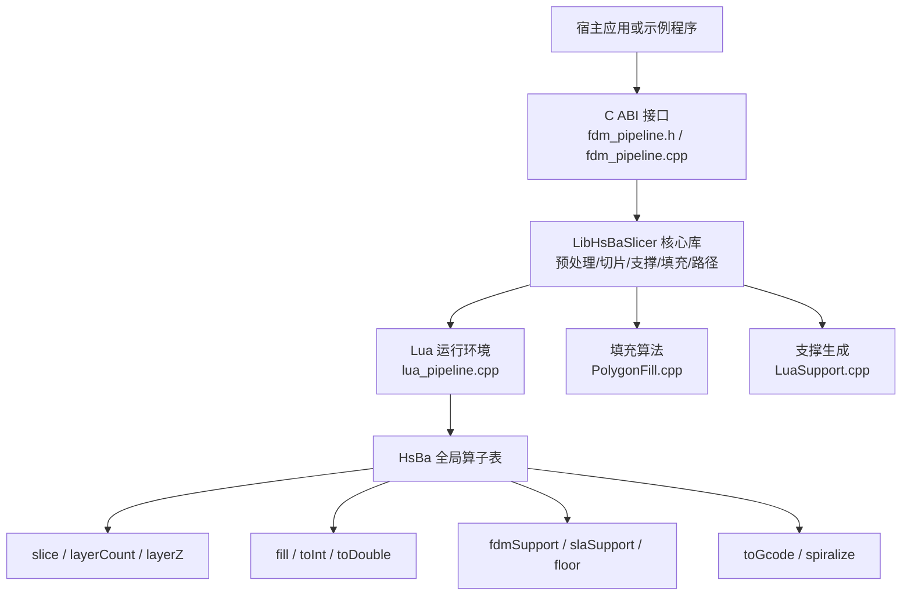
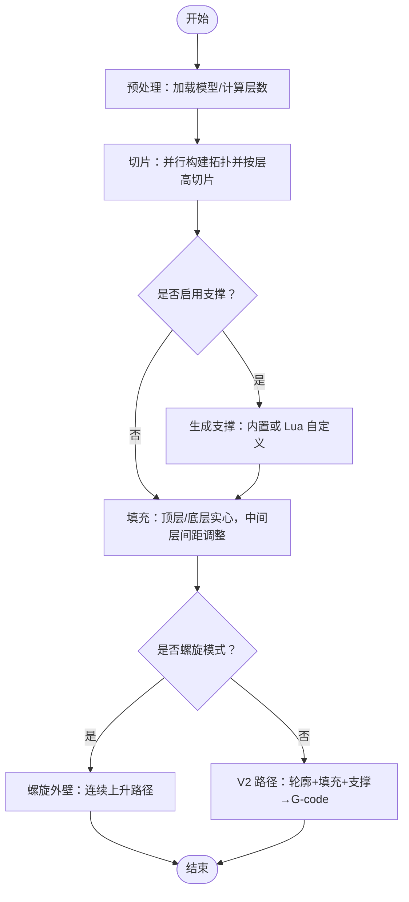
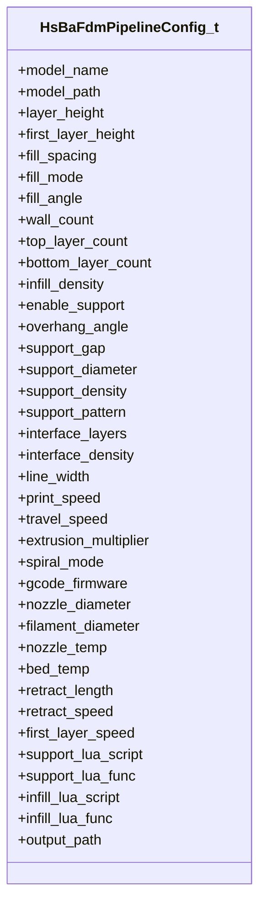
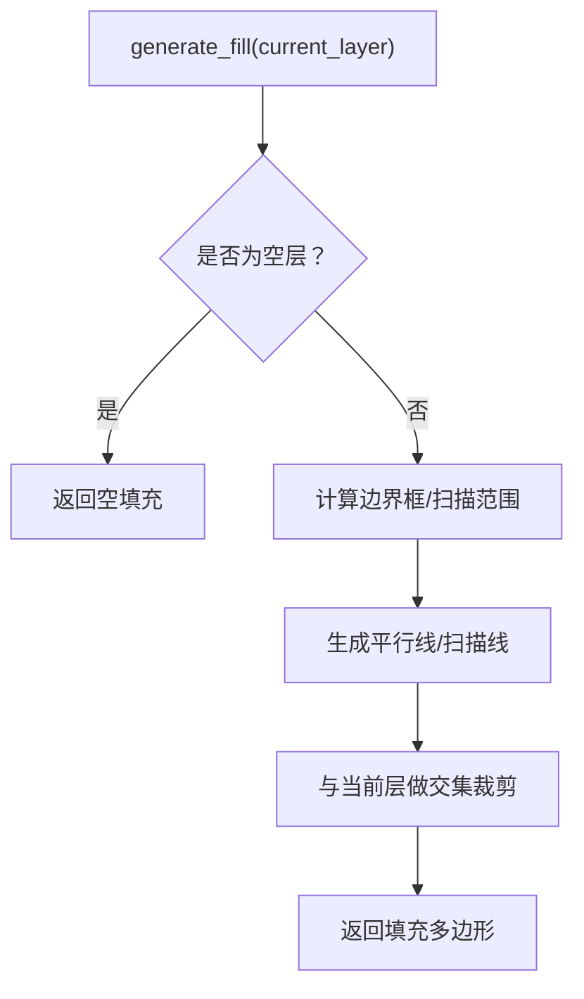
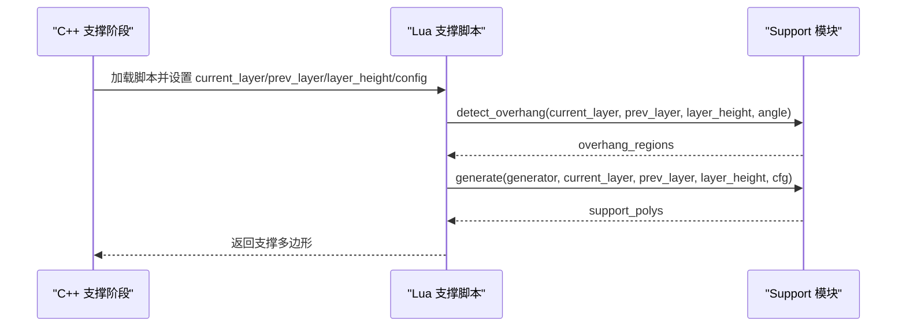
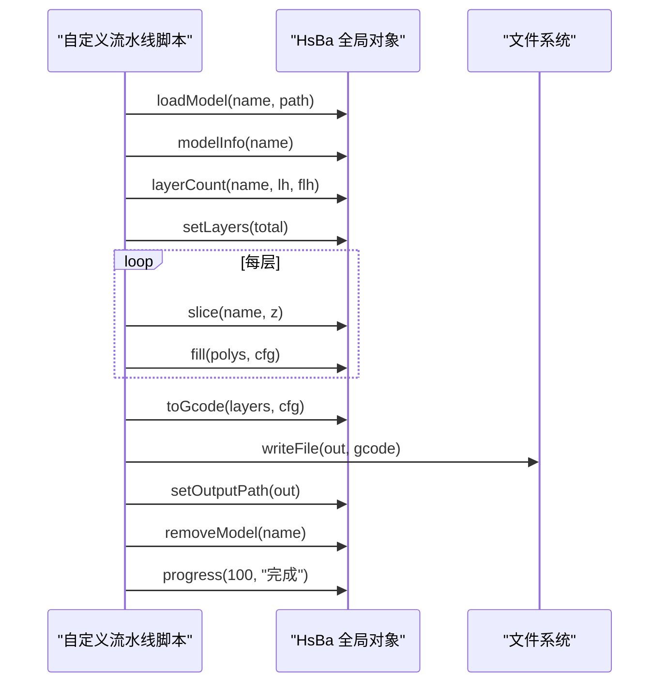
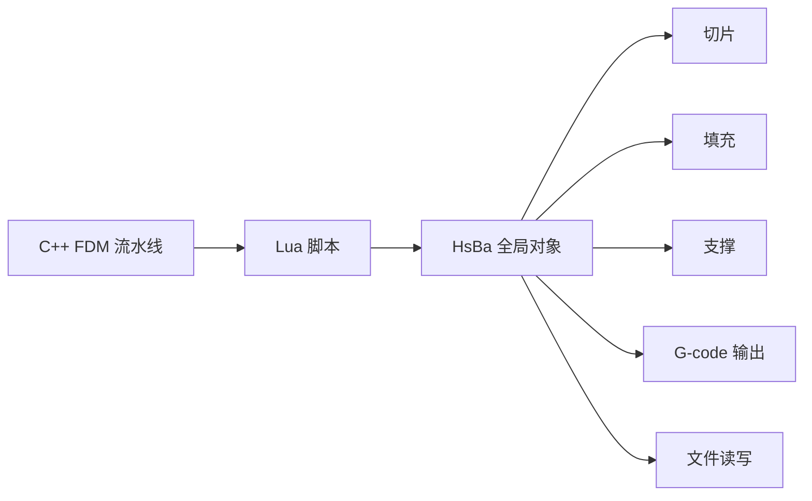

# FDM 流水线脚本开发

<cite>
**本文引用的文件**   
- [fdm_pipeline.h](file://DllHsBaSlicer/fdm_pipeline.h)
- [fdm_pipeline.cpp](file://DllHsBaSlicer/fdm_pipeline.cpp)
- [pipeline_types.h](file://pipelinetypes/pipeline_types.h)
- [lua_pipeline.cpp](file://LibHsBaSlicer/Extends/lua_pipeline.cpp)
- [LuaSupport.cpp](file://support/LuaSupport.cpp)
- [PolygonFill.cpp](file://2D/PolygonFill.cpp)
- [my_support.lua](file://samples/FDM/scripts/my_support.lua)
- [my_infill.lua](file://samples/FDM/scripts/my_infill.lua)
- [main.cpp](file://samples/FDM/main.cpp)
- [lua_pipeline_api.md](file://docs/zh/lua_pipeline_api.md)
</cite>

## 目录
1. [引言](#引言)
2. [项目结构](#项目结构)
3. [核心概念](#核心概念)
4. [FDM 流水线执行流程](#fdm-流水线执行流程)
5. [HsBa 全局对象 API 参考](#hsba-全局对象-api-参考)
6. [FDM 工艺参数配置](#fdm-工艺参数配置)
7. [自定义填充与支撑脚本](#自定义填充与支撑脚本)
8. [完整脚本示例与最佳实践](#完整脚本示例与最佳实践)
9. [依赖关系分析](#依赖关系分析)
10. [性能与并行特性](#性能与并行特性)
11. [常见问题与故障排除](#常见问题与故障排除)
12. [结论](#结论)

## 引言
本指南面向需要基于 HsBaSlicer 编写 FDM（熔融沉积成型）流水线 Lua 脚本的开发者。文档从源码出发，说明 C++ 侧 FDM 流水线的完整执行路径，以及 Lua 侧通过 `HsBa` 全局对象调用的切片、填充、支撑、G-code 输出等能力；同时给出自定义填充算法、支撑生成器、路径优化器的实现思路，并覆盖参数配置、进度回调、错误处理等工程化要点。

## 项目结构
围绕 FDM 流水线脚本开发，最相关的代码分布在以下位置：
- DllHsBaSlicer：对外 C ABI 与 FDM 流水线实现。
- LibHsBaSlicer：Lua 驱动环境、模型/切片/填充/支撑/G-code 路径等核心库。
- support：Lua 支撑阶段胶水层。
- 2D：多边形填充算法与 PolygonOperations 绑定。
- samples/FDM：C++ 调用示例与 FDM 专用 Lua 脚本样例。
- docs/zh/lua_pipeline_api.md：Lua 流水线 API 中文文档。

**图表来源**
- [fdm_pipeline.h:17-61](file://DllHsBaSlicer/fdm_pipeline.h#L17-L61)
- [fdm_pipeline.cpp:219-447](file://DllHsBaSlicer/fdm_pipeline.cpp#L219-L447)
- [lua_pipeline.cpp:224-690](file://LibHsBaSlicer/Extends/lua_pipeline.cpp#L224-L690)
- [PolygonFill.cpp:488-502](file://2D/PolygonFill.cpp#L488-L502)
- [LuaSupport.cpp:113-178](file://support/LuaSupport.cpp#L113-L178)

**章节来源**
- [fdm_pipeline.h:1-68](file://DllHsBaSlicer/fdm_pipeline.h#L1-L68)
- [fdm_pipeline.cpp:1-497](file://DllHsBaSlicer/fdm_pipeline.cpp#L1-L497)
- [lua_pipeline_api.md:1-332](file://docs/zh/lua_pipeline_api.md#L1-L332)

## 核心概念
- **两种 Lua 运行环境**：
  - 自定义流水线：由脚本完全控制加载、切片、支撑、填充、路径、写文件的顺序和内容，入口函数默认是 `run_pipeline`。
  - 内置流水线阶段替换：仅替换某个阶段（如支撑、填充），阶段顺序仍由 C++ 固定。
- **通用几何数据类型**：
  - 点：`{ x, y }`。
  - 多边形：有序点数组。
  - 多边形集合：多边形数组，孔洞作为独立多边形存在。
  - 层列表：逐层的多边形集合数组。
- **坐标精度**：布尔/填充运算内部按整数精度处理；`HsBa.toInt` / `HsBa.toDouble` 用于整型与浮点多边形之间转换。

**章节来源**
- [lua_pipeline_api.md:19-45](file://docs/zh/lua_pipeline_api.md#L19-L45)
- [lua_pipeline.cpp:185-222](file://LibHsBaSlicer/Extends/lua_pipeline.cpp#L185-L222)

## FDM 流水线执行流程
FDM 流水线在 C++ 侧采用协程调度，典型阶段为：预处理 → 切片 → 支撑 → 填充 → 路径生成。

**图表来源**
- [fdm_pipeline.cpp:219-447](file://DllHsBaSlicer/fdm_pipeline.cpp#L219-L447)

### 阶段细节
- **预处理**：
  - 使用 LibHsBaSlicer 模型池加载模型，获取包围盒和体积，计算总层数。
  - 失败时返回错误信息。
- **切片**：
  - 先构建切片拓扑，再并行对每层切片，得到每层外轮廓。
- **支撑**：
  - 若开启且非螺旋模式，则优先走 Lua 自定义支撑脚本；否则使用内置 FDM 支撑生成器。
- **填充**：
  - 顶层/底层按实心层处理；中间层根据 `infill_density` 调整间距。
  - 若配置了 Lua 自定义填充脚本，则串行调用该脚本；否则并行调用 C++ 填充算法。
- **路径生成**：
  - 螺旋模式：将各层外轮廓合并为一条连续上升的螺旋路径。
  - 常规模式：构造 `LayerPathData`，调用 V2 路径生成器输出 G-code。

**章节来源**
- [fdm_pipeline.cpp:231-447](file://DllHsBaSlicer/fdm_pipeline.cpp#L231-L447)

## HsBa 全局对象 API 参考
`HsBa` 是自定义流水线中唯一可用的全局算子表，提供控制、文件 IO、模型管理、切片、坐标转换、填充、支撑、地板、路径与 G-code 输出、打包导出等能力。

### 控制与文件 IO
- `HsBa.progress(percent[, stage])`：上报进度百分比与阶段名。
- `HsBa.setLayers(n)`：上报总层数。
- `HsBa.setOutputPath(path)`：上报实际输出路径。
- `HsBa.readFile(path)`：读取文件内容，失败返回 `nil`。
- `HsBa.writeFile(path, content)`：二进制覆盖写入，失败抛出 Lua 错误。

**章节来源**
- [lua_pipeline.cpp:228-288](file://LibHsBaSlicer/Extends/lua_pipeline.cpp#L228-L288)
- [lua_pipeline_api.md:67-76](file://docs/zh/lua_pipeline_api.md#L67-L76)

### 模型管理
- `HsBa.loadModel(name, path)`：加载模型到模型池，同名复用。
- `HsBa.modelInfo(name)`：返回包围盒最小/最大、体积等信息。
- `HsBa.translateModel(name, {x,y,z})`：平移模型。
- `HsBa.rotateModel(name, {x,y,z,w})`：四元数旋转。
- `HsBa.scaleModel(name, s | {x,y,z})`：标量或逐轴缩放。
- `HsBa.removeModel(name)`：移除模型。
- `HsBa.modelNames()`：列出模型池中所有模型名。

**章节来源**
- [lua_pipeline.cpp:290-397](file://LibHsBaSlicer/Extends/lua_pipeline.cpp#L290-L397)
- [lua_pipeline_api.md:77-88](file://docs/zh/lua_pipeline_api.md#L77-L88)

### 切片
- `HsBa.layerCount(name, layerHeight, firstLayerHeight)`：依据模型高度与层高计算总层数。
- `HsBa.layerZ(index0based, layerHeight, firstLayerHeight)`：第 `index` 层的 Z 高度。
- `HsBa.slice(name, z)`：安全切片，返回闭合轮廓（浮点多边形）。
- `HsBa.sliceUnsafe(name, z)`：归一化非安全切片，可能丢弃开口轮廓。

**章节来源**
- [lua_pipeline.cpp:399-461](file://LibHsBaSlicer/Extends/lua_pipeline.cpp#L399-L461)
- [lua_pipeline_api.md:89-97](file://docs/zh/lua_pipeline_api.md#L89-L97)

### 坐标转换与填充
- `HsBa.toInt(polygons)`：浮点多边形转整型。
- `HsBa.toDouble(intPolygons)`：整型转浮点。
- `HsBa.fill(polygons[, cfg])`：填充，cfg 支持 `spacing`、`mode`、`angle`、`borderCount`；`borderCount>0` 时生成壁厚+填充。

**章节来源**
- [lua_pipeline.cpp:463-508](file://LibHsBaSlicer/Extends/lua_pipeline.cpp#L463-L508)
- [lua_pipeline_api.md:98-105](file://docs/zh/lua_pipeline_api.md#L98-L105)

### 支撑与地板
- `HsBa.fdmSupport(layers, cfg)`：逐层 FDM 支撑，cfg 含悬垂角度、层高、间隙、直径、密度、模式等。
- `HsBa.slaSupport(layers, cfg)`：SLA 支撑。
- `HsBa.floor(bottomPolygons, cfg)`：SLA 底部地板/筏。

**章节来源**
- [lua_pipeline.cpp:510-556](file://LibHsBaSlicer/Extends/lua_pipeline.cpp#L510-L556)
- [lua_pipeline_api.md:106-117](file://docs/zh/lua_pipeline_api.md#L106-L117)

### 路径与 G-code
- `HsBa.spiralize(sections[, cfg])`：将逐层闭合轮廓化为单一连续 3D 螺旋路径，适用于 FDM/WAAM/3DP 连续挤出。
- `HsBa.toGcode(layers, cfg)`：生成 G-code，layers 每元素包含 outlines、fills、supports、zHeight；cfg 包含层高、线宽、打印速度、回抽、固件类型等。

**章节来源**
- [lua_pipeline.cpp:558-690](file://LibHsBaSlicer/Extends/lua_pipeline.cpp#L558-L690)
- [lua_pipeline_api.md:118-124](file://docs/zh/lua_pipeline_api.md#L118-L124)

### 打包与导出
- `HsBa.saveSlsPackage(tbl)`：打包 SLS 导出。
- `HsBa.saveWaamPackage(tbl)`：打包 WAAM 机器人程序。
- `HsBa.saveSlaPackage(tbl)`：打包 SLA 图像。
- `HsBa.renderImage(polygons, width, height, path)`：渲染多边形为图像文件。

**章节来源**
- [lua_pipeline.cpp:693-800](file://LibHsBaSlicer/Extends/lua_pipeline.cpp#L693-L800)
- [lua_pipeline_api.md:125-133](file://docs/zh/lua_pipeline_api.md#L125-L133)

## FDM 工艺参数配置
FDM 流水线通过 C 结构体 `HsBaFdmPipelineConfig_t` 暴露全部工艺参数，包括模型、切片、填充、支撑、路径、G-code 输出、Lua 自定义与输出路径。

**图表来源**
- [pipeline_types.h:53-113](file://pipelinetypes/pipeline_types.h#L53-L113)

### 关键参数说明
- **层高与首层高**：`layer_height`、`first_layer_height`。
- **填充**：`fill_spacing`、`fill_mode`、`fill_angle`、`wall_count`、`top_layer_count`、`bottom_layer_count`、`infill_density`。
- **支撑**：`enable_support`、`overhang_angle`、`support_gap`、`support_diameter`、`support_density`、`support_pattern`、`interface_layers`、`interface_density`。
- **路径与挤出**：`line_width`、`print_speed`、`travel_speed`、`extrusion_multiplier`、`spiral_mode`。
- **G-code 输出**：`gcode_firmware`、`nozzle_diameter`、`filament_diameter`、`nozzle_temp`、`bed_temp`、`retract_length`、`retract_speed`、`first_layer_speed`。
- **Lua 自定义**：`support_lua_script`、`support_lua_func`、`infill_lua_script`、`infill_lua_func`。
- **输出路径**：`output_path`。

**章节来源**
- [pipeline_types.h:53-113](file://pipelinetypes/pipeline_types.h#L53-L113)
- [fdm_pipeline.cpp:142-197](file://DllHsBaSlicer/fdm_pipeline.cpp#L142-L197)

## 自定义填充与支撑脚本
### 自定义填充脚本
- 约定入口函数：`generate_fill(current_layer)`，当前层多边形以参数传入（已扣除壁厚区域），返回填充多边形表。
- 该阶段不注入任何全局变量（无层号/配置），请使用脚本内默认值。
- 可用库：`PolygonOperations`、`PolygonFill`、`PathOptimize`。

**图表来源**
- [my_infill.lua:20-88](file://samples/FDM/scripts/my_infill.lua#L20-L88)

**章节来源**
- [lua_pipeline_api.md:234-239](file://docs/zh/lua_pipeline_api.md#L234-L239)
- [my_infill.lua:1-89](file://samples/FDM/scripts/my_infill.lua#L1-L89)

### 自定义支撑脚本
- 约定入口函数：`generate_support()`，返回支撑截面多边形表（格式同 `current_layer`）。
- 注入全局变量：`current_layer`、`prev_layer`、`layer_height`、`config`。
- 可用库：`PolygonOperations`、`Support`。

**图表来源**
- [LuaSupport.cpp:67-90](file://support/LuaSupport.cpp#L67-L90)
- [LuaSupport.cpp:113-178](file://support/LuaSupport.cpp#L113-L178)
- [my_support.lua:32-82](file://samples/FDM/scripts/my_support.lua#L32-L82)

**章节来源**
- [lua_pipeline_api.md:219-233](file://docs/zh/lua_pipeline_api.md#L219-L233)
- [LuaSupport.cpp:1-180](file://support/LuaSupport.cpp#L1-L180)
- [my_support.lua:1-83](file://samples/FDM/scripts/my_support.lua#L1-L83)

## 完整脚本示例与最佳实践
### 最小可运行的自定义流水线脚本
一个最小可运行的自定义流水线脚本应完成：
- 加载模型。
- 计算层数并上报。
- 逐层切片。
- 填充。
- 构造路径层数据。
- 生成 G-code。
- 写出文件并上报输出路径。
- 清理模型并上报完成进度。

**图表来源**
- [lua_pipeline_api.md:283-332](file://docs/zh/lua_pipeline_api.md#L283-L332)
- [lua_pipeline.cpp:228-690](file://LibHsBaSlicer/Extends/lua_pipeline.cpp#L228-L690)

### 最佳实践
- **参数配置**：
  - 使用 `HsBaCreateDefaultConfig()` 初始化后按需修改字段。
  - 合理设置层高、线宽、打印速度、挤出倍率、喷嘴直径、耗材直径、温度等。
- **进度回调**：
  - 在 C++ 侧注册 `OnProgress`，在 Lua 侧通过 `HsBa.progress` 上报阶段名称。
- **错误处理**：
  - 检查 `result.success`，读取 `error_message`。
  - 在 Lua 侧捕获 `writeFile` 等可能抛错的函数。
- **资源释放**：
  - C++ 侧必须调用 `HsBaFreePipelineResult`。
  - Lua 侧在完成后调用 `removeModel`。

**章节来源**
- [main.cpp:50-96](file://samples/FDM/main.cpp#L50-L96)
- [main.cpp:98-165](file://samples/FDM/main.cpp#L98-L165)
- [main.cpp:167-220](file://samples/FDM/main.cpp#L167-L220)
- [main.cpp:222-269](file://samples/FDM/main.cpp#L222-L269)
- [main.cpp:271-318](file://samples/FDM/main.cpp#L271-L318)

## 依赖关系分析
FDM 流水线脚本开发与 C++ 流水线之间存在清晰的依赖关系：
- C++ 流水线负责整体调度与并行优化。
- Lua 脚本通过 `HsBa` 调用切片、填充、支撑、路径与文件操作。
- 支撑与填充可通过 Lua 脚本替换，但阶段顺序仍由 C++ 控制。

**图表来源**
- [fdm_pipeline.cpp:219-447](file://DllHsBaSlicer/fdm_pipeline.cpp#L219-L447)
- [lua_pipeline.cpp:224-690](file://LibHsBaSlicer/Extends/lua_pipeline.cpp#L224-L690)

**章节来源**
- [fdm_pipeline.cpp:1-497](file://DllHsBaSlicer/fdm_pipeline.cpp#L1-L497)
- [lua_pipeline.cpp:1-800](file://LibHsBaSlicer/Extends/lua_pipeline.cpp#L1-L800)

## 性能与并行特性
- **切片并行**：构建切片拓扑一次，然后并行对每层切片。
- **填充并行**：C++ 填充算法可并行执行；Lua 自定义填充因解释器状态不可跨线程共享，改为串行。
- **螺旋模式优化**：跳过填充与支撑，直接生成连续螺旋路径，减少路径开销。
- **进度回调**：每个阶段均上报进度，便于 UI 更新与用户反馈。

**章节来源**
- [fdm_pipeline.cpp:259-383](file://DllHsBaSlicer/fdm_pipeline.cpp#L259-L383)
- [fdm_pipeline.cpp:385-447](file://DllHsBaSlicer/fdm_pipeline.cpp#L385-L447)

## 常见问题与故障排除
- **模型加载失败**：
  - 检查 `model_name` 与 `model_path` 是否正确。
  - 确认模型文件格式受支持。
- **切片为空或层数为零**：
  - 检查层高与首层高设置是否合理。
  - 确认模型包围盒高度大于零。
- **支撑生成异常**：
  - 检查 `overhang_angle`、`support_gap`、`support_diameter`、`support_density`、`support_pattern`。
  - 若使用 Lua 自定义支撑，确保 `generate_support` 返回正确格式。
- **填充结果异常**：
  - 检查 `fill_spacing`、`fill_mode`、`fill_angle`、`borderCount`。
  - 若使用 Lua 自定义填充，确保 `generate_fill` 返回填充多边形表。
- **G-code 生成失败**：
  - 检查 layers 数据结构是否包含 outlines、fills、supports、zHeight。
  - 检查 cfg 中的层高、线宽、打印速度、固件类型等。
- **文件写入失败**：
  - 检查输出路径权限与磁盘空间。
  - 在 Lua 侧捕获 `writeFile` 抛错。

**章节来源**
- [fdm_pipeline.cpp:231-447](file://DllHsBaSlicer/fdm_pipeline.cpp#L231-L447)
- [lua_pipeline.cpp:275-288](file://LibHsBaSlicer/Extends/lua_pipeline.cpp#L275-L288)
- [lua_pipeline.cpp:622-690](file://LibHsBaSlicer/Extends/lua_pipeline.cpp#L622-L690)

## 结论
HsBaSlicer 的 FDM 流水线提供了完整的 C++ 调度与灵活的 Lua 扩展能力。开发者可以通过 `HsBa` 全局对象实现自定义流水线，或通过 C++ 配置与 Lua 脚本替换支撑与填充算法。本文从源码出发，梳理了流水线执行流程、API 定义、工艺参数、脚本示例与最佳实践，帮助开发者快速上手并稳定集成 FDM 切片与 G-code 输出能力。