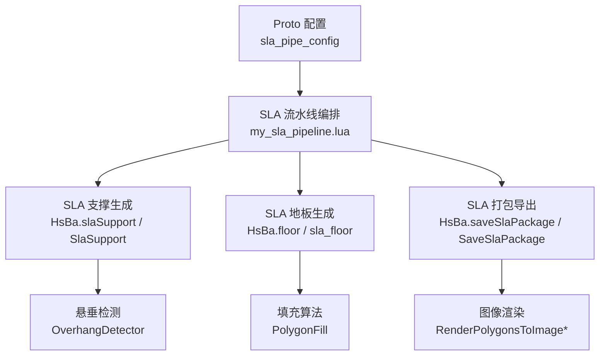
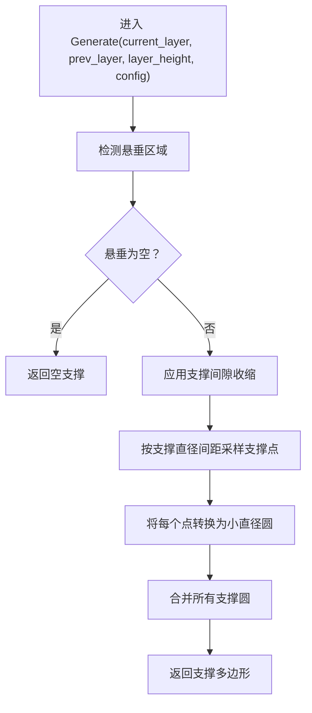
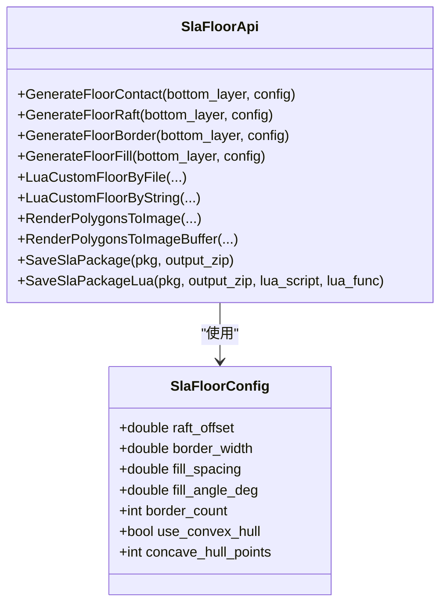
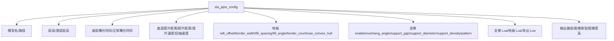
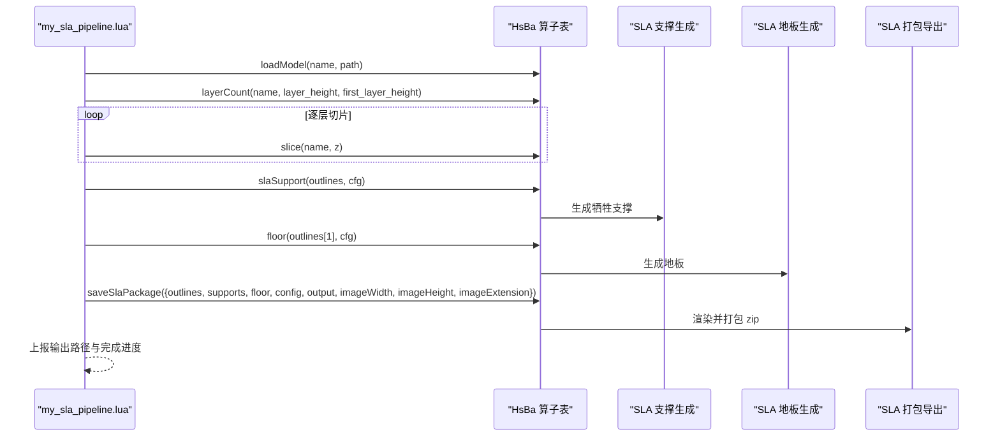

# SLA 流水线脚本开发

<cite>
**本文引用的文件**   
- [docs/zh/lua_pipeline_api.md](file://docs/zh/lua_pipeline_api.md)
- [proto/sla_pipeline.proto](file://proto/sla_pipeline.proto)
- [support/SlaSupport.hpp](file://support/SlaSupport.hpp)
- [support/SlaSupport.cpp](file://support/SlaSupport.cpp)
- [support/SupportConfig.hpp](file://support/SupportConfig.hpp)
- [LibHsBaSlicer/Floor/sla_floor.hpp](file://LibHsBaSlicer/Floor/sla_floor.hpp)
- [samples/Custom/scripts/my_sla_pipeline.lua](file://samples/Custom/scripts/my_sla_pipeline.lua)
- [samples/SLA/scripts/my_sla_support.lua](file://samples/SLA/scripts/my_sla_support.lua)
- [samples/SLA/scripts/my_sla_floor.lua](file://samples/SLA/scripts/my_sla_floor.lua)
</cite>

## 目录
1. [项目概述与快速开始](#项目概述与快速开始)
2. [架构总览](#架构总览)
3. [核心概念](#核心概念)
4. [核心模块详解](#核心模块详解)
5. [高级主题](#高级主题)
6. [Lua 脚本系统](#lua-脚本系统)
7. [API 参考文档](#api-参考文档)
8. [集成指南](#集成指南)
9. [开发·测试与贡献](#开发测试与贡献)
10. [扩展开发指南](#扩展开发指南)
11. [示例与教程](#示例与教程)
12. [部署·故障排除与FAQ](#部署故障排除与faq)
13. [附录](#附录)

## 项目概述与快速开始
本指南面向使用 HsBaSlicer 编写 SLA（光固化成型）流水线 Lua 脚本的开发者。SLA 流水线与 FDM 的关键差异在于：
- SLA 是逐层曝光，每层由图像或轮廓渲染到树脂槽；FDM 是逐层挤出路径。
- SLA 支撑多为牺牲型细柱，便于打印后去除；FDM 支撑常为树形、蜂窝或平面结构，并可能包含界面层。
- SLA 需要底面处理（raft/floor），用于增强模型与构建板的附着力，并提供可移除的基础平台。
- SLA 工艺参数强调层高、底层曝光时间、正常曝光时间、提升距离、提升速度、回抽速度等；FDM 更关注线宽、挤出倍率、喷嘴温度、床温等。

快速开始建议：
- 若希望完全控制加载、切片、支撑、地板、打包流程，编写自定义 SLA 流水线脚本，入口函数为 `run_pipeline`。
- 若只想替换内置流水线中的支撑或地板算法，分别编写支撑阶段脚本和地板阶段脚本。
- 使用 `HsBa.slaSupport` 生成逐层牺牲型支撑，使用 `HsBa.floor` 生成 SLA 地板，使用 `HsBa.saveSlaPackage` 输出层图、支撑图、地板图和配置。

**章节来源**
- [docs/zh/lua_pipeline_api.md:19-28](file://docs/zh/lua_pipeline_api.md#L19-L28)
- [docs/zh/lua_pipeline_api.md:106-132](file://docs/zh/lua_pipeline_api.md#L106-L132)

## 架构总览
SLA 流水线在 HsBaSlicer 中由以下层次组成：
- Proto 配置层：定义 SLA 工艺参数、支撑模式、图像类型、输出尺寸等。
- C++ 实现层：提供 SLA 牺牲支撑生成器、SLA 地板生成器、图像渲染与打包导出。
- Lua 脚本层：通过 `HsBa` 算子表调用支撑、地板、切片、填充、打包等能力；也可通过内置阶段脚本替换支撑/地板算法。
- 样本脚本层：提供完整的自定义 SLA 流水线、支撑、地板示例。

**图表来源**
- [proto/sla_pipeline.proto:18-58](file://proto/sla_pipeline.proto#L18-L58)
- [support/SlaSupport.cpp:81-123](file://support/SlaSupport.cpp#L81-L123)
- [LibHsBaSlicer/Floor/sla_floor.hpp:24-60](file://LibHsBaSlicer/Floor/sla_floor.hpp#L24-L60)
- [LibHsBaSlicer/Floor/sla_floor.hpp:134-183](file://LibHsBaSlicer/Floor/sla_floor.hpp#L134-L183)
- [samples/Custom/scripts/my_sla_pipeline.lua:27-103](file://samples/Custom/scripts/my_sla_pipeline.lua#L27-L103)

**章节来源**
- [proto/sla_pipeline.proto:18-58](file://proto/sla_pipeline.proto#L18-L58)
- [samples/Custom/scripts/my_sla_pipeline.lua:27-103](file://samples/Custom/scripts/my_sla_pipeline.lua#L27-L103)

## 核心概念
### SLA 与 FDM 的差异
- 曝光方式：SLA 使用 UV 光源逐层固化树脂；FDM 使用热喷头逐层挤出耗材。
- 支撑形态：SLA 牺牲支撑通常为小直径柱体，便于去除；FDM 支撑可为树形、蜂窝、平面，并可设置界面层密度与层数。
- 底面处理：SLA 常用 raft/floor 作为附着基础；FDM 通常使用 skirt/brim 或 rafts，但逻辑与参数不同。
- 工艺参数：SLA 强调层高、底层曝光时间、正常曝光时间、提升距离、提升速度、回抽速度；FDM 强调线宽、挤出倍率、喷嘴温度、床温、回抽长度/速度等。

### SLA 专用数据结构
- SLA 支撑配置：
  - 通用支撑配置：悬垂角度阈值、层高、支撑间隙、支撑直径、支撑密度、支撑模式、树分支角度、树最大分支半径、蜂窝单元尺寸。
  - SLA 特有字段：支撑尖端直径、raft 层厚度。
- SLA 地板配置：
  - raft 外扩偏移、边框宽度、填充间距、填充角度、边框环数量、是否使用凸包、凹包额外点数。
- SLA 流水线配置：
  - 模型名/路径、层高、首层层高、底层曝光时间、正常曝光时间、底层提升距离、提升距离、提升速度、回抽速度。
  - 地板参数、支撑开关与参数、支撑 Lua 脚本与函数、地板 Lua 脚本与函数、导出 Lua 脚本与函数。
  - 输出路径、图像类型、图像宽高。

**章节来源**
- [support/SupportConfig.hpp:14-43](file://support/SupportConfig.hpp#L14-L43)
- [LibHsBaSlicer/Floor/sla_floor.hpp:24-33](file://LibHsBaSlicer/Floor/sla_floor.hpp#L24-L33)
- [proto/sla_pipeline.proto:18-58](file://proto/sla_pipeline.proto#L18-L58)

## 核心模块详解
### SLA 牺牲支撑生成器
SLA 牺牲支撑的核心思路：
- 基于当前层与上一层检测悬垂区域。
- 对悬垂区域应用支撑间隙收缩。
- 在收缩后的区域内按支撑直径间距采样点，生成小直径圆形支撑截面。
- 合并所有支撑圆形成最终支撑多边形。

**图表来源**
- [support/SlaSupport.cpp:81-123](file://support/SlaSupport.cpp#L81-L123)

**章节来源**
- [support/SlaSupport.hpp:13-42](file://support/SlaSupport.hpp#L13-L42)
- [support/SlaSupport.cpp:38-123](file://support/SlaSupport.cpp#L38-L123)
- [support/SupportConfig.hpp:36-43](file://support/SupportConfig.hpp#L36-L43)

### SLA 地板生成器
SLA 地板生成器提供多种能力：
- 计算接触面积（footprint），可选凸包或凹包简化。
- 生成完整 raft（边框 + 内部填充）。
- 仅生成边框环或仅生成内部填充。
- 支持通过 Lua 脚本自定义地板生成逻辑。
- 提供图像渲染与 SLA 打包导出 API。

**图表来源**
- [LibHsBaSlicer/Floor/sla_floor.hpp:24-33](file://LibHsBaSlicer/Floor/sla_floor.hpp#L24-L33)
- [LibHsBaSlicer/Floor/sla_floor.hpp:45-116](file://LibHsBaSlicer/Floor/sla_floor.hpp#L45-L116)
- [LibHsBaSlicer/Floor/sla_floor.hpp:134-195](file://LibHsBaSlicer/Floor/sla_floor.hpp#L134-L195)

**章节来源**
- [LibHsBaSlicer/Floor/sla_floor.hpp:24-116](file://LibHsBaSlicer/Floor/sla_floor.hpp#L24-L116)
- [LibHsBaSlicer/Floor/sla_floor.hpp:134-195](file://LibHsBaSlicer/Floor/sla_floor.hpp#L134-L195)

### SLA 流水线配置
SLA 流水线配置涵盖模型信息、层高、曝光参数、提升参数、地板参数、支撑参数、Lua 脚本钩子、输出设置等。这些字段直接决定切片质量、支撑密度、底面附着力与导出图像格式。

**图表来源**
- [proto/sla_pipeline.proto:18-58](file://proto/sla_pipeline.proto#L18-L58)

**章节来源**
- [proto/sla_pipeline.proto:18-58](file://proto/sla_pipeline.proto#L18-L58)

## 高级主题
### 支撑密度与支撑模式调优
- 支撑密度影响支撑体积与去除难度：密度越高，支撑越密，强度越好但去除更困难。
- 支撑模式包括牺牲柱、锥形等；SLA 牺牲柱适合精细模型，锥形支撑适合大悬垂。
- 支撑间隙越小，支撑与模型越近，附着力越强但去除风险越大。
- 支撑直径越小，去除更容易，但支撑强度降低。

### 底面处理策略
- raft 外扩偏移增大可提升附着力，但会增加材料消耗与后处理时间。
- 边框环数量增加可提高边缘强度，填充间距减小可增加底部密度。
- 使用凸包可简化复杂轮廓，减少底板复杂度；凹包额外点数可用于保留部分凹陷特征。

### 曝光时间与提升参数
- 底层曝光时间决定首层附着力；过高可能导致过固化，过低导致脱落。
- 正常曝光时间决定层间固化质量；过高导致过度固化与细节损失，过低导致层间结合弱。
- 提升距离与提升速度影响脱模应力；过大提升距离易拉断薄壁，过小易粘连。
- 回抽速度影响树脂回流与气泡控制。

**章节来源**
- [support/SupportConfig.hpp:14-43](file://support/SupportConfig.hpp#L14-L43)
- [LibHsBaSlicer/Floor/sla_floor.hpp:24-33](file://LibHsBaSlicer/Floor/sla_floor.hpp#L24-L33)
- [proto/sla_pipeline.proto:23-39](file://proto/sla_pipeline.proto#L23-L39)

## Lua 脚本系统
### 两种运行环境
- 自定义流水线：脚本自行编排加载、切片、支撑、地板、打包全流程，拥有完整 `HsBa` 算子表。
- 内置流水线阶段替换：仅替换支撑、填充、地板、导出阶段的默认算法，阶段顺序由 C++ 固定。

### 通用几何数据类型
- Point：`{ x = number, y = number }`
- Polygon：有序点数组，闭合轮廓
- Polygons：多边形集合
- Layers：逐层多边形集合数组
- 3D 点：`{ x, y, z }`

### 自定义流水线入口
- 入口函数默认为 `run_pipeline`，可由 C++ 侧覆盖。
- 返回非空字符串表示成功，返回 `true` 表示成功但无结果文本，返回 `false`/`nil` 或抛出错误表示失败。

**章节来源**
- [docs/zh/lua_pipeline_api.md:19-28](file://docs/zh/lua_pipeline_api.md#L19-L28)
- [docs/zh/lua_pipeline_api.md:48-65](file://docs/zh/lua_pipeline_api.md#L48-L65)
- [docs/zh/lua_pipeline_api.md:32-44](file://docs/zh/lua_pipeline_api.md#L32-L44)

## API 参考文档
### HsBa 算子表（自定义流水线）
- 进度与输出：
  - `HsBa.progress(percent[, stage])`
  - `HsBa.setLayers(n)`
  - `HsBa.setOutputPath(path)`
- 文件 IO：
  - `HsBa.readFile(path)`
  - `HsBa.writeFile(path, content)`
- 模型管理：
  - `HsBa.loadModel(name, path)`
  - `HsBa.modelInfo(name)`
  - `HsBa.translateModel(name, {x,y,z})`
  - `HsBa.rotateModel(name, {x,y,z,w})`
  - `HsBa.scaleModel(name, s or {x,y,z})`
  - `HsBa.removeModel(name)`
  - `HsBa.modelNames()`
- 切片：
  - `HsBa.layerCount(name, layerHeight, firstLayerHeight)`
  - `HsBa.layerZ(index0based, layerHeight, firstLayerHeight)`
  - `HsBa.slice(name, z)`
  - `HsBa.sliceUnsafe(name, z)`
- 坐标转换与填充：
  - `HsBa.toInt(polygons)`
  - `HsBa.toDouble(intPolygons)`
  - `HsBa.fill(polygons[, cfg])`
- 支撑与地板：
  - `HsBa.fdmSupport(layers, cfg)`
  - `HsBa.slaSupport(layers, cfg)`
  - `HsBa.floor(bottomPolygons, cfg)`
- 路径与 G-code：
  - `HsBa.spiralize(sections[, cfg])`
  - `HsBa.toGcode(layers, cfg)`
- 打包与导出：
  - `HsBa.saveSlsPackage(tbl)`
  - `HsBa.saveWaamPackage(tbl)`
  - `HsBa.saveSlaPackage(tbl)`
  - `HsBa.renderImage(polygons, width, height, path)`

**章节来源**
- [docs/zh/lua_pipeline_api.md:67-132](file://docs/zh/lua_pipeline_api.md#L67-L132)

### 通用共享库
- PolygonOperations：布尔运算、偏移、凸包/凹包、面积、构造矩形/圆形/椭圆/正多边形、文本转多边形。
- PolygonFill：offsetFill、lineFill、simpleZigzagFill、zigzagFill、compositeOffsetFill、hybridFill、offsetOnly。
- PathOptimize：路径顺序优化。
- Support：创建支撑生成器、检测悬垂、默认配置、生成支撑。
- Cipher：Base64/Hex 编解码。
- Zipper/Bit7zZipper：压缩打包。
- 数据库适配器：SQLiteAdapter、MySQLAdapter、PostgreSQLAdapter。
- ParamStore：参数持久化。

**章节来源**
- [docs/zh/lua_pipeline_api.md:136-212](file://docs/zh/lua_pipeline_api.md#L136-L212)

### 内置阶段脚本
- 支撑阶段：
  - 全局变量：`current_layer`、`prev_layer`、`layer_height`、`config`
  - 约定入口函数：`generate_support()`
- 填充阶段：
  - 约定入口函数：`generate_fill(current_layer)`
- 地板阶段（SLA）：
  - 可用库：`PolygonOperations`、`PolygonFill`
- 导出阶段：
  - 全局变量：`config`、`images`、`output_path`
  - 约定入口函数：各工艺导出函数（如 `export_sls`、`export_waam`）

**章节来源**
- [docs/zh/lua_pipeline_api.md:215-260](file://docs/zh/lua_pipeline_api.md#L215-L260)

## 集成指南
### 如何编写自定义 SLA 流水线脚本
步骤：
1. 定义入口函数 `run_pipeline`。
2. 从全局变量获取模型名、模型路径、输出路径、流水线配置。
3. 加载模型并计算层数。
4. 逐层切片，收集轮廓。
5. 调用 `HsBa.slaSupport` 生成支撑。
6. 调用 `HsBa.floor` 生成地板。
7. 调用 `HsBa.saveSlaPackage` 打包层图、支撑图、地板图与配置。
8. 上报输出路径与完成进度。

**图表来源**
- [samples/Custom/scripts/my_sla_pipeline.lua:27-103](file://samples/Custom/scripts/my_sla_pipeline.lua#L27-L103)
- [docs/zh/lua_pipeline_api.md:106-132](file://docs/zh/lua_pipeline_api.md#L106-L132)

**章节来源**
- [samples/Custom/scripts/my_sla_pipeline.lua:27-103](file://samples/Custom/scripts/my_sla_pipeline.lua#L27-L103)

### 如何替换内置支撑算法
步骤：
1. 编写支撑阶段脚本，定义 `generate_support()`。
2. 使用 `Support.detect_overhang` 检测悬垂区域。
3. 使用 `Support.new_sla()` 创建 SLA 支撑生成器。
4. 配置 `Support.default_config()` 并覆盖必要字段。
5. 调用 `Support.generate(generator, current_layer, prev_layer, layer_height, support_cfg)` 生成支撑。
6. 可选：根据面积过滤支撑点。

**章节来源**
- [samples/SLA/scripts/my_sla_support.lua:32-75](file://samples/SLA/scripts/my_sla_support.lua#L32-L75)
- [docs/zh/lua_pipeline_api.md:219-232](file://docs/zh/lua_pipeline_api.md#L219-L232)

### 如何替换内置地板算法
步骤：
1. 编写地板阶段脚本，定义 `generate_floor(bottom_layer, config)`。
2. 使用 `PolygonOperations.convexHullOperation` 简化轮廓。
3. 使用 `PolygonOperations.offsetOperation` 生成 raft 外边界与内边界。
4. 使用 `PolygonOperations.difference` 生成边框环。
5. 使用 `PolygonFill.zigzagFill` 生成内部填充。
6. 合并边框与填充并返回。

**章节来源**
- [samples/SLA/scripts/my_sla_floor.lua:33-63](file://samples/SLA/scripts/my_sla_floor.lua#L33-L63)
- [docs/zh/lua_pipeline_api.md:241-244](file://docs/zh/lua_pipeline_api.md#L241-L244)

## 开发·测试与贡献
- 建议在 samples 目录下新增自定义脚本，复用现有 my_sla_pipeline.lua、my_sla_support.lua、my_sla_floor.lua 的结构。
- 使用 `HsBa.progress` 上报进度，便于调试与可视化。
- 使用 `HsBa.writeFile` 与 `HsBa.readFile` 进行中间结果验证。
- 使用 `HsBa.saveSlaPackage` 输出 zip 包，检查层图、支撑图、地板图与 config.json。

**章节来源**
- [docs/zh/lua_pipeline_api.md:67-75](file://docs/zh/lua_pipeline_api.md#L67-L75)
- [docs/zh/lua_pipeline_api.md:125-132](file://docs/zh/lua_pipeline_api.md#L125-L132)

## 扩展开发指南
- 如需扩展 SLA 支撑生成器，可在 C++ 侧实现新的 `ISupport` 子类，并在 Lua 侧注册对应生成器。
- 如需扩展 SLA 地板生成逻辑，可使用 `LuaCustomFloorByFile` 或 `LuaCustomFloorByString` 注入自定义 Lua 脚本。
- 如需扩展导出逻辑，可使用 `SaveSlaPackageLua` 注入自定义导出脚本。

**章节来源**
- [LibHsBaSlicer/Floor/sla_floor.hpp:81-116](file://LibHsBaSlicer/Floor/sla_floor.hpp#L81-L116)
- [LibHsBaSlicer/Floor/sla_floor.hpp:186-195](file://LibHsBaSlicer/Floor/sla_floor.hpp#L186-L195)

## 示例与教程
### 完整自定义 SLA 流水线脚本
参考 `samples/Custom/scripts/my_sla_pipeline.lua`，该脚本演示了：
- 加载模型与计算层数
- 逐层切片
- 生成 SLA 支撑
- 生成地板
- 打包 SLA 图像与配置

**章节来源**
- [samples/Custom/scripts/my_sla_pipeline.lua:1-105](file://samples/Custom/scripts/my_sla_pipeline.lua#L1-L105)

### 自定义 SLA 支撑脚本
参考 `samples/SLA/scripts/my_sla_support.lua`，该脚本演示了：
- 检测悬垂区域
- 使用内置 SLA 支撑生成器
- 配置支撑参数
- 可选面积过滤

**章节来源**
- [samples/SLA/scripts/my_sla_support.lua:1-76](file://samples/SLA/scripts/my_sla_support.lua#L1-L76)

### 自定义 SLA 地板脚本
参考 `samples/SLA/scripts/my_sla_floor.lua`，该脚本演示了：
- 凸包简化轮廓
- 生成 raft 外边界与内边界
- 生成边框环与内部填充
- 合并边框与填充

**章节来源**
- [samples/SLA/scripts/my_sla_floor.lua:1-64](file://samples/SLA/scripts/my_sla_floor.lua#L1-L64)

## 部署·故障排除与FAQ
### 常见问题
- 支撑过多或过少：调整 `support_density`、`support_diameter`、`overhang_angle`。
- 底面附着力不足：增大 `raft_offset`、`border_count`，或启用 `use_convex_hull`。
- 层图模糊或失真：调整 `imageWidth`、`imageHeight`、`imageExtension`。
- 打包失败：检查 `saveSlaPackage` 参数是否完整，确保 `output` 必填。

### 性能优化技巧
- 减少不必要的浮点运算：优先使用整型多边形进行布尔与填充操作。
- 合理设置支撑间距：避免过密的支撑点导致合并耗时过长。
- 控制填充密度与角度：避免复杂填充图案导致渲染与导出变慢。
- 使用批量写入与内存缓冲：优先使用 `RenderPolygonsToImageBuffer` 避免临时文件开销。

**章节来源**
- [docs/zh/lua_pipeline_api.md:106-132](file://docs/zh/lua_pipeline_api.md#L106-L132)
- [LibHsBaSlicer/Floor/sla_floor.hpp:134-151](file://LibHsBaSlicer/Floor/sla_floor.hpp#L134-L151)

## 附录
### SLA 工艺参数调优建议
- 层高：0.05–0.1 mm 常见；更小层高提升细节但增加层数与时间。
- 底层曝光时间：根据材料与构建板附着力调整；过高导致过固化，过低导致脱落。
- 正常曝光时间：根据树脂特性调整；过高导致过度固化，过低导致层间结合弱。
- 提升距离与速度：根据模型高度与薄壁结构调整；过大易拉断，过小易粘连。
- 支撑密度：0.1–0.3 常见；密度越高支撑越强但去除更难。
- 支撑直径：0.3–2.0 mm；小直径易去除，大直径强度高。
- 地板 raft 外扩：1–3 mm；外扩越大附着力越强但材料消耗越多。

**章节来源**
- [proto/sla_pipeline.proto:23-39](file://proto/sla_pipeline.proto#L23-L39)
- [support/SupportConfig.hpp:36-43](file://support/SupportConfig.hpp#L36-L43)
- [LibHsBaSlicer/Floor/sla_floor.hpp:24-33](file://LibHsBaSlicer/Floor/sla_floor.hpp#L24-L33)