# 填充算法扩展

<cite>
**本文引用的文件**   
- [2D/PolygonFill.hpp](file://2D/PolygonFill.hpp)
- [2D/PolygonFill.cpp](file://2D/PolygonFill.cpp)
- [LibHsBaSlicer/Fill/polygon_fill.hpp](file://LibHsBaSlicer/Fill/polygon_fill.hpp)
- [LibHsBaSlicer/Fill/polygon_fill.cpp](file://LibHsBaSlicer/Fill/polygon_fill.cpp)
- [2D/LuaAdapter.cpp](file://2D/LuaAdapter.cpp)
- [2D/IntPolygon.hpp](file://2D/IntPolygon.hpp)
- [ModuleHsBaSlicer/hsba_slicer.cppm](file://ModuleHsBaSlicer/hsba_slicer.cppm)
- [samples/FDM/scripts/my_infill.lua](file://samples/FDM/scripts/my_infill.lua)
- [tests/PolygonFill/custom_fill.lua](file://tests/PolygonFill/custom_fill.lua)
- [tests/PolygonFill/lua_polygon_operations_test.cpp](file://tests/PolygonFill/lua_polygon_operations_test.cpp)
- [tests/PolygonFill/polygon_fill_test.cpp](file://tests/PolygonFill/polygon_fill_test.cpp)
</cite>

## 目录
1. [引言](#引言)
2. [项目结构](#项目结构)
3. [核心概念](#核心概念)
4. [架构总览](#架构总览)
5. [详细组件分析](#详细组件分析)
6. [依赖关系分析](#依赖关系分析)
7. [性能与优化](#性能与优化)
8. [调试与常见问题](#调试与常见问题)
9. [结论](#结论)
10. [附录：自定义填充实现模板](#附录自定义填充实现模板)

## 引言
本文面向需要在 HsBaSlicer 中开发自定义填充算法的开发者，目标是说明如何基于现有接口扩展直线、锯齿形、网格、螺旋等填充模式。文档重点包括：
- 填充算法的 C++ 与 Lua 双入口规范；
- `generate_fill` 函数的参数格式与返回值约定；
- `PolygonOperations` 工具函数在脚本中的使用方法；
- 边界框计算、扫描线生成、多边形布尔运算等核心步骤；
- 性能优化建议、调试方法与常见陷阱。

## 项目结构
填充相关代码主要分布在以下位置：
- 2D 几何与填充引擎：`2D/PolygonFill.*`、`2D/LuaAdapter.cpp`、`2D/IntPolygon.hpp`；
- LibHsBaSlicer 对外 API：`LibHsBaSlicer/Fill/polygon_fill.*`；
- 模块层调用与 FDM 流水线集成：`ModuleHsBaSlicer/hsba_slicer.cppm`；
- Lua 示例与测试：`samples/FDM/scripts/my_infill.lua`、`tests/PolygonFill/custom_fill.lua`、`tests/PolygonFill/lua_polygon_operations_test.cpp`、`tests/PolygonFill/polygon_fill_test.cpp`。

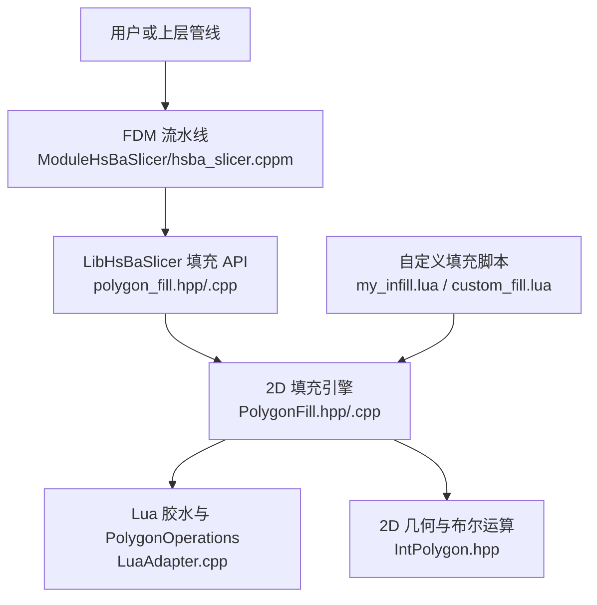

**图表来源**
- [ModuleHsBaSlicer/hsba_slicer.cppm:667-675](file://ModuleHsBaSlicer/hsba_slicer.cppm#L667-L675)
- [LibHsBaSlicer/Fill/polygon_fill.hpp:17-53](file://LibHsBaSlicer/Fill/polygon_fill.hpp#L17-L53)
- [LibHsBaSlicer/Fill/polygon_fill.cpp:13-49](file://LibHsBaSlicer/Fill/polygon_fill.cpp#L13-L49)
- [2D/PolygonFill.hpp:20-136](file://2D/PolygonFill.hpp#L20-L136)
- [2D/LuaAdapter.cpp:22-119](file://2D/LuaAdapter.cpp#L22-L119)
- [2D/IntPolygon.hpp:75-106](file://2D/IntPolygon.hpp#L75-L106)

**章节来源**
- [2D/PolygonFill.hpp:20-136](file://2D/PolygonFill.hpp#L20-L136)
- [LibHsBaSlicer/Fill/polygon_fill.hpp:17-53](file://LibHsBaSlicer/Fill/polygon_fill.hpp#L17-L53)
- [ModuleHsBaSlicer/hsba_slicer.cppm:667-675](file://ModuleHsBaSlicer/hsba_slicer.cppm#L667-L675)

## 核心概念
### 输入与输出类型
- 输入：当前层多边形数组，C++ 侧为 `Polygons`，Lua 侧为 `{ { {x=.., y=..}, ... }, ... }`。
- 输出：填充路径的多边形集合，C++ 侧返回 `Polygons`，Lua 脚本需返回由点表组成的多边形数组。

### 填充模式枚举
`FillMode` 定义三种内置模式：
- `Line`：平行直线填充；
- `SimpleZigzag`：简单锯齿形填充；
- `Zigzag`：改进角点处理的锯齿形填充。

### 关键 C++ 接口
- `OffsetFill`：向内偏移生成同心环；
- `LineFill`：按角度生成独立直线段；
- `SimpleZigzagFill`：连接相邻行线段形成连续折线；
- `ZigzagFill`：更复杂的连通性处理与桥接逻辑；
- `CompositeOffsetFill`：先内部填充，再叠加内外偏移层；
- `HybridFill`：先外扩轮廓，再向内偏移直到最小面积阈值，最后对最内层填充；
- `LuaCustomFill` / `LuaCustomFillString`：通过 Lua 脚本生成填充。

**章节来源**
- [2D/PolygonFill.hpp:20-136](file://2D/PolygonFill.hpp#L20-L136)
- [2D/PolygonFill.cpp:504-564](file://2D/PolygonFill.cpp#L504-L564)
- [2D/PolygonFill.cpp:568-800](file://2D/PolygonFill.cpp#L568-L800)
- [2D/PolygonFill.cpp:803-1370](file://2D/PolygonFill.cpp#L803-L1370)
- [2D/PolygonFill.cpp:1372-1491](file://2D/PolygonFill.cpp#L1372-L1491)

## 架构总览
下图展示从 FDM 流水线到 2D 填充引擎再到 Lua 脚本的完整调用链。

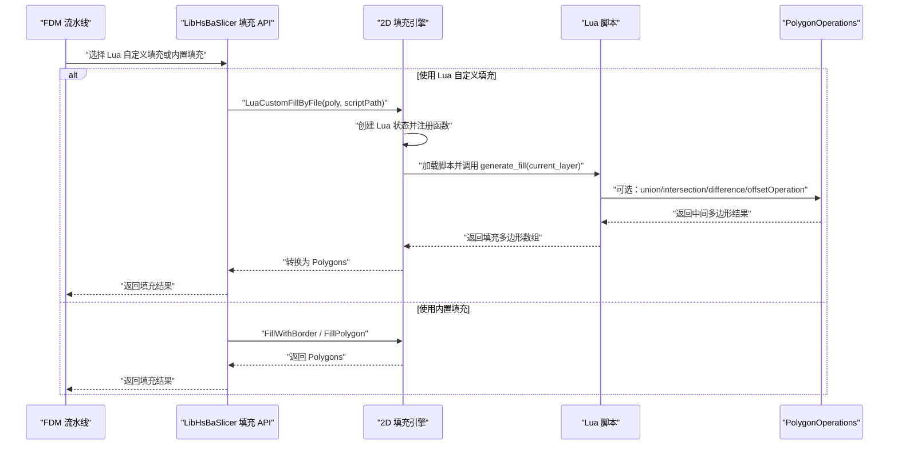

**图表来源**
- [ModuleHsBaSlicer/hsba_slicer.cppm:667-675](file://ModuleHsBaSlicer/hsba_slicer.cppm#L667-L675)
- [LibHsBaSlicer/Fill/polygon_fill.cpp:13-49](file://LibHsBaSlicer/Fill/polygon_fill.cpp#L13-L49)
- [2D/PolygonFill.cpp:1493-1585](file://2D/PolygonFill.cpp#L1493-L1585)
- [2D/LuaAdapter.cpp:487-491](file://2D/LuaAdapter.cpp#L487-L491)

## 详细组件分析

### 2D 填充引擎接口
`2D/PolygonFill.hpp` 暴露了所有填充算法的 C++ 接口，以及 Lua 自定义填充入口。

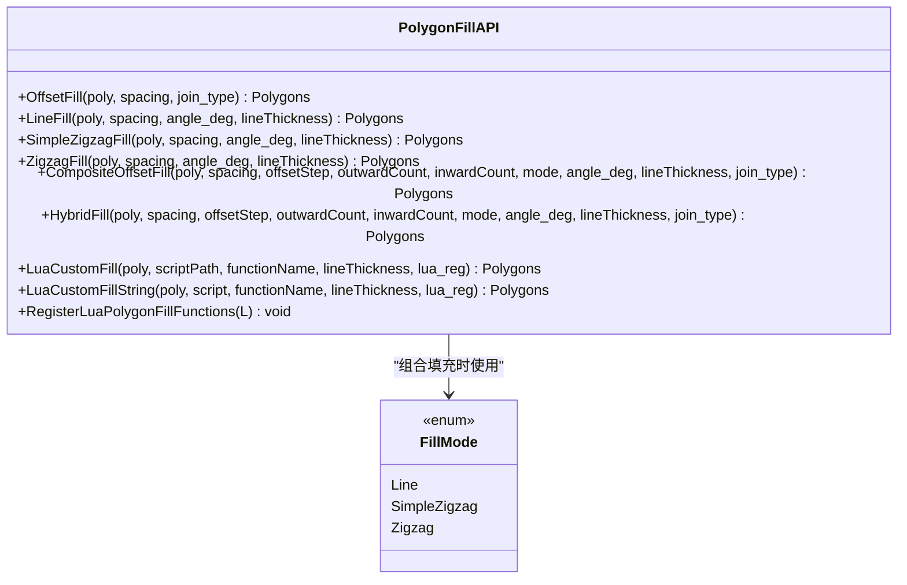

**图表来源**
- [2D/PolygonFill.hpp:20-136](file://2D/PolygonFill.hpp#L20-L136)

**章节来源**
- [2D/PolygonFill.hpp:20-136](file://2D/PolygonFill.hpp#L20-L136)

### 内置填充算法流程

#### 直线填充
`LineFill` 的核心是扫描线构造：
1. 将输入多边形转为浮点坐标；
2. 计算包围盒与投影范围；
3. 沿法向步进生成矩形条带；
4. 与原始多边形求交得到每行的有效线段；
5. 输出每个线段作为独立多边形。

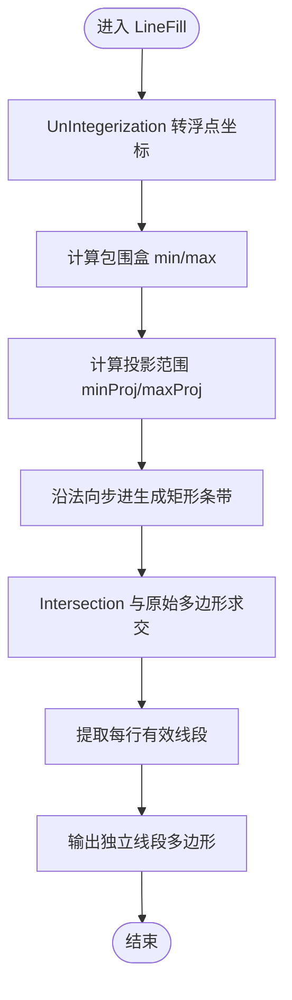

**图表来源**
- [2D/PolygonFill.cpp:44-160](file://2D/PolygonFill.cpp#L44-L160)
- [2D/PolygonFill.cpp:543-564](file://2D/PolygonFill.cpp#L543-L564)

**章节来源**
- [2D/PolygonFill.cpp:44-160](file://2D/PolygonFill.cpp#L44-L160)
- [2D/PolygonFill.cpp:543-564](file://2D/PolygonFill.cpp#L543-L564)

#### 简单锯齿形填充
`SimpleZigzagFill` 在扫描线基础上连接相邻行线段：
1. 使用 `LineFilling` 获取行线段；
2. 对偶数行顺序遍历，奇数行逆序遍历；
3. 使用二分查找裁剪线段端点到多边形内部；
4. 仅允许同一行或相邻行连接；
5. 输出连续折线。

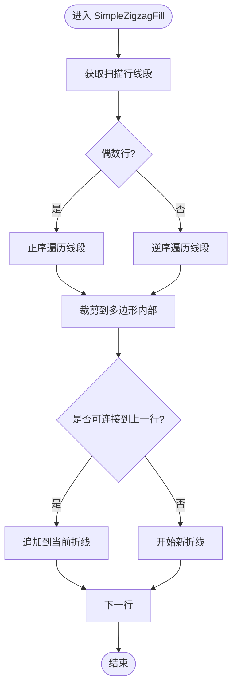

**图表来源**
- [2D/PolygonFill.cpp:568-800](file://2D/PolygonFill.cpp#L568-L800)

**章节来源**
- [2D/PolygonFill.cpp:568-800](file://2D/PolygonFill.cpp#L568-L800)

#### 高级锯齿形填充
`ZigzagFill` 进一步处理复杂连通性：
1. 排序每行线段；
2. 扁平化所有线段并建立并查集；
3. 根据区间重叠连接相邻行；
4. 构建连通分量；
5. 尝试桥接不同分量的相邻行；
6. 失败时回退到中线检测或额外直线段。

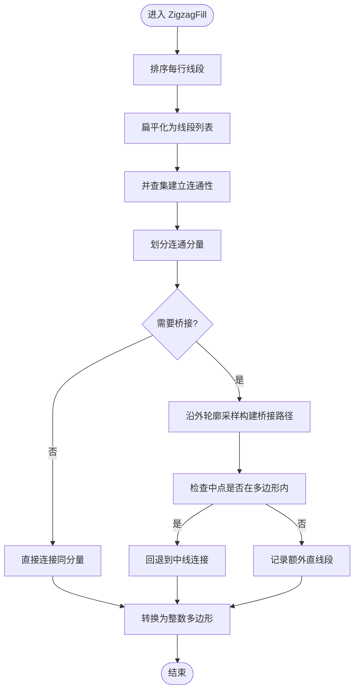

**图表来源**
- [2D/PolygonFill.cpp:803-1370](file://2D/PolygonFill.cpp#L803-L1370)

**章节来源**
- [2D/PolygonFill.cpp:803-1370](file://2D/PolygonFill.cpp#L803-L1370)

#### 组合偏移填充与混合填充
- `CompositeOffsetFill`：基础填充 + 外扩偏移层 + 内缩偏移层；
- `HybridFill`：先外扩轮廓，再逐步内缩直到面积小于阈值，最后对最内层填充。

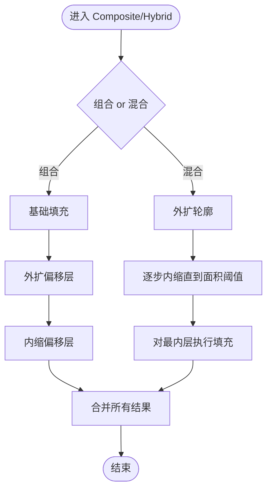

**图表来源**
- [2D/PolygonFill.cpp:1372-1491](file://2D/PolygonFill.cpp#L1372-L1491)

**章节来源**
- [2D/PolygonFill.cpp:1372-1491](file://2D/PolygonFill.cpp#L1372-L1491)

### Lua 自定义填充接口

#### `generate_fill` 函数规范
- 参数：`current_layer`，类型为当前层多边形数组，即 `{ { {x=.., y=..}, ... }, ... }`；
- 返回值：填充多边形数组，每个元素是一个点表 `{ {x=.., y=..}, ... }`；
- 错误处理：若未返回表或函数不存在，会抛出运行时错误。

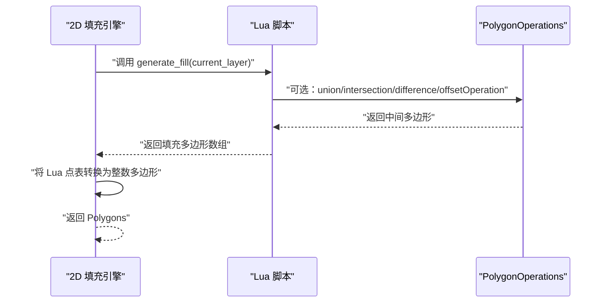

**图表来源**
- [2D/PolygonFill.cpp:1493-1585](file://2D/PolygonFill.cpp#L1493-L1585)
- [samples/FDM/scripts/my_infill.lua:20-38](file://samples/FDM/scripts/my_infill.lua#L20-L38)
- [tests/PolygonFill/custom_fill.lua:7-13](file://tests/PolygonFill/custom_fill.lua#L7-L13)

**章节来源**
- [2D/PolygonFill.cpp:1493-1585](file://2D/PolygonFill.cpp#L1493-L1585)
- [samples/FDM/scripts/my_infill.lua:20-38](file://samples/FDM/scripts/my_infill.lua#L20-L38)
- [tests/PolygonFill/custom_fill.lua:7-13](file://tests/PolygonFill/custom_fill.lua#L7-L13)

#### `PolygonOperations` 工具函数
Lua 侧可用的 2D 布尔与构造函数包括：
- `booleanOperation(a, b, op)`：通用布尔操作，`op ∈ union/intersection/difference/xor`；
- `union(a, b)` / `intersection(a, b)` / `difference(a, b)` / `xor(a, b)`；
- `offsetOperation(polys, delta)`：偏移操作；
- `convexHullOperation(polys)` / `concaveHullOperation(polys[, ...])`；
- `area(polygon)`；
- `makeRectangle(xmin, ymin, xmax, ymax)` / `makeCircle(cx, cy, r)` / `makeEllipse(...)` / `makeRegularPolygon(...)` / `textToPolygons(...)`。

这些函数在 `LuaAdapter.cpp` 中注册为全局 `PolygonOperations` 表。

**章节来源**
- [2D/LuaAdapter.cpp:22-119](file://2D/LuaAdapter.cpp#L22-L119)
- [2D/LuaAdapter.cpp:487-491](file://2D/LuaAdapter.cpp#L487-L491)
- [tests/PolygonFill/lua_polygon_operations_test.cpp:162-191](file://tests/PolygonFill/lua_polygon_operations_test.cpp#L162-L191)

### LibHsBaSlicer 对外 API
`LibHsBaSlicer/Fill/polygon_fill.hpp` 提供简洁的 C++ 接口：
- `FillPolygon`：根据 `FillMode` 分发到具体填充算法；
- `FillWithBorder`：组合偏移边框 + 内部填充；
- `LuaCustomFillByFile`：封装 `LuaCustomFill`，并自动注册 2D 函数与路径优化函数。

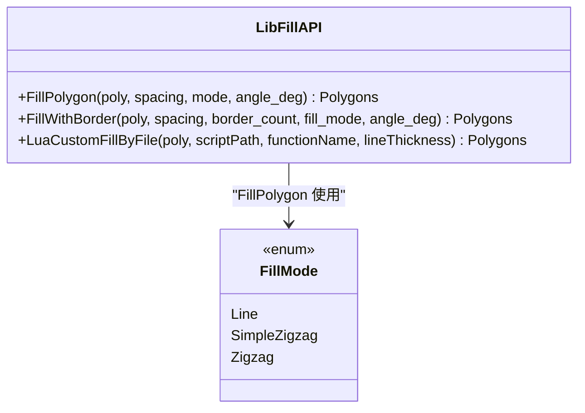

**图表来源**
- [LibHsBaSlicer/Fill/polygon_fill.hpp:17-53](file://LibHsBaSlicer/Fill/polygon_fill.hpp#L17-L53)
- [LibHsBaSlicer/Fill/polygon_fill.cpp:13-49](file://LibHsBaSlicer/Fill/polygon_fill.cpp#L13-L49)

**章节来源**
- [LibHsBaSlicer/Fill/polygon_fill.hpp:17-53](file://LibHsBaSlicer/Fill/polygon_fill.hpp#L17-L53)
- [LibHsBaSlicer/Fill/polygon_fill.cpp:13-49](file://LibHsBaSlicer/Fill/polygon_fill.cpp#L13-L49)

### FDM 流水线集成
FDM 流水线在检测到配置中存在 `infill_lua_script` 时，优先调用 Lua 自定义填充，否则回退到内置填充。

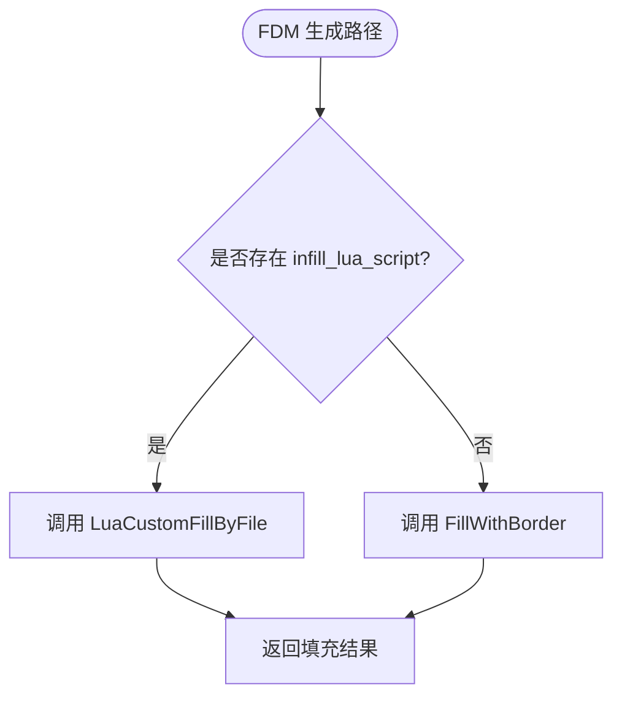

**图表来源**
- [ModuleHsBaSlicer/hsba_slicer.cppm:667-675](file://ModuleHsBaSlicer/hsba_slicer.cppm#L667-L675)

**章节来源**
- [ModuleHsBaSlicer/hsba_slicer.cppm:667-675](file://ModuleHsBaSlicer/hsba_slicer.cppm#L667-L675)

## 依赖关系分析
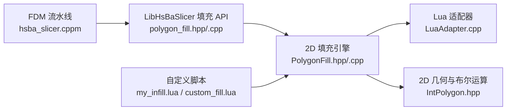

**图表来源**
- [ModuleHsBaSlicer/hsba_slicer.cppm:667-675](file://ModuleHsBaSlicer/hsba_slicer.cppm#L667-L675)
- [LibHsBaSlicer/Fill/polygon_fill.hpp:17-53](file://LibHsBaSlicer/Fill/polygon_fill.hpp#L17-L53)
- [2D/PolygonFill.hpp:20-136](file://2D/PolygonFill.hpp#L20-L136)
- [2D/LuaAdapter.cpp:487-491](file://2D/LuaAdapter.cpp#L487-L491)
- [2D/IntPolygon.hpp:75-106](file://2D/IntPolygon.hpp#L75-L106)

**章节来源**
- [ModuleHsBaSlicer/hsba_slicer.cppm:667-675](file://ModuleHsBaSlicer/hsba_slicer.cppm#L667-L675)
- [LibHsBaSlicer/Fill/polygon_fill.hpp:17-53](file://LibHsBaSlicer/Fill/polygon_fill.hpp#L17-L53)
- [2D/PolygonFill.hpp:20-136](file://2D/PolygonFill.hpp#L20-L136)
- [2D/LuaAdapter.cpp:487-491](file://2D/LuaAdapter.cpp#L487-L491)
- [2D/IntPolygon.hpp:75-106](file://2D/IntPolygon.hpp#L75-L106)

## 性能与优化
### 空间分割
- 扫描线算法已按法向步进生成矩形条带，避免全图扫描；
- 对于复杂多边形，可先用 `offsetOperation` 缩小区域，减少后续布尔运算规模。

### 并行处理
- 当前实现以单线程为主，若需并行，可在脚本层对多个不相连区域分别生成填充后合并；
- 注意 Lua 状态与 C++ 对象的生命周期管理。

### 内存管理
- `LineFilling` 会临时存储浮点多边形与行线段，建议在脚本中避免返回过多小多边形；
- `ZigzagFill` 的并查集与连通分量计算可能产生较大中间结构，应控制输入多边形复杂度。

### 布尔运算优化
- 尽量复用 `PolygonOperations.union` / `intersection` / `difference`，避免重复构造相同几何；
- 使用 `offsetOperation` 预裁剪可减少后续交集计算量。

[本节为通用指导，不直接分析具体源码文件]

## 调试与常见问题

### 常见问题
1. **Lua 函数未找到**：确保脚本中定义了 `generate_fill`，且 `functionName` 参数正确。
2. **返回值不是表**：`generate_fill` 必须返回多边形数组，否则抛出运行时错误。
3. **参数类型错误**：`current_layer` 必须是多边形数组，每个多边形是点表。
4. **PolygonOperations 函数报错**：检查传入参数是否为合法多边形表。

### 调试方法
- 使用 `tests/PolygonFill/custom_fill.lua` 作为最小示例，验证基本流程；
- 在脚本中使用 `PolygonOperations.area` 检查中间多边形面积；
- 利用 `lua_polygon_operations_test.cpp` 中的断言模式验证函数行为。

**章节来源**
- [2D/PolygonFill.cpp:1493-1585](file://2D/PolygonFill.cpp#L1493-L1585)
- [tests/PolygonFill/custom_fill.lua:7-13](file://tests/PolygonFill/custom_fill.lua#L7-L13)
- [tests/PolygonFill/lua_polygon_operations_test.cpp:162-191](file://tests/PolygonFill/lua_polygon_operations_test.cpp#L162-L191)

## 结论
HsBaSlicer 的填充系统提供了从 C++ 到 Lua 的双层扩展能力。开发者可通过 `generate_fill` 接口实现任意填充模式，并利用 `PolygonOperations` 进行几何构造与布尔运算。内置算法如直线、锯齿形、组合偏移与混合填充可作为参考实现。在实际扩展中，应关注输入数据校验、中间结果缓存与内存占用，以获得稳定高效的填充效果。

[本节为总结性内容，不直接分析具体源码文件]

## 附录：自定义填充实现模板

### 直线填充（Lua 示例）
```lua
local PO = PolygonOperations

function generate_fill(current_layer)
    if #current_layer == 0 then
        return {}
    end

    local spacing = 0.4
    local angle = 45.0
    local rad = angle * math.pi / 180.0

    -- 计算边界框
    local min_x, min_y = math.huge, math.huge
    local max_x, max_y = -math.huge, -math.huge

    for _, poly in ipairs(current_layer) do
        for _, pt in ipairs(poly) do
            if pt.x < min_x then min_x = pt.x end
            if pt.y < min_y then min_y = pt.y end
            if pt.x > max_x then max_x = pt.x end
            if pt.y > max_y then max_y = pt.y end
        end
    end

    -- 生成直线段（示意）
    local result = {}
    -- 此处可根据 spacing 和 angle 生成多条直线
    return result
end
```

**章节来源**
- [samples/FDM/scripts/my_infill.lua:20-38](file://samples/FDM/scripts/my_infill.lua#L20-L38)

### 网格填充（Lua 思路）
1. 计算当前层边界框；
2. 沿 X/Y 方向生成等间距直线；
3. 使用 `PolygonOperations.intersection` 与当前层求交；
4. 返回交点多边形集合。

### 螺旋填充（Lua 思路）
1. 使用 `offsetOperation` 逐步内缩多边形；
2. 对每一层偏移结果生成闭合路径；
3. 连接各层路径形成螺旋线；
4. 返回最终多边形集合。

[本节为概念性示例，不直接分析具体源码文件]