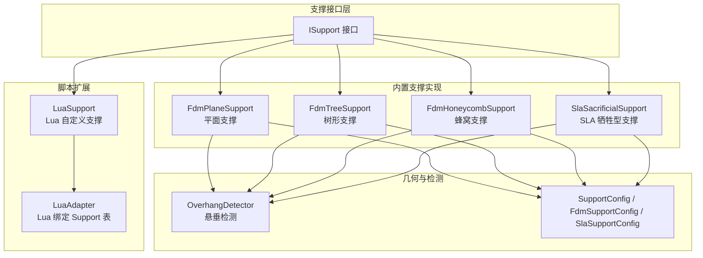
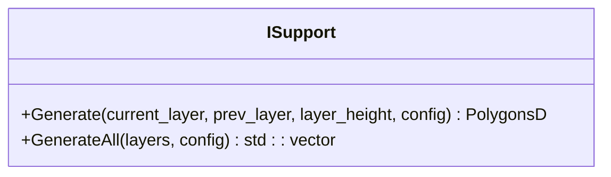
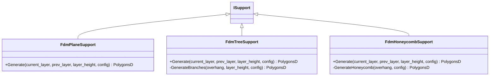
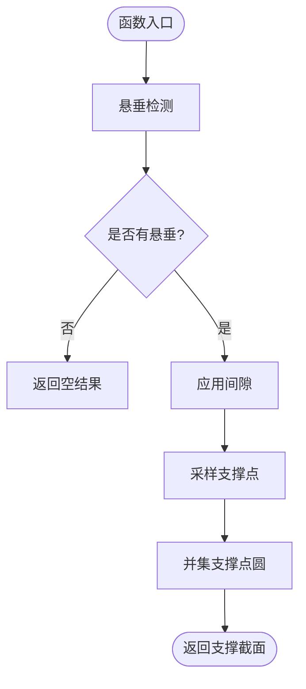
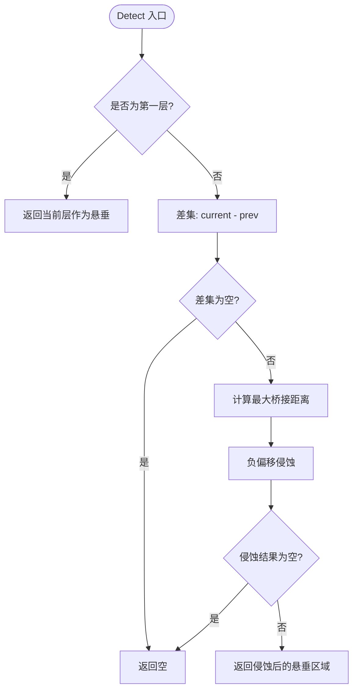
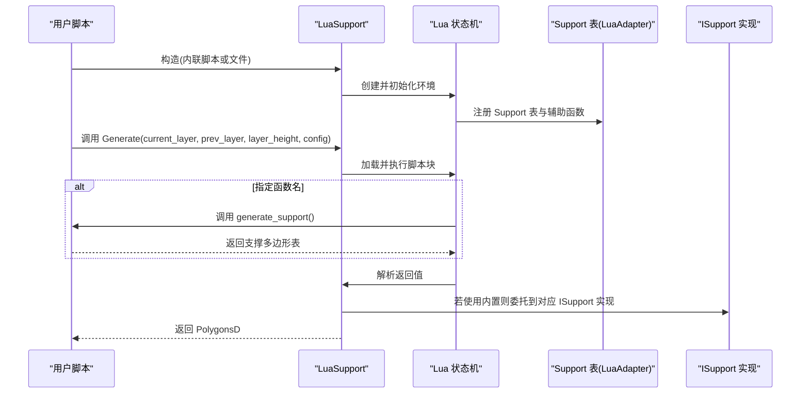
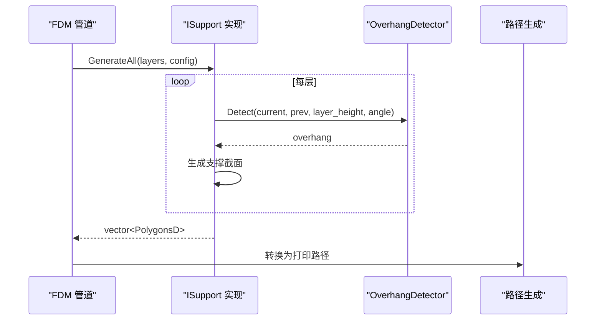
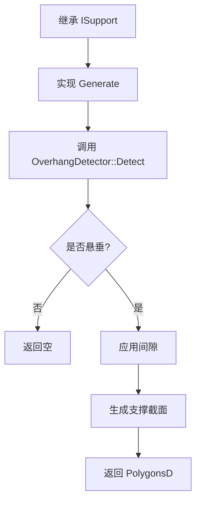

# 支撑算法扩展

<cite>
**本文引用的文件**   
- [ISupport.hpp](file://support/ISupport.hpp)
- [ISupport.cpp](file://support/ISupport.cpp)
- [FdmSupport.hpp](file://support/FdmSupport.hpp)
- [FdmSupport.cpp](file://support/FdmSupport.cpp)
- [SlaSupport.hpp](file://support/SlaSupport.hpp)
- [SlaSupport.cpp](file://support/SlaSupport.cpp)
- [OverhangDetector.hpp](file://support/OverhangDetector.hpp)
- [OverhangDetector.cpp](file://support/OverhangDetector.cpp)
- [SupportConfig.hpp](file://support/SupportConfig.hpp)
- [LuaSupport.hpp](file://support/LuaSupport.hpp)
- [LuaSupport.cpp](file://support/LuaSupport.cpp)
- [LuaAdapter.hpp](file://support/LuaAdapter.hpp)
- [LuaAdapter.cpp](file://support/LuaAdapter.cpp)
- [fdm_pipeline.proto](file://proto/fdm_pipeline.proto)
</cite>

## 目录
1. [项目概述与快速开始](#项目概述与快速开始)
2. [架构总览](#架构总览)
3. [核心概念](#核心概念)
4. [核心模块详解](#核心模块详解)
5. [高级主题](#高级主题)
6. [Lua 脚本系统](#lua-脚本系统)
7. [API 参考文档](#api-参考文档)
8. [集成指南](#集成指南)
9. [开发·测试与贡献](#开发测试与贡献)
10. [扩展开发指南](#扩展开发指南)
11. [示例与教程](#示例与教程)
12. [部署·故障排除与FAQ](#部署故障排除与faq)
13. [附录](#附录)

## 项目概述与快速开始
本指南面向需要在 HsBaSlicer 中扩展支撑生成算法的开发者，覆盖 FDM 支撑（平面、树形、蜂窝）和 SLA 牺牲型支撑的实现方法。你将了解：
- 支撑算法的统一接口与数据流
- 悬垂检测机制与支撑点生成策略
- 支撑结构连接与接触面处理
- 参数配置项及其影响
- Lua 自定义支撑脚本扩展方式
- 性能调优与最佳实践

HsBaSlicer 的支撑子系统以 ISupport 抽象接口为核心，提供多种内置实现，并通过 Lua 适配器暴露给脚本层，便于用户在不修改 C++ 源码的情况下定制支撑行为。

[本节不直接分析具体文件]

## 架构总览
支撑系统的整体架构由“悬垂检测 + 支撑生成器 + 配置对象 + Lua 适配”组成。所有支撑生成器统一实现 ISupport 接口，接收当前层与上一层轮廓，输出当前层的支撑截面多边形。

**图表来源** 
- [ISupport.hpp:22-44](file://support/ISupport.hpp#L22-L44)
- [FdmSupport.hpp:19-63](file://support/FdmSupport.hpp#L19-L63)
- [SlaSupport.hpp:20-42](file://support/SlaSupport.hpp#L20-L42)
- [OverhangDetector.hpp:20-49](file://support/OverhangDetector.hpp#L20-L49)
- [SupportConfig.hpp:14-43](file://support/SupportConfig.hpp#L14-L43)
- [LuaSupport.hpp:40-64](file://support/LuaSupport.hpp#L40-L64)
- [LuaAdapter.hpp:13-30](file://support/LuaAdapter.hpp#L13-L30)

**章节来源**
- [ISupport.hpp:22-44](file://support/ISupport.hpp#L22-L44)
- [FdmSupport.hpp:19-63](file://support/FdmSupport.hpp#L19-L63)
- [SlaSupport.hpp:20-42](file://support/SlaSupport.hpp#L20-L42)
- [OverhangDetector.hpp:20-49](file://support/OverhangDetector.hpp#L20-L49)
- [SupportConfig.hpp:14-43](file://support/SupportConfig.hpp#L14-L43)
- [LuaSupport.hpp:40-64](file://support/LuaSupport.hpp#L40-L64)
- [LuaAdapter.hpp:13-30](file://support/LuaAdapter.hpp#L13-L30)

## 核心概念
- 支撑生成器接口：ISupport 定义单层支撑生成 Generate 与批量生成 GenerateAll。
- 悬垂检测：OverhangDetector 基于角度阈值与层高计算最大桥接距离，对当前层与上一层进行差集与侵蚀操作得到需要支撑的区域。
- 支撑配置：SupportConfig 提供通用参数；FdmSupportConfig 与 SlaSupportConfig 分别扩展 FDM 与 SLA 专用参数。
- 支撑截面：输出为 PolygonsD，即二维多边形集合，表示每层支撑横截面。

关键要点：
- 支撑生成器只负责在当前层生成支撑截面，跨层连接逻辑通过 GenerateAll 迭代或上层管线控制。
- 悬垂检测是支撑生成的前置步骤，决定是否需要支撑以及支撑区域范围。
- 配置对象贯穿整个流程，影响悬垂判定、间隙、直径、密度、图案等。

**章节来源**
- [ISupport.hpp:22-44](file://support/ISupport.hpp#L22-L44)
- [ISupport.cpp:9-21](file://support/ISupport.cpp#L9-L21)
- [OverhangDetector.hpp:20-49](file://support/OverhangDetector.hpp#L20-L49)
- [SupportConfig.hpp:14-43](file://support/SupportConfig.hpp#L14-L43)

## 核心模块详解

### 支撑接口与默认实现
ISupport 定义了统一的支撑生成接口，并提供 GenerateAll 的默认实现，按层迭代调用 Generate。

**图表来源**
- [ISupport.hpp:22-44](file://support/ISupport.hpp#L22-L44)
- [ISupport.cpp:9-21](file://support/ISupport.cpp#L9-L21)

**章节来源**
- [ISupport.hpp:22-44](file://support/ISupport.hpp#L22-L44)
- [ISupport.cpp:9-21](file://support/ISupport.cpp#L9-L21)

### FDM 支撑：平面、树形、蜂窝
FDM 支撑包含三种策略：
- 平面支撑：将悬垂区域收缩间隙后膨胀为柱体截面。
- 树形支撑：在悬垂区域内采样分支点，生成圆形分支尖端，并在层间合并。
- 蜂窝支撑：在悬垂区域内填充六边形网格，取交集得到轻量但刚性的支撑结构。

**图表来源**
- [FdmSupport.hpp:19-63](file://support/FdmSupport.hpp#L19-L63)

**章节来源**
- [FdmSupport.hpp:19-63](file://support/FdmSupport.hpp#L19-L63)
- [FdmSupport.cpp:48-76](file://support/FdmSupport.cpp#L48-L76)
- [FdmSupport.cpp:81-168](file://support/FdmSupport.cpp#L81-L168)
- [FdmSupport.cpp:173-267](file://support/FdmSupport.cpp#L173-L267)

### SLA 牺牲型支撑
SLA 牺牲型支撑使用小尖端直径与大基底直径，逐层生成锥形柱体截面。其核心步骤包括：
- 悬垂检测
- 应用间隙
- 在悬垂区域内按间距采样支撑点
- 将支撑点圆并集得到支撑截面

**图表来源**
- [SlaSupport.cpp:81-124](file://support/SlaSupport.cpp#L81-L124)

**章节来源**
- [SlaSupport.hpp:20-42](file://support/SlaSupport.hpp#L20-L42)
- [SlaSupport.cpp:38-79](file://support/SlaSupport.cpp#L38-L79)
- [SlaSupport.cpp:81-133](file://support/SlaSupport.cpp#L81-L133)

### 悬垂检测机制
OverhangDetector 根据角度阈值与层高计算最大桥接距离，并对当前层与上一层进行差集与负偏移（侵蚀），过滤可桥接的小悬垂。

**图表来源**
- [OverhangDetector.cpp:23-80](file://support/OverhangDetector.cpp#L23-L80)

**章节来源**
- [OverhangDetector.hpp:20-49](file://support/OverhangDetector.hpp#L20-L49)
- [OverhangDetector.cpp:23-80](file://support/OverhangDetector.cpp#L23-L80)

### 支撑配置对象
SupportConfig 提供通用参数，FdmSupportConfig 与 SlaSupportConfig 分别扩展 FDM 与 SLA 专用参数。

| 字段 | 类型 | 默认值 | 说明 |
|---|---|---:|---|
| overhang_angle_threshold | float | 45.0 | 悬垂角度阈值（度） |
| layer_height | float | 0.2 | 层高（mm） |
| support_gap | float | 0.5 | 支撑与模型间隙（mm） |
| support_diameter | float | 2.0 | 支撑柱直径（mm） |
| support_density | float | 0.3 | 支撑填充密度 [0,1] |
| support_pattern | int | 0 | 0=平面, 1=树形, 2=蜂窝 |
| tree_branch_angle | float | 30.0 | 树形分支角度（度） |
| tree_max_branch_radius | float | 5.0 | 树形最大分支半径（mm） |
| honeycomb_cell_size | float | 5.0 | 蜂窝单元尺寸（mm） |
| interface_layers (FDM) | int | 2 | 支撑与模型界面层数 |
| interface_density (FDM) | float | 0.5 | 界面层填充密度 [0,1] |
| tip_diameter (SLA) | float | 0.3 | 支撑尖端直径（mm） |
| raft_thickness (SLA) | float | 0.5 | 筏层厚度（mm） |

**章节来源**
- [SupportConfig.hpp:14-43](file://support/SupportConfig.hpp#L14-L43)

## 高级主题

### 支撑密度控制
- 通用密度字段 support_density 用于描述支撑填充密度，但在当前内置实现中，主要影响的是高层管线的渲染与路径生成阶段；支撑截面生成主要依赖 support_diameter、honeycomb_cell_size 等几何参数。
- 蜂窝支撑通过 honeycomb_cell_size 控制单元大小，间接影响密度与强度。

### 支撑角度优化
- overhang_angle_threshold 控制悬垂判定阈值，越大越严格，越小越宽松。
- OverhangDetector::MaxBridgeDistance 根据层高与角度计算最大桥接距离，用于过滤可桥接的小悬垂。

### 支撑与模型接触面处理
- 所有支撑生成器在生成前都会应用 support_gap 间隙，避免支撑与模型直接接触。
- FDM 支持 interface_layers 与 interface_density，用于在支撑与模型之间插入界面层，改善表面质量与去除性。

**章节来源**
- [OverhangDetector.cpp:23-39](file://support/OverhangDetector.cpp#L23-L39)
- [FdmSupport.cpp:48-76](file://support/FdmSupport.cpp#L48-L76)
- [SupportConfig.hpp:14-43](file://support/SupportConfig.hpp#L14-L43)

## Lua 脚本系统
LuaSupport 允许用户通过 Lua 脚本完全替换内置支撑算法。脚本环境提供：
- current_layer、prev_layer、layer_height、config 全局变量
- Support 表，包含 new_plane、new_tree、new_honeycomb、new_sla、new_lua、new_lua_file、generate、detect_overhang、default_config 等方法
- 2D 多边形操作辅助函数（通过 2D/LuaAdapter 注册）

**图表来源**
- [LuaSupport.cpp:113-177](file://support/LuaSupport.cpp#L113-L177)
- [LuaAdapter.cpp:253-276](file://support/LuaAdapter.cpp#L253-L276)

**章节来源**
- [LuaSupport.hpp:40-64](file://support/LuaSupport.hpp#L40-L64)
- [LuaSupport.cpp:19-90](file://support/LuaSupport.cpp#L19-L90)
- [LuaSupport.cpp:113-177](file://support/LuaSupport.cpp#L113-L177)
- [LuaAdapter.hpp:13-30](file://support/LuaAdapter.hpp#L13-L30)
- [LuaAdapter.cpp:43-108](file://support/LuaAdapter.cpp#L43-L108)
- [LuaAdapter.cpp:174-213](file://support/LuaAdapter.cpp#L174-L213)
- [LuaAdapter.cpp:253-276](file://support/LuaAdapter.cpp#L253-L276)

## API 参考文档

### ISupport 接口
- Generate(current_layer, prev_layer, layer_height, config): 生成单层支撑截面
- GenerateAll(layers, config): 批量生成所有层支撑截面（默认实现）

**章节来源**
- [ISupport.hpp:22-44](file://support/ISupport.hpp#L22-L44)
- [ISupport.cpp:9-21](file://support/ISupport.cpp#L9-L21)

### FDM 支撑类
- FdmPlaneSupport::Generate
- FdmTreeSupport::Generate, GenerateBranches
- FdmHoneycombSupport::Generate, GenerateHoneycomb

**章节来源**
- [FdmSupport.hpp:19-63](file://support/FdmSupport.hpp#L19-L63)
- [FdmSupport.cpp:48-76](file://support/FdmSupport.cpp#L48-L76)
- [FdmSupport.cpp:81-168](file://support/FdmSupport.cpp#L81-L168)
- [FdmSupport.cpp:173-267](file://support/FdmSupport.cpp#L173-L267)

### SLA 支撑类
- SlaSacrificialSupport::Generate(SupportConfig)
- SlaSacrificialSupport::Generate(SlaSupportConfig)
- SlaSacrificialSupport::SampleSupportPoints

**章节来源**
- [SlaSupport.hpp:20-42](file://support/SlaSupport.hpp#L20-L42)
- [SlaSupport.cpp:38-79](file://support/SlaSupport.cpp#L38-L79)
- [SlaSupport.cpp:81-133](file://support/SlaSupport.cpp#L81-L133)

### 悬垂检测
- OverhangDetector::Detect(PolygonsD, PolygonsD, float, float)
- OverhangDetector::Detect(PolygonsD, PolygonsD, SupportConfig)
- OverhangDetector::MaxBridgeDistance(float, float)

**章节来源**
- [OverhangDetector.hpp:20-49](file://support/OverhangDetector.hpp#L20-L49)
- [OverhangDetector.cpp:23-80](file://support/OverhangDetector.cpp#L23-L80)

### Lua 支撑扩展
- LuaSupport::Generate
- LuaSupport::SetExternalRegs
- Support.new_plane/tree/honeycomb/sla/lua/lua_file
- Support.generate
- Support.detect_overhang
- Support.default_config

**章节来源**
- [LuaSupport.hpp:40-64](file://support/LuaSupport.hpp#L40-L64)
- [LuaSupport.cpp:113-177](file://support/LuaSupport.cpp#L113-L177)
- [LuaAdapter.hpp:13-30](file://support/LuaAdapter.hpp#L13-L30)
- [LuaAdapter.cpp:174-213](file://support/LuaAdapter.cpp#L174-L213)
- [LuaAdapter.cpp:253-276](file://support/LuaAdapter.cpp#L253-L276)

## 集成指南
- 在 C++ 管线中，选择 ISupport 的具体实现（平面、树形、蜂窝、SLA 或 Lua 自定义）。
- 通过 SupportConfig 或其派生类型配置支撑参数。
- 调用 GenerateAll 获取全层支撑截面，再交由路径生成与导出模块处理。
- 在 proto 层面，FDM 管道支持 support_pattern 枚举，映射到平面、树形、蜂窝。

**图表来源**
- [ISupport.cpp:9-21](file://support/ISupport.cpp#L9-L21)
- [OverhangDetector.cpp:41-80](file://support/OverhangDetector.cpp#L41-L80)
- [fdm_pipeline.proto:12-17](file://proto/fdm_pipeline.proto#L12-L17)

**章节来源**
- [ISupport.cpp:9-21](file://support/ISupport.cpp#L9-L21)
- [OverhangDetector.cpp:41-80](file://support/OverhangDetector.cpp#L41-L80)
- [fdm_pipeline.proto:12-17](file://proto/fdm_pipeline.proto#L12-L17)

## 开发·测试与贡献
- 单元测试覆盖了 SLA 牺牲型支撑与 Lua 支撑的基本场景。
- 建议在新增支撑策略时，补充边界条件测试（无悬垂、极小悬垂、大悬垂、零间隙、极端角度等）。

**章节来源**
- [tests\Support\support_test.cpp:193-236](file://tests/Support/support_test.cpp#L193-L236)

## 扩展开发指南

### 如何开发自定义支撑算法
1. 继承 ISupport 并实现 Generate。
2. 复用 OverhangDetector 进行悬垂检测。
3. 使用 SupportConfig 或派生配置对象控制行为。
4. 使用 2D 几何工具（Clipper2Lib 封装）进行 Offset、Union、Intersect、Difference 等操作。
5. 如需脚本化，实现 LuaSupport 或通过 LuaAdapter 暴露新算法。

**图表来源**
- [ISupport.hpp:22-44](file://support/ISupport.hpp#L22-L44)
- [OverhangDetector.hpp:20-49](file://support/OverhangDetector.hpp#L20-L49)

**章节来源**
- [ISupport.hpp:22-44](file://support/ISupport.hpp#L22-L44)
- [OverhangDetector.hpp:20-49](file://support/OverhangDetector.hpp#L20-L49)

### 支撑点生成策略
- 平面支撑：对悬垂区域做负偏移（间隙）后再正偏移（直径/2）得到柱体截面。
- 树形支撑：在悬垂区域内按间距采样点，生成圆形分支尖端，并合并重叠圆。
- 蜂窝支撑：生成六边形网格并与悬垂区域求交集。
- SLA 牺牲型：在悬垂区域内按间距采样小圆点，并集得到支撑截面。

**章节来源**
- [FdmSupport.cpp:48-76](file://support/FdmSupport.cpp#L48-L76)
- [FdmSupport.cpp:81-168](file://support/FdmSupport.cpp#L81-L168)
- [FdmSupport.cpp:173-267](file://support/FdmSupport.cpp#L173-L267)
- [SlaSupport.cpp:38-124](file://support/SlaSupport.cpp#L38-L124)

### 支撑结构连接算法
- 当前内置实现以层为单位生成支撑截面，层间连接通过 GenerateAll 迭代与上层管线控制。
- 树形支撑的分支扩张在层间体现，2D 截面仅显示分支尖端。

**章节来源**
- [ISupport.cpp:9-21](file://support/ISupport.cpp#L9-L21)
- [FdmSupport.hpp:26-44](file://support/FdmSupport.hpp#L26-L44)

### 支撑与模型接触面处理
- 所有内置实现均先应用 support_gap 间隙，避免直接接触。
- FDM 可通过 interface_layers 与 interface_density 设置界面层。

**章节来源**
- [FdmSupport.cpp:48-76](file://support/FdmSupport.cpp#L48-L76)
- [SupportConfig.hpp:30-34](file://support/SupportConfig.hpp#L30-L34)

## 示例与教程

### FDM 平面支撑示例
- 输入：当前层与上一层轮廓
- 步骤：悬垂检测 → 应用间隙 → 膨胀为柱体截面
- 输出：PolygonsD

参考实现路径：
- [FdmSupport.cpp:48-76](file://support/FdmSupport.cpp#L48-L76)

### FDM 树形支撑示例
- 输入：当前层与上一层轮廓
- 步骤：悬垂检测 → 应用间隙 → 采样分支点 → 生成圆形分支尖端 → 并集
- 输出：PolygonsD

参考实现路径：
- [FdmSupport.cpp:81-168](file://support/FdmSupport.cpp#L81-L168)

### FDM 蜂窝支撑示例
- 输入：当前层与上一层轮廓
- 步骤：悬垂检测 → 应用间隙 → 生成六边形网格 → 与悬垂区域求交集
- 输出：PolygonsD

参考实现路径：
- [FdmSupport.cpp:173-267](file://support/FdmSupport.cpp#L173-L267)

### SLA 牺牲型支撑示例
- 输入：当前层与上一层轮廓
- 步骤：悬垂检测 → 应用间隙 → 采样支撑点 → 并集
- 输出：PolygonsD

参考实现路径：
- [SlaSupport.cpp:81-124](file://support/SlaSupport.cpp#L81-L124)

### Lua 自定义支撑示例
- 使用 Support.new_lua 或 Support.new_lua_file 创建 LuaSupport
- 在脚本中返回支撑多边形表或使用 Support.generate 调用内置算法
- 可使用 Support.detect_overhang 自行检测悬垂

参考实现路径：
- [LuaAdapter.cpp:146-172](file://support/LuaAdapter.cpp#L146-L172)
- [LuaAdapter.cpp:174-213](file://support/LuaAdapter.cpp#L174-L213)
- [LuaSupport.cpp:113-177](file://support/LuaSupport.cpp#L113-L177)

## 部署·故障排除与FAQ

### 常见问题
- 无支撑生成：检查 overhang_angle_threshold 是否过大，或 support_gap 是否导致悬垂区域被完全消除。
- 支撑过密或过疏：调整 support_diameter 或 honeycomb_cell_size。
- Lua 脚本错误：确认脚本语法正确，且返回值为多边形表或定义了指定函数名。

### 性能建议
- 减少不必要的几何运算：优先判断悬垂是否为空，避免后续 Offset/Union 等昂贵操作。
- 合理设置采样间距：树形与 SLA 支撑的 spacing 直接影响点数与并集开销。
- 使用整数化与 Clipper2Lib 的高效布尔运算：避免浮点误差导致的拓扑问题。

**章节来源**
- [OverhangDetector.cpp:41-80](file://support/OverhangDetector.cpp#L41-L80)
- [FdmSupport.cpp:81-168](file://support/FdmSupport.cpp#L81-L168)
- [SlaSupport.cpp:38-124](file://support/SlaSupport.cpp#L38-L124)
- [LuaSupport.cpp:130-177](file://support/LuaSupport.cpp#L130-L177)

## 附录

### 参数配置选项总览
| 参数 | 影响范围 | 典型用途 |
|---|---|---|
| overhang_angle_threshold | 悬垂检测 | 控制是否需要支撑 |
| layer_height | 悬垂检测、锥度 | 影响桥接距离与支撑锥度 |
| support_gap | 所有支撑 | 防止支撑与模型接触 |
| support_diameter | 平面/树形/SLA | 控制支撑柱粗细与采样间距 |
| support_density | 高层管线 | 控制支撑填充密度 |
| support_pattern | FDM | 选择平面/树形/蜂窝 |
| tree_branch_angle | 树形 | 控制分支角度 |
| tree_max_branch_radius | 树形 | 控制分支最大半径 |
| honeycomb_cell_size | 蜂窝 | 控制六边形单元大小 |
| interface_layers / interface_density | FDM | 设置界面层数量与密度 |
| tip_diameter | SLA | 控制支撑尖端直径 |
| raft_thickness | SLA | 控制筏层厚度 |

**章节来源**
- [SupportConfig.hpp:14-43](file://support/SupportConfig.hpp#L14-L43)