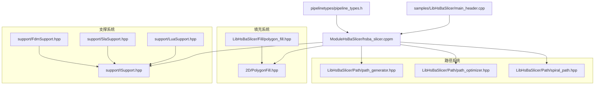
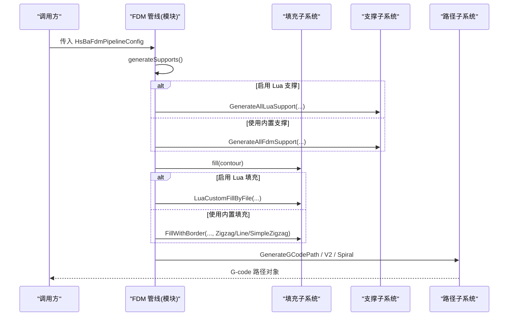
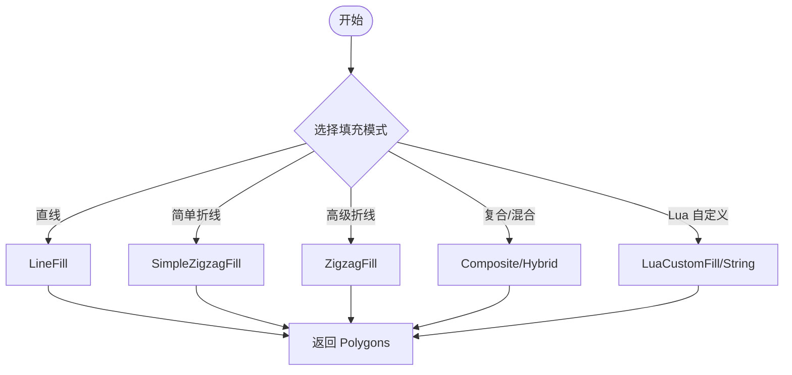
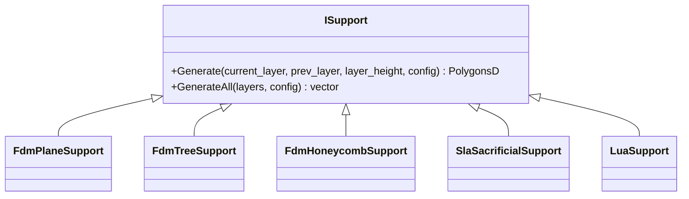
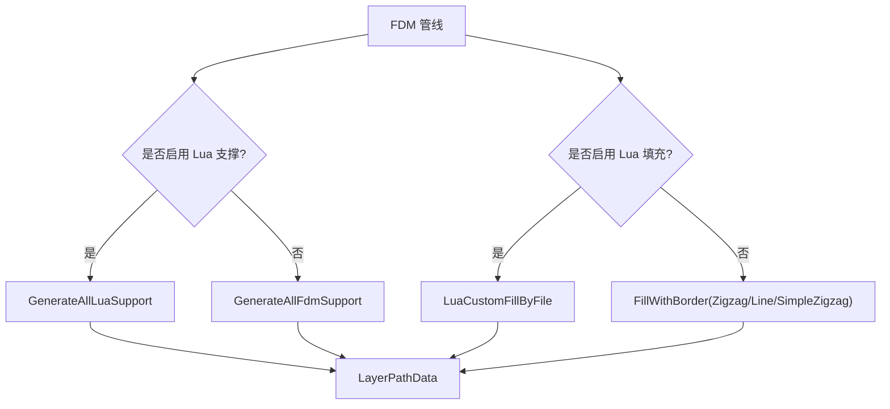
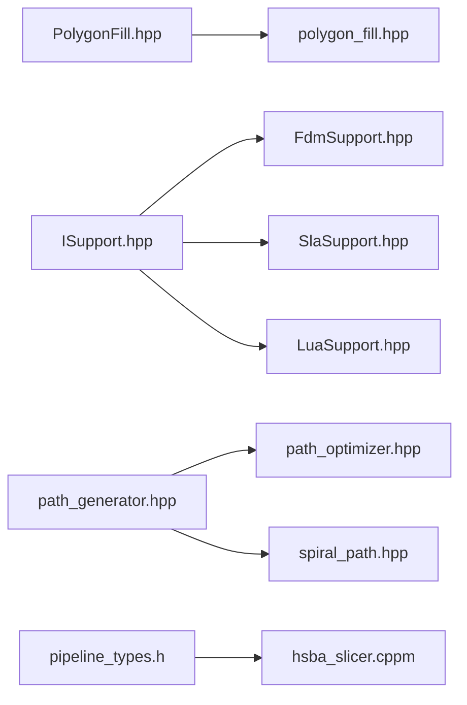

# 算法扩展开发

<cite>
**本文引用的文件**   
- [pipeline_types.h](file://pipelinetypes/pipeline_types.h)
- [ISupport.hpp](file://support/ISupport.hpp)
- [FdmSupport.hpp](file://support/FdmSupport.hpp)
- [SlaSupport.hpp](file://support/SlaSupport.hpp)
- [LuaSupport.hpp](file://support/LuaSupport.hpp)
- [polygon_fill.hpp](file://LibHsBaSlicer/Fill/polygon_fill.hpp)
- [PolygonFill.hpp](file://2D/PolygonFill.hpp)
- [path_generator.hpp](file://LibHsBaSlicer/Path/path_generator.hpp)
- [path_optimizer.hpp](file://LibHsBaSlicer/Path/path_optimizer.hpp)
- [spiral_path.hpp](file://LibHsBaSlicer/Path/spiral_path.hpp)
- [hsba_slicer.cppm](file://ModuleHsBaSlicer/hsba_slicer.cppm)
- [main_header.cpp](file://samples/LibHsBaSlicer/main_header.cpp)
</cite>

## 目录
1. [引言](#引言)
2. [项目结构](#项目结构)
3. [核心组件](#核心组件)
4. [架构总览](#架构总览)
5. [详细组件分析](#详细组件分析)
6. [依赖关系分析](#依赖关系分析)
7. [性能与复杂度](#性能与复杂度)
8. [调试与性能分析方法](#调试与性能分析方法)
9. [结论](#结论)
10. [附录：接口规范速查](#附录接口规范速查)

## 引言
本指南面向需要在 HsBaSlicer 中扩展自定义算法的开发者，覆盖填充算法、支撑生成算法、路径规划与优化等核心能力的扩展方式。文档基于源码实证，给出接口定义、输入输出约定、参数传递机制、返回值语义，并提供可落地的实现思路、流程图与类图，帮助你在不破坏现有管线的前提下，以 C++ 或 Lua 脚本两种方式扩展算法能力。

## 项目结构
围绕算法扩展的关键代码分布在以下模块：
- 2D 几何与填充：2D/PolygonFill.*、LibHsBaSlicer/Fill/polygon_fill.*
- 支撑系统：support/*（抽象接口 ISupport、FDM/SLA 具体实现、Lua 自定义支撑）
- 路径生成与优化：LibHsBaSlicer/Path/*（G-code 路径、区域路径优化器、螺旋外壁）
- 管线类型与配置：pipelinetypes/pipeline_types.h
- 管线集成点：ModuleHsBaSlicer/hsba_slicer.cppm
- 示例入口：samples/LibHsBaSlicer/main_header.cpp



**图示来源**
- [pipeline_types.h:56-113](file://pipelinetypes/pipeline_types.h#L56-L113)
- [ISupport.hpp:14-45](file://support/ISupport.hpp#L14-L45)
- [polygon_fill.hpp:15-53](file://LibHsBaSlicer/Fill/polygon_fill.hpp#L15-L53)
- [PolygonFill.hpp:20-136](file://2D/PolygonFill.hpp#L20-L136)
- [path_generator.hpp:20-91](file://LibHsBaSlicer/Path/path_generator.hpp#L20-L91)
- [path_optimizer.hpp:23-115](file://LibHsBaSlicer/Path/path_optimizer.hpp#L23-L115)
- [spiral_path.hpp:16-58](file://LibHsBaSlicer/Path/spiral_path.hpp#L16-L58)
- [hsba_slicer.cppm:640-670](file://ModuleHsBaSlicer/hsba_slicer.cppm#L640-L670)

**章节来源**
- [pipeline_types.h:56-113](file://pipelinetypes/pipeline_types.h#L56-L113)
- [hsba_slicer.cppm:640-670](file://ModuleHsBaSlicer/hsba_slicer.cppm#L640-L670)

## 核心组件
本节聚焦三类可扩展能力：填充、支撑、路径。

- 填充系统
  - 提供内置模式：直线填充、简单折线填充、高级折线填充；支持偏移/复合/混合填充。
  - 提供 Lib 层封装：FillPolygon、FillWithBorder、LuaCustomFillByFile。
  - 底层 2D 引擎：LineFill、SimpleZigzagFill、ZigzagFill、CompositeOffsetFill、HybridFill、LuaCustomFill/String。

- 支撑系统
  - 抽象接口 ISupport：按层接收当前层/上一层轮廓与层高，返回支撑截面多边形。
  - FDM 支撑：平面柱体、树形、蜂窝三种策略。
  - SLA 支撑：牺牲型细柱支撑。
  - Lua 自定义支撑：通过脚本完全替换内置算法。

- 路径系统与优化
  - G-code 路径生成：GenerateGCodePath / GenerateGCodePathV2 / GenerateGCodePathSpiral。
  - 区域路径优化器 RegionPathOptimizer：对独立区域进行访问顺序优化，支持“填充结果模式”和“多边形模式”。
  - 螺旋外壁：SpiralizeOuterWall 将各层外轮廓合并为连续上升路径。

**章节来源**
- [polygon_fill.hpp:15-53](file://LibHsBaSlicer/Fill/polygon_fill.hpp#L15-L53)
- [PolygonFill.hpp:20-136](file://2D/PolygonFill.hpp#L20-L136)
- [ISupport.hpp:14-45](file://support/ISupport.hpp#L14-L45)
- [FdmSupport.hpp:13-63](file://support/FdmSupport.hpp#L13-L63)
- [SlaSupport.hpp:13-42](file://support/SlaSupport.hpp#L13-L42)
- [LuaSupport.hpp:19-81](file://support/LuaSupport.hpp#L19-L81)
- [path_generator.hpp:20-91](file://LibHsBaSlicer/Path/path_generator.hpp#L20-L91)
- [path_optimizer.hpp:23-115](file://LibHsBaSlicer/Path/path_optimizer.hpp#L23-L115)
- [spiral_path.hpp:16-58](file://LibHsBaSlicer/Path/spiral_path.hpp#L16-L58)

## 架构总览
下图展示从配置到执行的关键流程：管线配置决定使用内置还是 Lua 自定义算法；填充与支撑分别由对应子系统处理；路径生成与优化在后续阶段完成。



**图示来源**
- [pipeline_types.h:56-113](file://pipelinetypes/pipeline_types.h#L56-L113)
- [hsba_slicer.cppm:640-670](file://ModuleHsBaSlicer/hsba_slicer.cppm#L640-L670)
- [polygon_fill.hpp:39-53](file://LibHsBaSlicer/Fill/polygon_fill.hpp#L39-L53)
- [path_generator.hpp:44-80](file://LibHsBaSlicer/Path/path_generator.hpp#L44-L80)

## 详细组件分析

### 填充算法扩展
- 内置算法族
  - 直线填充 LineFill：按角度生成平行扫描线并裁剪。
  - 简单折线 SimpleZigzagFill：基础折线填充。
  - 高级折线 ZigzagFill：改进拐角处理的折线填充。
  - 复合/混合填充 CompositeOffsetFill / HybridFill：先偏移再填充的组合策略。
- Lib 层封装
  - FillPolygon：直接对 Polygons 调用 2D 填充。
  - FillWithBorder：带边框偏移的填充，常用于外壁+内填充组合。
  - LuaCustomFillByFile：通过脚本文件注入自定义填充逻辑。
- 2D 引擎扩展点
  - LuaCustomFill / LuaCustomFillString：允许通过 Lua 函数 generate_fill 返回填充多边形。
  - RegisterLuaPolygonFillFunctions：向 Lua 暴露 polygon 操作与填充函数。



**图示来源**
- [PolygonFill.hpp:20-136](file://2D/PolygonFill.hpp#L20-L136)
- [polygon_fill.hpp:15-53](file://LibHsBaSlicer/Fill/polygon_fill.hpp#L15-L53)

**章节来源**
- [PolygonFill.hpp:20-136](file://2D/PolygonFill.hpp#L20-L136)
- [polygon_fill.hpp:15-53](file://LibHsBaSlicer/Fill/polygon_fill.hpp#L15-L53)

#### 如何实现自定义填充算法
- C++ 扩展
  - 在 2D 层新增一个函数（例如 SpiralFill），遵循 PolygonFill.hpp 的函数签名风格：输入 Polygons，输出 Polygons。
  - 若需与管线集成，可在 ModuleHsBaSlicer 的 FDM 管线分支中添加新 FillMode，并在 hsba_slicer.cppm 中映射。
- Lua 扩展
  - 编写脚本实现函数 generate_fill(poly)，返回填充后的多边形集合。
  - 通过 Lib 层 API LuaCustomFillByFile 或管线配置的 infill_lua_script/infill_lua_func 启用。

参考路径：
- [polygon_fill.hpp:39-53](file://LibHsBaSlicer/Fill/polygon_fill.hpp#L39-L53)
- [PolygonFill.hpp:104-136](file://2D/PolygonFill.hpp#L104-L136)
- [hsba_slicer.cppm:663-670](file://ModuleHsBaSlicer/hsba_slicer.cppm#L663-L670)

**章节来源**
- [polygon_fill.hpp:39-53](file://LibHsBaSlicer/Fill/polygon_fill.hpp#L39-L53)
- [PolygonFill.hpp:104-136](file://2D/PolygonFill.hpp#L104-L136)
- [hsba_slicer.cppm:663-670](file://ModuleHsBaSlicer/hsba_slicer.cppm#L663-L670)

### 支撑生成算法扩展
- 抽象接口
  - ISupport::Generate(current_layer, prev_layer, layer_height, config)：按层生成支撑截面。
  - ISupport::GenerateAll(layers, config)：默认逐层迭代实现。
- 内置实现
  - FdmPlaneSupport：从悬垂区域膨胀生成柱状支撑。
  - FdmTreeSupport：自下而上生长的树形支撑。
  - FdmHoneycombSupport：在悬垂区域内填充蜂窝网格。
  - SlaSacrificialSupport：SLA 牺牲型细柱支撑。
- Lua 自定义支撑
  - LuaSupport：支持内联脚本或脚本文件，全局变量 current_layer、prev_layer、layer_height、config 可用。
  - 可通过 Support.new_lua/new_lua_file 创建，或在管线配置中使用 support_lua_script/support_lua_func。



**图示来源**
- [ISupport.hpp:14-45](file://support/ISupport.hpp#L14-L45)
- [FdmSupport.hpp:13-63](file://support/FdmSupport.hpp#L13-L63)
- [SlaSupport.hpp:13-42](file://support/SlaSupport.hpp#L13-L42)
- [LuaSupport.hpp:19-81](file://support/LuaSupport.hpp#L19-L81)

**章节来源**
- [ISupport.hpp:14-45](file://support/ISupport.hpp#L14-L45)
- [FdmSupport.hpp:13-63](file://support/FdmSupport.hpp#L13-L63)
- [SlaSupport.hpp:13-42](file://support/SlaSupport.hpp#L13-L42)
- [LuaSupport.hpp:19-81](file://support/LuaSupport.hpp#L19-L81)

#### 如何实现自定义支撑算法
- C++ 扩展
  - 新建类继承 ISupport，实现 Generate 方法；在 FDM 管线分支中根据配置枚举切换。
  - 参考 FdmSupport.hpp 中的 FdmPlaneSupport/FdmTreeSupport/FdmHoneycombSupport 的实现风格。
- Lua 扩展
  - 编写 generate_support(current_layer, prev_layer, layer_height, cfg) 返回支撑多边形。
  - 通过 Support.new_lua(path, func) 或管线配置 support_lua_script/support_lua_func 启用。

参考路径：
- [FdmSupport.hpp:13-63](file://support/FdmSupport.hpp#L13-L63)
- [LuaSupport.hpp:28-64](file://support/LuaSupport.hpp#L28-L64)
- [pipeline_types.h:76-108](file://pipelinetypes/pipeline_types.h#L76-L108)

**章节来源**
- [FdmSupport.hpp:13-63](file://support/FdmSupport.hpp#L13-L63)
- [LuaSupport.hpp:28-64](file://support/LuaSupport.hpp#L28-L64)
- [pipeline_types.h:76-108](file://pipelinetypes/pipeline_types.h#L76-L108)

### 路径规划与优化扩展
- 路径生成
  - GenerateGCodePath / GenerateGCodePathV2：从 LayerPathData 生成 G-code 路径。
  - GenerateGCodePathSpiral：将各层外轮廓合并为连续上升路径（花瓶模式）。
- 区域路径优化
  - RegionPathOptimizer：对独立区域进行访问顺序优化，支持两种模式：
    - 填充结果模式：addRegion(paths)，buildPaths() 输出完整填充路径。
    - 多边形模式：addPolygonRegion(polygons)，buildPolygons() 输出优化后的多边形序列。
  - Lua 绑定：RegisterLuaPathOptimizeFunctions，提供 PathOptimize.optimizeRegions/optimizePolygons 等一次性优化接口。
- 螺旋外壁
  - SpiralizeOuterWall：从每层外轮廓构建连续 3D 路径，适合均匀截面的棱柱模型。

```mermaid
sequenceDiagram
participant App as "应用"
participant Opt as "RegionPathOptimizer"
participant Gen as "路径生成器"
App->>Opt : addRegion(id, paths) 或 addPolygonRegion(id, polygons)
App->>Opt : optimizeOrder()
alt 填充结果模式
Opt-->>App : buildPaths()
else 多边形模式
Opt-->>App : buildPolygons()
end
App->>Gen : GenerateGCodePath / V2 / Spiral
Gen-->>App : G-code 路径对象
```

**图示来源**
- [path_optimizer.hpp:23-115](file://LibHsBaSlicer/Path/path_optimizer.hpp#L23-L115)
- [path_generator.hpp:44-80](file://LibHsBaSlicer/Path/path_generator.hpp#L44-L80)
- [spiral_path.hpp:31-58](file://LibHsBaSlicer/Path/spiral_path.hpp#L31-L58)

**章节来源**
- [path_optimizer.hpp:23-115](file://LibHsBaSlicer/Path/path_optimizer.hpp#L23-L115)
- [path_generator.hpp:44-80](file://LibHsBaSlicer/Path/path_generator.hpp#L44-L80)
- [spiral_path.hpp:31-58](file://LibHsBaSlicer/Path/spiral_path.hpp#L31-L58)

#### 如何实现自定义路径优化器
- 使用 RegionPathOptimizer
  - 在填充前：addPolygonRegion 添加多边形区域，optimizeOrder 后 buildPolygons 得到优化顺序的多边形集。
  - 在填充后：addRegion 添加填充路径段，optimizeOrder 后 buildPaths 得到优化的完整路径。
- Lua 脚本扩展
  - 使用 PathOptimize.optimizeRegions/optimizePolygons 一次性优化。
  - 或通过 LuaOptimizeRegionPaths/LuaOptimizeRegionPolygons 系列 API 加载脚本。

参考路径：
- [path_optimizer.hpp:44-95](file://LibHsBaSlicer/Path/path_optimizer.hpp#L44-L95)
- [path_optimizer.hpp:102-186](file://LibHsBaSlicer/Path/path_optimizer.hpp#L102-L186)

**章节来源**
- [path_optimizer.hpp:44-95](file://LibHsBaSlicer/Path/path_optimizer.hpp#L44-L95)
- [path_optimizer.hpp:102-186](file://LibHsBaSlicer/Path/path_optimizer.hpp#L102-L186)

### 管线集成与数据流
- FDM 管线在支撑与填充阶段的分支逻辑：
  - 若配置了 support_lua_script，则走 Lua 支撑；否则走内置 FDM 支撑。
  - 若配置了 infill_lua_script，则走 Lua 填充；否则走内置 FillWithBorder。
- 示例入口展示了如何组装 LayerPathData 并调用支撑与填充。



**图示来源**
- [hsba_slicer.cppm:640-670](file://ModuleHsBaSlicer/hsba_slicer.cppm#L640-L670)
- [main_header.cpp:120-156](file://samples/LibHsBaSlicer/main_header.cpp#L120-L156)

**章节来源**
- [hsba_slicer.cppm:640-670](file://ModuleHsBaSlicer/hsba_slicer.cppm#L640-L670)
- [main_header.cpp:120-156](file://samples/LibHsBaSlicer/main_header.cpp#L120-L156)

## 依赖关系分析
- 填充系统依赖 2D 几何库（Clipper2 等）与 Lua 适配器。
- 支撑系统依赖悬垂检测与 2D 多边形运算；LuaSupport 依赖 Lua 环境。
- 路径系统依赖 2D 多边形与路径数据结构（PointsPath/GCodePath）。
- 管线类型定义集中于 pipeline_types.h，作为 C 兼容的配置与结果结构。



**图示来源**
- [PolygonFill.hpp:20-136](file://2D/PolygonFill.hpp#L20-L136)
- [polygon_fill.hpp:15-53](file://LibHsBaSlicer/Fill/polygon_fill.hpp#L15-L53)
- [ISupport.hpp:14-45](file://support/ISupport.hpp#L14-L45)
- [FdmSupport.hpp:13-63](file://support/FdmSupport.hpp#L13-L63)
- [SlaSupport.hpp:13-42](file://support/SlaSupport.hpp#L13-L42)
- [LuaSupport.hpp:19-81](file://support/LuaSupport.hpp#L19-L81)
- [path_generator.hpp:20-91](file://LibHsBaSlicer/Path/path_generator.hpp#L20-L91)
- [path_optimizer.hpp:23-115](file://LibHsBaSlicer/Path/path_optimizer.hpp#L23-L115)
- [spiral_path.hpp:16-58](file://LibHsBaSlicer/Path/spiral_path.hpp#L16-L58)
- [pipeline_types.h:56-113](file://pipelinetypes/pipeline_types.h#L56-L113)
- [hsba_slicer.cppm:640-670](file://ModuleHsBaSlicer/hsba_slicer.cppm#L640-L670)

**章节来源**
- [pipeline_types.h:56-113](file://pipelinetypes/pipeline_types.h#L56-L113)
- [hsba_slicer.cppm:640-670](file://ModuleHsBaSlicer/hsba_slicer.cppm#L640-L670)

## 性能与复杂度
- 填充算法
  - 直线/折线填充通常与扫描行数 × 线段裁剪成本相关；复杂边界会增加 Intersection 与排序开销。
  - 复合/混合填充会引入多次 Offset 计算，复杂度随偏移层数线性增长。
  - Lua 自定义填充的性能取决于脚本实现；建议避免在脚本中进行大量几何布尔运算。
- 支撑算法
  - 平面支撑：悬垂区域膨胀与圆/矩形生成，复杂度与悬垂面积及采样密度相关。
  - 树形支撑：分支生长与合并涉及近邻搜索与拓扑维护，复杂度较高。
  - 蜂窝支撑：六边形网格填充与边界裁剪，复杂度与单元格数量成正比。
- 路径优化
  - RegionPathOptimizer 使用遗传 TSP 求解区域访问顺序，区域数量较多时计算成本显著增加。
  - 多边形模式与填充结果模式的内部代价不同：前者侧重顶点重排，后者侧重端点匹配与方向调整。
- 螺旋外壁
  - SpiralizeOuterWall 主要开销在于每层外轮廓选择与接缝对齐，整体接近 O(N)（N 为轮廓点数）。

[本节为通用性能讨论，不直接分析具体文件]

## 调试与性能分析方法
- 单元测试与样例
  - 使用 samples/LibHsBaSlicer/main_header.cpp 快速验证支撑与填充的装配流程。
  - 针对填充算法，可构造凹多边形（如 U 形）测试桥接与连通性。
- Lua 脚本调试
  - 在 Lua 支撑/填充脚本中打印中间结果（如悬垂区域、支撑点、填充路径段），确认数据流正确性。
  - 使用 PathOptimize.optimizeRegions/optimizePolygons 对比优化前后路径长度与跳跃次数。
- 性能剖析
  - 对关键循环（扫描行生成、Intersection、Offset、TSP）加入计时点，定位热点。
  - 控制参数（spacing、lineThickness、support_diameter、support_density）进行敏感性分析，观察时间与内存变化。
- 回归测试
  - 保持固定输入模型与参数，比较新旧算法输出的路径长度、总打印时间估算、支撑体积等指标。

**章节来源**
- [main_header.cpp:120-156](file://samples/LibHsBaSlicer/main_header.cpp#L120-L156)
- [path_optimizer.hpp:102-186](file://LibHsBaSlicer/Path/path_optimizer.hpp#L102-L186)

## 结论
HsBaSlicer 提供了清晰的扩展点：
- 填充：通过 2D 引擎函数或 Lua 脚本注入自定义填充策略。
- 支撑：通过继承 ISupport 或编写 Lua 脚本替换内置支撑算法。
- 路径：利用 RegionPathOptimizer 与螺旋外壁 API 优化路径访问顺序与连续性。
结合 pipeline_types.h 的配置结构与 ModuleHsBaSlicer 的管线分支，开发者可以以最小侵入的方式扩展核心功能，并通过单元测试与性能剖析持续优化算法效率。

[本节为总结性内容，不直接分析具体文件]

## 附录：接口规范速查
- 填充 API（Lib 层）
  - FillPolygon(poly, spacing, mode, angle_deg) → Polygons
  - FillWithBorder(poly, spacing, border_count, fill_mode, angle_deg) → Polygons
  - LuaCustomFillByFile(poly, scriptPath, functionName="generate_fill", lineThickness=0.5) → Polygons
- 填充 API（2D 引擎）
  - LineFill / SimpleZigzagFill / ZigzagFill / CompositeOffsetFill / HybridFill
  - LuaCustomFill / LuaCustomFillString
  - RegisterLuaPolygonFillFunctions(L)
- 支撑接口
  - ISupport::Generate(current_layer, prev_layer, layer_height, config) → PolygonsD
  - ISupport::GenerateAll(layers, config) → vector<PolygonsD>
  - FdmPlaneSupport / FdmTreeSupport / FdmHoneycombSupport / SlaSacrificialSupport
  - LuaSupport(script|file, funcName)
- 路径 API
  - GenerateGCodePath(layer_data, config) → PointsPath
  - GenerateGCodePathV2(layer_data, config, printer_config) → GCodePath
  - GenerateGCodePathSpiral(layer_outlines, layer_zs, printer_config) → GCodePath
  - RegionPathOptimizer.addRegion/addPolygonRegion/addRoute/optimizeOrder/buildPaths/buildPolygons
  - RegisterLuaPathOptimizeFunctions(L)
  - SpiralizeOuterWall(layer_sections, layer_zs) → vector<SpiralPoint>

**章节来源**
- [polygon_fill.hpp:15-53](file://LibHsBaSlicer/Fill/polygon_fill.hpp#L15-L53)
- [PolygonFill.hpp:20-136](file://2D/PolygonFill.hpp#L20-L136)
- [ISupport.hpp:14-45](file://support/ISupport.hpp#L14-L45)
- [FdmSupport.hpp:13-63](file://support/FdmSupport.hpp#L13-L63)
- [SlaSupport.hpp:13-42](file://support/SlaSupport.hpp#L13-L42)
- [LuaSupport.hpp:19-81](file://support/LuaSupport.hpp#L19-L81)
- [path_generator.hpp:20-91](file://LibHsBaSlicer/Path/path_generator.hpp#L20-L91)
- [path_optimizer.hpp:23-115](file://LibHsBaSlicer/Path/path_optimizer.hpp#L23-L115)
- [spiral_path.hpp:16-58](file://LibHsBaSlicer/Path/spiral_path.hpp#L16-L58)