# 路径算法扩展

<cite>
**本文引用的文件**   
- [IPath.hpp](file://paths/IPath.hpp)
- [layerspath.hpp](file://paths/layerspath.hpp)
- [pointspath.hpp](file://paths/pointspath.hpp)
- [gcodepath.hpp](file://paths/gcodepath.hpp)
- [robotpath.hpp](file://paths/robotpath.hpp)
- [weldrobotpath.hpp](file://paths/weldrobotpath.hpp)
- [path_generator.hpp](file://LibHsBaSlicer/Path/path_generator.hpp)
- [path_generator.cpp](file://LibHsBaSlicer/Path/path_generator.cpp)
- [spiral_path.hpp](file://LibHsBaSlicer/Path/spiral_path.hpp)
- [spiral_path.cpp](file://LibHsBaSlicer/Path/spiral_path.cpp)
- [path_optimizer.hpp](file://LibHsBaSlicer/Path/path_optimizer.hpp)
- [waam_export.hpp](file://LibHsBaSlicer/Path/waam_export.hpp)
- [waam_export.cpp](file://LibHsBaSlicer/Path/waam_export.cpp)
- [sls_export.hpp](file://LibHsBaSlicer/Path/sls_export.hpp)
- [my_waam_path.lua](file://samples/WAAM/scripts/my_waam_path.lua)
- [hsba_pipeline.d.lua](file://types/hsba_pipeline.d.lua)
- [pipeline_types.h](file://pipelinetypes/pipeline_types.h)
- [AreaGraph.hpp](file://utils/AreaGraph.hpp)
</cite>

## 目录
1. [引言](#引言)
2. [项目结构](#项目结构)
3. [核心概念](#核心概念)
4. [核心模块详解](#核心模块详解)
5. [架构总览](#架构总览)
6. [详细组件分析](#详细组件分析)
7. [依赖关系分析](#依赖关系分析)
8. [性能与优化策略](#性能与优化策略)
9. [故障排除指南](#故障排除指南)
10. [结论](#结论)
11. [附录：接口参考与示例](#附录接口参考与示例)

## 引言
本指南面向需要在 HsBaSlicer 中开发自定义路径规划算法的工程师，覆盖 G-code 路径生成、机器人路径规划、焊接路径优化等能力。文档基于源码实证，说明路径数据结构定义、路径生成函数签名、路径优化回调机制，并提供 WAAM 焊接路径、螺旋路径、分层路径等实现思路与代码片段路径，帮助你在不修改核心库的前提下扩展路径算法。

## 项目结构
路径相关能力主要分布在以下位置：
- paths：路径输出抽象与具体类型（IPath、LayersPath、PointsPath、GCodePath、RobotPath、WeldRobotPath）。
- LibHsBaSlicer/Path：路径生成与优化 API（path_generator、spiral_path、path_optimizer、waam_export、sls_export）。
- samples/WAAM：WAAM 自定义机器人脚本示例。
- types/pipelinetypes：C ABI 配置与结果结构。
- utils/AreaGraph：区域图与 TSP 求解基础设施。

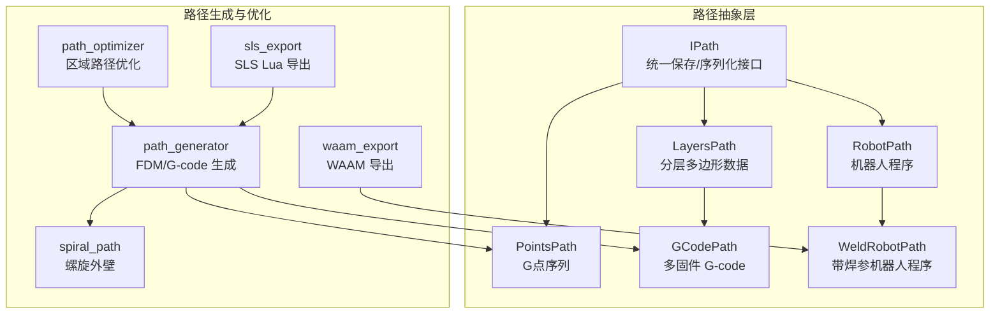

**图示来源**
- [IPath.hpp:29-57](file://paths/IPath.hpp#L29-L57)
- [layerspath.hpp:25-60](file://paths/layerspath.hpp#L25-L60)
- [pointspath.hpp:61-94](file://paths/pointspath.hpp#L61-L94)
- [gcodepath.hpp:66-107](file://paths/gcodepath.hpp#L66-L107)
- [robotpath.hpp:61-104](file://paths/robotpath.hpp#L61-L104)
- [weldrobotpath.hpp:65-96](file://paths/weldrobotpath.hpp#L65-L96)
- [path_generator.hpp:23-91](file://LibHsBaSlicer/Path/path_generator.hpp#L23-L91)
- [spiral_path.hpp:24-58](file://LibHsBaSlicer/Path/spiral_path.hpp#L24-L58)
- [path_optimizer.hpp:44-95](file://LibHsBaSlicer/Path/path_optimizer.hpp#L44-L95)
- [waam_export.hpp:23-72](file://LibHsBaSlicer/Path/waam_export.hpp#L23-L72)
- [sls_export.hpp:24-56](file://LibHsBaSlicer/Path/sls_export.hpp#L24-L56)

**章节来源**
- [IPath.hpp:29-57](file://paths/IPath.hpp#L29-L57)
- [path_generator.hpp:23-91](file://LibHsBaSlicer/Path/path_generator.hpp#L23-L91)
- [path_optimizer.hpp:44-95](file://LibHsBaSlicer/Path/path_optimizer.hpp#L44-L95)

## 核心概念
- IPath 抽象：所有路径输出均继承 IPath，提供 Save/ToString 系列接口，支持原生格式与 Lua 后处理回调。
- 分层路径 LayersPath：按层存储 PolygonsD 与自由配置字符串，便于后续 G-code/机器人程序生成。
- 点序列 PointsPath：以 GPoint 序列表达 G-code 运动命令，包含目标点、速度、挤出量等。
- GCodePath：在 LayersPath 基础上增加多固件（Marlin/RepRap/Klipper）G-code 生成与连续螺旋外壁支持。
- RobotPath/WeldRobotPath：面向工业机器人的程序生成，后者附加焊接参数（电流、电压、送丝速度等）。
- SpiralizeOuterWall：将每层外轮廓合并为一条 Z 连续上升的螺旋路径，适用于花瓶模式或连续沉积。
- RegionPathOptimizer：对独立区域进行访问顺序优化（TSP），减少空走距离；支持填充前/填充后两种模式。

**章节来源**
- [IPath.hpp:29-57](file://paths/IPath.hpp#L29-L57)
- [layerspath.hpp:25-60](file://paths/layerspath.hpp#L25-L60)
- [pointspath.hpp:44-94](file://paths/pointspath.hpp#L44-L94)
- [gcodepath.hpp:24-107](file://paths/gcodepath.hpp#L24-L107)
- [robotpath.hpp:44-104](file://paths/robotpath.hpp#L44-L104)
- [weldrobotpath.hpp:34-96](file://paths/weldrobotpath.hpp#L34-L96)
- [spiral_path.hpp:24-58](file://LibHsBaSlicer/Path/spiral_path.hpp#L24-L58)
- [path_optimizer.hpp:23-95](file://LibHsBaSlicer/Path/path_optimizer.hpp#L23-L95)

## 核心模块详解
### 路径抽象与输出类型
- IPath：统一 Save/ToString 接口，支持内联 Lua 脚本或脚本文件 + 函数名，以及可选的 lua_reg 回调注册额外函数。
- LayersPath：维护 layers_ 列表，每层包含 layerConfig 与 PolygonsD；可设置进度回调。
- PointsPath：维护 GPoint 序列，支持绝对/相对单位、平面选择、直线/圆弧指令。
- GCodePath：继承 LayersPath，新增 ToGCode/SaverGCode、连续螺旋外壁 setContinuousWall、打印机配置 GCodePrinterConfig。
- RobotPath：维护 RLPoint 序列，支持 ABB/KUKA/FANUC 三种语言品牌，支持起始/结束程序块。
- WeldRobotPath：在 RobotPath 基础上增加 WeldParam 与 isWelding 标记，用于焊接段控制。

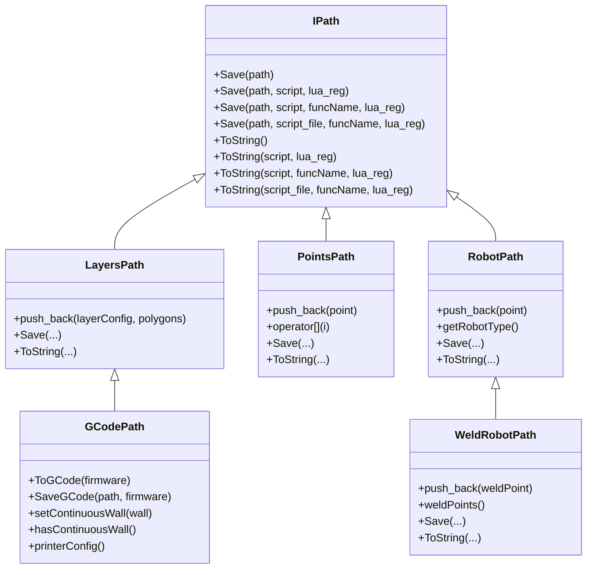

**图示来源**
- [IPath.hpp:29-57](file://paths/IPath.hpp#L29-L57)
- [layerspath.hpp:25-60](file://paths/layerspath.hpp#L25-L60)
- [pointspath.hpp:61-94](file://paths/pointspath.hpp#L61-L94)
- [gcodepath.hpp:66-107](file://paths/gcodepath.hpp#L66-L107)
- [robotpath.hpp:61-104](file://paths/robotpath.hpp#L61-L104)
- [weldrobotpath.hpp:65-96](file://paths/weldrobotpath.hpp#L65-L96)

**章节来源**
- [IPath.hpp:29-57](file://paths/IPath.hpp#L29-L57)
- [layerspath.hpp:25-60](file://paths/layerspath.hpp#L25-L60)
- [pointspath.hpp:61-94](file://paths/pointspath.hpp#L61-L94)
- [gcodepath.hpp:66-107](file://paths/gcodepath.hpp#L66-L107)
- [robotpath.hpp:61-104](file://paths/robotpath.hpp#L61-L104)
- [weldrobotpath.hpp:65-96](file://paths/weldrobotpath.hpp#L65-L96)

### FDM 路径生成与螺旋路径
- path_generator：提供 GenerateGCodePath（返回 PointsPath）、GenerateGCodePathV2（返回 GCodePath）、GenerateGCodePathSpiral（返回带连续螺旋壁的 GCodePath），以及 PolygonsToGPoints 辅助函数。
- spiral_path：SpiralizeOuterWall 从每层外轮廓生成连续 3D 路径，保证接缝对齐与 Z 线性插值，避免层间停顿。

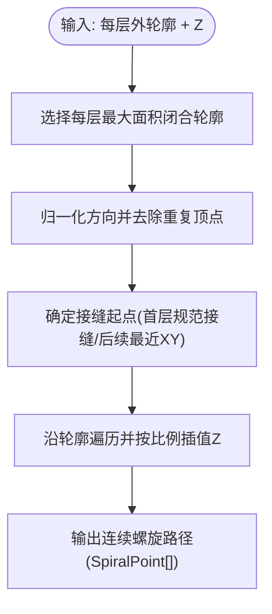

**图示来源**
- [spiral_path.cpp:88-163](file://LibHsBaSlicer/Path/spiral_path.cpp#L88-L163)
- [spiral_path.hpp:24-58](file://LibHsBaSlicer/Path/spiral_path.hpp#L24-L58)

**章节来源**
- [path_generator.hpp:23-91](file://LibHsBaSlicer/Path/path_generator.hpp#L23-L91)
- [path_generator.cpp:14-140](file://LibHsBaSlicer/Path/path_generator.cpp#L14-L140)
- [spiral_path.hpp:24-58](file://LibHsBaSlicer/Path/spiral_path.hpp#L24-L58)
- [spiral_path.cpp:88-163](file://LibHsBaSlicer/Path/spiral_path.cpp#L88-L163)

### 区域路径优化
- RegionPathOptimizer：将每个独立区域建模为 AreaGraph 顶点，使用遗传算法 TSP 求解访问顺序；内部入口/出口门通过最近邻贪心安排。
- 两种模式：
  - 填充结果模式（addRegion）：输入为填充路径（支持多点折线），输出完整填充路径。
  - 多边形模式（addPolygonRegion）：输入为多边形本身，输出优化顺序的多边形集合供后续填充。
- 可通过 addRoute 手动指定区域间空走代价。

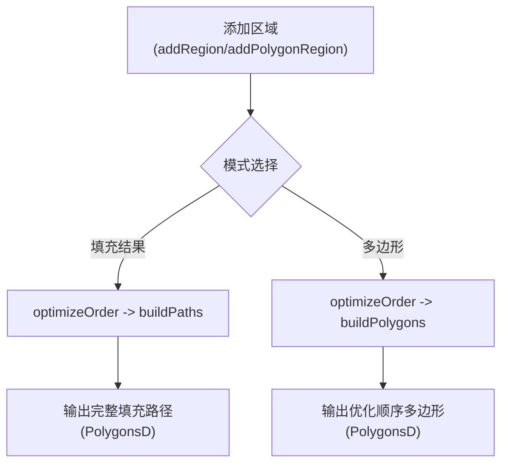

**图示来源**
- [path_optimizer.hpp:44-95](file://LibHsBaSlicer/Path/path_optimizer.hpp#L44-L95)
- [AreaGraph.hpp:253-284](file://utils/AreaGraph.hpp#L253-L284)

**章节来源**
- [path_optimizer.hpp:44-95](file://LibHsBaSlicer/Path/path_optimizer.hpp#L44-L95)
- [AreaGraph.hpp:253-284](file://utils/AreaGraph.hpp#L253-L284)

### WAAM 焊接路径导出
- waam_export：提供 SaveWaamRobotPath，根据 WaamRobotPackage（含层轮廓、Z高度、焊参、机器人类型、bead_width、spiral_mode）构建 WeldRobotPath 并输出品牌机器人程序。
- 支持 Lua 后处理脚本（export_waam），可完全替换内置 ABB/KUKA/FANUC 生成逻辑。
- pipeline_types.h 暴露 C ABI 配置字段（如 robot_type、path_lua_script、spiral_mode、output_path）。

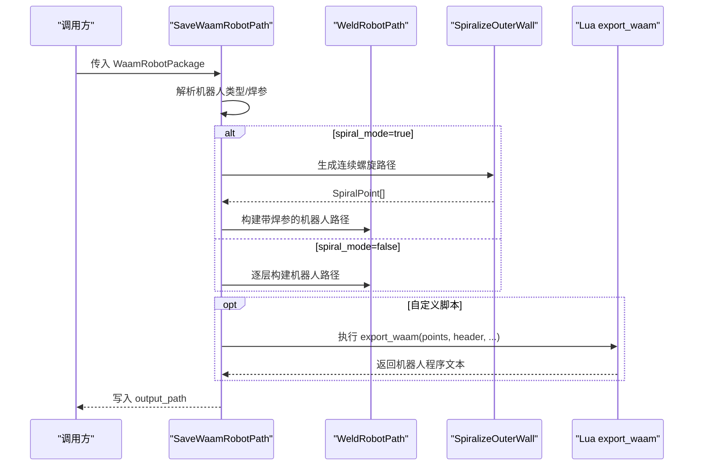

**图示来源**
- [waam_export.hpp:23-72](file://LibHsBaSlicer/Path/waam_export.hpp#L23-L72)
- [waam_export.cpp:1-54](file://LibHsBaSlicer/Path/waam_export.cpp#L1-L54)
- [spiral_path.hpp:24-58](file://LibHsBaSlicer/Path/spiral_path.hpp#L24-L58)
- [my_waam_path.lua:17-45](file://samples/WAAM/scripts/my_waam_path.lua#L17-L45)
- [pipeline_types.h:592-612](file://pipelinetypes/pipeline_types.h#L592-L612)

**章节来源**
- [waam_export.hpp:23-72](file://LibHsBaSlicer/Path/waam_export.hpp#L23-L72)
- [waam_export.cpp:1-54](file://LibHsBaSlicer/Path/waam_export.cpp#L1-L54)
- [my_waam_path.lua:17-45](file://samples/WAAM/scripts/my_waam_path.lua#L17-L45)
- [pipeline_types.h:592-612](file://pipelinetypes/pipeline_types.h#L592-L612)

## 架构总览
整体路径算法扩展架构如下：
- 上层流水线（FDM/WAAM/SLS 等）通过 LibHsBaSlicer/Path 提供的 API 生成路径。
- 路径抽象层（paths/*）负责统一输出与序列化，支持 Lua 后处理。
- 优化层（path_optimizer）在路径输出前对区域访问顺序进行优化。
- 特殊路径（spiral_path）提供连续螺旋外壁生成，适配花瓶模式与连续沉积。
- 导出层（waam_export/sls_export）将路径转换为特定工艺的输出（机器人程序、Lua 驱动归档等）。

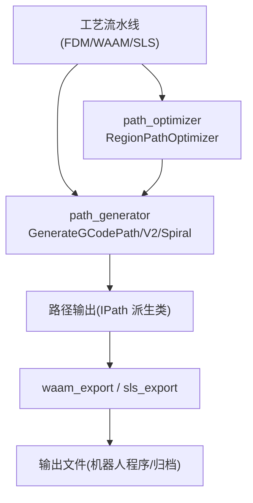

**图示来源**
- [path_generator.hpp:23-91](file://LibHsBaSlicer/Path/path_generator.hpp#L23-L91)
- [path_optimizer.hpp:44-95](file://LibHsBaSlicer/Path/path_optimizer.hpp#L44-L95)
- [waam_export.hpp:23-72](file://LibHsBaSlicer/Path/waam_export.hpp#L23-L72)
- [sls_export.hpp:24-56](file://LibHsBaSlicer/Path/sls_export.hpp#L24-L56)

## 详细组件分析

### G-code 路径生成器
- 输入：LayerPathData（outlines/fills/supports + z_height）与 FdmPathConfig（层高、线宽、速度、挤出倍率、单位）。
- 输出：PointsPath 或 GCodePath。
- 关键流程：
  - PolygonsToGPoints：将多边形转为 GPoint 序列，计算挤出量（线宽×层高×段长×倍率）。
  - GenerateGCodePath：逐层追加轮廓、填充、支撑路径。
  - GenerateGCodePathV2：封装为 GCodePath，保留层配置字符串。
  - GenerateGCodePathSpiral：调用 SpiralizeOuterWall 生成连续螺旋外壁，设置到 GCodePath。

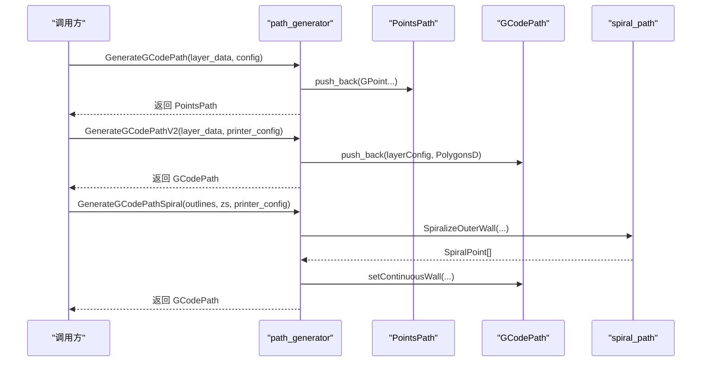

**图示来源**
- [path_generator.cpp:14-140](file://LibHsBaSlicer/Path/path_generator.cpp#L14-L140)
- [path_generator.hpp:23-91](file://LibHsBaSlicer/Path/path_generator.hpp#L23-L91)
- [spiral_path.hpp:24-58](file://LibHsBaSlicer/Path/spiral_path.hpp#L24-L58)

**章节来源**
- [path_generator.cpp:14-140](file://LibHsBaSlicer/Path/path_generator.cpp#L14-L140)
- [path_generator.hpp:23-91](file://LibHsBaSlicer/Path/path_generator.hpp#L23-L91)

### 螺旋路径生成
- 算法要点：
  - 每层选择最大面积闭合轮廓作为外壁。
  - 归一化为 CCW 开放环，去除重复顶点。
  - 首层采用规范接缝（最低 Y，其次最低 X），后续层选择 XY 最近的接缝以保持单缝线。
  - 沿轮廓遍历，Z 在层间线性插值，最后一层平走。
- 适用场景：均匀截面柱体/棱柱的外壁连续沉积，提升表面质量与强度。

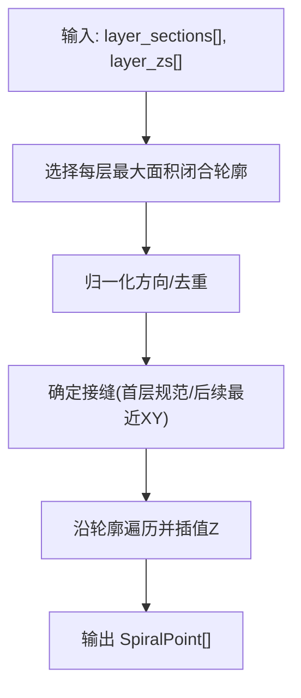

**图示来源**
- [spiral_path.cpp:88-163](file://LibHsBaSlicer/Path/spiral_path.cpp#L88-L163)

**章节来源**
- [spiral_path.cpp:88-163](file://LibHsBaSlicer/Path/spiral_path.cpp#L88-L163)
- [spiral_path.hpp:24-58](file://LibHsBaSlicer/Path/spiral_path.hpp#L24-L58)

### 区域路径优化器
- 建模：每个区域为 AreaGraph 顶点，门（entry/exit）为候选进出点。
- 成本：区域内门到门为直线距离；区域间路由为直线距离（空走）。
- 求解：区域访问顺序用遗传 TSP；区域内门序用最近邻贪心。
- 模式：
  - 填充结果模式：addRegion + optimizeOrder + buildPaths。
  - 多边形模式：addPolygonRegion + optimizeOrder + buildPolygons。
- 扩展：addRoute 可手动覆盖区域间空走代价。

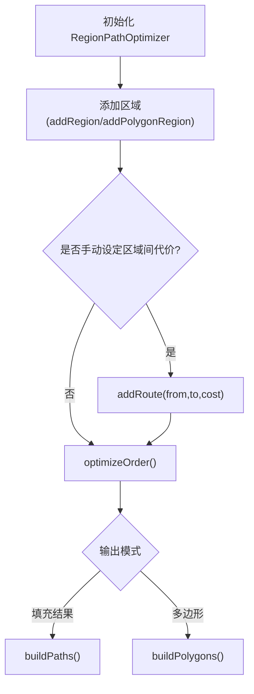

**图示来源**
- [path_optimizer.hpp:44-95](file://LibHsBaSlicer/Path/path_optimizer.hpp#L44-L95)
- [AreaGraph.hpp:253-284](file://utils/AreaGraph.hpp#L253-L284)

**章节来源**
- [path_optimizer.hpp:44-95](file://LibHsBaSlicer/Path/path_optimizer.hpp#L44-L95)
- [AreaGraph.hpp:253-284](file://utils/AreaGraph.hpp#L253-L284)

### WAAM 焊接路径导出与 Lua 脚本
- 数据包：WaamRobotPackage 包含层轮廓、Z高度、焊参、机器人类型、bead_width、config_json、spiral_mode。
- 导出：SaveWaamRobotPath 构建 WeldRobotPath，支持 Lua 脚本 export_waam 替换内置生成器。
- Lua 环境：全局变量 header、startProgramFunc、endProgramFunc、points（数组元素含 end/middle/velocity/type）。
- 返回值：脚本必须返回字符串（完整机器人程序文本）。

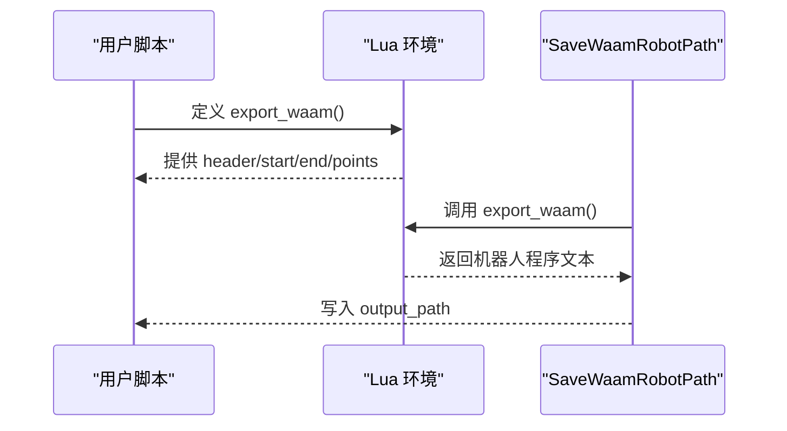

**图示来源**
- [waam_export.hpp:23-72](file://LibHsBaSlicer/Path/waam_export.hpp#L23-L72)
- [my_waam_path.lua:17-45](file://samples/WAAM/scripts/my_waam_path.lua#L17-L45)
- [hsba_pipeline.d.lua:592-623](file://types/hsba_pipeline.d.lua#L592-L623)

**章节来源**
- [waam_export.hpp:23-72](file://LibHsBaSlicer/Path/waam_export.hpp#L23-L72)
- [my_waam_path.lua:17-45](file://samples/WAAM/scripts/my_waam_path.lua#L17-L45)
- [hsba_pipeline.d.lua:592-623](file://types/hsba_pipeline.d.lua#L592-L623)

## 依赖关系分析
- 路径抽象层依赖 2D 几何（FloatPolygons/PolygonsD）与基础工具（error、units）。
- path_generator 依赖 spiral_path 与路径输出类型（PointsPath/GCodePath）。
- path_optimizer 依赖 AreaGraph 进行最短路径与 TSP 求解。
- waam_export 依赖 weldrobotpath 与 spiral_path，并通过 Lua 脚本扩展输出。
- sls_export 通过 Lua 脚本驱动归档与数据库注册。

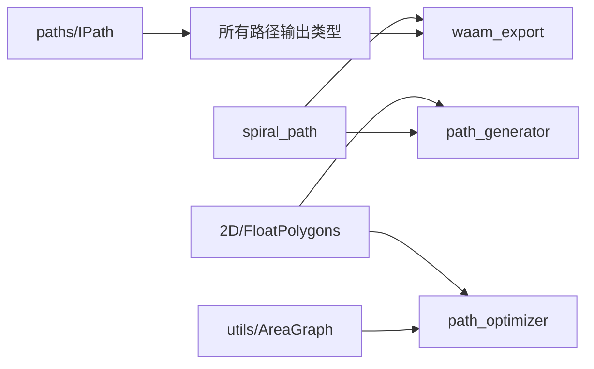

**图示来源**
- [path_generator.hpp:23-91](file://LibHsBaSlicer/Path/path_generator.hpp#L23-L91)
- [path_optimizer.hpp:44-95](file://LibHsBaSlicer/Path/path_optimizer.hpp#L44-L95)
- [waam_export.hpp:23-72](file://LibHsBaSlicer/Path/waam_export.hpp#L23-L72)
- [IPath.hpp:29-57](file://paths/IPath.hpp#L29-L57)

**章节来源**
- [path_generator.hpp:23-91](file://LibHsBaSlicer/Path/path_generator.hpp#L23-L91)
- [path_optimizer.hpp:44-95](file://LibHsBaSlicer/Path/path_optimizer.hpp#L44-L95)
- [waam_export.hpp:23-72](file://LibHsBaSlicer/Path/waam_export.hpp#L23-L72)
- [IPath.hpp:29-57](file://paths/IPath.hpp#L29-L57)

## 性能与优化策略
- 路径长度最小化：
  - 使用 RegionPathOptimizer 对区域访问顺序进行 TSP 优化，减少空走距离。
  - 在填充结果模式下，内部路径方向与顺序通过最近邻贪心减少跳跃。
- 加工时间优化：
  - 合理设置 FdmPathConfig 与 GCodePrinterConfig（print_speed/travel_speed/extrusion_multiplier）。
  - 使用螺旋外壁（spiral_mode）避免层间停顿与重起弧，提升连续沉积效率。
- 材料利用率提升：
  - 调整 line_width、layer_height、extrusion_multiplier 以匹配材料与设备特性。
  - 在 WAAM 中通过 bead_width 与焊参（current/voltage/wire_feed_speed）优化熔覆宽度与热输入。
- 冲突检测与连续性保证：
  - 螺旋路径确保接缝对齐与 Z 线性插值，避免层间断层。
  - 机器人路径中通过 MoveJ/MoveL 与中间点 middle 控制轨迹平滑性。

[本节为通用指导，无需源码引用]

## 故障排除指南
- Lua 脚本错误：
  - 检查 export_waam 返回值是否为字符串；确认 points/header/startProgramFunc/endProgramFunc 是否正确注入。
  - 参考 hsba_pipeline.d.lua 中的类型注解与 my_waam_path.lua 示例。
- 路径为空或异常：
  - 确认 LayerPathData 的 outlines/fills/supports 非空且 z_height 正确。
  - 螺旋路径需每层至少有一个有效闭合轮廓；否则跳过该层。
- 优化结果不符合预期：
  - 检查 addRoute 是否误设了过大的区域间代价。
  - 区分填充结果模式与多边形模式，不可混用同一优化器实例。
- 机器人程序无法运行：
  - 确认 robot_type 与目标控制器一致；必要时使用自定义 Lua 脚本覆盖内置生成器。

**章节来源**
- [my_waam_path.lua:17-45](file://samples/WAAM/scripts/my_waam_path.lua#L17-L45)
- [hsba_pipeline.d.lua:592-623](file://types/hsba_pipeline.d.lua#L592-L623)
- [path_generator.cpp:14-140](file://LibHsBaSlicer/Path/path_generator.cpp#L14-L140)
- [spiral_path.cpp:88-163](file://LibHsBaSlicer/Path/spiral_path.cpp#L88-L163)
- [path_optimizer.hpp:44-95](file://LibHsBaSlicer/Path/path_optimizer.hpp#L44-L95)

## 结论
HsBaSlicer 的路径算法扩展体系以 IPath 抽象为核心，结合 path_generator、spiral_path、path_optimizer 与 waam_export/sls_export，提供了从分层路径到机器人程序的完整链路。开发者可通过 C++ API 与 Lua 脚本灵活定制路径生成与优化策略，满足 FDM、WAAM、SLS 等多种工艺的差异化需求。建议在工程中优先使用 RegionPathOptimizer 进行区域访问优化，并结合螺旋路径与焊参调优提升加工效率与质量。

[本节为总结，无需源码引用]

## 附录：接口参考与示例

### 路径数据结构定义
- OutPoints3：三维输出点（x/y/z）。
- GPoint：G-code 运动点（type/p1/center/velocity/extrusion）。
- PathPoint3D：连续 3D 路径点（用于螺旋外壁）。
- RLPoint/WeldRLPoint：机器人路径点与焊接路径点（含 velocity/type/programIndex 与 WeldParam/isWelding）。
- SpiralPoint：螺旋路径点（x/y/z）。

**章节来源**
- [IPath.hpp:59-65](file://paths/IPath.hpp#L59-L65)
- [pointspath.hpp:44-52](file://paths/pointspath.hpp#L44-L52)
- [gcodepath.hpp:51-60](file://paths/gcodepath.hpp#L51-L60)
- [robotpath.hpp:44-52](file://paths/robotpath.hpp#L44-L52)
- [weldrobotpath.hpp:34-57](file://paths/weldrobotpath.hpp#L34-L57)
- [spiral_path.hpp:24-29](file://LibHsBaSlicer/Path/spiral_path.hpp#L24-L29)

### 路径生成函数签名
- GenerateGCodePath(const vector<LayerPathData>&, const FdmPathConfig&) -> unique_ptr<PointsPath>
- GenerateGCodePathV2(const vector<LayerPathData>&, const FdmPathConfig&, const GCodePrinterConfig&) -> unique_ptr<GCodePath>
- GenerateGCodePathSpiral(const vector<PolygonsD>&, const vector<double>&, const GCodePrinterConfig&) -> unique_ptr<GCodePath>
- PolygonsToGPoints(const PolygonsD&, float, const FdmPathConfig&, bool) -> vector<GPoint>

**章节来源**
- [path_generator.hpp:50-91](file://LibHsBaSlicer/Path/path_generator.hpp#L50-L91)

### 路径优化回调机制
- RegisterLuaPathOptimizeFunctions(lua_State*)：注册 PathOptimize 全局表。
- LuaOptimizeRegionPaths/LuaOptimizeRegionPolygons：通过脚本文件或内联脚本进行区域优化。
- Lua 函数签名：
  - optimize_paths(regions) -> paths
  - optimize_polygons(regions) -> polygons

**章节来源**
- [path_optimizer.hpp:102-186](file://LibHsBaSlicer/Path/path_optimizer.hpp#L102-L186)

### 示例与教程
- WAAM 自定义机器人脚本：my_waam_path.lua
- SLS Lua 导出：sls_export.hpp 描述的环境与契约
- 流水线类型定义：hsba_pipeline.d.lua 与 pipeline_types.h

**章节来源**
- [my_waam_path.lua:17-45](file://samples/WAAM/scripts/my_waam_path.lua#L17-L45)
- [sls_export.hpp:24-56](file://LibHsBaSlicer/Path/sls_export.hpp#L24-L56)
- [hsba_pipeline.d.lua:592-623](file://types/hsba_pipeline.d.lua#L592-L623)
- [pipeline_types.h:592-612](file://pipelinetypes/pipeline_types.h#L592-L612)