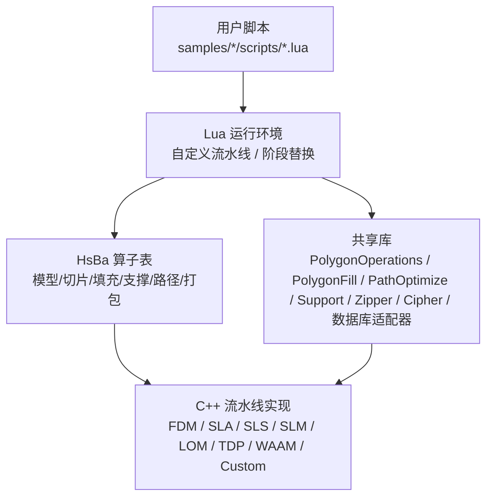
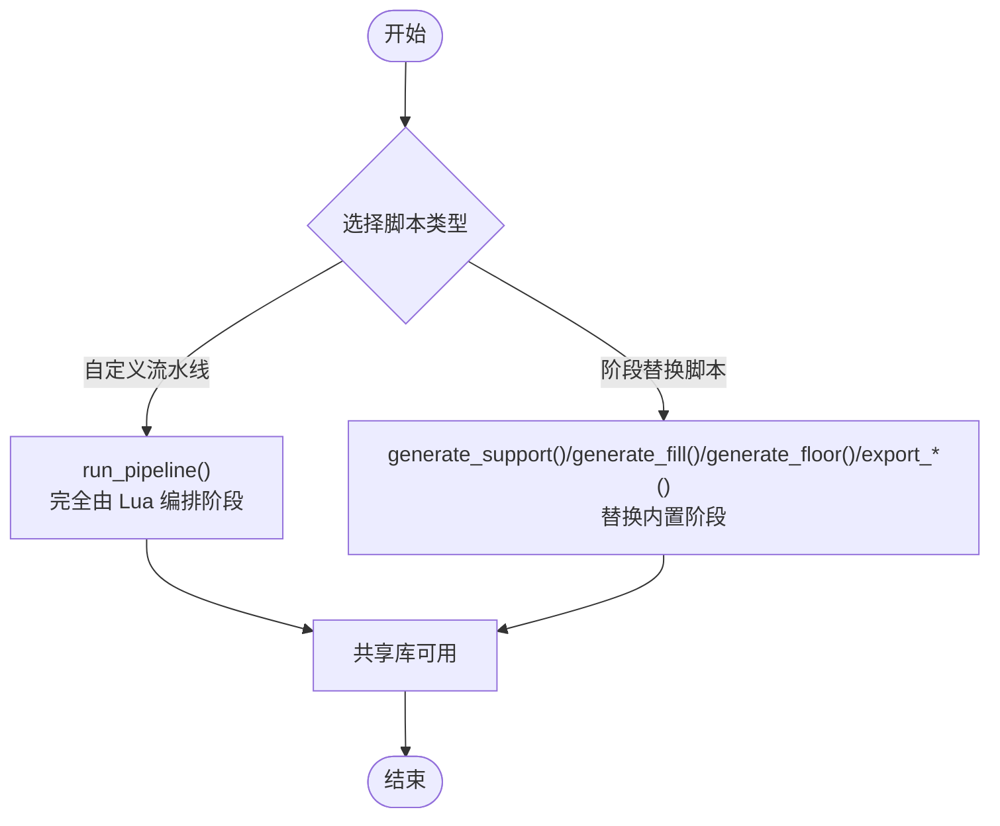
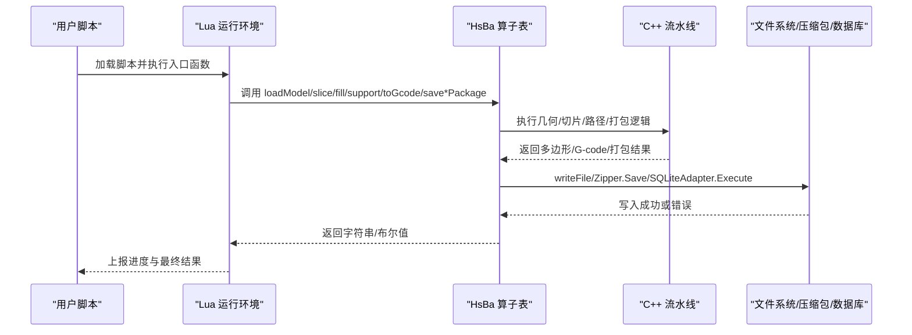
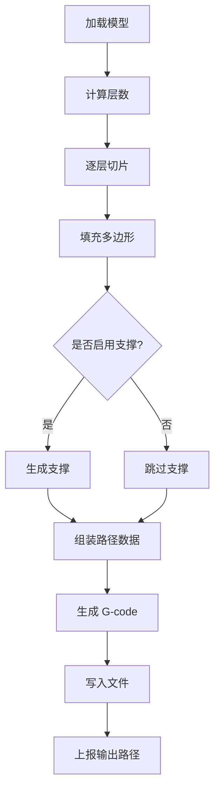

# 脚本开发指南

<cite>
**本文引用的文件**   
- [hsba_pipeline.d.lua](file://types/hsba_pipeline.d.lua)
- [lua_pipeline_api.md（中文）](file://docs/zh/lua_pipeline_api.md)
- [my_fdm_pipeline.lua](file://samples/Custom/scripts/my_fdm_pipeline.lua)
- [my_sla_pipeline.lua](file://samples/Custom/scripts/my_sla_pipeline.lua)
- [my_sls_pipeline.lua](file://samples/Custom/scripts/my_sls_pipeline.lua)
- [my_slm_pipeline.lua](file://samples/Custom/scripts/my_slm_pipeline.lua)
- [my_lom_pipeline.lua](file://samples/Custom/scripts/my_lom_pipeline.lua)
- [my_tdp_pipeline.lua](file://samples/Custom/scripts/my_tdp_pipeline.lua)
- [my_waam_pipeline.lua](file://samples/Custom/scripts/my_waam_pipeline.lua)
- [my_infill.lua](file://samples/FDM/scripts/my_infill.lua)
- [my_support.lua](file://samples/FDM/scripts/my_support.lua)
- [my_sla_floor.lua](file://samples/SLA/scripts/my_sla_floor.lua)
- [my_sla_support.lua](file://samples/SLA/scripts/my_sla_support.lua)
- [my_sls_export.lua](file://samples/SLS/scripts/my_sls_export.lua)
- [my_waam_path.lua](file://samples/WAAM/scripts/my_waam_path.lua)
</cite>

## 目录
1. [引言](#引言)
2. [项目结构](#项目结构)
3. [核心概念](#核心概念)
4. [架构总览](#架构总览)
5. [核心模块详解](#核心模块详解)
6. [Lua 脚本系统](#lua-脚本系统)
7. [扩展开发指南](#扩展开发指南)
8. [示例与教程](#示例与教程)
9. [API 参考文档](#api-参考文档)
10. [集成指南](#集成指南)
11. [开发·测试与贡献](#开发测试与贡献)
12. [高级主题](#高级主题)
13. [部署·故障排除与FAQ](#部署故障排除与faq)
14. [附录](#附录)

## 引言
本指南面向需要在 HsBaSlicer 中编写 Lua 流水线脚本的开发者，目标是帮助你从零开始完成自定义填充算法、支撑生成器、路径优化器和导出器的设计与实现。文档覆盖以下关键内容：
- 两种 Lua 运行环境：完全由脚本编排的“自定义流水线”和仅替换内置流水线某个阶段的“阶段替换脚本”。
- 不同工艺流水线（FDM、SLA、SLS、SLM、LOM、TDP、WAAM、Custom）的脚本结构与可用变量。
- 完整的开发流程：需求分析 → 脚本设计 → 代码实现 → 测试调试。
- 常见开发场景的实际示例与性能优化技巧。
- 调试方法与常见问题解决方案。

## 项目结构
HsBaSlicer 中与 Lua 脚本开发直接相关的代码主要分布在以下位置：
- `types/hsba_pipeline.d.lua`：IDE 类型定义，描述所有 Lua API、全局变量、数据结构与流水线步骤分组。
- `docs/zh/lua_pipeline_api.md`：官方中文 Lua 流水线 API 参考文档，说明两种运行环境、共享库、阶段替换约定与可用性矩阵。
- `samples/Custom/scripts/*`：各工艺的完整自定义流水线示例。
- `samples/FDM/scripts/*`、`samples/SLA/scripts/*`、`samples/SLS/scripts/*`、`samples/WAAM/scripts/*`：内置流水线的阶段替换脚本示例。

**图示来源** 
- [hsba_pipeline.d.lua:1-18](file://types/hsba_pipeline.d.lua#L1-L18)
- [lua_pipeline_api.md（中文）:19-28](file://docs/zh/lua_pipeline_api.md#L19-L28)

**章节来源**
- [hsba_pipeline.d.lua:1-18](file://types/hsba_pipeline.d.lua#L1-L18)
- [lua_pipeline_api.md（中文）:1-6](file://docs/zh/lua_pipeline_api.md#L1-L6)

## 核心概念
HsBaSlicer 的 Lua 脚本按用途分为两类：
- **自定义流水线（Custom Pipeline）**：脚本自行决定加载模型、切片、支撑、填充、路径生成、写文件的顺序；C++ 只负责调用入口函数（默认 `run_pipeline`）。
- **内置流水线阶段替换（Stage Hook）**：仅替换内置流水线中的某个阶段（如支撑、填充、地板、导出），阶段顺序仍由 C++ 固定。

两类环境都会注册通用共享库（`PolygonOperations`、`Support`、`PolygonFill`、`PathOptimize`、`Cipher`、`Zipper`、数据库适配器等），区别在于 `HsBa` 算子表只在自定义流水线环境中存在。

**图示来源**
- [lua_pipeline_api.md（中文）:19-28](file://docs/zh/lua_pipeline_api.md#L19-L28)

**章节来源**
- [lua_pipeline_api.md（中文）:19-28](file://docs/zh/lua_pipeline_api.md#L19-L28)

## 架构总览
下图展示 HsBaSlicer 中 Lua 脚本与 C++ 流水线之间的交互关系：

**图示来源**
- [hsba_pipeline.d.lua:290-463](file://types/hsba_pipeline.d.lua#L290-L463)
- [lua_pipeline_api.md（中文）:48-133](file://docs/zh/lua_pipeline_api.md#L48-L133)

**章节来源**
- [hsba_pipeline.d.lua:290-463](file://types/hsba_pipeline.d.lua#L290-L463)
- [lua_pipeline_api.md（中文）:48-133](file://docs/zh/lua_pipeline_api.md#L48-L133)

## 核心模块详解
本节聚焦与脚本开发密切相关的核心模块：几何操作、填充、路径优化、支撑、压缩与数据库。

### 几何与多边形操作
- `PolygonOperations` 提供布尔运算、偏移、凸包/凹包、面积计算、基础图形构造等。
- 输入输出为 Lua table 表示的多边形集合，内部按整数精度处理，外部通过 `HsBa.toInt` / `HsBa.toDouble` 转换。

**章节来源**
- [hsba_pipeline.d.lua:35-51](file://types/hsba_pipeline.d.lua#L35-L51)
- [lua_pipeline_api.md（中文）:140-155](file://docs/zh/lua_pipeline_api.md#L140-L155)

### 填充算法
- `PolygonFill` 提供多种填充模式：偏移填充、平行线填充、之字形填充、复合偏移填充、混合填充等。
- 在自定义流水线中可通过 `HsBa.fill` 调用；在填充阶段替换脚本中可直接使用 `PolygonFill`。

**章节来源**
- [hsba_pipeline.d.lua:53-62](file://types/hsba_pipeline.d.lua#L53-L62)
- [lua_pipeline_api.md（中文）:157-159](file://docs/zh/lua_pipeline_api.md#L157-L159)

### 路径顺序优化
- `PathOptimize` 支持区域级和多边形级的路径顺序优化，减少空行程。
- 常用方法：`addRegion`、`addPolygons`、`optimizeOrder`、`buildPaths`、`buildPolygons`。

**章节来源**
- [hsba_pipeline.d.lua:64-77](file://types/hsba_pipeline.d.lua#L64-L77)
- [lua_pipeline_api.md（中文）:161-167](file://docs/zh/lua_pipeline_api.md#L161-L167)

### 支撑生成工具
- `Support` 提供平面、树状、蜂窝、SLA 支撑生成器，以及悬垂检测。
- 可在支撑阶段替换脚本中使用，也可在自定义流水线中通过 `HsBa.fdmSupport` / `HsBa.slaSupport` 调用。

**章节来源**
- [hsba_pipeline.d.lua:79-105](file://types/hsba_pipeline.d.lua#L79-L105)
- [lua_pipeline_api.md（中文）:169-177](file://docs/zh/lua_pipeline_api.md#L169-L177)

### 压缩与数据库
- `Zipper` / `Bit7zZipper` 用于打包 zip/tar.gz/tar.xz 等格式。
- `Cipher` 提供 base64/hex 编解码。
- `SQLiteAdapter` / `MySQLAdapter` / `PostgreSQLAdapter` 提供数据库操作接口。

**章节来源**
- [hsba_pipeline.d.lua:107-175](file://types/hsba_pipeline.d.lua#L107-L175)
- [lua_pipeline_api.md（中文）:179-211](file://docs/zh/lua_pipeline_api.md#L179-L211)

## Lua 脚本系统
本节详细说明两种 Lua 运行环境的差异、可用 API 与阶段约定。

### 自定义流水线环境
- 入口函数：默认 `run_pipeline`，可由 `pipeline_entry` 覆盖。
- 上下文全局变量：`pipeline_config`、`output_path`、`model_name`、`model_path`。
- 控制与文件 IO：`HsBa.progress`、`HsBa.setLayers`、`HsBa.setOutputPath`、`HsBa.readFile`、`HsBa.writeFile`。
- 模型管理：`HsBa.loadModel`、`HsBa.modelInfo`、`HsBa.translateModel`、`HsBa.rotateModel`、`HsBa.scaleModel`、`HsBa.removeModel`、`HsBa.modelNames`。
- 切片：`HsBa.layerCount`、`HsBa.layerZ`、`HsBa.slice`、`HsBa.sliceUnsafe`。
- 坐标转换与填充：`HsBa.toInt`、`HsBa.toDouble`、`HsBa.fill`。
- 支撑与地板：`HsBa.fdmSupport`、`HsBa.slaSupport`、`HsBa.floor`。
- 路径与 G-code：`HsBa.spiralize`、`HsBa.toGcode`。
- 打包与导出：`HsBa.saveSlsPackage`、`HsBa.saveWaamPackage`、`HsBa.saveSlaPackage`、`HsBa.renderImage`。

**章节来源**
- [hsba_pipeline.d.lua:290-463](file://types/hsba_pipeline.d.lua#L290-L463)
- [lua_pipeline_api.md（中文）:48-133](file://docs/zh/lua_pipeline_api.md#L48-L133)

### 内置流水线阶段替换脚本
- 支撑阶段：`generate_support()`，全局变量 `current_layer`、`prev_layer`、`layer_height`、`config`。
- 填充阶段：`generate_fill(current_layer)`，无全局变量，参数传入当前层多边形。
- 地板阶段（SLA）：`generate_floor(bottomLayer, floorCfg)`。
- 导出阶段：`export_sls()` / `export_slm()` / `export_lom()` / `export_tdp()` / `export_sla()` / `export_waam()`，全局变量 `config`、`images`、`output_path`。

**章节来源**
- [hsba_pipeline.d.lua:489-623](file://types/hsba_pipeline.d.lua#L489-L623)
- [lua_pipeline_api.md（中文）:215-260](file://docs/zh/lua_pipeline_api.md#L215-L260)

## 扩展开发指南
本节提供从需求分析到测试调试的完整开发流程，并结合实际脚本示例说明如何扩展新的处理步骤。

### 需求分析
明确目标工艺与期望输出：
- FDM：需要 G-code 输出，可自定义填充、支撑、路径优化。
- SLA：需要层图 + 地板 + 支撑 + config 打包。
- SLS/SLM/LOM/TDP：粉末床/叠层工艺，无需支撑/地板，重点在配置与导出。
- WAAM：机器人程序输出，需考虑焊接参数与机器人类型。

### 脚本设计
根据目标工艺选择合适的流水线模板：
- 若需完全控制阶段顺序，选择 `samples/Custom/scripts/my_*_pipeline.lua`。
- 若仅需替换某个阶段，选择对应阶段的替换脚本模板。

### 代码实现
以 FDM 自定义流水线为例，典型步骤如下：
1. 加载模型并获取信息。
2. 计算层数并逐层切片。
3. 每层填充（可动态调整角度/间距）。
4. 可选生成支撑。
5. 组装路径数据并生成 G-code。
6. 写入文件并上报输出路径。

**图示来源**
- [my_fdm_pipeline.lua:52-170](file://samples/Custom/scripts/my_fdm_pipeline.lua#L52-L170)

**章节来源**
- [my_fdm_pipeline.lua:52-170](file://samples/Custom/scripts/my_fdm_pipeline.lua#L52-L170)

### 测试调试
- 使用 `HsBa.progress(percent, stage)` 上报进度，便于观察流水线状态。
- 在导出脚本中使用 `pcall` 包裹数据库操作，避免非致命错误导致整个导出失败。
- 检查返回值类型：导出脚本必须返回 `{ success = true/false, export_path = "..." }`。

**章节来源**
- [my_sls_export.lua:23-79](file://samples/SLS/scripts/my_sls_export.lua#L23-L79)

## 示例与教程
本节汇总各工艺的完整流水线示例与阶段替换脚本，帮助开发者快速上手。

### FDM 自定义流水线
- 文件：`samples/Custom/scripts/my_fdm_pipeline.lua`
- 特点：完全由 Lua 编排加载、切片、填充、支撑、路径、写文件。
- 关键 API：`HsBa.loadModel`、`HsBa.slice`、`HsBa.fill`、`HsBa.fdmSupport`、`HsBa.toGcode`、`HsBa.writeFile`。

**章节来源**
- [my_fdm_pipeline.lua:1-172](file://samples/Custom/scripts/my_fdm_pipeline.lua#L1-L172)

### SLA 自定义流水线
- 文件：`samples/Custom/scripts/my_sla_pipeline.lua`
- 特点：生成支撑、地板，并打包层图、支撑图、地板图与 config。
- 关键 API：`HsBa.slaSupport`、`HsBa.floor`、`HsBa.saveSlaPackage`。

**章节来源**
- [my_sla_pipeline.lua:1-105](file://samples/Custom/scripts/my_sla_pipeline.lua#L1-L105)

### SLS/SLM/LOM/TDP 自定义流水线
- 文件：`samples/Custom/scripts/my_sls_pipeline.lua`、`my_slm_pipeline.lua`、`my_lom_pipeline.lua`、`my_tdp_pipeline.lua`
- 特点：粉末床/叠层工艺，无需支撑/地板，重点在配置与导出。
- 关键 API：`HsBa.saveSlsPackage`。

**章节来源**
- [my_sls_pipeline.lua:1-102](file://samples/Custom/scripts/my_sls_pipeline.lua#L1-L102)
- [my_slm_pipeline.lua:1-94](file://samples/Custom/scripts/my_slm_pipeline.lua#L1-L94)
- [my_lom_pipeline.lua:1-92](file://samples/Custom/scripts/my_lom_pipeline.lua#L1-L92)
- [my_tdp_pipeline.lua:1-91](file://samples/Custom/scripts/my_tdp_pipeline.lua#L1-L91)

### WAAM 自定义流水线
- 文件：`samples/Custom/scripts/my_waam_pipeline.lua`
- 特点：机器人程序输出，支持 ABB/KUKA/FANUC。
- 关键 API：`HsBa.saveWaamPackage`。

**章节来源**
- [my_waam_pipeline.lua:1-94](file://samples/Custom/scripts/my_waam_pipeline.lua#L1-L94)

### 阶段替换脚本示例
- FDM 填充：`samples/FDM/scripts/my_infill.lua`
- FDM 支撑：`samples/FDM/scripts/my_support.lua`
- SLA 地板：`samples/SLA/scripts/my_sla_floor.lua`
- SLA 支撑：`samples/SLA/scripts/my_sla_support.lua`
- SLS 导出：`samples/SLS/scripts/my_sls_export.lua`
- WAAM 路径：`samples/WAAM/scripts/my_waam_path.lua`

**章节来源**
- [my_infill.lua:1-89](file://samples/FDM/scripts/my_infill.lua#L1-L89)
- [my_support.lua:1-83](file://samples/FDM/scripts/my_support.lua#L1-L83)
- [my_sla_floor.lua:1-64](file://samples/SLA/scripts/my_sla_floor.lua#L1-L64)
- [my_sla_support.lua:1-76](file://samples/SLA/scripts/my_sla_support.lua#L1-L76)
- [my_sls_export.lua:1-80](file://samples/SLS/scripts/my_sls_export.lua#L1-L80)
- [my_waam_path.lua:1-46](file://samples/WAAM/scripts/my_waam_path.lua#L1-L46)

## API 参考文档
本节基于官方中文 API 文档与类型定义，整理关键 API 与可用性矩阵。

### 通用几何数据类型
- Point：`{ x = number, y = number }`
- Polygon：Point 数组
- Polygons：Polygon 数组
- Layers：Polygons 数组
- 3D Point：`{ x = number, y = number, z = number }`

**章节来源**
- [lua_pipeline_api.md（中文）:32-44](file://docs/zh/lua_pipeline_api.md#L32-L44)

### HsBa 算子表（自定义流水线）
- 控制与文件 IO：`progress`、`setLayers`、`setOutputPath`、`readFile`、`writeFile`
- 模型管理：`loadModel`、`modelInfo`、`translateModel`、`rotateModel`、`scaleModel`、`removeModel`、`modelNames`
- 切片：`layerCount`、`layerZ`、`slice`、`sliceUnsafe`
- 坐标转换与填充：`toInt`、`toDouble`、`fill`
- 支撑与地板：`fdmSupport`、`slaSupport`、`floor`
- 路径与 G-code：`spiralize`、`toGcode`
- 打包与导出：`saveSlsPackage`、`saveWaamPackage`、`saveSlaPackage`、`renderImage`

**章节来源**
- [hsba_pipeline.d.lua:290-463](file://types/hsba_pipeline.d.lua#L290-L463)
- [lua_pipeline_api.md（中文）:48-133](file://docs/zh/lua_pipeline_api.md#L48-L133)

### 共享库
- `PolygonOperations`：布尔运算、偏移、凸包/凹包、面积、图形构造
- `PolygonFill`：多种填充算法
- `PathOptimize`：路径顺序优化
- `Support`：支撑生成器与悬垂检测
- `Cipher`：base64/hex 编解码
- `Zipper` / `Bit7zZipper`：压缩打包
- 数据库适配器：`SQLiteAdapter` / `MySQLAdapter` / `PostgreSQLAdapter`

**章节来源**
- [hsba_pipeline.d.lua:35-175](file://types/hsba_pipeline.d.lua#L35-L175)
- [lua_pipeline_api.md（中文）:136-211](file://docs/zh/lua_pipeline_api.md#L136-L211)

### 流水线可用性矩阵
| API | 自定义流水线 | 内置阶段脚本 |
|-----|:------------:|:------------:|
| `HsBa` 算子表 | ✅ | ❌ |
| 上下文全局 | ✅ | ❌ |
| `PolygonOperations` | ✅ | ✅ |
| `Support` | ✅ | ✅ |
| `PolygonFill` | ✅ | ✅ |
| `PathOptimize` | ✅ | ✅ |
| `Cipher` | ✅ | ✅ |
| `Zipper` / `Bit7zZipper` | ✅ | ✅ |
| 数据库适配器 | ✅ | ✅ |

**章节来源**
- [lua_pipeline_api.md（中文）:264-279](file://docs/zh/lua_pipeline_api.md#L264-L279)

## 集成指南
本节说明如何将 Lua 脚本集成到 HsBaSlicer 的 C++ 流水线中。

### 自定义流水线集成
- C++ 侧调用 `run_pipeline`（或 `pipeline_entry` 指定的入口名）。
- 脚本返回非空字符串 → 成功，返回 `true` → 成功但无结果文本，返回 `false`/`nil` 或抛出错误 → 失败。

### 阶段替换脚本集成
- 内置流水线在特定阶段加载用户脚本并调用约定的函数。
- 每个阶段注入不同的全局变量与入口函数。

**章节来源**
- [lua_pipeline_api.md（中文）:19-28](file://docs/zh/lua_pipeline_api.md#L19-L28)
- [lua_pipeline_api.md（中文）:215-260](file://docs/zh/lua_pipeline_api.md#L215-L260)

## 开发·测试与贡献
### 开发建议
- 优先使用 `samples/Custom/scripts/*` 作为模板，逐步修改以适应新需求。
- 在复杂逻辑中使用 `local` 局部变量，避免污染全局命名空间。
- 使用 `HsBa.progress` 上报进度，便于 UI 反馈。

### 测试方法
- 使用最小可运行脚本验证基本功能。
- 针对导出脚本，使用 `pcall` 包裹数据库操作，确保非致命错误不影响主流程。
- 检查返回值类型是否符合约定。

### 贡献流程
- 遵循仓库现有代码风格与注释规范。
- 新增脚本时，同步更新类型定义与文档。
- 提交前进行单元测试与集成测试。

**章节来源**
- [my_sls_export.lua:50-71](file://samples/SLS/scripts/my_sls_export.lua#L50-L71)

## 高级主题
### 性能优化技巧
- 批量处理多边形：避免在循环中频繁创建临时对象。
- 使用 `PathOptimize.optimizeRegions` 一键优化填充结果。
- 合理设置填充间距与角度，平衡打印质量与时间。

### 调试方法
- 使用 `print` 输出中间结果（注意日志量）。
- 在导出脚本中记录错误信息，便于定位问题。
- 利用 `HsBa.renderImage` 渲染多边形为图片，直观检查切片与填充效果。

**章节来源**
- [lua_pipeline_api.md（中文）:161-167](file://docs/zh/lua_pipeline_api.md#L161-L167)
- [lua_pipeline_api.md（中文）:131-132](file://docs/zh/lua_pipeline_api.md#L131-L132)

## 部署·故障排除与FAQ
### 常见问题
- 导出脚本返回值类型错误：确保返回 `{ success = true/false, export_path = "..." }`。
- 数据库连接失败：使用 `pcall` 包裹数据库操作，避免影响主流程。
- 路径优化无效：检查输入多边形是否为整型，必要时使用 `HsBa.toInt` 转换。

### 解决方案
- 检查脚本语法与缩进，确保 Lua 解析无误。
- 验证配置文件 JSON 格式是否正确。
- 使用 `HsBa.setProgress` 上报进度，确认流水线执行到哪一步失败。

**章节来源**
- [lua_pipeline_api.md（中文）:256-260](file://docs/zh/lua_pipeline_api.md#L256-L260)

## 附录
### 流水线步骤汇总
- FDM：Preprocess → Slice → Support → Fill → PathOutput(G-code)
- SLA：Preprocess → Slice → Floor → Support → Export(Zip)
- SLS：Preprocess → Slice → Export(Zip)
- SLM：Preprocess → Slice → Export(Zip)
- LOM：Preprocess → Slice → Export(Zip)
- TDP：Preprocess → Slice → Export(Zip)
- WAAM：Preprocess → Slice → RobotPath
- Custom：由 Lua 脚本自由编排

**章节来源**
- [hsba_pipeline.d.lua:9-18](file://types/hsba_pipeline.d.lua#L9-L18)