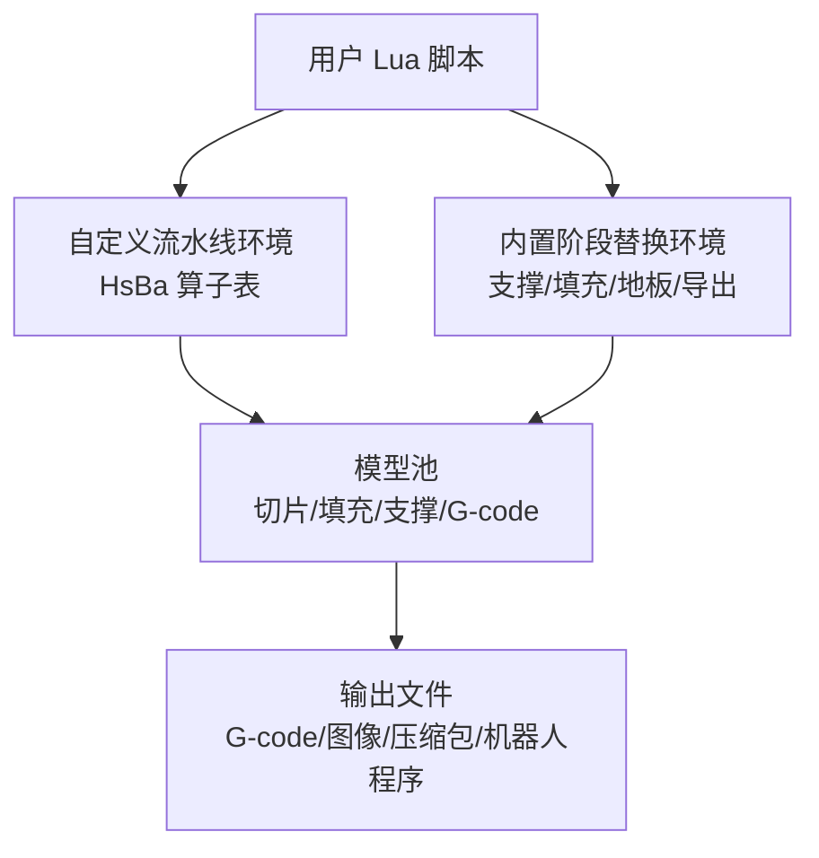
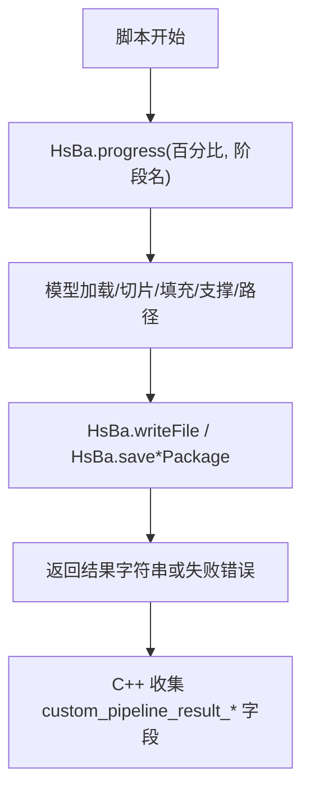
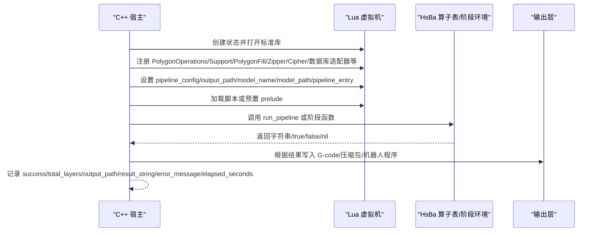
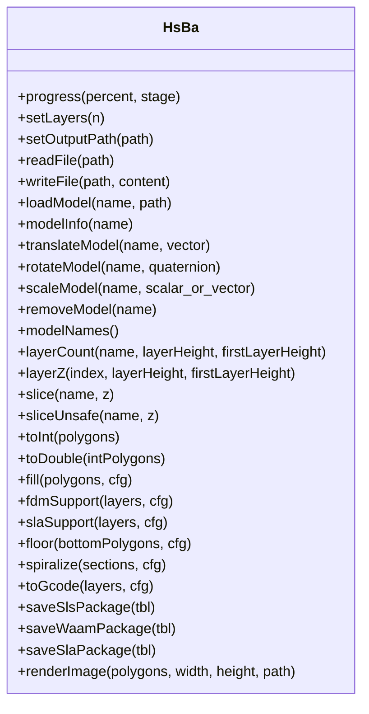
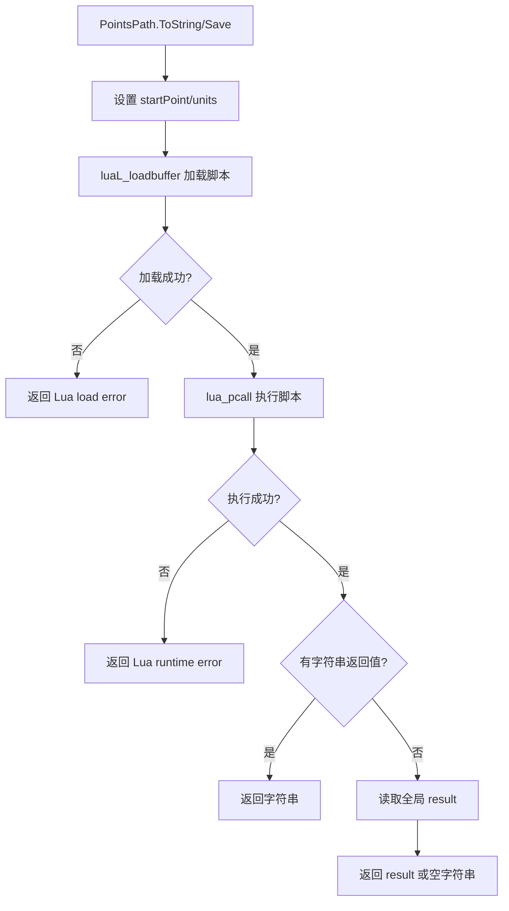
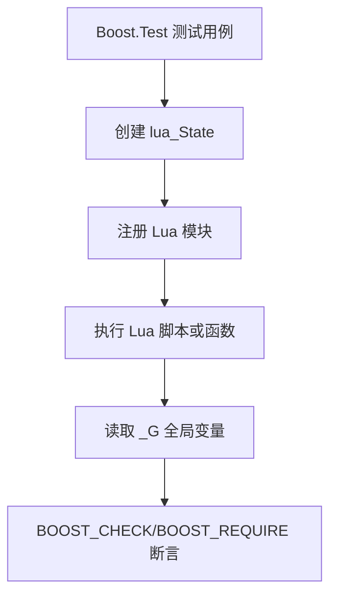
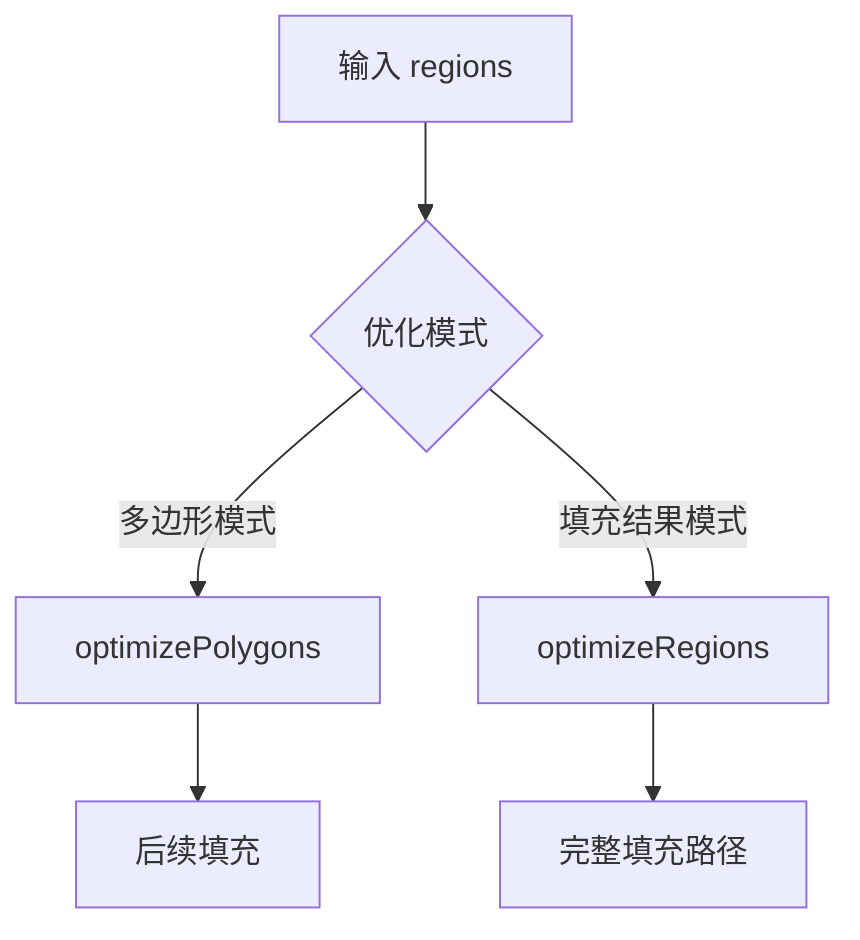
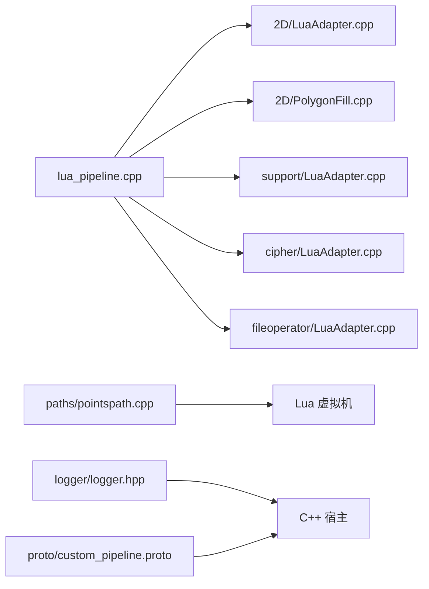

# 脚本调试与测试

<cite>
**本文引用的文件**   
- [README.md](file://README.md)
- [lua_pipeline_api.md](file://docs/zh/lua_pipeline_api.md)
- [logger.hpp](file://logger/logger.hpp)
- [custom_pipeline.proto](file://proto/custom_pipeline.proto)
- [lua_pipeline.cpp](file://LibHsBaSlicer/Extends/lua_pipeline.cpp)
- [pointspath.cpp](file://paths/pointspath.cpp)
- [gcode_path_test.cpp](file://tests/PathsOut/gcode_path_test.cpp)
- [points_path_test.cpp](file://tests/PathsOut/points_path_test.cpp)
- [cipher_lua_adapter_test.cpp](file://tests/Cipher/cipher_lua_adapter_test.cpp)
- [zipper_test.cpp](file://tests/FilesOperator/zipper_test.cpp)
- [sqlite_test.cpp](file://tests/FilesOperator/sqlite_test.cpp)
- [any_object_test.cpp](file://tests/AnyObject/any_object_test.cpp)
- [path_optimizer.cpp](file://LibHsBaSlicer/Path/path_optimizer.cpp)
- [polygon_fill.cpp](file://LibHsBaSlicer/Fill/polygon_fill.cpp)
</cite>

## 目录
1. [引言](#引言)
2. [项目结构中的调试与测试位置](#项目结构中的调试与测试位置)
3. [核心调试能力](#核心调试能力)
4. [架构总览：Lua 脚本如何被加载、执行与返回结果](#架构总览lua-脚本如何被加载执行与返回结果)
5. [详细组件分析](#详细组件分析)
6. [依赖关系分析](#依赖关系分析)
7. [性能分析与优化建议](#性能分析与优化建议)
8. [常见问题排查指南](#常见问题排查指南)
9. [结论](#结论)
10. [附录：可测试脚本编写规范](#附录可测试脚本编写规范)

## 引言
本指南面向使用 HsBaSlicer 的 Lua 脚本开发者，目标是帮助你在自定义流水线或内置阶段替换脚本中完成调试、验证和优化。文档基于仓库源码实证，覆盖以下方面：

- 日志输出：C++ 侧日志系统、Lua 脚本进度上报、错误信息传播。
- 断点与变量检查：通过 C++ 测试框架驱动 Lua 状态、读取全局变量、捕获 Lua 错误字符串。
- 测试分层：单元测试、集成测试、路径导出测试、压缩与数据库适配器测试等。
- 常见定位方法：内存泄漏、性能瓶颈、API 调用错误、返回值结构不匹配。
- 可测试脚本设计：模块化、依赖注入、模拟对象、函数名驱动执行。
- 性能分析工具与建议：切片、填充、支撑、G-code 生成、路径优化的性能关注点。

## 项目结构中的调试与测试位置
HsBaSlicer 是一个以 C++ 为核心的 3D 打印切片框架，Lua 脚本主要运行在两类环境中：

| 环境 | 用途 | 关键入口 | 可用 API |
|------|------|----------|----------|
| 自定义流水线 | 由脚本控制加载、切片、支撑、填充、路径、写文件全流程 | `run_pipeline`（可通过 `pipeline_entry` 覆盖） | 完整 `HsBa` 算子表 + 上下文全局变量 |
| 内置流水线阶段替换 | 仅替换某个阶段算法，阶段顺序由 C++ 固定 | 各阶段约定函数，如 `generate_support()`、`generate_fill()`、导出函数 | 该阶段可用的共享库 |

**图表来源**  
- [lua_pipeline_api.md:19-28](file://docs/zh/lua_pipeline_api.md#L19-L28)  
- [lua_pipeline.cpp:228-288](file://LibHsBaSlicer/Extends/lua_pipeline.cpp#L228-L288)

**章节来源**  
- [README.md:25-39](file://README.md#L25-L39)  
- [lua_pipeline_api.md:19-28](file://docs/zh/lua_pipeline_api.md#L19-L28)

## 核心调试能力
HsBaSlicer 的调试能力不是“在 Lua 里加 print 就完事”，而是围绕 C++ 宿主、Lua 状态、测试结果和协议字段构建的体系。

### 日志与进度
- C++ 侧提供线程安全的日志单例，支持 debug/info/warning/error 级别，并支持文件输出。
- Lua 脚本通过 `HsBa.progress(percent, stage)` 向 C++ 上报进度百分比与阶段名称。
- 自定义流水线结果包含成功标志、层数、输出路径、返回字符串、错误信息和耗时字段。

**图表来源**  
- [lua_pipeline.cpp:228-288](file://LibHsBaSlicer/Extends/lua_pipeline.cpp#L228-L288)  
- [custom_pipeline.proto:23-30](file://proto/custom_pipeline.proto#L23-L30)

**章节来源**  
- [logger.hpp:35-89](file://logger/logger.hpp#L35-L89)  
- [lua_pipeline.cpp:228-288](file://LibHsBaSlicer/Extends/lua_pipeline.cpp#L228-L288)  
- [custom_pipeline.proto:23-30](file://proto/custom_pipeline.proto#L23-L30)

### 断点与变量检查
仓库没有为 Lua 提供独立的“断点调试器”绑定，但提供了更实用的调试方式：

1. **通过 C++ 测试用例创建 Lua 状态**：使用 `luaL_newstate`、`luaL_openlibs`、注册模块后执行脚本。
2. **读取全局变量**：测试代码从 `_G` 或指定全局名读取脚本写入的结果。
3. **捕获错误**：通过 `luaL_dostring` 返回值判断是否成功，失败时读取栈顶错误字符串。
4. **模拟对象与 Mock**：例如 `HSBA_ANY_OBJECT_ENABLE_MOCK` 下可验证 AnyObject 调用计数。

典型模式是：测试构造 Lua 环境 → 执行脚本 → 读取 `_G.ok_*`、`_G.sum`、`_G.err` 等布尔或数值结果 → 用 BOOST_CHECK 断言。

**章节来源**  
- [any_object_test.cpp:423-457](file://tests/AnyObject/any_object_test.cpp#L423-L457)  
- [any_object_test.cpp:679-706](file://tests/AnyObject/any_object_test.cpp#L679-L706)  
- [cipher_lua_adapter_test.cpp:18-48](file://tests/Cipher/cipher_lua_adapter_test.cpp#L18-L48)

### 多边形可视化调试
当启用编译宏 `HSBA_POLYGON_DUMP` 时，PolygonOperations 暴露 `dumpPolygon` 和 `dumpPolygons`，用于把单个多边形或多边形集合写出到文件，便于几何问题定位。

**章节来源**  
- [lua_pipeline_api.md:154-156](file://docs/zh/lua_pipeline_api.md#L154-L156)  
- [lua_pipeline_api.md:140-156](file://docs/zh/lua_pipeline_api.md#L140-L156)

## 架构总览：Lua 脚本如何被加载、执行与返回结果
HsBaSlicer 对 Lua 的执行流程可以概括为：创建 Lua 状态 → 打开标准库 → 注册模块 → 设置上下文全局变量 → 加载脚本 → 调用入口函数 → 处理返回值或全局结果 → 返回给 C++ 上层。

**图表来源**  
- [lua_pipeline.cpp:890-940](file://LibHsBaSlicer/Extends/lua_pipeline.cpp#L890-L940)  
- [lua_pipeline.cpp:228-288](file://LibHsBaSlicer/Extends/lua_pipeline.cpp#L228-L288)  
- [custom_pipeline.proto:23-30](file://proto/custom_pipeline.proto#L23-L30)

**章节来源**  
- [lua_pipeline.cpp:890-940](file://LibHsBaSlicer/Extends/lua_pipeline.cpp#L890-L940)  
- [lua_pipeline_api.md:48-65](file://docs/zh/lua_pipeline_api.md#L48-L65)

## 详细组件分析

### 自定义流水线入口与上下文
自定义流水线要求脚本定义入口函数，默认名为 `run_pipeline`，也可通过 `pipeline_entry` 覆盖。脚本必须返回非空字符串表示成功，返回 `true` 表示成功但无文本结果，返回 `false`/`nil` 或抛出错误表示失败。

上下文全局变量包括：

| 变量 | 类型 | 含义 |
|------|------|------|
| `pipeline_config` | string | C++ 传入的 JSON 配置字符串 |
| `output_path` | string | C++ 传入的默认输出路径 |
| `model_name` | string | C++ 传入的模型名 |
| `model_path` | string | C++ 传入的模型文件路径 |
| `pipeline_entry` | string | 入口函数名 |

脚本还可通过 `HsBa.progress`、`HsBa.setLayers`、`HsBa.setOutputPath`、`HsBa.readFile`、`HsBa.writeFile` 与模型、切片、填充、支撑、路径、打包 API 协作。

**章节来源**  
- [lua_pipeline_api.md:48-75](file://docs/zh/lua_pipeline_api.md#L48-L75)  
- [lua_pipeline.cpp:228-288](file://LibHsBaSlicer/Extends/lua_pipeline.cpp#L228-L288)

### 模型、切片、填充、支撑、路径与导出
`HsBa` 算子表是自定义流水线的核心：

- 模型管理：`loadModel`、`modelInfo`、`translateModel`、`rotateModel`、`scaleModel`、`removeModel`、`modelNames`。
- 切片：`layerCount`、`layerZ`、`slice`、`sliceUnsafe`。
- 坐标转换：`toInt`、`toDouble`。
- 填充：`fill`，支持 spacing、mode、angle、borderCount。
- 支撑：`fdmSupport`、`slaSupport`。
- SLA 地板：`floor`。
- 路径：`spiralize`、`toGcode`。
- 打包导出：`saveSlsPackage`、`saveWaamPackage`、`saveSlaPackage`、`renderImage`。

**图表来源**  
- [lua_pipeline.cpp:228-800](file://LibHsBaSlicer/Extends/lua_pipeline.cpp#L228-L800)  
- [lua_pipeline_api.md:77-133](file://docs/zh/lua_pipeline_api.md#L77-L133)

**章节来源**  
- [lua_pipeline.cpp:290-800](file://LibHsBaSlicer/Extends/lua_pipeline.cpp#L290-L800)  
- [lua_pipeline_api.md:77-133](file://docs/zh/lua_pipeline_api.md#L77-L133)

### 路径导出中的 Lua 执行与错误处理
路径导出类也支持通过 Lua 脚本生成输出。其执行流程包括：

1. 设置起点坐标和单位。
2. 加载脚本字符串。
3. 使用 `lua_pcall` 执行脚本。
4. 如果返回字符串，直接作为结果。
5. 否则尝试读取全局 `result`。
6. 如果按函数名调用，找不到函数会抛出运行时错误；运行时错误会被包装成诊断字符串或异常。

**图表来源**  
- [pointspath.cpp:183-230](file://paths/pointspath.cpp#L183-L230)  
- [pointspath.cpp:304-346](file://paths/pointspath.cpp#L304-L346)

**章节来源**  
- [pointspath.cpp:183-230](file://paths/pointspath.cpp#L183-L230)  
- [pointspath.cpp:304-346](file://paths/pointspath.cpp#L304-L346)  
- [gcode_path_test.cpp:192-217](file://tests/PathsOut/gcode_path_test.cpp#L192-L217)  
- [points_path_test.cpp:237-256](file://tests/PathsOut/points_path_test.cpp#L237-L256)

### 通用共享库与阶段脚本
所有环境都可用 PolygonOperations、PolygonFill、PathOptimize、Support、Cipher、Zipper、Bit7zZipper、SQLiteAdapter/MySQLAdapter/PostgreSQLAdapter、ParamStore 等共享库。不同阶段注入的全局变量和入口函数不同：

| 阶段 | 入口函数 | 注入全局变量 | 可用库 |
|------|----------|--------------|--------|
| FDM/SLA 支撑 | `generate_support()` | `current_layer`、`prev_layer`、`layer_height`、`config` | PolygonOperations、Support |
| 填充 | `generate_fill(current_layer)` | 无全局变量 | PolygonOperations、PolygonFill、PathOptimize |
| SLA 地板 | 阶段相关函数 | 阶段相关 | PolygonOperations、PolygonFill |
| 导出 | `export_sls()`、`export_waam()` 等 | `config`、`images`、`output_path` | Zipper、Cipher、Bit7zZipper、数据库适配器、ParamStore |

**章节来源**  
- [lua_pipeline_api.md:215-259](file://docs/zh/lua_pipeline_api.md#L215-L259)  
- [lua_pipeline_api.md:264-279](file://docs/zh/lua_pipeline_api.md#L264-L279)

### 测试框架与测试分层
HsBaSlicer 使用 Boost.Test 进行 C++ 单元测试，并通过 C++ 侧驱动 Lua 状态来验证 Lua 绑定和脚本行为。测试分层如下：

| 层次 | 示例 | 目标 |
|------|------|------|
| 单元测试 | `any_object_test.cpp`、`cipher_lua_adapter_test.cpp` | 验证 Lua 绑定、类型转换、错误分支 |
| 集成测试 | `zipper_test.cpp`、`sqlite_test.cpp` | 验证 Lua 脚本与文件系统、数据库、压缩库交互 |
| 路径导出测试 | `gcode_path_test.cpp`、`points_path_test.cpp` | 验证 Lua 脚本生成 G-code 或点路径的行为 |
| 静态测试 | `static_tests/*` | 编译期概念、模板、接口约束 |

**图表来源**  
- [cipher_lua_adapter_test.cpp:18-48](file://tests/Cipher/cipher_lua_adapter_test.cpp#L18-L48)  
- [zipper_test.cpp:105-141](file://tests/FilesOperator/zipper_test.cpp#L105-L141)  
- [sqlite_test.cpp:125-149](file://tests/FilesOperator/sqlite_test.cpp#L125-L149)

**章节来源**  
- [cipher_lua_adapter_test.cpp:1-48](file://tests/Cipher/cipher_lua_adapter_test.cpp#L1-L48)  
- [zipper_test.cpp:105-176](file://tests/FilesOperator/zipper_test.cpp#L105-L176)  
- [sqlite_test.cpp:111-149](file://tests/FilesOperator/sqlite_test.cpp#L111-L149)  
- [gcode_path_test.cpp:192-217](file://tests/PathsOut/gcode_path_test.cpp#L192-L217)  
- [points_path_test.cpp:237-322](file://tests/PathsOut/points_path_test.cpp#L237-L322)

### 路径优化与可测试脚本
路径优化支持两种模式：

- 多边形模式：先优化多边形顺序，再填充。
- 填充结果模式：直接优化填充路径。

脚本可以通过 `PathOptimize.new()` 或使用一键函数 `optimizeRegions`、`optimizePolygons`。C++ 侧还提供 `LuaOptimizeRegionPaths`、`LuaOptimizeRegionPathsString` 等嵌入入口，允许通过脚本文件或内联脚本参与优化。

**图表来源**  
- [path_optimizer.cpp:477-521](file://LibHsBaSlicer/Path/path_optimizer.cpp#L477-L521)  
- [polygon_fill.cpp:36-49](file://LibHsBaSlicer/Fill/polygon_fill.cpp#L36-L49)

**章节来源**  
- [path_optimizer.cpp:477-521](file://LibHsBaSlicer/Path/path_optimizer.cpp#L477-L521)  
- [polygon_fill.cpp:36-49](file://LibHsBaSlicer/Fill/polygon_fill.cpp#L36-L49)

## 依赖关系分析
Lua 脚本调试与测试涉及多个模块耦合：

- `LibHsBaSlicer/Extends/lua_pipeline.cpp`：自定义流水线环境、`HsBa` 算子表、阶段脚本加载。
- `2D/LuaAdapter.cpp`、`2D/PolygonFill.cpp`：2D 几何与填充 Lua 绑定。
- `support/LuaAdapter.cpp`、`support/LuaSupport.cpp`：支撑生成 Lua 绑定。
- `cipher/LuaAdapter.cpp`、`fileoperator/LuaAdapter.cpp`：编解码、ZIP、SQLite 等 Lua 绑定。
- `paths/pointspath.cpp`、`paths/gcodepath.*`：路径导出中的 Lua 执行。
- `logger/logger.hpp`：C++ 日志系统。
- `proto/custom_pipeline.proto`：自定义流水线结果协议。

**图表来源**  
- [lua_pipeline.cpp:890-940](file://LibHsBaSlicer/Extends/lua_pipeline.cpp#L890-L940)  
- [pointspath.cpp:183-230](file://paths/pointspath.cpp#L183-L230)  
- [logger.hpp:35-89](file://logger/logger.hpp#L35-L89)  
- [custom_pipeline.proto:23-30](file://proto/custom_pipeline.proto#L23-L30)

**章节来源**  
- [lua_pipeline.cpp:890-940](file://LibHsBaSlicer/Extends/lua_pipeline.cpp#L890-L940)  
- [pointspath.cpp:183-230](file://paths/pointspath.cpp#L183-L230)  
- [logger.hpp:35-89](file://logger/logger.hpp#L35-L89)  
- [custom_pipeline.proto:23-30](file://proto/custom_pipeline.proto#L23-L30)

## 性能分析与优化建议
虽然仓库没有内置 Lua 性能分析器，但可以从以下维度定位性能问题：

1. **切片与网格操作**：大量 `slice` 调用可能成为瓶颈，应关注层高、模型尺寸、网格质量。
2. **填充算法**：`fill`、`offsetFill`、`lineFill`、`zigzagFill` 等算法复杂度较高，应合理设置 spacing、mode、angle。
3. **支撑生成**：FDM/SLA 支撑计算量大，应调整 overhang_angle、density、pattern。
4. **路径优化**：使用 `PathOptimize.optimizePolygons` 或 `optimizeRegions` 减少移动距离。
5. **G-code 生成**：`toGcode` 会生成大量字符串，应避免在脚本中进行重复拼接。
6. **I/O 与打包**：频繁读写文件和压缩包会影响整体性能，应批量处理。
7. **日志开销**：生产环境避免过多 debug 日志，优先使用 `HsBa.progress` 和结构化结果。

建议实践：

- 先用小模型验证脚本逻辑，再逐步放大模型规模。
- 将耗时计算放在 C++ 扩展中，Lua 只负责参数和流程编排。
- 使用 `HSBA_POLYGON_DUMP` 辅助几何调试，但不要在生产路径中启用。
- 通过测试用例对比不同参数的输出体积、层数、路径长度。

[本节为通用性能指导，不直接分析具体文件]

## 常见问题排查指南

### 内存泄漏
Lua 脚本本身不负责底层网格内存管理，但长期运行的流水线可能出现：

- 未调用 `removeModel` 导致模型池增长。
- 循环引用或长时间持有大对象。
- 频繁创建临时多边形集合。

排查建议：

- 在流水线结束时显式 `HsBa.removeModel(name)`。
- 使用测试用例监控模型数量。
- 避免在循环中创建不必要的中间表。

**章节来源**  
- [lua_pipeline.cpp:380-397](file://LibHsBaSlicer/Extends/lua_pipeline.cpp#L380-L397)

### 性能瓶颈
常见瓶颈：

- 逐层切片：`HsBa.slice` 调用次数等于层数。
- 填充：复杂边界、过小 spacing、多次 offset。
- 支撑：高密度、复杂树状支撑。
- G-code：超大模型、过多路径段。
- 路径优化：regions 过大或未优化顺序。

排查建议：

- 统计层数和每层多边形数量。
- 比较不同 fill mode 的输出。
- 使用 `PathOptimize.optimizePolygons` 或 `optimizeRegions`。
- 分块处理超大模型。

**章节来源**  
- [lua_pipeline.cpp:435-508](file://LibHsBaSlicer/Extends/lua_pipeline.cpp#L435-L508)  
- [path_optimizer.cpp:477-521](file://LibHsBaSlicer/Path/path_optimizer.cpp#L477-L521)

### API 调用错误
常见错误：

- 模型未加载就调用 `slice`。
- `layerCount` 传入无效层高。
- 导出脚本返回结构不符合预期。
- Lua 函数名不存在。
- Lua 脚本语法错误或运行时错误。

排查建议：

- 检查 `HsBa.loadModel` 返回值。
- 检查 `layerCount` 参数合法性。
- 严格遵循导出脚本返回 `{success, export_path}`。
- 使用 `pcall` 包裹关键 Lua 调用。
- 查看 `lua_tostring(L, -1)` 的错误消息。

**章节来源**  
- [lua_pipeline.cpp:435-460](file://LibHsBaSlicer/Extends/lua_pipeline.cpp#L435-L460)  
- [pointspath.cpp:191-204](file://paths/pointspath.cpp#L191-L204)  
- [pointspath.cpp:311-322](file://paths/pointspath.cpp#L311-L322)  
- [lua_pipeline_api.md:256-260](file://docs/zh/lua_pipeline_api.md#L256-L260)

### 单元测试与集成测试案例
仓库已有多种测试模式可作为参考：

- 加密模块 Lua 绑定测试：注册 Cipher，执行脚本，读取全局结果，验证 base64/hex 编码解码。
- ZIP 压缩测试：创建 Lua 状态，注册 Zipper，执行脚本创建 zip，提取内容断言。
- SQLite 适配器测试：连接数据库、建表、插入、查询。
- G-code 后处理测试：验证空脚本、返回值、固件全局变量、数字转字符串。
- PointsPath 测试：验证 global result fallback、load/runtime error、funcName 调用。

**章节来源**  
- [cipher_lua_adapter_test.cpp:10-48](file://tests/Cipher/cipher_lua_adapter_test.cpp#L10-L48)  
- [zipper_test.cpp:105-176](file://tests/FilesOperator/zipper_test.cpp#L105-L176)  
- [sqlite_test.cpp:125-149](file://tests/FilesOperator/sqlite_test.cpp#L125-L149)  
- [gcode_path_test.cpp:192-217](file://tests/PathsOut/gcode_path_test.cpp#L192-L217)  
- [points_path_test.cpp:237-322](file://tests/PathsOut/points_path_test.cpp#L237-L322)

## 结论
HsBaSlicer 的 Lua 脚本调试与测试不是单一工具能解决的，而是由 C++ 日志、Lua 状态、测试结果、协议字段共同构成。对于脚本开发者来说，最实用的方法是：

- 使用 `HsBa.progress` 和结构化返回值跟踪流水线状态。
- 通过 C++ 测试用例驱动 Lua 执行，读取 `_G` 全局变量断言正确性。
- 使用 `HSBA_POLYGON_DUMP` 辅助几何调试。
- 用 `PathOptimize` 优化路径顺序。
- 针对内存、性能、API 错误建立分层测试。
- 将复杂计算下沉到 C++，Lua 专注流程编排和参数配置。

[本节为总结性内容，不直接分析具体文件]

## 附录：可测试脚本编写规范

### 模块化设计
- 将模型加载、切片、填充、支撑、路径、导出拆分为独立步骤。
- 每个步骤返回明确结果，便于单元测试。
- 使用配置文件表传递参数，避免硬编码。

### 依赖注入
- 通过 `pipeline_config` 注入外部配置。
- 通过 `HsBa.progress`、`HsBa.setLayers`、`HsBa.setOutputPath` 与 C++ 宿主通信。
- 导出阶段通过 `config`、`images`、`output_path` 获取上下文。

### 模拟对象
- 在 C++ 测试中注册 mock 函数或简化实现。
- 使用 `HSBA_ANY_OBJECT_ENABLE_MOCK` 验证调用次数。
- 对 I/O 操作使用临时文件或内存数据。

### 函数名驱动执行
- 自定义流水线使用 `run_pipeline`。
- 支撑阶段使用 `generate_support()`。
- 填充阶段使用 `generate_fill(current_layer)`。
- 导出阶段使用 `export_sls()`、`export_waam()` 等。
- 路径优化可使用 `optimize_paths`、`optimize_polygons`。

**章节来源**  
- [lua_pipeline_api.md:48-65](file://docs/zh/lua_pipeline_api.md#L48-L65)  
- [lua_pipeline_api.md:215-259](file://docs/zh/lua_pipeline_api.md#L215-L259)  
- [any_object_test.cpp:423-457](file://tests/AnyObject/any_object_test.cpp#L423-L457)