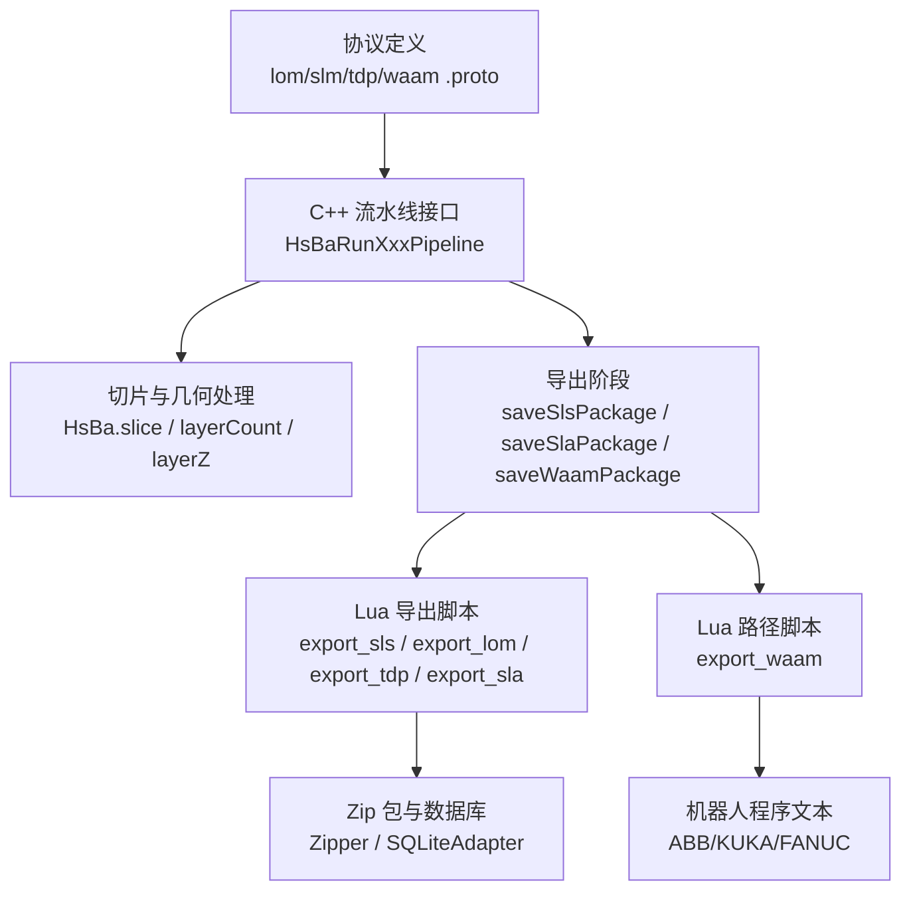
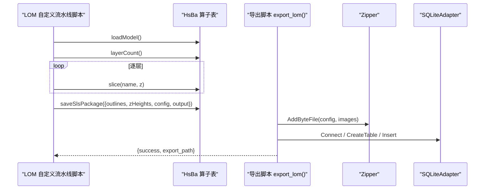
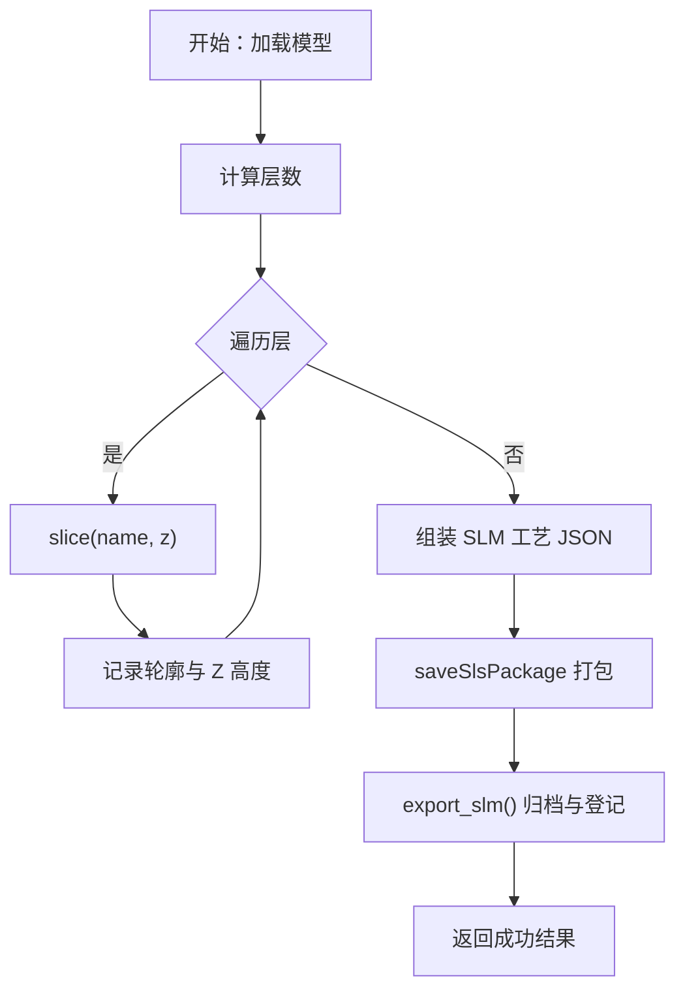
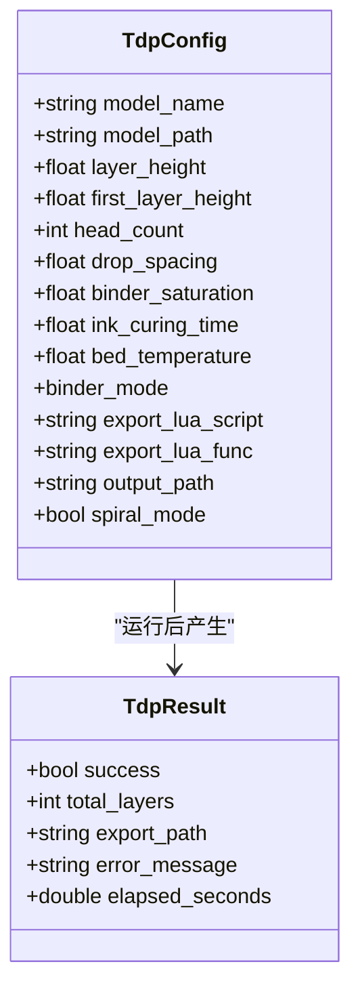
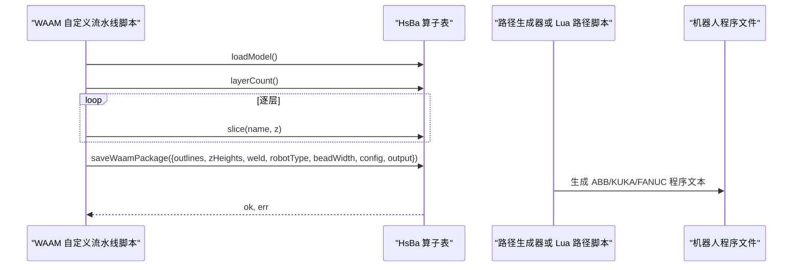
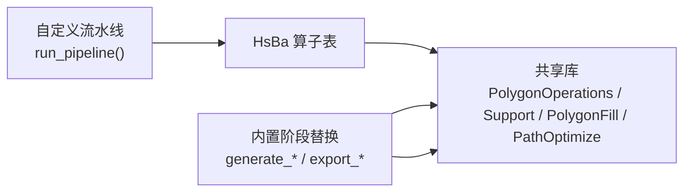

# 自定义流水线开发

<cite>
**本文引用的文件**   
- [hsba_pipeline.d.lua](file://types/hsba_pipeline.d.lua)
- [lua_pipeline_api.md](file://docs/zh/lua_pipeline_api.md)
- [my_lom_pipeline.lua](file://samples/Custom/scripts/my_lom_pipeline.lua)
- [my_slm_pipeline.lua](file://samples/Custom/scripts/my_slm_pipeline.lua)
- [my_tdp_pipeline.lua](file://samples/Custom/scripts/my_tdp_pipeline.lua)
- [my_waam_pipeline.lua](file://samples/Custom/scripts/my_waam_pipeline.lua)
- [my_lom_export.lua](file://samples/LOM/scripts/my_lom_export.lua)
- [my_slm_export.lua](file://samples/SLM/scripts/my_slm_export.lua)
- [my_tdp_export.lua](file://samples/TDP/scripts/my_tdp_export.lua)
- [my_waam_path.lua](file://samples/WAAM/scripts/my_waam_path.lua)
- [lom_pipeline.h](file://DllHsBaSlicer/lom_pipeline.h)
- [slm_pipeline.h](file://DllHsBaSlicer/slm_pipeline.h)
- [tdp_pipeline.h](file://DllHsBaSlicer/tdp_pipeline.h)
- [waam_pipeline.h](file://DllHsBaSlicer/waam_pipeline.h)
- [lom_pipeline.proto](file://proto/lom_pipeline.proto)
- [slm_pipeline.proto](file://proto/slm_pipeline.proto)
- [tdp_pipeline.proto](file://proto/tdp_pipeline.proto)
- [waam_pipeline.proto](file://proto/waam_pipeline.proto)
</cite>

## 目录
1. [项目概述与快速开始](#项目概述与快速开始)
2. [架构总览](#架构总览)
3. [核心概念](#核心概念)
4. [核心模块详解](#核心模块详解)
5. [高级主题](#高级主题)
6. [Lua 脚本系统](#lua-脚本系统)
7. [API 参考文档](#api-参考文档)
8. [集成指南](#集成指南)
9. [开发·测试与贡献](#开发测试与贡献)
10. [扩展开发指南](#扩展开发指南)
11. [示例与教程](#示例与教程)
12. [部署·故障排除与FAQ](#部署故障排除与faq)
13. [附录](#附录)

## 项目概述与快速开始
本指南面向需要为 LOM、SLM、TDP（3DP）、WAAM 等增材制造技术编写 Lua 自定义流水线的开发者。仓库同时提供两类能力：
- C++ 侧暴露的流水线接口，用于驱动“预处理 → 切片 → 导出”的标准流程；
- Lua 侧的 `HsBa` 算子表与阶段替换环境，用于完全由脚本编排或仅替换某个阶段的逻辑。

快速开始建议：
- 若只需调整导出格式或工艺参数，优先使用内置流水线 + 导出脚本；
- 若需要自由控制加载、切片、支撑、填充、路径生成顺序，则编写 `run_pipeline()` 自定义流水线；
- 若需要机器人程序输出，优先使用 WAAM 流水线及其 `saveWaamPackage` / `export_waam()` 机制。

**章节来源**
- [lua_pipeline_api.md:19-28](file://docs/zh/lua_pipeline_api.md#L19-L28)
- [lua_pipeline_api.md:283-331](file://docs/zh/lua_pipeline_api.md#L283-L331)

## 架构总览
HsBaSlicer 的自定义流水线开发围绕三层结构展开：
- 协议层：各工艺的 `.proto` 定义配置字段、枚举和结果结构；
- C++ 流水线层：对外暴露 `HsBaRunXxxPipeline` 系列函数，负责模型预处理、切片、调用 Lua 导出或机器人路径生成；
- Lua 脚本层：通过 `HsBa` 算子表、全局变量和阶段入口函数完成数据组装、打包、数据库登记或机器人代码生成。

**图表来源**
- [lom_pipeline.proto:13-36](file://proto/lom_pipeline.proto#L13-L36)
- [slm_pipeline.proto:33-55](file://proto/slm_pipeline.proto#L33-L55)
- [tdp_pipeline.proto:15-37](file://proto/tdp_pipeline.proto#L15-L37)
- [waam_pipeline.proto:49-79](file://proto/waam_pipeline.proto#L49-L79)
- [lua_pipeline_api.md:125-132](file://docs/zh/lua_pipeline_api.md#L125-L132)

**章节来源**
- [lua_pipeline_api.md:19-28](file://docs/zh/lua_pipeline_api.md#L19-L28)
- [lua_pipeline_api.md:125-132](file://docs/zh/lua_pipeline_api.md#L125-L132)

## 核心概念
### 两种 Lua 运行环境
- **自定义流水线环境**：脚本拥有完整控制权，可调用 `HsBa` 算子表，自行决定模型加载、切片、支撑、填充、路径生成与文件输出顺序。
- **内置流水线阶段替换环境**：C++ 固定阶段顺序，仅在支撑、填充、地板或导出阶段注入少量全局变量并调用约定函数。

### 通用几何数据类型
所有 API 使用统一 Lua table 表示几何数据：
- 点：`{ x, y }` 或 `{ x, y, z }`；
- 多边形：有序点数组；
- 多边形集合：多边形数组，孔洞作为独立多边形存在；
- 层列表：逐层的多边形集合数组。

### 流水线共性
- 都从模型信息出发，计算层高、首层层高与总层数；
- 都通过 `HsBa.slice` 获取每层轮廓；
- 都需要将工艺参数以 JSON 形式写入配置；
- 都需要上报进度、设置输出路径、清理模型。

### 技术差异
- LOM：按板材厚度切片，关注切割速度、切割余量、激光功率、粘合温度/压力/时间；
- SLM：金属粉末床，关注激光功率、扫描速度、搭接间距、搭接角度、材料、基板温度；
- TDP：粘结剂喷射，关注喷头数量、液滴间距、粘结剂饱和度、固化时间、基板温度；
- WAAM：机器人熔覆焊丝，输出机器人语言程序，关注焊接电流、电压、送丝速度、保护气流量、行走速度、机器人类型。

**章节来源**
- [lua_pipeline_api.md:32-45](file://docs/zh/lua_pipeline_api.md#L32-L45)
- [lua_pipeline_api.md:19-28](file://docs/zh/lua_pipeline_api.md#L19-L28)

## 核心模块详解
### LOM 流水线
LOM 是叠层实体切割工艺，每层对应一张板材轮廓，无需支撑与地板。C++ 接口说明其流程为“预处理 → 切片 → 导出”，导出由 Lua 脚本完成 zip 与数据库登记。

关键实现要点：
- 自定义流水线脚本通过 `HsBa.loadModel`、`HsBa.layerCount`、`HsBa.slice` 逐层提取轮廓；
- 将切割与粘合参数组装为 JSON，并通过 `HsBa.saveSlsPackage` 复用 SLS 式打包流程；
- 导出脚本 `export_lom()` 将 `config.json` 与逐层轮廓归档，并可写入 SQLite 历史表。

**图表来源**
- [my_lom_pipeline.lua:19-90](file://samples/Custom/scripts/my_lom_pipeline.lua#L19-L90)
- [my_lom_export.lua:10-57](file://samples/LOM/scripts/my_lom_export.lua#L10-L57)
- [lua_pipeline_api.md:125-132](file://docs/zh/lua_pipeline_api.md#L125-L132)

**章节来源**
- [lom_pipeline.h:17-37](file://DllHsBaSlicer/lom_pipeline.h#L17-L37)
- [lom_pipeline.proto:13-36](file://proto/lom_pipeline.proto#L13-L36)
- [my_lom_pipeline.lua:19-90](file://samples/Custom/scripts/my_lom_pipeline.lua#L19-L90)
- [my_lom_export.lua:10-57](file://samples/LOM/scripts/my_lom_export.lua#L10-L57)

### SLM 流水线
SLM 是选择性激光熔化金属工艺，与 SLS 高度相似，区别在于工艺参数聚焦金属材料、能量源与保护气体。C++ 接口同样采用“预处理 → 切片 → 导出”模式。

关键实现要点：
- 自定义流水线脚本读取模型、计算层数、逐层切片；
- 将激光功率、扫描速度、搭接间距、搭接角度、材料、基板温度写入 JSON；
- 复用 `saveSlsPackage` 打包，导出脚本 `export_slm()` 归档配置与层数据，并可登记 SQLite。

**图表来源**
- [my_slm_pipeline.lua:22-92](file://samples/Custom/scripts/my_slm_pipeline.lua#L22-L92)
- [my_slm_export.lua:15-62](file://samples/SLM/scripts/my_slm_export.lua#L15-L62)
- [slm_pipeline.proto:33-55](file://proto/slm_pipeline.proto#L33-L55)

**章节来源**
- [slm_pipeline.h:17-37](file://DllHsBaSlicer/slm_pipeline.h#L17-L37)
- [slm_pipeline.proto:9-31](file://proto/slm_pipeline.proto#L9-L31)
- [my_slm_pipeline.lua:22-92](file://samples/Custom/scripts/my_slm_pipeline.lua#L22-L92)
- [my_slm_export.lua:15-62](file://samples/SLM/scripts/my_slm_export.lua#L15-L62)

### TDP 流水线
TDP（3DP）是粘结剂喷射粉末床工艺，逐层向粉末床喷射液态粘结剂，无需支撑与地板。C++ 接口支持螺旋沉积路径选项。

关键实现要点：
- 自定义流水线脚本逐层切片，并将喷头数量、液滴间距、粘结剂饱和度、固化时间、基板温度写入 JSON；
- 复用 `saveSlsPackage` 打包，导出脚本 `export_tdp()` 归档配置与层数据；
- 协议中提供 `spiral_mode`，可用于后续连续沉积路径场景。

**图表来源**
- [tdp_pipeline.proto:15-37](file://proto/tdp_pipeline.proto#L15-L37)
- [tdp_pipeline.proto:39-46](file://proto/tdp_pipeline.proto#L39-L46)

**章节来源**
- [tdp_pipeline.h:17-37](file://DllHsBaSlicer/tdp_pipeline.h#L17-L37)
- [tdp_pipeline.proto:8-13](file://proto/tdp_pipeline.proto#L8-L13)
- [my_tdp_pipeline.lua:20-90](file://samples/Custom/scripts/my_tdp_pipeline.lua#L20-L90)
- [my_tdp_export.lua:15-62](file://samples/TDP/scripts/my_tdp_export.lua#L15-L62)

### WAAM 流水线
WAAM 是机器人金属丝沉积工艺，输出不是层 zip 包，而是机器人语言程序（ABB / KUKA / FANUC）。C++ 接口明确说明其流程为“预处理 → 切片 → 机器人路径导出”。

关键实现要点：
- 自定义流水线脚本逐层切片，并将焊接电流、电压、送丝速度、保护气流量、行走速度、机器人类型传入 `saveWaamPackage`；
- 可选 `path_lua_script` 与 `path_lua_func` 替换内置代码生成器，由 `export_waam()` 返回完整机器人程序文本；
- 协议支持材料、焊接工艺、保护方式、保护气体、层间温度、机器人类型与螺旋模式。

**图表来源**
- [my_waam_pipeline.lua:22-92](file://samples/Custom/scripts/my_waam_pipeline.lua#L22-L92)
- [my_waam_path.lua:17-45](file://samples/WAAM/scripts/my_waam_path.lua#L17-L45)
- [waam_pipeline.proto:49-79](file://proto/waam_pipeline.proto#L49-L79)

**章节来源**
- [waam_pipeline.h:17-37](file://DllHsBaSlicer/waam_pipeline.h#L17-L37)
- [waam_pipeline.proto:9-47](file://proto/waam_pipeline.proto#L9-L47)
- [my_waam_pipeline.lua:22-92](file://samples/Custom/scripts/my_waam_pipeline.lua#L22-L92)
- [my_waam_path.lua:17-45](file://samples/WAAM/scripts/my_waam_path.lua#L17-L45)

## 高级主题
### 跨技术通用开发模式
- 模型管理：统一通过 `HsBa.loadModel`、`HsBa.modelInfo`、`HsBa.removeModel` 管理模型池；
- 切片循环：统一通过 `layerCount`、`layerZ`、`slice` 构建 `outlines` 与 `zHeights`；
- 进度上报：统一通过 `HsBa.progress` 上报百分比与阶段名；
- 输出管理：统一通过 `HsBa.setOutputPath` 上报最终输出路径；
- 配置 JSON：统一将工艺参数序列化为字符串，交由导出脚本归档。

### 数据格式转换
- 浮点多边形与整型多边形之间通过 `HsBa.toInt`、`HsBa.toDouble` 转换；
- 布尔运算与填充算法内部按整数精度处理，外部 API 通常返回浮点多边形；
- 导出脚本接收 `images` 数组，每个元素包含 `path` 与 `data`，其中 `data` 是多边形 JSON。

### 错误处理最佳实践
- 导出脚本必须返回 `{ success, export_path }`，避免返回字符串覆盖 zip 文件；
- 数据库操作建议使用 `pcall` 包裹，失败时降级而不中断主流程；
- 自定义流水线在打包失败时应清理模型并返回失败标志。

**章节来源**
- [lua_pipeline_api.md:98-116](file://docs/zh/lua_pipeline_api.md#L98-L116)
- [lua_pipeline_api.md:246-260](file://docs/zh/lua_pipeline_api.md#L246-L260)
- [my_lom_export.lua:30-49](file://samples/LOM/scripts/my_lom_export.lua#L30-L49)
- [my_slm_export.lua:35-54](file://samples/SLM/scripts/my_slm_export.lua#L35-L54)
- [my_tdp_export.lua:35-54](file://samples/TDP/scripts/my_tdp_export.lua#L35-L54)

## Lua 脚本系统
### 自定义流水线环境
自定义流水线是唯一拥有全局 `HsBa` 表的环境。脚本必须定义入口函数，默认名为 `run_pipeline`，可由 C++ 侧覆盖。返回值规则：
- 非空字符串：成功，作为结果上报；
- `true`：成功但无结果文本；
- `false`/`nil` 或抛出 Lua 错误：失败。

上下文全局变量包括 `pipeline_config`、`output_path`、`model_name`、`model_path`、`pipeline_entry`。

### 内置阶段替换环境
内置流水线在支撑、填充、地板、导出阶段注入不同全局变量与入口函数：
- 支撑阶段：`generate_support()`，可用 `current_layer`、`prev_layer`、`layer_height`、`config`；
- 填充阶段：`generate_fill(current_layer)`，不注入全局变量；
- SLA 地板阶段：`generate_floor(bottomLayer, floorCfg)`；
- 导出阶段：`export_sls()`、`export_slm()`、`export_lom()`、`export_tdp()`、`export_sla()`、`export_waam()`。

### 共享库
所有环境均可用 `PolygonOperations`、`Support`、`PolygonFill`、`PathOptimize`、`Cipher`、`Zipper`、`Bit7zZipper`、数据库适配器与 `ParamStore`。

**图表来源**
- [hsba_pipeline.d.lua:189-292](file://types/hsba_pipeline.d.lua#L189-L292)
- [hsba_pipeline.d.lua:465-623](file://types/hsba_pipeline.d.lua#L465-L623)
- [lua_pipeline_api.md:19-28](file://docs/zh/lua_pipeline_api.md#L19-L28)

**章节来源**
- [lua_pipeline_api.md:48-65](file://docs/zh/lua_pipeline_api.md#L48-L65)
- [lua_pipeline_api.md:215-259](file://docs/zh/lua_pipeline_api.md#L215-L259)
- [hsba_pipeline.d.lua:189-292](file://types/hsba_pipeline.d.lua#L189-L292)
- [hsba_pipeline.d.lua:465-623](file://types/hsba_pipeline.d.lua#L465-L623)

## API 参考文档
### 自定义流水线常用 API
- 控制与文件 IO：`HsBa.progress`、`HsBa.setLayers`、`HsBa.setOutputPath`、`HsBa.readFile`、`HsBa.writeFile`；
- 模型管理：`HsBa.loadModel`、`HsBa.modelInfo`、`HsBa.translateModel`、`HsBa.rotateModel`、`HsBa.scaleModel`、`HsBa.removeModel`、`HsBa.modelNames`；
- 切片：`HsBa.layerCount`、`HsBa.layerZ`、`HsBa.slice`、`HsBa.sliceUnsafe`；
- 坐标转换与填充：`HsBa.toInt`、`HsBa.toDouble`、`HsBa.fill`；
- 支撑与地板：`HsBa.fdmSupport`、`HsBa.slaSupport`、`HsBa.floor`；
- 路径与 G-code：`HsBa.spiralize`、`HsBa.toGcode`；
- 打包与导出：`HsBa.saveSlsPackage`、`HsBa.saveWaamPackage`、`HsBa.saveSlaPackage`、`HsBa.renderImage`。

### 导出脚本约定
- SLS/SLM/LOM/TDP 导出脚本返回 `{ success, export_path }`；
- WAAM 路径脚本返回完整机器人程序文本；
- 导出脚本可使用 `Zipper`、`Bit7zZipper`、`Cipher`、数据库适配器与 `ParamStore`。

### 配置字段速览
- LOM：切割速度、切割余量、激光功率、粘合温度、粘合压力、粘合时间、切割模式；
- SLM：激光功率、扫描速度、搭接间距、搭接角度、基板温度、材料、光源、保护气体；
- TDP：喷头数量、液滴间距、粘结剂饱和度、固化时间、基板温度、粘结剂模式、螺旋模式；
- WAAM：层厚、首层层高、道宽、行走速度、送丝速度、电弧电流、电弧电压、保护气流量、材料、焊接工艺、保护方式、保护气体、层间温度、机器人类型、路径 Lua 脚本、螺旋模式。

**章节来源**
- [lua_pipeline_api.md:67-132](file://docs/zh/lua_pipeline_api.md#L67-L132)
- [lua_pipeline_api.md:136-212](file://docs/zh/lua_pipeline_api.md#L136-L212)
- [lua_pipeline_api.md:246-260](file://docs/zh/lua_pipeline_api.md#L246-L260)
- [lom_pipeline.proto:13-36](file://proto/lom_pipeline.proto#L13-L36)
- [slm_pipeline.proto:33-55](file://proto/slm_pipeline.proto#L33-L55)
- [tdp_pipeline.proto:15-37](file://proto/tdp_pipeline.proto#L15-L37)
- [waam_pipeline.proto:49-79](file://proto/waam_pipeline.proto#L49-L79)

## 集成指南
### 使用 C++ 流水线接口
- LOM：调用 `HsBaCreateDefaultLomConfig` 与 `HsBaRunLomPipeline`，设置 `export_lua_script` 与 `export_lua_func`；
- SLM：调用 `HsBaCreateDefaultSlmConfig` 与 `HsBaRunSlmPipeline`，设置金属相关参数与导出脚本；
- TDP：调用 `HsBaCreateDefaultTdpConfig` 与 `HsBaRunTdpPipeline`，可启用 `spiral_mode`；
- WAAM：调用 `HsBaCreateDefaultWaamConfig` 与 `HsBaRunWaamPipeline`，设置机器人类型与可选路径 Lua 脚本。

### 使用 Lua 自定义流水线
- 定义 `run_pipeline()`，读取 `model_name`、`model_path`、`output_path`、`pipeline_config`；
- 使用 `HsBa` 算子表完成模型加载、切片、填充、支撑、路径生成与文件输出；
- 对 LOM/SLM/TDP 使用 `saveSlsPackage`，对 WAAM 使用 `saveWaamPackage`。

### 使用内置阶段替换
- 在支撑阶段编写 `generate_support()`；
- 在填充阶段编写 `generate_fill(current_layer)`；
- 在 SLA 地板阶段编写 `generate_floor(bottomLayer, floorCfg)`；
- 在导出阶段编写对应 `export_xxx()`。

**章节来源**
- [lom_pipeline.h:17-37](file://DllHsBaSlicer/lom_pipeline.h#L17-L37)
- [slm_pipeline.h:17-37](file://DllHsBaSlicer/slm_pipeline.h#L17-L37)
- [tdp_pipeline.h:17-37](file://DllHsBaSlicer/tdp_pipeline.h#L17-L37)
- [waam_pipeline.h:17-37](file://DllHsBaSlicer/waam_pipeline.h#L17-L37)
- [lua_pipeline_api.md:215-259](file://docs/zh/lua_pipeline_api.md#L215-L259)

## 开发·测试与贡献
### 开发建议
- 先使用最小自定义流水线验证模型加载与切片；
- 逐步加入填充、支撑、路径生成与导出；
- 对导出脚本优先保证返回结构与 zip 文件正确性；
- 对 WAAM 优先验证机器人程序语法与路径点结构。

### 测试建议
- 使用小模型验证层数与轮廓数量；
- 检查导出 zip 是否包含 `config.json` 与 `layers/N.json`；
- 检查 SQLite 历史表是否成功插入；
- 检查 WAAM 输出是否为预期机器人程序文本。

### 贡献建议
- 新增工艺时补充 `.proto` 配置与 C++ 流水线头文件；
- 提供对应的 Lua 自定义流水线脚本与导出脚本；
- 更新 Lua 类型定义与中文 API 文档；
- 保持示例脚本与文档描述一致。

[本节为通用指导，不直接分析具体源码文件]

## 扩展开发指南
### 新增自定义流水线步骤
- 在 Lua 类型定义中补充新步骤的类注解与方法签名；
- 在 C++ 侧注册新的 `HsBa` 方法；
- 在内置流水线中增加阶段钩子；
- 提供示例脚本与文档说明。

### 新增导出格式
- 编写 `export_xxx()` 脚本；
- 使用 `Zipper` 或 `Bit7zZipper` 打包；
- 使用 `SQLiteAdapter` 或远程数据库登记历史；
- 确保返回 `{ success, export_path }`。

### 新增机器人路径生成
- 在 WAAM 配置中设置 `path_lua_script` 与 `path_lua_func`；
- 在 `export_waam()` 中遍历 `points` 数组；
- 根据 `type` 与 `velocity` 生成机器人指令；
- 返回完整机器人程序文本。

**章节来源**
- [hsba_pipeline.d.lua:465-623](file://types/hsba_pipeline.d.lua#L465-L623)
- [my_waam_path.lua:17-45](file://samples/WAAM/scripts/my_waam_path.lua#L17-L45)

## 示例与教程
### LOM 完整流程示例
- 自定义流水线脚本：`samples/Custom/scripts/my_lom_pipeline.lua`；
- 导出脚本：`samples/LOM/scripts/my_lom_export.lua`；
- 关键点：逐层切片、组装切割与粘合参数、复用 `saveSlsPackage`、归档 zip 与 SQLite。

### SLM 完整流程示例
- 自定义流水线脚本：`samples/Custom/scripts/my_slm_pipeline.lua`；
- 导出脚本：`samples/SLM/scripts/my_slm_export.lua`；
- 关键点：金属工艺参数、激光与搭接参数、复用 SLS 打包流程。

### TDP 完整流程示例
- 自定义流水线脚本：`samples/Custom/scripts/my_tdp_pipeline.lua`；
- 导出脚本：`samples/TDP/scripts/my_tdp_export.lua`；
- 关键点：粘结剂喷射参数、喷头与固化参数、可选螺旋模式。

### WAAM 完整流程示例
- 自定义流水线脚本：`samples/Custom/scripts/my_waam_pipeline.lua`；
- 路径脚本：`samples/WAAM/scripts/my_waam_path.lua`；
- 关键点：机器人类型、焊接参数、`saveWaamPackage`、返回机器人程序文本。

**章节来源**
- [my_lom_pipeline.lua:19-90](file://samples/Custom/scripts/my_lom_pipeline.lua#L19-L90)
- [my_lom_export.lua:10-57](file://samples/LOM/scripts/my_lom_export.lua#L10-L57)
- [my_slm_pipeline.lua:22-92](file://samples/Custom/scripts/my_slm_pipeline.lua#L22-L92)
- [my_slm_export.lua:15-62](file://samples/SLM/scripts/my_slm_export.lua#L15-L62)
- [my_tdp_pipeline.lua:20-90](file://samples/Custom/scripts/my_tdp_pipeline.lua#L20-L90)
- [my_tdp_export.lua:15-62](file://samples/TDP/scripts/my_tdp_export.lua#L15-L62)
- [my_waam_pipeline.lua:22-92](file://samples/Custom/scripts/my_waam_pipeline.lua#L22-L92)
- [my_waam_path.lua:17-45](file://samples/WAAM/scripts/my_waam_path.lua#L17-L45)

## 部署·故障排除与FAQ
### 常见问题
- 导出脚本返回字符串导致 zip 被覆盖：应返回 `{ success, export_path }`；
- SQLite 登记失败：使用 `pcall` 包裹数据库操作，失败时降级；
- 模型未清理：流水线结束后调用 `HsBa.removeModel`；
- 输出路径为空：通过 `HsBa.setOutputPath` 上报实际输出路径；
- WAAM 机器人程序不可执行：检查 `robotType` 与路径脚本生成的指令格式。

### 性能建议
- 大模型切片时定期上报进度；
- 避免在导出脚本中进行重型计算；
- 合理使用 `PathOptimize` 优化路径顺序；
- 对重复模型复用模型池。

**章节来源**
- [lua_pipeline_api.md:246-260](file://docs/zh/lua_pipeline_api.md#L246-L260)
- [my_lom_export.lua:30-49](file://samples/LOM/scripts/my_lom_export.lua#L30-L49)
- [my_slm_export.lua:35-54](file://samples/SLM/scripts/my_slm_export.lua#L35-L54)
- [my_tdp_export.lua:35-54](file://samples/TDP/scripts/my_tdp_export.lua#L35-L54)

## 附录
### 流水线对比表
| 技术 | 输入数据 | 主要输出 | 关键参数 | 典型导出方式 |
|------|----------|----------|----------|--------------|
| LOM | 模型 STL/OBJ | 板材轮廓 zip | 切割速度、切割余量、激光功率、粘合温度/压力/时间 | `saveSlsPackage` + `export_lom()` |
| SLM | 模型 STL/OBJ | 金属层轮廓 zip | 激光功率、扫描速度、搭接间距/角度、材料、基板温度 | `saveSlsPackage` + `export_slm()` |
| TDP | 模型 STL/OBJ | 粘结剂喷射轮廓 zip | 喷头数量、液滴间距、粘结剂饱和度、固化时间、基板温度 | `saveSlsPackage` + `export_tdp()` |
| WAAM | 模型 STL/OBJ | 机器人程序文本 | 电流、电压、送丝速度、保护气流量、行走速度、机器人类型 | `saveWaamPackage` + `export_waam()` |

### 推荐开发顺序
1. 确认目标技术与输出格式；
2. 编写最小自定义流水线验证切片；
3. 添加工艺参数 JSON；
4. 编写导出脚本或路径脚本；
5. 完善进度上报、错误处理与资源清理；
6. 补充单元测试与示例模型。

[本节为总结性内容，不直接分析具体源码文件]