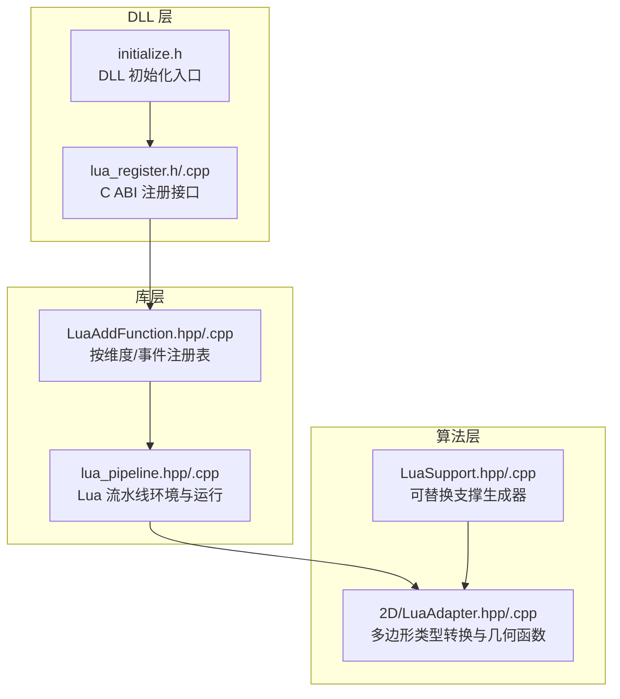
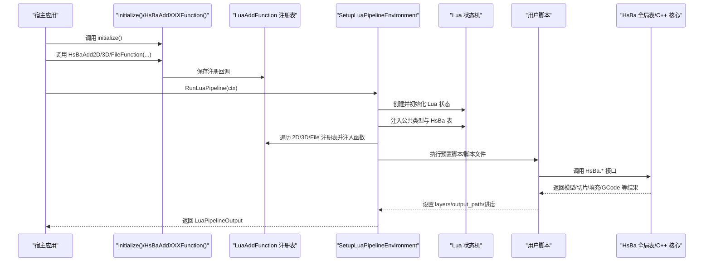
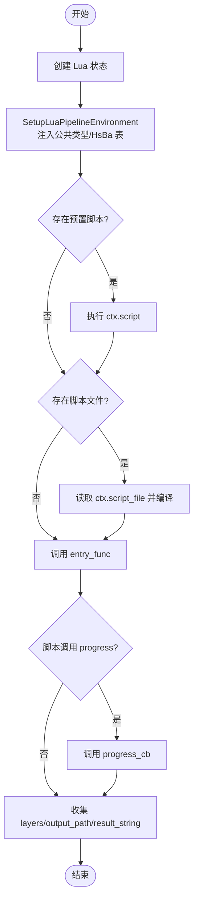
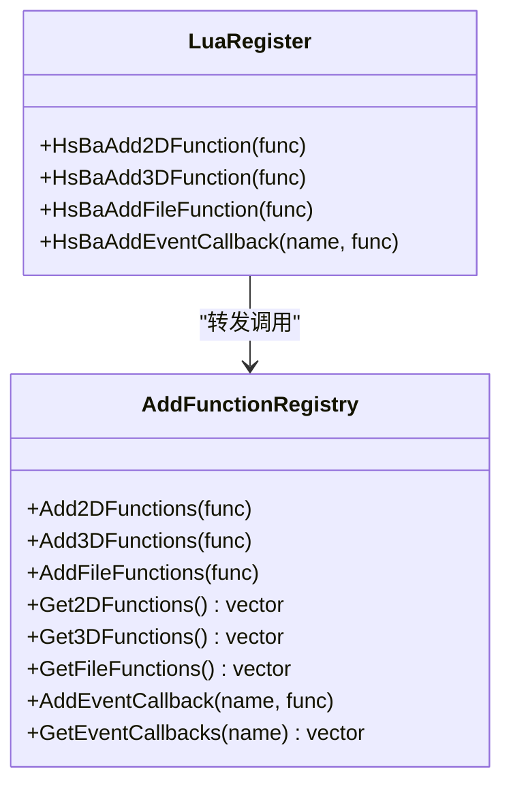
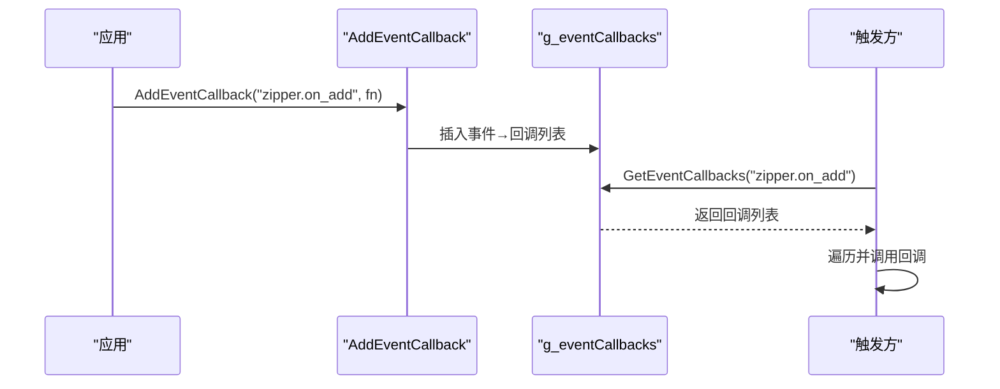
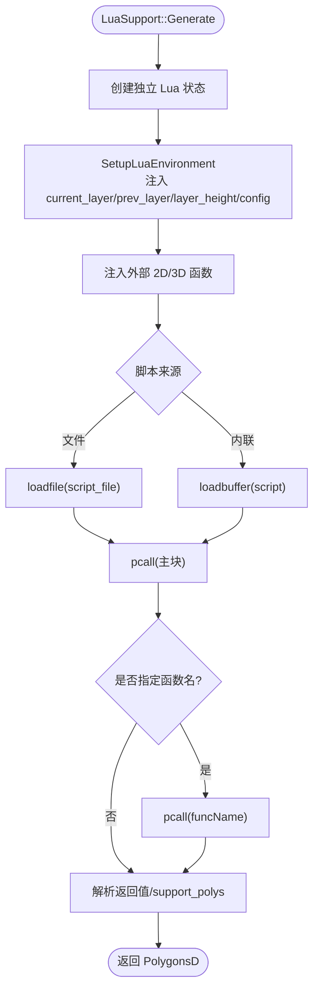
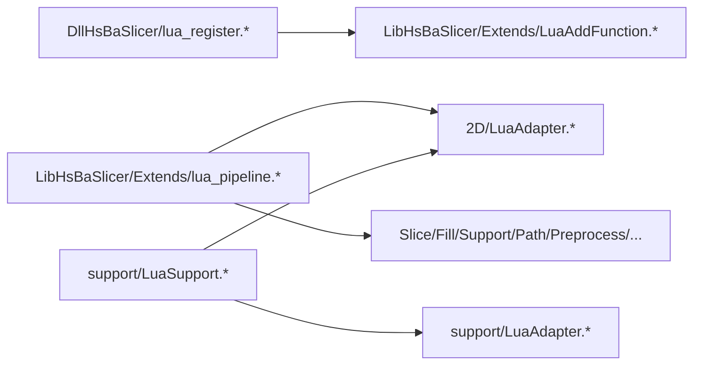

# 脚本执行机制

<cite>
**本文引用的文件**   
- [lua_register.h](file://DllHsBaSlicer/lua_register.h)
- [lua_register.cpp](file://DllHsBaSlicer/lua_register.cpp)
- [LuaAddFunction.hpp](file://LibHsBaSlicer/Extends/LuaAddFunction.hpp)
- [LuaAddFunction.cpp](file://LibHsBaSlicer/Extends/LuaAddFunction.cpp)
- [lua_pipeline.hpp](file://LibHsBaSlicer/Extends/lua_pipeline.hpp)
- [lua_pipeline.cpp](file://LibHsBaSlicer/Extends/lua_pipeline.cpp)
- [LuaSupport.hpp](file://support/LuaSupport.hpp)
- [LuaSupport.cpp](file://support/LuaSupport.cpp)
- [LuaAdapter.hpp](file://2D/LuaAdapter.hpp)
- [LuaAdapter.cpp](file://2D/LuaAdapter.cpp)
- [initialize.h](file://DllHsBaSlicer/initialize.h)
</cite>

## 目录
1. [引言](#引言)
2. [项目结构](#项目结构)
3. [核心组件](#核心组件)
4. [架构总览](#架构总览)
5. [详细组件分析](#详细组件分析)
6. [依赖关系分析](#依赖关系分析)
7. [性能与内存管理](#性能与内存管理)
8. [错误处理与调试](#错误处理与调试)
9. [故障排除指南](#故障排除指南)
10. [结论](#结论)

## 引言
本文面向 HsBaSlicer 的 Lua 脚本执行机制，系统性说明脚本加载、编译、执行生命周期；脚本环境初始化、函数注册与垃圾回收；脚本与 C++ 核心的数据交换协议（类型转换、内存管理与优化）；脚本管道架构（2D 函数、3D 函数、文件函数的分类管理）；事件回调系统（注册、触发与异步处理）；错误处理机制（异常捕获、错误报告、调试信息输出）；以及脚本性能监控与分析方法。文档以源码为依据，配合架构图与时序图帮助读者快速理解并扩展 HsBaSlicer 的脚本能力。

## 项目结构
围绕 Lua 脚本执行的关键代码分布在以下模块：
- DllHsBaSlicer：对外暴露 C ABI 的函数注册入口与 DLL 初始化接口。
- LibHsBaSlicer/Extends：Lua 驱动自定义流水线的环境构建、运行入口与全局函数表。
- support：基于 Lua 的可替换支撑生成器。
- 2D：多边形与 Lua 栈之间的类型转换与几何操作函数注册。



**图示来源**
- [initialize.h:1-22](file://DllHsBaSlicer/initialize.h#L1-L22)
- [lua_register.h:1-38](file://DllHsBaSlicer/lua_register.h#L1-L38)
- [lua_register.cpp:1-42](file://DllHsBaSlicer/lua_register.cpp#L1-L42)
- [LuaAddFunction.hpp:1-78](file://LibHsBaSlicer/Extends/LuaAddFunction.hpp#L1-L78)
- [LuaAddFunction.cpp:1-68](file://LibHsBaSlicer/Extends/LuaAddFunction.cpp#L1-L68)
- [lua_pipeline.hpp:1-88](file://LibHsBaSlicer/Extends/lua_pipeline.hpp#L1-L88)
- [lua_pipeline.cpp:1-800](file://LibHsBaSlicer/Extends/lua_pipeline.cpp#L1-L800)
- [LuaSupport.hpp:1-85](file://support/LuaSupport.hpp#L1-L85)
- [LuaSupport.cpp:1-180](file://support/LuaSupport.cpp#L1-L180)
- [LuaAdapter.hpp:1-84](file://2D/LuaAdapter.hpp#L1-L84)
- [LuaAdapter.cpp:1-493](file://2D/LuaAdapter.cpp#L1-L493)

**章节来源**
- [initialize.h:1-22](file://DllHsBaSlicer/initialize.h#L1-L22)
- [lua_register.h:1-38](file://DllHsBaSlicer/lua_register.h#L1-L38)
- [lua_register.cpp:1-42](file://DllHsBaSlicer/lua_register.cpp#L1-L42)
- [LuaAddFunction.hpp:1-78](file://LibHsBaSlicer/Extends/LuaAddFunction.hpp#L1-L78)
- [LuaAddFunction.cpp:1-68](file://LibHsBaSlicer/Extends/LuaAddFunction.cpp#L1-L68)
- [lua_pipeline.hpp:1-88](file://LibHsBaSlicer/Extends/lua_pipeline.hpp#L1-L88)
- [lua_pipeline.cpp:1-800](file://LibHsBaSlicer/Extends/lua_pipeline.cpp#L1-L800)
- [LuaSupport.hpp:1-85](file://support/LuaSupport.hpp#L1-L85)
- [LuaSupport.cpp:1-180](file://support/LuaSupport.cpp#L1-L180)
- [LuaAdapter.hpp:1-84](file://2D/LuaAdapter.hpp#L1-L84)
- [LuaAdapter.cpp:1-493](file://2D/LuaAdapter.cpp#L1-L493)

## 核心组件
- C ABI 注册入口：提供 HsBaAdd2DFunction/HsBaAdd3DFunction/HsBaAddFileFunction/HsBaAddEventCallback，供外部模块在进程启动时注册自定义 Lua 函数与事件回调。
- 按维度与事件的注册表：维护 2D/3D/File 三类注册回调列表，以及按事件名索引的回调列表。
- Lua 流水线环境：SetupLuaPipelineEnvironment 负责创建 lua_State、打开标准库、注入公共类型、安装 HsBa 全局表与阶段相关函数；RunLuaPipeline 负责加载脚本、执行入口函数并收集结果。
- 可替换支撑生成器：LuaSupport 封装了支撑算法的 Lua 实现，支持内联脚本或脚本文件，并在每次生成时创建独立 Lua 状态。
- 2D 类型适配器：提供 Polygon/Polygons 与 Lua table 的双向转换，以及几何布尔运算、偏移、凸包、面积、图形构造等函数注册。

**章节来源**
- [lua_register.h:1-38](file://DllHsBaSlicer/lua_register.h#L1-L38)
- [lua_register.cpp:1-42](file://DllHsBaSlicer/lua_register.cpp#L1-L42)
- [LuaAddFunction.hpp:1-78](file://LibHsBaSlicer/Extends/LuaAddFunction.hpp#L1-L78)
- [LuaAddFunction.cpp:1-68](file://LibHsBaSlicer/Extends/LuaAddFunction.cpp#L1-L68)
- [lua_pipeline.hpp:1-88](file://LibHsBaSlicer/Extends/lua_pipeline.hpp#L1-L88)
- [lua_pipeline.cpp:1-800](file://LibHsBaSlicer/Extends/lua_pipeline.cpp#L1-L800)
- [LuaSupport.hpp:1-85](file://support/LuaSupport.hpp#L1-L85)
- [LuaSupport.cpp:1-180](file://support/LuaSupport.cpp#L1-L180)
- [LuaAdapter.hpp:1-84](file://2D/LuaAdapter.hpp#L1-L84)
- [LuaAdapter.cpp:1-493](file://2D/LuaAdapter.cpp#L1-L493)

## 架构总览
下图展示从 DLL 初始化到脚本执行的完整调用链，包括函数注册、环境构建、脚本加载与执行、结果回传。



**图示来源**
- [initialize.h:1-22](file://DllHsBaSlicer/initialize.h#L1-L22)
- [lua_register.cpp:1-42](file://DllHsBaSlicer/lua_register.cpp#L1-L42)
- [LuaAddFunction.cpp:1-68](file://LibHsBaSlicer/Extends/LuaAddFunction.cpp#L1-L68)
- [lua_pipeline.cpp:950-994](file://LibHsBaSlicer/Extends/lua_pipeline.cpp#L950-L994)

## 详细组件分析

### 脚本加载、编译与执行生命周期
- 环境初始化：RunLuaPipeline 创建 Lua 状态，调用 SetupLuaPipelineEnvironment 打开标准库、注入公共类型、安装 HsBa 全局表，并将上下文与输出对象绑定到 registry 中。
- 脚本加载：优先执行 ctx.script 作为预置片段，再读取 ctx.script_file 内容并编译为 chunk。
- 执行入口：默认调用 entry_func（run_pipeline），允许返回字符串；脚本可通过 HsBa.setLayers/setOutputPath 更新输出元数据。
- 进度上报：脚本通过 HsBa.progress(percent, stage) 回调宿主 progress_cb。



**图示来源**
- [lua_pipeline.cpp:950-994](file://LibHsBaSlicer/Extends/lua_pipeline.cpp#L950-L994)
- [lua_pipeline.cpp:228-256](file://LibHsBaSlicer/Extends/lua_pipeline.cpp#L228-L256)

**章节来源**
- [lua_pipeline.hpp:29-83](file://LibHsBaSlicer/Extends/lua_pipeline.hpp#L29-L83)
- [lua_pipeline.cpp:950-994](file://LibHsBaSlicer/Extends/lua_pipeline.cpp#L950-L994)
- [lua_pipeline.cpp:228-256](file://LibHsBaSlicer/Extends/lua_pipeline.cpp#L228-L256)

### 函数注册与脚本管道分类管理
- 三类函数注册：
  - 2D 函数：用于 Support/Fill/SLA Output 阶段的 2D 多边形操作。
  - 3D 函数：用于 Slice/Support 阶段的 3D 模型操作。
  - File 函数：用于 SLS/SLA Output 阶段的文件输出操作。
- 注册流程：
  - 宿主调用 HsBaAdd2DFunction/HsBaAdd3DFunction/HsBaAddFileFunction，将回调保存到对应全局向量。
  - 每个阶段创建 Lua 环境时，遍历对应向量并调用回调，向该阶段 Lua 状态注入函数。
- 事件回调：
  - 通过 HsBaAddEventCallback(event_name, func) 将回调绑定到事件名。
  - 运行时根据事件名查找并调用对应回调。



**图示来源**
- [lua_register.h:1-38](file://DllHsBaSlicer/lua_register.h#L1-L38)
- [lua_register.cpp:1-42](file://DllHsBaSlicer/lua_register.cpp#L1-L42)
- [LuaAddFunction.hpp:1-78](file://LibHsBaSlicer/Extends/LuaAddFunction.hpp#L1-L78)
- [LuaAddFunction.cpp:1-68](file://LibHsBaSlicer/Extends/LuaAddFunction.cpp#L1-L68)

**章节来源**
- [lua_register.h:1-38](file://DllHsBaSlicer/lua_register.h#L1-L38)
- [lua_register.cpp:1-42](file://DllHsBaSlicer/lua_register.cpp#L1-L42)
- [LuaAddFunction.hpp:1-78](file://LibHsBaSlicer/Extends/LuaAddFunction.hpp#L1-L78)
- [LuaAddFunction.cpp:1-68](file://LibHsBaSlicer/Extends/LuaAddFunction.cpp#L1-L68)

### 脚本与 C++ 核心的数据交换协议
- 多边形类型：
  - 双精度多边形 PolygonD/PolygonsD 与整数多边形 Polygon/Polygons 之间通过 integerization 因子进行缩放转换。
  - Lua 侧使用 table 表示点集与多边形集合，字段 x/y 为数值。
- 转换函数：
  - PushPolygonDToLua/PushPolygonsDToLua：C++ → Lua。
  - LuaTableToPolygonD/LuaTableToPolygonsD：Lua → C++。
  - PushPolygonToLua/PushPolygonsToLua：C++ 整数多边形 → Lua。
  - LuaTableToPolygon/LuaTableToPolygons：Lua → C++ 整数多边形。
- 几何操作：
  - 通过 RegisterLuaPolygonOperations 将 booleanOperation/union/intersection/difference/xor/offsetOperation/convexHullOperation/concaveHullOperation/area/makeRectangle/makeCircle/makeEllipse/makeRegularPolygon/textToPolygons 等函数注册到 Lua 全局 PolygonOperations。
- 模型与路径：
  - HsBa.loadModel/modelInfo/translateModel/rotateModel/scaleModel/removeModel/modelNames 暴露模型池操作。
  - HsBa.slice/sliceUnsafe/layerCount/layerZ 暴露切片与层级计算。
  - HsBa.fill/fdmSupport/slaSupport/floor/spiralize/toGcode 暴露填充、支撑、底面、螺旋路径与 GCode 生成。
  - HsBa.saveSlsPackage/saveWaamPackage/saveSlaPackage 暴露打包导出。

```mermaid
flowchart LR
Lua["Lua table<br/>[[{x,y},...],...]"] < --> Adapter["2D/LuaAdapter<br/>Push*/LuaTableTo*"]
Adapter < --> Core["C++ 核心<br/>Polygon/PolygonD/Polygons/PolygonsD"]
Core --> Ops["几何与路径算法<br/>Fill/Support/Spiral/GCode"]
Ops --> Adapter
Adapter --> Lua
```

**图示来源**
- [LuaAdapter.cpp:332-493](file://2D/LuaAdapter.cpp#L332-L493)
- [lua_pipeline.cpp:290-691](file://LibHsBaSlicer/Extends/lua_pipeline.cpp#L290-L691)

**章节来源**
- [LuaAdapter.hpp:1-84](file://2D/LuaAdapter.hpp#L1-L84)
- [LuaAdapter.cpp:1-493](file://2D/LuaAdapter.cpp#L1-L493)
- [lua_pipeline.cpp:290-691](file://LibHsBaSlicer/Extends/lua_pipeline.cpp#L290-L691)

### 事件回调系统工作原理
- 注册：通过 HsBaAddEventCallback(event_name, func) 将回调函数指针绑定到事件名。
- 存储：内部使用 map<string, vector<LuaRegFunc>> 维护事件到回调列表的映射。
- 触发：任意模块在需要时通过 GetEventCallbacks(event_name) 获取回调列表并依次调用。
- 适用场景：压缩器事件（如 zipper.on_add）、数据库查询事件（db.on_query）等。



**图示来源**
- [LuaAddFunction.cpp:51-68](file://LibHsBaSlicer/Extends/LuaAddFunction.cpp#L51-L68)
- [LuaAddFunction.hpp:60-74](file://LibHsBaSlicer/Extends/LuaAddFunction.hpp#L60-L74)

**章节来源**
- [LuaAddFunction.cpp:51-68](file://LibHsBaSlicer/Extends/LuaAddFunction.cpp#L51-L68)
- [LuaAddFunction.hpp:60-74](file://LibHsBaSlicer/Extends/LuaAddFunction.hpp#L60-L74)

### 可替换支撑生成器（LuaSupport）
- 构造方式：支持内联脚本或脚本文件，并可指定入口函数名（默认 generate_support）。
- 环境准备：打开标准库，注册 PolygonOperations 与 Support 模块，注入 current_layer/prev_layer/layer_height/config 等全局变量。
- 执行流程：加载脚本 chunk，pcall 执行主块；若指定函数名则再次 pcall 调用该函数；最终从返回值或全局 support_polys 解析 PolygonsD。
- 外部函数注入：通过 SetExternalRegs 传入 2D+3D 注册回调，在每次生成前注入到独立 Lua 状态。



**图示来源**
- [LuaSupport.cpp:19-179](file://support/LuaSupport.cpp#L19-L179)
- [LuaSupport.hpp:40-81](file://support/LuaSupport.hpp#L40-L81)

**章节来源**
- [LuaSupport.hpp:1-85](file://support/LuaSupport.hpp#L1-L85)
- [LuaSupport.cpp:1-180](file://support/LuaSupport.cpp#L1-L180)

## 依赖关系分析
- DllHsBaSlicer/lua_register.* 依赖 LibHsBaSlicer/Extends/LuaAddFunction.* 完成实际注册逻辑。
- LibHsBaSlicer/Extends/lua_pipeline.* 依赖 2D/LuaAdapter.* 进行多边形类型转换，并依赖各算法模块（Slice/Fill/Support/Path/Preprocess/Cipher/FileOperator）。
- support/LuaSupport.* 依赖 2D/LuaAdapter.* 与 support/LuaAdapter.* 提供支撑相关的 Lua 函数。



**图示来源**
- [lua_register.cpp:1-42](file://DllHsBaSlicer/lua_register.cpp#L1-L42)
- [LuaAddFunction.cpp:1-68](file://LibHsBaSlicer/Extends/LuaAddFunction.cpp#L1-L68)
- [lua_pipeline.cpp:1-800](file://LibHsBaSlicer/Extends/lua_pipeline.cpp#L1-L800)
- [LuaAdapter.cpp:1-493](file://2D/LuaAdapter.cpp#L1-L493)
- [LuaSupport.cpp:1-180](file://support/LuaSupport.cpp#L1-L180)

**章节来源**
- [lua_register.cpp:1-42](file://DllHsBaSlicer/lua_register.cpp#L1-L42)
- [LuaAddFunction.cpp:1-68](file://LibHsBaSlicer/Extends/LuaAddFunction.cpp#L1-L68)
- [lua_pipeline.cpp:1-800](file://LibHsBaSlicer/Extends/lua_pipeline.cpp#L1-L800)
- [LuaAdapter.cpp:1-493](file://2D/LuaAdapter.cpp#L1-L493)
- [LuaSupport.cpp:1-180](file://support/LuaSupport.cpp#L1-L180)

## 性能与内存管理
- 类型转换开销：
  - 多边形在 Lua 与 C++ 间频繁拷贝，建议批量处理以减少跨语言边界调用次数。
  - 使用整数多边形（Polygon/Polygons）可减少浮点误差与提升几何算法性能，必要时再通过 toDouble 转回双精度。
- 内存池与对象复用：
  - 模型池（model pool）避免重复加载，减少 I/O 与解析成本。
  - 流水线运行状态通过 registry 键值绑定，避免全局变量污染。
- 垃圾回收：
  - 每个 RunLuaPipeline 创建独立的 Lua 状态，执行结束后由 RAII 智能指针释放，确保 GC 及时回收。
  - LuaSupport 每次 Generate 也创建独立 Lua 状态，避免状态污染与长驻内存。
- 优化策略：
  - 预编译脚本：对热点脚本可考虑缓存编译后的 chunk（当前实现为每次加载源文本）。
  - 减少大表传递：尽量通过 HsBa.* 接口直接调用核心算法，避免在 Lua 侧构造超大中间表。
  - 合理设置 layerHeight/firstLayerHeight 以减少不必要的切片计算。

[本节为通用性能指导，不直接分析具体文件]

## 错误处理与调试
- 脚本加载错误：
  - LuaSupport 在 loadfile/loadbuffer 失败时抛出 RuntimeError，包含 Lua 错误消息。
  - RunLuaPipeline 在创建 Lua 状态或打开脚本文件失败时，返回 LuaPipelineOutput.error_message。
- 运行时错误：
  - 所有脚本调用使用 lua_pcall，错误信息通过 lua_tostring 捕获并包装为 RuntimeError 或返回 error_message。
- 调试信息：
  - HsBa.progress(percent, stage) 可用于上报进度与阶段名称，便于上层日志记录。
  - 2D/LuaAdapter 中的几何函数在参数校验失败时通过 luaL_error 抛出带函数名的错误信息。
- 调试建议：
  - 启用 HSBA_POLYGON_DUMP 宏以输出多边形调试文件（dumpPolygon/dumpPolygons）。
  - 在宿主侧记录 progress_cb 的 percent/stage，结合错误消息定位问题阶段。

**章节来源**
- [LuaSupport.cpp:130-179](file://support/LuaSupport.cpp#L130-L179)
- [lua_pipeline.cpp:950-994](file://LibHsBaSlicer/Extends/lua_pipeline.cpp#L950-L994)
- [LuaAdapter.cpp:16-54](file://2D/LuaAdapter.cpp#L16-L54)
- [lua_pipeline.cpp:228-256](file://LibHsBaSlicer/Extends/lua_pipeline.cpp#L228-L256)

## 故障排除指南
- 无法加载脚本文件：
  - 检查 script_file 路径是否正确，确认文件可读。
  - 查看 LuaPipelineOutput.error_message 中的“Failed to open Lua script file”提示。
- 脚本语法错误：
  - 检查预置脚本与脚本文件的语法，关注 LuaSupport 抛出的 “load error” 或 “runtime error”。
- 找不到模型：
  - 确保已通过 HsBa.loadModel 成功加载模型，并使用正确的 model name。
  - 使用 HsBa.modelNames 列出已加载模型名称。
- 切片结果为空：
  - 检查 layerHeight/firstLayerHeight 是否为正数，模型高度是否大于零。
  - 使用 HsBa.layerCount 验证层数计算。
- 填充/支撑/路径生成失败：
  - 检查输入多边形是否闭合，坐标范围是否合理。
  - 使用 PolygonOperations.area 与 convexHullOperation 辅助诊断。
- 打包导出失败：
  - 检查 saveSlsPackage/saveWaamPackage/saveSlaPackage 的参数完整性（output/script/func 等）。
  - 查看返回的二元结果或错误详情。

**章节来源**
- [lua_pipeline.cpp:950-994](file://LibHsBaSlicer/Extends/lua_pipeline.cpp#L950-L994)
- [LuaSupport.cpp:130-179](file://support/LuaSupport.cpp#L130-L179)
- [lua_pipeline.cpp:290-691](file://LibHsBaSlicer/Extends/lua_pipeline.cpp#L290-L691)
- [LuaAdapter.cpp:332-493](file://2D/LuaAdapter.cpp#L332-L493)

## 结论
HsBaSlicer 的 Lua 脚本执行机制通过清晰的职责分层实现了灵活的脚本化流水线：DLL 层提供稳定的 C ABI 注册入口，库层维护按维度与事件的函数注册表，流水线环境负责安全地创建与销毁 Lua 状态并注入全局能力，算法层提供丰富的几何与路径处理能力。类型转换与内存管理策略在保证正确性的同时兼顾性能，错误处理机制覆盖加载、编译与运行全链路。借助本文提供的架构图、时序图与流程图，开发者可以快速集成自定义函数、扩展事件回调、优化脚本性能并排查常见问题。

[本节为总结性内容，不直接分析具体文件]