# 自定义填充算法

<cite>
**本文引用的文件**   
- [2D/PolygonFill.hpp](file://2D/PolygonFill.hpp)
- [2D/PolygonFill.cpp](file://2D/PolygonFill.cpp)
- [LibHsBaSlicer/Fill/polygon_fill.hpp](file://LibHsBaSlicer/Fill/polygon_fill.hpp)
- [LibHsBaSlicer/Fill/polygon_fill.cpp](file://LibHsBaSlicer/Fill/polygon_fill.cpp)
- [DllHsBaSlicer/fdm_pipeline.cpp](file://DllHsBaSlicer/fdm_pipeline.cpp)
- [ModuleHsBaSlicer/hsba_slicer.cppm](file://ModuleHsBaSlicer/hsba_slicer.cppm)
- [types/hsba_pipeline.d.lua](file://types/hsba_pipeline.d.lua)
- [samples/FDM/scripts/my_infill.lua](file://samples/FDM/scripts/my_infill.lua)
- [tests/PolygonFill/custom_fill.lua](file://tests/PolygonFill/custom_fill.lua)
- [tests/PolygonFill/polygon_fill_test.cpp](file://tests/PolygonFill/polygon_fill_test.cpp)
- [pipelinetypes/pipeline_types.h](file://pipelinetypes/pipeline_types.h)
</cite>

## 目录
1. [引言](#引言)
2. [项目结构](#项目结构)
3. [核心概念](#核心概念)
4. [架构总览](#架构总览)
5. [核心组件详解](#核心组件详解)
6. [详细组件分析](#详细组件分析)
7. [依赖关系分析](#依赖关系分析)
8. [性能与优化](#性能与优化)
9. [Lua 自定义填充开发指南](#lua-自定义填充开发指南)
10. [调试与常见问题](#调试与常见问题)
11. [结论](#结论)

## 引言
本文面向希望为 FDM 切片系统编写自定义填充算法的开发者，系统性说明 HsBaSlicer 中填充算法的实现模式、数据流、注册方式与调用时机。文档覆盖直线填充、网格/交错折线填充、偏移组合填充、混合填充以及 Lua 自定义填充；同时给出从简单到复杂的实现思路、坐标变换、路径组织、性能考虑和调试方法。

## 项目结构
填充能力在仓库中分为三层：
- 2D 几何填充引擎：提供偏移、直线、折线、组合、混合及 Lua 自定义填充。
- LibHsBaSlicer C++ API：对外暴露简洁接口，封装常用填充模式。
- DllHsBaSlicer FDM 流水线：将填充嵌入切片、支撑、路径生成流程，并支持并行执行与 Lua 脚本注入。

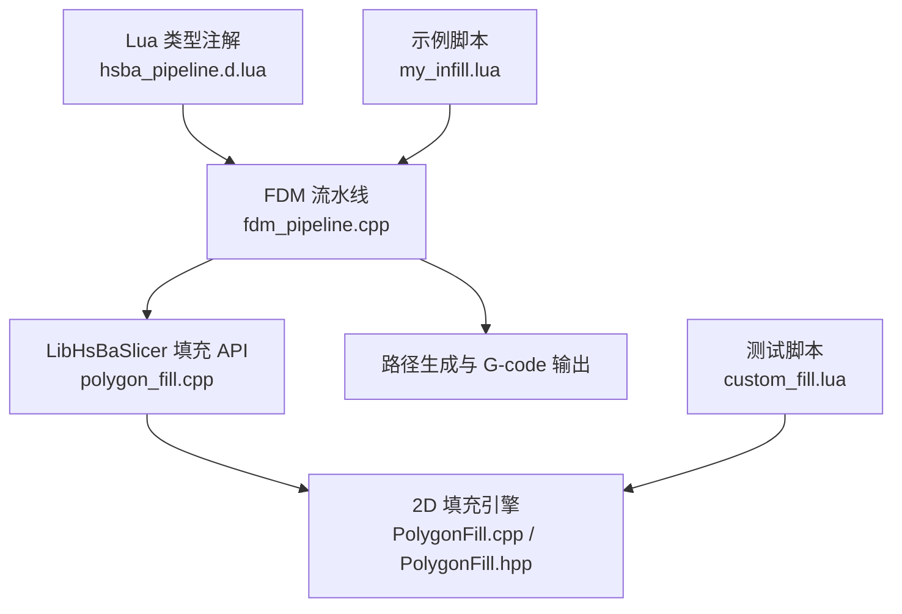

**图表来源**
- [DllHsBaSlicer/fdm_pipeline.cpp:312-383](file://DllHsBaSlicer/fdm_pipeline.cpp#L312-L383)
- [LibHsBaSlicer/Fill/polygon_fill.cpp:13-49](file://LibHsBaSlicer/Fill/polygon_fill.cpp#L13-L49)
- [2D/PolygonFill.cpp:488-502](file://2D/PolygonFill.cpp#L488-L502)
- [types/hsba_pipeline.d.lua:551-561](file://types/hsba_pipeline.d.lua#L551-L561)
- [samples/FDM/scripts/my_infill.lua:1-89](file://samples/FDM/scripts/my_infill.lua#L1-L89)
- [tests/PolygonFill/custom_fill.lua:1-16](file://tests/PolygonFill/custom_fill.lua#L1-L16)

**章节来源**
- [DllHsBaSlicer/fdm_pipeline.cpp:312-383](file://DllHsBaSlicer/fdm_pipeline.cpp#L312-L383)
- [LibHsBaSlicer/Fill/polygon_fill.cpp:13-49](file://LibHsBaSlicer/Fill/polygon_fill.cpp#L13-L49)
- [2D/PolygonFill.hpp:20-136](file://2D/PolygonFill.hpp#L20-L136)

## 核心概念
- 多边形输入：填充阶段接收的是当前层轮廓多边形集合，通常已扣除壁厚区域。
- 整数化坐标：内部使用整数坐标进行布尔运算与偏移，避免浮点误差。
- 填充模式：
  - 直线填充：按角度生成平行扫描线，裁剪后得到线段。
  - 简单折线填充：连接相邻扫描段形成连续折线。
  - 高级折线填充：通过连通性分析与桥接逻辑生成更稳健的连续路径。
  - 偏移组合填充：对基础多边形做内外偏移，再对偏移结果应用内部填充。
  - 混合填充：先输出若干偏移边界，再对最内层有效区域填充。
- Lua 自定义填充：通过 `generate_fill` 函数返回多边形或折线数组，胶水负责类型转换与错误处理。

**章节来源**
- [2D/PolygonFill.hpp:20-136](file://2D/PolygonFill.hpp#L20-L136)
- [2D/PolygonFill.cpp:44-160](file://2D/PolygonFill.cpp#L44-L160)
- [2D/PolygonFill.cpp:543-800](file://2D/PolygonFill.cpp#L543-L800)
- [2D/PolygonFill.cpp:803-1491](file://2D/PolygonFill.cpp#L803-L1491)

## 架构总览
FDM 流水线在支撑完成后进入填充阶段。若启用螺旋模式则跳过填充；否则根据是否配置 Lua 填充脚本决定串行或并行执行。最终填充结果与轮廓、支撑一起进入路径生成阶段。

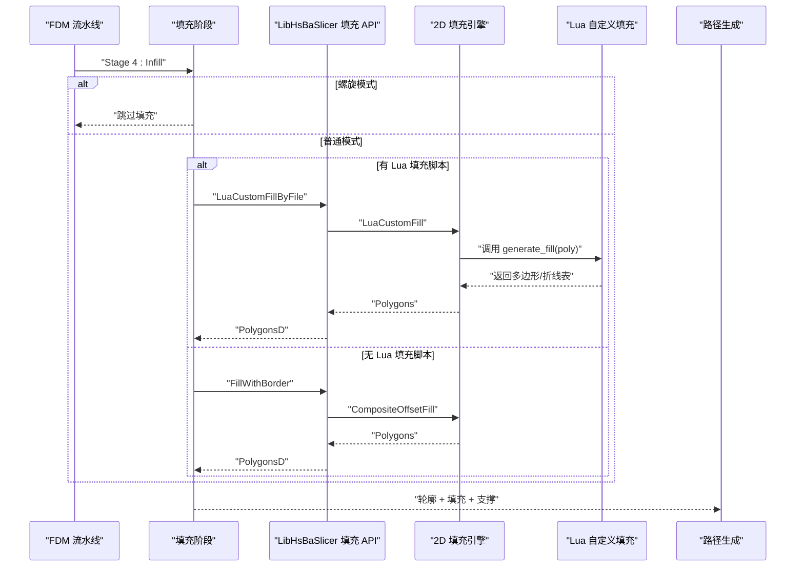

**图表来源**
- [DllHsBaSlicer/fdm_pipeline.cpp:312-383](file://DllHsBaSlicer/fdm_pipeline.cpp#L312-L383)
- [LibHsBaSlicer/Fill/polygon_fill.cpp:35-49](file://LibHsBaSlicer/Fill/polygon_fill.cpp#L35-L49)
- [2D/PolygonFill.cpp:1493-1585](file://2D/PolygonFill.cpp#L1493-L1585)

**章节来源**
- [DllHsBaSlicer/fdm_pipeline.cpp:312-383](file://DllHsBaSlicer/fdm_pipeline.cpp#L312-L383)

## 核心组件详解
### 2D 填充引擎接口
- 偏移填充：`OffsetFill`
- 直线填充：`LineFill`
- 简单折线填充：`SimpleZigzagFill`
- 高级折线填充：`ZigzagFill`
- 组合偏移填充：`CompositeOffsetFill`
- 混合填充：`HybridFill`
- Lua 自定义填充：`LuaCustomFill`、`LuaCustomFillString`
- Lua 绑定注册：`RegisterLuaPolygonFillFunctions`

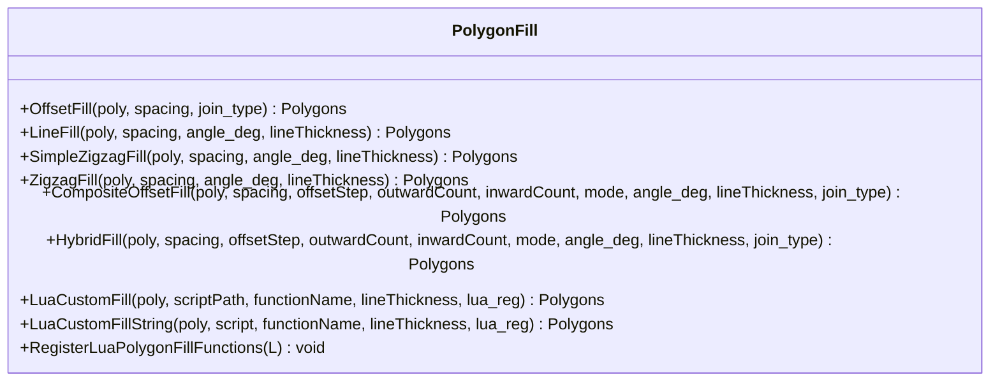

**图表来源**
- [2D/PolygonFill.hpp:20-136](file://2D/PolygonFill.hpp#L20-L136)
- [2D/PolygonFill.cpp:488-502](file://2D/PolygonFill.cpp#L488-L502)

**章节来源**
- [2D/PolygonFill.hpp:20-136](file://2D/PolygonFill.hpp#L20-L136)

### LibHsBaSlicer 填充 API
对外暴露三个主要接口：
- `FillPolygon`：根据模式选择直线、简单折线或高级折线填充。
- `FillWithBorder`：基于组合偏移填充，用于“边框 + 内部填充”。
- `LuaCustomFillByFile`：加载外部 Lua 脚本，自动注册 2D 操作与路径优化函数。

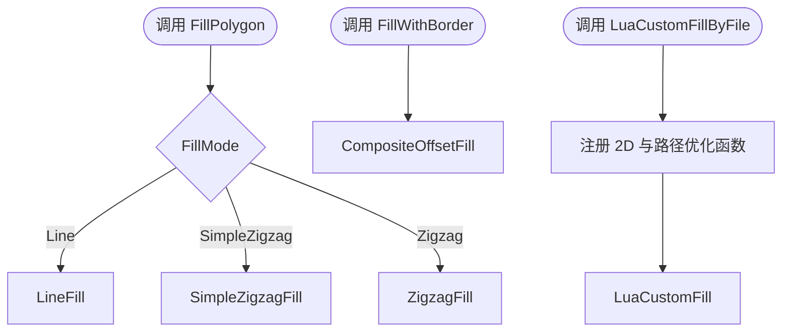

**图表来源**
- [LibHsBaSlicer/Fill/polygon_fill.cpp:13-49](file://LibHsBaSlicer/Fill/polygon_fill.cpp#L13-L49)

**章节来源**
- [LibHsBaSlicer/Fill/polygon_fill.hpp:17-53](file://LibHsBaSlicer/Fill/polygon_fill.hpp#L17-L53)
- [LibHsBaSlicer/Fill/polygon_fill.cpp:13-49](file://LibHsBaSlicer/Fill/polygon_fill.cpp#L13-L49)

### FDM 流水线中的填充阶段
- 非螺旋模式下计算填充。
- 顶层与底层使用实心填充（较小间距），中间层根据密度调整间距。
- 若配置了 Lua 填充脚本，则逐层串行调用；否则使用 C++ 填充并并行执行。
- 填充结果与轮廓、支撑合并后进入路径生成。

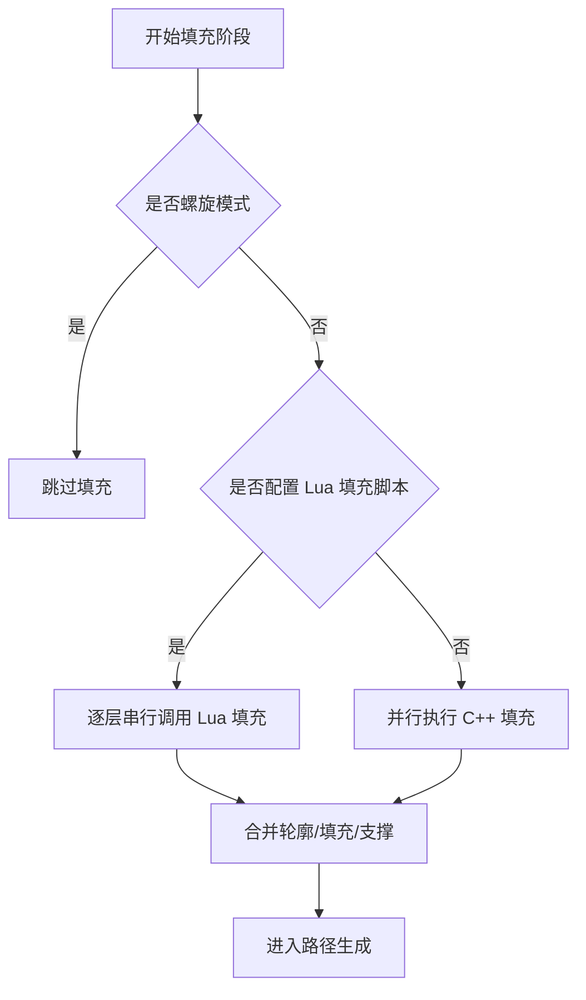

**图表来源**
- [DllHsBaSlicer/fdm_pipeline.cpp:312-383](file://DllHsBaSlicer/fdm_pipeline.cpp#L312-L383)

**章节来源**
- [DllHsBaSlicer/fdm_pipeline.cpp:312-383](file://DllHsBaSlicer/fdm_pipeline.cpp#L312-L383)

## 详细组件分析

### 直线填充算法
直线填充的核心思想：
- 计算多边形边界框与投影范围。
- 沿指定角度生成等距扫描矩形条。
- 与原始多边形求交，提取每个扫描条内的线段区间。
- 将区间转换为独立线段输出。

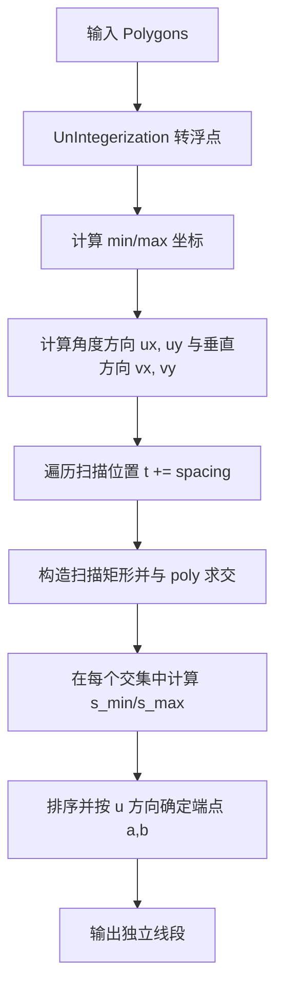

**图表来源**
- [2D/PolygonFill.cpp:44-160](file://2D/PolygonFill.cpp#L44-L160)
- [2D/PolygonFill.cpp:543-564](file://2D/PolygonFill.cpp#L543-L564)

**章节来源**
- [2D/PolygonFill.cpp:44-160](file://2D/PolygonFill.cpp#L44-L160)
- [2D/PolygonFill.cpp:543-564](file://2D/PolygonFill.cpp#L543-L564)

### 简单折线填充算法
简单折线填充在直线扫描基础上，尝试将相邻扫描段的中心连接成连续折线：
- 对每条扫描段进行“向内收缩”以避开边界。
- 使用二分搜索找到段与多边形内部的第一个/最后一个交点。
- 仅允许同一行或相邻行之间连接，避免跨行跳变。
- 将折线点集转换为整数多边形输出。

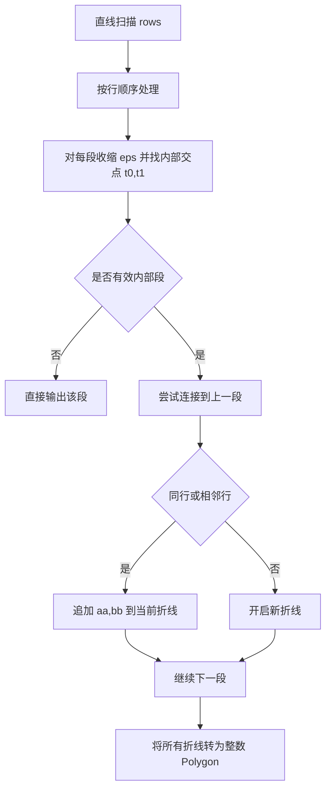

**图表来源**
- [2D/PolygonFill.cpp:566-800](file://2D/PolygonFill.cpp#L566-L800)

**章节来源**
- [2D/PolygonFill.cpp:566-800](file://2D/PolygonFill.cpp#L566-L800)

### 高级折线填充算法
高级折线填充进一步改进连通性与边界桥接：
- 对相邻行的扫描段进行区间重叠判断，使用并查集构建连通分量。
- 当不同分量且位于相邻行时，尝试沿外环走最短弧进行桥接。
- 若桥接失败，回退到中线点是否在内部作为连接条件。
- 收集额外无法连接的直线段，最后统一输出。

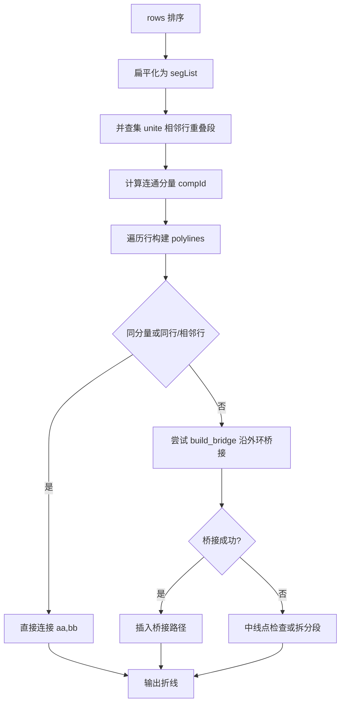

**图表来源**
- [2D/PolygonFill.cpp:803-1491](file://2D/PolygonFill.cpp#L803-L1491)

**章节来源**
- [2D/PolygonFill.cpp:803-1491](file://2D/PolygonFill.cpp#L803-L1491)

### 组合偏移填充与混合填充
- 组合偏移填充：对基础多边形应用内部填充，再对外部偏移层与内部偏移层分别应用相同填充模式。
- 混合填充：先输出若干外部偏移闭合路径，再对最内层有效区域进行填充，忽略过小面积区域。

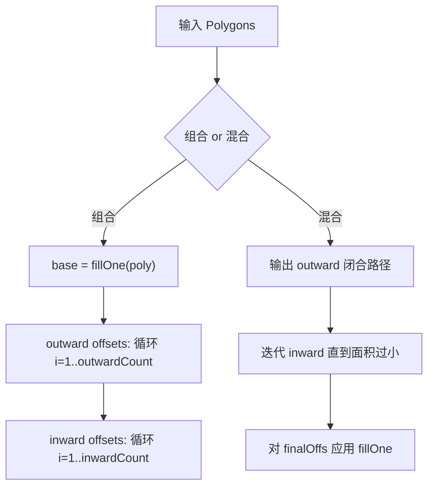

**图表来源**
- [2D/PolygonFill.cpp:1372-1491](file://2D/PolygonFill.cpp#L1372-L1491)

**章节来源**
- [2D/PolygonFill.cpp:1372-1491](file://2D/PolygonFill.cpp#L1372-L1491)

### Lua 自定义填充入口
- 入口函数名为 `generate_fill`，默认可从配置中替换。
- 输入参数为当前层多边形（浮点坐标）。
- 返回值应为多边形或折线数组，胶水会将其转换为整数多边形。
- 可通过 `lua_reg` 回调注入更多库函数，例如 2D 操作与路径优化。

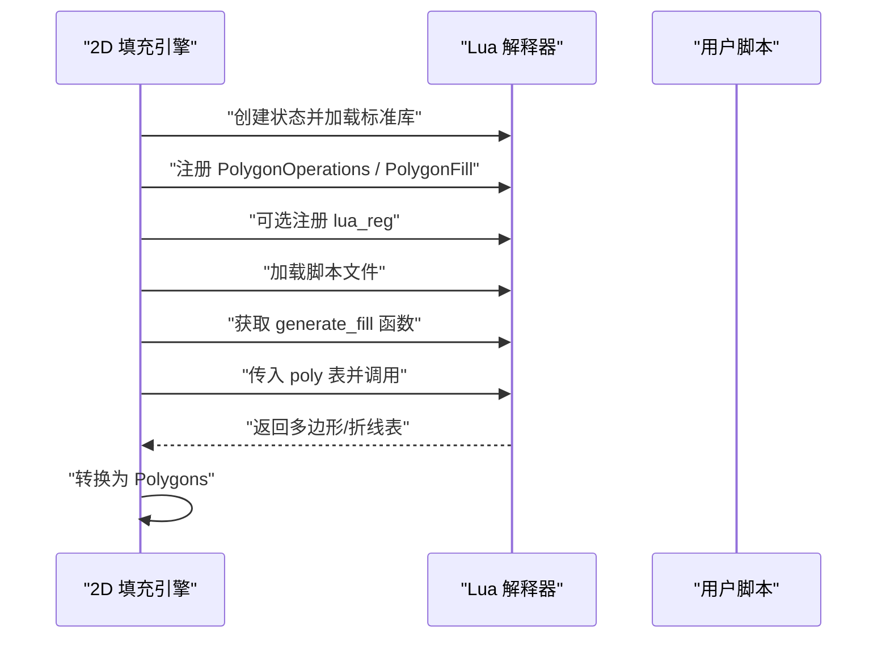

**图表来源**
- [2D/PolygonFill.cpp:1493-1585](file://2D/PolygonFill.cpp#L1493-L1585)
- [LibHsBaSlicer/Fill/polygon_fill.cpp:35-49](file://LibHsBaSlicer/Fill/polygon_fill.cpp#L35-L49)

**章节来源**
- [2D/PolygonFill.cpp:1493-1585](file://2D/PolygonFill.cpp#L1493-L1585)
- [LibHsBaSlicer/Fill/polygon_fill.cpp:35-49](file://LibHsBaSlicer/Fill/polygon_fill.cpp#L35-L49)

## 依赖关系分析
- 2D 填充引擎依赖 Clipper2 进行偏移、交集、面积等几何操作。
- LibHsBaSlicer 填充 API 依赖 2D 引擎与路径优化函数注册。
- FDM 流水线依赖 LibHsBaSlicer API，并在必要时串行调用 Lua 填充。
- Lua 类型注解文件定义了各阶段脚本环境，包括 FDM 填充阶段的 `generate_fill`。

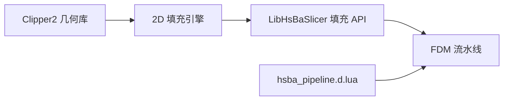

**图表来源**
- [2D/PolygonFill.cpp:1-20](file://2D/PolygonFill.cpp#L1-L20)
- [LibHsBaSlicer/Fill/polygon_fill.cpp:1-10](file://LibHsBaSlicer/Fill/polygon_fill.cpp#L1-L10)
- [DllHsBaSlicer/fdm_pipeline.cpp:312-383](file://DllHsBaSlicer/fdm_pipeline.cpp#L312-L383)
- [types/hsba_pipeline.d.lua:551-561](file://types/hsba_pipeline.d.lua#L551-L561)

**章节来源**
- [2D/PolygonFill.cpp:1-20](file://2D/PolygonFill.cpp#L1-L20)
- [LibHsBaSlicer/Fill/polygon_fill.cpp:1-10](file://LibHsBaSlicer/Fill/polygon_fill.cpp#L1-L10)
- [DllHsBaSlicer/fdm_pipeline.cpp:312-383](file://DllHsBaSlicer/fdm_pipeline.cpp#L312-L383)
- [types/hsba_pipeline.d.lua:551-561](file://types/hsba_pipeline.d.lua#L551-L561)

## 性能与优化
- 内存管理：
  - 内部使用整数坐标减少浮点误差，避免重复分配大对象。
  - 扫描行与线段列表按需增长，避免预分配过大缓冲区。
- 计算复杂度：
  - 直线填充复杂度与扫描行数 × 多边形顶点数相关。
  - 高级折线填充引入并查集与相邻行区间比较，复杂度随扫描段数量增加而上升。
- 并行处理：
  - C++ 填充可并行执行，Lua 填充因共享解释器需串行。
  - 顶层/底层使用实心填充，中间层根据密度调整间距以减少计算量。
- 优化建议：
  - 合理设置间距与角度，避免过密扫描。
  - 对于复杂形状优先使用组合偏移填充，减少内部填充区域。
  - 在 Lua 脚本中尽量复用几何操作，避免重复计算。

[本节为通用性能讨论，不直接分析具体文件]

## Lua 自定义填充开发指南

### 脚本约定与数据结构
- 入口函数：`generate_fill(polys)`
- 输入：`polys` 为多边形数组，每个多边形由点数组组成，点包含 `x`、`y` 字段。
- 输出：多边形或折线数组，胶水会转换为整数多边形。
- 可用库：`PolygonOperations`、`PolygonFill`、`PathOptimize`（通过注册注入）。

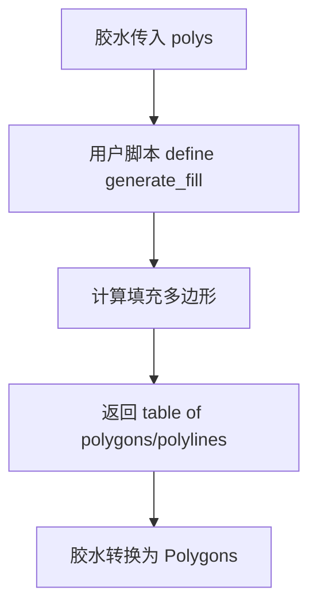

**图表来源**
- [types/hsba_pipeline.d.lua:551-561](file://types/hsba_pipeline.d.lua#L551-L561)
- [2D/PolygonFill.cpp:1493-1585](file://2D/PolygonFill.cpp#L1493-L1585)

**章节来源**
- [types/hsba_pipeline.d.lua:551-561](file://types/hsba_pipeline.d.lua#L551-L561)
- [2D/PolygonFill.cpp:1493-1585](file://2D/PolygonFill.cpp#L1493-L1585)

### 坐标变换与路径优化
- 坐标变换：
  - 输入为浮点坐标，内部会转换为整数坐标进行几何运算。
  - 输出前由胶水将整数坐标转回浮点或直接转换为整数多边形。
- 路径优化：
  - 可通过 `lua_reg` 注入路径优化函数，使脚本在输出前对区域进行优化。
  - 示例中 LibHsBaSlicer 的 `LuaCustomFillByFile` 会自动注册 2D 操作与路径优化函数。

**章节来源**
- [LibHsBaSlicer/Fill/polygon_fill.cpp:35-49](file://LibHsBaSlicer/Fill/polygon_fill.cpp#L35-L49)
- [2D/PolygonFill.cpp:1493-1585](file://2D/PolygonFill.cpp#L1493-L1585)

### 完整示例：从直线填充到复杂填充
- 简单示例：返回两条对角折线。
- 中等示例：基于边界框生成平行线，并与轮廓求交。
- 复杂示例：结合偏移、组合填充与角度控制，生成多层填充。

参考文件：
- [tests/PolygonFill/custom_fill.lua:1-16](file://tests/PolygonFill/custom_fill.lua#L1-L16)
- [samples/FDM/scripts/my_infill.lua:1-89](file://samples/FDM/scripts/my_infill.lua#L1-L89)

**章节来源**
- [tests/PolygonFill/custom_fill.lua:1-16](file://tests/PolygonFill/custom_fill.lua#L1-L16)
- [samples/FDM/scripts/my_infill.lua:1-89](file://samples/FDM/scripts/my_infill.lua#L1-L89)

### 注册与调用时机
- 注册：
  - `RegisterLuaPolygonFillFunctions` 将 `offsetFill`、`lineFill`、`simpleZigzagFill`、`zigzagFill`、`compositeOffsetFill`、`hybridFill`、`offsetOnly` 暴露给 Lua。
- 调用时机：
  - FDM 流水线在支撑完成后进入填充阶段。
  - 若配置了 Lua 填充脚本，则逐层串行调用；否则使用 C++ 填充并并行执行。

**章节来源**
- [2D/PolygonFill.cpp:488-502](file://2D/PolygonFill.cpp#L488-L502)
- [DllHsBaSlicer/fdm_pipeline.cpp:312-383](file://DllHsBaSlicer/fdm_pipeline.cpp#L312-L383)

## 调试与常见问题

### 常见错误与定位
- Lua 脚本加载失败：检查脚本路径与语法。
- 未找到 `generate_fill` 函数：确认函数名与配置一致。
- 返回值不是表：确保脚本返回多边形或折线数组。
- 坐标异常：检查输入多边形是否为空或退化。

**章节来源**
- [2D/PolygonFill.cpp:1493-1585](file://2D/PolygonFill.cpp#L1493-L1585)

### 调试技巧
- 使用测试脚本验证基本功能：
  - [tests/PolygonFill/custom_fill.lua:1-16](file://tests/PolygonFill/custom_fill.lua#L1-L16)
- 逐步打印中间结果：
  - 在 Lua 脚本中输出边界框、扫描线数量、交点数量。
- 对比内置填充结果：
  - 使用 `PolygonFill.lineFill`、`PolygonFill.zigzagFill` 等函数生成基准结果。

**章节来源**
- [tests/PolygonFill/custom_fill.lua:1-16](file://tests/PolygonFill/custom_fill.lua#L1-L16)
- [tests/PolygonFill/polygon_fill_test.cpp:208-234](file://tests/PolygonFill/polygon_fill_test.cpp#L208-L234)

### 性能问题排查
- 填充过密导致耗时过长：增大间距或降低密度。
- 复杂形状导致桥接失败：使用组合偏移填充减少内部区域。
- Lua 填充串行瓶颈：评估是否可改用 C++ 填充或优化脚本逻辑。

[本节为通用调试指导，不直接分析具体文件]

## 结论
HsBaSlicer 的填充系统提供了从基础直线填充到复杂混合填充的完整能力，并通过 Lua 脚本机制支持高度定制化的填充逻辑。开发者可根据模型特征选择合适的填充模式，利用偏移、角度控制与路径优化提升打印质量与效率。在实际工程中，应关注坐标精度、内存占用与并行策略，确保填充算法在大规模模型上稳定运行。

[本节为总结性内容，不直接分析具体文件]