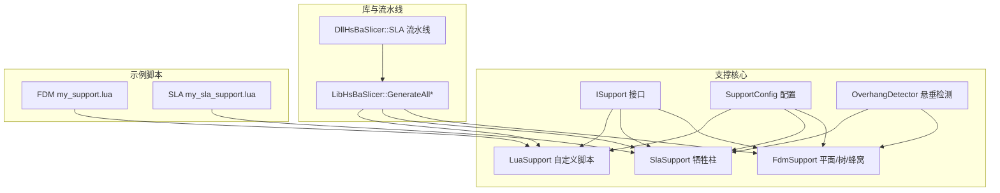
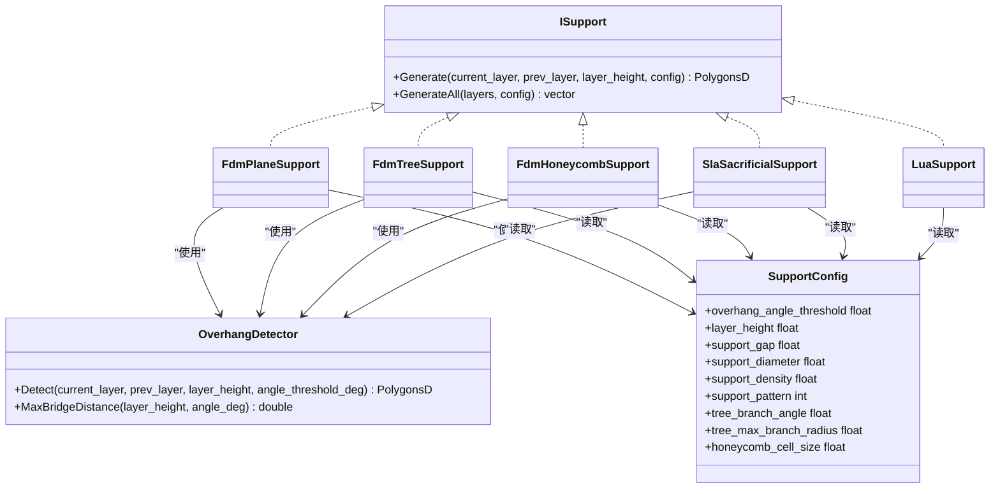
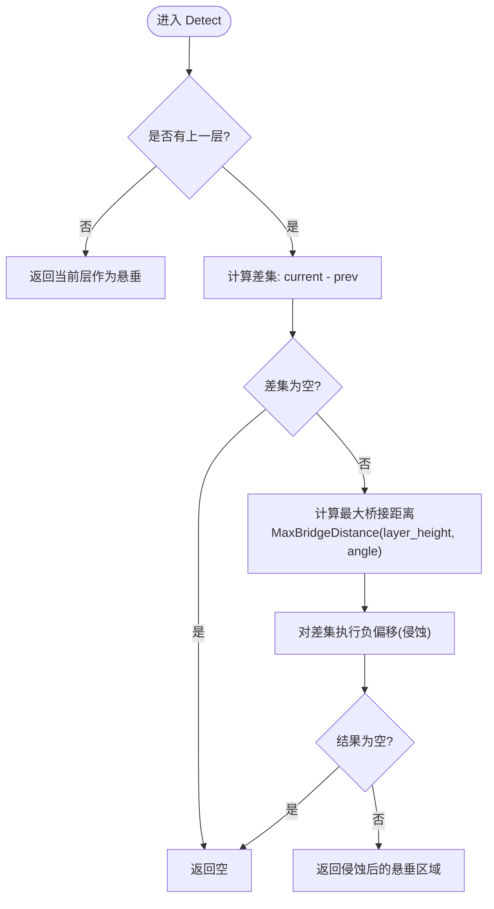
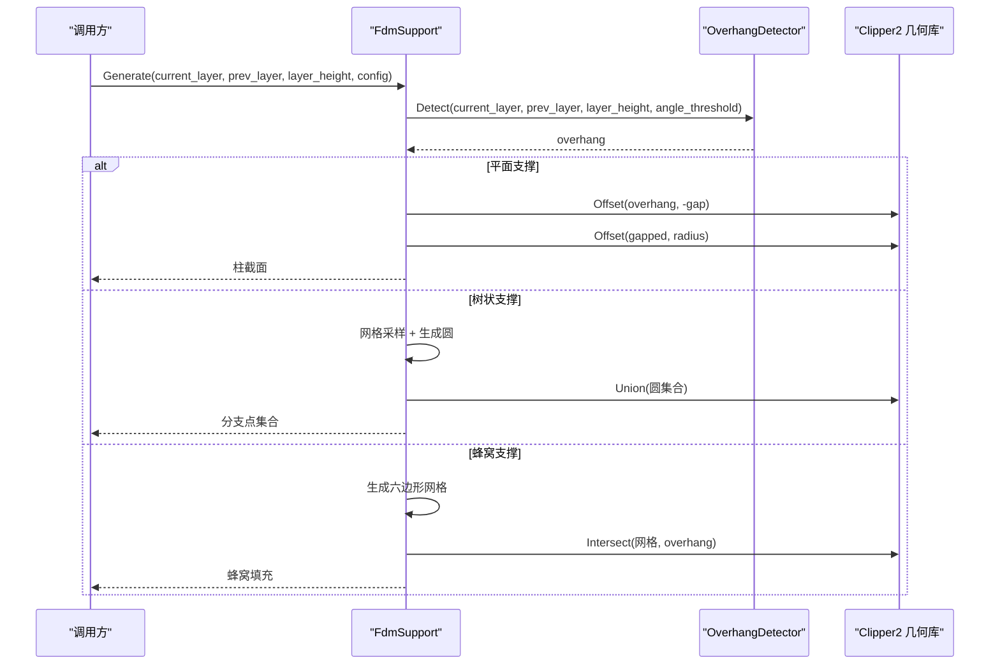
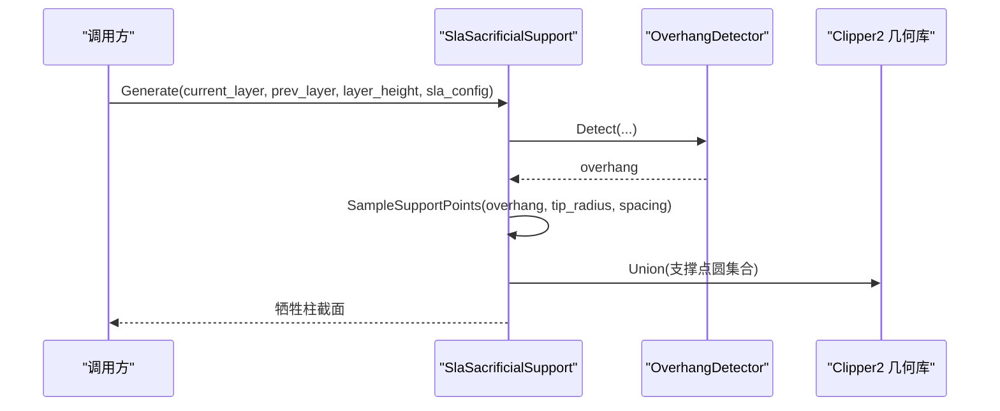
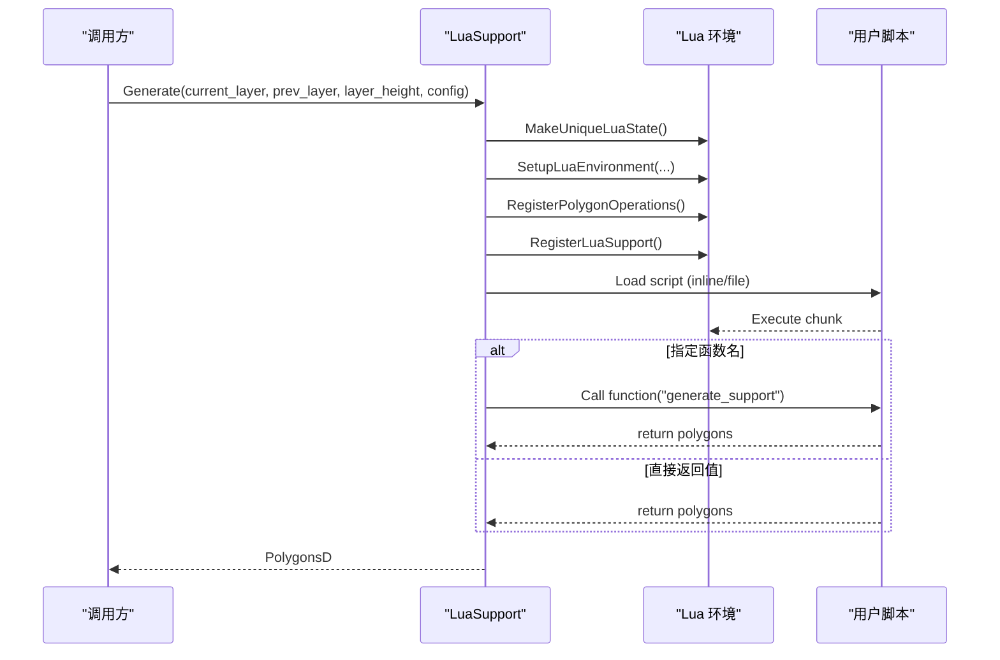
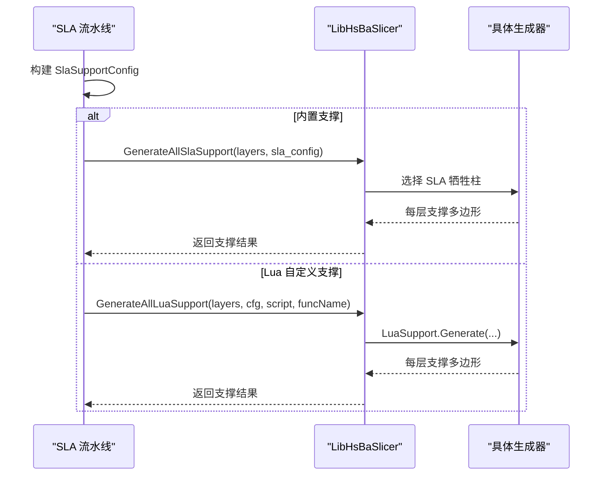
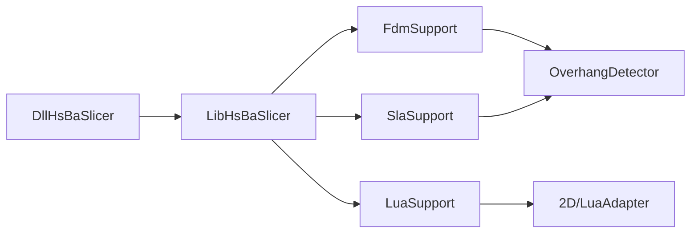

# 自定义支撑生成

<cite>
**本文引用的文件**   
- [ISupport.hpp](file://support/ISupport.hpp)
- [SupportConfig.hpp](file://support/SupportConfig.hpp)
- [OverhangDetector.hpp](file://support/OverhangDetector.hpp)
- [OverhangDetector.cpp](file://support/OverhangDetector.cpp)
- [FdmSupport.hpp](file://support/FdmSupport.hpp)
- [FdmSupport.cpp](file://support/FdmSupport.cpp)
- [SlaSupport.hpp](file://support/SlaSupport.hpp)
- [SlaSupport.cpp](file://support/SlaSupport.cpp)
- [LuaSupport.hpp](file://support/LuaSupport.hpp)
- [LuaSupport.cpp](file://support/LuaSupport.cpp)
- [fdm_support.hpp](file://LibHsBaSlicer/Support/fdm_support.hpp)
- [fdm_support.cpp](file://LibHsBaSlicer/Support/fdm_support.cpp)
- [sla_pipeline.cpp](file://DllHsBaSlicer/sla_pipeline.cpp)
- [my_support.lua](file://samples/FDM/scripts/my_support.lua)
- [my_sla_support.lua](file://samples/SLA/scripts/my_sla_support.lua)
</cite>

## 目录
1. [引言](#引言)
2. [项目结构](#项目结构)
3. [核心概念](#核心概念)
4. [架构总览](#架构总览)
5. [详细组件分析](#详细组件分析)
6. [依赖关系分析](#依赖关系分析)
7. [性能与优化](#性能与优化)
8. [调试与故障排除](#调试与故障排除)
9. [参数配置与调优指南](#参数配置与调优指南)
10. [结论](#结论)
11. [附录：Lua 脚本示例与最佳实践](#附录lua-脚本示例与最佳实践)

## 引言
本指南面向需要开发“自定义支撑生成算法”的工程师，围绕 HsBaSlicer 支撑子系统展开。内容覆盖：
- 悬垂检测、支撑密度控制与接触面优化
- FDM 与 SLA 两种工艺下的支撑策略（平面、树状、蜂窝、牺牲柱）
- Lua 脚本驱动的自定义支撑实现路径
- 参数配置、调优方法与性能优化技巧
- 支撑与模型的交互关系、碰撞检测机制与调试方法

## 项目结构
支撑相关代码集中在 support 目录，并通过 LibHsBaSlicer 与 DllHsBaSlicer 暴露给上层流水线；同时提供 FDM/SLA 的 Lua 示例脚本。

图表来源
- [ISupport.hpp:1-49](file://support/ISupport.hpp#L1-L49)
- [SupportConfig.hpp:1-47](file://support/SupportConfig.hpp#L1-L47)
- [OverhangDetector.hpp:1-54](file://support/OverhangDetector.hpp#L1-L54)
- [FdmSupport.hpp:1-67](file://support/FdmSupport.hpp#L1-L67)
- [SlaSupport.hpp:1-46](file://support/SlaSupport.hpp#L1-L46)
- [LuaSupport.hpp:1-85](file://support/LuaSupport.hpp#L1-L85)
- [fdm_support.hpp:37-71](file://LibHsBaSlicer/Support/fdm_support.hpp#L37-L71)
- [sla_pipeline.cpp:391-413](file://DllHsBaSlicer/sla_pipeline.cpp#L391-L413)

章节来源
- [ISupport.hpp:1-49](file://support/ISupport.hpp#L1-L49)
- [SupportConfig.hpp:1-47](file://support/SupportConfig.hpp#L1-L47)
- [OverhangDetector.hpp:1-54](file://support/OverhangDetector.hpp#L1-L54)
- [FdmSupport.hpp:1-67](file://support/FdmSupport.hpp#L1-L67)
- [SlaSupport.hpp:1-46](file://support/SlaSupport.hpp#L1-L46)
- [LuaSupport.hpp:1-85](file://support/LuaSupport.hpp#L1-L85)
- [fdm_support.hpp:37-71](file://LibHsBaSlicer/Support/fdm_support.hpp#L37-L71)
- [sla_pipeline.cpp:391-413](file://DllHsBaSlicer/sla_pipeline.cpp#L391-L413)

## 核心概念
- 支撑生成器抽象：所有支撑算法统一实现 ISupport 接口，按层接收当前层与上一层轮廓，输出当前层的支撑截面多边形。
- 悬垂检测：基于层高与角度阈值计算最大桥接距离，对当前层与上一层差集进行负偏移（侵蚀），过滤可桥接区域，得到需支撑区域。
- 支撑形状策略：
  - FDM：平面柱、树状分支、蜂窝填充
  - SLA：牺牲柱（细尖径、大底径）
- 自定义支撑：通过 LuaSupport 加载用户脚本，注入 current_layer、prev_layer、layer_height、config 等全局变量，并暴露 PolygonOperations 与 Support 模块供脚本调用。

章节来源
- [ISupport.hpp:16-45](file://support/ISupport.hpp#L16-L45)
- [OverhangDetector.cpp:23-87](file://support/OverhangDetector.cpp#L23-L87)
- [FdmSupport.hpp:13-63](file://support/FdmSupport.hpp#L13-L63)
- [SlaSupport.hpp:13-42](file://support/SlaSupport.hpp#L13-L42)
- [LuaSupport.hpp:21-39](file://support/LuaSupport.hpp#L21-L39)

## 架构总览
支撑子系统采用“接口 + 多实现 + 配置驱动”的设计。LibHsBaSlicer 提供统一的 GenerateAll* API，DllHsBaSlicer 在流水线中根据配置选择内置或 Lua 自定义支撑。

图表来源
- [ISupport.hpp:16-45](file://support/ISupport.hpp#L16-L45)
- [FdmSupport.hpp:13-63](file://support/FdmSupport.hpp#L13-L63)
- [SlaSupport.hpp:13-42](file://support/SlaSupport.hpp#L13-L42)
- [LuaSupport.hpp:21-81](file://support/LuaSupport.hpp#L21-L81)
- [OverhangDetector.hpp:14-50](file://support/OverhangDetector.hpp#L14-L50)
- [SupportConfig.hpp:11-43](file://support/SupportConfig.hpp#L11-L43)

## 详细组件分析

### 悬垂检测（OverhangDetector）
- 设计要点：
  - 首层无上一层时，整个当前层视为悬垂
  - 计算差集后，依据层高与角度阈值求最大桥接距离，对差集做负偏移以剔除可桥接区域
  - 返回最终需支撑的多边形集合
- 复杂度与性能：
  - 主要开销为几何布尔运算与偏移，建议使用整数化坐标减少浮点误差
- 错误处理：
  - 空输入直接返回空结果
  - 角度阈值边界情况（≥90° 或 ≤0°）有明确分支

图表来源
- [OverhangDetector.cpp:23-87](file://support/OverhangDetector.cpp#L23-L87)

章节来源
- [OverhangDetector.hpp:14-50](file://support/OverhangDetector.hpp#L14-L50)
- [OverhangDetector.cpp:23-87](file://support/OverhangDetector.cpp#L23-L87)

### FDM 支撑（平面、树状、蜂窝）
- 平面支撑：
  - 对悬垂区域应用支撑间隙收缩，再按支撑直径膨胀生成柱截面
- 树状支撑：
  - 在悬垂区域内按间距采样网格点，生成圆形分支尖端，合并重叠圆形成支撑点阵
- 蜂窝支撑：
  - 在包围盒内生成平顶六边形网格，与悬垂区域交集得到蜂窝填充

图表来源
- [FdmSupport.cpp:48-76](file://support/FdmSupport.cpp#L48-L76)
- [FdmSupport.cpp:81-168](file://support/FdmSupport.cpp#L81-L168)
- [FdmSupport.cpp:173-267](file://support/FdmSupport.cpp#L173-L267)

章节来源
- [FdmSupport.hpp:13-63](file://support/FdmSupport.hpp#L13-L63)
- [FdmSupport.cpp:48-267](file://support/FdmSupport.cpp#L48-L267)

### SLA 牺牲柱支撑
- 设计要点：
  - 使用较小的尖端直径便于去除，较大的底部直径增强附着
  - 在悬垂区域内按支撑直径间距采样点，生成小圆并合并
- 与 FDM 的差异：
  - 更强调支撑点稀疏性与易去除性，不生成蜂窝或树状分支

图表来源
- [SlaSupport.cpp:38-124](file://support/SlaSupport.cpp#L38-L124)

章节来源
- [SlaSupport.hpp:13-42](file://support/SlaSupport.hpp#L13-L42)
- [SlaSupport.cpp:38-135](file://support/SlaSupport.cpp#L38-L135)

### Lua 自定义支撑（LuaSupport）
- 设计要点：
  - 支持内联脚本与脚本文件两种方式
  - 初始化 Lua 环境时注入 current_layer、prev_layer、layer_height、config
  - 注册 PolygonOperations 与 Support 模块，允许脚本调用内置生成器与几何操作
  - 支持外部扩展函数注册（SetExternalRegs）
- 错误处理：
  - 创建 Lua 状态失败、脚本加载失败、运行时错误、函数调用失败均抛出异常

图表来源
- [LuaSupport.cpp:19-90](file://support/LuaSupport.cpp#L19-L90)
- [LuaSupport.cpp:113-178](file://support/LuaSupport.cpp#L113-L178)
- [LuaSupport.hpp:21-81](file://support/LuaSupport.hpp#L21-L81)

章节来源
- [LuaSupport.hpp:21-81](file://support/LuaSupport.hpp#L21-L81)
- [LuaSupport.cpp:19-178](file://support/LuaSupport.cpp#L19-L178)

### 库与流水线集成（LibHsBaSlicer / DllHsBaSlicer）
- LibHsBaSlicer 暴露 FDM/SLA/Lua 支撑的统一 API，内部根据配置选择具体生成器
- DllHsBaSlicer 的 SLA 流水线将配置映射到 SlaSupportConfig，并在检测到 Lua 自定义支撑时调用 GenerateAllLuaSupport

图表来源
- [fdm_support.cpp:14-32](file://LibHsBaSlicer/Support/fdm_support.cpp#L14-L32)
- [fdm_support.hpp:37-71](file://LibHsBaSlicer/Support/fdm_support.hpp#L37-L71)
- [sla_pipeline.cpp:391-413](file://DllHsBaSlicer/sla_pipeline.cpp#L391-L413)

章节来源
- [fdm_support.hpp:37-71](file://LibHsBaSlicer/Support/fdm_support.hpp#L37-L71)
- [fdm_support.cpp:14-32](file://LibHsBaSlicer/Support/fdm_support.cpp#L14-L32)
- [sla_pipeline.cpp:391-413](file://DllHsBaSlicer/sla_pipeline.cpp#L391-L413)

## 依赖关系分析
- 耦合关系：
  - 各支撑生成器强依赖 OverhangDetector 与 Clipper2 几何库
  - LuaSupport 依赖 2D/LuaAdapter 与 Lua 运行时
  - LibHsBaSlicer 聚合多种生成器，对外暴露统一 API
- 潜在循环依赖：
  - 支撑生成器之间无相互依赖，仅共同依赖 ISupport 接口与配置结构
- 外部依赖：
  - Clipper2 用于多边形布尔运算与偏移
  - Lua 虚拟机用于脚本执行

图表来源
- [FdmSupport.cpp:1-13](file://support/FdmSupport.cpp#L1-L13)
- [SlaSupport.cpp:1-12](file://support/SlaSupport.cpp#L1-L12)
- [LuaSupport.cpp:1-14](file://support/LuaSupport.cpp#L1-L14)
- [fdm_support.cpp:1-11](file://LibHsBaSlicer/Support/fdm_support.cpp#L1-L11)
- [sla_pipeline.cpp:391-413](file://DllHsBaSlicer/sla_pipeline.cpp#L391-L413)

章节来源
- [FdmSupport.cpp:1-13](file://support/FdmSupport.cpp#L1-L13)
- [SlaSupport.cpp:1-12](file://support/SlaSupport.cpp#L1-L12)
- [LuaSupport.cpp:1-14](file://support/LuaSupport.cpp#L1-L14)
- [fdm_support.cpp:1-11](file://LibHsBaSlicer/Support/fdm_support.cpp#L1-L11)
- [sla_pipeline.cpp:391-413](file://DllHsBaSlicer/sla_pipeline.cpp#L391-L413)

## 性能与优化
- 几何运算优化：
  - 使用整数化坐标进行偏移与布尔运算，减少浮点误差与抖动
  - 对大规模网格采样（树状/蜂窝）先计算包围盒，限制迭代范围
- 内存与对象池：
  - 避免频繁分配临时多边形集合，尽量复用容器
- 并行化：
  - 层间支撑生成可并行处理（GenerateAll 默认迭代，可在上层并发）
- Lua 脚本性能：
  - 避免在脚本中进行大量几何计算，优先使用 C++ 提供的 Support/PolygonOperations 接口
  - 合理设置支撑密度与间距，减少脚本返回的多边形数量

[本节为通用指导，不直接分析具体文件]

## 调试与故障排除
- 常见问题与定位：
  - 无支撑生成：检查悬垂检测是否返回空（角度阈值过高或层高过小）
  - 支撑与模型碰撞：确认支撑间隙设置是否正确，必要时增大 support_gap
  - 支撑过密或过疏：调整 support_diameter 与 support_density
  - Lua 脚本错误：查看 load/pcall 抛出的错误信息，确认函数名与返回值格式
- 建议调试步骤：
  - 打印悬垂区域与支撑截面多边形面积，验证几何逻辑
  - 逐步缩小问题范围：先使用内置生成器，再切换至 Lua 自定义
  - 使用最小模型复现问题，降低几何复杂度

章节来源
- [OverhangDetector.cpp:23-87](file://support/OverhangDetector.cpp#L23-L87)
- [LuaSupport.cpp:113-178](file://support/LuaSupport.cpp#L113-L178)

## 参数配置与调优指南
- 通用配置字段（SupportConfig）：
  - overhang_angle_threshold：悬垂角度阈值（度）
  - layer_height：层高（mm）
  - support_gap：支撑与模型间隙（mm）
  - support_diameter：支撑柱直径（mm）
  - support_density：支撑填充密度 [0,1]
  - support_pattern：支撑模式（0=平面，1=树状，2=蜂窝）
  - tree_branch_angle：树状分支角度（度）
  - tree_max_branch_radius：树状最大分支半径（mm）
  - honeycomb_cell_size：蜂窝单元尺寸（mm）
- FDM 专用（FdmSupportConfig）：
  - interface_layers：界面层数
  - interface_density：界面层填充密度
- SLA 专用（SlaSupportConfig）：
  - tip_diameter：支撑尖端直径（mm）
  - raft_thickness：底板厚度（mm）

调优建议：
- 悬垂角度阈值：提高可减少支撑量，但可能影响悬垂质量；降低则增加支撑覆盖率
- 支撑间隙：适当增大可减少粘连，但过大可能导致支撑不稳定
- 支撑直径与密度：平衡强度与材料用量；树状/蜂窝适合大面积悬垂
- SLA 尖端直径：越小越易去除，但需保证附着强度

章节来源
- [SupportConfig.hpp:11-43](file://support/SupportConfig.hpp#L11-L43)
- [fdm_support.hpp:37-71](file://LibHsBaSlicer/Support/fdm_support.hpp#L37-L71)

## 结论
HsBaSlicer 的支撑子系统提供了从基础悬垂检测到多种支撑形状生成的完整能力，并通过 Lua 脚本开放了高度可扩展的自定义支撑路径。工程实践中，应结合工艺特性（FDM/SLA）、模型几何与打印质量要求，合理配置参数并借助脚本进行精细化优化。

[本节为总结性内容，不直接分析具体文件]

## 附录：Lua 脚本示例与最佳实践

### FDM 自定义支撑脚本（my_support.lua）
- 功能概述：
  - 使用内置悬垂检测器获取需支撑区域
  - 根据 support_pattern 选择平面/树状/蜂窝生成器
  - 可选地对支撑结果进行二次偏移以细化接触面
- 关键流程：
  - 首层跳过
  - 调用 Support.detect_overhang
  - 构造 Support.default_config 并填充必要字段
  - 调用 Support.generate 生成支撑
  - 可选 PO.offsetOperation 微调

章节来源
- [my_support.lua:1-83](file://samples/FDM/scripts/my_support.lua#L1-L83)

### SLA 自定义支撑脚本（my_sla_support.lua）
- 功能概述：
  - 检测悬垂区域并使用内置 SLA 牺牲柱生成器
  - 可选地按面积阈值过滤支撑点，减少材料使用
- 关键流程：
  - 首层跳过
  - 调用 Support.detect_overhang
  - 构造 Support.default_config 并填充必要字段
  - 调用 Support.generate 生成支撑
  - 遍历结果并按面积过滤

章节来源
- [my_sla_support.lua:1-76](file://samples/SLA/scripts/my_sla_support.lua#L1-L76)

### 脚本编写最佳实践
- 始终检查 prev_layer 是否为空，避免首层误生成支撑
- 优先使用 Support.detect_overhang 与内置生成器，减少重复实现
- 使用 PolygonOperations 进行几何修正（如 offsetOperation 微调接触面）
- 控制支撑密度与间距，避免过多小多边形导致后续处理开销
- 在脚本中记录关键中间结果（如悬垂区域面积、支撑点数），便于调试

[本节为示例与指导，不直接分析具体文件]