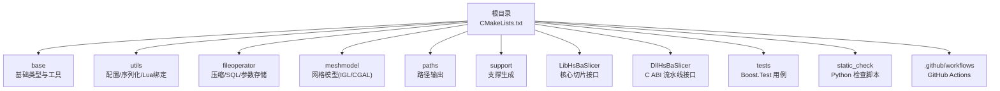
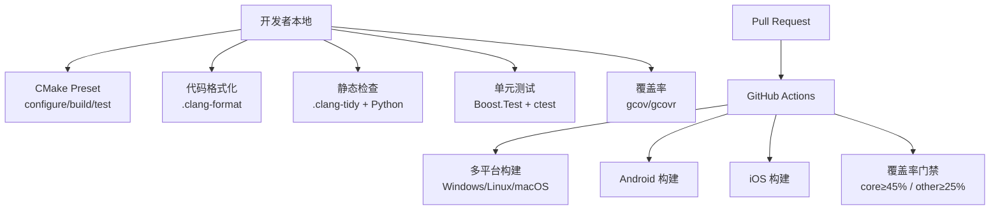
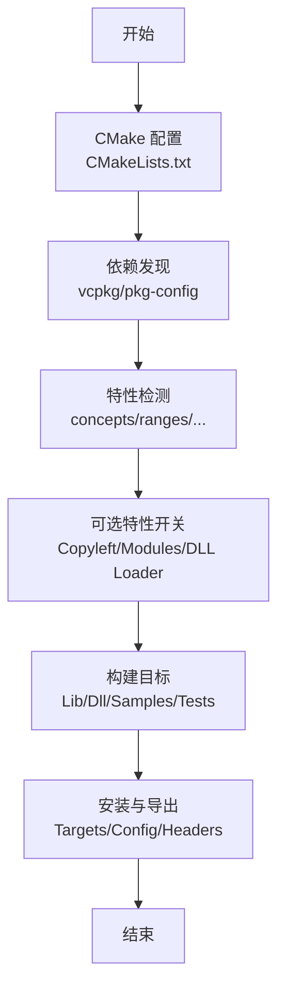
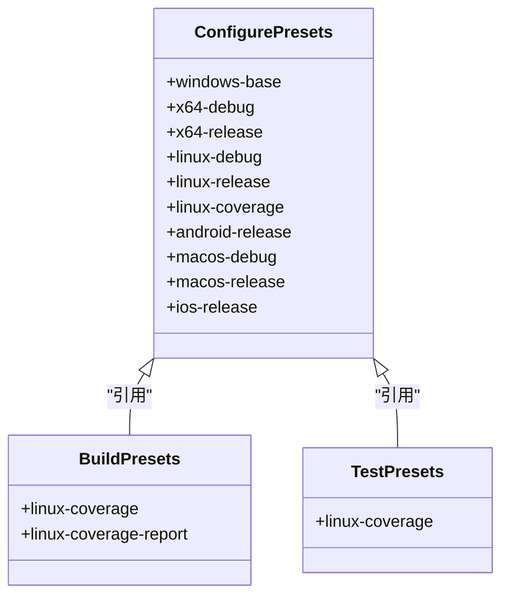
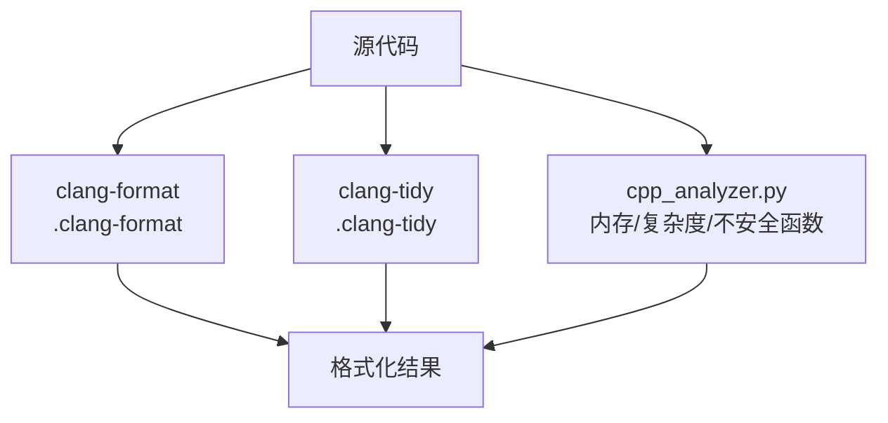
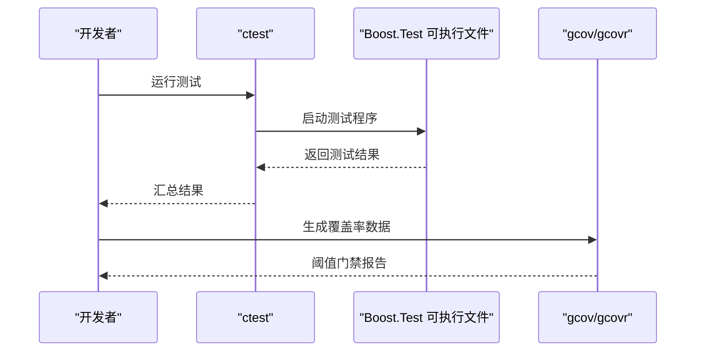
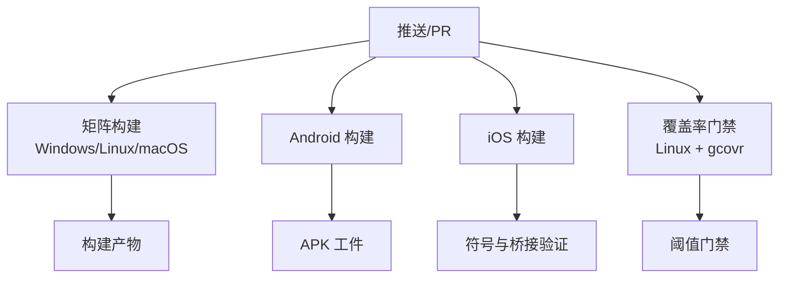
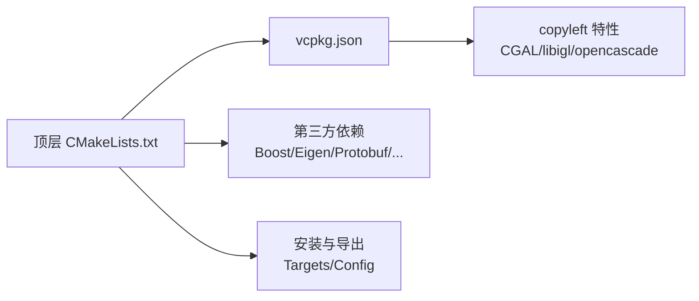

# 开发·测试与贡献

<cite>
**本文引用的文件**   
- [CMakeLists.txt](file://CMakeLists.txt)
- [CMakePresets.json](file://CMakePresets.json)
- [.clang-format](file://.clang-format)
- [.clang-tidy](file://.clang-tidy)
- [vcpkg.json](file://vcpkg.json)
- [vcpkg-configuration.json](file://vcpkg-configuration.json)
- [cmake/coverage.cmake](file://cmake/coverage.cmake)
- [tests/CMakeLists.txt](file://tests/CMakeLists.txt)
- [static_check/cpp_analyzer.py](file://static_check/cpp_analyzer.py)
- [static_check/clang-format-batch.py](file://static_check/clang-format-batch.py)
- [.github/workflows/build-linux.yml](file://.github/workflows/build-linux.yml)
- [.github/workflows/test-coverage.yml](file://.github/workflows/test-coverage.yml)
- [.github/workflows/cmake-multi-platform.yml](file://.github/workflows/cmake-multi-platform.yml)
- [README.md](file://README.md)
</cite>

## 目录
1. [简介](#简介)
2. [项目结构](#项目结构)
3. [核心组件](#核心组件)
4. [架构总览](#架构总览)
5. [详细组件分析](#详细组件分析)
6. [依赖关系分析](#依赖关系分析)
7. [性能与构建优化](#性能与构建优化)
8. [调试与故障排除](#调试与故障排除)
9. [贡献流程与规范](#贡献流程与规范)
10. [结论](#结论)

## 简介
本指南面向 HsBaSlicer 的新老贡献者，聚焦“如何在本仓库中高效、安全地开发与测试”，并统一代码风格、静态检查、覆盖率门禁与多平台持续集成。内容覆盖：
- 开发环境搭建（CMake、vcpkg、编译器）
- 构建系统与预设使用
- 代码风格与静态检查（clang-format、clang-tidy、自定义 Python 检查）
- 单元测试与覆盖率（Boost.Test、ctest、gcovr）
- 持续集成（GitHub Actions）
- 提交与分支管理建议、Pull Request 流程
- 调试技巧、性能分析方法与问题排查
- 贡献者行为准则、问题报告模板与功能请求流程

## 项目结构
HsBaSlicer 采用模块化 CMake 工程，顶层 CMakeLists.txt 负责全局特性检测、依赖发现、目标安装与导出；各子模块通过 add_subdirectory 组织。测试位于 tests 目录，静态检查脚本位于 static_check，CI 工作流位于 .github/workflows。

**图示来源**  
- [CMakeLists.txt:410-440](file://CMakeLists.txt#L410-L440)

**章节来源**  
- [CMakeLists.txt:1-120](file://CMakeLists.txt#L1-L120)
- [CMakeLists.txt:410-440](file://CMakeLists.txt#L410-L440)
- [README.md:25-39](file://README.md#L25-L39)

## 核心组件
本节从“开发视角”梳理关键构建与质量保障组件：
- CMake 顶层配置：启用 C++20、位置无关代码、可选 Copyleft 内核、动态库加载开关、测试与文档开关、安装与导出。
- CMake Presets：提供 Windows/Linux/macOS/iOS/Android 的 configure/build/test preset，以及 gcov 覆盖率 preset。
- vcpkg 依赖：集中声明第三方库与可选 copyleft 特性。
- 静态检查：.clang-format/.clang-tidy + 自定义 Python 脚本（内存泄漏、圈复杂度、不安全函数等）。
- 测试框架：Boost.Test + ctest，支持按目标运行与构建后自动执行。
- 覆盖率：cmake/coverage.cmake 提供 coverage 目标与阈值门禁。

**章节来源**  
- [CMakeLists.txt:1-120](file://CMakeLists.txt#L1-L120)
- [CMakePresets.json:1-113](file://CMakePresets.json#L1-L113)
- [vcpkg.json:1-113](file://vcpkg.json#L1-L113)
- [.clang-format:1-99](file://.clang-format#L1-L99)
- [.clang-tidy:1-96](file://.clang-tidy#L1-L96)
- [cmake/coverage.cmake:1-173](file://cmake/coverage.cmake#L1-L173)
- [tests/CMakeLists.txt:1-40](file://tests/CMakeLists.txt#L1-L40)

## 架构总览
下图展示“本地开发到持续集成”的整体流程：开发者在本地使用 CMake Preset 配置与构建，运行 Boost.Test 用例并通过 ctest 汇总；静态检查由 clang-format/clang-tidy 与 Python 脚本完成；PR 触发 GitHub Actions 在多平台构建，并在 Linux 上执行覆盖率门禁。

**图示来源**  
- [CMakePresets.json:1-239](file://CMakePresets.json#L1-L239)
- [.github/workflows/cmake-multi-platform.yml:1-180](file://.github/workflows/cmake-multi-platform.yml#L1-L180)
- [.github/workflows/test-coverage.yml:1-136](file://.github/workflows/test-coverage.yml#L1-L136)

## 详细组件分析

### 构建系统与环境搭建
- 最低要求：CMake ≥ 3.28，支持 C++20 的编译器，vcpkg（推荐），PowerShell（Windows）。
- 依赖管理：vcpkg.json 声明依赖与可选 copyleft 特性；vcpkg-configuration.json 指定默认注册表与 overlay。
- 顶层 CMakeLists.txt：
  - 设置 C++20、C11/C23 标准、位置无关代码、Debug 后缀。
  - 特性检测：concepts/ranges/source_location/NTTP/template-template 等，缺失则失败或降级。
  - 可选能力：HSBA_COPL（CGAL/OpenCascade）、HSBA_SLICER_MODULE（C++20 modules）、HSBA_USE_DLL_LOADER、HSBA_HSBA_USE_BIT7Z、HSBA_ENABLE_THREAD_POOL_COROUTINE。
  - 依赖发现：Boost、Clipper2、miniz/bit7z、Protobuf、RapidJSON、Eigen3、OpenSSL、OpenCV、libigl/CGAL、OpenCASCADE、OpenVDB、sqlpp11、Lua、tinyxml2、yaml-cpp、magic_enum。
  - 安装与导出：GNUInstallDirs、HsBaSlicerTargets、Config/Version 文件、头文件与 proto 多语言导出。
  - 测试与文档：enable_testing()、add_subdirectory("tests")、Doxygen 可选。

**图示来源**  
- [CMakeLists.txt:1-120](file://CMakeLists.txt#L1-L120)
- [CMakeLists.txt:206-350](file://CMakeLists.txt#L206-L350)
- [CMakeLists.txt:456-665](file://CMakeLists.txt#L456-L665)

**章节来源**  
- [README.md:41-99](file://README.md#L41-L99)
- [CMakeLists.txt:1-120](file://CMakeLists.txt#L1-L120)
- [CMakeLists.txt:206-350](file://CMakeLists.txt#L206-L350)
- [CMakeLists.txt:456-665](file://CMakeLists.txt#L456-L665)
- [vcpkg.json:1-113](file://vcpkg.json#L1-L113)
- [vcpkg-configuration.json:1-21](file://vcpkg-configuration.json#L1-L21)

### CMake Presets 使用
- 预置目标包括：
  - windows-base/x64-debug/x64-release
  - linux-debug/linux-release/linux-coverage
  - android-release
  - macos-debug/macos-release
  - ios-release
- linux-coverage preset 开启 HSBA_COVERAGE，关闭 samples/docs/static_tests，并设置覆盖率阈值变量。
- build/test presets 关联到 configurePreset，便于一键构建与运行测试。

**图示来源**  
- [CMakePresets.json:1-239](file://CMakePresets.json#L1-L239)

**章节来源**  
- [CMakePresets.json:1-239](file://CMakePresets.json#L1-L239)

### 静态代码检查与代码风格
- .clang-format：Allman 大括号风格、列宽 120、指针/引用左对齐、保留 include 块顺序、短函数 InlineOnly 等。
- .clang-tidy：启用 analyzer/bugprone/cert/cppcoreguidelines/misc/modernize/performance/readability 等规则集，并通过 HeaderFilterRegex 仅对生产代码生效，排除 tests/samples/static_tests。
- 自定义 Python 脚本：
  - cpp_analyzer.py：跳过 tests/examples，禁止 catch(...)、using namespace（命名空间含 Literals 放行）、不安全函数、魔法数字、潜在内存泄漏（new/malloc/free 配对检测）、圈复杂度阈值。
  - clang-format-batch.py：批量格式化 C/C++ 文件，解析 .gitignore，支持并行与 dry-run。

**图示来源**  
- [.clang-format:1-99](file://.clang-format#L1-L99)
- [.clang-tidy:1-96](file://.clang-tidy#L1-L96)
- [static_check/cpp_analyzer.py:1-383](file://static_check/cpp_analyzer.py#L1-L383)
- [static_check/clang-format-batch.py:1-274](file://static_check/clang-format-batch.py#L1-L274)

**章节来源**  
- [.clang-format:1-99](file://.clang-format#L1-L99)
- [.clang-tidy:1-96](file://.clang-tidy#L1-L96)
- [static_check/cpp_analyzer.py:1-383](file://static_check/cpp_analyzer.py#L1-L383)
- [static_check/clang-format-batch.py:1-274](file://static_check/clang-format-batch.py#L1-L274)

### 单元测试与覆盖率
- 测试框架：Boost.Test，每个测试目标链接 Boost::unit_test_framework，定义 BOOST_TEST_DYN_LINK。
- 测试注册：tests/CMakeLists.txt 为每个测试 add_executable + target_link_libraries + enable_testing + add_test，并可 POST_BUILD 调用 ctest。
- 覆盖率：cmake/coverage.cmake 注入 --coverage 编译/链接选项，定义 core/other 阈值（默认 core 45%，other 25%），生成 JSON/HTML/XML 报告，未达标时构建失败。

**图示来源**  
- [tests/CMakeLists.txt:1-40](file://tests/CMakeLists.txt#L1-L40)
- [cmake/coverage.cmake:1-173](file://cmake/coverage.cmake#L1-L173)

**章节来源**  
- [tests/CMakeLists.txt:1-40](file://tests/CMakeLists.txt#L1-L40)
- [cmake/coverage.cmake:1-173](file://cmake/coverage.cmake#L1-L173)

### 持续集成流程
- 多平台构建：.github/workflows/cmake-multi-platform.yml 在 Windows/Linux/macOS 上构建，Linux 上运行 ctest。
- Android/iOS：分别构建原生库并验证产物符号与桥接头。
- 覆盖率门禁：.github/workflows/test-coverage.yml 使用 linux-coverage preset，构建+运行测试+gcovr 阈值门禁，上传报告。

**图示来源**  
- [.github/workflows/cmake-multi-platform.yml:1-180](file://.github/workflows/cmake-multi-platform.yml#L1-L180)
- [.github/workflows/test-coverage.yml:1-136](file://.github/workflows/test-coverage.yml#L1-L136)

**章节来源**  
- [.github/workflows/build-linux.yml:1-82](file://.github/workflows/build-linux.yml#L1-L82)
- [.github/workflows/cmake-multi-platform.yml:1-180](file://.github/workflows/cmake-multi-platform.yml#L1-L180)
- [.github/workflows/test-coverage.yml:1-136](file://.github/workflows/test-coverage.yml#L1-L136)

## 依赖关系分析
- 顶层 CMakeLists.txt 通过 find_package/pkg_check_modules 引入 Boost、Clipper2、miniz/bit7z、Protobuf、RapidJSON、Eigen3、OpenSSL、OpenCV、libigl/CGAL、OpenCASCADE、OpenVDB、sqlpp11、Lua、tinyxml2、yaml-cpp、magic_enum。
- vcpkg.json 声明依赖与 copyleft 特性（CGAL、libigl[cgal]、OpenCASCADE），默认启用 copyleft 特性但受平台与开关控制。
- 安装导出：HsBaSlicerTargets.cmake 与 Config/Version 文件供下游 find_package(HsBaSlicer) 引用。

**图示来源**  
- [CMakeLists.txt:206-350](file://CMakeLists.txt#L206-L350)
- [vcpkg.json:1-113](file://vcpkg.json#L1-L113)
- [CMakeLists.txt:456-665](file://CMakeLists.txt#L456-L665)

**章节来源**  
- [CMakeLists.txt:206-350](file://CMakeLists.txt#L206-L350)
- [vcpkg.json:1-113](file://vcpkg.json#L1-L113)
- [CMakeLists.txt:456-665](file://CMakeLists.txt#L456-L665)

## 性能与构建优化
- 构建并行度：CI 中限制 CMAKE_BUILD_PARALLEL_LEVEL 与 VCPKG_MAX_CONCURRENCY，避免 CAD 重型模块 Debug 构建 OOM。
- 覆盖率并行：cmake/coverage.cmake 根据 gcovr 帮助信息自动选择 -j 参数，可通过 HSBA_COVERAGE_JOBS 调整。
- 布尔运算禁用：Debug 下禁用 CGAL/IGL 布尔运算以减少内存占用与耗时。
- 线程池协程：HSBA_ENABLE_THREAD_POOL_COROUTINE 可开启协程支持。

**章节来源**  
- [.github/workflows/test-coverage.yml:25-33](file://.github/workflows/test-coverage.yml#L25-L33)
- [cmake/coverage.cmake:73-91](file://cmake/coverage.cmake#L73-L91)
- [CMakeLists.txt:294-298](file://CMakeLists.txt#L294-L298)
- [CMakeLists.txt:258-262](file://CMakeLists.txt#L258-L262)

## 调试与故障排除
- 常见构建问题：
  - 缺少依赖：确保 vcpkg 已 bootstrap 且环境变量 VCPKG_ROOT 正确；必要时清理 vcpkg/downloads 缓存。
  - 编译器不满足特性：确认 C++20 与 required features（concepts/ranges/source_location/NTTP/template-template）。
  - 动态库加载：非桌面平台默认关闭 HSBA_USE_DLL_LOADER，如需启用请显式设置。
- 测试失败：
  - 使用 ctest --build-config Release --output-on-failure --parallel N 定位失败用例。
  - 针对特定测试：ctest -R <test_name>。
- 覆盖率门禁失败：
  - 检查 core/other 阈值是否合理；必要时提升测试覆盖或调整阈值。
  - 查看 out/build/linux-coverage/coverage 下的 HTML/XML 报告定位未覆盖源文件。
- 静态检查告警：
  - 使用 clang-format-batch.py 批量格式化；用 clang-tidy 检查生产代码；用 cpp_analyzer.py 检查内存/复杂度/不安全函数。

**章节来源**  
- [tests/CMakeLists.txt:1-40](file://tests/CMakeLists.txt#L1-L40)
- [cmake/coverage.cmake:1-173](file://cmake/coverage.cmake#L1-L173)
- [static_check/cpp_analyzer.py:1-383](file://static_check/cpp_analyzer.py#L1-L383)
- [static_check/clang-format-batch.py:1-274](file://static_check/clang-format-batch.py#L1-L274)

## 贡献流程与规范
- 代码风格：
  - 使用 .clang-format 进行格式化；建议使用 clang-format-batch.py 批量处理。
  - 使用 .clang-tidy 检查生产代码；IDE 集成参考 .clang-tidy 注释说明。
- 提交规范（建议）：
  - 提交消息遵循“类型: 简短描述”（如 feat/fix/refactor/docs/chore）。
  - 变更影响范围明确，附带相关测试与文档更新。
- 分支管理策略（建议）：
  - master：稳定主线；dev：开发主线。
  - 功能分支：feature/<name>；修复分支：fix/<name>；发布分支：release/<version>。
- Pull Request 流程（建议）：
  - 创建 PR 前本地运行 ctest 与静态检查。
  - PR 描述包含变更动机、影响范围、测试方法与风险点。
  - CI 通过后进入评审；评审通过后合并至 dev，再经 release 流程合并至 master。
- 行为准则（建议）：
  - 尊重他人意见，保持专业沟通。
  - 对问题与反馈及时响应，避免人身攻击与歧视性言论。
- 问题报告模板（建议字段）：
  - 环境信息（操作系统、编译器版本、CMake/vcpkg 版本）
  - 复现步骤（最小化示例）
  - 期望行为与实际行为
  - 日志与截图（如有）
- 功能请求流程（建议字段）：
  - 背景与动机
  - 需求描述与边界条件
  - 替代方案与权衡
  - 验收标准与测试计划

[本节为通用实践建议，不直接分析具体源码文件]

## 结论
通过统一的 CMake 构建系统、严格的代码风格与静态检查、完善的单元测试与覆盖率门禁，以及跨平台的持续集成，HsBaSlicer 为高质量、可维护的切片引擎提供了坚实基础。新贡献者可依据本指南快速上手，同时确保代码一致性与稳定性。