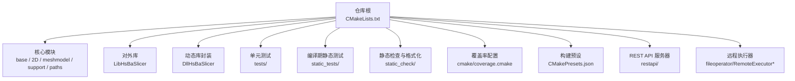
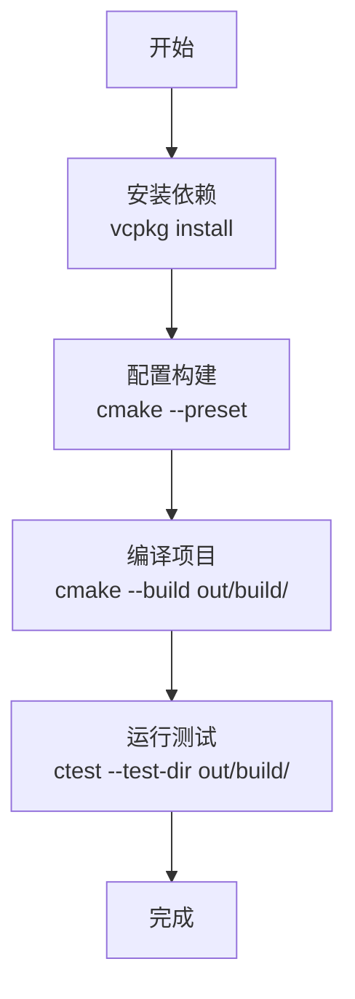
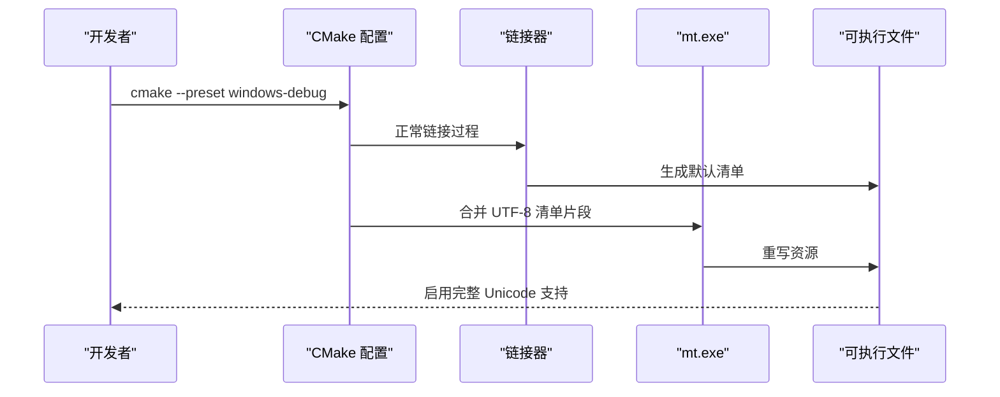
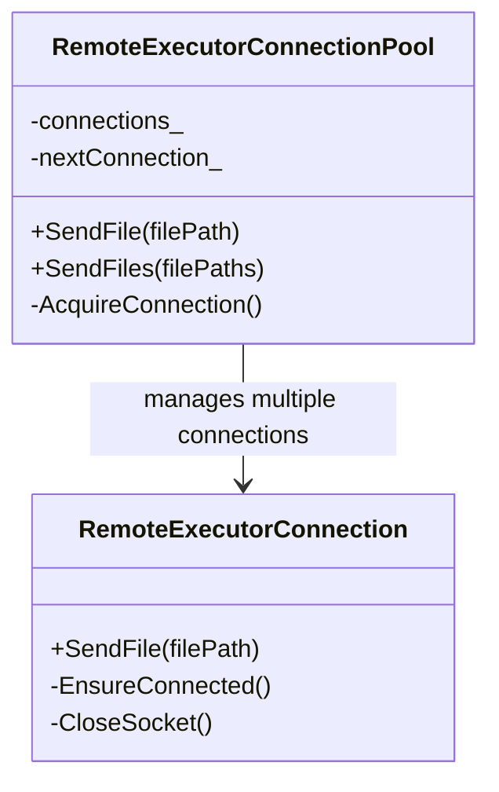
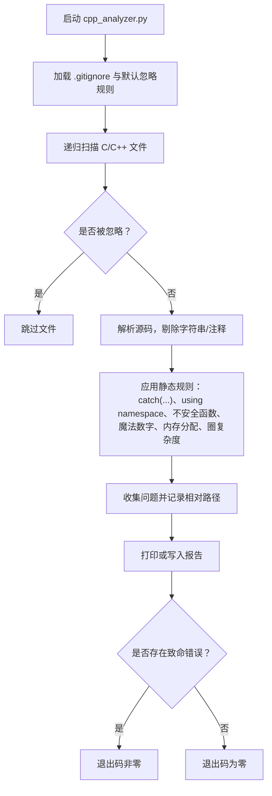
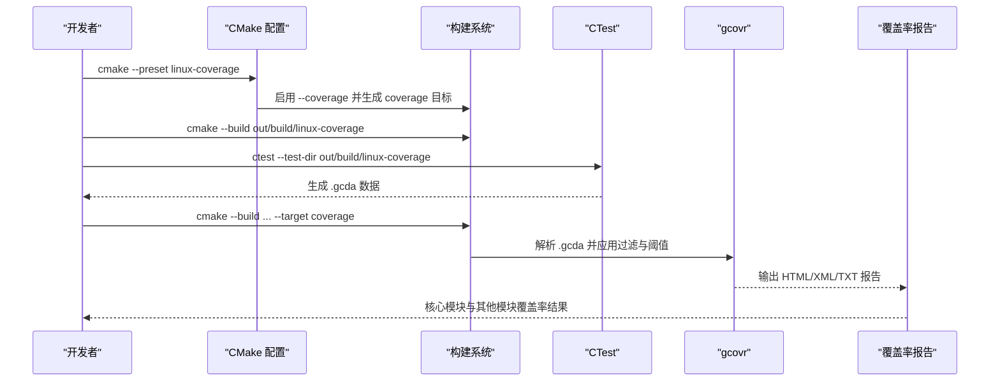
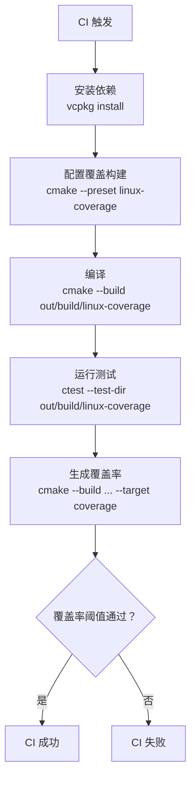

# 开发测试与贡献

<cite>
**本文引用的文件**   
- [CMakeLists.txt](file://CMakeLists.txt)
- [CMakePresets.json](file://CMakePresets.json)
- [.clang-format](file://.clang-format)
- [.clang-tidy](file://.clang-tidy)
- [.clangd](file://.clangd)
- [feature_check.cmake](file://static_check/feature_check.cmake)
- [cpp_analyzer.py](file://static_check/cpp_analyzer.py)
- [clang-format-batch.py](file://static_check/clang-format-batch.py)
- [coverage.cmake](file://cmake/coverage.cmake)
- [HsBaWindowsUtf8.cmake](file://cmake/HsBaWindowsUtf8.cmake)
- [hsba_utf8.manifest](file://cmake/hsba_utf8.manifest)
- [RemoteExecutor.cpp](file://fileoperator/RemoteExecutor.cpp)
- [RemoteExecutor.hpp](file://fileoperator/RemoteExecutor.hpp)
- [tests/CMakeLists.txt](file://tests/CMakeLists.txt)
- [restapi/CMakeLists.txt](file://restapi/CMakeLists.txt)
- [vcpkg.json](file://vcpkg.json)
- [config_roundtrip_test.cpp](file://tests/RestApi/config_roundtrip_test.cpp)
- [content_negotiate_test.cpp](file://tests/RestApi/content_negotiate_test.cpp)
- [job_manager_test.cpp](file://tests/RestApi/job_manager_test.cpp)
- [remote_executor_test.cpp](file://tests/FilesOperator/remote_executor_test.cpp)
- [static_tests/README.md](file://static_tests/README.md)
- [base_static_tests.cpp](file://static_tests/base_static_tests/base_static_tests.cpp)
- [utils_static_tests.cpp](file://static_tests/utils_static_tests/utils_static_tests.cpp)
</cite>

## 更新摘要
**所做更改**   
- 更新了 Windows UTF-8 清单嵌入机制的说明，从 link.exe /MANIFESTINPUT 改为 mt.exe 后构建步骤
- 新增了 REST API 可选服务进程的构建和测试指南
- 增强了远程执行器连接池的功能说明
- 更新了 CMake 配置和依赖管理流程
- 扩展了测试体系以包含 REST API 相关测试

## 目录
1. [引言](#引言)
2. [项目结构与开发入口](#项目结构与开发入口)
3. [开发环境搭建](#开发环境搭建)
4. [代码风格与静态检查](#代码风格与静态检查)
5. [测试体系与执行方式](#测试体系与执行方式)
6. [覆盖率、性能与内存分析](#覆盖率性能与内存分析)
7. [持续集成与自动化流程](#持续集成与自动化流程)
8. [贡献指南与代码审查标准](#贡献指南与代码审查标准)
9. [常见问题排查](#常见问题排查)
10. [结论](#结论)

## 引言
本指南面向 HsBaSlicer 的 C++ 开发者与维护者，聚焦开发环境搭建、代码规范、测试方法、质量保障、贡献流程和持续集成。HsBaSlicer 是一个以 C++20 为核心的切片与路径生成库，通过 CMake、vcpkg、Boost.Test、clangd、clang-format、clang-tidy 和 gcovr 构建完整的本地开发与 CI 质量闭环。

**更新** 新增了 RESTful API 可选服务进程支持，改进了 Windows UTF-8 清单嵌入机制，并增强了远程执行器的连接池功能。

## 项目结构与开发入口
HsBaSlicer 采用多子目录 CMake 工程结构：核心算法位于 `base`、`2D`、`meshmodel`、`support`、`paths` 等模块；对外接口由 `LibHsBaSlicer` 提供；可执行示例位于 `samples`；单元测试位于 `tests`；编译期静态断言测试位于 `static_tests`；静态检查脚本位于 `static_check`；覆盖率配置位于 `cmake/coverage.cmake`；IDE 与工具链配置集中在根目录的 `.clang-*` 文件和 `CMakePresets.json`。



**图表来源**
- [CMakeLists.txt:410-439](file://CMakeLists.txt#L410-L439)
- [CMakePresets.json:1-239](file://CMakePresets.json#L1-L239)
- [restapi/CMakeLists.txt:1-65](file://restapi/CMakeLists.txt#L1-L65)

**章节来源**
- [CMakeLists.txt:1-715](file://CMakeLists.txt#L1-L715)
- [CMakePresets.json:1-239](file://CMakePresets.json#L1-L239)

## 开发环境搭建

### 基础依赖
- CMake 3.28+
- C++20 编译器（MSVC、GCC 或 Clang）
- vcpkg 包管理器
- Boost（含 unit_test_framework）
- Protobuf、RapidJSON、Eigen3、OpenSSL、miniz、libigl、Lua、tinyxml2、yaml-cpp、magic_enum
- Linux/WSL 下可选安装 gcovr 用于覆盖率报告
- IDE 推荐 Visual Studio、VS Code + clangd、CLion

### 使用 CMakePresets 快速配置
项目提供平台化预设，自动设置 Ninja 生成器、vcpkg toolchain、输出目录和调试信息。常用预设包括：
- Windows：`windows-base`、`x64-debug`、`x64-release`
- Linux：`linux-debug`、`linux-release`、`linux-coverage`
- macOS：`macos-debug`、`macos-release`
- iOS：`ios-release`
- Android：`android-release`

典型工作流：
1. 初始化并安装依赖：`vcpkg install`
2. 配置构建：`cmake --preset x64-debug` 或 `cmake --preset linux-debug`
3. 编译：`cmake --build out/build/x64-debug`
4. 运行测试：`ctest --test-dir out/build/x64-debug`



**图表来源**
- [CMakePresets.json:1-239](file://CMakePresets.json#L1-L239)
- [CMakeLists.txt:392-407](file://CMakeLists.txt#L392-L407)

**章节来源**
- [CMakePresets.json:1-239](file://CMakePresets.json#L1-L239)
- [CMakeLists.txt:1-127](file://CMakeLists.txt#L1-L127)
- [CMakeLists.txt:392-407](file://CMakeLists.txt#L392-L407)

### Windows UTF-8 清单嵌入改进

**新增** 项目现在使用改进的 UTF-8 清单嵌入机制，通过 `mt.exe` 在构建后步骤中合并清单，而不是在链接时使用 `/MANIFESTINPUT`。

主要改进：
- 使用 `hsba_apply_utf8_codepage()` 函数在目标上应用 UTF-8 活动代码页清单
- 通过 `mt.exe` 工具在链接后合并 UTF-8 清单片段到可执行文件
- 避免了 `link.exe /MANIFESTINPUT` 导致的资源冲突问题
- 支持非 ASCII（中日文、重音符号、表情符号）文件路径



**图表来源**
- [HsBaWindowsUtf8.cmake:49-75](file://cmake/HsBaWindowsUtf8.cmake#L49-L75)
- [hsba_utf8.manifest:1-29](file://cmake/hsba_utf8.manifest#L1-L29)

**章节来源**
- [HsBaWindowsUtf8.cmake:1-76](file://cmake/HsBaWindowsUtf8.cmake#L1-L76)
- [hsba_utf8.manifest:1-29](file://cmake/hsba_utf8.manifest#L1-L29)

### REST API 可选服务进程

**新增** 项目现在支持可选编译的 RESTful API 服务器 `HsBaSlicerRestServer`，基于 cpp-httplib 实现。

启用方式：
```bash
# 通过环境变量启用
set VCPKG_MANIFEST_FEATURES=rest-api
cmake --preset x64-debug

# 或通过命令行参数
cmake -DHSBA_BUILD_REST_API=ON -DVCPKG_MANIFEST_FEATURES=rest-api
```

特性：
- 异步作业队列处理切片流水线
- JSON/XML 双格式响应
- 配置文件驱动 (`restapi.ini`)
- 仅桌面平台支持
- 默认关闭，需显式启用

**章节来源**
- [CMakeLists.txt:179-204](file://CMakeLists.txt#L179-L204)
- [restapi/CMakeLists.txt:1-65](file://restapi/CMakeLists.txt#L1-L65)
- [vcpkg.json:111-119](file://vcpkg.json#L111-L119)

### 远程执行器连接池增强

**新增** 远程执行器现在支持连接池功能，提高批量文件传输的性能。

主要功能：
- 连接池管理多个并发连接
- 轮询分配连接以提高吞吐量
- 最大连接数限制为 16
- 线程安全的连接获取机制



**图表来源**
- [RemoteExecutor.hpp:23-98](file://fileoperator/RemoteExecutor.hpp#L23-L98)

**章节来源**
- [RemoteExecutor.hpp:1-103](file://fileoperator/RemoteExecutor.hpp#L1-L103)
- [RemoteExecutor.cpp:1-325](file://fileoperator/RemoteExecutor.cpp#L1-L325)

## 代码风格与静态检查

### 代码风格：clang-format
项目统一使用 Allman 大括号风格，缩进为 4 空格，列宽限制为 120，指针与引用左对齐，包含排序按大小写敏感，命名空间不紧凑。可通过批量脚本一次性格式化整个仓库。

常用命令：
- 批量格式化：`python static_check/clang-format-batch.py -p . -j 8`
- 仅预览：`python static_check/clang-format-batch.py --dry-run`
- 指定风格：`python static_check/clang-format-batch.py --style LLVM`

注意事项：
- 脚本会忽略 `.gitignore` 中的目录，并跳过 `encoding_convert.cpp` 与 `version.cpp`。
- 多线程并行处理，默认 4 线程，可通过 `-j` 调整。

**章节来源**
- [.clang-format:1-99](file://.clang-format#L1-L99)
- [clang-format-batch.py:1-274](file://static_check/clang-format-batch.py#L1-L274)

### 静态诊断：clang-tidy
`.clang-tidy` 启用安全、现代性、可读性、性能、核心指导原则等检查组，并通过 `HeaderFilterRegex` 排除 `vcpkg`、`third_parts`、`out/`、`tests/`、`samples/`、`static_tests/` 等目录，避免测试桩、教学示例和编译期静态断言产生噪声。

IDE 集成：
- clangd 已内置 clang-tidy 支持，读取 `.clang-tidy` 与 `.clangd`。
- `.clangd` 中启用了诊断增强、未使用头文件检测、后台索引和类型推导提示。

建议：
- 在提交前运行 `clang-tidy --p=out/build/x64-debug/compile_commands.json src/*.cpp`。
- 在 VS Code 或 CLion 中开启 clangd 诊断，实时查看问题。

**章节来源**
- [.clang-tidy:1-96](file://.clang-tidy#L1-L96)
- [.clangd:1-118](file://.clangd#L1-L118)

### 自定义静态检查：cpp_analyzer.py
该脚本实现仓库级静态规则，包括：
- 跳过 `tests/`、`examples/`、`samples/`、`static_tests/` 及 `.gitignore` 内容
- 禁止 `catch(...)`
- 禁止 `using namespace`（命名空间名含 `Literals` 时放行）
- 警告不安全函数：`gets`、`strcpy`、`strcat`、`sprintf`、`vsprintf`
- 魔法数字检测（允许常见常量）
- 简单内存泄漏检测：匹配 `new/malloc/calloc/realloc` 附近是否出现配对释放或智能指针
- 圈复杂度统计（默认阈值 10）

典型用法：
- 扫描当前目录：`python static_check/cpp_analyzer.py .`
- 指定阈值：`python static_check/cpp_analyzer.py . -c 15`
- 输出报告：`python static_check/cpp_analyzer.py . -o report.txt`



**图表来源**
- [cpp_analyzer.py:1-383](file://static_check/cpp_analyzer.py#L1-L383)

**章节来源**
- [cpp_analyzer.py:1-383](file://static_check/cpp_analyzer.py#L1-L383)

### 编译器特性检测
`static_check/feature_check.cmake` 在 CMake 配置阶段探测 C++20 概念、ranges、source_location、类类型非类型模板参数、浮点非类型模板参数、模板模板参数匹配、协程、显式 this 参数、C++20 modules 支持和 C23 constexpr 能力。缺失关键特性时会终止配置，可选特性则添加宏定义供条件编译使用。

**章节来源**
- [feature_check.cmake:1-123](file://static_check/feature_check.cmake#L1-L123)
- [CMakeLists.txt:48-104](file://CMakeLists.txt#L48-L104)

## 测试体系与执行方式

### 单元测试框架
项目使用 Boost.Test 作为单元测试框架。每个测试目标通过 `add_executable` 创建，链接 `Boost::unit_test_framework`，并定义 `BOOST_TEST_DYN_LINK`。测试通过 `enable_testing()` 和 `add_test(NAME ... COMMAND ...)` 注册到 CTest。

典型测试目标包括：
- `any_object_test`、`app_config_test`、`anyvisit_test`、`coroutines_test`
- `memory_pool_test`、`thread_pool_test`、`object_pool_test`
- `filename_check_test`、`encoding_convert_test`、`configmap_test`
- `cipher_test`、`cipher_lua_adapter_test`、`string_utils_test`
- `points_path_test`、`layers_path_test`、`images_path_test`
- `param_store_test`、`zipper_test`、`remote_executor_test`
- `json_convert_test`、`sqlite_test`、`igl_model_test`、`full_topo_model_test`
- `polygon_fill_test`、`spiral_path_test`、`image_polygons_test`、`static_reflect_test`
- `support_test`、`model_loader_test`、`openvdb_model_test`、`lua_common_types_test`
- `hull_2d_test`、`gcode_path_test`、`weld_robot_path_test`、`float_polygons_test`、`fdm_support_lib_test`、`robot_path_test`、`path_generator_test`、`int_polygon_test`

**新增** REST API 相关测试：
- `restapi_config_roundtrip_test`：配置序列化/反序列化往返测试
- `restapi_content_negotiate_test`：内容协商逻辑测试
- `restapi_job_manager_test`：异步作业队列状态机测试

可选测试：
- `occt_model_test`：仅在构建 `HsBaSlicerCADModel` 时启用
- `cgal_model_test`：仅在启用 copyleft 内核（CGAL/OpenCASCADE）时构建

**章节来源**
- [tests/CMakeLists.txt:1-800](file://tests/CMakeLists.txt#L1-L800)
- [config_roundtrip_test.cpp:1-98](file://tests/RestApi/config_roundtrip_test.cpp#L1-L98)
- [content_negotiate_test.cpp:1-56](file://tests/RestApi/content_negotiate_test.cpp#L1-L56)
- [job_manager_test.cpp:1-114](file://tests/RestApi/job_manager_test.cpp#L1-L114)

### 静态测试
`static_tests` 用于验证编译期行为，例如模板辅助函数、枚举名称转换、`AnyObject` 反射、协程类型、序列化结构体等。这些测试不产生运行时逻辑，而是通过 `static_assert` 和模板实例化确保 API 契约。

主要文件：
- `static_tests/README.md`：说明静态测试用途
- `static_tests/base_static_tests/base_static_tests.cpp`：验证模板助手、枚举、`AnyObject`、协程
- `static_tests/utils_static_tests/utils_static_tests.cpp`：验证 JSON/XML/YAML 序列化与 Lua 对象绑定

执行方式：
- 通过顶层 CMake 选项 `HSBA_SLICER_USE_STATIC_TESTS` 控制是否构建
- 静态测试通常随主工程一起编译，失败表现为编译期错误

**章节来源**
- [static_tests/README.md:1-4](file://static_tests/README.md#L1-L4)
- [base_static_tests.cpp:1-257](file://static_tests/base_static_tests/base_static_tests.cpp#L1-L257)
- [utils_static_tests.cpp:1-108](file://static_tests/utils_static_tests/utils_static_tests.cpp#L1-L108)
- [CMakeLists.txt:696-700](file://CMakeLists.txt#L696-L700)

### 集成测试与样本程序
`samples` 目录提供 FDM、SLA、SLS、SLM、LOM、TDP、WAAM、Custom、LibHsBaSlicer 等示例程序，可用于端到端验证流水线与导出功能。它们不是单元测试，但可作为集成验证手段。

**章节来源**
- [CMakeLists.txt:442-454](file://CMakeLists.txt#L442-L454)

## 覆盖率、性能与内存分析

### 覆盖率分析（gcov + gcovr）
项目提供 `cmake/coverage.cmake`，在启用 `HSBA_COVERAGE=ON` 后：
- 所有目标添加 `--coverage` 编译与链接选项
- 生成 `coverage` 自定义目标，聚合 `.gcda` 数据并输出 HTML、XML、TXT 报告
- 对"核心模块"和"其他模块"分别设置行覆盖率阈值，默认核心 45%、其他 25%
- 排除 `tests`、`samples`、`static_tests`、`static_check`、`third_parts_without_vcpkg`、`docs`、`out`、`build`、`vcpkg_installed`、`vcpkg/`、`/usr/`

Linux/WSL 下的推荐流程：
1. 使用覆盖预设：`cmake --preset linux-coverage`
2. 构建并运行测试：`ctest --test-dir out/build/linux-coverage`
3. 生成覆盖率报告：`cmake --build out/build/linux-coverage --target coverage`



**图表来源**
- [coverage.cmake:1-173](file://cmake/coverage.cmake#L1-L173)
- [CMakePresets.json:86-113](file://CMakePresets.json#L86-L113)

**章节来源**
- [coverage.cmake:1-173](file://cmake/coverage.cmake#L1-L173)
- [CMakePresets.json:86-113](file://CMakePresets.json#L86-L113)

### 性能分析与内存泄漏检测
- 性能分析：建议使用编译器或平台工具（如 perf、VTune、Valgrind Callgrind）对 Release 构建进行热点分析；项目本身未内建性能基准目标。
- 内存泄漏检测：`static_check/cpp_analyzer.py` 提供轻量级静态检测，识别未配对的 `new/delete` 或 `malloc/free`，并在附近发现智能指针时放行。更严格的运行时检测可使用 AddressSanitizer、Valgrind 或平台内存分析器。

建议实践：
- 在 Debug 构建中使用 ASan 或 Valgrind 运行关键测试
- 对长生命周期对象增加 RAII 包装，避免裸指针
- 对复杂函数拆分以降低圈复杂度，减少潜在资源管理风险

**章节来源**
- [cpp_analyzer.py:43-193](file://static_check/cpp_analyzer.py#L43-L193)

## 持续集成与自动化流程

### 构建与测试自动化
虽然仓库未提供 GitHub Actions YAML，但 CMakePresets 已定义覆盖构建、测试与报告目标，适合接入任意 CI 系统（GitHub Actions、Azure Pipelines、GitLab CI 等）。

推荐 CI 步骤：
1. 安装依赖：`vcpkg install`
2. 配置构建：`cmake --preset linux-coverage`
3. 构建项目：`cmake --build out/build/linux-coverage`
4. 运行测试：`ctest --test-dir out/build/linux-coverage`
5. 生成覆盖率报告：`cmake --build out/build/linux-coverage --target coverage`
6. 上传报告：将 `out/build/linux-coverage/coverage` 目录归档



**图表来源**
- [CMakePresets.json:86-113](file://CMakePresets.json#L86-L113)
- [CMakePresets.json:210-237](file://CMakePresets.json#L210-L237)
- [coverage.cmake:158-173](file://cmake/coverage.cmake#L158-L173)

**章节来源**
- [CMakePresets.json:1-239](file://CMakePresets.json#L1-L239)
- [coverage.cmake:1-173](file://cmake/coverage.cmake#L1-L173)

## 贡献指南与代码审查标准

### 代码提交规范
- 使用清晰的提交消息，描述变更动机与影响范围
- 小步提交，便于审查与回滚
- 新增功能需配套单元测试或静态测试
- 修改公共 API 需更新文档与安装头文件清单

### Pull Request 流程
- 分支命名建议：`feature/<功能>`、`fix/<问题>`、`refactor/<模块>`
- PR 描述应包含：变更概述、测试方法、影响模块、兼容性说明
- 关联 Issue 或需求编号
- 确保本地通过 clang-format、clang-tidy、静态检查与测试

### 代码审查标准
- 风格一致性：遵循 `.clang-format` 与 `.clang-tidy`
- 安全性：避免不安全函数、裸内存分配、`catch(...)`
- 可读性：函数圈复杂度合理，命名清晰，注释充分
- 可维护性：模块化设计，依赖清晰，避免循环依赖
- 测试覆盖：新增逻辑至少有一个单元测试或静态断言
- 覆盖率：核心模块覆盖率不低于默认阈值（45%），其他模块不低于 25%

### 质量门禁建议
- 预提交钩子：运行 `clang-format` 与 `clang-tidy`
- CI 门禁：编译、测试、静态检查、覆盖率阈值
- 文档同步：API 变更同步更新 docs 目录

**章节来源**
- [.clang-format:1-99](file://.clang-format#L1-L99)
- [.clang-tidy:1-96](file://.clang-tidy#L1-L96)
- [cpp_analyzer.py:1-383](file://static_check/cpp_analyzer.py#L1-L383)
- [tests/CMakeLists.txt:1-800](file://tests/CMakeLists.txt#L1-L800)
- [coverage.cmake:1-173](file://cmake/coverage.cmake#L1-L173)

## 常见问题排查

### clangd 无法找到编译数据库
- 首次使用前需运行 `cmake --preset <presetName>` 生成 `compile_commands.json`
- 在 Linux/macOS 上可创建符号链接：`ln -sf out/build/linux-debug/compile_commands.json .`
- 在 Windows 上可创建硬链接：`mklink compile_commands.json out\build\x64-debug\compile_commands.json`

### MSVC 标志不被 clangd 识别
- `.clangd` 已移除 `/bigobj`、`/W4`、`/WX`、`/permissive-`、`/Zc:__cplusplus`、`/utf-8`、`/FS`、`-mssse3`、`-msse4.2`、`/arch:*` 等标志
- 如需查询驱动路径，保留 `--query-driver=**/cl.exe` 与 `--query-driver=**/clang-cl.exe`

### 覆盖率报告缺失或阈值失败
- 确认使用 `linux-coverage` 预设
- 确保安装了 gcovr
- 先运行测试再执行 `coverage` 目标
- 检查 `HSBA_COVERAGE_THRESHOLD_CORE` 与 `HSBA_COVERAGE_THRESHOLD_OTHER` 阈值

### Windows UTF-8 清单问题
- 确认使用了改进的 `hsba_apply_utf8_codepage()` 函数
- 检查 `mt.exe` 是否正确定位
- 验证清单文件 `hsba_utf8.manifest` 存在且格式正确

### REST API 构建失败
- 确认启用了 `rest-api` vcpkg feature：`VCPKG_MANIFEST_FEATURES=rest-api`
- 检查 cpp-httplib 依赖是否正确安装
- 验证 HSBA_BUILD_REST_API 选项设置为 ON

**章节来源**
- [.clangd:1-118](file://.clangd#L1-L118)
- [coverage.cmake:1-173](file://cmake/coverage.cmake#L1-L173)
- [CMakePresets.json:86-113](file://CMakePresets.json#L86-L113)
- [HsBaWindowsUtf8.cmake:63-67](file://cmake/HsBaWindowsUtf8.cmake#L63-L67)
- [CMakeLists.txt:197-202](file://CMakeLists.txt#L197-L202)

## 结论
HsBaSlicer 提供了完善的开发工具链与质量保障体系：CMakePresets 简化跨平台构建，clang-format 与 clang-tidy 统一代码风格与诊断，Boost.Test 与静态测试覆盖运行期与编译期行为，gcovr 提供覆盖率门禁，cpp_analyzer.py 补充仓库级静态规则。

**更新** 最新的改进包括：
- 改进的 Windows UTF-8 清单嵌入机制，提供更好的 Unicode 支持
- 可选的 RESTful API 服务器，支持异步作业处理和多种数据格式
- 增强的远程执行器连接池，提高批量文件传输性能
- 完善的测试覆盖，包括新的 REST API 和远程执行器测试

遵循本指南的搭建、测试、规范与贡献流程，可有效提升代码质量、降低回归风险，并为持续集成提供稳定基础。