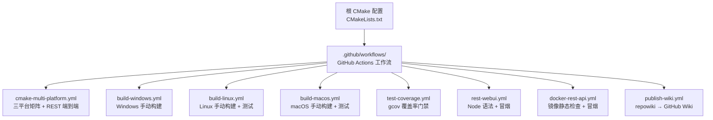
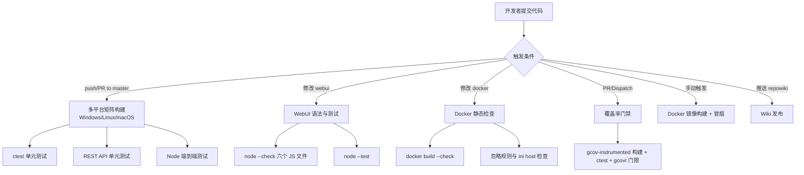
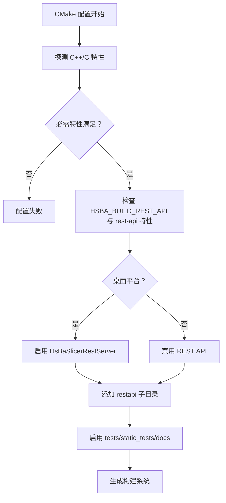
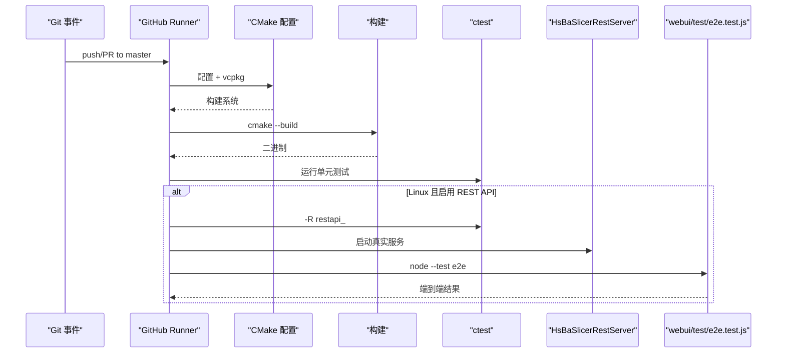
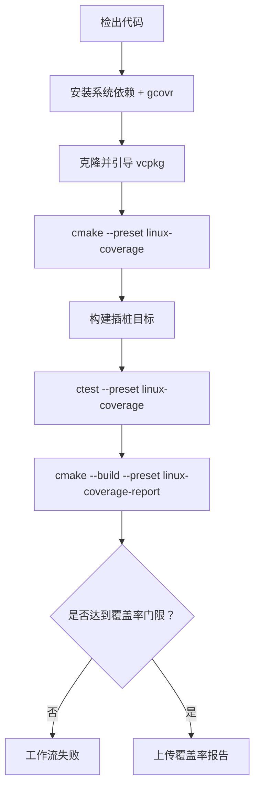
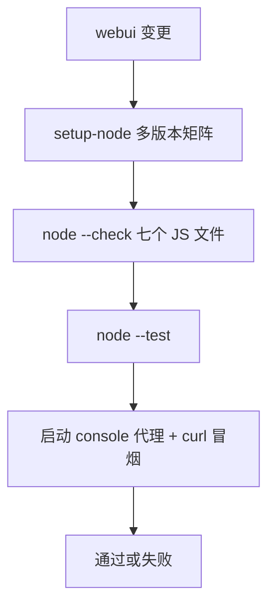
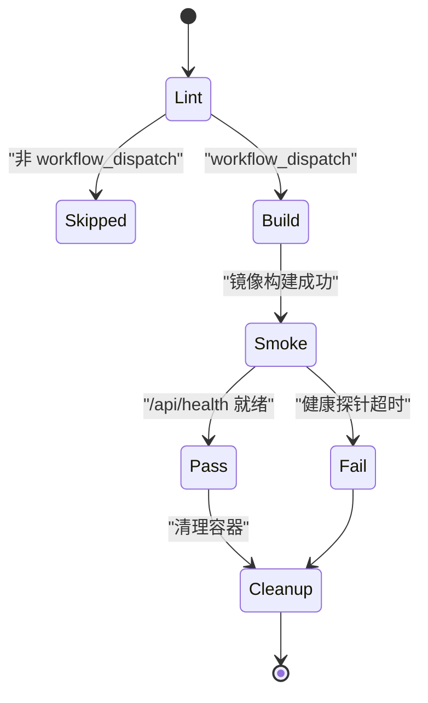
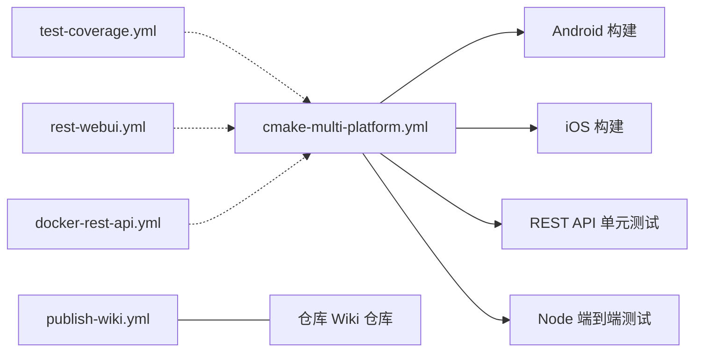

# CI/CD流水线增强

<cite>
**本文引用的文件**   
- [CMakeLists.txt](file://CMakeLists.txt)
- [cmake-multi-platform.yml](file://.github/workflows/cmake-multi-platform.yml)
- [build-windows.yml](file://.github/workflows/build-windows.yml)
- [build-linux.yml](file://.github/workflows/build-linux.yml)
- [build-macos.yml](file://.github/workflows/build-macos.yml)
- [test-coverage.yml](file://.github/workflows/test-coverage.yml)
- [rest-webui.yml](file://.github/workflows/rest-webui.yml)
- [docker-rest-api.yml](file://.github/workflows/docker-rest-api.yml)
- [publish-wiki.yml](file://.github/workflows/publish-wiki.yml)
</cite>

## 目录
1. [引言](#引言)
2. [项目结构](#项目结构)
3. [核心组件](#核心组件)
4. [架构总览](#架构总览)
5. [详细组件分析](#详细组件分析)
6. [依赖关系分析](#依赖关系分析)
7. [性能与资源特性](#性能与资源特性)
8. [故障排除指南](#故障排除指南)
9. [结论](#结论)

## 引言
本仓库的持续集成与持续交付体系围绕 C++ 多平台构建、Node.js WebUI 控制台、Docker REST API 镜像以及覆盖率门禁四个维度组织。根 `CMakeLists.txt` 通过 vcpkg 管理依赖，按桌面/移动/游戏机平台切换可选能力；`.github/workflows` 下每个工作流对应一个明确的职责：矩阵编译、平台构建、覆盖率门禁、WebUI 语法与冒烟测试、Docker 镜像静态检查与冒烟、Wiki 发布。

作者意图是把“CI/CD 流水线增强”拆成可独立验证的阶段：先保证多平台构建和测试全绿，再叠加 REST API 端到端测试、覆盖率门禁与 Docker 镜像冒烟。文档严格依据源码与工作流实现说明设计取舍，例如 Linux 矩阵单独启用 REST API、macOS 保持默认关闭；覆盖率门禁对 core 模块与其他模块分别设置阈值；Docker 工作流仅在手动触发时执行完整构建，避免 PR 中冷编译拖慢反馈。

## 项目结构
CI/CD 相关代码集中在两处：
- 顶层 `CMakeLists.txt`：定义编译器标准、可选功能（REST API、Copyleft 内核、测试、文档）、vcpkg 工具链、安装规则与子目录装配。
- `.github/workflows/`：GitHub Actions 工作流，覆盖 Windows/Linux/macOS/iOS/Android 构建、覆盖率、WebUI、Docker 镜像与 Wiki 发布。

**图表来源**
- [CMakeLists.txt:182-216](file://CMakeLists.txt#L182-L216)
- [cmake-multi-platform.yml:1-517](file://.github/workflows/cmake-multi-platform.yml#L1-L517)
- [rest-webui.yml:1-79](file://.github/workflows/rest-webui.yml#L1-L79)
- [docker-rest-api.yml:1-153](file://.github/workflows/docker-rest-api.yml#L1-L153)

**章节来源**
- [CMakeLists.txt:1-796](file://CMakeLists.txt#L1-L796)
- [cmake-multi-platform.yml:1-517](file://.github/workflows/cmake-multi-platform.yml#L1-L517)

## 核心组件
本节聚焦 CI/CD 体系中真正影响构建、测试与交付的关键开关与步骤。

| 组件 | 位置 | 作用 | 关键约束 |
|---|---|---|---|
| 根 CMake 配置 | `CMakeLists.txt` | 设定 C++20/C11、可选 REST API、Copyleft 内核、测试、安装目标 | REST API 必须同时开启 `-DHSBA_BUILD_REST_API=ON` 且启用 vcpkg `rest-api` 特性 |
| 多平台矩阵 | `cmake-multi-platform.yml` | push/PR 到 master 时在 Windows/Linux/macOS 构建 Release，并在 Linux 额外跑 REST API 单元测试与 Node 端到端测试 | Linux 才加 `-DVCPKG_MANIFEST_FEATURES=rest-api` |
| 平台构建工作流 | `build-windows.yml` / `build-linux.yml` / `build-macos.yml` | 提供 `workflow_dispatch` 触发的单平台构建脚本 | Windows 显式关闭线程池协程选项 |
| 覆盖率门禁 | `test-coverage.yml` | 使用 gcov/gcovr 在 Linux 上强制 core ≥ 45%、other ≥ 25% | 并行度限制为 2，避免 CAD 模块 Debug 构建 OOM |
| WebUI 控制台 | `rest-webui.yml` | 对 webui 下 JS 做语法检查并运行 `node --test` | 仅监听 `webui/**` 变更，不依赖 C++ 工具链 |
| Docker REST API | `docker-rest-api.yml` | 静态检查 Dockerfile 与忽略规则，手动触发时构建镜像并访问 `/api/health`、`/api/version` | 非 Dispatch 时 build job 跳过是预期行为 |
| Wiki 发布 | `publish-wiki.yml` | 把 `.qoder/repowiki` 转换为 GitHub Wiki 页面 | 需要预先初始化 wiki 仓库 |

**章节来源**
- [CMakeLists.txt:182-216](file://CMakeLists.txt#L182-L216)
- [cmake-multi-platform.yml:131-188](file://.github/workflows/cmake-multi-platform.yml#L131-L188)
- [test-coverage.yml:1-136](file://.github/workflows/test-coverage.yml#L1-L136)
- [rest-webui.yml:1-79](file://.github/workflows/rest-webui.yml#L1-L79)
- [docker-rest-api.yml:1-153](file://.github/workflows/docker-rest-api.yml#L1-L153)
- [publish-wiki.yml:1-110](file://.github/workflows/publish-wiki.yml#L1-L110)

## 架构总览
CI/CD 架构不是单一流水线，而是由多个相互解耦的工作流组成：

**图表来源**
- [cmake-multi-platform.yml:3-188](file://.github/workflows/cmake-multi-platform.yml#L3-L188)
- [rest-webui.yml:8-79](file://.github/workflows/rest-webui.yml#L8-L79)
- [docker-rest-api.yml:13-80](file://.github/workflows/docker-rest-api.yml#L13-L80)
- [test-coverage.yml:16-102](file://.github/workflows/test-coverage.yml#L16-L102)

## 详细组件分析

### 根 CMake 配置与可选 REST API
根 CMake 文件定义了 CI 环境最关键的编译语义：
- 强制 C++20，并根据编译器版本尝试 C23；MSVC 统一 UTF-8 编码。
- 通过 `static_check/feature_check.cmake` 探测 concepts、ranges、source_location、NTTP 等特性，缺失则直接失败。
- REST API 服务器 `HsBaSlicerRestServer` 默认关闭，且只在桌面平台生效；即使打开 `-DHSBA_BUILD_REST_API=ON`，也必须让 vcpkg 安装 `rest-api` 特性以引入 cpp-httplib。
- 测试默认启用，交叉编译时禁用自动运行；静态模板测试与文档构建也受选项控制。

**图表来源**
- [CMakeLists.txt:4-112](file://CMakeLists.txt#L4-L112)
- [CMakeLists.txt:182-216](file://CMakeLists.txt#L182-L216)
- [CMakeLists.txt:444-475](file://CMakeLists.txt#L444-L475)
- [CMakeLists.txt:511-514](file://CMakeLists.txt#L511-L514)

**章节来源**
- [CMakeLists.txt:4-112](file://CMakeLists.txt#L4-L112)
- [CMakeLists.txt:182-216](file://CMakeLists.txt#L182-L216)
- [CMakeLists.txt:444-475](file://CMakeLists.txt#L444-L475)
- [CMakeLists.txt:511-514](file://CMakeLists.txt#L511-L514)

### 多平台矩阵流水线
`cmake-multi-platform.yml` 是默认分支的主质量闸门：
- 在 Windows、Ubuntu、macOS 上分别用 Ninja 构建 Release。
- Linux 额外启用 REST API，并运行 `restapi_` 前缀的 ctest 用例。
- Linux 还下载示例 STL 模型，启动真实 `HsBaSlicerRestServer`，执行 `webui/test/e2e.test.js`，校验作业路径、结果下载与 HTTP 行为。
- Android 与 iOS 作为依赖任务，分别验证原生库产物、ABI 符号与桥接头。

**图表来源**
- [cmake-multi-platform.yml:3-188](file://.github/workflows/cmake-multi-platform.yml#L3-L188)
- [cmake-multi-platform.yml:190-230](file://.github/workflows/cmake-multi-platform.yml#L190-L230)

**章节来源**
- [cmake-multi-platform.yml:10-188](file://.github/workflows/cmake-multi-platform.yml#L10-L188)
- [cmake-multi-platform.yml:190-230](file://.github/workflows/cmake-multi-platform.yml#L190-L230)
- [cmake-multi-platform.yml:241-517](file://.github/workflows/cmake-multi-platform.yml#L241-L517)

### 平台专用构建工作流
三个 `build-*.yml` 是 `workflow_dispatch` 触发的轻量构建入口，适合本地复现或人工验证：
- Windows：调用 `vswhere` 定位 Visual Studio，设置 x64 环境，关闭线程池协程。
- Linux：安装大量系统依赖后构建，并运行 ctest。
- macOS：通过 Homebrew 安装依赖后构建并运行测试。

它们与矩阵流水线的区别在于：不强制启用 REST API，也不执行端到端测试，更适合作为快速回归入口。

**章节来源**
- [build-windows.yml:1-49](file://.github/workflows/build-windows.yml#L1-L49)
- [build-linux.yml:1-82](file://.github/workflows/build-linux.yml#L1-L82)
- [build-macos.yml:1-60](file://.github/workflows/build-macos.yml#L1-L60)

### 覆盖率门禁
`test-coverage.yml` 是 PR 质量门槛的核心：
- 使用预设 `linux-coverage` 构建带 gcov 插桩的二进制。
- 并行度限制为 2，避免 CGAL/OCCT/VTK 等 CAD 模块在 Debug 下耗尽内存。
- 运行 `ctest --preset linux-coverage` 产生覆盖率数据。
- 通过 `cmake --build --preset linux-coverage-report` 执行 gcovr 门限检查：core 模块 ≥ 45%，其他模块 ≥ 25%。
- 将摘要写入 GitHub Job Summary，并上传 HTML/XML 报告。

**图表来源**
- [test-coverage.yml:1-136](file://.github/workflows/test-coverage.yml#L1-L136)

**章节来源**
- [test-coverage.yml:1-136](file://.github/workflows/test-coverage.yml#L1-L136)

### WebUI 控制台工作流
`rest-webui.yml` 只关心 webui 下的 JavaScript 质量，不链接任何 C++：
- 监听 `webui/**` 与自身文件变更。
- 对 `server.js`、`public/httphelpers.js`、`public/model.js`、`public/view.js`、`public/app.js`、`test/server.test.js`、`test/e2e.test.js` 执行 `node --check`。
- 运行 `node --test`，其中端到端测试因缺少 `HsBaSlicerRestServer` 而跳过；真实端到端由 Linux 矩阵完成。
- 启动控制台代理，验证健康端点、首页文本、`/app.js` 中的 `/api/pipelines` 引用以及 `globalThis.HsBaHttp`。

**图表来源**
- [rest-webui.yml:8-79](file://.github/workflows/rest-webui.yml#L8-L79)

**章节来源**
- [rest-webui.yml:1-79](file://.github/workflows/rest-webui.yml#L1-L79)

### Docker REST API 镜像工作流
`docker-rest-api.yml` 的职责是保证容器镜像可构建、可运行，而不是重复验证切片算法正确性：
- push/PR 仅改动 `docker/**` 或本文件时，只做 hadolint 风格检查与上下文完整性检查。
- 检查项包括：Dockerfile 是否启用 `-DHSBA_BUILD_REST_API=ON`、是否包含 `VCPKG_MANIFEST_FEATURES`、忽略规则是否误排 `samples/tests/static_tests/docs/overlay-ports/triplets`、`restapi.ini` 是否保留默认 `host = 127.0.0.1`。
- 完整镜像构建与冒烟仅由 `workflow_dispatch` 触发，支持选择 MIT 或 copyleft 特性集，并可推送到 GHCR。
- 冒烟阶段启动容器，轮询 `/api/health`，再访问 `/api/version` 与 `/api/pipelines`。

**图表来源**
- [docker-rest-api.yml:13-80](file://.github/workflows/docker-rest-api.yml#L13-L80)
- [docker-rest-api.yml:82-153](file://.github/workflows/docker-rest-api.yml#L82-L153)

**章节来源**
- [docker-rest-api.yml:1-153](file://.github/workflows/docker-rest-api.yml#L1-L153)

### Wiki 发布工作流
`publish-wiki.yml` 负责把 `.qoder/repowiki` 同步到 GitHub Wiki：
- 支持手动选择语言 `en`、`zh`、`both`。
- 当推送 `main` 或 `master` 且 `.qoder/repowiki/**` 变化时自动触发。
- 使用 Python 脚本转换，clone wiki 仓库，删除旧页面后复制新内容并提交。
- 若 wiki 未初始化，clone 失败会明确报错，便于维护者修复权限或初始化状态。

**章节来源**
- [publish-wiki.yml:1-110](file://.github/workflows/publish-wiki.yml#L1-L110)

## 依赖关系分析
CI/CD 各工作流之间的耦合并不强，但存在清晰的依赖顺序：

- 多平台矩阵是中心节点：它既承担基础构建，又承担 REST API 单元测试与端到端测试。
- 覆盖率门禁与 WebUI 工作流相对独立，分别关注 C++ 测试覆盖与前端语法。
- Docker 工作流与原生构建互补：前者验证容器化部署，后者验证真实二进制。
- Wiki 发布与代码构建无运行时依赖，只依赖 `.qoder/repowiki` 内容与 wiki 仓库权限。

**图表来源**
- [cmake-multi-platform.yml:10-517](file://.github/workflows/cmake-multi-platform.yml#L10-L517)
- [test-coverage.yml:16-136](file://.github/workflows/test-coverage.yml#L16-L136)
- [rest-webui.yml:8-79](file://.github/workflows/rest-webui.yml#L8-L79)
- [docker-rest-api.yml:13-153](file://.github/workflows/docker-rest-api.yml#L13-L153)
- [publish-wiki.yml:16-110](file://.github/workflows/publish-wiki.yml#L16-L110)

**章节来源**
- [cmake-multi-platform.yml:10-517](file://.github/workflows/cmake-multi-platform.yml#L10-L517)
- [test-coverage.yml:16-136](file://.github/workflows/test-coverage.yml#L16-L136)
- [rest-webui.yml:8-79](file://.github/workflows/rest-webui.yml#L8-L79)
- [docker-rest-api.yml:13-153](file://.github/workflows/docker-rest-api.yml#L13-L153)
- [publish-wiki.yml:16-110](file://.github/workflows/publish-wiki.yml#L16-L110)

## 性能与资源特性
CI/CD 设计中有几个明显的性能与资源优化点：

| 场景 | 优化手段 | 原因 |
|---|---|---|
| Linux 大磁盘空间 | 使用 `easimon/maximize-build-space` 清理无关环境 | 减少 runner 磁盘压力，提高缓存命中率 |
| vcpkg 依赖下载 | 使用 `actions/cache@v5` 缓存 `vcpkg/downloads` | 避免每次拉取第三方包 |
| vcpkg 二进制缓存 | 设置 `VCPKG_BINARY_SOURCES=clear;x-gha,readwrite` | 复用 GitHub Actions 缓存后端 |
| CAD 模块覆盖率构建 | `CMAKE_BUILD_PARALLEL_LEVEL=2`、`VCPKG_MAX_CONCURRENCY=2` | Debug + gcov 下 CGAL/OCCT/VTK 可能占用数 GB 内存 |
| Docker 镜像构建 | BuildKit 缓存 + GHCR 推送可选 | 增量构建分钟级，推送仅手动触发 |
| WebUI 测试 | 仅监听 `webui/**` | 避免每次 C++ 变更都触发 Node 环境 |

这些优化共同保证：日常 PR 反馈快，重型构建只在必要路径执行，覆盖率门禁不会因内存不足静默失败。

**章节来源**
- [cmake-multi-platform.yml:20-32](file://.github/workflows/cmake-multi-platform.yml#L20-L32)
- [cmake-multi-platform.yml:106-129](file://.github/workflows/cmake-multi-platform.yml#L106-L129)
- [test-coverage.yml:25-33](file://.github/workflows/test-coverage.yml#L25-L33)
- [docker-rest-api.yml:112-127](file://.github/workflows/docker-rest-api.yml#L112-L127)
- [rest-webui.yml:8-17](file://.github/workflows/rest-webui.yml#L8-L17)

## 故障排除指南
以下是 CI/CD 中最常见的失败模式及排查建议：

| 现象 | 可能原因 | 排查步骤 |
|---|---|---|
| Linux 矩阵 REST API 测试未编译 | 未启用 `rest-api` vcpkg 特性 | 确认 Linux 配置命令包含 `-DHSBA_BUILD_REST_API=ON -DVCPKG_MANIFEST_FEATURES=rest-api` |
| REST API 单元测试失败 | httplib 版本不兼容或路由异常 | 查看 `tests/RestApi/` 日志，确认 `routes.cpp` 注册顺序与请求格式 |
| 端到端测试报 `HsBaSlicerRestServer missing` | 构建产物未生成或路径错误 | 检查 `HSBA_REST_SERVER` 环境变量与 `build/bin/Release/HsBaSlicerRestServer` |
| 端到端测试报 `node is not on PATH` | Ubuntu runner 未安装 Node | 检查矩阵中 Node 安装步骤，或使用工作区自带 Node |
| 覆盖率门禁失败 | core 或其他模块覆盖率低于阈值 | 查看 Job Summary 中的 `core_summary.txt` / `other_summary.txt`，补充测试或调整阈值 |
| Docker 静态检查失败 | Dockerfile 未启用 REST API 或忽略规则误删目录 | 检查 `docker/Dockerfile` 与 `docker/Dockerfile.dockerignore` |
| Docker 冒烟失败 | `/api/health` 未就绪 | 查看容器日志，确认 `restapi.ini` 中 host/port 与端口映射 |
| Wiki 发布失败 | wiki 仓库未初始化或 token 无写权限 | 先在仓库 UI 创建至少一个 wiki 页面，检查 `GITHUB_TOKEN` 权限 |

**章节来源**
- [cmake-multi-platform.yml:131-188](file://.github/workflows/cmake-multi-platform.yml#L131-L188)
- [cmake-multi-platform.yml:213-230](file://.github/workflows/cmake-multi-platform.yml#L213-L230)
- [test-coverage.yml:100-136](file://.github/workflows/test-coverage.yml#L100-L136)
- [docker-rest-api.yml:55-79](file://.github/workflows/docker-rest-api.yml#L55-L79)
- [docker-rest-api.yml:130-153](file://.github/workflows/docker-rest-api.yml#L130-L153)
- [publish-wiki.yml:55-93](file://.github/workflows/publish-wiki.yml#L55-L93)

## 结论
该项目的 CI/CD 体系以 CMake 与 vcpkg 为中心，通过 GitHub Actions 把工作流拆分为多平台构建、覆盖率门禁、WebUI 控制台、Docker 镜像与 Wiki 发布五个清晰职责。其设计优点在于：
- 分层验证：基础构建、单元测试、REST API 单元测试、端到端测试、覆盖率、容器镜像各自有明确入口。
- 平台差异化：Linux 承担 REST API 端到端验证，macOS 保持默认配置，Windows 关闭协程选项。
- 资源可控：覆盖率门禁限制并发，Docker 构建仅手动触发，WebUI 测试独立于 C++。
- 可观测性强：覆盖率摘要写入 Job Summary，Docker 冒烟输出容器日志，Wiki 发布给出变更清单。

未来若继续增强 CI/CD，应优先遵循现有范式：新增端点或流水线能力时，先在 CMake 层暴露选项，再在 Linux 矩阵中启用 REST API 测试，最后补充覆盖率与 Docker 冒烟，避免把重型逻辑塞进默认 PR 路径。