# CI/CD流水线增强

<cite>
**本文引用的文件**   
- [CMakeLists.txt](file://CMakeLists.txt)
- [CMakePresets.json](file://CMakePresets.json)
- [vcpkg.json](file://vcpkg.json)
- [vcpkg-configuration.json](file://vcpkg-configuration.json)
- [cmake-multi-platform.yml](file://.github/workflows/cmake-multi-platform.yml)
- [build-windows.yml](file://.github/workflows/build-windows.yml)
- [build-linux.yml](file://.github/workflows/build-linux.yml)
- [build-macos.yml](file://.github/workflows/build-macos.yml)
- [build-android.yml](file://.github/workflows/build-android.yml)
- [build-ios.yml](file://.github/workflows/build-ios.yml)
- [test-coverage.yml](file://.github/workflows/test-coverage.yml)
- [rest-webui.yml](file://.github/workflows/rest-webui.yml)
- [docker-rest-api.yml](file://.github/workflows/docker-rest-api.yml)
- [publish-wiki.yml](file://.github/workflows/publish-wiki.yml)
- [action.yml](file://.github/actions/macos-toolchain/action.yml)
</cite>

## 更新摘要
**变更内容**   
- 引入 vcpkg 基线固定机制，通过 `vcpkg-configuration.json` 锁定 `93ad765c7b66ab9ce97469ec23a90b15c3a14ee5`，确保依赖版本可重现
- 所有 CMake 配置步骤增加网络失败重试机制（最多 5 次），自动清理构建目录并等待 30 秒后重试，解决 vcpkg 将连接失败视为非瞬态错误的问题
- macOS 工具链复合动作中明确说明 CMake 4.5.x 的 `source_group(TREE)` 严格检查已通过 vcpkg baseline 中的补丁修复，无需额外版本固定
- Docker REST API 工作流新增 `vcpkg_baseline` 输入参数，支持运行时覆盖 vcpkg git 基线
- Android 和 iOS 构建工作流统一采用与 Linux/macOS 相同的重试策略，提升移动平台构建稳定性
- 优化 vcpkg 二进制缓存后端配置，使用 GitHub Actions 缓存作为读写后端

## 目录
1. [引言](#引言)
2. [项目结构](#项目结构)
3. [核心组件](#核心组件)
4. [架构总览](#架构总览)
5. [详细组件分析](#详细组件分析)
6. [依赖关系分析](#依赖关系分析)
7. [性能与资源特性](#性能与资源特性)
8. [故障排除指南](#故障排除指南)
9. [结论](#结论)

## 引言
本仓库的持续集成与持续交付体系围绕 C++ 多平台构建、Node.js WebUI 控制台、Docker REST API 镜像以及覆盖率门禁四个维度组织。根 `CMakeLists.txt` 通过 vcpkg 管理依赖，按桌面/移动/游戏机平台切换可选能力；`.github/workflows` 下每个工作流对应一个明确的职责：矩阵编译、平台构建、覆盖率门禁、WebUI 语法与冒烟测试、Docker 镜像静态检查与冒烟、Wiki 发布。

作者意图是把"CI/CD 流水线增强"拆成可独立验证的阶段：先保证多平台构建和测试全绿，再叠加 REST API 端到端测试、覆盖率门禁与 Docker 镜像冒烟。文档严格依据源码与工作流实现说明设计取舍，例如 Linux 矩阵单独启用 REST API、macOS 保持默认关闭；覆盖率门禁对 core 模块与其他模块分别设置阈值；Docker 工作流仅在手动触发时执行完整构建，避免 PR 中冷编译拖慢反馈。

**更新** 随着 vcpkg 基线固定机制和网络重试机制的引入，构建系统现在具备更强的稳定性和可重现性。所有平台的 CMake 配置都包含自动重试逻辑，能够优雅处理网络波动导致的依赖下载失败。

## 项目结构
CI/CD 相关代码集中在两处：
- 顶层 `CMakeLists.txt` 和 `CMakePresets.json`：定义编译器标准、可选功能（REST API、Copyleft 内核、测试、文档）、vcpkg 工具链、安装规则与子目录装配，以及标准化的构建预设。
- `.github/workflows/`：GitHub Actions 工作流，覆盖 Windows/Linux/macOS/iOS/Android 构建、覆盖率、WebUI、Docker 镜像与 Wiki 发布。
- `.github/actions/macos-toolchain/`：macOS 专用工具链安装复合动作，统一管理 Homebrew 依赖安装。

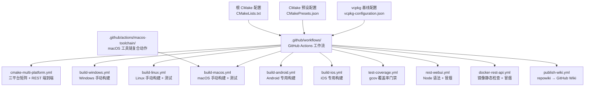

**图表来源**
- [CMakeLists.txt:182-216](file://CMakeLists.txt#L182-L216)
- [CMakePresets.json:1-353](file://CMakePresets.json#L1-L353)
- [vcpkg-configuration.json:1-21](file://vcpkg-configuration.json#L1-L21)
- [action.yml:1-21](file://.github/actions/macos-toolchain/action.yml#L1-L21)
- [cmake-multi-platform.yml:1-564](file://.github/workflows/cmake-multi-platform.yml#L1-L564)
- [build-android.yml:1-144](file://.github/workflows/build-android.yml#L1-L144)
- [build-ios.yml:1-140](file://.github/workflows/build-ios.yml#L1-L140)
- [rest-webui.yml:1-79](file://.github/workflows/rest-webui.yml#L1-L79)
- [docker-rest-api.yml:1-153](file://.github/workflows/docker-rest-api.yml#L1-L153)

**章节来源**
- [CMakeLists.txt:1-796](file://CMakeLists.txt#L1-L796)
- [CMakePresets.json:1-353](file://CMakePresets.json#L1-L353)
- [vcpkg-configuration.json:1-21](file://vcpkg-configuration.json#L1-L21)
- [action.yml:1-21](file://.github/actions/macos-toolchain/action.yml#L1-L21)
- [cmake-multi-platform.yml:1-564](file://.github/workflows/cmake-multi-platform.yml#L1-L564)

## 核心组件
本节聚焦 CI/CD 体系中真正影响构建、测试与交付的关键开关与步骤。

| 组件 | 位置 | 作用 | 关键约束 |
|---|---|---|---|
| 根 CMake 配置 | `CMakeLists.txt` | 设定 C++20/C11、可选 REST API、Copyleft 内核、测试、安装目标 | REST API 必须同时开启 `-DHSBA_BUILD_REST_API=ON` 且启用 vcpkg `rest-api` 特性 |
| CMake 预设 | `CMakePresets.json` | 标准化构建配置，包含 windows-base、x64-debug/release、linux-debug/release/coverage、android-release、macos-debug/release、ios-release | 完整的多平台预设系统，支持所有目标平台 |
| vcpkg 基线 | `vcpkg-configuration.json` | 固定 vcpkg git 基线为 `93ad765c7b66ab9ce97469ec23a90b15c3a14ee5`，确保依赖版本可重现 | 可通过 Docker 工作流的 `vcpkg_baseline` 参数覆盖 |
| 网络重试机制 | 所有 CMake 配置步骤 | 自动重试最多 5 次，每次间隔 30 秒，清理构建目录以消除陈旧缓存 | 解决 vcpkg 将连接失败视为非瞬态错误的问题 |
| macOS 工具链 | `.github/actions/macos-toolchain/action.yml` | 统一安装 Homebrew 依赖，说明 CMake 4.5.x 问题已通过 vcpkg baseline 修复 | 无需额外 CMake 版本固定 |
| 多平台矩阵 | `cmake-multi-platform.yml` | push/PR 到 master 时在 Windows/Linux/macOS 构建 Release，并在 Linux 额外跑 REST API 单元测试与 Node 端到端测试 | Linux 才加 `-DVCPKG_MANIFEST_FEATURES=rest-api` |
| 平台构建工作流 | `build-windows.yml` / `build-linux.yml` / `build-macos.yml` | 提供 `workflow_dispatch` 触发的单平台构建脚本 | Windows 显式关闭线程池协程选项 |
| Android 构建工作流 | `build-android.yml` | 专门的 Android arm64 构建，生成 APK 并部署原生库 | 需要 Android SDK 和 NDK r27d |
| iOS 构建工作流 | `build-ios.yml` | 专门的 iOS arm64 构建，验证静态库和桥接头 | 需要 macOS 环境和 Xcode 工具链 |
| 覆盖率门禁 | `test-coverage.yml` | 使用 gcov/gcovr 在 Linux 上强制 core ≥ 45%、other ≥ 25% | 并行度限制为 2，避免 CAD 模块 Debug 构建 OOM |
| WebUI 控制台 | `rest-webui.yml` | 对 webui 下 JS 做语法检查并运行 `node --test` | 仅监听 `webui/**` 变更，不依赖 C++ 工具链 |
| Docker REST API | `docker-rest-api.yml` | 静态检查 Dockerfile 与忽略规则，手动触发时构建镜像并访问 `/api/health`、`/api/version` | 非 Dispatch 时 build job 跳过是预期行为 |
| Wiki 发布 | `publish-wiki.yml` | 把 `.qoder/repowiki` 转换为 GitHub Wiki 页面 | 需要预先初始化 wiki 仓库 |

**更新** vcpkg 基线固定机制确保了依赖版本的可重现性，所有平台的 CMake 配置都包含了健壮的网络重试逻辑，显著提升了构建稳定性。

**章节来源**
- [CMakeLists.txt:182-216](file://CMakeLists.txt#L182-L216)
- [CMakePresets.json:4-292](file://CMakePresets.json#L4-L292)
- [vcpkg-configuration.json:1-21](file://vcpkg-configuration.json#L1-L21)
- [action.yml:1-21](file://.github/actions/macos-toolchain/action.yml#L1-L21)
- [cmake-multi-platform.yml:131-188](file://.github/workflows/cmake-multi-platform.yml#L131-L188)
- [build-android.yml:1-144](file://.github/workflows/build-android.yml#L1-L144)
- [build-ios.yml:1-140](file://.github/workflows/build-ios.yml#L1-L140)
- [test-coverage.yml:1-151](file://.github/workflows/test-coverage.yml#L1-L151)
- [rest-webui.yml:1-79](file://.github/workflows/rest-webui.yml#L1-L79)
- [docker-rest-api.yml:1-153](file://.github/workflows/docker-rest-api.yml#L1-L153)
- [publish-wiki.yml:1-110](file://.github/workflows/publish-wiki.yml#L1-L110)

## 架构总览
CI/CD 架构不是单一流水线，而是由多个相互解耦的工作流组成：

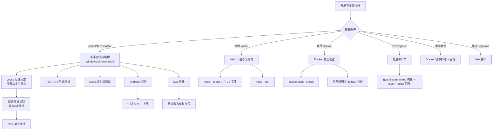

**图表来源**
- [cmake-multi-platform.yml:3-564](file://.github/workflows/cmake-multi-platform.yml#L3-L564)
- [vcpkg-configuration.json:1-21](file://vcpkg-configuration.json#L1-L21)
- [rest-webui.yml:8-79](file://.github/workflows/rest-webui.yml#L8-L79)
- [docker-rest-api.yml:13-80](file://.github/workflows/docker-rest-api.yml#L13-L80)
- [test-coverage.yml:16-102](file://.github/workflows/test-coverage.yml#L16-L102)
- [build-android.yml:1-144](file://.github/workflows/build-android.yml#L1-L144)
- [build-ios.yml:1-140](file://.github/workflows/build-ios.yml#L1-L140)

## 详细组件分析

### vcpkg 基线固定与依赖管理
**更新** 项目现在通过 `vcpkg-configuration.json` 固定了 vcpkg 的 git 基线，确保依赖版本的可重现性：

- **基线锁定**：固定到 `93ad765c7b66ab9ce97469ec23a90b15c3a14ee5`，避免上游 vcpkg 变更影响构建
- **注册表配置**：使用官方 vcpkg 仓库作为默认注册表，并配置 Microsoft artifact registry
- **覆盖端口**：支持本地 `overlay-ports` 和 `triplets` 自定义
- **Docker 支持**：Docker 工作流新增 `vcpkg_baseline` 输入参数，允许运行时覆盖基线版本

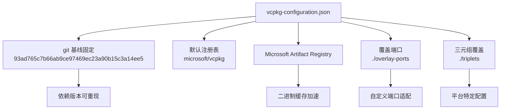

**图表来源**
- [vcpkg-configuration.json:1-21](file://vcpkg-configuration.json#L1-L21)
- [docker-rest-api.yml:35-38](file://.github/workflows/docker-rest-api.yml#L35-L38)

**章节来源**
- [vcpkg-configuration.json:1-21](file://vcpkg-configuration.json#L1-L21)
- [docker-rest-api.yml:35-38](file://.github/workflows/docker-rest-api.yml#L35-L38)

### 网络失败重试机制
**更新** 所有 CMake 配置步骤都实现了健壮的网络重试机制，解决 vcpkg 将连接失败视为非瞬态错误的问题：

- **重试策略**：最多尝试 5 次，每次失败后清理构建目录并等待 30 秒
- **跨平台实现**：Unix 使用 bash for 循环，Windows 使用 cmd goto 标签
- **统一行为**：Linux、macOS、Windows、Android、iOS 都采用相同策略
- **错误处理**：最终失败时输出清晰的错误信息，便于诊断

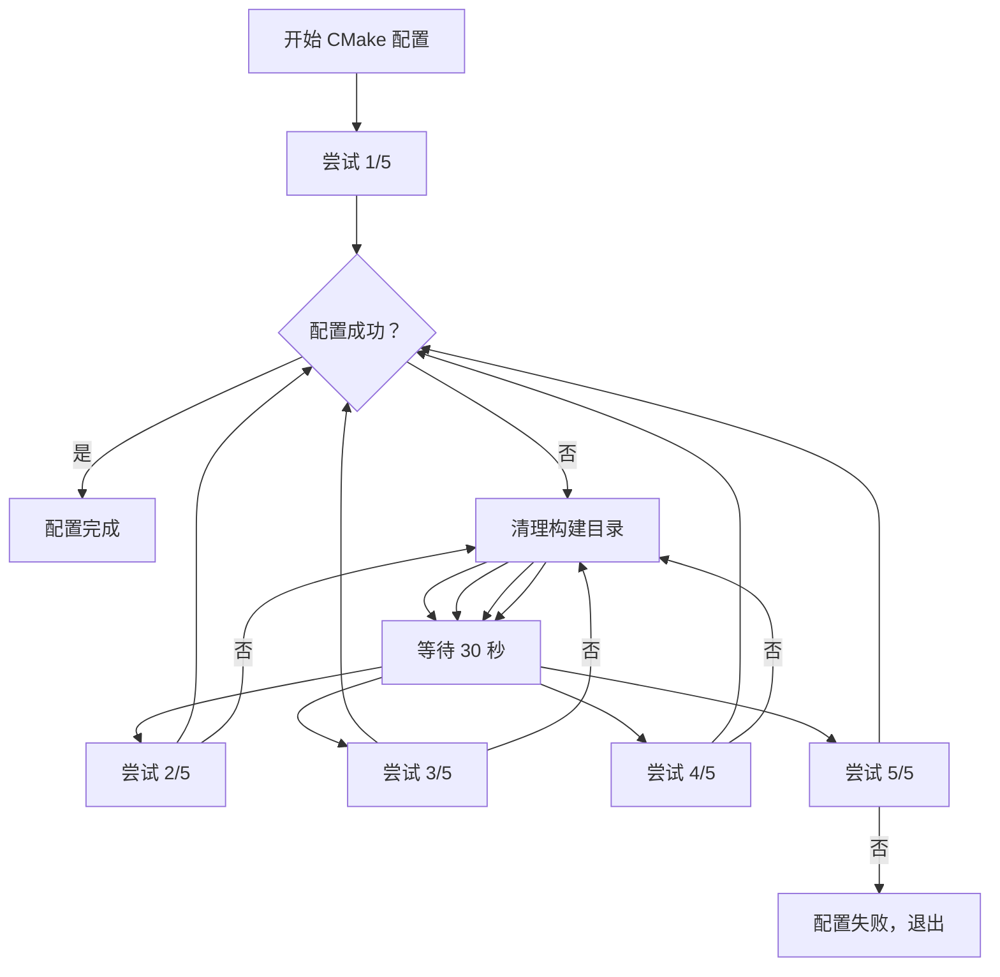

**图表来源**
- [cmake-multi-platform.yml:142-160](file://.github/workflows/cmake-multi-platform.yml#L142-L160)
- [cmake-multi-platform.yml:171-192](file://.github/workflows/cmake-multi-platform.yml#L171-L192)
- [cmake-multi-platform.yml:354-375](file://.github/workflows/cmake-multi-platform.yml#L354-L375)
- [cmake-multi-platform.yml:457-477](file://.github/workflows/cmake-multi-platform.yml#L457-L477)

**章节来源**
- [cmake-multi-platform.yml:142-160](file://.github/workflows/cmake-multi-platform.yml#L142-L160)
- [cmake-multi-platform.yml:171-192](file://.github/workflows/cmake-multi-platform.yml#L171-L192)
- [cmake-multi-platform.yml:354-375](file://.github/workflows/cmake-multi-platform.yml#L354-L375)
- [cmake-multi-platform.yml:457-477](file://.github/workflows/cmake-multi-platform.yml#L457-L477)
- [build-linux.yml:67-82](file://.github/workflows/build-linux.yml#L67-L82)
- [build-macos.yml:40-55](file://.github/workflows/build-macos.yml#L40-L55)
- [build-windows.yml:40-58](file://.github/workflows/build-windows.yml#L40-L58)
- [test-coverage.yml:91-105](file://.github/workflows/test-coverage.yml#L91-L105)

### macOS 工具链与 CMake 版本管理
**更新** macOS 工具链复合动作中明确了 CMake 版本相关的技术细节：

- **Homebrew CMake 4.5.x**：Homebrew 提供滚动更新的 CMake 4.5.x 版本
- **source_group(TREE) 问题**：新版本 CMake 的严格检查曾导致 vcpkg boost-locale 端口配置失败
- **补丁修复**：vcpkg baseline 中的 `ports/boost-locale/fix-source-group.patch` 已修复该问题
- **无需版本固定**：由于补丁已合并到基线，不再需要额外的 CMake 版本固定

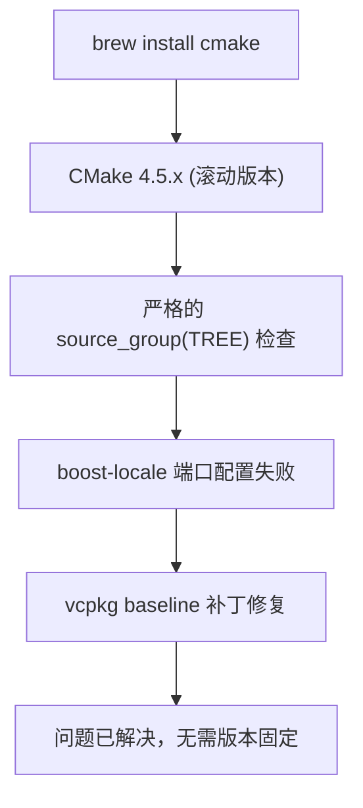

**图表来源**
- [action.yml:12-18](file://.github/actions/macos-toolchain/action.yml#L12-L18)

**章节来源**
- [action.yml:1-21](file://.github/actions/macos-toolchain/action.yml#L1-L21)

### 多平台矩阵流水线
`cmake-multi-platform.yml` 是默认分支的主质量闸门：
- 在 Windows、Ubuntu、macOS 上分别用 Ninja 构建 Release。
- Linux 额外启用 REST API，并运行 `restapi_` 前缀的 ctest 用例。
- Linux 还下载示例 STL 模型，启动真实 `HsBaSlicerRestServer`，执行 `webui/test/e2e.test.js`，校验作业路径、结果下载与 HTTP 行为。
- **新增** Android 与 iOS 作为依赖任务，分别验证原生库产物、ABI 符号与桥接头。
- **更新** 所有平台都采用了网络重试机制，显著提升构建稳定性。

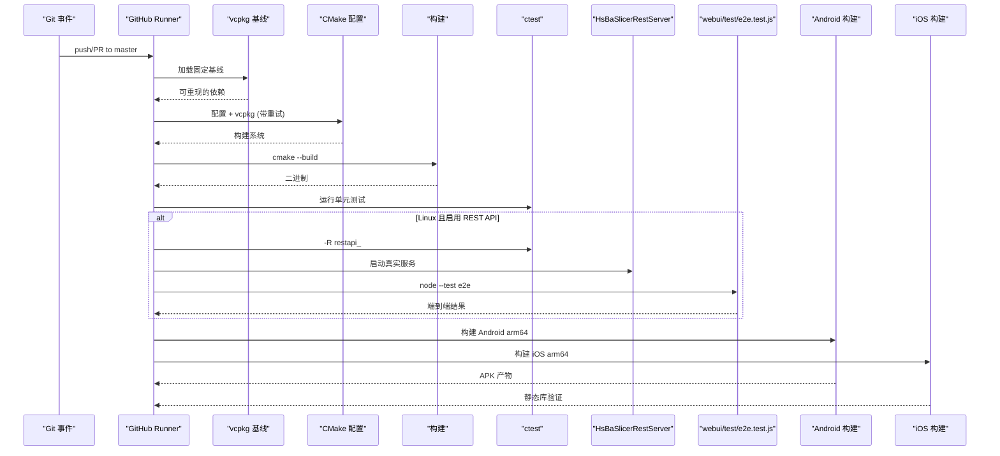

**图表来源**
- [cmake-multi-platform.yml:3-564](file://.github/workflows/cmake-multi-platform.yml#L3-L564)
- [vcpkg-configuration.json:1-21](file://vcpkg-configuration.json#L1-L21)

**章节来源**
- [cmake-multi-platform.yml:10-564](file://.github/workflows/cmake-multi-platform.yml#L10-L564)

### 平台专用构建工作流
三个 `build-*.yml` 是 `workflow_dispatch` 触发的轻量构建入口，适合本地复现或人工验证：
- Windows：调用 `vswhere` 定位 Visual Studio，设置 x64 环境，关闭线程池协程。
- Linux：安装大量系统依赖后构建，并运行 ctest。
- macOS：通过 Homebrew 安装依赖后构建并运行测试。

**新增** 两个专用的移动平台构建工作流：
- **Android 构建** (`build-android.yml`)：完整的 Android 开发环境设置，包括 JDK 21、Android SDK、NDK r27d，生成 arm64-v8a 原生库并构建 APK
- **iOS 构建** (`build-ios.yml`)：macOS 环境下的 iOS 构建，验证静态库导出符号和桥接头文件

它们与矩阵流水线的区别在于：不强制启用 REST API，也不执行端到端测试，更适合作为快速回归入口。

**更新** 所有平台构建工作流都集成了网络重试机制，确保在网络不稳定时的构建可靠性。

**章节来源**
- [build-windows.yml:1-67](file://.github/workflows/build-windows.yml#L1-L67)
- [build-linux.yml:1-95](file://.github/workflows/build-linux.yml#L1-L95)
- [build-macos.yml:1-68](file://.github/workflows/build-macos.yml#L1-L68)
- [build-android.yml:1-144](file://.github/workflows/build-android.yml#L1-L144)
- [build-ios.yml:1-140](file://.github/workflows/build-ios.yml#L1-L140)

### 覆盖率门禁
`test-coverage.yml` 是 PR 质量门槛的核心：
- 使用预设 `linux-coverage` 构建带 gcov 插桩的二进制。
- 并行度限制为 2，避免 CGAL/OCCT/VTK 等 CAD 模块在 Debug 下耗尽内存。
- 运行 `ctest --preset linux-coverage` 产生覆盖率数据。
- 通过 `cmake --build --preset linux-coverage-report` 执行 gcovr 门限检查：core 模块 ≥ 45%，其他模块 ≥ 25%。
- 将摘要写入 GitHub Job Summary，并上传 HTML/XML 报告。
- **更新** 同样采用了网络重试机制，确保依赖下载失败不会导致构建中断。

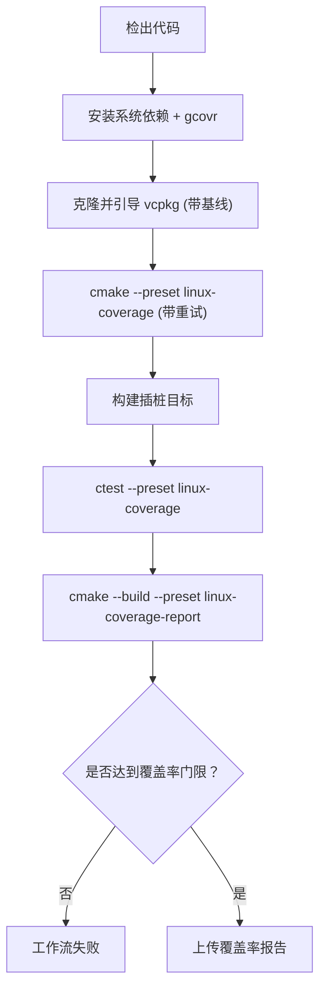

**图表来源**
- [test-coverage.yml:1-151](file://.github/workflows/test-coverage.yml#L1-L151)

**章节来源**
- [test-coverage.yml:1-151](file://.github/workflows/test-coverage.yml#L1-L151)

### Docker REST API 镜像工作流
`docker-rest-api.yml` 的职责是保证容器镜像可构建、可运行，而不是重复验证切片算法正确性：
- push/PR 仅改动 `docker/**` 或本文件时，只做 hadolint 风格检查与上下文完整性检查。
- 检查项包括：Dockerfile 是否启用 `-DHSBA_BUILD_REST_API=ON`、是否包含 `VCPKG_MANIFEST_FEATURES`、忽略规则是否误排 `samples/tests/static_tests/docs/overlay-ports/triplets`、`restapi.ini` 是否保留默认 `host = 127.0.0.1`。
- 完整镜像构建与冒烟仅由 `workflow_dispatch` 触发，支持选择 MIT 或 copyleft 特性集，并可推送到 GHCR。
- **更新** 新增 `vcpkg_baseline` 输入参数，允许运行时覆盖 vcpkg git 基线。
- 冒烟阶段启动容器，轮询 `/api/health`，再访问 `/api/version` 与 `/api/pipelines`。

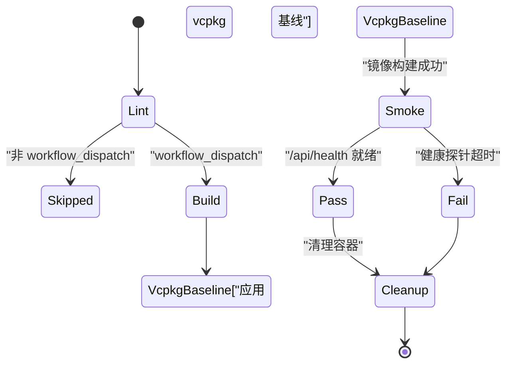

**图表来源**
- [docker-rest-api.yml:13-80](file://.github/workflows/docker-rest-api.yml#L13-L80)
- [docker-rest-api.yml:82-153](file://.github/workflows/docker-rest-api.yml#L82-L153)
- [docker-rest-api.yml:35-38](file://.github/workflows/docker-rest-api.yml#L35-L38)

**章节来源**
- [docker-rest-api.yml:1-153](file://.github/workflows/docker-rest-api.yml#L1-L153)

### Wiki 发布工作流
`publish-wiki.yml` 负责把 `.qoder/repowiki` 同步到 GitHub Wiki：
- 支持手动选择语言 `en`、`zh`、`both`。
- 当推送 `main` 或 `master` 且 `.qoder/repowiki/**` 变化时自动触发。
- 使用 Python 脚本转换，clone wiki 仓库，删除旧页面后复制新内容并提交。
- 若 wiki 未初始化，clone 失败会明确报错，便于维护者修复权限或初始化状态。

**章节来源**
- [publish-wiki.yml:1-110](file://.github/workflows/publish-wiki.yml#L1-L110)

### Android 构建工作流
**新增** `build-android.yml` 提供完整的 Android 构建环境：
- 安装 JDK 21、Android SDK、NDK r27d 和必要的构建工具
- 使用 CMake 配置 arm64-android 三元组，构建原生库
- 将生成的 .so 文件复制到 Android 应用的 jniLibs 目录
- 使用 Gradle 8.7 构建调试 APK
- 在非 main/master 分支自动提交 Gradle wrapper 文件
- **更新** 集成了网络重试机制，确保依赖下载失败时的构建稳定性

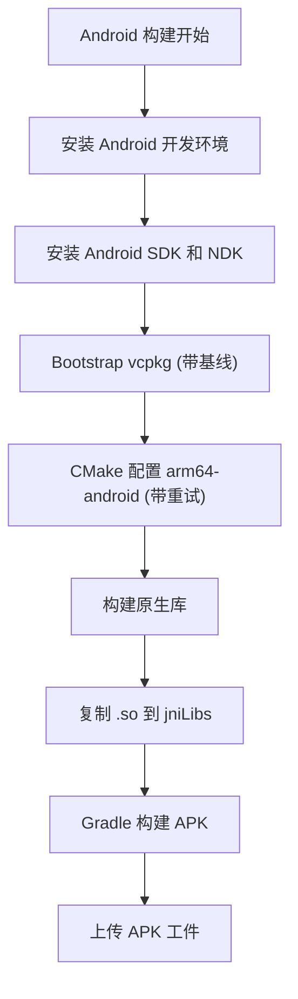

**图表来源**
- [build-android.yml:1-144](file://.github/workflows/build-android.yml#L1-L144)

**章节来源**
- [build-android.yml:1-144](file://.github/workflows/build-android.yml#L1-L144)

### iOS 构建工作流
**新增** `build-ios.yml` 提供完整的 iOS 构建验证：
- 在 macOS 环境中安装必要的构建依赖
- 使用 CMake 配置 iOS arm64 目标，部署目标为 iOS 26.5
- 构建静态库并验证导出的符号
- 检查 iOS 示例应用的文件结构和桥接头声明
- **更新** 集成了网络重试机制，提升构建可靠性

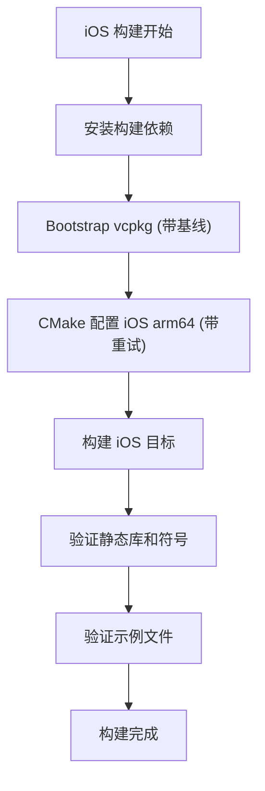

**图表来源**
- [build-ios.yml:1-140](file://.github/workflows/build-ios.yml#L1-L140)

**章节来源**
- [build-ios.yml:1-140](file://.github/workflows/build-ios.yml#L1-L140)

## 依赖关系分析
CI/CD 各工作流之间的耦合并不强，但存在清晰的依赖顺序：

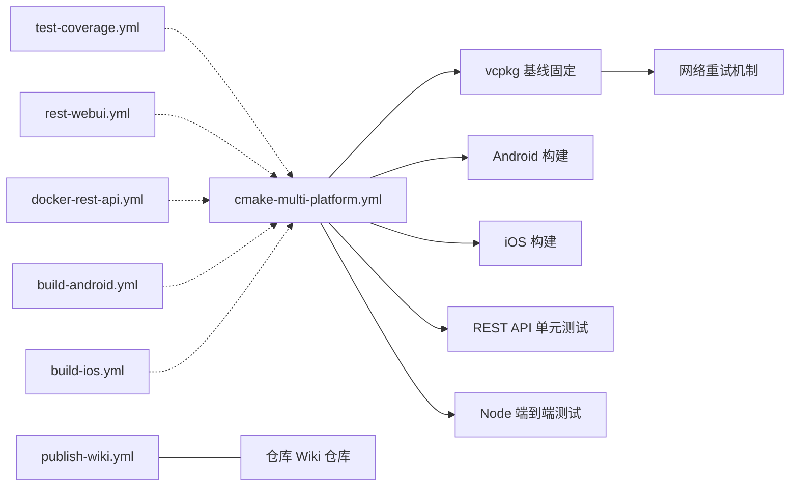

- 多平台矩阵是中心节点：它既承担基础构建，又承担 REST API 单元测试与端到端测试，现在还包括 Android 和 iOS 构建。
- **更新** vcpkg 基线固定是所有构建的基础，确保依赖版本的一致性。
- **更新** 网络重试机制贯穿所有平台，显著提升构建稳定性。
- 覆盖率门禁与 WebUI 工作流相对独立，分别关注 C++ 测试覆盖与前端语法。
- Docker 工作流与原生构建互补：前者验证容器化部署，后者验证真实二进制。
- Wiki 发布与代码构建无运行时依赖，只依赖 `.qoder/repowiki` 内容与 wiki 仓库权限。
- **新增** Android 和 iOS 专用工作流提供独立的移动平台构建能力。

**图表来源**
- [cmake-multi-platform.yml:10-564](file://.github/workflows/cmake-multi-platform.yml#L10-L564)
- [vcpkg-configuration.json:1-21](file://vcpkg-configuration.json#L1-L21)
- [test-coverage.yml:16-151](file://.github/workflows/test-coverage.yml#L16-L151)
- [rest-webui.yml:8-79](file://.github/workflows/rest-webui.yml#L8-L79)
- [docker-rest-api.yml:13-153](file://.github/workflows/docker-rest-api.yml#L13-L153)
- [publish-wiki.yml:16-110](file://.github/workflows/publish-wiki.yml#L16-L110)
- [build-android.yml:1-144](file://.github/workflows/build-android.yml#L1-L144)
- [build-ios.yml:1-140](file://.github/workflows/build-ios.yml#L1-L140)

**章节来源**
- [cmake-multi-platform.yml:10-564](file://.github/workflows/cmake-multi-platform.yml#L10-L564)
- [vcpkg-configuration.json:1-21](file://vcpkg-configuration.json#L1-L21)
- [test-coverage.yml:16-151](file://.github/workflows/test-coverage.yml#L16-L151)
- [rest-webui.yml:8-79](file://.github/workflows/rest-webui.yml#L8-L79)
- [docker-rest-api.yml:13-153](file://.github/workflows/docker-rest-api.yml#L13-L153)
- [publish-wiki.yml:16-110](file://.github/workflows/publish-wiki.yml#L16-L110)
- [build-android.yml:1-144](file://.github/workflows/build-android.yml#L1-L144)
- [build-ios.yml:1-140](file://.github/workflows/build-ios.yml#L1-L140)

## 性能与资源特性
CI/CD 设计中有几个明显的性能与资源优化点：

| 场景 | 优化手段 | 原因 |
|---|---|---|
| Linux 大磁盘空间 | 使用 `easimon/maximize-build-space` 清理无关环境 | 减少 runner 磁盘压力，提高缓存命中率 |
| vcpkg 依赖下载 | 使用 `actions/cache@v5` 缓存 `vcpkg/downloads` | 避免每次拉取第三方包 |
| vcpkg 二进制缓存 | 设置 `VCPKG_BINARY_SOURCES=clear;x-gha,readwrite` | 复用 GitHub Actions 缓存后端 |
| CAD 模块覆盖率构建 | `CMAKE_BUILD_PARALLEL_LEVEL=2`、`VCPKG_MAX_CONCURRENCY=2` | Debug + gcov 下 CGAL/OCCT/VTK 可能占用数 GB 内存 |
| Docker 镜像构建 | BuildKit 缓存 + GHCR 推送可选 | 增量构建分钟级，推送仅手动触发 |
| WebUI 测试 | 仅监听 `webui/**` | 避免每次 C++ 变更都触发 Node 环境 |
| **CMake 预设** | **标准化构建配置** | **减少重复配置，提高构建一致性** |
| **libigl 依赖优化** | **作为顶层依赖 + 仅启用 cgal 特性** | **减少不必要的依赖，加快构建速度** |
| **Android 构建缓存** | **vcpkg downloads 缓存** | **避免重复下载 Android 依赖** |
| **iOS 构建缓存** | **vcpkg downloads 缓存** | **避免重复下载 iOS 依赖** |
| **vcpkg 基线固定** | **固定 git 基线** | **确保依赖版本可重现，避免上游变更影响** |
| **网络重试机制** | **自动重试最多5次** | **优雅处理网络波动，提升构建稳定性** |

**更新** 新增的 vcpkg 基线固定机制确保了依赖版本的可重现性，网络重试机制显著提升了构建稳定性，特别是在网络不稳定的环境下。

这些优化共同保证：日常 PR 反馈快，重型构建只在必要路径执行，覆盖率门禁不会因内存不足静默失败，构建过程更加稳定可靠。

**章节来源**
- [cmake-multi-platform.yml:20-32](file://.github/workflows/cmake-multi-platform.yml#L20-L32)
- [cmake-multi-platform.yml:106-129](file://.github/workflows/cmake-multi-platform.yml#L106-L129)
- [test-coverage.yml:25-33](file://.github/workflows/test-coverage.yml#L25-L33)
- [docker-rest-api.yml:112-127](file://.github/workflows/docker-rest-api.yml#L112-L127)
- [rest-webui.yml:8-17](file://.github/workflows/rest-webui.yml#L8-L17)
- [CMakePresets.json:1-353](file://CMakePresets.json#L1-L353)
- [vcpkg.json:52-104](file://vcpkg.json#L52-L104)
- [vcpkg-configuration.json:1-21](file://vcpkg-configuration.json#L1-L21)
- [build-android.yml:73-78](file://.github/workflows/build-android.yml#L73-L78)
- [build-ios.yml:36-41](file://.github/workflows/build-ios.yml#L36-L41)

## 故障排除指南
以下是 CI/CD 中最常见的失败模式及排查建议：

| 现象 | 可能原因 | 排查步骤 |
|---|---|---|
| Linux 矩阵 REST API 测试未编译 | 未启用 `rest-api` vcpkg 特性 | 确认 Linux 配置命令包含 `-DHSBA_BUILD_REST_API=ON -DVCPKG_MANIFEST_FEATURES=rest-api` |
| REST API 单元测试失败 | httplib 版本不兼容或路由异常 | 查看 `tests/RestApi/` 日志，确认 `routes.cpp` 注册顺序与请求格式 |
| 端到端测试报 `HsBaSlicerRestServer missing` | 构建产物未生成或路径错误 | 检查 `HSBA_REST_SERVER` 环境变量与 `build/bin/Release/HsBaSlicerRestServer` |
| 端到端测试报 `node is not on PATH` | Ubuntu runner 未安装 Node | 检查矩阵中 Node 安装步骤，或使用工作区自带 Node |
| 覆盖率门禁失败 | core 或其他模块覆盖率低于阈值 | 查看 Job Summary 中的 `core_summary.txt` / `other_summary.txt`，补充测试或调整阈值 |
| Docker 静态检查失败 | Dockerfile 未启用 REST API 或忽略规则误删目录 | 检查 `docker/Dockerfile` 与 `docker/Dockerfile.dockerignore` |
| Docker 冒烟失败 | `/api/health` 未就绪 | 查看容器日志，确认 `restapi.ini` 中 host/port 与端口映射 |
| Wiki 发布失败 | wiki 仓库未初始化或 token 无写权限 | 先在仓库 UI 创建至少一个 wiki 页面，检查 `GITHUB_TOKEN` 权限 |
| **CMake 预设构建失败** | **预设配置错误或平台不匹配** | 检查 `CMakePresets.json` 中的预设定义和平台条件 |
| **libigl 依赖问题** | **UWP 平台构建失败** | 确认平台过滤条件 `!uwp` 是否正确应用 |
| **copyleft 特性构建缓慢** | **依赖过多** | 确认是否只需要 `libigl[cgal]` 而非完整 libigl |
| **Android 构建失败** | **NDK 或 SDK 版本不匹配** | 检查 NDK r27d 和 Android SDK 34 是否正确安装 |
| **iOS 构建失败** | **Xcode 工具链问题** | 确认 macOS 环境和 Xcode 命令行工具已正确配置 |
| **APK 构建失败** | **Gradle 版本不兼容** | 检查 Gradle 8.7 是否正确安装和配置 |
| **vcpkg 依赖下载失败** | **网络连接不稳定** | 检查网络重试日志，确认是否达到最大重试次数 |
| **CMake 配置反复失败** | **网络问题或缓存损坏** | 查看重试日志，确认构建目录是否被正确清理 |
| **依赖版本不一致** | **vcpkg 基线未生效** | 检查 `vcpkg-configuration.json` 中的基线配置 |
| **Docker 构建使用错误基线** | **vcpkg_baseline 参数未正确传递** | 检查 workflow_dispatch 输入参数 |

**更新** 新增了与 vcpkg 基线固定、网络重试机制相关的故障排除条目，帮助开发者更快定位和解决问题。

**章节来源**
- [cmake-multi-platform.yml:131-188](file://.github/workflows/cmake-multi-platform.yml#L131-L188)
- [cmake-multi-platform.yml:213-230](file://.github/workflows/cmake-multi-platform.yml#L213-L230)
- [test-coverage.yml:100-151](file://.github/workflows/test-coverage.yml#L100-L151)
- [docker-rest-api.yml:55-79](file://.github/workflows/docker-rest-api.yml#L55-L79)
- [docker-rest-api.yml:130-153](file://.github/workflows/docker-rest-api.yml#L130-L153)
- [publish-wiki.yml:55-93](file://.github/workflows/publish-wiki.yml#L55-L93)
- [CMakePresets.json:76-108](file://CMakePresets.json#L76-L108)
- [vcpkg.json:52-104](file://vcpkg.json#L52-L104)
- [vcpkg-configuration.json:1-21](file://vcpkg-configuration.json#L1-L21)
- [build-android.yml:41-50](file://.github/workflows/build-android.yml#L41-L50)
- [build-ios.yml:42-52](file://.github/workflows/build-ios.yml#L42-L52)

## 结论
该项目的 CI/CD 体系以 CMake 与 vcpkg 为中心，通过 GitHub Actions 把工作流拆分为多平台构建、覆盖率门禁、WebUI 控制台、Docker 镜像与 Wiki 发布五个清晰职责。其设计优点在于：
- 分层验证：基础构建、单元测试、REST API 单元测试、端到端测试、覆盖率、容器镜像各自有明确入口。
- 平台差异化：Linux 承担 REST API 端到端验证，macOS 保持默认配置，Windows 关闭协程选项。
- 资源可控：覆盖率门禁限制并发，Docker 构建仅手动触发，WebUI 测试独立于 C++。
- 可观测性强：覆盖率摘要写入 Job Summary，Docker 冒烟输出容器日志，Wiki 发布给出变更清单。

**更新** 随着 vcpkg 基线固定机制和网络重试机制的引入，构建系统变得更加稳定和可重现：
- **依赖可重现**：vcpkg 基线固定确保依赖版本一致，避免上游变更影响构建
- **构建稳定性**：网络重试机制优雅处理连接失败，显著提升构建成功率
- **版本管理**：Docker 工作流支持运行时覆盖 vcpkg 基线，提供灵活的版本控制
- **跨平台一致性**：所有平台都采用相同的重试策略，确保构建行为一致

未来若继续增强 CI/CD，应优先遵循现有范式：新增端点或流水线能力时，先在 CMake 层暴露选项，再在 Linux 矩阵中启用 REST API 测试，最后补充覆盖率与 Docker 冒烟，避免把重型逻辑塞进默认 PR 路径。同时可以利用现有的 CMake 预设系统、vcpkg 基线固定机制和网络重试机制来简化和标准化新的构建配置，确保构建的稳定性和可重现性。