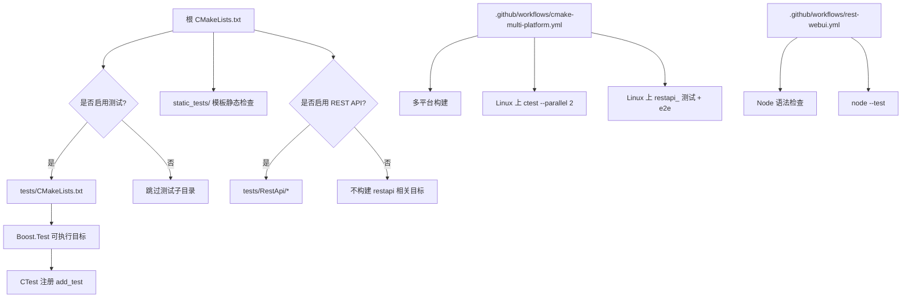
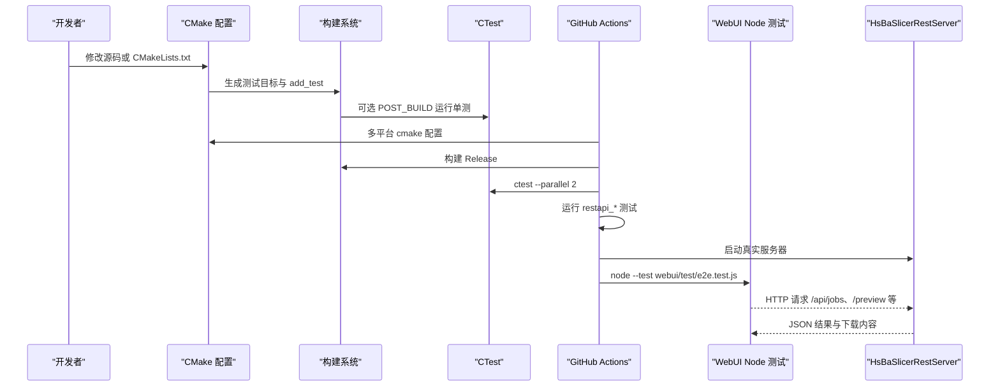
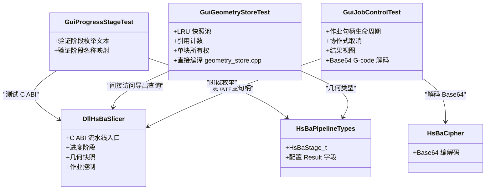
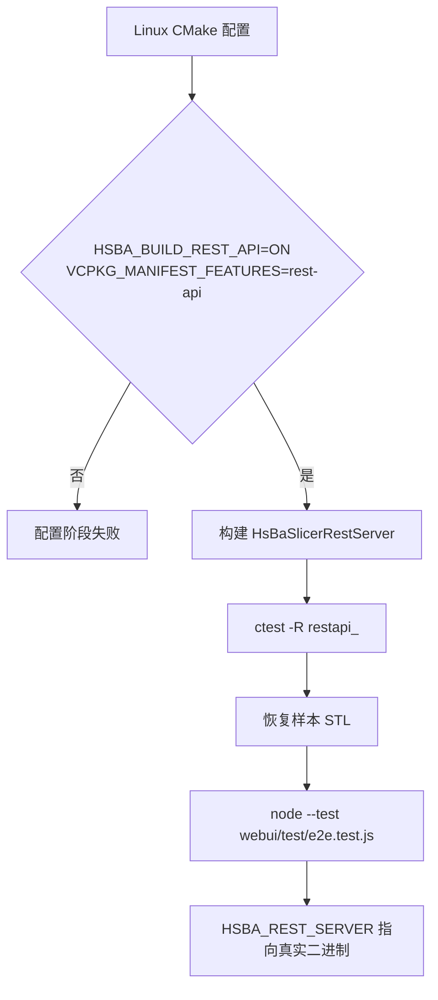
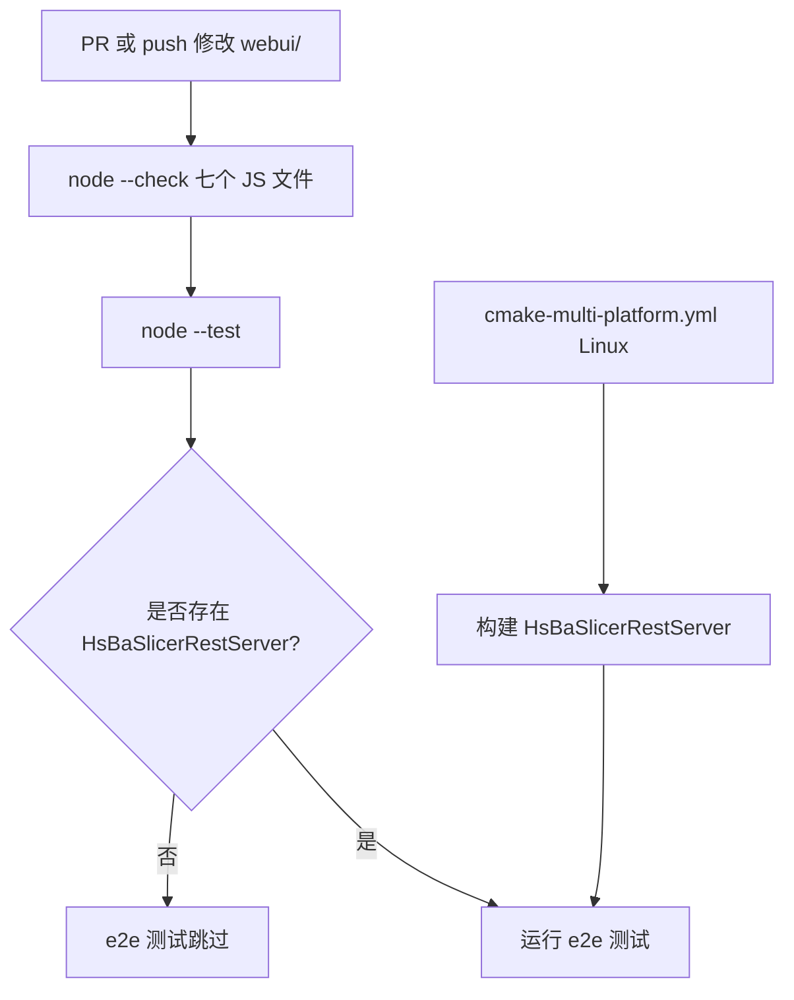
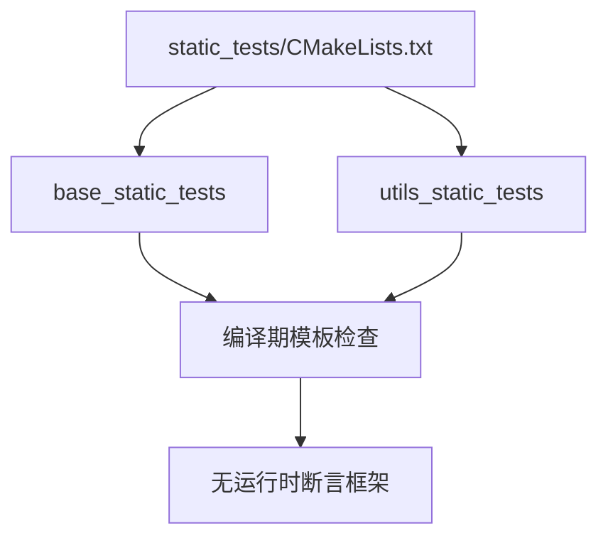
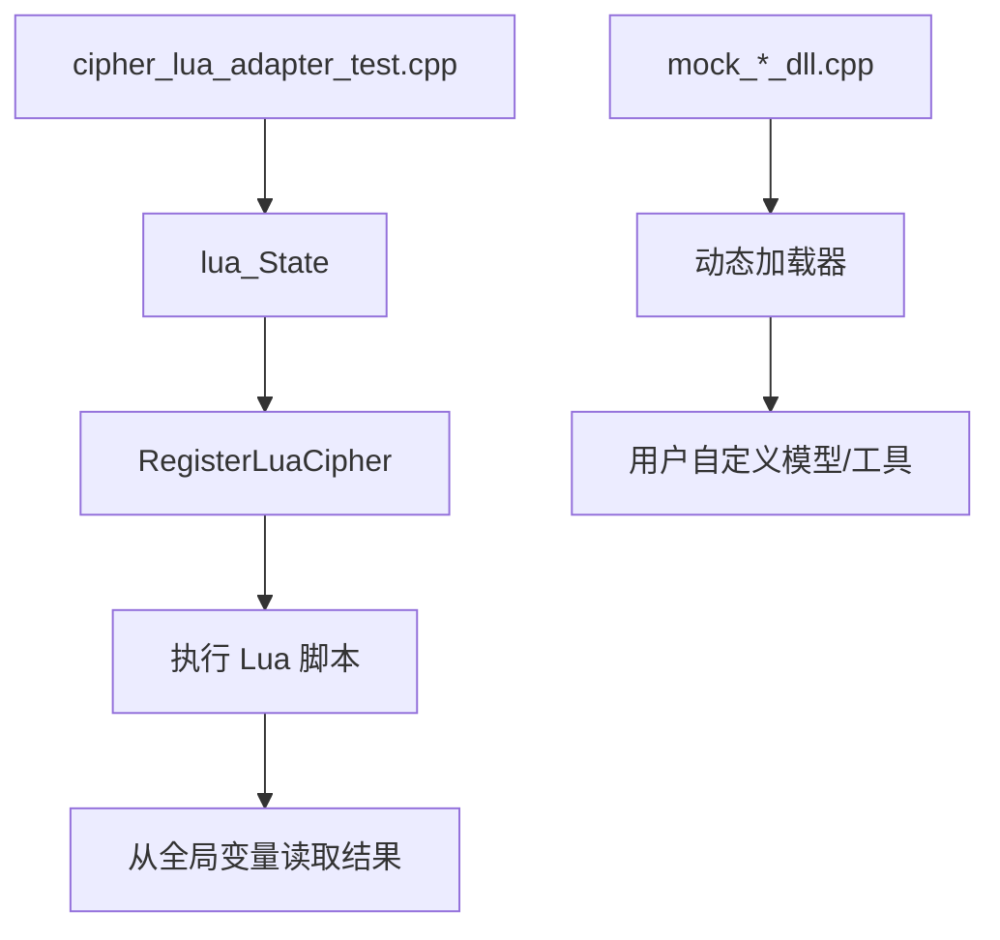
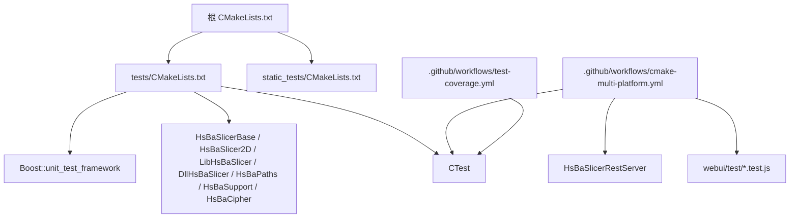
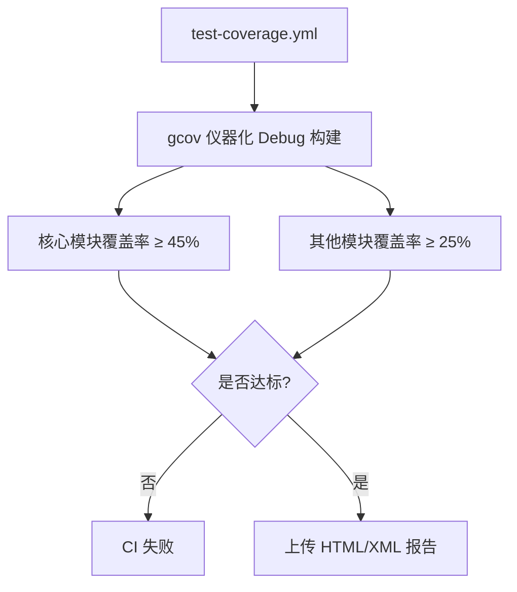

# 测试基础设施扩展

<cite>
**本文引用的文件**   
- [CMakeLists.txt](file://CMakeLists.txt)
- [tests/CMakeLists.txt](file://tests/CMakeLists.txt)
- [cmake-multi-platform.yml](file://.github/workflows/cmake-multi-platform.yml)
- [rest-webui.yml](file://.github/workflows/rest-webui.yml)
- [test-coverage.yml](file://.github/workflows/test-coverage.yml)
- [slice-ui.test.mjs](file://integration/slice-ui.test.mjs)
- [any_object_test.cpp](file://tests/AnyObject/any_object_test.cpp)
- [app_config_test.cpp](file://tests/AppConfig/app_config_test.cpp)
- [graph_test.cpp](file://tests/Graph/graph_test.cpp)
- [struct_xml_test.cpp](file://tests/ConfigMap/struct_xml_test.cpp)
- [cipher_lua_adapter_test.cpp](file://tests/Cipher/cipher_lua_adapter_test.cpp)
- [base_static_tests.cpp](file://static_tests/base_static_tests/base_static_tests.cpp)
- [gui_progress_stage_test.cpp](file://tests/GuiApi/progress_stage_test.cpp)
- [gui_geometry_store_test.cpp](file://tests/GuiApi/geometry_store_test.cpp)
- [gui_job_control_test.cpp](file://tests/GuiApi/job_control_test.cpp)
</cite>

## 目录
1. [引言](#引言)
2. [项目结构](#项目结构)
3. [核心组件](#核心组件)
4. [架构总览](#架构总览)
5. [详细组件分析](#详细组件分析)
6. [依赖关系分析](#依赖关系分析)
7. [性能与覆盖率特性](#性能与覆盖率特性)
8. [故障排除指南](#故障排除指南)
9. [结论](#结论)
10. [附录：测试用例分类索引](#附录测试用例分类索引)

## 引言
本文聚焦 HsBaSlicer 的“测试基础设施扩展”，即围绕 CMake、CTest、Boost.Test、静态模板检查、GitHub Actions CI 以及 WebUI/REST API 端到端测试所形成的整体测试体系。文档不讨论切片算法本身，而是回答以下问题：

- 哪些目标会被构建为可执行测试？
- 单元测试、静态模板测试、GUI ABI 测试、REST API 测试、WebUI Node.js 测试分别由谁触发？
- 如何启用或禁用测试、覆盖率、REST API 和可选内核？
- 新增一个测试时应该遵循什么模式？
- 当测试失败或跳过时，应优先排查哪些配置项与环境变量？

## 项目结构
测试基础设施横跨四个层面：

| 层级 | 位置 | 职责 |
|---|---|---|
| 顶层构建开关 | `CMakeLists.txt` | 定义 `HSBA_SLICER_USE_TESTS`、`HSBA_SLICER_RUN_TESTS_AFTER_BUILD`、`HSBA_COPL`、`HSBA_BUILD_REST_API` 等全局选项，并决定是否包含 `tests/` 与 `static_tests/` |
| 测试目标注册 | `tests/CMakeLists.txt` | 使用 Boost.Test 创建每个测试可执行文件，并通过 `add_test` 注册到 CTest |
| 持续集成 | `.github/workflows/*.yml` | 在 Linux/Windows/macOS 上编译、运行 CTest、覆盖率门禁、REST/WebUI 独立校验 |
| 前端与集成测试 | `webui/test/*`、`integration/slice-ui.test.mjs` | 用 Node.js 驱动 REST 控制台与真实服务器 |



**图表来源**
- [CMakeLists.txt:444-475](file://CMakeLists.txt#L444-L475)
- [tests/CMakeLists.txt:1-39](file://tests/CMakeLists.txt#L1-L39)
- [cmake-multi-platform.yml:131-189](file://.github/workflows/cmake-multi-platform.yml#L131-L189)
- [rest-webui.yml:46-60](file://.github/workflows/rest-webui.yml#L46-L60)

**章节来源**
- [CMakeLists.txt:444-475](file://CMakeLists.txt#L444-L475)
- [tests/CMakeLists.txt:1-39](file://tests/CMakeLists.txt#L1-L39)

## 核心组件
测试基础设施的核心不是单个类，而是一组相互咬合的构建与运行契约：

1. **顶层 CMake 选项**
   - `HSBA_SLICER_USE_TESTS`：控制是否进入 `tests/` 子目录。Android/iOS/主机平台默认关闭测试输出时也会强制关闭。
   - `HSBA_SLICER_RUN_TESTS_AFTER_BUILD`：是否在每次测试目标构建后自动调用 `ctest -R <target>`。
   - `HSBA_SLICER_USE_STATIC_TESTS`：控制 `static_tests/`。
   - `HSBA_COPL`：控制 CGAL/OpenCASCADE 等 copyleft 内核；影响 `cgal_model_test` 与布尔运算相关测试。
   - `HSBA_BUILD_REST_API`：控制 `HsBaSlicerRestServer` 及 `tests/RestApi/*`。

2. **Boost.Test 测试目标**
   - 每个测试目录对应一个 `add_executable(..._test)`。
   - 统一链接 `Boost::unit_test_framework` 并定义 `BOOST_TEST_DYN_LINK`。
   - 通过 `enable_testing()` 与 `add_test(NAME ... COMMAND $<TARGET_FILE:...>)` 注册到 CTest。
   - 大量目标附带 `POST_BUILD` 自定义命令，用于本地快速单测回归。

3. **CI 分层验证**
   - `cmake-multi-platform.yml`：三平台构建 + Linux 上 CTest + REST API 测试 + WebUI e2e。
   - `rest-webui.yml`：仅当 `webui/` 变更时触发，对 Node.js 源码做语法检查与 `node --test`。
   - `test-coverage.yml`：gcov 覆盖率门禁（核心模块 ≥ 45%，其他模块 ≥ 25%）。

4. **WebUI 与集成测试**
   - `webui/test/server.test.js`、`webui/test/e2e.test.js` 由 `rest-webui.yml` 语法检查与运行。
   - `integration/slice-ui.test.mjs` 启动真实 `HsBaSlicerRestServer`，驱动浏览器侧模型/视图脚本完成提交→轮询→预览路径。

**章节来源**
- [CMakeLists.txt:182-216](file://CMakeLists.txt#L182-L216)
- [CMakeLists.txt:444-475](file://CMakeLists.txt#L444-L475)
- [tests/CMakeLists.txt:1-39](file://tests/CMakeLists.txt#L1-L39)
- [cmake-multi-platform.yml:174-230](file://.github/workflows/cmake-multi-platform.yml#L174-L230)
- [rest-webui.yml:46-79](file://.github/workflows/rest-webui.yml#L46-L79)
- [test-coverage.yml:1-31](file://.github/workflows/test-coverage.yml#L1-L31)
- [slice-ui.test.mjs:1-21](file://integration/slice-ui.test.mjs#L1-L21)

## 架构总览
下图展示从开发者修改代码到 CI 报告结果的完整链路：



**图表来源**
- [CMakeLists.txt:768-781](file://CMakeLists.txt#L768-L781)
- [tests/CMakeLists.txt:29-39](file://tests/CMakeLists.txt#L29-L39)
- [cmake-multi-platform.yml:168-230](file://.github/workflows/cmake-multi-platform.yml#L168-L230)
- [rest-webui.yml:56-79](file://.github/workflows/rest-webui.yml#L56-L79)

## 详细组件分析

### 顶层测试开关与条件构建
根 `CMakeLists.txt` 中测试相关逻辑的关键约束如下：

| 选项 | 默认值 | 行为 |
|---|---:|---|
| `HSBA_SLICER_USE_TESTS` | `ON` | Android/iOS/游戏主机强制关闭；交叉编译时保留构建但关闭自动运行 |
| `HSBA_SLICER_RUN_TESTS_AFTER_BUILD` | `ON` | 每个测试目标构建后追加 `ctest -V -R <name>` |
| `HSBA_SLICER_USE_STATIC_TESTS` | `ON` | 启用 `static_tests/` |
| `HSBA_COPL` | `AUTO` | 探测 CGAL/OpenCASCADE；影响 `cgal_model_test` 与布尔运算测试 |
| `HSBA_BUILD_REST_API` | `OFF` | 桌面专属；需要 vcpkg `rest-api` 特性安装 cpp-httplib |

特别注意：`enable_testing()` 在根 CMake 中只在 `HSBA_SLICER_USE_TESTS` 为真时调用，因此如果顶层未启用测试，即使 `tests/CMakeLists.txt` 内部再次 `enable_testing()` 也不会被 CTest 发现。

```mermaid
flowchart TD
Start["配置阶段"] --> UseTests{"HSBA_SLICER_USE_TESTS"}
UseTests --> |否| NoTests["不添加 tests/ 子目录"]
UseTests --> |是| AddTests["add_subdirectory(\"tests\")"]
AddTests --> StaticTests{"HSBA_SLICER_USE_STATIC_TESTS"}
StaticTests --> |是| StaticDir["add_subdirectory(\"static_tests\")"]
StaticTests --> |否| SkipStatic["跳过静态模板测试"]
AddTests --> RestApi{"HSBA_BUILD_REST_API"}
RestApi --> |是| RestEnabled["restapi 子目录参与构建"]
RestApi --> |否| RestDisabled["restapi 不参与构建"]
```

**图表来源**
- [CMakeLists.txt:444-475](file://CMakeLists.txt#L444-L475)
- [CMakeLists.txt:511-514](file://CMakeLists.txt#L511-L514)
- [CMakeLists.txt:768-781](file://CMakeLists.txt#L768-L781)

**章节来源**
- [CMakeLists.txt:182-216](file://CMakeLists.txt#L182-L216)
- [CMakeLists.txt:444-475](file://CMakeLists.txt#L444-L475)
- [CMakeLists.txt:768-781](file://CMakeLists.txt#L768-L781)

### Boost.Test 测试目标注册范式
`tests/CMakeLists.txt` 采用高度一致的模板：

1. `find_package(Boost 1.54 REQUIRED unit_test_framework)`
2. `add_executable(<name>_test "<dir>/<name>_test.cpp")`
3. `target_link_libraries(... Boost::unit_test_framework)`
4. `target_compile_definitions(... BOOST_TEST_DYN_LINK)`
5. `enable_testing()`
6. `add_test(NAME <name>_test COMMAND $<TARGET_FILE:<name>_test>)`
7. 可选 `POST_BUILD` 调用 `ctest -V -R <name>_test`

这种范式带来两个重要性质：

- 所有测试都通过 CTest 暴露，支持 `ctest -R pattern` 按名称筛选。
- 本地开发可通过 `HSBA_RUN_TESTS_AFTER_BUILD` 实现“构建即单测”体验。

示例参考：

- 基础类型测试：[any_object_test.cpp](file://tests/AnyObject/any_object_test.cpp)
- 应用配置单例测试：[app_config_test.cpp](file://tests/AppConfig/app_config_test.cpp)
- 图算法测试：[graph_test.cpp](file://tests/Graph/graph_test.cpp)
- XML/YAML 序列化测试：[struct_xml_test.cpp](file://tests/ConfigMap/struct_xml_test.cpp)

**章节来源**
- [tests/CMakeLists.txt:1-39](file://tests/CMakeLists.txt#L1-L39)
- [tests/CMakeLists.txt:41-65](file://tests/CMakeLists.txt#L41-L65)
- [tests/CMakeLists.txt:67-85](file://tests/CMakeLists.txt#L67-L85)
- [tests/CMakeLists.txt:260-280](file://tests/CMakeLists.txt#L260-L280)
- [any_object_test.cpp:1-32](file://tests/AnyObject/any_object_test.cpp#L1-L32)
- [app_config_test.cpp:1-32](file://tests/AppConfig/app_config_test.cpp#L1-L32)
- [graph_test.cpp:1-47](file://tests/Graph/graph_test.cpp#L1-L47)
- [struct_xml_test.cpp:1-61](file://tests/ConfigMap/struct_xml_test.cpp#L1-L61)

### GUI ABI 与 DllHsBaSlicer 测试
`tests/GuiApi/` 是本次“测试基础设施扩展”中最贴近 DllHsBaSlicer 的部分，它验证的是 C ABI 层能力，而不是 LibHsBaSlicer 内部实现：

| 测试目标 | 链接目标 | 验证重点 |
|---|---|---|
| `gui_progress_stage_test` | `DllHsBaSlicer`、`HsBaPipelineTypes` | 阶段枚举文本与名称映射 |
| `gui_geometry_store_test` | `HsBaSlicer2D`、`HsBaSlicerBase`、`HsBaPipelineTypes`，并直接编译 `DllHsBaSlicer/geometry_store.cpp` | LRU 快照池、引用计数、单块所有权 |
| `gui_job_control_test` | `DllHsBaSlicer`、`HsBaPipelineTypes`、`HsBaCipher` | 作业提交、取消、等待、结果视图、Base64 G-code 解码 |

关键设计约束：

- `gui_geometry_store_test` 不通过 C ABI 构造快照池，因为快照池不在导出接口中；它直接把内部翻译单元编进测试。
- 该测试必须定义 `HSBA_SLICER_EXPORTS`，使导出的查询函数以“导出”语义而非“导入”语义编译。
- `gui_job_control_test` 链接 `HsBaCipher`，是因为其预览用例需要从 G-code 注释块中解码 Base64 图像字节。



**图表来源**
- [tests/CMakeLists.txt:1510-1599](file://tests/CMakeLists.txt#L1510-L1599)
- [gui_progress_stage_test.cpp](file://tests/GuiApi/progress_stage_test.cpp)
- [gui_geometry_store_test.cpp](file://tests/GuiApi/geometry_store_test.cpp)
- [gui_job_control_test.cpp](file://tests/GuiApi/job_control_test.cpp)

**章节来源**
- [tests/CMakeLists.txt:1510-1599](file://tests/CMakeLists.txt#L1510-L1599)

### REST API 测试与 Linux 专用构建门控
REST API 测试仅在 `HSBA_BUILD_REST_API=ON` 且 vcpkg manifest feature `rest-api` 可用时构建。根 CMake 会显式检查环境变量或缓存变量中的 `VCPKG_MANIFEST_FEATURES`，若缺失则直接报错，而不是静默跳过。

CI 中 Linux 行额外设置：

```text
-DHSBA_BUILD_REST_API=ON -DVCPKG_MANIFEST_FEATURES=rest-api
```

随后：

1. `ctest --test-dir build/tests -R "restapi_"` 运行 REST API 单元测试。
2. 恢复 Stanford Bunny 样本模型。
3. 设置 `HSBA_REST_SERVER=build/bin/Release/HsBaSlicerRestServer`。
4. 运行 `node --test webui/test/e2e.test.js`，用真实服务器驱动 WebUI 控制台。



**图表来源**
- [CMakeLists.txt:182-216](file://CMakeLists.txt#L182-L216)
- [cmake-multi-platform.yml:131-152](file://.github/workflows/cmake-multi-platform.yml#L131-L152)
- [cmake-multi-platform.yml:182-230](file://.github/workflows/cmake-multi-platform.yml#L182-L230)

**章节来源**
- [CMakeLists.txt:182-216](file://CMakeLists.txt#L182-L216)
- [cmake-multi-platform.yml:131-152](file://.github/workflows/cmake-multi-platform.yml#L131-L152)
- [cmake-multi-platform.yml:182-230](file://.github/workflows/cmake-multi-platform.yml#L182-L230)

### WebUI 与 Node.js 测试边界
`rest-webui.yml` 明确说明：WebUI 控制台是独立的 Node.js 项目，不链接任何 C++ 库。它只检查 `server.js`、`public/httphelpers.js`、`public/model.js`、`public/view.js`、`public/app.js`、`test/server.test.js`、`test/e2e.test.js` 的语法，然后运行 `node --test`。

其中 `e2e.test.js` 需要真实 `HsBaSlicerRestServer`，因此在该 workflow 中通常跳过；真正的端到端验证放在 `cmake-multi-platform.yml` 的 Linux 分支。



**图表来源**
- [rest-webui.yml:3-17](file://.github/workflows/rest-webui.yml#L3-L17)
- [rest-webui.yml:46-79](file://.github/workflows/rest-webui.yml#L46-L79)
- [cmake-multi-platform.yml:213-230](file://.github/workflows/cmake-multi-platform.yml#L213-L230)

**章节来源**
- [rest-webui.yml:3-17](file://.github/workflows/rest-webui.yml#L3-L17)
- [rest-webui.yml:46-79](file://.github/workflows/rest-webui.yml#L46-L79)
- [cmake-multi-platform.yml:213-230](file://.github/workflows/cmake-multi-platform.yml#L213-L230)

### 静态模板测试
`static_tests/` 不包含传统运行时断言，而是通过编译期模板实例化验证概念、协程、泛型生成器、`any_object` 反射等。其 CMake 非常薄，只是聚合 `base_static_tests` 与 `utils_static_tests`。

示例中可见：

- 协程返回 `int`、`void`、异常路径。
- 自定义分配器的协程任务。
- `Generator<int>` 的 `co_yield` 序列。
- `any_object` 的类型信息注册与访问。



**图表来源**
- [static_tests/CMakeLists.txt:1-4](file://static_tests/CMakeLists.txt#L1-L4)
- [base_static_tests.cpp:166-230](file://static_tests/base_static_tests/base_static_tests.cpp#L166-L230)

**章节来源**
- [static_tests/CMakeLists.txt:1-4](file://static_tests/CMakeLists.txt#L1-L4)
- [base_static_tests.cpp:166-230](file://static_tests/base_static_tests/base_static_tests.cpp#L166-L230)

### Lua 绑定与动态加载测试
仓库中存在两类“桥接测试”：

1. **Lua 适配器测试**：例如 `tests/Cipher/cipher_lua_adapter_test.cpp`，启动真实 Lua 状态，注册 Cipher 模块，执行脚本并把结果读回 C++，覆盖 `pcall` 错误路径。
2. **动态库加载测试**：通过 `mock_dll_loader_dll`、`mock_point_cloud_dll`、`mock_cad_dll` 等共享库，验证 `utils/LuaDllLoader.cpp` 与用户自定义模型/DLL 加载路径。

这些测试的共同点是：它们不只验证纯函数，还验证跨语言/跨边界的交互契约。



**图表来源**
- [cipher_lua_adapter_test.cpp:1-48](file://tests/Cipher/cipher_lua_adapter_test.cpp#L1-L48)
- [tests/CMakeLists.txt:1467-1508](file://tests/CMakeLists.txt#L1467-L1508)
- [tests/CMakeLists.txt:1377-1465](file://tests/CMakeLists.txt#L1377-L1465)

**章节来源**
- [cipher_lua_adapter_test.cpp:1-48](file://tests/Cipher/cipher_lua_adapter_test.cpp#L1-L48)
- [tests/CMakeLists.txt:1377-1508](file://tests/CMakeLists.txt#L1377-L1508)

## 依赖关系分析
测试基础设施的依赖关系可以按“构建产物 → 测试目标 → 外部依赖”理解：



**图表来源**
- [CMakeLists.txt:444-475](file://CMakeLists.txt#L444-L475)
- [tests/CMakeLists.txt:1-39](file://tests/CMakeLists.txt#L1-L39)
- [cmake-multi-platform.yml:174-230](file://.github/workflows/cmake-multi-platform.yml#L174-L230)
- [test-coverage.yml:1-31](file://.github/workflows/test-coverage.yml#L1-L31)

**章节来源**
- [CMakeLists.txt:444-475](file://CMakeLists.txt#L444-L475)
- [tests/CMakeLists.txt:1-39](file://tests/CMakeLists.txt#L1-L39)
- [cmake-multi-platform.yml:174-230](file://.github/workflows/cmake-multi-platform.yml#L174-L230)
- [test-coverage.yml:1-31](file://.github/workflows/test-coverage.yml#L1-L31)

## 性能与覆盖率特性
覆盖率门禁由 `test-coverage.yml` 维护，当前基线为：

- 核心模块（`base/`、`2D/`、`utils/`、`cipher/`、`meshmodel/`、`paths/`、`preprocess/`、`support/`、`LibHsBaSlicer/`）≥ 45%
- 其他模块 ≥ 25%

CI 使用 gcov-instrumented Debug 构建，并在 Linux 上限制并行度，避免 CGAL/OCCT/VTK 等 CAD-heavy 模块在 Debug 下耗尽内存。`static_tests` 不参与覆盖率计算，因为它们属于编译期检查。



**图表来源**
- [test-coverage.yml:1-31](file://.github/workflows/test-coverage.yml#L1-L31)

**章节来源**
- [test-coverage.yml:1-31](file://.github/workflows/test-coverage.yml#L1-L31)

## 故障排除指南

| 现象 | 可能原因 | 排查步骤 |
|---|---|---|
| `ctest` 找不到任何测试 | 根 CMake 未启用 `HSBA_SLICER_USE_TESTS`，或未在根构建目录运行 | 确认顶层 `CMakeLists.txt` 中 `HSBA_SLICER_USE_TESTS=ON`，并在根构建目录执行 `ctest` |
| 本地构建后没有自动跑测试 | `HSBA_SLICER_RUN_TESTS_AFTER_BUILD=OFF` 或交叉编译 | 检查 CMake 配置输出；交叉编译时会强制关闭自动运行 |
| `cgal_model_test` 不存在 | `HSBA_COPL=OFF` 或未安装 copyleft 内核 | 检查 `vcpkg.json` 的 `copyleft` 特性；查看 `CMakeLists.txt` 中 CGAL/OpenCASCADE 探测 |
| `restapi_*` 测试缺失 | 未启用 `HSBA_BUILD_REST_API` 或未设置 `VCPKG_MANIFEST_FEATURES=rest-api` | 在 Linux 上复现 CI 参数：`-DHSBA_BUILD_REST_API=ON -DVCPKG_MANIFEST_FEATURES=rest-api` |
| `e2e.test.js` 跳过 | 缺少 `HsBaSlicerRestServer` | 先构建 REST API，再设置 `HSBA_REST_SERVER` 环境变量 |
| WebUI 工作流语法检查失败 | `webui/` 下的 JS 文件存在语法错误 | 按 `rest-webui.yml` 中列出的 7 个文件逐一 `node --check` |
| 覆盖率门禁失败 | 新增代码未被现有测试覆盖 | 优先补充单元测试；不要盲目降低阈值 |
| GUI ABI 测试编译失败 | 缺少 `HSBA_SLICER_EXPORTS` 或 `DllHsBaSlicer` 未构建 | 确认测试目标链接 `DllHsBaSlicer`，且 `gui_geometry_store_test` 定义了导出宏 |

**章节来源**
- [CMakeLists.txt:444-475](file://CMakeLists.txt#L444-L475)
- [CMakeLists.txt:182-216](file://CMakeLists.txt#L182-L216)
- [tests/CMakeLists.txt:1510-1599](file://tests/CMakeLists.txt#L1510-L1599)
- [cmake-multi-platform.yml:182-230](file://.github/workflows/cmake-multi-platform.yml#L182-L230)
- [rest-webui.yml:46-79](file://.github/workflows/rest-webui.yml#L46-L79)

## 结论
HsBaSlicer 的测试基础设施不是单一测试框架，而是一个分层体系：

- **构建层**：通过 CMake 选项控制测试、静态模板检查、REST API、copyleft 内核。
- **单元测试层**：基于 Boost.Test，统一通过 CTest 注册，便于局部回归与 CI 全量运行。
- **ABI 层**：`tests/GuiApi/` 专门验证 DllHsBaSlicer 的 C ABI、进度阶段、几何快照与作业控制。
- **服务层**：REST API 单元测试与真实服务器端到端测试分离，前者验证路由与策略，后者验证请求形状与结果消费。
- **前端层**：WebUI 的 Node.js 测试独立于 C++ 工具链，仅验证 HTTP 契约与页面脚本。
- **质量层**：覆盖率门禁保护核心模块与其他模块的最低测试覆盖。

对于新增功能，建议优先遵循现有 `tests/CMakeLists.txt` 范式：一个测试目录、一个 Boost.Test 可执行、一个 CTest 条目，并在 CI 能触发的条件下保持可运行。

## 附录：测试用例分类索引

| 分类 | 目录 | 主要目标 |
|---|---|---|
| 基础类型与工具 | `tests/AnyObject`、`tests/AnyVisit`、`tests/AppConfig`、`tests/BoostStdConvert`、`tests/EncodingConvert`、`tests/EnumSimpleConvert`、`tests/StringUtils` | `any_object_test`、`anyvisit_test`、`app_config_test`、`boost_std_convert_test`、`encoding_convert_test`、`enum_simple_convert_test`、`string_utils_test` |
| 配置与序列化 | `tests/ConfigMap` | `configmap_test`、`json_convert_test`、`struct_xml_test`、`struct_yaml_test` |
| 并发与对象池 | `tests/Pool` | `memory_pool_test`、`thread_pool_test`、`object_pool_test` |
| 协程与图 | `tests/Coroutines`、`tests/Graph` | `coroutines_test`、`graph_test` |
| 文件与压缩 | `tests/FilesOperator` | `filename_check_test`、`sqlite_test`、`zipper_test`、`remote_executor_test` |
| 加密与 Lua | `tests/Cipher` | `cipher_test`、`cipher_lua_adapter_test` |
| 网格与点云 | `tests/Models`、`tests/PointCloud` | `igl_model_test`、`full_topo_model_test`、`openvdb_model_test`、`cgal_model_test`、`occt_model_test`、`user_custom_point_cloud_model_test` |
| 2D 几何与填充 | `tests/PolygonFill`、`tests/Hull`、`tests/IntPolygon` | `polygon_fill_test`、`float_polygons_test`、`image_polygons_test`、`hull_2d_test`、`int_polygon_test` |
| 路径输出 | `tests/PathsOut` | `points_path_test`、`layers_path_test`、`images_path_test`、`gcode_path_test`、`weld_robot_path_test`、`robot_path_test`、`path_generator_test` |
| 支撑与预处理 | `tests/Support`、`tests/Preprocess` | `support_test`、`fdm_support_lib_test`、`model_loader_test` |
| GUI ABI | `tests/GuiApi` | `gui_progress_stage_test`、`gui_geometry_store_test`、`gui_job_control_test` |
| REST API | `tests/RestApi` | `auth_gate_test`、`config_roundtrip_test`、`content_negotiate_test`、`endpoint_http_test`、`job_manager_test`、`upload_store_test` |
| 静态模板检查 | `static_tests` | `base_static_tests`、`utils_static_tests` |