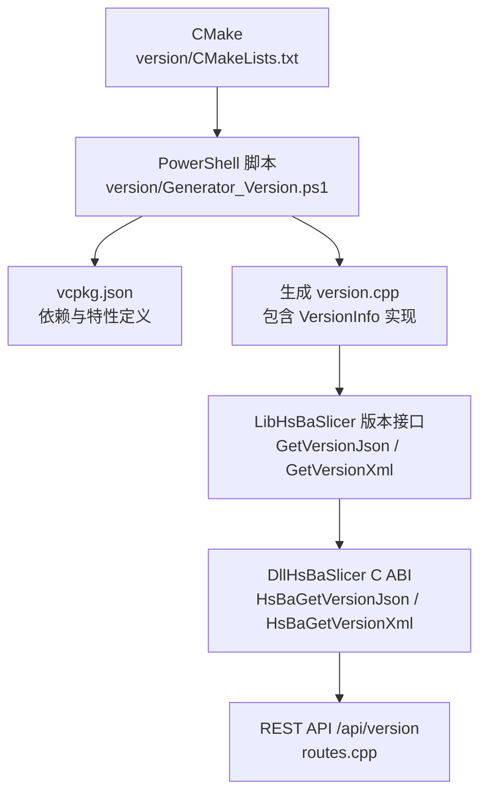
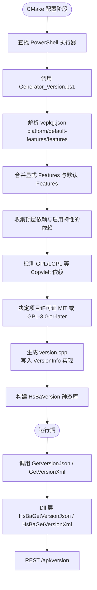
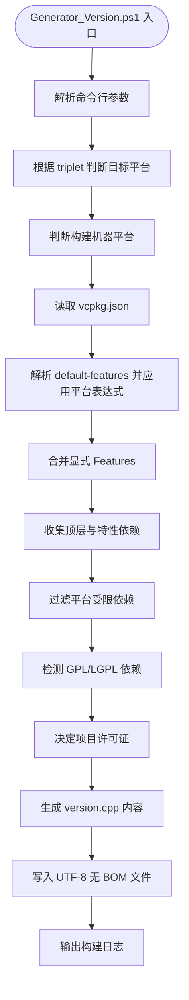
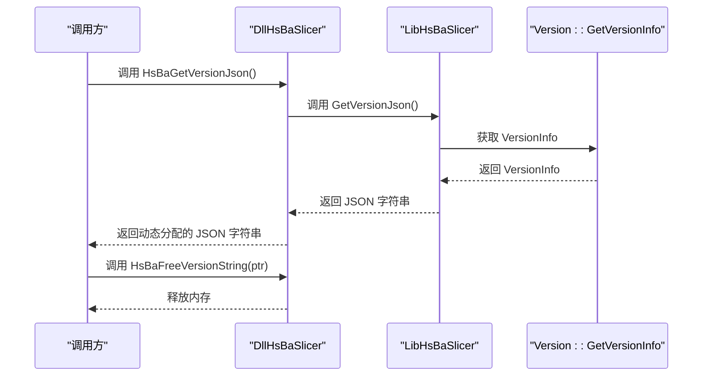
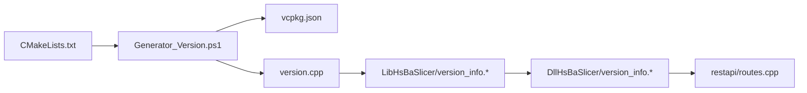

# 版本与许可证生成脚本

<cite>
**本文引用的文件**   
- [Generator_Version.ps1](file://version/Generator_Version.ps1)
- [CMakeLists.txt](file://version/CMakeLists.txt)
- [version.cpp.in](file://version/version.cpp.in)
- [vcpkg.json](file://vcpkg.json)
- [version_info.hpp](file://LibHsBaSlicer/version_info.hpp)
- [version_info.cpp](file://LibHsBaSlicer/version_info.cpp)
- [version_info.h](file://DllHsBaSlicer/version_info.h)
- [version_info.cpp](file://DllHsBaSlicer/version_info.cpp)
- [routes.cpp](file://restapi/routes.cpp)
</cite>

## 目录
1. [引言](#引言)
2. [项目结构](#项目结构)
3. [核心组件](#核心组件)
4. [架构总览](#架构总览)
5. [详细组件分析](#详细组件分析)
6. [依赖关系分析](#依赖关系分析)
7. [性能与构建特性](#性能与构建特性)
8. [故障排除指南](#故障排除指南)
9. [结论](#结论)

## 引言
本页面聚焦 HsBaSlicer 的「版本与许可证生成脚本」，说明 CMake 如何在配置阶段调用 PowerShell 脚本解析 `vcpkg.json`，动态决定项目许可证、目标平台、第三方库清单，并生成运行时可查询的版本信息。该机制同时暴露给 LibHsBaSlicer、DllHsBaSlicer 以及可选 REST API 服务使用，使版本、许可证与依赖信息在编译期确定、运行期可查。

## 项目结构
版本相关代码集中在 `version/` 目录，并通过 CMake 集成到整体构建；运行时查询接口分别位于 `LibHsBaSlicer` 与 `DllHsBaSlicer`，REST API 通过 `restapi/routes.cpp` 复用 Dll 层 C ABI。

**图表来源**
- [CMakeLists.txt:1-59](file://version/CMakeLists.txt#L1-L59)
- [Generator_Version.ps1:1-283](file://version/Generator_Version.ps1#L1-L283)
- [vcpkg.json:1-125](file://vcpkg.json#L1-L125)
- [version_info.hpp:1-30](file://LibHsBaSlicer/version_info.hpp#L1-L30)
- [version_info.cpp:1-43](file://DllHsBaSlicer/version_info.cpp#L1-L43)
- [routes.cpp:335-335](file://restapi/routes.cpp#L335-L335)

**章节来源**
- [CMakeLists.txt:1-59](file://version/CMakeLists.txt#L1-L59)
- [Generator_Version.ps1:1-283](file://version/Generator_Version.ps1#L1-L283)
- [vcpkg.json:1-125](file://vcpkg.json#L1-L125)

## 核心组件
- **CMake 集成层**：负责收集构建类型、vcpkg triplet、manifest features、配置时间，并调用 PowerShell 脚本生成 `version.cpp`。
- **PowerShell 生成器**：解析 `vcpkg.json`，计算启用的特性与依赖，判定 Copyleft 依赖，输出带版本、许可证、平台、第三方库列表的 `version.cpp`。
- **运行时版本接口**：Lib 层提供 C++ 接口返回 JSON/XML；Dll 层提供 C ABI 供外部语言或宿主程序调用。
- **REST API 集成**：可选 REST 服务通过 Dll 层 C ABI 暴露 `/api/version`。

**章节来源**
- [CMakeLists.txt:1-59](file://version/CMakeLists.txt#L1-L59)
- [Generator_Version.ps1:1-283](file://version/Generator_Version.ps1#L1-L283)
- [version_info.hpp:1-30](file://LibHsBaSlicer/version_info.hpp#L1-L30)
- [version_info.cpp:1-43](file://DllHsBaSlicer/version_info.cpp#L1-L43)
- [routes.cpp:335-335](file://restapi/routes.cpp#L335-L335)

## 架构总览
版本与许可证生成流程分为「配置期」和「运行期」两个阶段：

**图表来源**
- [CMakeLists.txt:1-59](file://version/CMakeLists.txt#L1-L59)
- [Generator_Version.ps1:1-283](file://version/Generator_Version.ps1#L1-L283)
- [vcpkg.json:1-125](file://vcpkg.json#L1-L125)
- [version_info.hpp:1-30](file://LibHsBaSlicer/version_info.hpp#L1-L30)
- [version_info.cpp:1-43](file://DllHsBaSlicer/version_info.cpp#L1-L43)
- [routes.cpp:335-335](file://restapi/routes.cpp#L335-L335)

## 详细组件分析

### CMake 配置阶段：version/CMakeLists.txt
CMake 在配置时完成以下工作：
- 设置 `VERSION_CPP_PATH` 为二进制目录下的 `version.cpp`。
- 读取 `CMAKE_BUILD_TYPE`、`VCPKG_TARGET_TRIPLET`、`VCPKG_MANIFEST_FEATURES`、`VCPKG_MANIFEST_NO_DEFAULT_FEATURES`。
- 记录配置时间戳。
- 查找 `pwsh` 或 `powershell`，未找到则直接失败。
- 执行 `Generator_Version.ps1`，传入输出路径、构建类型、triplet、JSON 路径、features、是否忽略默认特性。
- 将生成的 `version.cpp` 加入 `HsBaVersion` 静态库，并公开头文件目录。

关键行为要点：
- 若 PowerShell 不可用，构建会立即失败，避免生成不完整版本信息。
- 脚本执行结果非零时，CMake 报告错误并附带脚本输出与错误信息。
- `HsBaVersion` 依赖 `HsBaSlicerBase`，确保基础类型可用。

**章节来源**
- [CMakeLists.txt:1-59](file://version/CMakeLists.txt#L1-L59)

### PowerShell 生成器：version/Generator_Version.ps1
生成器是版本与许可证机制的核心，职责包括：

1. **参数处理**
   - 必填参数：输出路径、构建类型、目标平台占位、vcpkg triplet。
   - 可选参数：配置时间、`vcpkg.json` 路径、manifest features、是否忽略默认特性。

2. **目标平台判定**
   - 根据 triplet 匹配游戏主机、Android、iOS、macOS、Linux、Windows。
   - 无法识别时回退为 `Unknown`。

3. **构建机器平台判定**
   - 优先使用 `$IsWindows`、`$IsLinux`、`$IsMacOS`。
   - 旧版 PowerShell 或非 Core 环境回退到环境变量与 `uname`。

4. **vcpkg.json 解析**
   - 从指定路径或默认 `..\\vcpkg.json` 读取 JSON。
   - 维护常见库的许可证与主页映射表。
   - 解析 `default-features`，支持平台表达式 `|`、`&`、`!`。
   - 合并显式传入的 features（分号或逗号分隔）。
   - 去重后得到最终启用特性集合。

5. **依赖收集与许可证判定**
   - 收集顶层依赖与所有启用特性的依赖。
   - 对每个依赖应用平台条件表达式。
   - 若依赖许可证包含 GPL/LGPL 且不是双许可形式，则标记存在 Copyleft 依赖。
   - 根据是否存在 Copyleft 依赖决定项目许可证：MIT 或 GPL-3.0-or-later。

6. **生成 version.cpp**
   - 生成 `HsBa::Slicer::Version::GetVersionInfo()` 实现。
   - 字段包括库名、许可证、版本号、构建类型、构建平台、配置时间、vcpkg triplet、第三方库列表。
   - 第三方库列表由解析结果自动生成，避免手动维护遗漏。

7. **输出与日志**
   - 确保输出目录存在。
   - 以 UTF-8 无 BOM 编码写入文件。
   - 打印生成路径、构建类型、平台、triplet、启用的特性、项目许可证、配置时间。

**图表来源**
- [Generator_Version.ps1:1-283](file://version/Generator_Version.ps1#L1-L283)
- [vcpkg.json:1-125](file://vcpkg.json#L1-L125)

**章节来源**
- [Generator_Version.ps1:1-283](file://version/Generator_Version.ps1#L1-L283)

### vcpkg.json 与特性语义
`vcpkg.json` 定义了项目的依赖、默认特性与可选特性：

- 顶层 `license` 为 MIT，但实际构建许可证由生成器根据依赖判定。
- `default-features` 中的 `copyleft` 在 `windows | linux | osx | android` 默认启用。
- `features.copyleft` 引入 CGAL、libigl[cgal]、OpenCascade，并将 feature license 设为 GPL-3.0-or-later。
- `features.rest-api` 引入 cpp-httplib，用于可选 REST 服务，不在默认特性中。
- 依赖项可带 `platform` 表达式，生成器会完整求值 `|`、`&`、`!`。

重要语义：
- 启用 `copyleft` 会使项目许可证变为 GPL-3.0-or-later。
- 启用 `rest-api` 不会改变项目许可证，但会增加 HTTP 服务器依赖。
- 平台受限依赖（如 CGAL、OpenCascade）仅在允许的平台安装与链接。

**章节来源**
- [vcpkg.json:1-125](file://vcpkg.json#L1-L125)

### 运行时版本接口：LibHsBaSlicer
Lib 层提供 C++ 接口：

- `GetVersionJson()`：返回格式化 JSON。
- `GetVersionXml()`：返回 XML。
- 内部调用 `HsBa::Slicer::Version::GetVersionInfo()`，再通过 `struct_json` 与 `struct_xml` 序列化。

接口特点：
- 返回 `std::string`，调用方无需手动释放内存。
- 序列化格式稳定，便于测试与调试。
- 依赖 `version.hpp` 提供的 `VersionInfo` 结构。

**章节来源**
- [version_info.hpp:1-30](file://LibHsBaSlicer/version_info.hpp#L1-L30)
- [version_info.cpp:1-26](file://LibHsBaSlicer/version_info.cpp#L1-L26)

### 运行时版本接口：DllHsBaSlicer
Dll 层提供 C ABI：

- `HsBaGetVersionJson()`：返回动态分配的 UTF-8 JSON 字符串。
- `HsBaGetVersionXml()`：返回动态分配的 UTF-8 XML 字符串。
- `HsBaFreeVersionString()`：释放上述函数返回的字符串。

设计要点：
- 字符串由 `malloc` 分配，调用方必须使用 `free` 对应释放。
- 内部委托 Lib 层获取 JSON/XML，再复制为 C 字符串。
- 对外暴露稳定的 C ABI，适合 GUI、脚本、跨语言宿主调用。

**图表来源**
- [version_info.cpp:1-43](file://DllHsBaSlicer/version_info.cpp#L1-L43)
- [version_info.hpp:1-30](file://LibHsBaSlicer/version_info.hpp#L1-L30)

**章节来源**
- [version_info.h:1-48](file://DllHsBaSlicer/version_info.h#L1-L48)
- [version_info.cpp:1-43](file://DllHsBaSlicer/version_info.cpp#L1-L43)

### REST API 集成：/api/version
可选 REST 服务通过 `restapi/routes.cpp` 调用 Dll 层 C ABI 暴露版本信息：

- 端点 `/api/version` 返回库版本。
- 根据请求格式协商选择 JSON 或 XML。
- 底层调用 `HsBaGetVersionJson` 或 `HsBaGetVersionXml`。

注意：
- REST API 属于可选模块，需启用相应 CMake 选项与 vcpkg manifest feature。
- 版本端点不修改状态，仅查询构建期生成的版本信息。

**章节来源**
- [routes.cpp:335-335](file://restapi/routes.cpp#L335-L335)

## 依赖关系分析
版本与许可证生成涉及多层依赖：

依赖耦合说明：
- CMake 强依赖 PowerShell 执行器。
- PowerShell 强依赖 `vcpkg.json` 结构与许可证映射表。
- Lib 层依赖 `Version::GetVersionInfo`。
- Dll 层依赖 Lib 层。
- REST 层依赖 Dll 层 C ABI。

潜在风险：
- `vcpkg.json` 结构变化可能影响生成逻辑。
- 新增第三方库需在许可证映射表中登记，否则不会出现在版本信息中。
- 若禁用 PowerShell，构建会失败。

**图表来源**
- [CMakeLists.txt:1-59](file://version/CMakeLists.txt#L1-L59)
- [Generator_Version.ps1:1-283](file://version/Generator_Version.ps1#L1-L283)
- [vcpkg.json:1-125](file://vcpkg.json#L1-L125)
- [version_info.hpp:1-30](file://LibHsBaSlicer/version_info.hpp#L1-L30)
- [version_info.cpp:1-43](file://DllHsBaSlicer/version_info.cpp#L1-L43)
- [routes.cpp:335-335](file://restapi/routes.cpp#L335-L335)

**章节来源**
- [CMakeLists.txt:1-59](file://version/CMakeLists.txt#L1-L59)
- [Generator_Version.ps1:1-283](file://version/Generator_Version.ps1#L1-L283)
- [vcpkg.json:1-125](file://vcpkg.json#L1-L125)

## 性能与构建特性
- **配置期开销**：PowerShell 启动与 JSON 解析发生在 CMake 配置阶段，不影响编译期增量构建。
- **生成频率**：每次 CMake 重新配置都会重新生成 `version.cpp`，确保版本信息与当前构建一致。
- **平台判定复杂度**：平台表达式解析为线性扫描，依赖数量通常较小，性能可忽略。
- **许可证判定**：基于预维护的许可证映射表，时间复杂度与依赖数量线性相关。
- **运行时查询**：JSON/XML 序列化开销极小，适合频繁查询。

优化建议：
- 若频繁切换 vcpkg triplet 或 features，应清理 CMake 缓存以避免旧版本信息残留。
- 新增第三方库时同步更新许可证映射表，避免版本信息缺失。
- 对大型 CI 场景，可缓存 `vcpkg.json` 解析结果以减少重复解析。

[本节为通用指导，不直接分析具体源码文件]

## 故障排除指南

常见问题与排查步骤：

1. **PowerShell 未找到**
   - 现象：CMake 报错提示找不到 PowerShell。
   - 原因：系统未安装 `pwsh` 或 `powershell`。
   - 解决：安装 PowerShell 并确保 PATH 可找到执行器。

2. **vcpkg.json 未找到或解析失败**
   - 现象：生成脚本警告无法解析 `vcpkg.json`。
   - 原因：路径错误或 JSON 格式非法。
   - 解决：检查 `CMAKE_SOURCE_DIR/vcpkg.json` 是否存在且语法正确。

3. **许可证不符合预期**
   - 现象：项目许可证显示 GPL-3.0-or-later，但期望 MIT。
   - 原因：启用了 `copyleft` 特性或依赖中包含 GPL/LGPL。
   - 解决：关闭 `copyleft` 特性，或移除/替换 Copyleft 依赖。

4. **第三方库未出现在版本信息中**
   - 现象：版本信息缺少某个依赖。
   - 原因：未在许可证映射表中登记该库。
   - 解决：在 `Generator_Version.ps1` 的库信息映射中添加许可证与主页。

5. **REST API 版本端点不可用**
   - 现象：访问 `/api/version` 返回 404 或服务未启动。
   - 原因：未启用 REST API 相关 CMake 选项或 vcpkg feature。
   - 解决：启用 `HSBA_BUILD_REST_API=ON` 与 `rest-api` manifest feature。

**章节来源**
- [CMakeLists.txt:24-48](file://version/CMakeLists.txt#L24-L48)
- [Generator_Version.ps1:116-236](file://version/Generator_Version.ps1#L116-L236)
- [Generator_Version.ps1:238-283](file://version/Generator_Version.ps1#L238-L283)
- [routes.cpp:335-335](file://restapi/routes.cpp#L335-L335)

## 结论
HsBaSlicer 的版本与许可证生成机制通过 CMake 与 PowerShell 协作，将 `vcpkg.json` 的结构化依赖与特性声明转化为运行时可查询的版本信息。该机制实现了：
- 构建期自动判定目标平台与许可证。
- 自动生成第三方库清单。
- 统一暴露 Lib C++ 接口与 Dll C ABI。
- 可选 REST API 复用同一数据源。

这种设计降低了人工维护成本，提升了构建可追溯性，并为多平台、多特性组合提供了稳定一致的版本与许可证查询能力。

[本节为总结性内容，不直接分析具体源码文件]