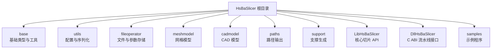
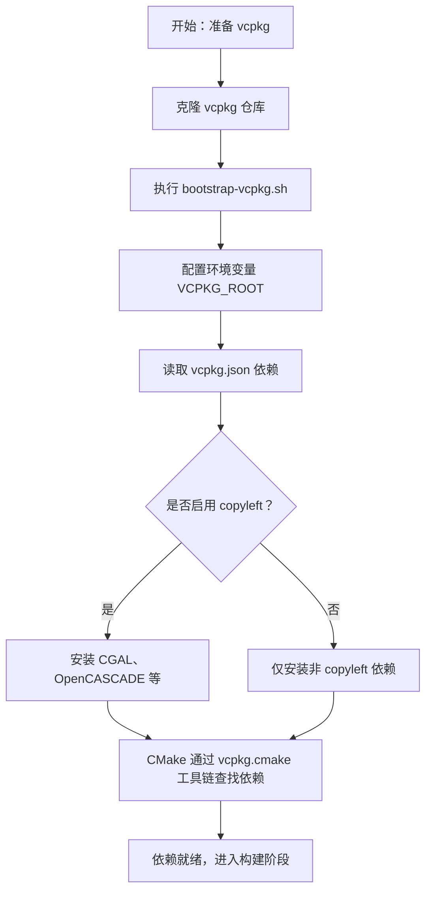
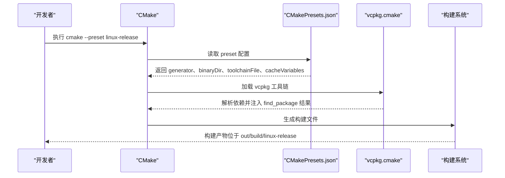
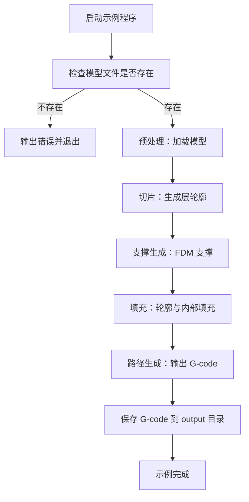

# 快速开始

<cite>
**本文引用的文件**   
- [README.md](file://README.md)
- [CMakeLists.txt](file://CMakeLists.txt)
- [CMakePresets.json](file://CMakePresets.json)
- [vcpkg.json](file://vcpkg.json)
- [vcpkg-configuration.json](file://vcpkg-configuration.json)
- [samples/LibHsBaSlicer/CMakeLists.txt](file://samples/LibHsBaSlicer/CMakeLists.txt)
- [samples/LibHsBaSlicer/main_header.cpp](file://samples/LibHsBaSlicer/main_header.cpp)
- [samples/LibHsBaSlicer/main_module.cpp](file://samples/LibHsBaSlicer/main_module.cpp)
</cite>

## 目录
1. [简介](#简介)
2. [环境要求](#环境要求)
3. [项目结构概览](#项目结构概览)
4. [安装与依赖管理](#安装与依赖管理)
5. [构建 HsBaSlicer](#构建-hsbaslicer)
6. [使用 CMake 预设](#使用-cmake-预设)
7. [集成示例：在项目中引用 HsBaSlicer](#集成示例在项目中引用-hsbaslicer)
8. [运行第一个示例程序](#运行第一个示例程序)
9. [常见问题与故障排除](#常见问题与故障排除)
10. [性能与构建建议](#性能与构建建议)
11. [结论](#结论)

## 简介
HsBaSlicer 是一个面向 3D 打印切片领域的高性能 C++ 框架，提供模块化、跨平台的切片核心能力，适用于研发与生产级别的切片流水线。它同时暴露两种主要使用方式：
- 动态库接口：`DllHsBaSlicer`，导出 C ABI，适合外部语言或插件化调用。
- C++ 静态/共享库接口：`LibHsBaSlicer`，封装完整切片流程，适合直接嵌入 C++ 应用。

本快速开始指南的目标是帮助你在最短时间内完成环境准备、依赖安装、项目构建，并成功运行一个 FDM 切片示例。

**章节来源**
- [README.md:21-39](file://README.md#L21-L39)

## 环境要求
### 必需工具
- CMake 版本不低于 3.28。
- 支持 C++20 的编译器。
- vcpkg 依赖管理器。
- PowerShell（Windows 下建议使用 PowerShell 7；Windows PowerShell 5.1 也可用）。

### 平台说明
- Windows：建议使用 Visual Studio 2022 或更高版本，勾选“使用 C++ 的桌面开发”、CMake 工具和 vcpkg，并安装 Git。
- Linux/macOS：需要系统包管理器提供的编译工具链、Ninja、pkg-config 等基础工具。
- Android/iOS：Android 通常在 Linux 环境下构建，需安装 Android SDK/NDK 并设置 `ANDROID_NDK_HOME`；iOS 在 CI 上已验证，macOS 本地构建未进行广泛测试。

**章节来源**
- [README.md:41-98](file://README.md#L41-L98)
- [CMakeLists.txt:4-38](file://CMakeLists.txt#L4-L38)

## 项目结构概览
HsBaSlicer 采用多模块组织方式，常见关键目录如下：
- `base`：基础类型、模板辅助、单例、线程池、静态反射等。
- `utils`：配置、序列化、Lua 绑定等辅助模块。
- `fileoperator`：ZIP、SQLite、配置树、Lua 适配器。
- `meshmodel`：网格模型后端（CGAL / IGL）。
- `cadmodel`：基于 OpenCascade 的 B-Rep 与布尔运算。
- `paths`：层路径、点路径、机器人路径输出。
- `support`：FDM/SLA 支撑生成与悬垂检测。
- `LibHsBaSlicer`：核心切片接口集合。
- `DllHsBaSlicer`：导出 C ABI 的运行时流水线接口。
- `samples`：多种切片场景示例，包括 FDM、SLA、SLS、SLM、LOM、TDP、WAAM 以及 LibHsBaSlicer 直接使用示例。



**图表来源**
- [README.md:25-39](file://README.md#L25-L39)

**章节来源**
- [README.md:25-39](file://README.md#L25-L39)

## 安装与依赖管理
### 安装 vcpkg
推荐使用 vcpkg 管理第三方依赖。Linux/macOS 可参考以下流程：
1. 克隆 vcpkg 仓库。
2. 执行 bootstrap 脚本初始化 vcpkg。
3. 将 vcpkg 路径加入环境变量，以便 CMake 通过工具链文件找到依赖。

Windows 用户建议在 Visual Studio 中启用 vcpkg 集成，或在命令行中将 vcpkg 路径加入 PATH。

### vcpkg 清单与特性
项目的依赖定义位于 `vcpkg.json`，默认启用了 copyleft 特性，从而引入 CGAL、OpenCASCADE 等组件。若你希望避免 GPL/LGPL 内核，可以在构建时关闭该特性，但需要注意这会影响布尔运算、CAD 模型等功能。

`vcpkg-configuration.json` 指定了 vcpkg 注册表、基线版本、覆盖端口和三元组目录，便于团队统一依赖版本。



**图表来源**
- [vcpkg.json:1-113](file://vcpkg.json#L1-L113)
- [vcpkg-configuration.json:1-21](file://vcpkg-configuration.json#L1-L21)

**章节来源**
- [README.md:72-86](file://README.md#L72-L86)
- [vcpkg.json:1-113](file://vcpkg.json#L1-L113)
- [vcpkg-configuration.json:1-21](file://vcpkg-configuration.json#L1-L21)

## 构建 HsBaSlicer
### Windows 构建步骤
1. 安装 Visual Studio 2022 或更高版本，勾选“使用 C++ 的桌面开发”、CMake 工具、Git。
2. 安装 vcpkg，并将 `VCPKG_ROOT` 设置为 vcpkg 安装路径。
3. 推荐直接使用 CMake 预设 `windows-release` 进行发布构建。
4. 如果包含 CGAL 子模块，`windows-debug` 可能遇到问题，建议优先使用 release 预设。

典型命令（以 PowerShell 为例）：
- 配置：`cmake --preset windows-release`
- 构建：`cmake --build out/build/windows-release --config Release`
- 安装：`cmake --install out/install/windows-release --prefix <你的安装目录>`

### Linux/macOS 构建步骤
1. 安装系统依赖（Ubuntu/Debian 示例见 README）。
2. 安装 vcpkg 并设置 `VCPKG_ROOT`。
3. 使用 CMake 预设 `linux-release` 或 `macos-release`。
4. 构建完成后，可通过 `cmake --install` 安装到指定前缀。

典型命令：
- 配置：`cmake --preset linux-release`
- 构建：`cmake --build out/build/linux-release --config Release`
- 安装：`cmake --install out/install/linux-release --prefix <你的安装目录>`

**章节来源**
- [README.md:57-94](file://README.md#L57-L94)
- [CMakePresets.json:1-205](file://CMakePresets.json#L1-L205)

## 使用 CMake 预设
项目提供了多个预设，用于简化不同平台和构建类型的配置。常用预设包括：
- `windows-base`：Windows 基础预设，使用 Ninja 生成器，设置 MSVC 编译器。
- `x64-debug` / `x64-release`：Windows x64 调试与发布。
- `linux-debug` / `linux-release`：Linux 调试与发布。
- `macos-debug` / `macos-release`：macOS 调试与发布。
- `ios-release`：iOS 发布（Xcode 生成器）。
- `android-release`：Android arm64 发布（需设置 `ANDROID_NDK_HOME`）。
- `linux-coverage`：Linux 覆盖率构建，启用 gcov/gcovr 覆盖率门控。

预设会自动设置：
- 生成器（Ninja 或 Xcode）。
- 二进制目录与安装目录。
- vcpkg 工具链文件路径。
- 构建类型（Debug/Release）。
- 平台相关变量（如 Android NDK、iOS 架构与部署目标）。



**图表来源**
- [CMakePresets.json:1-205](file://CMakePresets.json#L1-L205)

**章节来源**
- [CMakePresets.json:1-205](file://CMakePresets.json#L1-L205)

## 集成示例：在项目中引用 HsBaSlicer
### 安装后通过 find_package 引用
项目通过 `cmake --install` 导出完整的 CMake 配置。安装后，下游项目可使用 `find_package(HsBaSlicer CONFIG REQUIRED)` 查找包，并通过命名空间 `HsBaSlicer::` 引用目标。

例如：
- 动态库目标：`HsBaSlicer::DllHsBaSlicer`
- C++ 全流程库目标：`HsBaSlicer::LibHsBaSlicer`

安装命令示例：
```bash
cmake --install <构建目录> --prefix <安装前缀> --config Release
```

下游 CMake 示例：
```cmake
find_package(HsBaSlicer CONFIG REQUIRED)
target_link_libraries(my_app PRIVATE HsBaSlicer::DllHsBaSlicer)
```

### 头文件布局
安装后的公共头文件位于 `<install_prefix>/include/HsBaSlicer/`，包含：
- `dllexport.h`：DllHsBaSlicer C API。
- `fdm_pipeline.h`、`sla_pipeline.h`、`initialize.h`、`version.hpp` 等。
- `LibHsBaSlicer/` 下的核心切片 API。
- `2D/`、`meshmodel/`、`support/`、`paths/`、`proto/` 等模块头文件。

### 直接链接 LibHsBaSlicer（不安装）
如果你不想安装 HsBaSlicer，也可以直接在当前工程中链接 `LibHsBaSlicer` 目标。示例工程 `samples/LibHsBaSlicer` 展示了如何添加可执行目标并链接该库。

**章节来源**
- [README.md:100-179](file://README.md#L100-L179)
- [CMakeLists.txt:456-665](file://CMakeLists.txt#L456-L665)
- [samples/LibHsBaSlicer/CMakeLists.txt:1-38](file://samples/LibHsBaSlicer/CMakeLists.txt#L1-L38)

## 运行第一个示例程序
项目提供了两个 LibHsBaSlicer 直接使用示例：
- `lib_sample_header`：传统头文件方式，演示 FDM 完整切片流程。
- `lib_sample_module`：C++20 模块方式，演示基于类的流水线 API 与可选 Lua 自定义流水线。

### 前置条件
- 确保已构建 samples（默认开启 `HSBA_SLICER_BUILD_SAMPLES=ON`）。
- 示例会复制 Stanford Bunny STL 模型到输出目录的 `models/` 文件夹。
- 模块示例还会复制 `samples/Custom/scripts` 中的 Lua 脚本。

### 运行步骤
1. 构建项目（使用预设或手动配置）。
2. 进入对应输出目录：
   - Windows：`out/build/windows-release/bin/Release`
   - Linux/macOS：`out/build/linux-release/bin/Release` 或 `out/build/macos-release/bin/Release`
3. 运行示例程序：
   - `lib_sample_header.exe`（Windows）或 `lib_sample_header`（Linux/macOS）
   - `lib_sample_module.exe`（Windows）或 `lib_sample_module`（Linux/macOS）

### 示例行为
- 传统头文件示例会执行预处理、切片、支撑生成、填充、路径生成，最终输出 G-code 到 `output/lib_header_sample.gcode`。
- 模块示例会创建 `Model`，配置 `FdmPipeline`，运行完整流水线，输出 `output/lib_module_sample.gcode`；如果存在 `scripts/my_fdm_pipeline.lua`，还会运行自定义 Lua 流水线，输出 `output/lib_module_lua.gcode`。



**图表来源**
- [samples/LibHsBaSlicer/main_header.cpp:46-184](file://samples/LibHsBaSlicer/main_header.cpp#L46-L184)
- [samples/LibHsBaSlicer/main_module.cpp:31-160](file://samples/LibHsBaSlicer/main_module.cpp#L31-L160)

**章节来源**
- [samples/LibHsBaSlicer/CMakeLists.txt:40-71](file://samples/LibHsBaSlicer/CMakeLists.txt#L40-L71)
- [samples/LibHsBaSlicer/main_header.cpp:1-186](file://samples/LibHsBaSlicer/main_header.cpp#L1-L186)
- [samples/LibHsBaSlicer/main_module.cpp:1-162](file://samples/LibHsBaSlicer/main_module.cpp#L1-L162)

## 常见问题与故障排除
### CMake 版本过低
- 现象：配置失败，提示 CMake 版本不满足最低要求。
- 原因：项目要求 CMake >= 3.28。
- 解决：升级 CMake 到 3.28 或更高版本。

**章节来源**
- [CMakeLists.txt:4-4](file://CMakeLists.txt#L4-L4)

### 编译器不支持 C++20 特性
- 现象：配置阶段报错，提示缺少 concepts、ranges、source_location、template-template parameter matching 等特性。
- 原因：编译器版本过旧或未启用 C++20。
- 解决：使用支持 C++20 的编译器（MSVC 19.34+、GCC 14+、Clang 16+），并在 CMake 中启用 C++20。

**章节来源**
- [CMakeLists.txt:17-38](file://CMakeLists.txt#L17-L38)
- [CMakeLists.txt:48-86](file://CMakeLists.txt#L48-L86)

### vcpkg 依赖未找到
- 现象：`find_package` 找不到 Boost、Protobuf、Eigen3、RapidJSON、miniz、OpenSSL、yaml-cpp、tinyxml2、magic_enum、sqlpp11、lua 等依赖。
- 原因：未正确安装 vcpkg 或未通过工具链文件传递依赖。
- 解决：
  - 确认已执行 vcpkg bootstrap。
  - 设置 `VCPKG_ROOT` 环境变量。
  - 使用预设或手动传入 `-DCMAKE_TOOLCHAIN_FILE=<vcpkg_root>/scripts/buildsystems/vcpkg.cmake`。

**章节来源**
- [CMakeLists.txt:206-349](file://CMakeLists.txt#L206-L349)
- [CMakePresets.json:10-10](file://CMakePresets.json#L10-L10)

### Windows Debug 构建包含 CGAL 时出现问题
- 现象：`windows-debug` 在包含 CGAL 的子模块时可能失败。
- 原因：CGAL 在 Debug 模式下可能较慢且内存占用高，项目已在 Debug 配置中禁用布尔运算。
- 解决：优先使用 `windows-release` 预设；如需 Debug，注意减少复杂几何操作。

**章节来源**
- [README.md:57-62](file://README.md#L57-L62)
- [CMakeLists.txt:294-298](file://CMakeLists.txt#L294-L298)

### Android/iOS 构建失败
- 现象：NDK 或 iOS 工具链未正确配置。
- 原因：未设置 `ANDROID_NDK_HOME` 或 iOS 部署目标不正确。
- 解决：
  - Android：设置 `ANDROID_NDK_HOME`，并使用 `android-release` 预设。
  - iOS：在 macOS 上使用 `ios-release` 预设，并确保 Xcode 工具链可用。

**章节来源**
- [README.md:96-98](file://README.md#L96-L98)
- [CMakePresets.json:112-205](file://CMakePresets.json#L112-L205)

### 许可证与 copyleft 内核
- 现象：构建包含 CGAL/OpenCASCADE 时，项目许可证变为 GPL-3.0-or-later。
- 原因：默认启用 `copyleft` 特性，引入 GPL/LGPL 内核。
- 解决：若不希望使用 copyleft 内核，可在 vcpkg 配置中关闭该特性，但会失去布尔运算与 CAD 模型功能。

**章节来源**
- [README.md:192-211](file://README.md#L192-L211)
- [vcpkg.json:89-110](file://vcpkg.json#L89-L110)

## 性能与构建建议
- 发布构建优先：Release 模式可获得更好的性能与更小的二进制体积。
- 避免 Debug 下复杂布尔运算：项目在 Debug 配置中禁用布尔运算以降低内存与时间开销。
- 合理使用样本与文档：构建时可关闭 `HSBA_SLICER_BUILD_SAMPLES` 与 `HSBA_SLICER_BUILD_DOCS` 以缩短构建时间。
- 覆盖率构建：Linux 下可使用 `linux-coverage` 预设进行覆盖率门控，适合 CI 质量门禁。

**章节来源**
- [CMakeLists.txt:294-298](file://CMakeLists.txt#L294-L298)
- [CMakePresets.json:84-110](file://CMakePresets.json#L84-L110)

## 结论
通过本快速开始指南，你应该已经完成了 HsBaSlicer 的环境准备、依赖安装、项目构建，并成功运行了第一个 FDM 切片示例。接下来，你可以：
- 使用 `LibHsBaSlicer` 直接嵌入 C++ 应用。
- 使用 `DllHsBaSlicer` 暴露 C ABI 给其他语言或插件系统。
- 根据业务需求扩展 Lua 自定义流水线或工艺参数存储。
- 在 CI 中使用预设与覆盖率构建保障代码质量。

如果在构建过程中遇到依赖缺失、编译器特性不足或平台工具链问题，请参考“常见问题与故障排除”部分逐步排查。