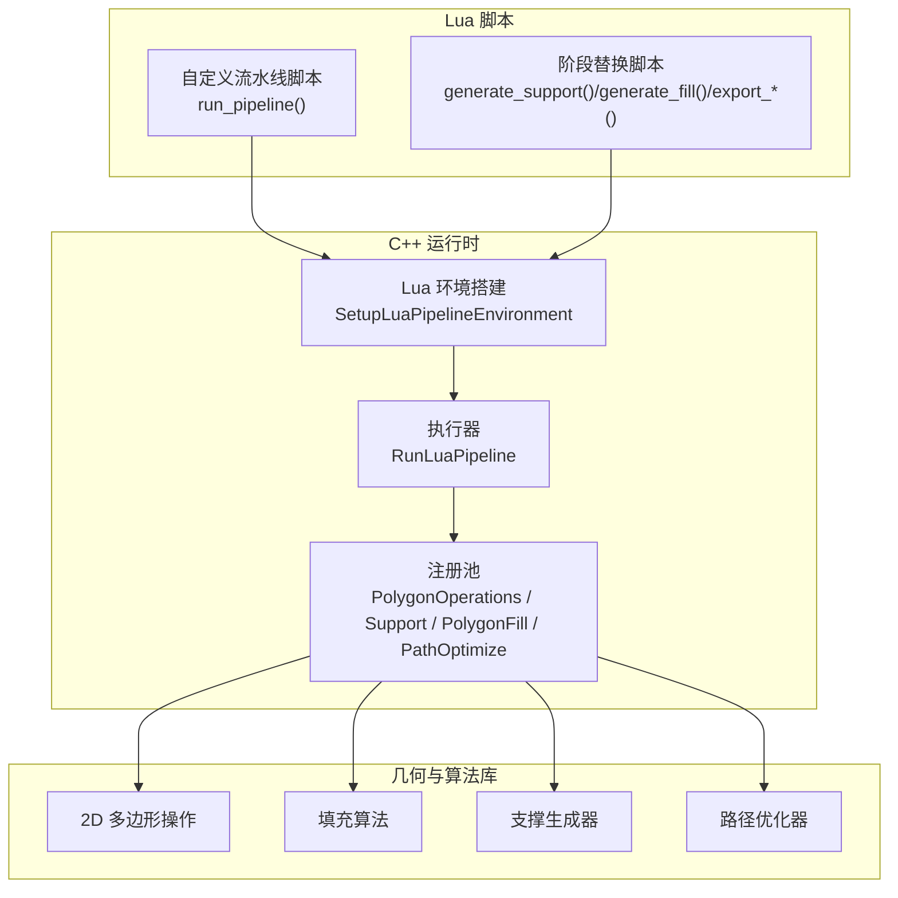
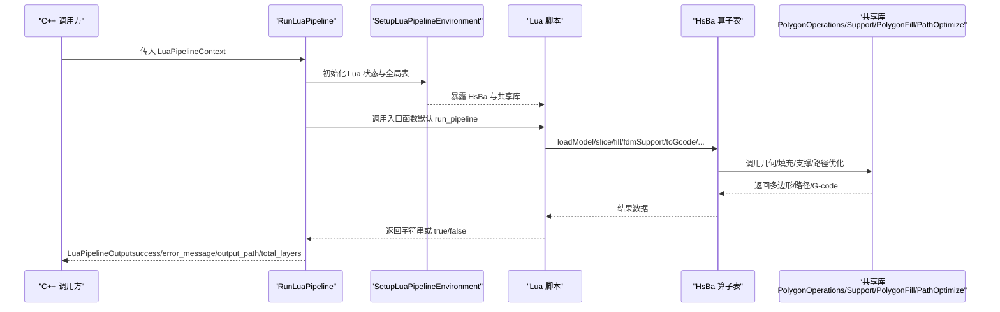
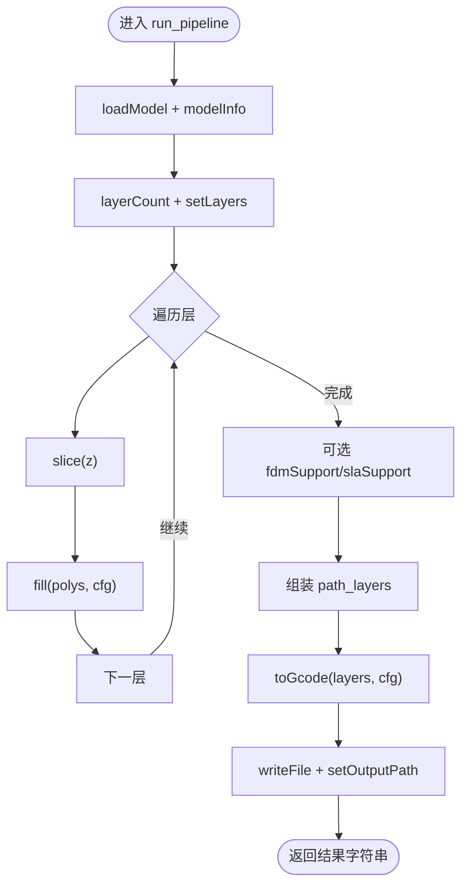
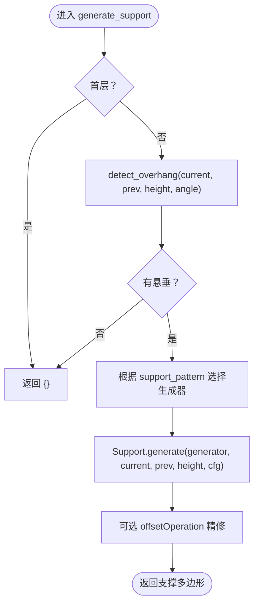
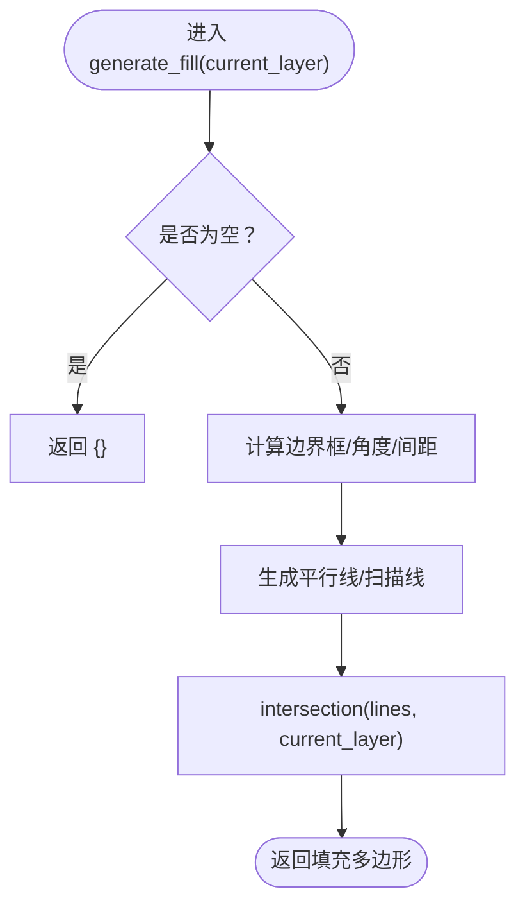
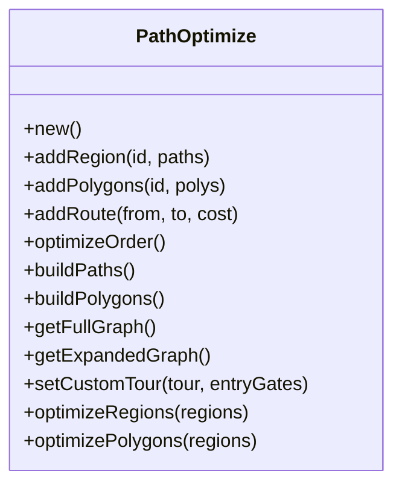
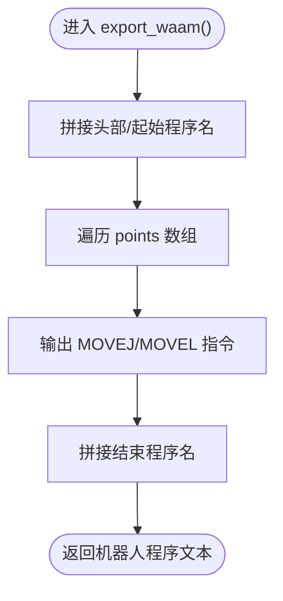
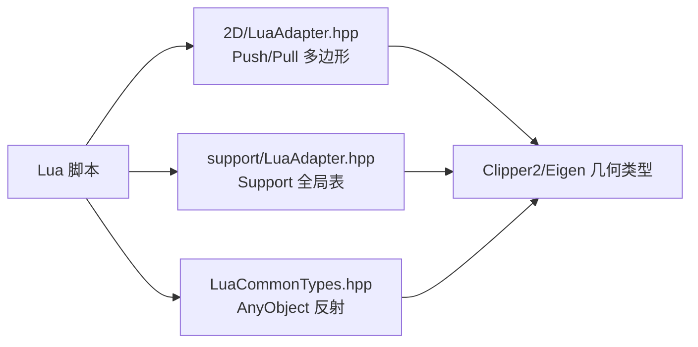

# Lua 扩展开发

<cite>
**本文引用的文件**   
- [docs/zh/lua_pipeline_api.md](file://docs/zh/lua_pipeline_api.md)
- [LibHsBaSlicer/Extends/lua_pipeline.hpp](file://LibHsBaSlicer/Extends/lua_pipeline.hpp)
- [support/LuaSupport.hpp](file://support/LuaSupport.hpp)
- [2D/LuaAdapter.hpp](file://2D/LuaAdapter.hpp)
- [support/LuaAdapter.hpp](file://support/LuaAdapter.hpp)
- [LibHsBaSlicer/Extends/LuaCommonTypes.hpp](file://LibHsBaSlicer/Extends/LuaCommonTypes.hpp)
- [samples/Custom/scripts/my_fdm_pipeline.lua](file://samples/Custom/scripts/my_fdm_pipeline.lua)
- [samples/FDM/scripts/my_infill.lua](file://samples/FDM/scripts/my_infill.lua)
- [samples/FDM/scripts/my_support.lua](file://samples/FDM/scripts/my_support.lua)
- [samples/SLA/scripts/my_sla_support.lua](file://samples/SLA/scripts/my_sla_support.lua)
- [samples/WAAM/scripts/my_waam_path.lua](file://samples/WAAM/scripts/my_waam_path.lua)
- [tests/PolygonFill/custom_fill.lua](file://tests/PolygonFill/custom_fill.lua)
- [tests/PolygonFill/optimize_paths.lua](file://tests/PolygonFill/optimize_paths.lua)
</cite>

## 目录
1. [引言](#引言)
2. [项目结构](#项目结构)
3. [核心概念](#核心概念)
4. [架构总览](#架构总览)
5. [详细组件分析](#详细组件分析)
6. [依赖关系分析](#依赖关系分析)
7. [性能与内存管理](#性能与内存管理)
8. [调试与错误处理](#调试与错误处理)
9. [常见问题与排错](#常见问题与排错)
10. [结论](#结论)
11. [附录：脚本示例索引](#附录脚本示例索引)

## 引言
本指南面向希望在 HsBaSlicer 中编写 Lua 扩展的开发者，系统说明 Lua 脚本在切片流水线中的角色、可用 API、数据交互机制以及常见扩展场景（填充算法、支撑生成、路径优化）的实现模式。文档同时解释 Lua 与 C++ 的对象绑定、类型反射、内存管理与性能优化技巧，并提供从简单数据处理到复杂算法实现的脚本示例参考。

## 项目结构
HsBaSlicer 将 Lua 扩展能力拆分为「自定义流水线环境」和「内置流水线阶段替换」两类：
- 自定义流水线：由脚本完全控制加载模型、切片、支撑、填充、路径生成与写文件的顺序；C++ 仅负责构建 Lua 运行环境与调用入口函数。
- 内置流水线阶段替换：仅在特定阶段（支撑、填充、地板、导出）注入少量全局变量并调用约定函数，阶段顺序仍由 C++ 固定。

**图示来源**
- [LibHsBaSlicer/Extends/lua_pipeline.hpp:29-83](file://LibHsBaSlicer/Extends/lua_pipeline.hpp#L29-L83)
- [docs/zh/lua_pipeline_api.md:19-28](file://docs/zh/lua_pipeline_api.md#L19-L28)

**章节来源**
- [docs/zh/lua_pipeline_api.md:19-28](file://docs/zh/lua_pipeline_api.md#L19-L28)
- [LibHsBaSlicer/Extends/lua_pipeline.hpp:29-83](file://LibHsBaSlicer/Extends/lua_pipeline.hpp#L29-L83)

## 核心概念
- 两种 Lua 运行环境
  - 自定义流水线：拥有完整 `HsBa` 算子表与上下文全局变量（如 `pipeline_config`、`model_name`、`output_path`），脚本自行编排全流程。
  - 内置阶段替换：仅注入当前阶段所需的全局变量与函数，例如支撑阶段的 `current_layer`、`prev_layer`、`layer_height`、`config`，以及填充阶段的 `generate_fill(current_layer)` 约定。

- 通用几何数据类型
  - 点：`{ x = number, y = number }`
  - 多边形：点的有序数组，表示闭合轮廓
  - 多边形集合：多边形的数组；孔洞作为独立多边形存在
  - 层列表：逐层的多边形集合数组
  - 3D 点：`{ x, y, z }`，用于螺旋路径等输出

- 整数化与浮点转换
  - 内部布尔/填充运算按整数精度处理；`HsBa.toInt` / `HsBa.toDouble` 用于整型与浮点多边形之间的转换。
  - `PolygonOperations`、`PolygonFill` 接收并返回整型化数据；`HsBa.slice` / `HsBa.fill` 返回浮点多边形表。

**章节来源**
- [docs/zh/lua_pipeline_api.md:32-45](file://docs/zh/lua_pipeline_api.md#L32-L45)

## 架构总览
下图展示自定义流水线与内置阶段替换在运行时的调用链路与数据流。

**图示来源**
- [LibHsBaSlicer/Extends/lua_pipeline.hpp:53-83](file://LibHsBaSlicer/Extends/lua_pipeline.hpp#L53-L83)
- [docs/zh/lua_pipeline_api.md:48-54](file://docs/zh/lua_pipeline_api.md#L48-L54)

## 详细组件分析

### 自定义流水线环境（HsBa 算子表）
- 入口函数
  - 默认入口名为 `run_pipeline`，可由 C++ 侧的 `pipeline_entry` 覆盖。
  - 返回非空字符串 → 成功；返回 `true` → 成功但无结果文本；返回 `false`/`nil` 或抛出 Lua 错误 → 失败。

- 上下文全局变量
  - `pipeline_config`：JSON 配置字符串
  - `output_path`：默认输出路径
  - `model_name`：模型名
  - `model_path`：模型文件路径
  - `pipeline_entry`：入口函数名

- 控制与文件 IO
  - `HsBa.progress(percent[, stage])`：上报进度
  - `HsBa.setLayers(n)`：上报总层数
  - `HsBa.setOutputPath(path)`：上报实际输出路径
  - `HsBa.readFile(path)` / `HsBa.writeFile(path, content)`：文件读写

- 模型管理
  - `HsBa.loadModel(name, path)`：加载模型到模型池
  - `HsBa.modelInfo(name)`：返回包围盒与体积信息
  - `HsBa.translateModel/rotateModel/scaleModel/removeModel/modelNames`：变换与查询

- 切片与坐标转换
  - `HsBa.layerCount/name/z`：计算层数与 Z 高度
  - `HsBa.slice/sliceUnsafe`：安全/非安全切片
  - `HsBa.toInt/double`：整型/浮点多边形互转

- 填充与支撑
  - `HsBa.fill(polygons[, cfg])`：填充，cfg 包含 spacing/angle/mode/borderCount
  - `HsBa.fdmSupport(layers, cfg)` / `HsBa.slaSupport(layers, cfg)`：FDM/SLA 支撑
  - `HsBa.floor(bottomPolygons, cfg)`：SLA 底部地板/raft

- 路径与 G-code
  - `HsBa.spiralize(sections[, cfg])`：连续 3D 螺旋路径
  - `HsBa.toGcode(layers, cfg)`：生成 G-code

- 打包与导出
  - `HsBa.saveSlsPackage/saveWaamPackage/saveSlaPackage/renderImage`：打包图像/机器人程序/渲染图像

**图示来源**
- [samples/Custom/scripts/my_fdm_pipeline.lua:52-170](file://samples/Custom/scripts/my_fdm_pipeline.lua#L52-L170)
- [docs/zh/lua_pipeline_api.md:55-133](file://docs/zh/lua_pipeline_api.md#L55-L133)

**章节来源**
- [docs/zh/lua_pipeline_api.md:48-133](file://docs/zh/lua_pipeline_api.md#L48-L133)
- [samples/Custom/scripts/my_fdm_pipeline.lua:52-170](file://samples/Custom/scripts/my_fdm_pipeline.lua#L52-L170)

### 内置阶段替换：支撑生成
- 环境注入
  - 全局变量：`current_layer`、`prev_layer`、`layer_height`、`config`
  - 约定入口函数：`generate_support()`，返回支撑截面多边形表
  - 可用库：`PolygonOperations`、`Support`

- 典型流程
  - 使用 `Support.detect_overhang` 检测悬垂区域
  - 根据 `config.support_pattern` 选择生成器（平面/树状/蜂窝/SLA）
  - 通过 `Support.generate` 生成支撑，并可进一步用 `offsetOperation` 精修接触面

**图示来源**
- [support/LuaSupport.hpp:21-39](file://support/LuaSupport.hpp#L21-L39)
- [samples/FDM/scripts/my_support.lua:32-79](file://samples/FDM/scripts/my_support.lua#L32-L79)
- [samples/SLA/scripts/my_sla_support.lua:34-72](file://samples/SLA/scripts/my_sla_support.lua#L34-L72)

**章节来源**
- [support/LuaSupport.hpp:21-39](file://support/LuaSupport.hpp#L21-L39)
- [samples/FDM/scripts/my_support.lua:32-79](file://samples/FDM/scripts/my_support.lua#L32-L79)
- [samples/SLA/scripts/my_sla_support.lua:34-72](file://samples/SLA/scripts/my_sla_support.lua#L34-L72)

### 内置阶段替换：填充算法
- 约定入口函数：`generate_fill(current_layer)`，参数为已扣除壁厚区域的当前层多边形，返回填充多边形表。
- 该阶段不注入任何全局变量，请使用脚本内默认值。
- 可用库：`PolygonOperations`、`PolygonFill`、`PathOptimize`。

**图示来源**
- [samples/FDM/scripts/my_infill.lua:20-87](file://samples/FDM/scripts/my_infill.lua#L20-L87)
- [docs/zh/lua_pipeline_api.md:244-249](file://docs/zh/lua_pipeline_api.md#L244-L249)

**章节来源**
- [samples/FDM/scripts/my_infill.lua:20-87](file://samples/FDM/scripts/my_infill.lua#L20-L87)
- [docs/zh/lua_pipeline_api.md:244-249](file://docs/zh/lua_pipeline_api.md#L244-L249)

### 路径优化与 TSP 定制
- `PathOptimize` 提供区域级与门级全组合图，支持用户用 Lua 设计任意路径优化算法。
- 常用方法：
  - `PathOptimize.new()`：创建优化器对象
  - `addRegion(id, paths)` / `addPolygons(id, polys)` / `addRoute(...)`
  - `optimizeOrder()` / `buildPaths()` / `buildPolygons()`
  - `getFullGraph()` / `getExpandedGraph()` / `setCustomTour(tour[, entryGates])`
- 一键优化：
  - `PathOptimize.optimizeRegions(regions)`：填充结果模式
  - `PathOptimize.optimizePolygons(regions)`：多边形模式

**图示来源**
- [docs/zh/lua_pipeline_api.md:161-177](file://docs/zh/lua_pipeline_api.md#L161-L177)
- [tests/PolygonFill/optimize_paths.lua:7-33](file://tests/PolygonFill/optimize_paths.lua#L7-L33)

**章节来源**
- [docs/zh/lua_pipeline_api.md:161-177](file://docs/zh/lua_pipeline_api.md#L161-L177)
- [tests/PolygonFill/optimize_paths.lua:7-33](file://tests/PolygonFill/optimize_paths.lua#L7-L33)

### 导出阶段与机器人路径脚本
- 导出阶段注入全局变量：`config`、`images`、`output_path`。
- 约定入口函数：SLS 为 `export_sls()`，WAAM 为 `export_waam()`，其余按工艺约定。
- 返回值：table `{ success = true/false, export_path = "..." }`。
- WAAM 机器人路径脚本需返回字符串（机器人程序文本）。

**图示来源**
- [samples/WAAM/scripts/my_waam_path.lua:17-42](file://samples/WAAM/scripts/my_waam_path.lua#L17-L42)
- [docs/zh/lua_pipeline_api.md:256-270](file://docs/zh/lua_pipeline_api.md#L256-L270)

**章节来源**
- [samples/WAAM/scripts/my_waam_path.lua:17-42](file://samples/WAAM/scripts/my_waam_path.lua#L17-L42)
- [docs/zh/lua_pipeline_api.md:256-270](file://docs/zh/lua_pipeline_api.md#L256-L270)

## 依赖关系分析
- Lua 与 C++ 的数据交互
  - 2D 多边形适配器：`2D/LuaAdapter.hpp` 提供 Push/Pull 接口，实现 Lua table 与 Clipper2 多边形类型的双向转换。
  - 支撑模块绑定：`support/LuaAdapter.hpp` 注册 `Support` 全局表，暴露生成器构造与 `generate`、`detect_overhang` 等方法。
  - 通用类型反射：`LibHsBaSlicer/Extends/LuaCommonTypes.hpp` 通过 `AnyObject` 反射机制注册 Eigen 向量/矩阵、Clipper2 点/多边形等类型，并提供 `cast_<Name>` 方法与 new/cast 适配器。

**图示来源**
- [2D/LuaAdapter.hpp:16-81](file://2D/LuaAdapter.hpp#L16-L81)
- [support/LuaAdapter.hpp:13-30](file://support/LuaAdapter.hpp#L13-L30)
- [LibHsBaSlicer/Extends/LuaCommonTypes.hpp:20-45](file://LibHsBaSlicer/Extends/LuaCommonTypes.hpp#L20-L45)

**章节来源**
- [2D/LuaAdapter.hpp:16-81](file://2D/LuaAdapter.hpp#L16-L81)
- [support/LuaAdapter.hpp:13-30](file://support/LuaAdapter.hpp#L13-L30)
- [LibHsBaSlicer/Extends/LuaCommonTypes.hpp:20-45](file://LibHsBaSlicer/Extends/LuaCommonTypes.hpp#L20-L45)

## 性能与内存管理
- 整数化与浮点转换
  - 内部几何布尔/填充运算采用整数精度以提升稳定性与速度；在需要高精度输出时再转换为浮点。
  - 使用 `HsBa.toInt` / `HsBa.toDouble` 在合适时机进行类型转换，避免不必要的重复转换。

- 对象绑定与反射
  - `LuaCommonTypes.hpp` 通过 `TypeInfo` 与 `AnyObject` 反射机制减少手动绑定开销，统一字段迭代与 cast 方法。
  - 对大型多边形集合，优先使用批量 Push/Pull 接口，减少 Lua/C++ 间频繁拷贝。

- 路径优化
  - 使用 `PathOptimize.getFullGraph()` / `getExpandedGraph()` 获取代价矩阵后，可在 Lua 中实现高效贪心或启发式算法，必要时通过 `setCustomTour` 回传最优顺序，跳过内置遗传 TSP。

- 并行与线程安全
  - 通用 AnyObject 类型安装是线程安全且幂等的，可安全地在多个流水线阶段复用。

**章节来源**
- [docs/zh/lua_pipeline_api.md:44-45](file://docs/zh/lua_pipeline_api.md#L44-L45)
- [LibHsBaSlicer/Extends/LuaCommonTypes.hpp:172-183](file://LibHsBaSlicer/Extends/LuaCommonTypes.hpp#L172-L183)
- [docs/zh/lua_pipeline_api.md:169-177](file://docs/zh/lua_pipeline_api.md#L169-L177)

## 调试与错误处理
- 自定义流水线返回值约定
  - 返回非空字符串 → 成功；返回 `true` → 成功但无结果文本；返回 `false`/`nil` 或抛出 Lua 错误 → 失败。
  - 失败时 `LuaPipelineOutput.error_message` 携带 Lua 错误信息。

- 进度与日志
  - 使用 `HsBa.progress(percent[, stage])` 上报进度，便于上层 UI 显示。
  - 建议在关键步骤打印模型信息、层数、输出路径等，辅助定位问题。

- 导出脚本返回值陷阱
  - 导出脚本必须严格返回 `{ success=..., export_path=... }`，否则可能导致 zip 被覆盖或写入空内容。
  - 注意对象方法名大小写与 C++ 绑定一致。

**章节来源**
- [docs/zh/lua_pipeline_api.md:50-54](file://docs/zh/lua_pipeline_api.md#L50-L54)
- [docs/zh/lua_pipeline_api.md:266-270](file://docs/zh/lua_pipeline_api.md#L266-L270)
- [LibHsBaSlicer/Extends/lua_pipeline.hpp:44-51](file://LibHsBaSlicer/Extends/lua_pipeline.hpp#L44-L51)

## 常见问题与排错
- 填充脚本未生效
  - 检查是否定义了 `generate_fill(current_layer)`，并确保脚本末尾没有自调用。
  - 确认输入多边形格式正确（已扣除壁厚区域）。

- 支撑生成结果为空
  - 检查 `Support.detect_overhang` 的悬垂角度阈值与层高设置是否合理。
  - 确认 `config.support_pattern` 与生成器匹配。

- 路径优化结果异常
  - 检查 `PathOptimize.addRegion` 的区域 ID 与路径格式。
  - 如需自定义 TSP，确保 `setCustomTour` 传入的顺序与门禁映射正确。

- 导出脚本无法写入文件
  - 检查返回值结构是否符合 `{ success=..., export_path=... }`。
  - 确认 `Zipper`/`Bit7zZipper` 的方法名与参数顺序正确。

**章节来源**
- [docs/zh/lua_pipeline_api.md:244-270](file://docs/zh/lua_pipeline_api.md#L244-L270)
- [samples/FDM/scripts/my_infill.lua:20-87](file://samples/FDM/scripts/my_infill.lua#L20-L87)
- [samples/FDM/scripts/my_support.lua:32-79](file://samples/FDM/scripts/my_support.lua#L32-L79)
- [tests/PolygonFill/optimize_paths.lua:7-33](file://tests/PolygonFill/optimize_paths.lua#L7-L33)

## 结论
HsBaSlicer 的 Lua 扩展体系提供了灵活的自定义流水线与阶段替换能力，结合强大的 2D 几何操作、填充算法、支撑生成与路径优化工具，用户可以在 Lua 中实现从简单数据处理到复杂算法的全流程定制。通过统一的几何数据类型、反射机制与适配器，Lua 与 C++ 的数据交互既高效又稳定。遵循本文档的 API 约定与最佳实践，可显著提升扩展开发的效率与可靠性。

## 附录：脚本示例索引
- 自定义 FDM 流水线：[my_fdm_pipeline.lua](file://samples/Custom/scripts/my_fdm_pipeline.lua)
- 自定义填充算法：[my_infill.lua](file://samples/FDM/scripts/my_infill.lua)、[custom_fill.lua](file://tests/PolygonFill/custom_fill.lua)
- 自定义支撑生成：[my_support.lua](file://samples/FDM/scripts/my_support.lua)、[my_sla_support.lua](file://samples/SLA/scripts/my_sla_support.lua)
- 路径优化示例：[optimize_paths.lua](file://tests/PolygonFill/optimize_paths.lua)
- WAAM 机器人路径脚本：[my_waam_path.lua](file://samples/WAAM/scripts/my_waam_path.lua)