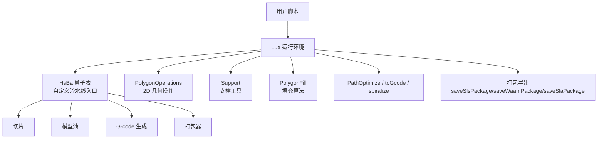
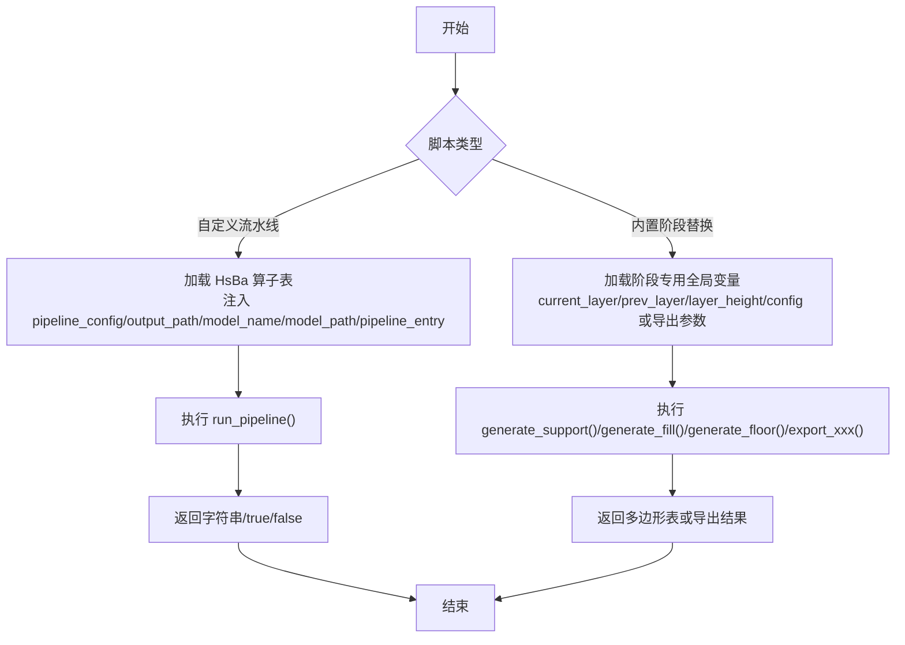
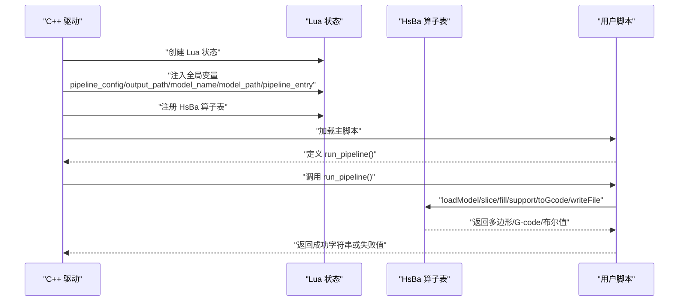
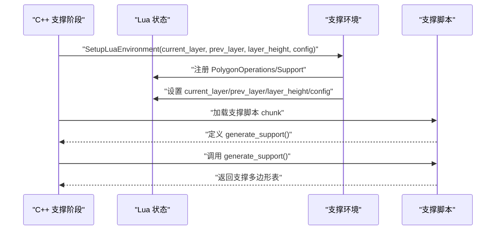
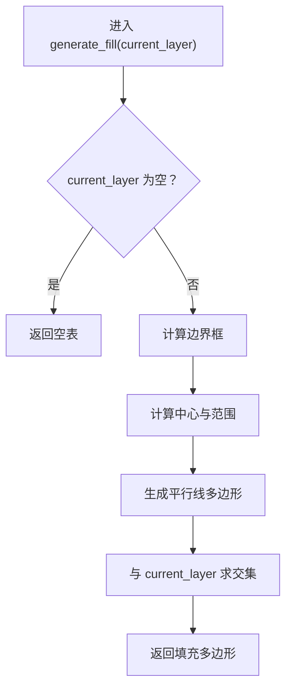
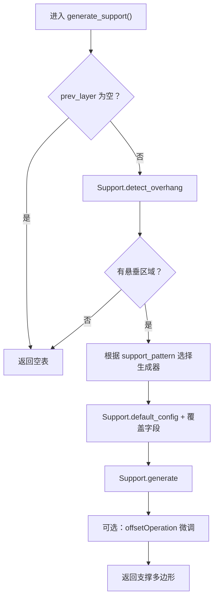
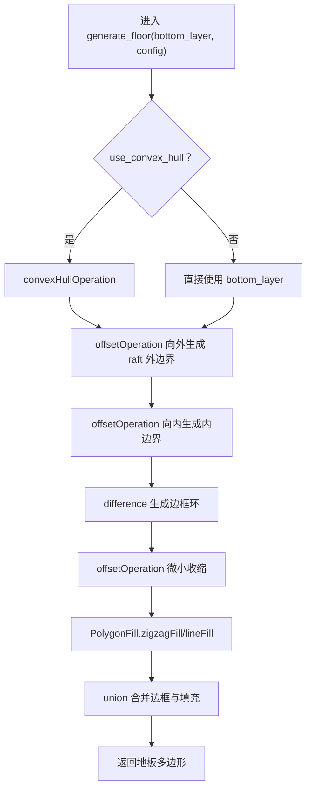
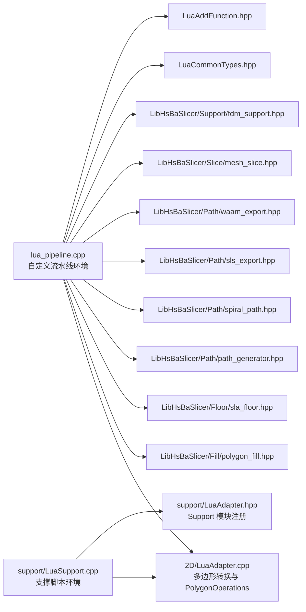

# Lua 脚本扩展

<cite>
**本文引用的文件**   
- [docs/zh/lua_pipeline_api.md](file://docs/zh/lua_pipeline_api.md)
- [LibHsBaSlicer/Extends/LuaAddFunction.hpp](file://LibHsBaSlicer/Extends/LuaAddFunction.hpp)
- [LibHsBaSlicer/Extends/LuaCommonTypes.hpp](file://LibHsBaSlicer/Extends/LuaCommonTypes.hpp)
- [LibHsBaSlicer/Extends/lua_pipeline.cpp](file://LibHsBaSlicer/Extends/lua_pipeline.cpp)
- [2D/LuaAdapter.cpp](file://2D/LuaAdapter.cpp)
- [support/LuaSupport.cpp](file://support/LuaSupport.cpp)
- [samples/FDM/scripts/my_infill.lua](file://samples/FDM/scripts/my_infill.lua)
- [samples/FDM/scripts/my_support.lua](file://samples/FDM/scripts/my_support.lua)
- [samples/SLA/scripts/my_sla_floor.lua](file://samples/SLA/scripts/my_sla_floor.lua)
- [samples/SLA/scripts/my_sla_support.lua](file://samples/SLA/scripts/my_sla_support.lua)
- [samples/Custom/scripts/my_fdm_pipeline.lua](file://samples/Custom/scripts/my_fdm_pipeline.lua)
- [samples/Custom/scripts/my_sla_pipeline.lua](file://samples/Custom/scripts/my_sla_pipeline.lua)
</cite>

## 目录
1. [引言](#引言)
2. [项目结构与定位](#项目结构与定位)
3. [核心组件总览](#核心组件总览)
4. [架构与数据流](#架构与数据流)
5. [Lua 运行环境与生命周期](#lua-运行环境与生命周期)
6. [全局变量与内置函数参考](#全局变量与内置函数参考)
7. [自定义填充算法编写指南](#自定义填充算法编写指南)
8. [自定义支撑生成算法编写指南](#自定义支撑生成算法编写指南)
9. [SLA 地板层处理脚本编写指南](#sla-地板层处理脚本编写指南)
10. [C++ 与 Lua 的交互机制](#c-与-lua-的交互机制)
11. [性能、内存与类型转换建议](#性能内存与类型转换建议)
12. [错误处理与调试技巧](#错误处理与调试技巧)
13. [完整示例与使用方式](#完整示例与使用方式)
14. [依赖关系分析](#依赖关系分析)
15. [常见问题排查](#常见问题排查)
16. [结论](#结论)

## 引言
本文件面向希望使用 HsBaSlicer 的 Lua 脚本能力定制切片流程的开发者，目标是说明：
- 如何理解并选择「自定义流水线」和「内置流水线阶段替换」两种模式。
- 如何在 Lua 中访问模型、切片、填充、支撑、路径、打包等能力。
- 如何编写自定义填充、支撑、地板层处理脚本。
- 如何理解 C++ 与 Lua 的类型转换、注册机制、错误处理和性能边界。
- 如何通过仓库中的示例脚本快速上手。

## 项目结构与定位
HsBaSlicer 将 Lua 扩展能力拆分为多个层次：
- 文档层：`docs/zh/lua_pipeline_api.md` 提供面向用户的 API 参考。
- 环境层：`LibHsBaSlicer/Extends/lua_pipeline.cpp` 实现自定义流水线的 `HsBa` 算子表、上下文全局变量、进度上报、模型管理、切片、填充、支撑、G-code 导出、打包等。
- 几何层：`2D/LuaAdapter.cpp` 提供多边形布尔运算、偏移、凸包、面积、构造函数等通用 2D 几何操作，并注册为 `PolygonOperations`。
- 支撑脚本层：`support/LuaSupport.cpp` 提供支撑阶段的 Lua 执行环境，注入 `current_layer`、`prev_layer`、`layer_height`、`config` 等全局变量。
- 类型系统层：`LibHsBaSlicer/Extends/LuaCommonTypes.hpp` 与 `LuaAddFunction.hpp` 负责向 `AnyObject` 反射常见几何类型，并通过 2D/3D/File 三类注册池把公共类型安装到各阶段 Lua 状态。
- 示例层：`samples/FDM`、`samples/SLA`、`samples/Custom` 下的 `.lua` 脚本展示填充、支撑、地板、完整流水线写法。

**图表来源**
- [LibHsBaSlicer/Extends/lua_pipeline.cpp:209-800](file://LibHsBaSlicer/Extends/lua_pipeline.cpp#L209-L800)
- [2D/LuaAdapter.cpp:251-419](file://2D/LuaAdapter.cpp#L251-L419)
- [support/LuaSupport.cpp:66-89](file://support/LuaSupport.cpp#L66-L89)

**章节来源**
- [docs/zh/lua_pipeline_api.md:1-16](file://docs/zh/lua_pipeline_api.md#L1-L16)
- [LibHsBaSlicer/Extends/lua_pipeline.cpp:1-39](file://LibHsBaSlicer/Extends/lua_pipeline.cpp#L1-L39)

## 核心组件总览
| 组件 | 职责 | 关键位置 |
|---|---|---|
| 自定义流水线环境 | 提供 `HsBa` 表、上下文全局变量、入口函数调用约定 | [LibHsBaSlicer/Extends/lua_pipeline.cpp](file://LibHsBaSlicer/Extends/lua_pipeline.cpp) |
| 2D 几何库 | 多边形布尔、偏移、凸包、面积、矩形/圆/椭圆/正多边形/文本转轮廓 | [2D/LuaAdapter.cpp](file://2D/LuaAdapter.cpp) |
| 支撑脚本环境 | 注入当前层、上一层、层高、配置，支持 `generate_support()` | [support/LuaSupport.cpp](file://support/LuaSupport.cpp) |
| 通用类型注册 | 向 `AnyObject` 注册 Eigen、Clipper2、多边形等类型，并提供 Lua 表转换 | [LibHsBaSlicer/Extends/LuaCommonTypes.hpp](file://LibHsBaSlicer/Extends/LuaCommonTypes.hpp) |
| 外部函数注册接口 | 按 2D/3D/File 维度注册 Lua 函数，支持事件回调 | [LibHsBaSlicer/Extends/LuaAddFunction.hpp](file://LibHsBaSlicer/Extends/LuaAddFunction.hpp) |
| 示例脚本 | FDM 填充、FDM 支撑、SLA 地板、SLA 支撑、完整 FDM/SLA 流水线 | [samples/FDM/scripts](file://samples/FDM/scripts), [samples/SLA/scripts](file://samples/SLA/scripts), [samples/Custom/scripts](file://samples/Custom/scripts) |

**章节来源**
- [docs/zh/lua_pipeline_api.md:19-28](file://docs/zh/lua_pipeline_api.md#L19-L28)
- [LibHsBaSlicer/Extends/LuaAddFunction.hpp:21-74](file://LibHsBaSlicer/Extends/LuaAddFunction.hpp#L21-L74)
- [LibHsBaSlicer/Extends/LuaCommonTypes.hpp:20-45](file://LibHsBaSlicer/Extends/LuaCommonTypes.hpp#L20-L45)

## 架构与数据流
HsBaSlicer 的 Lua 扩展不是单一入口，而是根据用途分成两类：

1. **自定义流水线**：脚本完全控制加载、切片、支撑、填充、路径、写文件或打包的顺序。C++ 侧只负责创建 Lua 状态、注入 `HsBa` 算子表和上下文全局变量，然后调用约定的入口函数（默认 `run_pipeline`）。
2. **内置流水线阶段替换**：C++ 固定阶段顺序，但在支撑、填充、地板、导出等阶段加载用户脚本，注入少量全局变量或参数，并调用约定函数。

**图表来源**
- [docs/zh/lua_pipeline_api.md:19-28](file://docs/zh/lua_pipeline_api.md#L19-L28)
- [LibHsBaSlicer/Extends/lua_pipeline.cpp:55-65](file://LibHsBaSlicer/Extends/lua_pipeline.cpp#L55-L65)
- [support/LuaSupport.cpp:66-89](file://support/LuaSupport.cpp#L66-L89)

**章节来源**
- [docs/zh/lua_pipeline_api.md:19-28](file://docs/zh/lua_pipeline_api.md#L19-L28)

## Lua 运行环境与生命周期
### 自定义流水线生命周期
自定义流水线由 C++ 驱动，典型流程如下：

**图表来源**
- [LibHsBaSlicer/Extends/lua_pipeline.cpp:209-800](file://LibHsBaSlicer/Extends/lua_pipeline.cpp#L209-L800)
- [docs/zh/lua_pipeline_api.md:48-65](file://docs/zh/lua_pipeline_api.md#L48-L65)

### 内置阶段替换生命周期
以支撑阶段为例：

**图表来源**
- [support/LuaSupport.cpp:66-89](file://support/LuaSupport.cpp#L66-L89)
- [support/LuaSupport.cpp:112-173](file://support/LuaSupport.cpp#L112-L173)

**章节来源**
- [docs/zh/lua_pipeline_api.md:48-65](file://docs/zh/lua_pipeline_api.md#L48-L65)
- [support/LuaSupport.cpp:66-89](file://support/LuaSupport.cpp#L66-L89)

## 全局变量与内置函数参考
### 自定义流水线可用全局变量
| 变量 | 类型 | 含义 |
|---|---|---|
| `pipeline_config` | string | C++ 传入的 JSON 配置字符串 |
| `output_path` | string | C++ 传入的默认输出路径 |
| `model_name` | string | C++ 传入的模型名 |
| `model_path` | string | C++ 传入的模型文件路径 |
| `pipeline_entry` | string | 入口函数名，默认 `run_pipeline` |

此外，C++ 可通过 `pipeline_lua_source` 预置前置脚本，例如注入 `machine` 表供脚本读取机台参数。

**章节来源**
- [docs/zh/lua_pipeline_api.md:55-65](file://docs/zh/lua_pipeline_api.md#L55-L65)

### HsBa 算子表常用函数
| 类别 | 函数 | 输入 | 输出 | 说明 |
|---|---|---|---|---|
| 控制 | `progress(percent[, stage])` | 百分比、阶段名 | 无 | 向 C++ 上报进度 |
| 控制 | `setLayers(n)` | 层数 | 无 | 回填总层数 |
| 控制 | `setOutputPath(path)` | 输出路径 | 无 | 回填实际输出路径 |
| 文件 | `readFile(path)` | 路径 | 字符串或 nil | 读取二进制内容 |
| 文件 | `writeFile(path, content)` | 路径、内容 | true | 覆盖写入 |
| 模型 | `loadModel(name, path)` | 名称、路径 | true | 加载到模型池 |
| 模型 | `modelInfo(name)` | 名称 | table | 包围盒、体积等 |
| 模型 | `translateModel/rotateModel/scaleModel/removeModel/modelNames` | 名称、变换参数 | 无/名称数组 | 模型变换与管理 |
| 切片 | `layerCount(name, layerHeight, firstLayerHeight)` | 名称、层高、首层层高 | int | 计算层数 |
| 切片 | `layerZ(index, layerHeight, firstLayerHeight)` | 索引、层高、首层层高 | number | 计算 Z 高度 |
| 切片 | `slice(name, z)` | 名称、Z | polygons | 安全闭合轮廓 |
| 切片 | `sliceUnsafe(name, z)` | 名称、Z | polygons | 非安全切片 |
| 坐标 | `toInt(polygons)` | 浮点多边形 | 整型多边形 | 用于内部整数化运算 |
| 坐标 | `toDouble(intPolygons)` | 整型多边形 | 浮点多边形 | 反整数化 |
| 填充 | `fill(polygons[, cfg])` | 多边形、配置 | polygons | 填充或壁厚+填充 |
| 支撑 | `fdmSupport(layers, cfg)` | 逐层多边形、配置 | 逐层支撑 | FDM 支撑 |
| 支撑 | `slaSupport(layers, cfg)` | 逐层多边形、配置 | 逐层支撑 | SLA 支撑 |
| 地板 | `floor(bottomPolygons, cfg)` | 底层多边形、配置 | polygons | SLA 地板/raft |
| 路径 | `spiralize(sections[, cfg])` | 逐层轮廓、配置 | 3D 点数组 | 螺旋外壁 |
| 路径 | `toGcode(layers, cfg)` | 层路径数据、配置 | string | 生成 G-code |
| 打包 | `saveSlsPackage/saveWaamPackage/saveSlaPackage` | 包结构 | bool 或附加信息 | 打包导出 |
| 渲染 | `renderImage(polygons, width, height, path)` | 多边形、尺寸、路径 | bool | 渲染图像 |

**章节来源**
- [docs/zh/lua_pipeline_api.md:67-133](file://docs/zh/lua_pipeline_api.md#L67-L133)
- [LibHsBaSlicer/Extends/lua_pipeline.cpp:212-783](file://LibHsBaSlicer/Extends/lua_pipeline.cpp#L212-L783)

### 通用共享库
| 库 | 主要能力 |
|---|---|
| `PolygonOperations` | 布尔运算、偏移、凸包/凹包、面积、矩形/圆/椭圆/正多边形、文本转轮廓 |
| `PolygonFill` | offsetFill、lineFill、simpleZigzagFill、zigzagFill、compositeOffsetFill、hybridFill、offsetOnly |
| `PathOptimize` | 路径顺序优化、区域优化、多边形优化 |
| `Support` | 平面/树状/蜂窝/SLA 支撑生成器、悬垂检测、默认配置 |
| `Cipher` | base64/hex 编解码 |
| `Zipper`/`Bit7zZipper` | zip/7z 压缩打包 |
| `SQLiteAdapter`/`MySQLAdapter`/`PostgreSQLAdapter` | 数据库连接、查询、插入、更新、删除、建表 |
| `ParamStore` | 基于反射的参数持久化 |

**章节来源**
- [docs/zh/lua_pipeline_api.md:136-213](file://docs/zh/lua_pipeline_api.md#L136-L213)

## 自定义填充算法编写指南
### 调用约定
内置填充阶段要求脚本：
- 定义函数 `generate_fill(current_layer)`。
- `current_layer` 是已扣除壁厚区域的当前层多边形。
- 返回填充多边形表。
- 该阶段不注入任何全局变量，因此层号、配置应使用脚本内默认值。

### 推荐思路
1. 检查输入是否为空。
2. 计算当前层的边界框或中心。
3. 根据间距和角度生成平行线或多边形。
4. 使用 `PolygonOperations.intersection` 裁剪到有效区域。
5. 返回裁剪后的填充多边形。

### 示例参考
- [samples/FDM/scripts/my_infill.lua](file://samples/FDM/scripts/my_infill.lua)

该示例展示了：
- 从 `current_layer` 计算最小最大坐标。
- 按角度生成平行线。
- 用极细矩形表示线条。
- 与当前层做交集得到最终填充。

**图表来源**
- [samples/FDM/scripts/my_infill.lua:20-87](file://samples/FDM/scripts/my_infill.lua#L20-L87)

**章节来源**
- [docs/zh/lua_pipeline_api.md:234-239](file://docs/zh/lua_pipeline_api.md#L234-L239)
- [samples/FDM/scripts/my_infill.lua:1-89](file://samples/FDM/scripts/my_infill.lua#L1-L89)

## 自定义支撑生成算法编写指南
### 调用约定
支撑阶段注入以下全局变量：
- `current_layer`：当前层多边形。
- `prev_layer`：上一层多边形，首层为空。
- `layer_height`：层高。
- `config`：支撑配置表。

约定入口函数为 `generate_support()`，返回支撑截面多边形表；也可通过全局 `support_polys` 返回。

### 推荐思路
1. 首层无需支撑时直接返回空。
2. 使用 `Support.detect_overhang` 检测悬垂区域。
3. 根据 `config.support_pattern` 选择平面、树状或蜂窝支撑生成器。
4. 使用 `Support.default_config()` 获取默认配置并覆盖必要字段。
5. 调用 `Support.generate` 生成支撑。
6. 可选：使用 `PolygonOperations.offsetOperation` 对接触点进行微调。

### 示例参考
- [samples/FDM/scripts/my_support.lua](file://samples/FDM/scripts/my_support.lua)
- [samples/SLA/scripts/my_sla_support.lua](file://samples/SLA/scripts/my_sla_support.lua)

**图表来源**
- [samples/FDM/scripts/my_support.lua:32-79](file://samples/FDM/scripts/my_support.lua#L32-L79)
- [samples/SLA/scripts/my_sla_support.lua:34-72](file://samples/SLA/scripts/my_sla_support.lua#L34-L72)
- [support/LuaSupport.cpp:66-89](file://support/LuaSupport.cpp#L66-L89)

**章节来源**
- [docs/zh/lua_pipeline_api.md:219-232](file://docs/zh/lua_pipeline_api.md#L219-L232)
- [support/LuaSupport.cpp:66-89](file://support/LuaSupport.cpp#L66-L89)
- [samples/FDM/scripts/my_support.lua:1-83](file://samples/FDM/scripts/my_support.lua#L1-L83)
- [samples/SLA/scripts/my_sla_support.lua:1-76](file://samples/SLA/scripts/my_sla_support.lua#L1-L76)

## SLA 地板层处理脚本编写指南
### 调用约定
SLA 地板阶段要求脚本：
- 定义函数 `generate_floor(bottom_layer, config)`。
- `bottom_layer` 是最底层多边形。
- `config` 包含 raft_offset、border_width、fill_spacing、fill_angle_deg、border_count、use_convex_hull、concave_hull_points 等字段。
- 返回地板多边形表。

### 推荐思路
1. 根据 `use_convex_hull` 决定是否对底层轮廓做凸包简化。
2. 向外偏移生成 raft 外边界。
3. 向内偏移生成内边界。
4. 用差集生成边框环。
5. 对内边界再微小收缩后使用 `PolygonFill.zigzagFill` 或 `lineFill` 生成填充。
6. 合并边框与填充。

### 示例参考
- [samples/SLA/scripts/my_sla_floor.lua](file://samples/SLA/scripts/my_sla_floor.lua)

**图表来源**
- [samples/SLA/scripts/my_sla_floor.lua:35-62](file://samples/SLA/scripts/my_sla_floor.lua#L35-L62)

**章节来源**
- [docs/zh/lua_pipeline_api.md:241-244](file://docs/zh/lua_pipeline_api.md#L241-L244)
- [samples/SLA/scripts/my_sla_floor.lua:1-64](file://samples/SLA/scripts/my_sla_floor.lua#L1-L64)

## C++ 与 Lua 的交互机制
### 类型系统与 AnyObject
`LuaCommonTypes.hpp` 的核心作用是：
- 为常见几何类型注册 `TypeInfo`，暴露稳定名称、字段迭代方法和 `cast_<Name>` 方法。
- 提供 Lua 表与 C++ 类型之间的转换适配器。
- 通过 `RegisterCommonAnyObjectTypes` 把标量类型和自定义类型一起注册到 `AnyObject`。
- 通过 `InstallCommonAnyObjectTypes` 把公共类型安装到 2D/3D/File 三类注册池，使不同阶段都能复用。

这意味着：
- Lua 中的 `{x=.., y=..}` 可被转换为 Clipper2 点、Eigen 向量、矩阵、四元数、多边形等。
- C++ 返回给 Lua 的多边形会被序列化为嵌套 table。
- 反射系统允许在运行时通过 `obj:invoke("cast_<Name>")` 进行类型转换。

**章节来源**
- [LibHsBaSlicer/Extends/LuaCommonTypes.hpp:20-45](file://LibHsBaSlicer/Extends/LuaCommonTypes.hpp#L20-L45)
- [LibHsBaSlicer/Extends/LuaCommonTypes.hpp:84-143](file://LibHsBaSlicer/Extends/LuaCommonTypes.hpp#L84-L143)
- [LibHsBaSlicer/Extends/LuaCommonTypes.hpp:148-183](file://LibHsBaSlicer/Extends/LuaCommonTypes.hpp#L148-L183)

### 外部函数注册接口
`LuaAddFunction.hpp` 定义了：
- `Add2DFunctions`、`Add3DFunctions`、`AddFileFunctions`：按流水线维度注册 Lua 函数。
- `Get2DFunctions`、`Get3DFunctions`、`GetFileFunctions`：获取对应注册回调列表。
- `AddEventCallback`、`GetEventCallbacks`：按事件名注册和查询回调，例如 Zipper、数据库等扩展事件。

这为扩展方提供了统一接入点：不需要修改核心流水线代码，只需向对应维度注册函数或事件回调。

**章节来源**
- [LibHsBaSlicer/Extends/LuaAddFunction.hpp:21-74](file://LibHsBaSlicer/Extends/LuaAddFunction.hpp#L21-L74)

### 多边形与坐标转换
`2D/LuaAdapter.cpp` 承担了 Lua table 与 C++ 多边形之间的双向转换：
- `PushPolygonToLua`/`PushPolygonsToLua`：C++ → Lua。
- `LuaTableToPolygon`/`LuaTableToPolygons`：Lua → C++。
- `RegisterLuaPolygonOperations`：将 `booleanOperation`、`union`、`intersection`、`difference`、`xor`、`offsetOperation`、`convexHullOperation`、`concaveHullOperation`、`area`、`makeRectangle`、`makeCircle`、`makeEllipse`、`makeRegularPolygon`、`textToPolygons` 注册为全局 `PolygonOperations`。

注意：
- 浮点多边形使用 `double`。
- 整型多边形使用 Clipper2 的整型点，并在转换时乘以 `integerization` 精度因子。
- 这是为什么文档强调 `HsBa.toInt`/`HsBa.toDouble` 的重要性。

**章节来源**
- [2D/LuaAdapter.cpp:251-419](file://2D/LuaAdapter.cpp#L251-L419)
- [docs/zh/lua_pipeline_api.md:32-45](file://docs/zh/lua_pipeline_api.md#L32-L45)

### 自定义流水线入口与返回值
`lua_pipeline.cpp` 中：
- 入口函数默认为 `run_pipeline`，可由 `pipeline_entry` 覆盖。
- 返回非空字符串表示成功，并作为结果上报 C++。
- 返回 `true` 表示成功但无结果文本。
- 返回 `false`/`nil` 或抛出 Lua 错误表示失败。

**章节来源**
- [docs/zh/lua_pipeline_api.md:48-54](file://docs/zh/lua_pipeline_api.md#L48-L54)

## 性能、内存与类型转换建议
### 避免不必要的浮点/整型转换
- 内部布尔运算、填充、偏移通常按整数精度处理。
- 尽量只在必要时调用 `HsBa.toInt`/`HsBa.toDouble`。
- 对大量层循环，优先批量处理，避免每层频繁创建/销毁大型 table。

### 合理使用内置填充与支撑
- 如果业务逻辑只是调整角度、间距、密度，优先使用 `HsBa.fill`、`HsBa.fdmSupport`、`HsBa.slaSupport`。
- 只有需要复杂几何裁剪、拓扑变化或工艺策略时才实现自定义 `generate_fill`/`generate_support`。

### 控制日志与进度上报频率
- 自定义流水线中不要每层都打印大量日志。
- 使用 `HsBa.progress` 分批上报，例如每 N 层或每个阶段开始时。

### 模型池管理
- 使用 `HsBa.loadModel` 加载模型，同名模型会复用。
- 流水线结束时调用 `HsBa.removeModel` 释放模型。
- 避免重复加载相同模型造成内存增长。

### 打包与导出
- 使用 `saveSlsPackage`/`saveWaamPackage`/`saveSlaPackage` 时，确保必填字段存在，尤其是 `output`。
- 导出脚本返回值必须严格符合约定，否则可能导致压缩包异常。

[本节为通用指导，不直接分析具体源码行]

## 错误处理与调试技巧
### Lua 脚本错误
- 自定义流水线：入口函数抛错或返回失败值会被视为流水线失败。
- 支撑脚本：`LuaSupport::Generate` 在 load、pcall、函数调用失败时会抛出带错误信息的异常。
- 文件读写：`HsBa.readFile` 失败返回 nil；`HsBa.writeFile` 打开失败会抛出 Lua 错误。

### 调试建议
1. 先用最小脚本验证环境是否可用，例如只调用 `HsBa.progress` 和 `HsBa.modelInfo`。
2. 逐步启用切片、填充、支撑、导出。
3. 使用 `PolygonOperations.area` 检查中间多边形面积是否合理。
4. 使用 `HsBa.renderImage` 将多边形渲染为图像，辅助定位几何问题。
5. 对于支撑脚本，先确认 `Support.detect_overhang` 是否返回非空区域。
6. 对于填充脚本，先返回空表，再逐步加入平行线、偏移、交集等操作。

**章节来源**
- [support/LuaSupport.cpp:125-173](file://support/LuaSupport.cpp#L125-L173)
- [LibHsBaSlicer/Extends/lua_pipeline.cpp:240-268](file://LibHsBaSlicer/Extends/lua_pipeline.cpp#L240-L268)
- [LibHsBaSlicer/Extends/lua_pipeline.cpp:773-783](file://LibHsBaSlicer/Extends/lua_pipeline.cpp#L773-L783)

## 完整示例与使用方式
### 完整自定义 FDM 流水线
示例脚本展示了：
- 从 `model_name`/`model_path`/`output_path`/`pipeline_config`/`machine` 读取参数。
- 加载模型、计算层数、逐层切片。
- 动态旋转填充角度。
- 条件生成支撑。
- 组装路径数据并生成 G-code。
- 写入文件、上报输出路径、清理模型。

参考路径：[samples/Custom/scripts/my_fdm_pipeline.lua](file://samples/Custom/scripts/my_fdm_pipeline.lua)

**章节来源**
- [samples/Custom/scripts/my_fdm_pipeline.lua:1-172](file://samples/Custom/scripts/my_fdm_pipeline.lua#L1-L172)

### 完整自定义 SLA 流水线
示例脚本展示了：
- 加载模型、切片。
- 生成 SLA 支撑。
- 生成地板/raft。
- 调用 `HsBa.saveSlaPackage` 打包层图、支撑图、地板图和配置。

参考路径：[samples/Custom/scripts/my_sla_pipeline.lua](file://samples/Custom/scripts/my_sla_pipeline.lua)

**章节来源**
- [samples/Custom/scripts/my_sla_pipeline.lua:1-105](file://samples/Custom/scripts/my_sla_pipeline.lua#L1-L105)

### 最小自定义流水线骨架
文档提供了一个最小可运行的自定义流水线骨架，包括：
- 参数回退逻辑。
- 模型加载与层数计算。
- 切片与填充。
- G-code 生成与写入。
- 输出路径上报与模型清理。

参考路径：[docs/zh/lua_pipeline_api.md:283-331](file://docs/zh/lua_pipeline_api.md#L283-L331)

**章节来源**
- [docs/zh/lua_pipeline_api.md:283-331](file://docs/zh/lua_pipeline_api.md#L283-L331)

## 依赖关系分析
### 模块依赖图

**图表来源**
- [LibHsBaSlicer/Extends/lua_pipeline.cpp:16-38](file://LibHsBaSlicer/Extends/lua_pipeline.cpp#L16-L38)
- [support/LuaSupport.cpp:9-12](file://support/LuaSupport.cpp#L9-L12)
- [2D/LuaAdapter.cpp:1-11](file://2D/LuaAdapter.cpp#L1-L11)

### 耦合与内聚
- `lua_pipeline.cpp` 是高内聚的流水线编排核心，集中处理模型、切片、填充、支撑、路径、打包。
- `2D/LuaAdapter.cpp` 是低耦合的几何工具层，专注于多边形转换和 2D 操作。
- `support/LuaSupport.cpp` 是支撑阶段的专用胶水层，隔离了支撑脚本的生命周期。
- `LuaCommonTypes.hpp` 和 `LuaAddFunction.hpp` 提供可扩展的注册机制，降低新增功能对核心的侵入性。

**章节来源**
- [LibHsBaSlicer/Extends/lua_pipeline.cpp:1-39](file://LibHsBaSlicer/Extends/lua_pipeline.cpp#L1-L39)
- [2D/LuaAdapter.cpp:1-11](file://2D/LuaAdapter.cpp#L1-L11)
- [support/LuaSupport.cpp:1-13](file://support/LuaSupport.cpp#L1-L13)
- [LibHsBaSlicer/Extends/LuaCommonTypes.hpp:148-183](file://LibHsBaSlicer/Extends/LuaCommonTypes.hpp#L148-L183)
- [LibHsBaSlicer/Extends/LuaAddFunction.hpp:21-74](file://LibHsBaSlicer/Extends/LuaAddFunction.hpp#L21-L74)

## 常见问题排查
### 问题：脚本没有 `HsBa` 表
- 可能使用了内置阶段替换脚本，而不是自定义流水线脚本。
- 内置阶段脚本不会注入 `HsBa`，只能使用 `PolygonOperations`、`Support`、`PolygonFill`、`PathOptimize` 等共享库。

排查方式：
- 确认脚本是 `run_pipeline` 风格还是 `generate_support`/`generate_fill`/`generate_floor` 风格。
- 参考可用性矩阵判断哪些 API 在当前环境中可用。

**章节来源**
- [docs/zh/lua_pipeline_api.md:19-28](file://docs/zh/lua_pipeline_api.md#L19-L28)
- [docs/zh/lua_pipeline_api.md:264-279](file://docs/zh/lua_pipeline_api.md#L264-L279)

### 问题：填充结果为空
- 当前层本身为空。
- 自定义填充逻辑生成的线条未与当前层相交。
- 角度或间距不合理导致线条过疏或过密。

排查方式：
- 先返回空表，确认环境正常。
- 打印或渲染中间多边形。
- 调整间距、角度、边界范围。

**章节来源**
- [samples/FDM/scripts/my_infill.lua:20-87](file://samples/FDM/scripts/my_infill.lua#L20-L87)

### 问题：支撑始终为空
- 首层直接返回空。
- 悬垂检测未检测到悬垂区域。
- 支撑配置字段缺失或数值不合理。

排查方式：
- 检查 `prev_layer` 是否为空。
- 检查 `Support.detect_overhang` 返回值。
- 使用 `Support.default_config()` 并覆盖必要字段。

**章节来源**
- [samples/FDM/scripts/my_support.lua:32-79](file://samples/FDM/scripts/my_support.lua#L32-L79)
- [samples/SLA/scripts/my_sla_support.lua:34-72](file://samples/SLA/scripts/my_sla_support.lua#L34-L72)

### 问题：打包失败或输出为空
- `output` 字段缺失。
- 导出脚本返回值不符合 `{ success=..., export_path=... }` 约定。
- 内部对象方法名大小写不一致。

排查方式：
- 检查 `saveSlsPackage`/`saveWaamPackage`/`saveSlaPackage` 必填字段。
- 检查导出脚本返回值结构。
- 对照文档中的导出阶段约定。

**章节来源**
- [docs/zh/lua_pipeline_api.md:246-261](file://docs/zh/lua_pipeline_api.md#L246-L261)
- [LibHsBaSlicer/Extends/lua_pipeline.cpp:658-771](file://LibHsBaSlicer/Extends/lua_pipeline.cpp#L658-L771)

## 结论
HsBaSlicer 的 Lua 脚本扩展提供了从轻量阶段替换到完全自定义流水线的完整能力。开发者可以：
- 使用 `HsBa` 算子表构建完整的 FDM/SLA 流水线。
- 使用 `PolygonOperations`、`PolygonFill`、`Support` 等共享库实现几何与工艺定制。
- 通过 `LuaCommonTypes` 和 `LuaAddFunction` 理解类型转换与函数注册机制。
- 借助示例脚本快速掌握参数访问、数据转换、几何操作、路径生成和打包导出。

在实际工程中，建议优先复用内置算法，仅在确有需要时实现自定义填充、支撑或地板逻辑；同时重视类型转换、内存管理和错误处理，以保证切片流程的稳定性和性能。