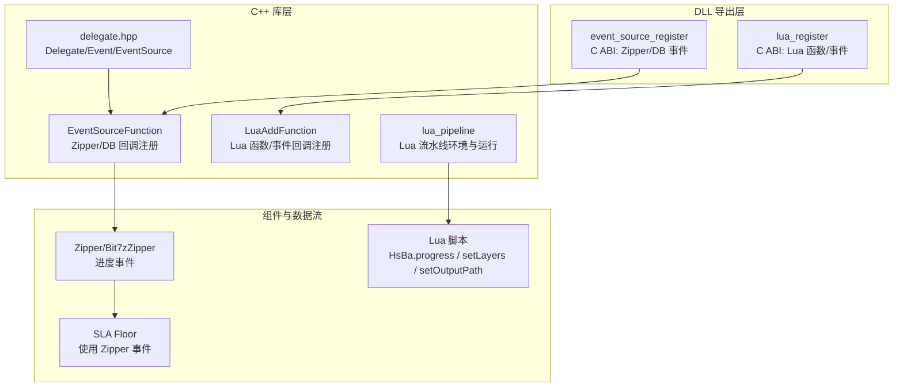
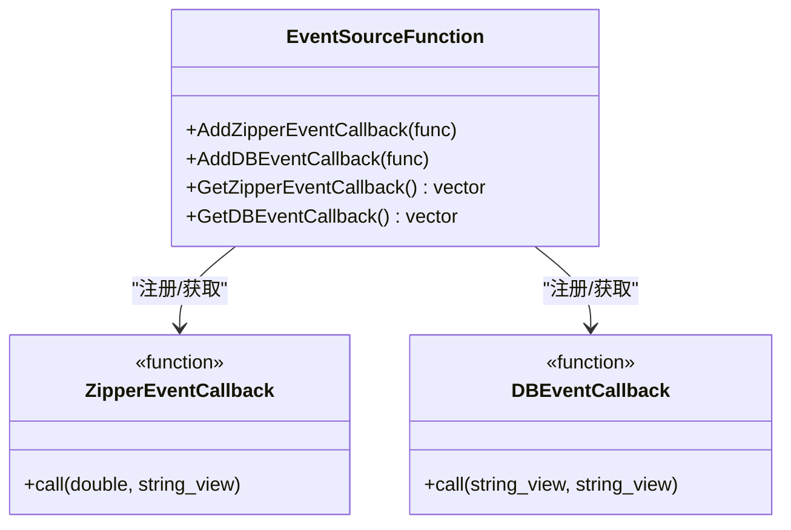
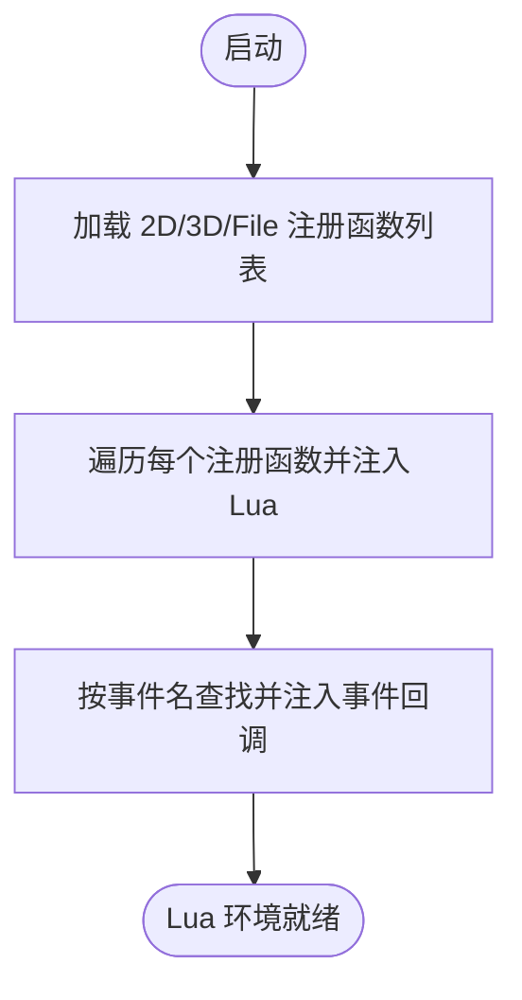
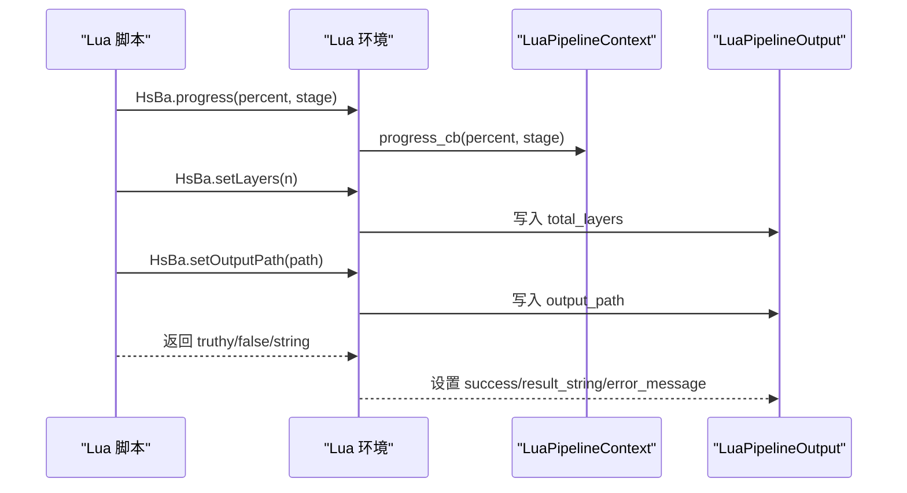
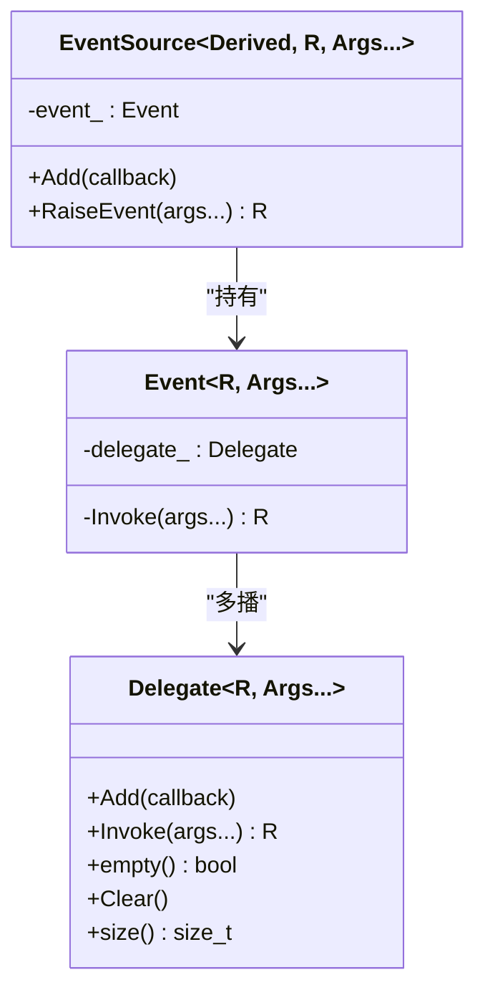
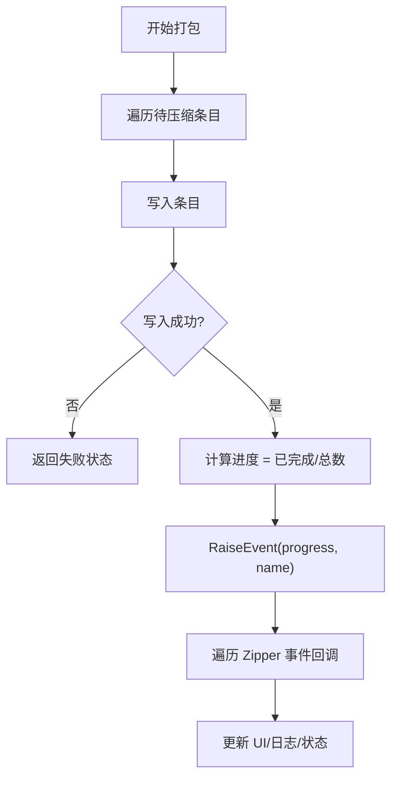
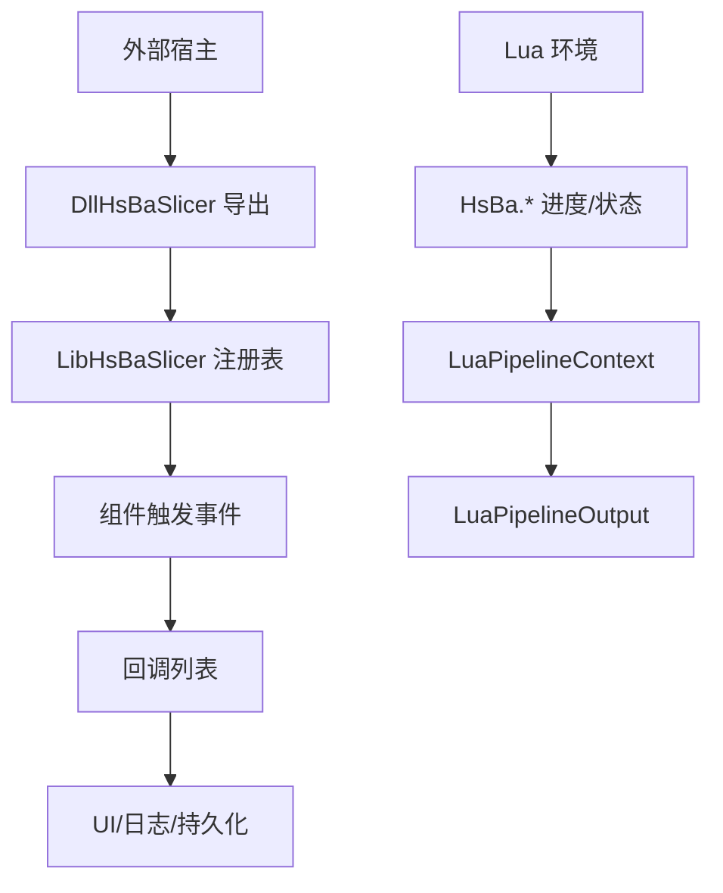
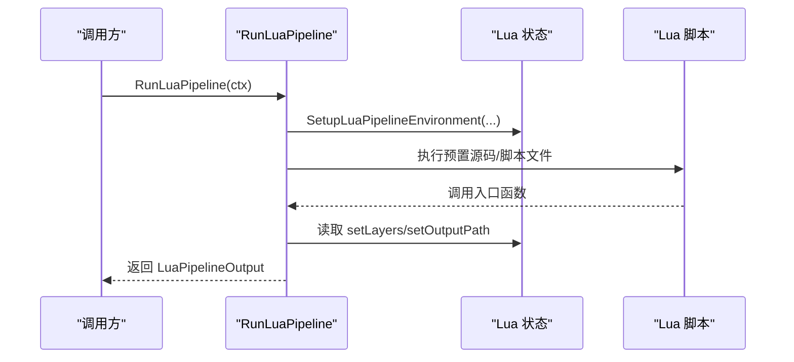
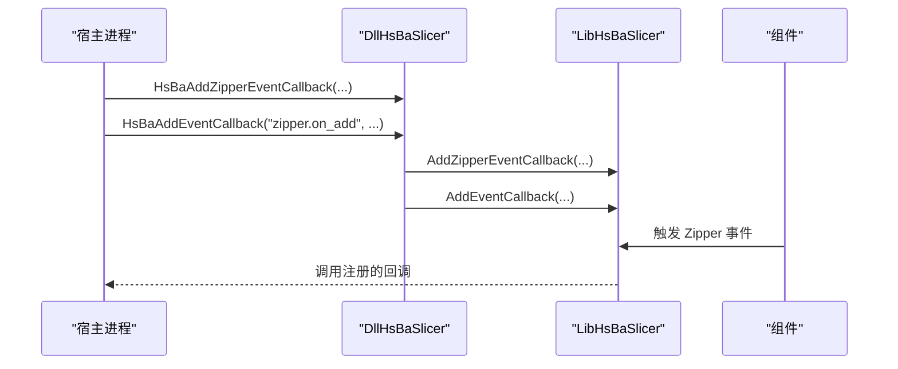

# 事件系统开发

<cite>
**本文引用的文件**   
- [EventSourceFunction.hpp](file://LibHsBaSlicer/Extends/EventSourceFunction.hpp)
- [EventSourceFunction.cpp](file://LibHsBaSlicer/Extends/EventSourceFunction.cpp)
- [event_source_register.h](file://DllHsBaSlicer/event_source_register.h)
- [event_source_register.cpp](file://DllHsBaSlicer/event_source_register.cpp)
- [lua_register.h](file://DllHsBaSlicer/lua_register.h)
- [lua_register.cpp](file://DllHsBaSlicer/lua_register.cpp)
- [LuaAddFunction.hpp](file://LibHsBaSlicer/Extends/LuaAddFunction.hpp)
- [LuaAddFunction.cpp](file://LibHsBaSlicer/Extends/LuaAddFunction.cpp)
- [lua_pipeline.hpp](file://LibHsBaSlicer/Extends/lua_pipeline.hpp)
- [lua_pipeline.cpp](file://LibHsBaSlicer/Extends/lua_pipeline.cpp)
- [delegate.hpp](file://base/delegate.hpp)
- [zipper.cpp](file://fileoperator/zipper.cpp)
- [bit7z_zipper.hpp](file://fileoperator/bit7z_zipper.hpp)
- [sla_floor.cpp](file://LibHsBaSlicer/Floor/sla_floor.cpp)
- [custom_pipeline.proto](file://proto/custom_pipeline.proto)
</cite>

## 目录
1. [引言](#引言)
2. [项目结构](#项目结构)
3. [核心概念](#核心概念)
4. [核心模块详解](#核心模块详解)
5. [架构总览](#架构总览)
6. [高级主题](#高级主题)
7. [Lua 脚本系统](#lua-脚本系统)
8. [API 参考文档](#api-参考文档)
9. [集成指南](#集成指南)
10. [开发·测试与贡献](#开发测试与贡献)
11. [扩展开发指南](#扩展开发指南)
12. [示例与教程](#示例与教程)
13. [部署·故障排除与FAQ](#部署故障排除与faq)
14. [附录](#附录)

## 引言
本指南面向 HsBaSlicer 的扩展开发者，系统化说明事件驱动架构在系统中的落地方式。围绕 EventSourceFunction 的设计模式、事件注册机制与回调管理，深入解释 Lua 事件绑定、异步事件处理与错误传播路径；同时给出进度监控、状态通知、异常处理的完整实现思路，并补充事件过滤、优先级管理与性能优化策略。文末提供最佳实践、调试工具与故障排除方法，帮助开发者构建响应式、松耦合的模块间通信。

## 项目结构
事件相关能力横跨 C++ 库层、DLL 导出层与 Lua 运行时：
- LibHsBaSlicer/Extends：事件回调注册表（Zipper/DB）、Lua 函数与事件回调注册表、Lua 自定义流水线环境。
- DllHsBaSlicer：对外 C ABI 导出，桥接外部宿主语言到内部注册表。
- base：通用委托/事件基础设施 Delegate/Event/EventSource。
- fileoperator：压缩器 Zipper/Bit7zZipper 通过事件上报进度。
- proto：自定义 Lua 流水线配置与结果协议。

图表来源
- [EventSourceFunction.hpp:16-41](file://LibHsBaSlicer/Extends/EventSourceFunction.hpp#L16-L41)
- [LuaAddFunction.hpp:19-74](file://LibHsBaSlicer/Extends/LuaAddFunction.hpp#L19-L74)
- [lua_pipeline.hpp:19-83](file://LibHsBaSlicer/Extends/lua_pipeline.hpp#L19-L83)
- [event_source_register.h:11-20](file://DllHsBaSlicer/event_source_register.h#L11-L20)
- [lua_register.h:11-31](file://DllHsBaSlicer/lua_register.h#L11-L31)
- [bit7z_zipper.hpp:79-102](file://fileoperator/bit7z_zipper.hpp#L79-L102)
- [lua_pipeline.cpp:228-238](file://LibHsBaSlicer/Extends/lua_pipeline.cpp#L228-L238)

章节来源
- [EventSourceFunction.hpp:16-41](file://LibHsBaSlicer/Extends/EventSourceFunction.hpp#L16-L41)
- [LuaAddFunction.hpp:19-74](file://LibHsBaSlicer/Extends/LuaAddFunction.hpp#L19-L74)
- [lua_pipeline.hpp:19-83](file://LibHsBaSlicer/Extends/lua_pipeline.hpp#L19-L83)
- [event_source_register.h:11-20](file://DllHsBaSlicer/event_source_register.h#L11-L20)
- [lua_register.h:11-31](file://DllHsBaSlicer/lua_register.h#L11-L31)

## 核心概念
- 事件源与回调注册表：以全局容器保存回调，提供 Add/Get API，供各子系统触发事件时遍历调用。
- 类型化回调：Zipper 进度回调为 (double, string_view)，数据库事件回调为 (string_view, string_view)。
- Lua 事件绑定：通过 LuaAddFunction 维护按事件名索引的 LuaRegFunc 列表，由外部通过 C ABI 注入。
- 通用事件基础设施：Delegate/Event/EventSource 提供线程安全的多播委托与事件源基类，用于组件级事件。
- 进度与状态：Lua 流水线暴露 HsBa.progress/setLayers/setOutputPath，将脚本内进度与输出信息回传至 C++ 上下文。

章节来源
- [EventSourceFunction.hpp:18-41](file://LibHsBaSlicer/Extends/EventSourceFunction.hpp#L18-L41)
- [LuaAddFunction.hpp:21-74](file://LibHsBaSlicer/Extends/LuaAddFunction.hpp#L21-L74)
- [delegate.hpp:27-167](file://base/delegate.hpp#L27-L167)
- [lua_pipeline.hpp:29-51](file://LibHsBaSlicer/Extends/lua_pipeline.hpp#L29-L51)

## 核心模块详解
### EventSourceFunction：Zipper/DB 事件回调注册
- 设计要点
  - 模块级全局 vector 保存 ZipperEventCallback 与 DBEventCallback。
  - 提供 Add/Get 接口，允许任意阶段订阅或枚举已注册回调。
- 复杂度
  - 添加回调 O(1)，触发时线性遍历 O(n)。
- 并发
  - 当前实现未加锁，调用方需保证注册与触发的时序安全。
- 典型用法
  - 在初始化阶段注册进度监听与数据库操作监听。

图表来源
- [EventSourceFunction.hpp:18-41](file://LibHsBaSlicer/Extends/EventSourceFunction.hpp#L18-L41)
- [EventSourceFunction.cpp:17-32](file://LibHsBaSlicer/Extends/EventSourceFunction.cpp#L17-L32)

章节来源
- [EventSourceFunction.hpp:18-41](file://LibHsBaSlicer/Extends/EventSourceFunction.hpp#L18-L41)
- [EventSourceFunction.cpp:17-32](file://LibHsBaSlicer/Extends/EventSourceFunction.cpp#L17-L32)

### LuaAddFunction：Lua 函数与事件回调注册
- 设计要点
  - 三类维度：2D/3D/File 的 Lua 注册函数列表。
  - 事件回调：按事件名映射到 LuaRegFunc 列表，支持动态扩展。
- 触发时机
  - 每次创建 Lua 环境时，依次执行对应维度的注册函数，将外部函数注入到 Lua 全局。
- 扩展点
  - 新增事件只需定义事件名并在宿主侧调用 AddEventCallback 完成绑定。

图表来源
- [LuaAddFunction.cpp:11-67](file://LibHsBaSlicer/Extends/LuaAddFunction.cpp#L11-L67)
- [lua_pipeline.cpp:903-958](file://LibHsBaSlicer/Extends/lua_pipeline.cpp#L903-L958)

章节来源
- [LuaAddFunction.hpp:21-74](file://LibHsBaSlicer/Extends/LuaAddFunction.hpp#L21-L74)
- [LuaAddFunction.cpp:11-67](file://LibHsBaSlicer/Extends/LuaAddFunction.cpp#L11-L67)

### lua_pipeline：Lua 流水线环境与进度/状态通道
- 关键对象
  - LuaPipelineContext：脚本入口、配置 JSON、模型信息与进度回调等。
  - LuaPipelineOutput：成功标志、总层数、输出路径与错误消息。
- 进度与状态
  - HsBa.progress(percent, stage) 调用 ctx->progress_cb。
  - HsBa.setLayers(n)/setOutputPath(path) 写入 Registry 槽位，最终汇总到 out。
- 错误传播
  - Lua 错误被捕获并封装为 RuntimeError，上层转换为 out.error_message。

图表来源
- [lua_pipeline.cpp:228-238](file://LibHsBaSlicer/Extends/lua_pipeline.cpp#L228-L238)
- [lua_pipeline.cpp:241-256](file://LibHsBaSlicer/Extends/lua_pipeline.cpp#L241-L256)
- [lua_pipeline.cpp:960-1042](file://LibHsBaSlicer/Extends/lua_pipeline.cpp#L960-L1042)

章节来源
- [lua_pipeline.hpp:29-83](file://LibHsBaSlicer/Extends/lua_pipeline.hpp#L29-L83)
- [lua_pipeline.cpp:228-256](file://LibHsBaSlicer/Extends/lua_pipeline.cpp#L228-L256)
- [lua_pipeline.cpp:960-1042](file://LibHsBaSlicer/Extends/lua_pipeline.cpp#L960-L1042)

### delegate.hpp：通用委托与事件源
- 功能
  - Delegate：线程安全的多播委托，支持 void 与非 void 返回值聚合。
  - Event/EventSource：基于 Delegate 的事件抽象，便于组件级事件驱动。
- 适用场景
  - 组件内部事件广播、跨模块解耦通信。

图表来源
- [delegate.hpp:27-167](file://base/delegate.hpp#L27-L167)
- [delegate.hpp:173-243](file://base/delegate.hpp#L173-L243)

章节来源
- [delegate.hpp:27-167](file://base/delegate.hpp#L27-L167)
- [delegate.hpp:173-243](file://base/delegate.hpp#L173-L243)

### Zipper/Bit7zZipper：压缩进度事件
- Zipper::AddAllToZip 在每加入一个条目后计算进度并 RaiseEvent。
- Bit7zZipper 继承自 Utils::EventSource，统一事件签名 (double, string_view)。
- SLA Floor 打包流程通过 GetZipperEventCallback() 将 Zipper 进度事件透传到上层 UI 或日志。

图表来源
- [zipper.cpp:137-157](file://fileoperator/zipper.cpp#L137-L157)
- [bit7z_zipper.hpp:79-102](file://fileoperator/bit7z_zipper.hpp#L79-L102)
- [sla_floor.cpp:472](file://LibHsBaSlicer/Floor/sla_floor.cpp#L472)

章节来源
- [zipper.cpp:137-157](file://fileoperator/zipper.cpp#L137-L157)
- [bit7z_zipper.hpp:79-102](file://fileoperator/bit7z_zipper.hpp#L79-L102)
- [sla_floor.cpp:472](file://LibHsBaSlicer/Floor/sla_floor.cpp#L472)

## 架构总览
整体事件驱动链路如下：
- 外部宿主通过 DLL 导出函数注册 Zipper/DB 事件与 Lua 函数/事件回调。
- 库层维护全局回调表，组件在执行过程中触发事件。
- Lua 流水线通过 HsBa.* 暴露进度与状态通道，将脚本行为与 C++ 上下文同步。

图表来源
- [event_source_register.cpp:9-34](file://DllHsBaSlicer/event_source_register.cpp#L9-L34)
- [lua_register.cpp:35-41](file://DllHsBaSlicer/lua_register.cpp#L35-L41)
- [lua_pipeline.cpp:903-958](file://LibHsBaSlicer/Extends/lua_pipeline.cpp#L903-L958)

## 高级主题
### 事件过滤与优先级
- 当前实现为简单向量顺序遍历，无内置过滤与优先级字段。
- 建议方案
  - 在回调包装中增加过滤器（如事件名、来源模块）。
  - 引入优先级元数据，在触发前排序或分桶调度。
  - 对高频事件采用环形缓冲+消费者队列，避免阻塞主流程。

### 异步事件处理
- 当前事件回调为同步调用，可能阻塞耗时任务。
- 建议方案
  - 将回调投递到线程池或协程队列，主流程仅做轻量分发。
  - 对 UI 更新进行线程亲和性隔离，避免跨线程访问。

### 性能优化策略
- 减少字符串拷贝：尽量使用 string_view 传递中间结果。
- 批量触发：合并多次进度更新，降低回调频率。
- 缓存热点回调：对频繁调用的回调集合做局部缓存。
- 禁用未使用回调：在流水线结束时清理不再使用的回调。

[本节为通用指导，不直接分析具体文件]

## Lua 脚本系统
### Lua 流水线上下文与输出
- LuaPipelineContext
  - script/script_file：预置源码与脚本文件路径。
  - entry_func：入口函数名，默认 run_pipeline。
  - config_json/model_name/model_path/output_path：脚本可见的全局变量。
  - progress_cb：进度回调钩子。
- LuaPipelineOutput
  - success/total_layers/output_path/result_string/error_message：运行结果与错误信息。

章节来源
- [lua_pipeline.hpp:29-83](file://LibHsBaSlicer/Extends/lua_pipeline.hpp#L29-L83)

### Lua 流水线运行流程
- 创建 Lua 状态与环境，注入 2D/3D/File 函数与常用库。
- 执行预置源码与脚本文件，调用入口函数。
- 收集 setLayers/setOutputPath 的结果与返回值，填充输出对象。
- 捕获 Lua 错误并转换为错误消息。

图表来源
- [lua_pipeline.cpp:960-1042](file://LibHsBaSlicer/Extends/lua_pipeline.cpp#L960-L1042)

章节来源
- [lua_pipeline.cpp:903-958](file://LibHsBaSlicer/Extends/lua_pipeline.cpp#L903-L958)
- [lua_pipeline.cpp:960-1042](file://LibHsBaSlicer/Extends/lua_pipeline.cpp#L960-L1042)

## API 参考文档
### C++ 事件回调注册（Zipper/DB）
- AddZipperEventCallback(ZipperEventCallback)
- AddDBEventCallback(DBEventCallback)
- GetZipperEventCallback() -> vector<ZipperEventCallback>&
- GetDBEventCallback() -> vector<DBEventCallback>&

章节来源
- [EventSourceFunction.hpp:21-41](file://LibHsBaSlicer/Extends/EventSourceFunction.hpp#L21-L41)

### DLL 导出 C ABI
- HsBaAddZipperEventCallback(event_name, func(double, const char*))
- HsBaAddDBEventCallback(event_name, func(const char*, const char*))
- HsBaAdd2DFunction/HsBaAdd3DFunction/HsBaAddFileFunction(HsBaLuaRegFn)
- HsBaAddEventCallback(event_name, HsBaLuaRegFn)

章节来源
- [event_source_register.h:11-20](file://DllHsBaSlicer/event_source_register.h#L11-L20)
- [lua_register.h:11-31](file://DllHsBaSlicer/lua_register.h#L11-L31)

### Lua 流水线 API
- SetupLuaPipelineEnvironment(L, ctx, out, run_state)
- RunLuaPipeline(ctx) -> LuaPipelineOutput
- HsBa.progress(percent, stage)
- HsBa.setLayers(n)
- HsBa.setOutputPath(path)

章节来源
- [lua_pipeline.hpp:69-83](file://LibHsBaSlicer/Extends/lua_pipeline.hpp#L69-L83)
- [lua_pipeline.cpp:228-256](file://LibHsBaSlicer/Extends/lua_pipeline.cpp#L228-L256)
- [lua_pipeline.cpp:903-958](file://LibHsBaSlicer/Extends/lua_pipeline.cpp#L903-L958)

### 通用事件基础设施
- Delegate<R, Args...>::Add/Invoke/empty/Clear/size
- Event<R, Args...>
- EventSource<Derived, R, Args...>::Add/RaiseEvent

章节来源
- [delegate.hpp:27-167](file://base/delegate.hpp#L27-L167)
- [delegate.hpp:173-243](file://base/delegate.hpp#L173-L243)

## 集成指南
### 在宿主进程中注册事件与 Lua 函数
- 步骤
  1. 调用 HsBaAddZipperEventCallback/HsBaAddDBEventCallback 注册 C 风格回调。
  2. 调用 HsBaAdd2DFunction/HsBaAdd3DFunction/HsBaAddFileFunction 注入 Lua 函数。
  3. 调用 HsBaAddEventCallback 将 Lua 函数绑定到指定事件名。
  4. 运行流水线，组件触发事件时回调将被调用。

图表来源
- [event_source_register.cpp:9-34](file://DllHsBaSlicer/event_source_register.cpp#L9-L34)
- [lua_register.cpp:35-41](file://DllHsBaSlicer/lua_register.cpp#L35-L41)

章节来源
- [event_source_register.cpp:9-34](file://DllHsBaSlicer/event_source_register.cpp#L9-L34)
- [lua_register.cpp:35-41](file://DllHsBaSlicer/lua_register.cpp#L35-L41)

## 开发·测试与贡献
- 单元测试建议
  - 验证事件回调注册与触发顺序。
  - 验证 Lua 流水线进度与状态回传。
  - 验证错误路径：Lua 错误、文件 IO 失败、空入口函数。
- 贡献规范
  - 新增事件需在 LuaAddFunction 中声明并维护命名约定。
  - 对高频事件提供节流或批处理接口。
  - 保持回调签名稳定，必要时提供版本兼容层。

[本节为通用指导，不直接分析具体文件]

## 扩展开发指南
### 新增事件类型
- 在 EventSourceFunction 中添加新的回调类型与 Add/Get API。
- 在组件中触发新事件，确保参数语义清晰且高效。
- 在 LuaAddFunction 中支持按事件名绑定 Lua 回调。

### 实现进度监控
- 在长耗时循环中定期调用 HsBa.progress 或触发 Zipper 事件。
- 在 UI 层消费进度回调，显示百分比与阶段描述。

### 状态通知与异常处理
- 使用 LuaPipelineOutput.error_message 统一报告错误。
- 在回调中记录关键状态，便于问题定位。

章节来源
- [EventSourceFunction.hpp:21-41](file://LibHsBaSlicer/Extends/EventSourceFunction.hpp#L21-L41)
- [lua_pipeline.cpp:960-1042](file://LibHsBaSlicer/Extends/lua_pipeline.cpp#L960-L1042)

## 示例与教程
### 完全由 Lua 驱动的 SLA 流水线示例
- 脚本编排：加载模型、切片、生成支撑、地板、打包 zip。
- 全局变量：model_name、model_path、output_path、pipeline_config。
- 返回值：字符串表示成功，false 表示失败。

章节来源
- [samples/Custom/scripts/my_sla_pipeline.lua:1-37](file://samples/Custom/scripts/my_sla_pipeline.lua#L1-L37)

### 自定义流水线协议
- custom_pipe_config：脚本路径、内联源码、入口函数、配置 JSON、模型信息与输出路径。
- custom_pipe_result：成功标志、总层数、输出路径与错误信息。

章节来源
- [custom_pipeline.proto:5-25](file://proto/custom_pipeline.proto#L5-L25)

## 部署·故障排除与FAQ
### 常见问题
- 回调未被调用
  - 检查是否在运行前注册了回调。
  - 确认事件名与触发逻辑一致。
- Lua 流水线报错
  - 查看 LuaPipelineOutput.error_message。
  - 检查入口函数是否存在与脚本语法是否正确。
- 进度不更新
  - 确认 HsBa.progress 是否被调用。
  - 检查 progress_cb 是否有效。

章节来源
- [lua_pipeline.cpp:960-1042](file://LibHsBaSlicer/Extends/lua_pipeline.cpp#L960-L1042)

### 调试工具
- 启用详细日志：在回调中打印事件名、参数与时间戳。
- 断点与堆栈：在触发点与回调入口处设置断点。
- 最小复现：剥离无关流水线阶段，聚焦事件链路。

[本节为通用指导，不直接分析具体文件]

## 附录
### 最佳实践清单
- 使用 string_view 传递只读字符串，减少拷贝。
- 对高频事件进行节流与批处理。
- 将 UI 更新与业务逻辑解耦，避免跨线程访问。
- 在流水线结束时清理不再使用的回调，防止内存泄漏。
- 为所有事件提供清晰的命名约定与文档。

[本节为通用指导，不直接分析具体文件]