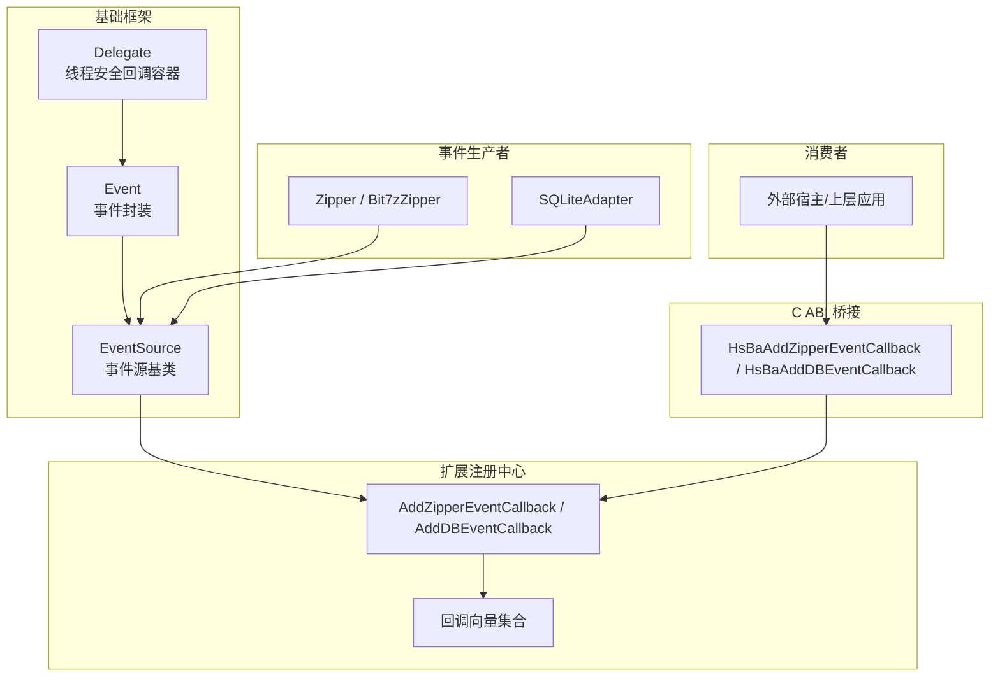
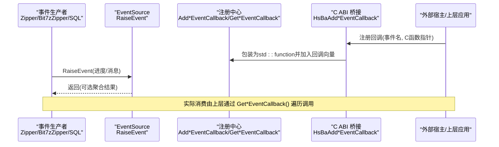
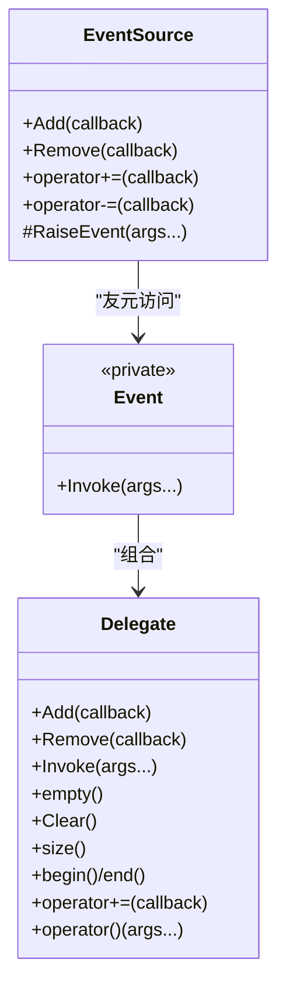
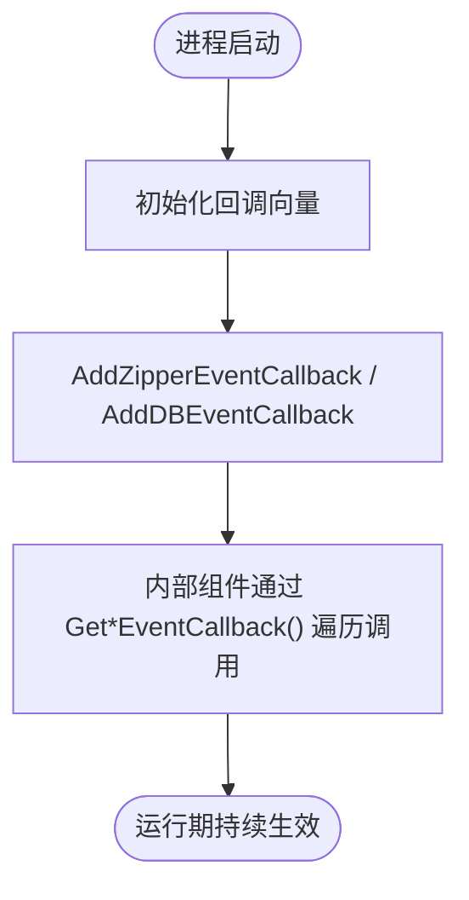
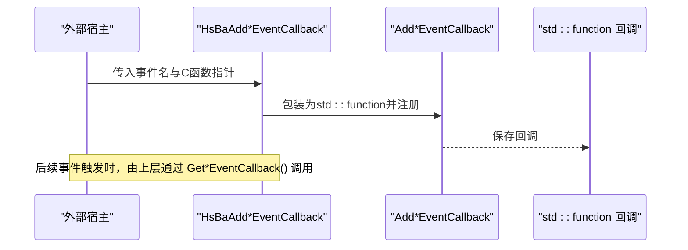
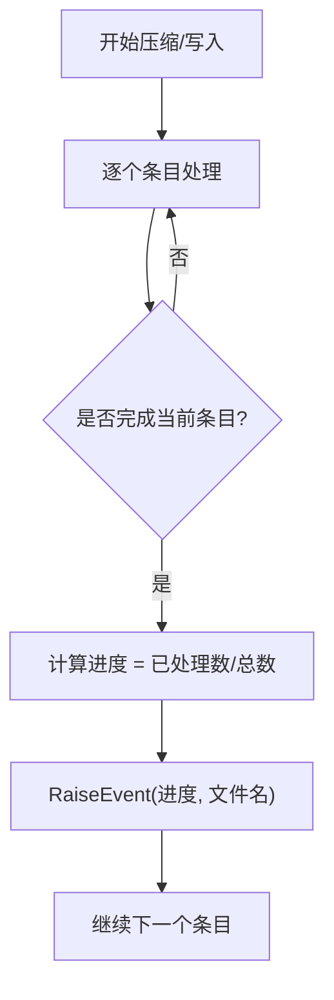
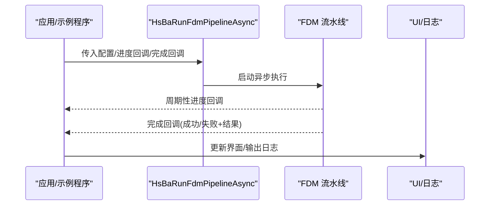

# 事件系统开发

<cite>
**本文引用的文件**   
- [delegate.hpp](file://base/delegate.hpp)
- [EventSourceFunction.hpp](file://LibHsBaSlicer/Extends/EventSourceFunction.hpp)
- [EventSourceFunction.cpp](file://LibHsBaSlicer/Extends/EventSourceFunction.cpp)
- [event_source_register.h](file://DllHsBaSlicer/event_source_register.h)
- [event_source_register.cpp](file://DllHsBaSlicer/event_source_register.cpp)
- [zipper.hpp](file://fileoperator/zipper.hpp)
- [bit7z_zipper.hpp](file://fileoperator/bit7z_zipper.hpp)
- [zipper.cpp](file://fileoperator/zipper.cpp)
- [bit7z_zipper.cpp](file://fileoperator/bit7z_zipper.cpp)
- [sql_adapter.cpp](file://fileoperator/sql_adapter.cpp)
- [fdm_pipeline.h](file://DllHsBaSlicer/fdm_pipeline.h)
- [main.cpp](file://samples/FDM/main.cpp)
</cite>

## 目录
1. [简介](#简介)
2. [项目结构](#项目结构)
3. [核心组件](#核心组件)
4. [架构总览](#架构总览)
5. [详细组件分析](#详细组件分析)
6. [依赖关系分析](#依赖关系分析)
7. [性能考虑](#性能考虑)
8. [故障排查指南](#故障排查指南)
9. [结论](#结论)
10. [附录](#附录)

## 简介
本文件面向需要在 HsBaSlicer 中实现复杂业务流程的开发者，系统性说明事件系统的定义、触发与监听机制，以及在自定义算法中发布/订阅事件、进行异步处理与进度反馈的方法。文档同时覆盖事件数据的序列化与跨语言通信支持（C ABI），并给出在流水线中的集成方式与性能影响评估，以及调试与监控建议。

## 项目结构
事件系统由三层构成：
- 基础事件框架：基于委托与事件源模板类，提供线程安全的回调管理与事件触发能力。
- 扩展事件注册中心：维护全局回调列表，供具体子系统（压缩、数据库等）统一上报事件。
- C ABI 桥接层：暴露给外部模块或跨语言宿主（如 Lua、游戏引擎）的事件回调注册接口。

图表来源
- [delegate.hpp:27-167](file://base/delegate.hpp#L27-L167)
- [delegate.hpp:174-243](file://base/delegate.hpp#L174-L243)
- [EventSourceFunction.hpp:16-41](file://LibHsBaSlicer/Extends/EventSourceFunction.hpp#L16-L41)
- [EventSourceFunction.cpp:9-26](file://LibHsBaSlicer/Extends/EventSourceFunction.cpp#L9-L26)
- [event_source_register.h:11-20](file://DllHsBaSlicer/event_source_register.h#L11-L20)
- [event_source_register.cpp:9-30](file://DllHsBaSlicer/event_source_register.cpp#L9-L30)
- [zipper.hpp:79-102](file://fileoperator/bit7z_zipper.hpp#L79-L102)
- [sql_adapter.cpp:155-190](file://fileoperator/sql_adapter.cpp#L155-L190)

章节来源
- [delegate.hpp:27-167](file://base/delegate.hpp#L27-L167)
- [delegate.hpp:174-243](file://base/delegate.hpp#L174-L243)
- [EventSourceFunction.hpp:16-41](file://LibHsBaSlicer/Extends/EventSourceFunction.hpp#L16-L41)
- [EventSourceFunction.cpp:9-26](file://LibHsBaSlicer/Extends/EventSourceFunction.cpp#L9-L26)
- [event_source_register.h:11-20](file://DllHsBaSlicer/event_source_register.h#L11-L20)
- [event_source_register.cpp:9-30](file://DllHsBaSlicer/event_source_register.cpp#L9-L30)

## 核心组件
- 委托与事件
  - Delegate：线程安全的回调容器，支持添加、移除、遍历与调用；Invoke 对返回值类型做条件聚合。
  - Event：对 Delegate 的轻量封装，限制构造与拷贝，仅允许友元 EventSource 访问。
  - EventSource：派生类通过继承获得 Add/RaiseEvent 能力，对外暴露 += 语法注册监听器。

- 扩展事件注册中心
  - AddZipperEventCallback/AddDBEventCallback：向全局回调向量追加函数对象。
  - GetZipperEventCallback/GetDBEventCallback：获取回调向量引用，供内部组件迭代触发。

- C ABI 桥接
  - HsBaAddZipperEventCallback/HsBaAddDBEventCallback：以 C 风格导出，将外部回调包装为 C++ std::function 后注入注册中心。

章节来源
- [delegate.hpp:27-167](file://base/delegate.hpp#L27-L167)
- [delegate.hpp:174-243](file://base/delegate.hpp#L174-L243)
- [EventSourceFunction.hpp:16-41](file://LibHsBaSlicer/Extends/EventSourceFunction.hpp#L16-L41)
- [EventSourceFunction.cpp:9-26](file://LibHsBaSlicer/Extends/EventSourceFunction.cpp#L9-L26)
- [event_source_register.h:11-20](file://DllHsBaSlicer/event_source_register.h#L11-L20)
- [event_source_register.cpp:9-30](file://DllHsBaSlicer/event_source_register.cpp#L9-L30)

## 架构总览
下图展示从“事件生产者”到“外部宿主”的完整链路：生产者通过 EventSource 触发事件，注册中心持有回调列表，C ABI 层负责跨语言适配。

图表来源
- [event_source_register.cpp:9-30](file://DllHsBaSlicer/event_source_register.cpp#L9-L30)
- [EventSourceFunction.cpp:9-26](file://LibHsBaSlicer/Extends/EventSourceFunction.cpp#L9-L26)
- [zipper.cpp:145-156](file://fileoperator/zipper.cpp#L145-L156)
- [bit7z_zipper.cpp:260-270](file://fileoperator/bit7z_zipper.cpp#L260-L270)
- [sql_adapter.cpp:155-190](file://fileoperator/sql_adapter.cpp#L155-L190)

## 详细组件分析

### 基础事件框架：Delegate / Event / EventSource
- 设计要点
  - 线程安全：使用 shared_mutex 保护回调容器，避免并发修改与读取竞争。
  - 返回值策略：根据返回类型是否可加性进行分支处理，void 直接调用，可加类型累加，其他类型取最后一次调用结果。
  - 易用性：提供 operator+= 注册监听器，RaiseEvent 触发事件。

图表来源
- [delegate.hpp:27-167](file://base/delegate.hpp#L27-L167)
- [delegate.hpp:174-243](file://base/delegate.hpp#L174-L243)

章节来源
- [delegate.hpp:27-167](file://base/delegate.hpp#L27-L167)
- [delegate.hpp:174-243](file://base/delegate.hpp#L174-L243)

### 扩展事件注册中心：Zipper/DB 回调管理
- 职责
  - 维护两类全局回调向量：压缩事件与数据库事件。
  - 提供 Add/Get 接口，供桥接层与内部组件使用。

图表来源
- [EventSourceFunction.cpp:9-26](file://LibHsBaSlicer/Extends/EventSourceFunction.cpp#L9-L26)
- [EventSourceFunction.hpp:16-41](file://LibHsBaSlicer/Extends/EventSourceFunction.hpp#L16-L41)

章节来源
- [EventSourceFunction.hpp:16-41](file://LibHsBaSlicer/Extends/EventSourceFunction.hpp#L16-L41)
- [EventSourceFunction.cpp:9-26](file://LibHsBaSlicer/Extends/EventSourceFunction.cpp#L9-L26)

### C ABI 桥接层：跨语言事件回调注册
- 作用
  - 暴露 C 风格 API，接收事件名与函数指针，将其包装为 C++ std::function 并注入注册中心。
  - 通过事件名过滤，确保只转发指定事件（如 zipper.on_add、db.on_query）。

图表来源
- [event_source_register.h:11-20](file://DllHsBaSlicer/event_source_register.h#L11-L20)
- [event_source_register.cpp:9-30](file://DllHsBaSlicer/event_source_register.cpp#L9-L30)
- [EventSourceFunction.hpp:16-41](file://LibHsBaSlicer/Extends/EventSourceFunction.hpp#L16-L41)

章节来源
- [event_source_register.h:11-20](file://DllHsBaSlicer/event_source_register.h#L11-L20)
- [event_source_register.cpp:9-30](file://DllHsBaSlicer/event_source_register.cpp#L9-L30)

### 事件生产者：压缩与数据库
- 压缩器（Zipper / Bit7zZipper）
  - 继承 EventSource，按条目粒度计算进度并触发事件。
  - 两种实现均通过 RaiseEvent(progress, name) 上报进度与文件名。

- 数据库适配器（SQLiteAdapter）
  - 在连接、执行、查询、插入、删除等操作完成后触发事件，携带状态描述与相关参数。

图表来源
- [zipper.cpp:145-156](file://fileoperator/zipper.cpp#L145-L156)
- [bit7z_zipper.cpp:260-270](file://fileoperator/bit7z_zipper.cpp#L260-L270)
- [sql_adapter.cpp:155-190](file://fileoperator/sql_adapter.cpp#L155-L190)

章节来源
- [zipper.hpp:79-102](file://fileoperator/bit7z_zipper.hpp#L79-L102)
- [zipper.cpp:145-156](file://fileoperator/zipper.cpp#L145-L156)
- [bit7z_zipper.cpp:260-270](file://fileoperator/bit7z_zipper.cpp#L260-L270)
- [sql_adapter.cpp:155-190](file://fileoperator/sql_adapter.cpp#L155-L190)

### 在流水线中的集成与异步处理
- 流水线异步入口
  - 提供 HsBaRunFdmPipelineAsync，支持进度回调与完成回调，便于非阻塞执行切片任务。
- 示例用法
  - 在样本中演示了如何设置配置、启动异步流水线并在回调中处理结果。

图表来源
- [fdm_pipeline.h:36-61](file://DllHsBaSlicer/fdm_pipeline.h#L36-L61)
- [main.cpp:228-269](file://samples/FDM/main.cpp#L228-L269)

章节来源
- [fdm_pipeline.h:36-61](file://DllHsBaSlicer/fdm_pipeline.h#L36-L61)
- [main.cpp:228-269](file://samples/FDM/main.cpp#L228-L269)

## 依赖关系分析
- 耦合度
  - 事件生产者仅依赖 EventSource 基类，低耦合。
  - 注册中心与桥接层解耦，通过函数对象与 C ABI 分离实现细节。
- 外部依赖
  - 压缩器依赖底层压缩库（miniz/bit7z）。
  - 数据库适配器依赖 SQLite。
- 潜在循环依赖
  - 无直接循环依赖；回调注册与触发通过中间层隔离。

图表来源
- [delegate.hpp:174-243](file://base/delegate.hpp#L174-L243)
- [EventSourceFunction.hpp:16-41](file://LibHsBaSlicer/Extends/EventSourceFunction.hpp#L16-L41)
- [event_source_register.h:11-20](file://DllHsBaSlicer/event_source_register.h#L11-L20)

章节来源
- [delegate.hpp:174-243](file://base/delegate.hpp#L174-L243)
- [EventSourceFunction.hpp:16-41](file://LibHsBaSlicer/Extends/EventSourceFunction.hpp#L16-L41)
- [event_source_register.h:11-20](file://DllHsBaSlicer/event_source_register.h#L11-L20)

## 性能考虑
- 回调容器开销
  - Delegate 使用共享锁保护回调容器，读多写少场景下开销可控；频繁注册/移除应批量操作以减少锁竞争。
- 事件频率
  - 压缩器按条目触发事件，大量小文件可能带来高频回调；建议在高层合并或节流（例如每 N 条或时间窗口聚合）。
- 数据拷贝
  - 事件参数包含字符串视图与路径，注意避免在回调中进行深拷贝或长时间阻塞操作。
- 异步流水线
  - 使用异步流水线接口避免主线程阻塞；进度回调应尽量轻量，必要时转交至 UI 线程。

[本节为通用指导，不直接分析具体文件]

## 故障排查指南
- 回调未触发
  - 检查是否正确通过 Add*EventCallback 注册回调。
  - 确认事件名匹配（如 zipper.on_add、db.on_query）。
- 回调顺序与竞态
  - 多个回调并行执行时，注意回调内部的共享资源保护。
- 进度异常
  - 核对进度计算逻辑（已处理条目/总条目），确认分母不为零。
- 内存与生命周期
  - 回调捕获的外部对象需保证在回调期间有效；避免悬挂指针与临时对象过早析构。

章节来源
- [event_source_register.cpp:9-30](file://DllHsBaSlicer/event_source_register.cpp#L9-L30)
- [zipper.cpp:145-156](file://fileoperator/zipper.cpp#L145-L156)
- [bit7z_zipper.cpp:260-270](file://fileoperator/bit7z_zipper.cpp#L260-L270)

## 结论
HsBaSlicer 的事件系统以轻量、线程安全的基础框架为核心，结合扩展注册中心与 C ABI 桥接，实现了跨模块、跨语言的解耦通信。通过在压缩与数据库等关键路径上发布事件，配合异步流水线接口，开发者可以构建高内聚、低耦合且具备良好可观测性的复杂业务流程。建议在生产环境中对事件频率进行节流与聚合，并对回调实现进行性能与健壮性审查。

## 附录
- 最佳实践
  - 事件命名规范：采用“模块.动作”形式（如 zipper.on_add、db.on_query）。
  - 回调职责单一：避免在回调中执行耗时 IO 或重计算，必要时异步派发。
  - 错误边界：在回调中捕获异常并记录日志，防止单个失败回调影响整体流程。
  - 资源管理：及时释放回调中持有的临时资源，避免内存泄漏。
- 调试与监控
  - 在回调中打印事件名、进度与上下文信息，便于定位问题。
  - 统计回调执行次数与耗时，识别热点路径。
  - 结合流水线进度回调与事件回调，形成端到端可视化追踪。

[本节为通用指导，不直接分析具体文件]