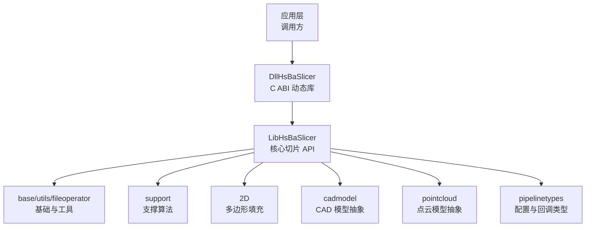
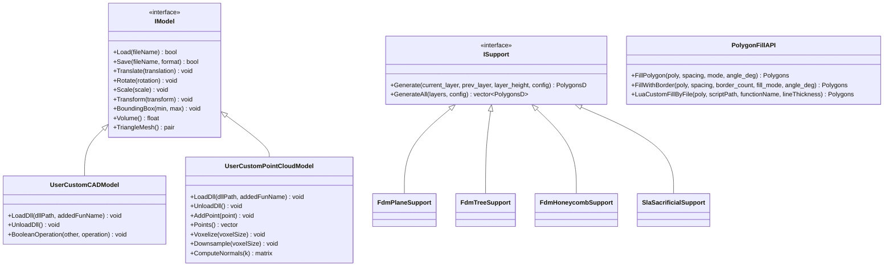
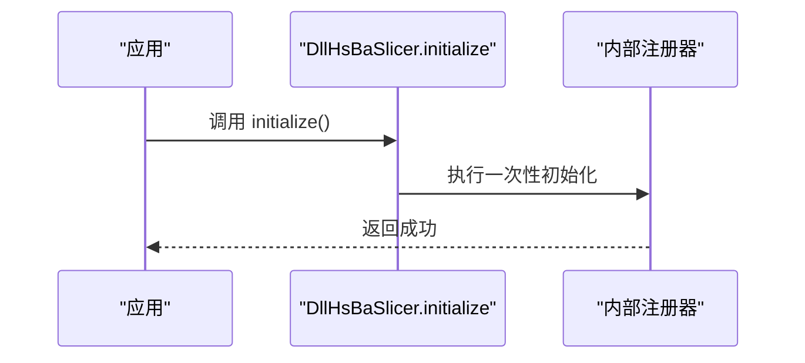
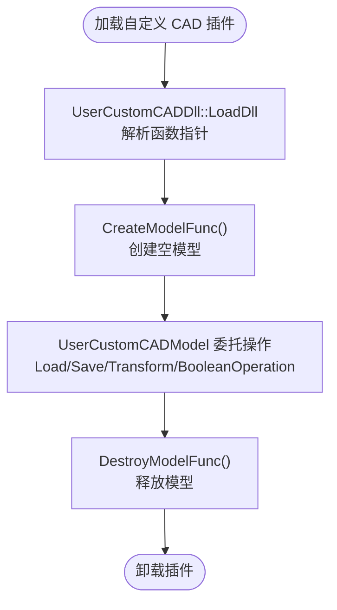
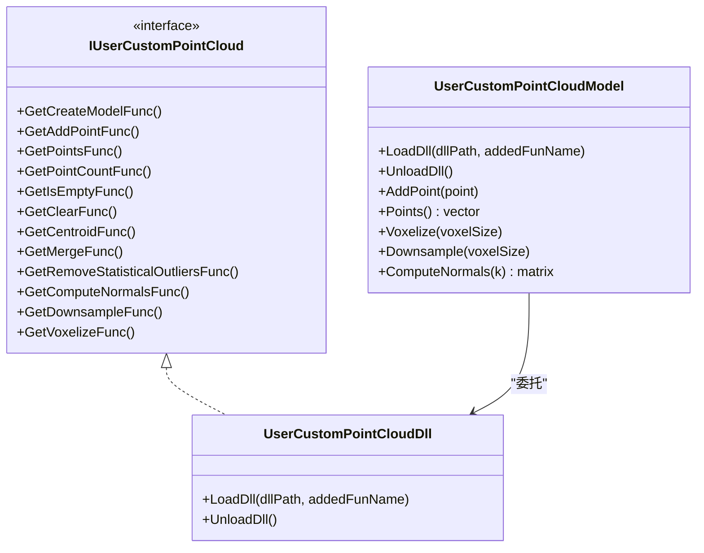
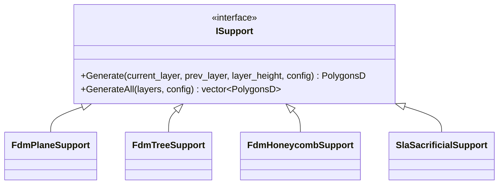
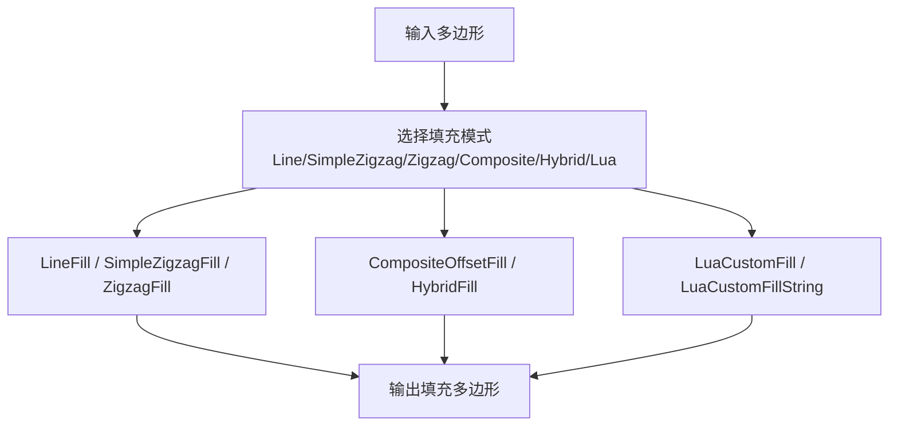
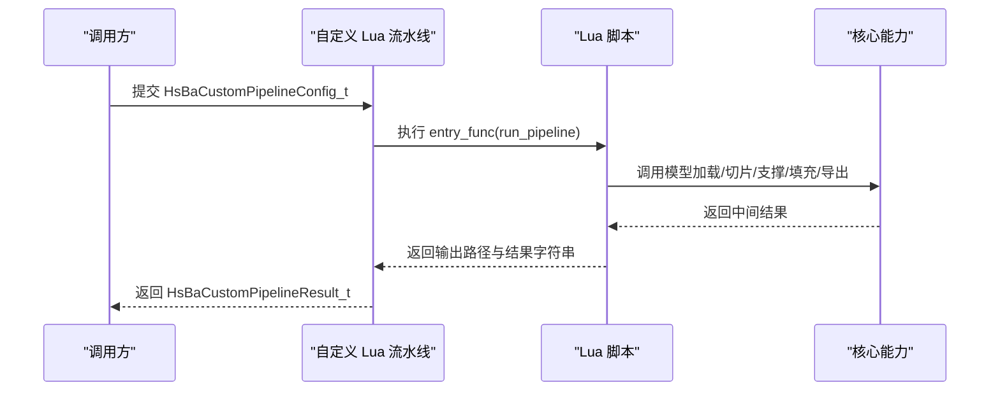
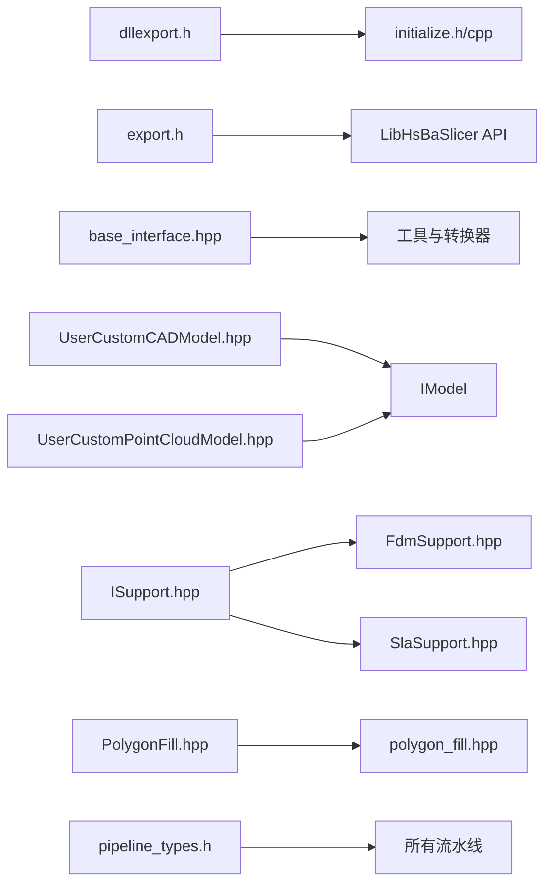

# 扩展开发指南

<cite>
**本文引用的文件**   
- [README.md](file://README.md)
- [initialize.h](file://DllHsBaSlicer/initialize.h)
- [initialize.cpp](file://DllHsBaSlicer/initialize.cpp)
- [dllexport.h](file://DllHsBaSlicer/dllexport.h)
- [export.h](file://LibHsBaSlicer/export.h)
- [base_interface.hpp](file://base/base_interface.hpp)
- [UserCustomCADModel.hpp](file://cadmodel/UserCustomCADModel.hpp)
- [UserCustomPointCloudModel.hpp](file://pointcloud/UserCustomPointCloudModel.hpp)
- [ISupport.hpp](file://support/ISupport.hpp)
- [FdmSupport.hpp](file://support/FdmSupport.hpp)
- [SlaSupport.hpp](file://support/SlaSupport.hpp)
- [polygon_fill.hpp](file://LibHsBaSlicer/Fill/polygon_fill.hpp)
- [PolygonFill.hpp](file://2D/PolygonFill.hpp)
- [pipeline_types.h](file://pipelinetypes/pipeline_types.h)
</cite>

## 目录
1. [引言](#引言)
2. [项目结构](#项目结构)
3. [核心组件](#核心组件)
4. [架构总览](#架构总览)
5. [详细组件分析](#详细组件分析)
6. [依赖关系分析](#依赖关系分析)
7. [性能与内存管理](#性能与内存管理)
8. [调试与故障排除](#调试与故障排除)
9. [结论](#结论)
10. [附录：插件模板与构建部署](#附录插件模板与构建部署)

## 引言
本指南面向需要在 HsBaSlicer 中实现自定义算法、插件和第三方库集成的开发者。文档围绕以下目标展开：
- 扩展点设计：模型抽象、支撑接口、填充接口、Lua 脚本管线。
- 插件加载机制：动态库（DLL/SO）加载、函数指针 ABI、生命周期管理。
- 自定义 CAD 模型与点云模型：通过外部库暴露工厂函数，统一接入 IModel。
- 自定义支撑与填充算法：继承 ISupport 或调用 PolygonFill/Lua 扩展。
- 事件系统、回调与进度监控：基于 C ABI 的进度与结果回调。
- 编译配置与部署：CMake 安装导出、find_package 引用、头文件布局。
- 性能优化与调试：避免重复分配、合理使用线程池、日志与错误处理。

## 项目结构
HsBaSlicer 采用模块化分层设计，扩展能力主要分布在以下位置：
- DllHsBaSlicer：对外导出 C ABI 的动态库入口与初始化逻辑。
- LibHsBaSlicer：封装核心切片能力的静态库 API。
- base / utils / fileoperator：基础类型、工具、序列化与 Lua 绑定。
- cadmodel / pointcloud：CAD 与点云模型抽象及用户自定义插件加载器。
- support / 2D：支撑生成与多边形填充算法。
- pipelinetypes：跨语言兼容的配置与回调类型定义。

图表来源
- [README.md:25-39](file://README.md#L25-L39)
- [initialize.h:1-22](file://DllHsBaSlicer/initialize.h#L1-L22)
- [pipeline_types.h:1-12](file://pipelinetypes/pipeline_types.h#L1-L12)

章节来源
- [README.md:25-39](file://README.md#L25-L39)

## 核心组件
本节聚焦扩展开发的关键组件与扩展点：
- 动态库初始化与导出宏：用于注册 Lua 函数、流水线与一次性运行时设置。
- 模型抽象接口：IModel 及其用户自定义 CAD/点云模型适配器。
- 支撑算法接口：ISupport 及 FDM/SLA 具体实现。
- 填充算法接口：PolygonFill 与 LibHsBaSlicer 包装 API。
- 配置与回调类型：C ABI 的结构体与回调函数，贯穿所有流水线。

章节来源
- [initialize.h:1-22](file://DllHsBaSlicer/initialize.h#L1-L22)
- [initialize.cpp:1-10](file://DllHsBaSlicer/initialize.cpp#L1-L10)
- [dllexport.h:1-23](file://DllHsBaSlicer/dllexport.h#L1-L23)
- [export.h:1-22](file://LibHsBaSlicer/export.h#L1-L22)
- [ISupport.hpp:1-49](file://support/ISupport.hpp#L1-L49)
- [FdmSupport.hpp:1-67](file://support/FdmSupport.hpp#L1-L67)
- [SlaSupport.hpp:1-46](file://support/SlaSupport.hpp#L1-L46)
- [polygon_fill.hpp:1-58](file://LibHsBaSlicer/Fill/polygon_fill.hpp#L1-L58)
- [PolygonFill.hpp:1-141](file://2D/PolygonFill.hpp#L1-L141)
- [pipeline_types.h:1-12](file://pipelinetypes/pipeline_types.h#L1-L12)

## 架构总览
HsBaSlicer 的扩展架构以“接口 + 动态库加载 + Lua 脚本”为核心：
- 接口层：IModel、ISupport、PolygonFill 等提供稳定扩展点。
- 动态库层：UserCustomCADModel 与 UserCustomPointCloudModel 通过 DLL/SO 加载第三方实现。
- 脚本层：Lua 支持自定义填充、支撑、导出与完整流水线。
- 配置层：pipelinetypes 提供跨语言兼容的配置与回调类型。

图表来源
- [UserCustomCADModel.hpp:27-121](file://cadmodel/UserCustomCADModel.hpp#L27-L121)
- [UserCustomPointCloudModel.hpp:26-171](file://pointcloud/UserCustomPointCloudModel.hpp#L26-L171)
- [ISupport.hpp:22-45](file://support/ISupport.hpp#L22-L45)
- [FdmSupport.hpp:19-63](file://support/FdmSupport.hpp#L19-L63)
- [SlaSupport.hpp:20-42](file://support/SlaSupport.hpp#L20-L42)
- [polygon_fill.hpp:17-53](file://LibHsBaSlicer/Fill/polygon_fill.hpp#L17-L53)

## 详细组件分析

### 动态库初始化与导出宏
- initialize.h/cpp 提供 C ABI 的 initialize 入口，用于一次性注册 Lua 函数、流水线与运行时设置。
- dllexport.h 与 export.h 分别定义 HSBA_SLICER_API 与 HSBA_SLICER_LIB_API 导出宏，确保 Windows 与非 Windows 平台的符号导出一致性。

图表来源
- [initialize.h:14-19](file://DllHsBaSlicer/initialize.h#L14-L19)
- [initialize.cpp:7-9](file://DllHsBaSlicer/initialize.cpp#L7-L9)

章节来源
- [initialize.h:1-22](file://DllHsBaSlicer/initialize.h#L1-L22)
- [initialize.cpp:1-10](file://DllHsBaSlicer/initialize.cpp#L1-L10)
- [dllexport.h:1-23](file://DllHsBaSlicer/dllexport.h#L1-L23)
- [export.h:1-22](file://LibHsBaSlicer/export.h#L1-L22)

### 自定义 CAD 模型插件
- IUserCustomCAD 定义了外部 CAD 库必须实现的函数指针契约，包括创建/销毁模型、布尔运算、基本几何体工厂、厚度设置与挤压操作。
- UserCustomCADDll 负责加载用户提供的 DLL/SO，解析并缓存函数指针。
- UserCustomCADModel 作为 IModel 适配器，将 Load/Save/Transform/BoundingBox/Volume/TriangleMesh 等操作委托给底层 CAD 库。

图表来源
- [UserCustomCADModel.hpp:27-48](file://cadmodel/UserCustomCADModel.hpp#L27-L48)
- [UserCustomCADModel.hpp:53-73](file://cadmodel/UserCustomCADModel.hpp#L53-L73)
- [UserCustomCADModel.hpp:79-121](file://cadmodel/UserCustomCADModel.hpp#L79-L121)

章节来源
- [UserCustomCADModel.hpp:1-126](file://cadmodel/UserCustomCADModel.hpp#L1-L126)

### 自定义点云模型插件
- IUserCustomPointCloud 定义了点云内核的 C 函数指针契约，包括增删点、统计、法线估计、体素化与下采样。
- UserCustomPointCloudDll 加载并暴露这些函数指针。
- UserCustomPointCloudModel 作为 IModel 实现，同时提供点云专属 API（AddPoint/Points/Voxelize/Downsample/ComputeNormals），与 OpenVdbModel 保持一致以便替换。

图表来源
- [UserCustomPointCloudModel.hpp:26-57](file://pointcloud/UserCustomPointCloudModel.hpp#L26-L57)
- [UserCustomPointCloudModel.hpp:62-88](file://pointcloud/UserCustomPointCloudModel.hpp#L62-L88)
- [UserCustomPointCloudModel.hpp:96-171](file://pointcloud/UserCustomPointCloudModel.hpp#L96-L171)

章节来源
- [UserCustomPointCloudModel.hpp:1-177](file://pointcloud/UserCustomPointCloudModel.hpp#L1-L177)

### 自定义支撑算法
- ISupport 是支撑生成器的抽象接口，提供 Generate 与 GenerateAll 方法。
- FdmPlaneSupport、FdmTreeSupport、FdmHoneycombSupport 为 FDM 的具体策略。
- SlaSacrificialSupport 为 SLA 牺牲型支撑策略，并提供带 SLA 配置的静态重载。

图表来源
- [ISupport.hpp:22-45](file://support/ISupport.hpp#L22-L45)
- [FdmSupport.hpp:19-63](file://support/FdmSupport.hpp#L19-L63)
- [SlaSupport.hpp:20-42](file://support/SlaSupport.hpp#L20-L42)

章节来源
- [ISupport.hpp:1-49](file://support/ISupport.hpp#L1-L49)
- [FdmSupport.hpp:1-67](file://support/FdmSupport.hpp#L1-L67)
- [SlaSupport.hpp:1-46](file://support/SlaSupport.hpp#L1-L46)

### 自定义填充算法
- PolygonFill.hpp 提供偏移、直线、简单折线、高级折线、复合与混合填充算法，以及 Lua 自定义填充。
- polygon_fill.hpp 在 LibHsBaSlicer 层提供 C++ API 包装，便于上层直接调用 FillPolygon、FillWithBorder 与 LuaCustomFillByFile。

图表来源
- [PolygonFill.hpp:20-137](file://2D/PolygonFill.hpp#L20-L137)
- [polygon_fill.hpp:17-53](file://LibHsBaSlicer/Fill/polygon_fill.hpp#L17-L53)

章节来源
- [PolygonFill.hpp:1-141](file://2D/PolygonFill.hpp#L1-L141)
- [polygon_fill.hpp:1-58](file://LibHsBaSlicer/Fill/polygon_fill.hpp#L1-L58)

### Lua 脚本系统与完整流水线
- pipeline_types.h 定义了所有流水线的配置结构与回调类型，包括 FDM、SLA、SLS、SLM、LOM、TDP、WAAM、文件传输与自定义 Lua 流水线。
- 自定义 Lua 流水线允许完全由脚本定义阶段顺序与内容，C++ 侧仅暴露模型加载、切片、支撑、填充、地板、路径输出与打包等能力。

图表来源
- [pipeline_types.h:676-732](file://pipelinetypes/pipeline_types.h#L676-L732)

章节来源
- [pipeline_types.h:1-12](file://pipelinetypes/pipeline_types.h#L1-L12)
- [pipeline_types.h:676-732](file://pipelinetypes/pipeline_types.h#L676-L732)

## 依赖关系分析
- 动态库导出宏：dllexport.h 与 export.h 分别控制共享库与静态库的符号可见性。
- 基础接口：base_interface.hpp 提供 ITranslator 模板接口，用于类型与字符串之间的转换。
- 模型与算法：UserCustomCADModel/UserCustomPointCloudModel 依赖 IModel；支撑与填充依赖 ISupport 与 PolygonFill。
- 配置与回调：pipelinetypes 提供统一的 C ABI 类型，供 DllHsBaSlicer 与 LibHsBaSlicer 共同使用。

图表来源
- [dllexport.h:1-23](file://DllHsBaSlicer/dllexport.h#L1-L23)
- [export.h:1-22](file://LibHsBaSlicer/export.h#L1-L22)
- [base_interface.hpp:15-25](file://base/base_interface.hpp#L15-L25)
- [UserCustomCADModel.hpp:79-121](file://cadmodel/UserCustomCADModel.hpp#L79-L121)
- [UserCustomPointCloudModel.hpp:96-171](file://pointcloud/UserCustomPointCloudModel.hpp#L96-L171)
- [ISupport.hpp:22-45](file://support/ISupport.hpp#L22-L45)
- [FdmSupport.hpp:19-63](file://support/FdmSupport.hpp#L19-L63)
- [SlaSupport.hpp:20-42](file://support/SlaSupport.hpp#L20-L42)
- [PolygonFill.hpp:20-137](file://2D/PolygonFill.hpp#L20-L137)
- [polygon_fill.hpp:17-53](file://LibHsBaSlicer/Fill/polygon_fill.hpp#L17-L53)
- [pipeline_types.h:1-12](file://pipelinetypes/pipeline_types.h#L1-L12)

章节来源
- [dllexport.h:1-23](file://DllHsBaSlicer/dllexport.h#L1-L23)
- [export.h:1-22](file://LibHsBaSlicer/export.h#L1-L22)
- [base_interface.hpp:1-28](file://base/base_interface.hpp#L1-L28)
- [pipeline_types.h:1-12](file://pipelinetypes/pipeline_types.h#L1-L12)

## 性能与内存管理
- 动态库加载与函数指针解析应尽量避免重复解析，建议在初始化阶段完成一次加载与缓存。
- 点云与 CAD 模型的创建/销毁需严格遵循 IUserCustomCAD/IUserCustomPointCloud 契约，避免悬垂指针与内存泄漏。
- 填充与支撑算法在处理大量多边形时，建议使用批量操作与预分配容器，减少临时对象分配。
- 使用线程池与协程（如 base 模块中的 thread_pool/coroutine）对独立计算阶段进行并行化，但需注意线程安全与锁粒度。
- 对于大模型与高像素图像输出，建议启用流式写入与分块处理，降低峰值内存占用。

[本节为通用指导，不直接分析具体文件]

## 调试与故障排除
- 初始化失败：检查 initialize() 是否被正确调用，确认 Lua 与流水线注册是否成功。
- 动态库加载失败：确认 DLL/SO 路径与 exported function name 匹配，ABI 类型一致（HsBaVector3f_t 等）。
- 回调未触发：检查进度与结果回调是否正确传入 user_data，并确保调用方在异步流程中保持进程存活。
- 内存泄漏：确保所有通过 C ABI 返回的 char* 字段（如 gcode_content、error_message、export_path）均按约定释放。
- 日志与错误信息：利用 logger 模块记录关键步骤与异常堆栈，结合错误消息定位问题。

章节来源
- [initialize.h:14-19](file://DllHsBaSlicer/initialize.h#L14-L19)
- [pipeline_types.h:120-140](file://pipelinetypes/pipeline_types.h#L120-L140)
- [pipeline_types.h:220-245](file://pipelinetypes/pipeline_types.h#L220-L245)
- [pipeline_types.h:285-310](file://pipelinetypes/pipeline_types.h#L285-L310)
- [pipeline_types.h:378-401](file://pipelinetypes/pipeline_types.h#L378-L401)
- [pipeline_types.h:438-461](file://pipelinetypes/pipeline_types.h#L438-L461)
- [pipeline_types.h:498-521](file://pipelinetypes/pipeline_types.h#L498-L521)
- [pipeline_types.h:602-625](file://pipelinetypes/pipeline_types.h#L602-L625)
- [pipeline_types.h:654-674](file://pipelinetypes/pipeline_types.h#L654-L674)
- [pipeline_types.h:706-732](file://pipelinetypes/pipeline_types.h#L706-L732)

## 结论
HsBaSlicer 通过稳定的接口与动态库加载机制，为自定义 CAD/点云模型、支撑与填充算法提供了高度可扩展的框架。配合 Lua 脚本系统，开发者可以灵活定制从模型预处理到最终输出的完整流水线。遵循本文的扩展点设计与生命周期管理规范，可实现高性能、可维护且易于部署的定制化切片解决方案。

[本节为总结性内容，不直接分析具体文件]

## 附录：插件模板与构建部署

### 插件开发模板要点
- 动态库导出函数：
  - 提供 create_model/destroy_model 等工厂函数，遵循 IUserCustomCAD/IUserCustomPointCloud 的函数指针签名。
  - 使用 HsBaVector3f_t 等共享 ABI 类型，确保跨平台兼容性。
- 生命周期管理：
  - 在插件加载时解析函数指针并缓存。
  - 在模型销毁时释放底层资源，避免悬挂指针。
- 错误处理：
  - 对无效参数、IO 失败、几何非法等情况返回明确状态码或抛出异常（在 C ABI 边界转换为错误消息）。

章节来源
- [UserCustomCADModel.hpp:27-48](file://cadmodel/UserCustomCADModel.hpp#L27-L48)
- [UserCustomPointCloudModel.hpp:26-57](file://pointcloud/UserCustomPointCloudModel.hpp#L26-L57)

### 编译配置与部署
- 构建要求：
  - CMake >= 3.28，支持 C++20 的编译器，vcpkg 推荐用于依赖管理。
- 安装与导出：
  - 使用 cmake --install 安装后，下游项目可通过 find_package(HsBaSlicer) 引用。
  - 头文件布局包含 dllexport.h、各 *_pipeline.h、LibHsBaSlicer/export.h 等。
- 下游引用示例：
  - target_link_libraries(my_app PRIVATE HsBaSlicer::DllHsBaSlicer)

章节来源
- [README.md:41-94](file://README.md#L41-L94)
- [README.md:100-124](file://README.md#L100-L124)
- [README.md:126-179](file://README.md#L126-L179)