# 扩展开发指南

<cite>
**本文引用的文件**   
- [README.md](file://README.md)
- [lua_pipeline.hpp](file://LibHsBaSlicer/Extends/lua_pipeline.hpp)
- [LuaAddFunction.hpp](file://LibHsBaSlicer/Extends/LuaAddFunction.hpp)
- [EventSourceFunction.hpp](file://LibHsBaSlicer/Extends/EventSourceFunction.hpp)
- [export.h](file://LibHsBaSlicer/export.h)
- [lua_register.h](file://DllHsBaSlicer/lua_register.h)
- [lua_pipeline_api.md](file://docs/zh/lua_pipeline_api.md)
- [my_fdm_pipeline.lua](file://samples/Custom/scripts/my_fdm_pipeline.lua)
- [my_infill.lua](file://samples/FDM/scripts/my_infill.lua)
- [my_support.lua](file://samples/FDM/scripts/my_support.lua)
- [my_sla_floor.lua](file://samples/SLA/scripts/my_sla_floor.lua)
- [my_sla_support.lua](file://samples/SLA/scripts/my_sla_support.lua)
- [my_sls_export.lua](file://samples/SLS/scripts/my_sls_export.lua)
</cite>

## 目录
1. [引言](#引言)
2. [项目结构](#项目结构)
3. [核心组件](#核心组件)
4. [架构总览](#架构总览)
5. [详细组件分析](#详细组件分析)
6. [依赖关系分析](#依赖关系分析)
7. [性能与调试](#性能与调试)
8. [故障排查](#故障排查)
9. [结论](#结论)
10. [附录：注册与打包最佳实践](#附录注册与打包最佳实践)

## 引言
本指南面向希望定制和扩展 HsBaSlicer 功能的开发者，系统讲解 Lua 脚本扩展机制、插件架构设计模式、事件系统与回调机制、自定义算法开发流程（填充、支撑、导出）、模型加载器注册、输出格式扩展、脚本调试技巧与性能优化建议，以及插件打包与分发最佳实践。文档以仓库现有源码与示例为依据，确保内容可落地、可验证。

## 项目结构
HsBaSlicer 提供两条主要扩展路径：
- 完全由 Lua 驱动的自定义流水线：通过全局 `HsBa` 算子表编排“加载→切片→支撑→填充→路径→写文件”的完整流程。
- 内置流水线阶段替换：在支撑、填充、地板、导出等固定阶段注入用户脚本，替换默认算法。

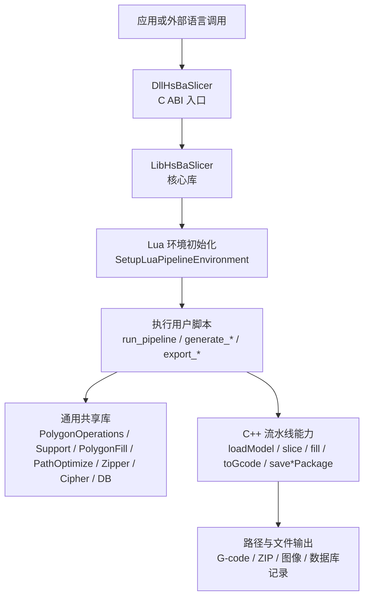

图示来源
- [lua_register.h:21-31](file://DllHsBaSlicer/lua_register.h#L21-L31)
- [lua_pipeline.hpp:53-83](file://LibHsBaSlicer/Extends/lua_pipeline.hpp#L53-L83)
- [lua_pipeline_api.md:19-28](file://docs/zh/lua_pipeline_api.md#L19-L28)

章节来源
- [README.md:25-39](file://README.md#L25-L39)
- [lua_pipeline_api.md:19-28](file://docs/zh/lua_pipeline_api.md#L19-L28)

## 核心组件
- 自定义流水线上下文与运行接口：定义脚本输入、进度回调、结果收集与运行入口。
- Lua 函数注册体系：按维度（2D/3D/File）注册扩展函数；按事件名注册回调。
- 事件源回调：Zipper 与数据库事件回调的统一注册与获取。
- C ABI 注册接口：供动态库暴露给外部语言进行扩展注册。

章节来源
- [lua_pipeline.hpp:19-83](file://LibHsBaSlicer/Extends/lua_pipeline.hpp#L19-L83)
- [LuaAddFunction.hpp:21-74](file://LibHsBaSlicer/Extends/LuaAddFunction.hpp#L21-L74)
- [EventSourceFunction.hpp:18-41](file://LibHsBaSlicer/Extends/EventSourceFunction.hpp#L18-L41)
- [lua_register.h:21-31](file://DllHsBaSlicer/lua_register.h#L21-L31)

## 架构总览
下图展示从 C ABI 到 Lua 脚本再到核心能力的调用链，以及扩展点位置。

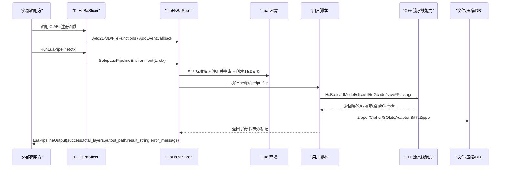

图示来源
- [lua_register.h:21-31](file://DllHsBaSlicer/lua_register.h#L21-L31)
- [lua_pipeline.hpp:53-83](file://LibHsBaSlicer/Extends/lua_pipeline.hpp#L53-L83)
- [lua_pipeline_api.md:48-133](file://docs/zh/lua_pipeline_api.md#L48-L133)

## 详细组件分析

### 自定义流水线 API 与环境
- 上下文对象包含脚本来源、入口函数名、配置 JSON、默认输出路径、模型信息、进度回调。
- 运行接口负责创建 Lua 状态、设置环境、执行脚本并收集结果。
- 全局 `HsBa` 算子表提供模型管理、切片、坐标转换、填充、支撑、地板、路径生成、打包导出、文件读写与进度上报。

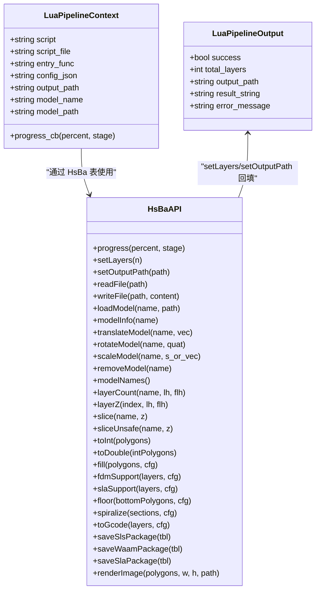

图示来源
- [lua_pipeline.hpp:19-83](file://LibHsBaSlicer/Extends/lua_pipeline.hpp#L19-L83)
- [lua_pipeline_api.md:48-133](file://docs/zh/lua_pipeline_api.md#L48-L133)

章节来源
- [lua_pipeline.hpp:19-83](file://LibHsBaSlicer/Extends/lua_pipeline.hpp#L19-L83)
- [lua_pipeline_api.md:48-133](file://docs/zh/lua_pipeline_api.md#L48-L133)

### 扩展点识别与插件架构
- 扩展点一：2D/3D/File 三类 Lua 函数注册。用于向不同流水线阶段注入新能力。
- 扩展点二：事件回调注册。按事件名绑定 Lua 注册函数，实现 Zipper/DB 等子系统的事件钩子。
- 扩展点三：事件源回调。C++ 侧统一维护 Zipper/DB 事件回调列表，便于跨模块通知。

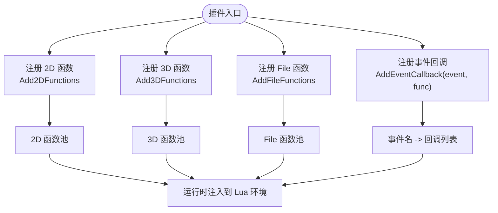

图示来源
- [LuaAddFunction.hpp:21-74](file://LibHsBaSlicer/Extends/LuaAddFunction.hpp#L21-L74)
- [EventSourceFunction.hpp:18-41](file://LibHsBaSlicer/Extends/EventSourceFunction.hpp#L18-L41)

章节来源
- [LuaAddFunction.hpp:21-74](file://LibHsBaSlicer/Extends/LuaAddFunction.hpp#L21-L74)
- [EventSourceFunction.hpp:18-41](file://LibHsBaSlicer/Extends/EventSourceFunction.hpp#L18-L41)

### 内置函数参考与可用库
- 几何与布尔运算：`PolygonOperations`（union/intersection/difference/xor/offsetOperation/convexHullOperation/makeCircle/makeRectangle/makeRegularPolygon/area 等）。
- 填充算法：`PolygonFill`（zigzagFill/lineFill/offsetFill/compositeOffsetFill/hybridFill/offsetOnly）。
- 路径优化：`PathOptimize`（optimizeRegions/optimizePolygons/new/addRegion/addPolygons/addRoute/optimizeOrder/buildPaths/buildPolygons）。
- 支撑工具：`Support`（new_plane/new_tree/new_honeycomb/new_sla/new_lua/generate/detect_overhang/default_config）。
- 编解码与压缩：`Cipher`（base64/hex）、`Zipper`/`Bit7zZipper`。
- 数据库适配器：`SQLiteAdapter`/`MySQLAdapter`/`PostgreSQLAdapter`（Connect/Execute/Query/Insert/Update/Delete/CreateTable）。
- 参数持久化：`ParamStore`（EnsureSchema/Save/Load/List/Update/Delete）。

章节来源
- [lua_pipeline_api.md:136-212](file://docs/zh/lua_pipeline_api.md#L136-L212)

### 自定义算法开发流程

#### 自定义填充算法
- 约定入口：`generate_fill(current_layer)`，参数为当前层多边形（已扣除壁厚），返回填充多边形表。
- 可用库：`PolygonOperations`、`PolygonFill`、`PathOptimize`。
- 典型步骤：计算包围盒 → 生成平行线/之字形 → 与轮廓求交 → 返回结果。

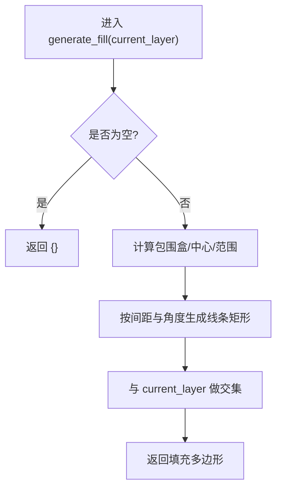

图示来源
- [my_infill.lua:1-89](file://samples/FDM/scripts/my_infill.lua#L1-L89)

章节来源
- [lua_pipeline_api.md:234-239](file://docs/zh/lua_pipeline_api.md#L234-L239)
- [my_infill.lua:1-89](file://samples/FDM/scripts/my_infill.lua#L1-L89)

#### 自定义支撑生成算法
- 约定入口：`generate_support()`，全局变量包括 `current_layer`、`prev_layer`、`layer_height`、`config`。
- 可用库：`PolygonOperations`、`Support`。
- 典型步骤：检测悬垂 → 选择生成器（平面/树状/蜂窝/SLA）→ 生成支撑 → 可选后处理（收缩接触点/面积过滤）。

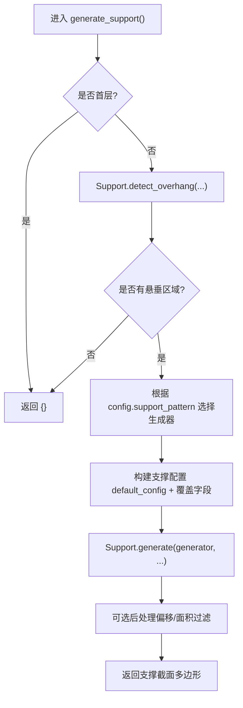

图示来源
- [my_support.lua:1-83](file://samples/FDM/scripts/my_support.lua#L1-L83)
- [my_sla_support.lua:1-76](file://samples/SLA/scripts/my_sla_support.lua#L1-L76)

章节来源
- [lua_pipeline_api.md:219-232](file://docs/zh/lua_pipeline_api.md#L219-L232)
- [my_support.lua:1-83](file://samples/FDM/scripts/my_support.lua#L1-L83)
- [my_sla_support.lua:1-76](file://samples/SLA/scripts/my_sla_support.lua#L1-L76)

#### SLA 地板生成算法
- 约定入口：`generate_floor(bottom_layer, config)`，参数传入底层多边形与配置表。
- 可用库：`PolygonOperations`、`PolygonFill`。
- 典型步骤：凸包简化 → Raft 外扩/内缩 → 边框环 → 内部填充 → 合并输出。

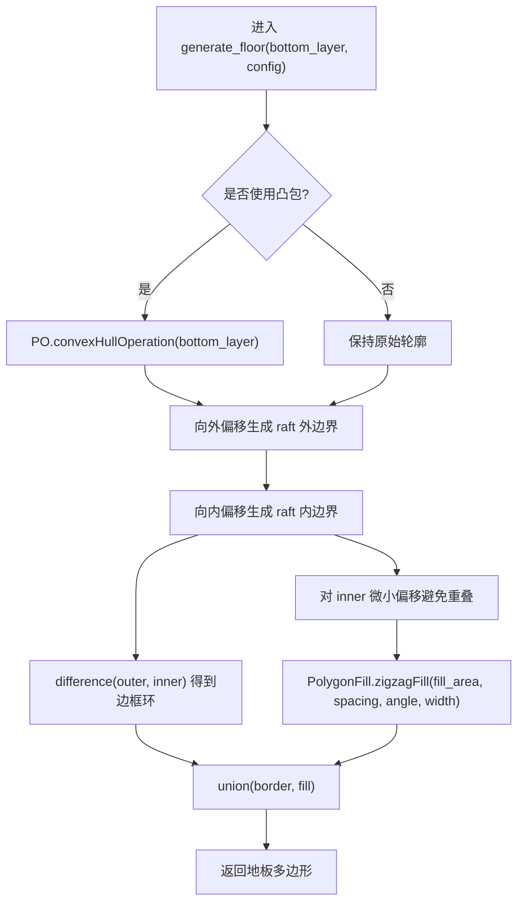

图示来源
- [my_sla_floor.lua:1-64](file://samples/SLA/scripts/my_sla_floor.lua#L1-L64)

章节来源
- [lua_pipeline_api.md:241-244](file://docs/zh/lua_pipeline_api.md#L241-L244)
- [my_sla_floor.lua:1-64](file://samples/SLA/scripts/my_sla_floor.lua#L1-L64)

#### 自定义导出格式（SLS 示例）
- 约定入口：`export_sls()`，全局变量包括 `config`、`images`、`output_path`。
- 可用库：`Zipper`、`Cipher`、`Bit7zZipper`、`SQLiteAdapter`/`MySQLAdapter`/`PostgreSQLAdapter`、`ParamStore`。
- 典型步骤：创建 zip → 写入配置与每层数据 → 写入 README → 保存压缩包 → 可选数据库记录。

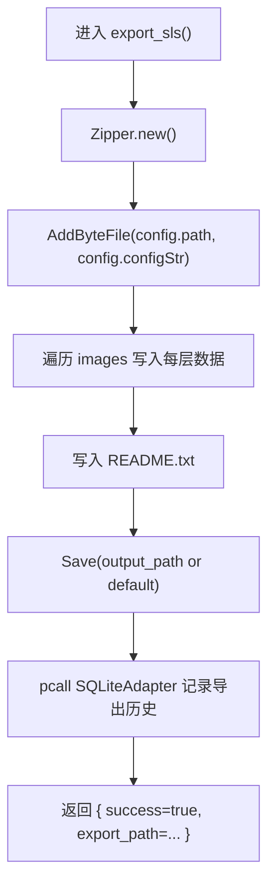

图示来源
- [my_sls_export.lua:1-80](file://samples/SLS/scripts/my_sls_export.lua#L1-L80)

章节来源
- [lua_pipeline_api.md:246-260](file://docs/zh/lua_pipeline_api.md#L246-L260)
- [my_sls_export.lua:1-80](file://samples/SLS/scripts/my_sls_export.lua#L1-L80)

### 事件系统与回调机制
- 事件回调注册：通过 `AddEventCallback(event_name, func)` 将 Lua 注册函数绑定到具体事件名（如 `zipper.on_add`、`db.on_query`）。
- 事件源回调：C++ 侧维护 Zipper/DB 事件回调列表，可在相应操作时触发。

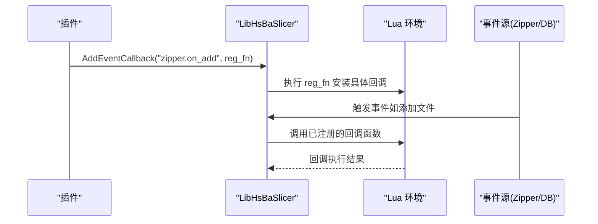

图示来源
- [LuaAddFunction.hpp:60-74](file://LibHsBaSlicer/Extends/LuaAddFunction.hpp#L60-L74)
- [EventSourceFunction.hpp:18-41](file://LibHsBaSlicer/Extends/EventSourceFunction.hpp#L18-L41)

章节来源
- [LuaAddFunction.hpp:60-74](file://LibHsBaSlicer/Extends/LuaAddFunction.hpp#L60-L74)
- [EventSourceFunction.hpp:18-41](file://LibHsBaSlicer/Extends/EventSourceFunction.hpp#L18-L41)

### 完全由 Lua 驱动的流水线示例
- 入口函数：`run_pipeline()`，C++ 侧通过 `RunLuaPipeline` 调用。
- 全局变量：`pipeline_config`、`output_path`、`model_name`、`model_path`、`machine`（可选）。
- 典型流程：加载模型 → 计算层数 → 逐层切片+填充 → 支撑（可选）→ 组装路径层 → 生成 G-code → 写文件 → 上报输出路径与层数。

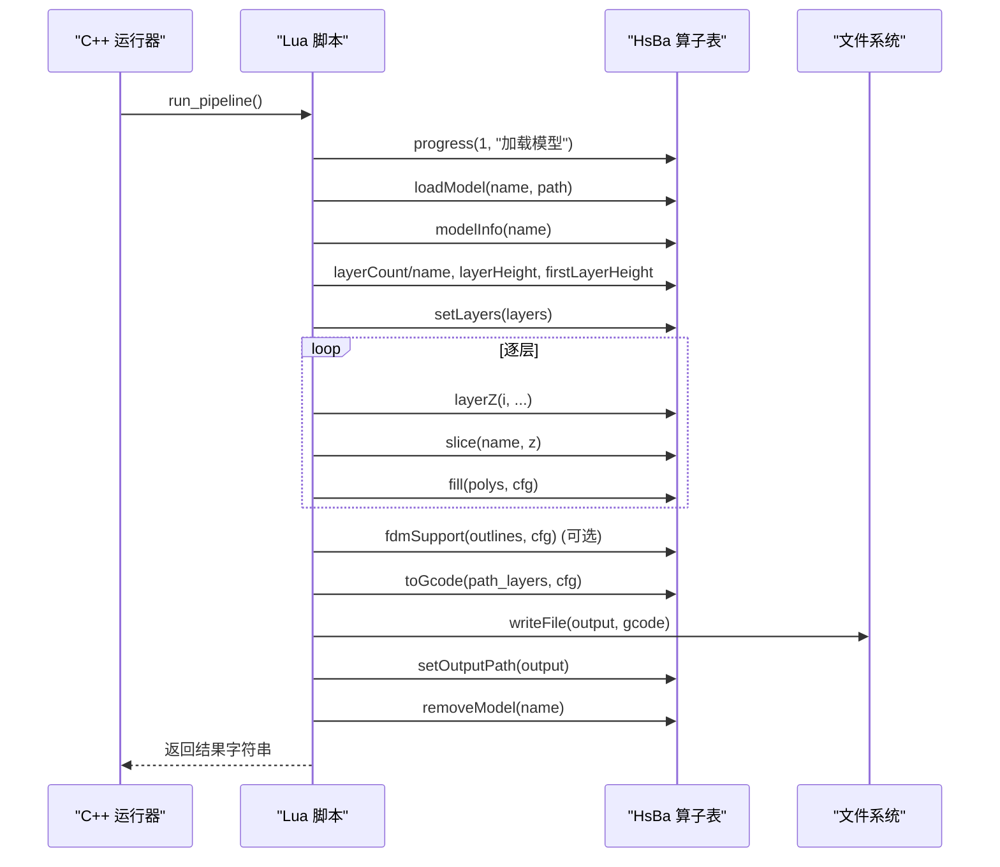

图示来源
- [my_fdm_pipeline.lua:1-172](file://samples/Custom/scripts/my_fdm_pipeline.lua#L1-L172)
- [lua_pipeline_api.md:48-133](file://docs/zh/lua_pipeline_api.md#L48-L133)

章节来源
- [my_fdm_pipeline.lua:1-172](file://samples/Custom/scripts/my_fdm_pipeline.lua#L1-L172)
- [lua_pipeline_api.md:48-133](file://docs/zh/lua_pipeline_api.md#L48-L133)

## 依赖关系分析
- 外部扩展通过 C ABI 暴露注册函数，被 DllHsBaSlicer 加载并转发至 LibHsBaSlicer。
- LibHsBaSlicer 维护三类函数池（2D/3D/File）与事件回调映射，运行时注入到 Lua 环境。
- 事件源回调集中管理 Zipper/DB 事件，便于跨模块通知与日志追踪。

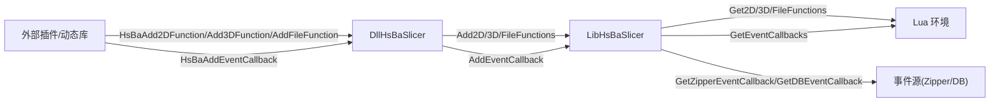

图示来源
- [lua_register.h:21-31](file://DllHsBaSlicer/lua_register.h#L21-L31)
- [LuaAddFunction.hpp:21-74](file://LibHsBaSlicer/Extends/LuaAddFunction.hpp#L21-L74)
- [EventSourceFunction.hpp:18-41](file://LibHsBaSlicer/Extends/EventSourceFunction.hpp#L18-L41)

章节来源
- [lua_register.h:21-31](file://DllHsBaSlicer/lua_register.h#L21-L31)
- [LuaAddFunction.hpp:21-74](file://LibHsBaSlicer/Extends/LuaAddFunction.hpp#L21-L74)
- [EventSourceFunction.hpp:18-41](file://LibHsBaSlicer/Extends/EventSourceFunction.hpp#L18-L41)

## 性能与调试
- 性能要点
  - 优先使用整型多边形进行布尔与填充运算，仅在必要时转换为浮点（`HsBa.toInt`/`HsBa.toDouble`）。
  - 合理设置填充间距与角度，避免过密导致路径过长。
  - 使用 `PathOptimize.optimizeRegions` 一键优化填充顺序，减少空走距离。
  - 批量写入文件与压缩，减少 I/O 次数；必要时使用 Bit7zZipper 一次生成 tar.gz/tar.xz。
  - 控制支撑密度与间隙，避免不必要的支撑体积。
- 调试技巧
  - 使用 `HsBa.progress(percent, stage)` 实时反馈进度，定位耗时阶段。
  - 在导出脚本中使用 `pcall` 包裹数据库操作，避免非致命错误中断主流程。
  - 利用 `PolygonOperations.dumpPolygon`/`dumpPolygons`（需启用编译宏）输出中间结果辅助诊断。
  - 在 Lua 中打印关键变量（层数、包围盒尺寸、填充数量）帮助确认数据流。

[本节为通用指导，不直接分析具体文件]

## 故障排查
- 常见问题
  - 导出脚本返回值类型错误：应返回 `{ success = true/false, export_path = "..." }`，否则可能导致 zip 被覆盖或为空。
  - 方法名大小写不一致：Lua 绑定的对象方法名必须与 C++ 一致（如 `AddByteFile`、`Save`）。
  - 数据库连接失败：使用 `pcall` 捕获异常，记录警告但不阻塞主流程。
  - 内存占用过高：避免一次性生成过多大对象，分块处理层数据。
- 定位手段
  - 检查 `LuaPipelineOutput.error_message` 获取 Lua 错误信息。
  - 通过 `HsBa.setProgress` 与日志输出定位问题阶段。
  - 使用最小可运行脚本逐步增加功能，缩小问题范围。

章节来源
- [lua_pipeline_api.md:246-260](file://docs/zh/lua_pipeline_api.md#L246-L260)
- [my_sls_export.lua:50-71](file://samples/SLS/scripts/my_sls_export.lua#L50-L71)

## 结论
HsBaSlicer 提供了完善的 Lua 扩展机制与插件架构，支持完全自定义流水线与内置阶段替换。开发者可通过 2D/3D/File 函数注册与事件回调机制扩展系统能力，结合丰富的内置库快速实现填充、支撑、导出等算法。遵循本文档的流程与最佳实践，可高效定制与分发插件，满足多样化切片需求。

[本节为总结性内容，不直接分析具体文件]

## 附录：注册与打包最佳实践
- 注册新的模型加载器
  - 通过 `Add3DFunctions` 或 `Add2DFunctions` 注入与模型相关的 Lua 函数，并在脚本中调用 `HsBa.loadModel` 等接口完成加载与管理。
  - 若需扩展模型元数据或预处理逻辑，可在前置脚本（`pipeline_lua_source`）中定义辅助函数。
- 注册新的填充算法
  - 在 `Add2DFunctions` 中注册自定义填充函数，并在填充阶段脚本中调用。
  - 遵循 `generate_fill(current_layer)` 约定，返回填充多边形表。
- 注册新的输出格式
  - 在 `AddFileFunctions` 中注册导出函数，并在导出阶段脚本中调用。
  - 遵循各工艺导出约定（如 SLS 的 `export_sls`），返回期望的结构体。
- 插件打包与分发
  - 将 Lua 脚本与必要的资源文件打包为 zip，并通过 `Zipper`/`Bit7zZipper` 写出。
  - 在导出脚本中记录导出历史（SQLite/MySQL/PostgreSQL），便于追溯与分析。
  - 使用 `ParamStore` 持久化流水线配置，支持后续复用与更新。

章节来源
- [LuaAddFunction.hpp:21-74](file://LibHsBaSlicer/Extends/LuaAddFunction.hpp#L21-L74)
- [lua_pipeline_api.md:246-260](file://docs/zh/lua_pipeline_api.md#L246-L260)
- [my_sls_export.lua:1-80](file://samples/SLS/scripts/my_sls_export.lua#L1-L80)