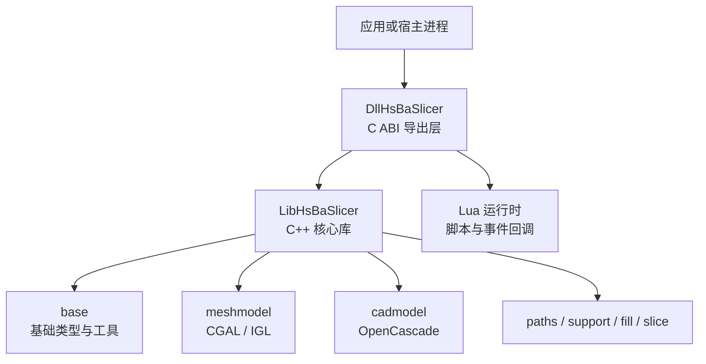
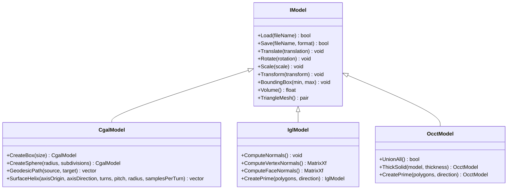
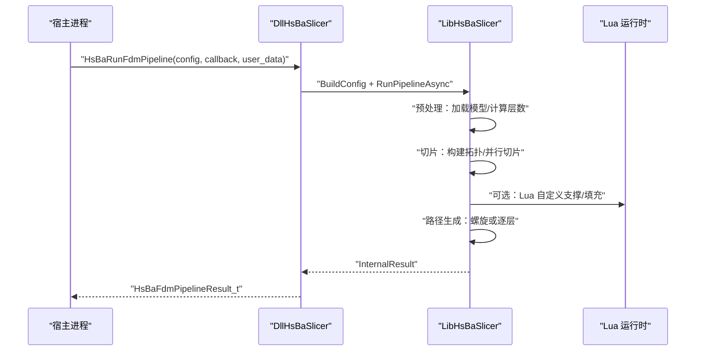
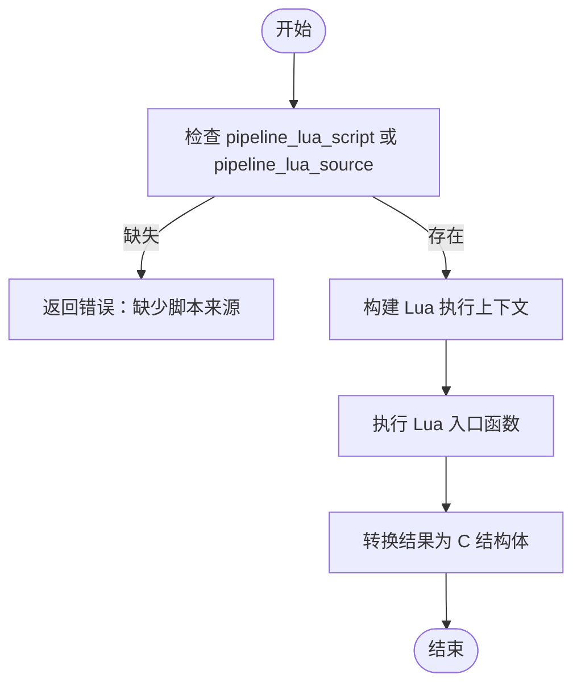
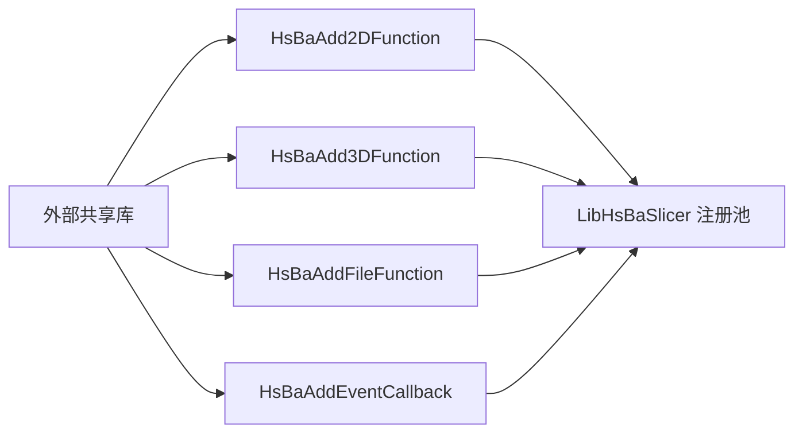
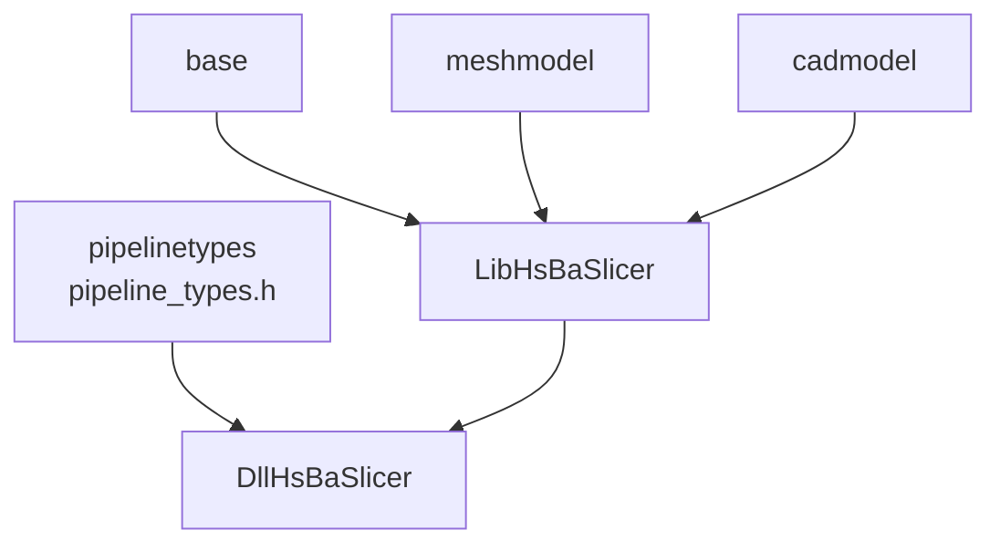

# 扩展开发指南

<cite>
**本文引用的文件**   
- [README.md](file://README.md)
- [docs/zh/README.md](file://docs/zh/README.md)
- [base/IModel.hpp](file://base/IModel.hpp)
- [meshmodel/CgalModel.hpp](file://meshmodel/CgalModel.hpp)
- [meshmodel/IglModel.hpp](file://meshmodel/IglModel.hpp)
- [cadmodel/OcctModel.hpp](file://cadmodel/OcctModel.hpp)
- [pipelinetypes/pipeline_types.h](file://pipelinetypes/pipeline_types.h)
- [DllHsBaSlicer/dllexport.h](file://DllHsBaSlicer/dllexport.h)
- [DllHsBaSlicer/initialize.h](file://DllHsBaSlicer/initialize.h)
- [DllHsBaSlicer/fdm_pipeline.h](file://DllHsBaSlicer/fdm_pipeline.h)
- [DllHsBaSlicer/custom_pipeline.h](file://DllHsBaSlicer/custom_pipeline.h)
- [DllHsBaSlicer/lua_register.h](file://DllHsBaSlicer/lua_register.h)
- [DllHsBaSlicer/fdm_pipeline.cpp](file://DllHsBaSlicer/fdm_pipeline.cpp)
- [DllHsBaSlicer/custom_pipeline.cpp](file://DllHsBaSlicer/custom_pipeline.cpp)
- [DllHsBaSlicer/lua_register.cpp](file://DllHsBaSlicer/lua_register.cpp)
- [LibHsBaSlicer/export.h](file://LibHsBaSlicer/export.h)
- [LibHsBaSlicer/Extends/LuaAddFunction.hpp](file://LibHsBaSlicer/Extends/LuaAddFunction.hpp)
- [LibHsBaSlicer/Extends/LuaCommonTypes.hpp](file://LibHsBaSlicer/Extends/LuaCommonTypes.hpp)
</cite>

## 目录
1. [引言](#引言)
2. [项目结构](#项目结构)
3. [核心组件](#核心组件)
4. [架构总览](#架构总览)
5. [详细组件分析](#详细组件分析)
6. [依赖关系分析](#依赖关系分析)
7. [性能与并发特性](#性能与并发特性)
8. [Lua 脚本扩展指南](#lua-脚本扩展指南)
9. [动态库加载与插件生命周期](#动态库加载与插件生命周期)
10. [自定义几何内核实现模式](#自定义几何内核实现模式)
11. [新流水线设计与实现](#新流水线设计与实现)
12. [故障排除与常见问题](#故障排除与常见问题)
13. [结论](#结论)
14. [附录：C ABI 配置与结果类型速查](#附录c-abi-配置与结果类型速查)

## 引言
本指南面向希望基于 HsBaSlicer 进行扩展开发的工程师，重点覆盖以下主题：
- 插件架构与扩展点机制
- 自定义几何内核（CGAL、IGL、OpenCascade）的实现模式
- 新流水线的设计方法，包括阶段定义、数据传递和错误处理
- Lua 脚本扩展的开发方式与性能优化技巧
- 动态库加载机制与插件生命周期管理
- 实际扩展示例与最佳实践

HsBaSlicer 提供两条主要扩展路径：
- C++ 静态库 LibHsBaSlicer：面向 C++ 调用者，封装预处理、切片、支撑、填充、路径生成等核心能力。
- C 动态库 DllHsBaSlicer：面向外部语言或宿主进程，通过 C ABI 暴露 FDM/SLA/SLS/SLM/LOM/WAAM/文件传输/自定义 Lua 流水线接口。

## 项目结构
从扩展视角看，仓库中与扩展开发最相关的目录如下：
- base：基础类型、任意对象访问、委托、协程、线程池等基础设施。
- meshmodel：网格模型后端（CGAL、IGL）。
- cadmodel：CAD 模型后端（OpenCascade）。
- pipelinetypes：所有流水线的 C 兼容配置与结果类型定义。
- DllHsBaSlicer：C ABI 导出层，包含各工艺流水线实现与 Lua 注册入口。
- LibHsBaSlicer：C++ 静态库，提供核心算法与扩展点（Lua 函数注册、通用类型注册）。
- samples：示例工程，演示如何集成和使用流水线。

图表来源
- [README.md:25-39](file://README.md#L25-L39)
- [docs/zh/README.md:14-49](file://docs/zh/README.md#L14-L49)

章节来源
- [README.md:25-39](file://README.md#L25-L39)
- [docs/zh/README.md:14-49](file://docs/zh/README.md#L14-L49)

## 核心组件
本节聚焦扩展开发中最常用的核心组件：
- 几何模型抽象 IModel：统一 Load/Save、变换、包围盒、体积、三角网格导出。
- 三种几何后端：CgalModel、IglModel、OcctModel。
- 流水线 C ABI：FDM、SLA、SLS、SLM、LOM、WAAM、文件传输、自定义 Lua 流水线。
- Lua 扩展点：2D/3D/File 维度函数注册、事件回调注册、通用 AnyObject 类型注册。

章节来源
- [base/IModel.hpp:110-139](file://base/IModel.hpp#L110-L139)
- [meshmodel/CgalModel.hpp:26-103](file://meshmodel/CgalModel.hpp#L26-L103)
- [meshmodel/IglModel.hpp:18-112](file://meshmodel/IglModel.hpp#L18-L112)
- [cadmodel/OcctModel.hpp:22-109](file://cadmodel/OcctModel.hpp#L22-L109)
- [pipelinetypes/pipeline_types.h:54-113](file://pipelinetypes/pipeline_types.h#L54-L113)
- [pipelinetypes/pipeline_types.h:165-218](file://pipelinetypes/pipeline_types.h#L165-L218)
- [pipelinetypes/pipeline_types.h:680-704](file://pipelinetypes/pipeline_types.h#L680-L704)

## 架构总览
HsBaSlicer 的扩展架构围绕“接口抽象 + 后端实现 + 流水线编排 + Lua 扩展”展开：
- IModel 是几何内核的统一抽象，允许替换 CGAL、IGL、OpenCascade 等不同后端。
- DllHsBaSlicer 通过 C ABI 暴露流水线接口，内部使用 LibHsBaSlicer 的核心能力。
- Lua 扩展点允许在切片、支撑、填充、输出等阶段注入自定义逻辑。
- 通用 AnyObject 类型系统让 C++ 与 Lua 之间可以安全地传递向量、矩阵、多边形等几何数据。

图表来源
- [base/IModel.hpp:110-139](file://base/IModel.hpp#L110-L139)
- [meshmodel/CgalModel.hpp:26-103](file://meshmodel/CgalModel.hpp#L26-L103)
- [meshmodel/IglModel.hpp:18-112](file://meshmodel/IglModel.hpp#L18-L112)
- [cadmodel/OcctModel.hpp:22-109](file://cadmodel/OcctModel.hpp#L22-L109)

## 详细组件分析

### FDM 流水线 C ABI
FDM 流水线对外暴露创建默认配置、同步运行、异步运行、释放结果等接口。其内部流程为：
- 预处理：加载模型、计算包围盒与层数。
- 切片：构建拓扑并并行切片。
- 支撑：支持内置算法与 Lua 自定义支撑。
- 填充：支持内置填充与 Lua 自定义填充。
- 路径生成：根据是否启用螺旋模式生成连续路径或逐层路径。

图表来源
- [DllHsBaSlicer/fdm_pipeline.h:17-61](file://DllHsBaSlicer/fdm_pipeline.h#L17-L61)
- [DllHsBaSlicer/fdm_pipeline.cpp:219-447](file://DllHsBaSlicer/fdm_pipeline.cpp#L219-L447)

章节来源
- [DllHsBaSlicer/fdm_pipeline.h:17-61](file://DllHsBaSlicer/fdm_pipeline.h#L17-L61)
- [DllHsBaSlicer/fdm_pipeline.cpp:142-197](file://DllHsBaSlicer/fdm_pipeline.cpp#L142-L197)
- [DllHsBaSlicer/fdm_pipeline.cpp:219-447](file://DllHsBaSlicer/fdm_pipeline.cpp#L219-L447)

### 自定义 Lua 流水线 C ABI
自定义流水线完全由 Lua 脚本驱动，C++ 侧仅负责：
- 校验脚本来源（文件或内联源码）。
- 构建 Lua 执行上下文（脚本、入口函数、配置 JSON、模型信息、输出路径）。
- 将进度回调桥接到 C 回调。
- 将 Lua 返回的结果转换为 C 结构体。

图表来源
- [DllHsBaSlicer/custom_pipeline.h:17-62](file://DllHsBaSlicer/custom_pipeline.h#L17-L62)
- [DllHsBaSlicer/custom_pipeline.cpp:117-163](file://DllHsBaSlicer/custom_pipeline.cpp#L117-L163)

章节来源
- [DllHsBaSlicer/custom_pipeline.h:17-62](file://DllHsBaSlicer/custom_pipeline.h#L17-L62)
- [DllHsBaSlicer/custom_pipeline.cpp:86-99](file://DllHsBaSlicer/custom_pipeline.cpp#L86-L99)
- [DllHsBaSlicer/custom_pipeline.cpp:117-163](file://DllHsBaSlicer/custom_pipeline.cpp#L117-L163)
- [DllHsBaSlicer/custom_pipeline.cpp:171-213](file://DllHsBaSlicer/custom_pipeline.cpp#L171-L213)

### Lua 函数与事件回调注册
扩展可以通过 C ABI 向流水线运行时注册：
- 2D 函数：用于支撑、填充、SLA 输出等二维阶段。
- 3D 函数：用于切片、支撑等三维阶段。
- File 函数：用于 SLS/SLA 输出等文件阶段。
- 事件回调：例如 zip 添加、数据库查询等事件钩子。

图表来源
- [DllHsBaSlicer/lua_register.h:21-31](file://DllHsBaSlicer/lua_register.h#L21-L31)
- [DllHsBaSlicer/lua_register.cpp:9-42](file://DllHsBaSlicer/lua_register.cpp#L9-L42)
- [LibHsBaSlicer/Extends/LuaAddFunction.hpp:24-74](file://LibHsBaSlicer/Extends/LuaAddFunction.hpp#L24-L74)

章节来源
- [DllHsBaSlicer/lua_register.h:21-31](file://DllHsBaSlicer/lua_register.h#L21-L31)
- [DllHsBaSlicer/lua_register.cpp:9-42](file://DllHsBaSlicer/lua_register.cpp#L9-L42)
- [LibHsBaSlicer/Extends/LuaAddFunction.hpp:24-74](file://LibHsBaSlicer/Extends/LuaAddFunction.hpp#L24-L74)

## 依赖关系分析
- DllHsBaSlicer 依赖 pipelinetypes 中的 C 兼容类型定义。
- DllHsBaSlicer 依赖 LibHsBaSlicer 的核心算法与 Lua 扩展点。
- LibHsBaSlicer 依赖 base 的基础设施（协程、任意对象、线程池等）。
- meshmodel/cadmodel 实现 IModel 接口，被上层流水线间接使用。

图表来源
- [pipelinetypes/pipeline_types.h:1-12](file://pipelinetypes/pipeline_types.h#L1-L12)
- [DllHsBaSlicer/fdm_pipeline.cpp:17-26](file://DllHsBaSlicer/fdm_pipeline.cpp#L17-L26)
- [LibHsBaSlicer/Extends/LuaCommonTypes.hpp:14-18](file://LibHsBaSlicer/Extends/LuaCommonTypes.hpp#L14-L18)

章节来源
- [pipelinetypes/pipeline_types.h:1-12](file://pipelinetypes/pipeline_types.h#L1-L12)
- [DllHsBaSlicer/fdm_pipeline.cpp:17-26](file://DllHsBaSlicer/fdm_pipeline.cpp#L17-L26)
- [LibHsBaSlicer/Extends/LuaCommonTypes.hpp:14-18](file://LibHsBaSlicer/Extends/LuaCommonTypes.hpp#L14-L18)

## 性能与并发特性
- FDM 流水线内部使用协程与并行循环提升吞吐：
  - 切片阶段对每层独立切片，使用并行循环。
  - 填充阶段在无 Lua 自定义时并行执行；有 Lua 自定义时串行执行以避免解释器状态竞争。
- 进度回调通过统一的 ReportProgress 函数上报，便于 UI 或日志系统消费。
- 异常处理将 RuntimeError 捕获并转为错误消息，避免崩溃。

章节来源
- [DllHsBaSlicer/fdm_pipeline.cpp:264-279](file://DllHsBaSlicer/fdm_pipeline.cpp#L264-L279)
- [DllHsBaSlicer/fdm_pipeline.cpp:329-383](file://DllHsBaSlicer/fdm_pipeline.cpp#L329-L383)
- [DllHsBaSlicer/fdm_pipeline.cpp:437-446](file://DllHsBaSlicer/fdm_pipeline.cpp#L437-L446)

## Lua 脚本扩展指南

### 扩展点分类
- 2D 扩展点：支撑、填充、SLA 输出等二维阶段。
- 3D 扩展点：切片、支撑等三维阶段。
- File 扩展点：SLS/SLA 输出等文件阶段。
- 事件回调：zipper.on_add、db.on_query 等命名事件。

### 通用类型与 AnyObject
- LuaCommonTypes 注册了常用几何类型（向量、矩阵、多边形）到 AnyObject 反射系统。
- InstallCommonAnyObjectTypes 将这些类型安装到流水线 Lua 注册池中，使各阶段无需重复绑定。
- 类型映射规则：
  - 固定向量/四元组：映射为带 x/y/(z)/(w) 键的表。
  - 矩阵：嵌套行序列。
  - Clipper 点：{x, y}。
  - 多边形/多边形集合：点序列或多边形序列。

章节来源
- [LibHsBaSlicer/Extends/LuaAddFunction.hpp:24-74](file://LibHsBaSlicer/Extends/LuaAddFunction.hpp#L24-L74)
- [LibHsBaSlicer/Extends/LuaCommonTypes.hpp:20-45](file://LibHsBaSlicer/Extends/LuaCommonTypes.hpp#L20-L45)
- [LibHsBaSlicer/Extends/LuaCommonTypes.hpp:148-183](file://LibHsBaSlicer/Extends/LuaCommonTypes.hpp#L148-L183)

### 性能优化建议
- 优先使用内置 C++ 填充算法，避免 Lua 解释器开销。
- 若必须使用 Lua 自定义填充，尽量保持每层计算轻量，避免跨层共享 Lua 状态。
- 合理使用进度回调，减少 UI 刷新频率。
- 使用 InstallCommonAnyObjectTypes 一次性注册通用类型，避免重复绑定。

章节来源
- [DllHsBaSlicer/fdm_pipeline.cpp:349-383](file://DllHsBaSlicer/fdm_pipeline.cpp#L349-L383)
- [LibHsBaSlicer/Extends/LuaCommonTypes.hpp:172-183](file://LibHsBaSlicer/Extends/LuaCommonTypes.hpp#L172-L183)

## 动态库加载与插件生命周期

### C ABI 导出宏
- DllHsBaSlicer 使用 HSBA_SLICER_API 标记导出符号。
- LibHsBaSlicer 使用 HSBA_SLICER_LIB_API 标记 C++ API 导出符号。

章节来源
- [DllHsBaSlicer/dllexport.h:9-20](file://DllHsBaSlicer/dllexport.h#L9-L20)
- [LibHsBaSlicer/export.h:9-20](file://LibHsBaSlicer/export.h#L9-L20)

### 初始化入口
- initialize 是 DLL 初始化入口，用于一次性设置（当前为空实现，可扩展为全局注册）。
- 建议在宿主进程加载 DLL 后调用一次 initialize。

章节来源
- [DllHsBaSlicer/initialize.h:14-19](file://DllHsBaSlicer/initialize.h#L14-L19)
- [DllHsBaSlicer/initialize.cpp:7-9](file://DllHsBaSlicer/initialize.cpp#L7-L9)

### 插件生命周期建议
- 加载阶段：调用 initialize，注册 Lua 函数与事件回调。
- 运行阶段：调用具体流水线接口（如 HsBaRunFdmPipeline 或 HsBaRunCustomPipeline）。
- 清理阶段：释放流水线结果（如 HsBaFreePipelineResult、HsBaFreeCustomPipelineResult）。

章节来源
- [DllHsBaSlicer/fdm_pipeline.h:53-61](file://DllHsBaSlicer/fdm_pipeline.h#L53-L61)
- [DllHsBaSlicer/custom_pipeline.h:57-62](file://DllHsBaSlicer/custom_pipeline.h#L57-L62)

## 自定义几何内核实现模式

### IModel 接口要求
实现 IModel 需满足：
- Load/Save：支持至少一种输入格式与输出格式。
- 变换：Translate/Rotate/Scale/Transform。
- 查询：BoundingBox/Volume/TriangleMesh。

章节来源
- [base/IModel.hpp:110-139](file://base/IModel.hpp#L110-L139)

### CGAL 后端
- 提供布尔运算、几何构造、表面测地线/螺旋/螺旋线等高级功能。
- 适合需要精确几何计算的场景。

章节来源
- [meshmodel/CgalModel.hpp:26-103](file://meshmodel/CgalModel.hpp#L26-L103)
- [meshmodel/CgalModel.hpp:105-149](file://meshmodel/CgalModel.hpp#L105-L149)

### IGL 后端
- 存储顶点/面/法线，提供法线计算、布尔运算、基本几何构造。
- 适合快速网格处理与可视化。

章节来源
- [meshmodel/IglModel.hpp:18-112](file://meshmodel/IglModel.hpp#L18-L112)

### OpenCascade 后端
- 支持 STEP/IGES/VRML/BRep 等 CAD 格式。
- 提供布尔运算、实体加厚、基本几何构造。
- 适合 CAD 建模与工业场景。

章节来源
- [cadmodel/OcctModel.hpp:22-109](file://cadmodel/OcctModel.hpp#L22-L109)

## 新流水线设计与实现

### 设计原则
- 使用 C ABI 暴露配置与结果类型，确保跨语言兼容。
- 内部使用协程与并行循环提升性能。
- 支持 Lua 扩展点，允许用户替换关键阶段。
- 统一进度回调与错误处理。

### 实现步骤
1. 在 pipelinetypes/pipeline_types.h 中定义新的配置与结果结构体。
2. 在 DllHsBaSlicer 中实现对应的头文件与源文件。
3. 在源文件中实现 BuildConfig、RunPipelineAsync、ToCResult 等函数。
4. 暴露 HsBaCreateDefaultConfig、HsBaRunXxxPipeline、HsBaRunXxxPipelineAsync、HsBaFreeXxxPipelineResult。
5. 如需 Lua 扩展，注册 2D/3D/File 函数与事件回调。

章节来源
- [pipelinetypes/pipeline_types.h:54-113](file://pipelinetypes/pipeline_types.h#L54-L113)
- [DllHsBaSlicer/fdm_pipeline.cpp:142-197](file://DllHsBaSlicer/fdm_pipeline.cpp#L142-L197)
- [DllHsBaSlicer/fdm_pipeline.cpp:199-211](file://DllHsBaSlicer/fdm_pipeline.cpp#L199-L211)
- [DllHsBaSlicer/fdm_pipeline.cpp:455-496](file://DllHsBaSlicer/fdm_pipeline.cpp#L455-L496)

## 故障排除与常见问题

### 常见错误
- 未设置脚本来源：自定义流水线需要 pipeline_lua_script 或 pipeline_lua_source。
- 模型高度无效：导致层数为 0，流水线提前失败。
- Lua 自定义填充串行执行：避免多线程解释器状态竞争。
- 未释放结果内存：调用 HsBaFreePipelineResult 或 HsBaFreeCustomPipelineResult。

章节来源
- [DllHsBaSlicer/custom_pipeline.cpp:127-133](file://DllHsBaSlicer/custom_pipeline.cpp#L127-L133)
- [DllHsBaSlicer/fdm_pipeline.cpp:249-255](file://DllHsBaSlicer/fdm_pipeline.cpp#L249-L255)
- [DllHsBaSlicer/fdm_pipeline.cpp:349-383](file://DllHsBaSlicer/fdm_pipeline.cpp#L349-L383)
- [DllHsBaSlicer/fdm_pipeline.cpp:488-496](file://DllHsBaSlicer/fdm_pipeline.cpp#L488-L496)

### 调试建议
- 启用进度回调，观察各阶段耗时。
- 使用 RuntimeError 捕获异常并记录错误消息。
- 在 Lua 脚本中使用 progress 回调报告中间状态。

章节来源
- [DllHsBaSlicer/fdm_pipeline.cpp:134-140](file://DllHsBaSlicer/fdm_pipeline.cpp#L134-L140)
- [DllHsBaSlicer/fdm_pipeline.cpp:437-446](file://DllHsBaSlicer/fdm_pipeline.cpp#L437-L446)

## 结论
HsBaSlicer 提供了完善的扩展机制，涵盖几何内核替换、流水线编排、Lua 脚本扩展与动态库生命周期管理。开发者可基于 IModel 接口实现自定义几何后端，通过 C ABI 暴露新流水线，并利用 Lua 扩展点注入业务逻辑。遵循本文的设计原则与最佳实践，可高效构建高性能、可维护的切片扩展。

## 附录：C ABI 配置与结果类型速查

### FDM 流水线
- 配置：HsBaFdmPipelineConfig_t
- 结果：HsBaFdmPipelineResult_t
- 回调：HsBaProgressCallback、HsBaResultCallback

章节来源
- [pipelinetypes/pipeline_types.h:54-113](file://pipelinetypes/pipeline_types.h#L54-L113)
- [pipelinetypes/pipeline_types.h:115-140](file://pipelinetypes/pipeline_types.h#L115-L140)

### SLA 流水线
- 配置：HsBaSlaPipelineConfig_t
- 结果：HsBaSlaPipelineResult_t
- 回调：HsBaSlaProgressCallback、HsBaSlaResultCallback

章节来源
- [pipelinetypes/pipeline_types.h:165-218](file://pipelinetypes/pipeline_types.h#L165-L218)
- [pipelinetypes/pipeline_types.h:220-245](file://pipelinetypes/pipeline_types.h#L220-L245)

### 自定义 Lua 流水线
- 配置：HsBaCustomPipelineConfig_t
- 结果：HsBaCustomPipelineResult_t
- 回调：HsBaCustomProgressCallback、HsBaCustomResultCallback

章节来源
- [pipelinetypes/pipeline_types.h:680-704](file://pipelinetypes/pipeline_types.h#L680-L704)
- [pipelinetypes/pipeline_types.h:706-732](file://pipelinetypes/pipeline_types.h#L706-L732)