# 插件开发

<cite>
**本文引用的文件**   
- [DllHsBaSlicer/dllexport.h](file://DllHsBaSlicer/dllexport.h)
- [DllHsBaSlicer/initialize.h](file://DllHsBaSlicer/initialize.h)
- [DllHsBaSlicer/initialize.cpp](file://DllHsBaSlicer/initialize.cpp)
- [DllHsBaSlicer/lua_register.h](file://DllHsBaSlicer/lua_register.h)
- [DllHsBaSlicer/lua_register.cpp](file://DllHsBaSlicer/lua_register.cpp)
- [DllHsBaSlicer/event_source_register.h](file://DllHsBaSlicer/event_source_register.h)
- [DllHsBaSlicer/event_source_register.cpp](file://DllHsBaSlicer/event_source_register.cpp)
- [DllHsBaSlicer/custom_pipeline.h](file://DllHsBaSlicer/custom_pipeline.h)
- [DllHsBaSlicer/custom_pipeline.cpp](file://DllHsBaSlicer/custom_pipeline.cpp)
- [pipelinetypes/pipeline_types.h](file://pipelinetypes/pipeline_types.h)
- [utils/LuaDllLoader.hpp](file://utils/LuaDllLoader.hpp)
- [utils/LuaDllLoader.cpp](file://utils/LuaDllLoader.cpp)
- [CMakeLists.txt](file://CMakeLists.txt)
- [samples/Custom/CMakeLists.txt](file://samples/Custom/CMakeLists.txt)
- [samples/Custom/scripts/my_fdm_pipeline.lua](file://samples/Custom/scripts/my_fdm_pipeline.lua)
- [samples/Custom/scripts/my_sla_pipeline.lua](file://samples/Custom/scripts/my_sla_pipeline.lua)
- [samples/Custom/scripts/my_lom_pipeline.lua](file://samples/Custom/scripts/my_lom_pipeline.lua)
</cite>

## 目录
1. [引言](#引言)
2. [项目结构](#项目结构)
3. [核心组件](#核心组件)
4. [架构总览](#架构总览)
5. [详细组件分析](#详细组件分析)
6. [依赖关系分析](#依赖关系分析)
7. [性能与并发特性](#性能与并发特性)
8. [插件开发模板与示例](#插件开发模板与示例)
9. [编译、依赖与部署](#编译依赖与部署)
10. [调试与故障排除](#调试与故障排除)
11. [结论](#结论)

## 引言
本指南面向希望为 HsBaSlicer 编写动态库插件的开发者，重点说明以下能力：
- 动态库插件的 C ABI 接口规范、加载机制和生命周期管理。
- 插件注册流程、事件系统集成、回调函数注册与进度反馈机制。
- 自定义流水线插件、数据处理插件、输出格式插件的实现方式。
- 插件编译配置、依赖管理与部署策略。
- 完整的插件开发模板、调试方法和性能监控建议。

HsBaSlicer 通过 DllHsBaSlicer 提供稳定的 C ABI，并通过 Lua 环境暴露切片、支撑、填充、路径生成和打包等算子；同时提供运行时动态库加载器，允许在 Lua 侧按需加载第三方 DLL 并调用其导出函数。

## 项目结构
与插件开发直接相关的代码主要分布在以下位置：
- DllHsBaSlicer：对外 C ABI、初始化入口、Lua 扩展函数注册、事件源回调注册、完全由 Lua 驱动的自定义流水线接口。
- pipelinetypes：所有流水线配置与结果的 C 兼容类型定义。
- utils：Lua 可见的动态库加载器，支持从第三方 DLL 解析并调用函数。
- samples/Custom：完全由 Lua 脚本驱动的流水线示例，展示如何编排模型加载、切片、支撑、填充、路径生成和输出。

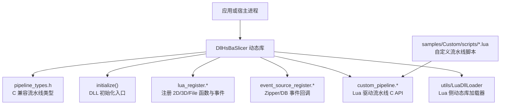

**图表来源**
- [DllHsBaSlicer/initialize.h:11-19](file://DllHsBaSlicer/initialize.h#L11-L19)
- [DllHsBaSlicer/lua_register.h:21-31](file://DllHsBaSlicer/lua_register.h#L21-L31)
- [DllHsBaSlicer/event_source_register.h:15-17](file://DllHsBaSlicer/event_source_register.h#L15-L17)
- [DllHsBaSlicer/custom_pipeline.h:17-62](file://DllHsBaSlicer/custom_pipeline.h#L17-L62)
- [utils/LuaDllLoader.hpp:27-79](file://utils/LuaDllLoader.hpp#L27-L79)
- [samples/Custom/scripts/my_fdm_pipeline.lua:52-170](file://samples/Custom/scripts/my_fdm_pipeline.lua#L52-L170)

**章节来源**
- [DllHsBaSlicer/initialize.h:11-19](file://DllHsBaSlicer/initialize.h#L11-L19)
- [DllHsBaSlicer/lua_register.h:21-31](file://DllHsBaSlicer/lua_register.h#L21-L31)
- [DllHsBaSlicer/event_source_register.h:15-17](file://DllHsBaSlicer/event_source_register.h#L15-L17)
- [DllHsBaSlicer/custom_pipeline.h:17-62](file://DllHsBaSlicer/custom_pipeline.h#L17-L62)
- [utils/LuaDllLoader.hpp:27-79](file://utils/LuaDllLoader.hpp#L27-L79)
- [samples/Custom/scripts/my_fdm_pipeline.lua:52-170](file://samples/Custom/scripts/my_fdm_pipeline.lua#L52-L170)

## 核心组件
本节梳理插件开发中最关键的公共组件及其职责：

| 组件 | 职责 | 关键接口或类型 | 适用场景 |
|---|---|---|---|
| C ABI 导出宏 | 跨平台符号导出/导入 | HSBA_SLICER_API | 所有对外 C 接口 |
| DLL 初始化入口 | 一次性初始化、注册 Lua 函数与流水线 | initialize() | 插件加载后调用 |
| Lua 扩展函数注册 | 向各阶段注入 2D/3D/File 函数与事件回调 | HsBaAdd2DFunction/HsBaAdd3DFunction/HsBaAddFileFunction/HsBaAddEventCallback | 扩展切片、支撑、填充、输出逻辑 |
| 事件源回调注册 | 监听 Zipper 压缩与数据库操作事件 | HsBaAddZipperEventCallback/HsBaAddDBEventCallback | 进度监控、审计日志 |
| 自定义流水线 C API | 同步/异步运行完全由 Lua 定义的流水线 | HsBaCreateDefaultCustomConfig/HsBaRunCustomPipeline/HsBaRunCustomPipelineAsync/HsBaFreeCustomPipelineResult | 第三方自定义工艺流水线 |
| 流水线类型定义 | 所有配置、结果、回调的 C 兼容结构体 | pipeline_types.h 中各 Config/Result/Callback | FDM/SLA/SLS/SLM/LOM/TDP/WAAM/文件传输/自定义流水线 |
| Lua 动态库加载器 | 在 Lua 环境中加载第三方 DLL 并调用导出函数 | DllLoader/get/call/register | 插件热插拔、第三方算法集成 |

**章节来源**
- [DllHsBaSlicer/dllexport.h:9-20](file://DllHsBaSlicer/dllexport.h#L9-L20)
- [DllHsBaSlicer/initialize.h:11-19](file://DllHsBaSlicer/initialize.h#L11-L19)
- [DllHsBaSlicer/lua_register.h:21-31](file://DllHsBaSlicer/lua_register.h#L21-L31)
- [DllHsBaSlicer/event_source_register.h:15-17](file://DllHsBaSlicer/event_source_register.h#L15-L17)
- [DllHsBaSlicer/custom_pipeline.h:17-62](file://DllHsBaSlicer/custom_pipeline.h#L17-L62)
- [pipelinetypes/pipeline_types.h:19-140](file://pipelinetypes/pipeline_types.h#L19-L140)
- [utils/LuaDllLoader.hpp:27-79](file://utils/LuaDllLoader.hpp#L27-L79)

## 架构总览
HsBaSlicer 的插件体系围绕“稳定 C ABI + Lua 扩展 + 可选动态库加载”展开：

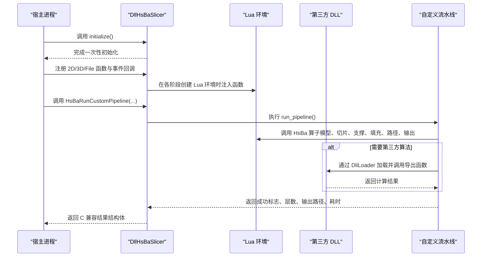

**图表来源**
- [DllHsBaSlicer/initialize.cpp:7-9](file://DllHsBaSlicer/initialize.cpp#L7-L9)
- [DllHsBaSlicer/lua_register.cpp:11-40](file://DllHsBaSlicer/lua_register.cpp#L11-L40)
- [DllHsBaSlicer/custom_pipeline.cpp:171-212](file://DllHsBaSlicer/custom_pipeline.cpp#L171-L212)
- [utils/LuaDllLoader.cpp:14-51](file://utils/LuaDllLoader.cpp#L14-L51)
- [samples/Custom/scripts/my_fdm_pipeline.lua:52-170](file://samples/Custom/scripts/my_fdm_pipeline.lua#L52-L170)

## 详细组件分析

### C ABI 与导出宏
- HSBA_SLICER_API 用于 Windows 平台的 __declspec(dllexport)/__declspec(dllimport)，非 Windows 平台为空宏。
- 所有对外 C 接口都应使用该宏标记，确保宿主进程能正确链接动态库。

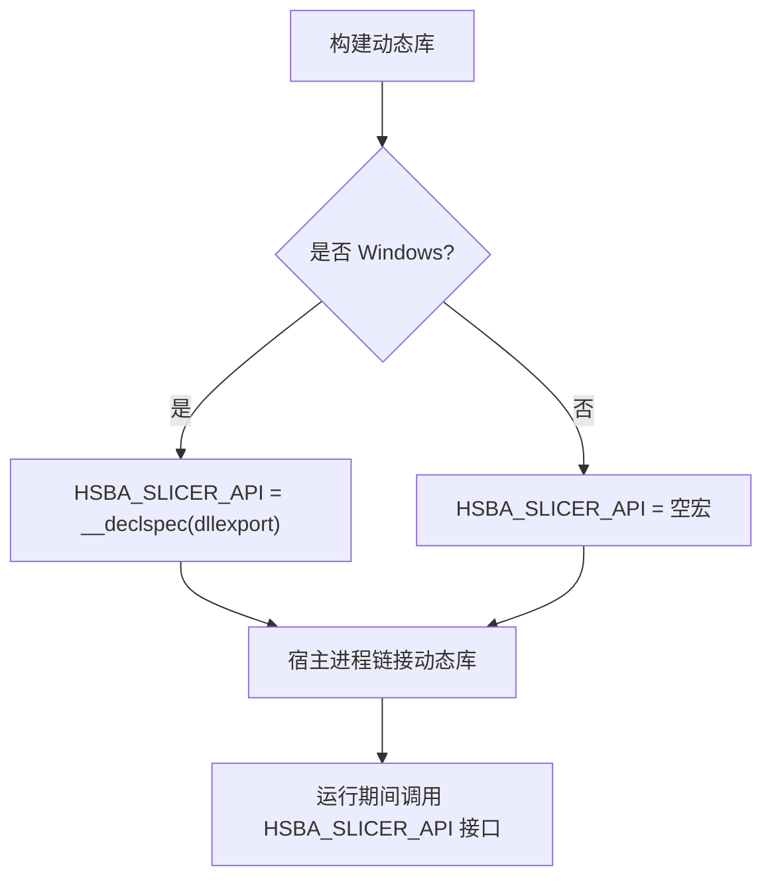

**图表来源**
- [DllHsBaSlicer/dllexport.h:9-20](file://DllHsBaSlicer/dllexport.h#L9-L20)

**章节来源**
- [DllHsBaSlicer/dllexport.h:9-20](file://DllHsBaSlicer/dllexport.h#L9-L20)

### 生命周期管理：initialize()
- initialize() 是 DLL 初始化入口，注释说明其应完成 Lua 函数、流水线及一次性运行时设置。
- 当前实现为空函数，但它是插件扩展注册的约定入口；插件可在该函数中调用 Lua 注册接口和事件回调注册接口。

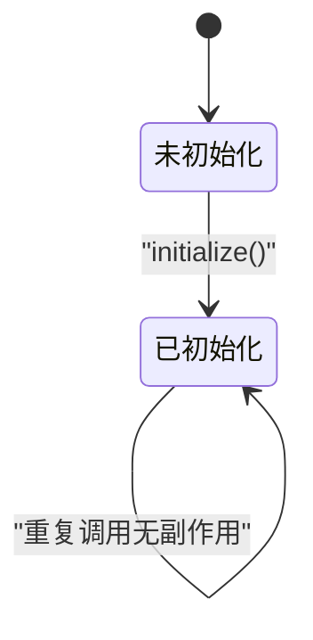

**图表来源**
- [DllHsBaSlicer/initialize.h:14-19](file://DllHsBaSlicer/initialize.h#L14-L19)
- [DllHsBaSlicer/initialize.cpp:7-9](file://DllHsBaSlicer/initialize.cpp#L7-L9)

**章节来源**
- [DllHsBaSlicer/initialize.h:14-19](file://DllHsBaSlicer/initialize.h#L14-L19)
- [DllHsBaSlicer/initialize.cpp:7-9](file://DllHsBaSlicer/initialize.cpp#L7-L9)

### Lua 扩展函数注册
- 通过 HsBaAdd2DFunction、HsBaAdd3DFunction、HsBaAddFileFunction 将外部 Lua 函数注入到对应流水线阶段。
- 通过 HsBaAddEventCallback 按事件名注册 Lua 事件回调。
- 这些接口最终委托给 LibHsBaSlicer 中的 Add2DFunctions/Add3DFunctions/AddFileFunctions/AddEventCallback。

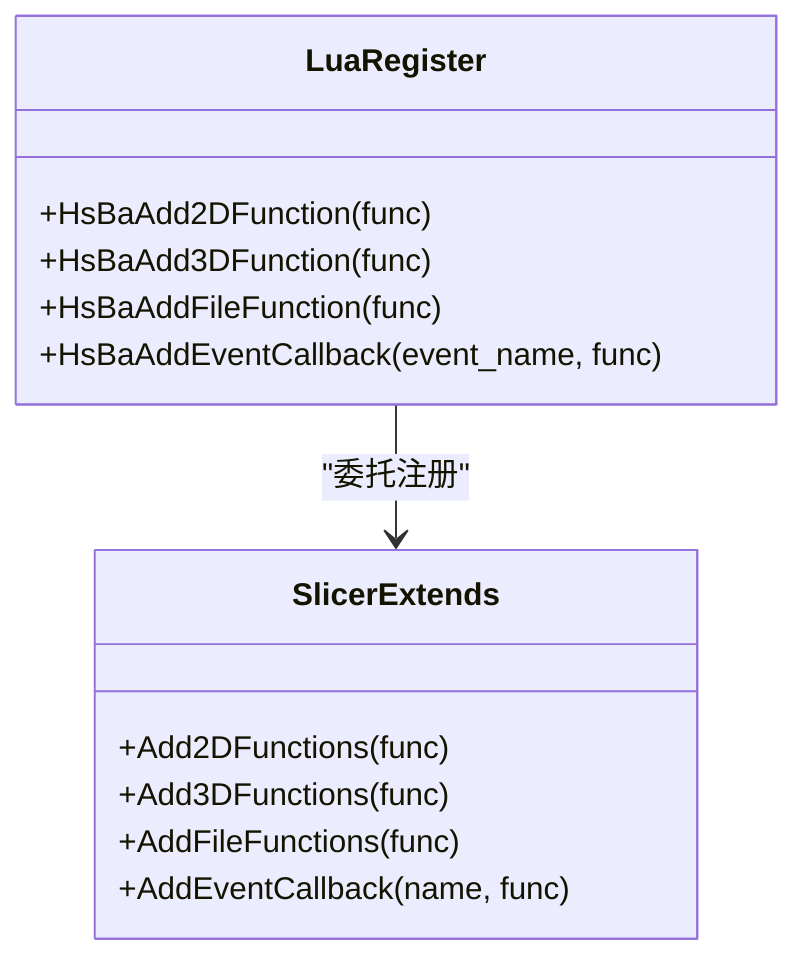

**图表来源**
- [DllHsBaSlicer/lua_register.h:21-31](file://DllHsBaSlicer/lua_register.h#L21-L31)
- [DllHsBaSlicer/lua_register.cpp:11-40](file://DllHsBaSlicer/lua_register.cpp#L11-L40)

**章节来源**
- [DllHsBaSlicer/lua_register.h:21-31](file://DllHsBaSlicer/lua_register.h#L21-L31)
- [DllHsBaSlicer/lua_register.cpp:11-40](file://DllHsBaSlicer/lua_register.cpp#L11-L40)

### 事件系统与回调
- 事件系统分为两类：
  - Lua 事件回调：通过 HsBaAddEventCallback 注册，供 Lua 流水线使用。
  - C 风格事件源回调：通过 HsBaAddZipperEventCallback 和 HsBaAddDBEventCallback 监听 Zipper 压缩进度与数据库查询事件。
- 事件名约定示例：zipper.on_add、db.on_query。

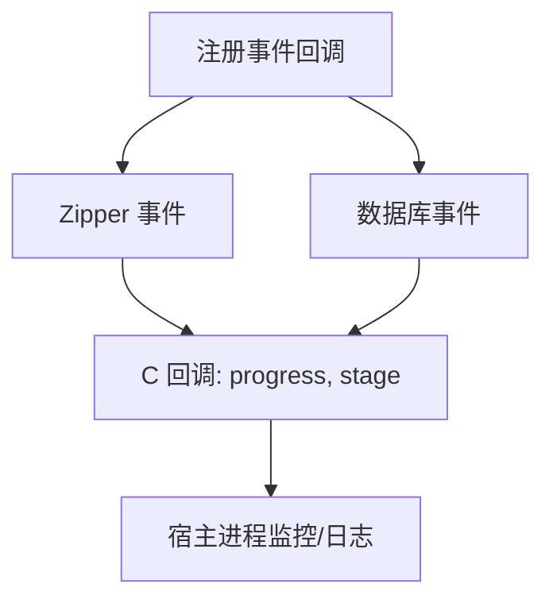

**图表来源**
- [DllHsBaSlicer/event_source_register.h:15-17](file://DllHsBaSlicer/event_source_register.h#L15-L17)
- [DllHsBaSlicer/event_source_register.cpp:9-33](file://DllHsBaSlicer/event_source_register.cpp#L9-L33)

**章节来源**
- [DllHsBaSlicer/event_source_register.h:15-17](file://DllHsBaSlicer/event_source_register.h#L15-L17)
- [DllHsBaSlicer/event_source_register.cpp:9-33](file://DllHsBaSlicer/event_source_register.cpp#L9-L33)

### 自定义流水线插件：C API 与执行流程
- HsBaCreateDefaultCustomConfig 返回默认配置。
- HsBaRunCustomPipeline 同步执行，HsBaRunCustomPipelineAsync 异步执行。
- 内部通过 LuaPipelineContext 和 RunLuaPipeline 执行 Lua 脚本中的 run_pipeline。
- 结果通过 HsBaFreeCustomPipelineResult 释放字符串字段。

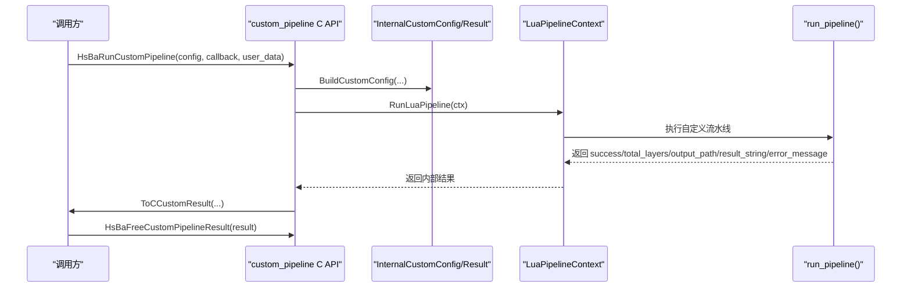

**图表来源**
- [DllHsBaSlicer/custom_pipeline.h:17-62](file://DllHsBaSlicer/custom_pipeline.h#L17-L62)
- [DllHsBaSlicer/custom_pipeline.cpp:86-114](file://DllHsBaSlicer/custom_pipeline.cpp#L86-L114)
- [DllHsBaSlicer/custom_pipeline.cpp:118-163](file://DllHsBaSlicer/custom_pipeline.cpp#L118-L163)
- [DllHsBaSlicer/custom_pipeline.cpp:171-212](file://DllHsBaSlicer/custom_pipeline.cpp#L171-L212)

**章节来源**
- [DllHsBaSlicer/custom_pipeline.h:17-62](file://DllHsBaSlicer/custom_pipeline.h#L17-L62)
- [DllHsBaSlicer/custom_pipeline.cpp:86-114](file://DllHsBaSlicer/custom_pipeline.cpp#L86-L114)
- [DllHsBaSlicer/custom_pipeline.cpp:118-163](file://DllHsBaSlicer/custom_pipeline.cpp#L118-L163)
- [DllHsBaSlicer/custom_pipeline.cpp:171-212](file://DllHsBaSlicer/custom_pipeline.cpp#L171-L212)

### 流水线类型与配置
- pipeline_types.h 定义了所有流水线配置的 C 兼容结构体，包括 FDM、SLA、SLS、SLM、LOM、TDP、WAAM、文件传输、自定义流水线。
- 每个 Config 都有对应的 Result 和 ProgressCallback/ResultCallback。
- 还提供 HsBaXxxConfigDefault 内联函数，用于快速初始化默认值。

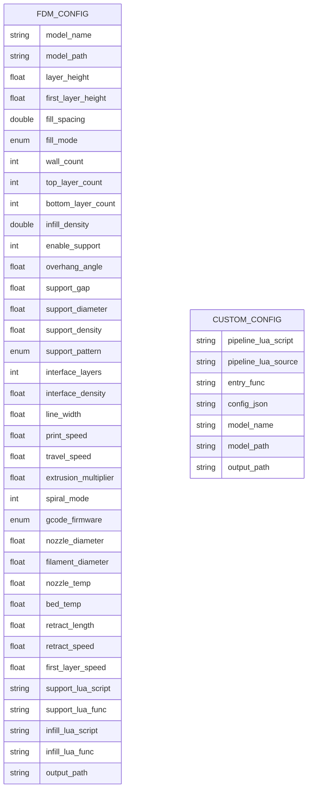

**图表来源**
- [pipelinetypes/pipeline_types.h:56-113](file://pipelinetypes/pipeline_types.h#L56-L113)
- [pipelinetypes/pipeline_types.h:689-704](file://pipelinetypes/pipeline_types.h#L689-L704)

**章节来源**
- [pipelinetypes/pipeline_types.h:56-113](file://pipelinetypes/pipeline_types.h#L56-L113)
- [pipelinetypes/pipeline_types.h:689-704](file://pipelinetypes/pipeline_types.h#L689-L704)
- [pipelinetypes/pipeline_types.h:742-783](file://pipelinetypes/pipeline_types.h#L742-L783)
- [pipelinetypes/pipeline_types.h:972-983](file://pipelinetypes/pipeline_types.h#L972-L983)

### 运行时动态库加载器
- DllLoader 封装 boost::dll，支持加载、重载、卸载第三方 DLL。
- 提供 get/call 模板方法，按函数签名解析并调用导出函数。
- 在 Lua 侧暴露 DllLoader 对象，支持 lua_dll_get_function 和 lua_dll_call_function。
- 当启用 HSBA_USE_DLL_LOADER 且非桌面平台时，可能禁用动态库加载器。

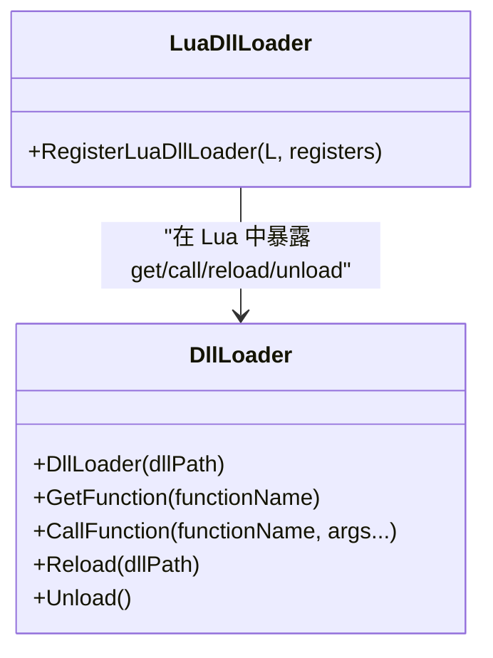

**图表来源**
- [utils/LuaDllLoader.hpp:27-79](file://utils/LuaDllLoader.hpp#L27-L79)
- [utils/LuaDllLoader.hpp:160-253](file://utils/LuaDllLoader.hpp#L160-L253)
- [utils/LuaDllLoader.cpp:14-51](file://utils/LuaDllLoader.cpp#L14-L51)

**章节来源**
- [utils/LuaDllLoader.hpp:27-79](file://utils/LuaDllLoader.hpp#L27-L79)
- [utils/LuaDllLoader.hpp:160-253](file://utils/LuaDllLoader.hpp#L160-L253)
- [utils/LuaDllLoader.cpp:14-51](file://utils/LuaDllLoader.cpp#L14-L51)

## 依赖关系分析
- DllHsBaSlicer 对外暴露 C ABI，依赖 pipelinetypes 的类型定义。
- Lua 扩展函数注册依赖 LibHsBaSlicer 的 Extends 模块。
- 事件源回调注册依赖 LibHsBaSlicer 的 EventSourceFunction。
- 自定义流水线依赖 LuaPipelineContext 和 RunLuaPipeline。
- Lua 动态库加载器依赖 boost::dll，并在 Lua 侧注册 DllLoader 对象。

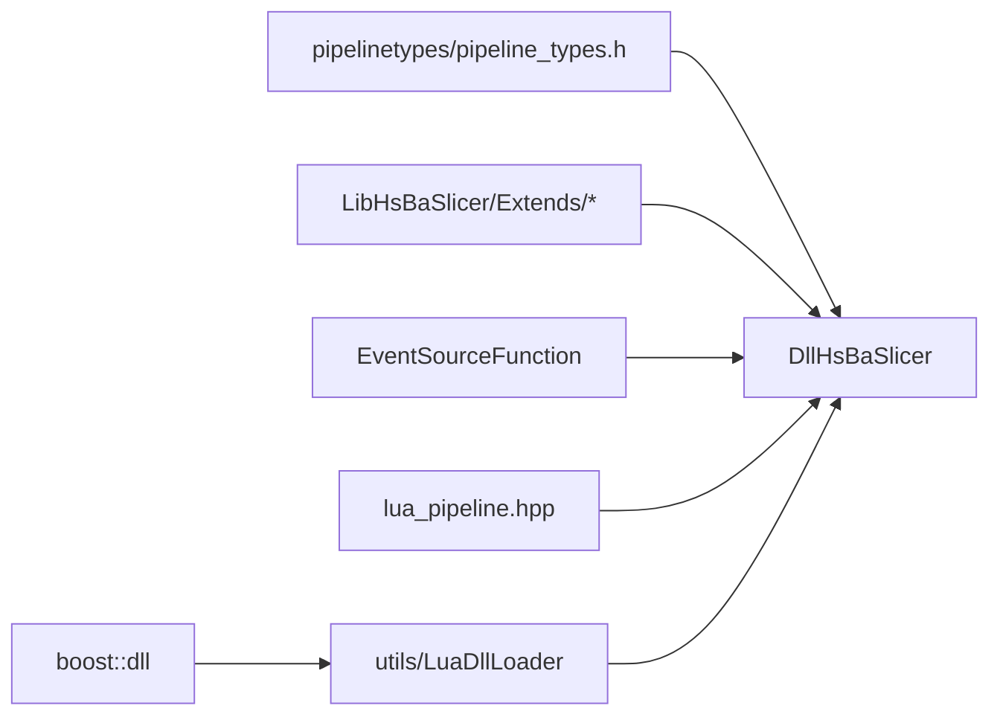

**图表来源**
- [pipelinetypes/pipeline_types.h:1-12](file://pipelinetypes/pipeline_types.h#L1-L12)
- [DllHsBaSlicer/lua_register.cpp:7-7](file://DllHsBaSlicer/lua_register.cpp#L7-L7)
- [DllHsBaSlicer/event_source_register.cpp:7-7](file://DllHsBaSlicer/event_source_register.cpp#L7-L7)
- [DllHsBaSlicer/custom_pipeline.cpp:14-16](file://DllHsBaSlicer/custom_pipeline.cpp#L14-L16)
- [utils/LuaDllLoader.hpp:7-15](file://utils/LuaDllLoader.hpp#L7-L15)

**章节来源**
- [pipelinetypes/pipeline_types.h:1-12](file://pipelinetypes/pipeline_types.h#L1-L12)
- [DllHsBaSlicer/lua_register.cpp:7-7](file://DllHsBaSlicer/lua_register.cpp#L7-L7)
- [DllHsBaSlicer/event_source_register.cpp:7-7](file://DllHsBaSlicer/event_source_register.cpp#L7-L7)
- [DllHsBaSlicer/custom_pipeline.cpp:14-16](file://DllHsBaSlicer/custom_pipeline.cpp#L14-L16)
- [utils/LuaDllLoader.hpp:7-15](file://utils/LuaDllLoader.hpp#L7-L15)

## 性能与并发特性
- 自定义流水线支持异步执行：HsBaRunCustomPipelineAsync 使用协程任务，完成后通过 result_callback 返回结果。
- 进度回调：HsBaCustomProgressCallback 由 Lua 脚本通过 HsBa.progress 触发，可上报百分比与阶段描述。
- 耗时统计：结果结构体包含 elapsed_seconds，便于性能监控。
- 动态库加载：DllLoader 支持 Reload/Unload，适合插件热更新，但需注意线程安全与资源释放。

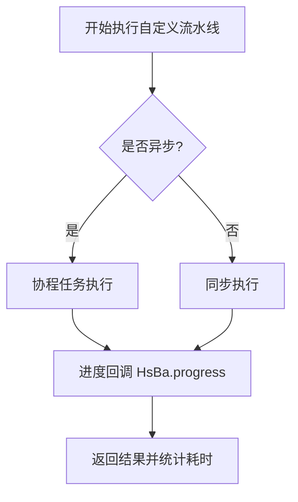

**图表来源**
- [DllHsBaSlicer/custom_pipeline.cpp:118-163](file://DllHsBaSlicer/custom_pipeline.cpp#L118-L163)
- [DllHsBaSlicer/custom_pipeline.cpp:185-200](file://DllHsBaSlicer/custom_pipeline.cpp#L185-L200)
- [samples/Custom/scripts/my_fdm_pipeline.lua:65-168](file://samples/Custom/scripts/my_fdm_pipeline.lua#L65-L168)

**章节来源**
- [DllHsBaSlicer/custom_pipeline.cpp:118-163](file://DllHsBaSlicer/custom_pipeline.cpp#L118-L163)
- [DllHsBaSlicer/custom_pipeline.cpp:185-200](file://DllHsBaSlicer/custom_pipeline.cpp#L185-L200)
- [samples/Custom/scripts/my_fdm_pipeline.lua:65-168](file://samples/Custom/scripts/my_fdm_pipeline.lua#L65-L168)

## 插件开发模板与示例

### 自定义流水线插件模板
推荐步骤：
1. 在宿主进程中调用 initialize()。
2. 根据需要调用 HsBaAdd2DFunction/HsBaAdd3DFunction/HsBaAddFileFunction 注册 Lua 函数。
3. 根据需要调用 HsBaAddEventCallback 注册事件回调。
4. 构造 HsBaCustomPipelineConfig_t，设置 pipeline_lua_script 或 pipeline_lua_source。
5. 调用 HsBaRunCustomPipeline 或 HsBaRunCustomPipelineAsync 执行流水线。
6. 使用 HsBaFreeCustomPipelineResult 释放结果。

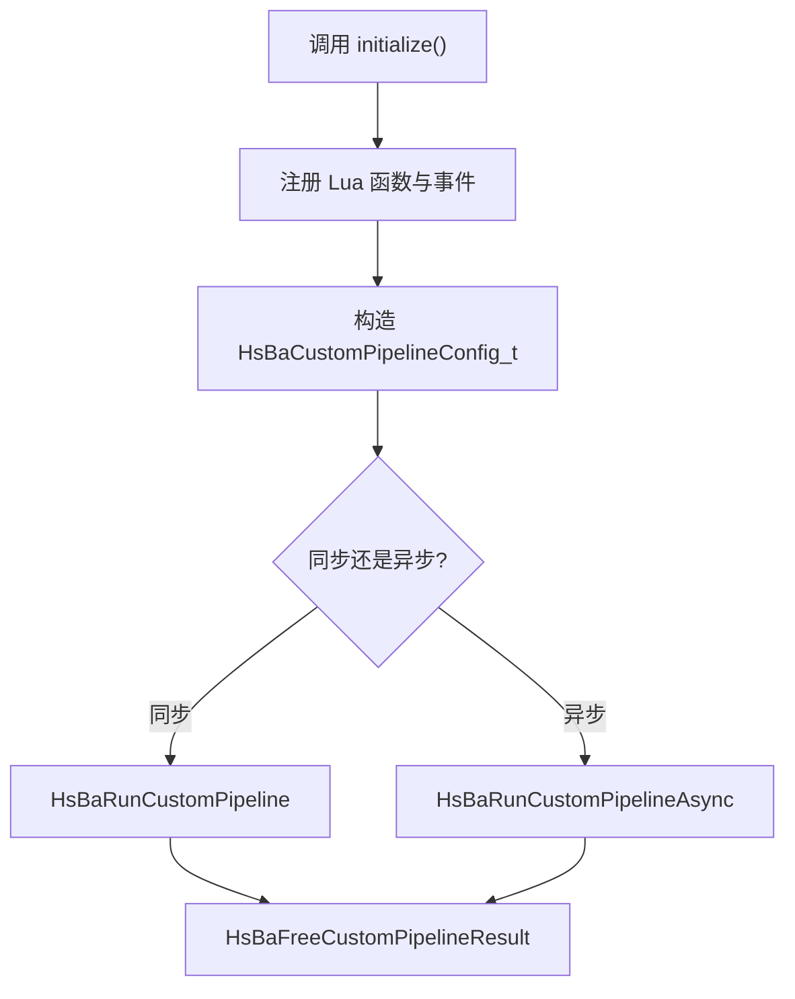

**图表来源**
- [DllHsBaSlicer/initialize.h:14-19](file://DllHsBaSlicer/initialize.h#L14-L19)
- [DllHsBaSlicer/lua_register.h:21-31](file://DllHsBaSlicer/lua_register.h#L21-L31)
- [DllHsBaSlicer/custom_pipeline.h:17-62](file://DllHsBaSlicer/custom_pipeline.h#L17-L62)

**章节来源**
- [DllHsBaSlicer/initialize.h:14-19](file://DllHsBaSlicer/initialize.h#L14-L19)
- [DllHsBaSlicer/lua_register.h:21-31](file://DllHsBaSlicer/lua_register.h#L21-L31)
- [DllHsBaSlicer/custom_pipeline.h:17-62](file://DllHsBaSlicer/custom_pipeline.h#L17-L62)

### 数据处理插件：Lua 扩展函数
- 若需扩展切片、支撑、填充或 SLA 输出阶段的 Lua 函数，可通过 HsBaAdd3DFunction 或 HsBaAdd2DFunction 注册。
- 在注册函数中使用 lua_register 将 C 函数绑定到 Lua 名称。

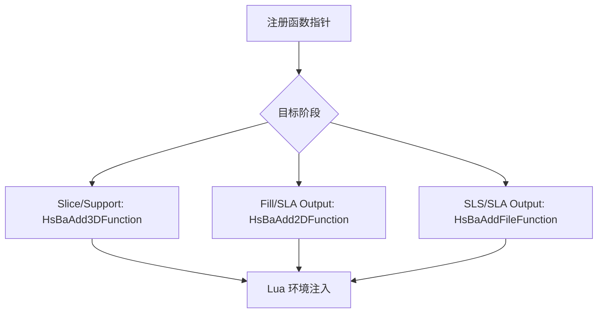

**图表来源**
- [DllHsBaSlicer/lua_register.h:21-31](file://DllHsBaSlicer/lua_register.h#L21-L31)
- [DllHsBaSlicer/lua_register.cpp:11-40](file://DllHsBaSlicer/lua_register.cpp#L11-L40)

**章节来源**
- [DllHsBaSlicer/lua_register.h:21-31](file://DllHsBaSlicer/lua_register.h#L21-L31)
- [DllHsBaSlicer/lua_register.cpp:11-40](file://DllHsBaSlicer/lua_register.cpp#L11-L40)

### 输出格式插件：Lua 脚本驱动
- 对于 SLS/SLA/LOM/TDP/WAAM 等输出格式，可通过 Lua 脚本编排切片、支撑、地板、打包流程。
- 示例脚本展示了如何使用 HsBa.saveSlaPackage/saveSlsPackage/toGcode/writeFile 等算子。

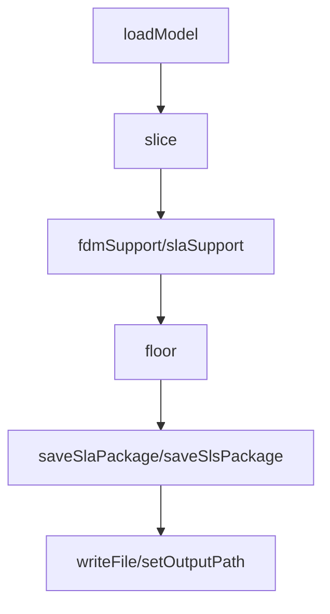

**图表来源**
- [samples/Custom/scripts/my_sla_pipeline.lua:27-104](file://samples/Custom/scripts/my_sla_pipeline.lua#L27-L104)
- [samples/Custom/scripts/my_lom_pipeline.lua:19-91](file://samples/Custom/scripts/my_lom_pipeline.lua#L19-L91)
- [samples/Custom/scripts/my_fdm_pipeline.lua:52-170](file://samples/Custom/scripts/my_fdm_pipeline.lua#L52-L170)

**章节来源**
- [samples/Custom/scripts/my_sla_pipeline.lua:27-104](file://samples/Custom/scripts/my_sla_pipeline.lua#L27-L104)
- [samples/Custom/scripts/my_lom_pipeline.lua:19-91](file://samples/Custom/scripts/my_lom_pipeline.lua#L19-L91)
- [samples/Custom/scripts/my_fdm_pipeline.lua:52-170](file://samples/Custom/scripts/my_fdm_pipeline.lua#L52-L170)

## 编译、依赖与部署
- 顶层 CMakeLists.txt 安装 DllHsBaSlicer 公开头文件，包括 dllexport.h、initialize.h、custom_pipeline.h、pipeline_convert.h、param_store_pipeline.h 等。
- pipelinetypes/pipeline_types.h 作为独立类型定义被安装到 HsBaSlicer/pipelinetypes。
- samples/Custom/CMakeLists.txt 演示如何链接 DllHsBaSlicer，并将模型与 Lua 脚本复制到输出目录。
- 动态库加载器开关：HSBA_USE_DLL_LOADER 控制是否启用运行时 DLL 加载；非桌面平台可能禁用。

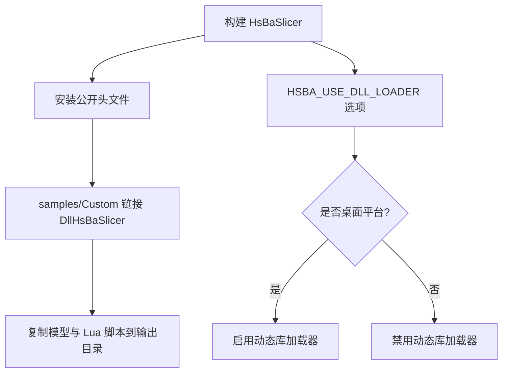

**图表来源**
- [CMakeLists.txt:508-525](file://CMakeLists.txt#L508-L525)
- [samples/Custom/CMakeLists.txt:13-49](file://samples/Custom/CMakeLists.txt#L13-L49)
- [CMakeLists.txt:228-240](file://CMakeLists.txt#L228-L240)

**章节来源**
- [CMakeLists.txt:508-525](file://CMakeLists.txt#L508-L525)
- [samples/Custom/CMakeLists.txt:13-49](file://samples/Custom/CMakeLists.txt#L13-L49)
- [CMakeLists.txt:228-240](file://CMakeLists.txt#L228-L240)

## 调试与故障排除
常见问题与建议：
- 未调用 initialize()：可能导致 Lua 函数未注册，流水线阶段找不到扩展函数。
- 未释放结果：HsBaFreeCustomPipelineResult 必须调用，否则 output_path/result_string/error_message 会泄漏。
- 动态库加载失败：检查 HSBA_USE_DLL_LOADER 是否启用，第三方 DLL 是否导出正确签名的函数。
- 事件回调未触发：确认事件名匹配 zipper.on_add/db.on_query，并确保在流水线执行前注册。
- 进度回调不更新：Lua 脚本需主动调用 HsBa.progress，C 侧仅转发回调。

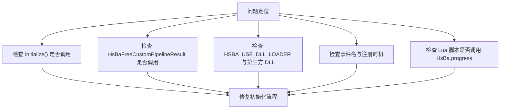

**图表来源**
- [DllHsBaSlicer/initialize.cpp:7-9](file://DllHsBaSlicer/initialize.cpp#L7-L9)
- [DllHsBaSlicer/custom_pipeline.cpp:203-212](file://DllHsBaSlicer/custom_pipeline.cpp#L203-L212)
- [utils/LuaDllLoader.cpp:27-51](file://utils/LuaDllLoader.cpp#L27-L51)
- [DllHsBaSlicer/event_source_register.cpp:9-33](file://DllHsBaSlicer/event_source_register.cpp#L9-L33)
- [samples/Custom/scripts/my_fdm_pipeline.lua:65-168](file://samples/Custom/scripts/my_fdm_pipeline.lua#L65-L168)

**章节来源**
- [DllHsBaSlicer/initialize.cpp:7-9](file://DllHsBaSlicer/initialize.cpp#L7-L9)
- [DllHsBaSlicer/custom_pipeline.cpp:203-212](file://DllHsBaSlicer/custom_pipeline.cpp#L203-L212)
- [utils/LuaDllLoader.cpp:27-51](file://utils/LuaDllLoader.cpp#L27-L51)
- [DllHsBaSlicer/event_source_register.cpp:9-33](file://DllHsBaSlicer/event_source_register.cpp#L9-L33)
- [samples/Custom/scripts/my_fdm_pipeline.lua:65-168](file://samples/Custom/scripts/my_fdm_pipeline.lua#L65-L168)

## 结论
HsBaSlicer 的插件体系以稳定 C ABI 为基础，结合 Lua 扩展与运行时动态库加载器，实现了高度可插拔的模块化扩展能力。开发者可以通过：
- 使用 initialize() 完成一次性初始化。
- 通过 HsBaAdd2DFunction/HsBaAdd3DFunction/HsBaAddFileFunction 扩展流水线阶段。
- 通过 HsBaAddEventCallback 与 C 风格事件回调接入事件系统。
- 通过 HsBaRunCustomPipeline/HsBaRunCustomPipelineAsync 运行完全由 Lua 定义的自定义流水线。
- 通过 DllLoader 在 Lua 侧加载第三方 DLL，实现算法热插拔。

配合 samples/Custom 中的 Lua 脚本示例，开发者可以快速构建可插拔的模块化扩展，实现灵活的第三方功能集成。