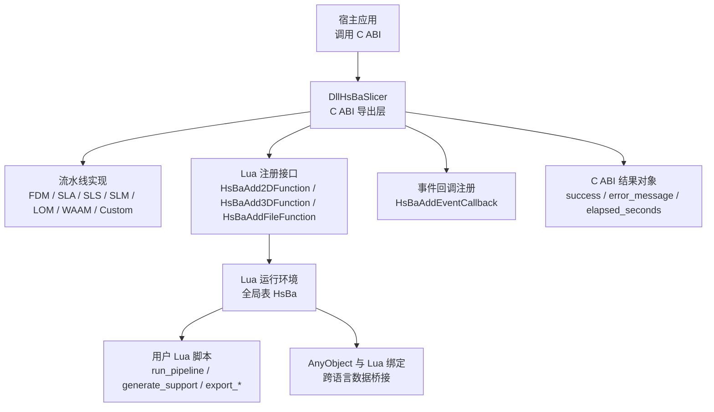
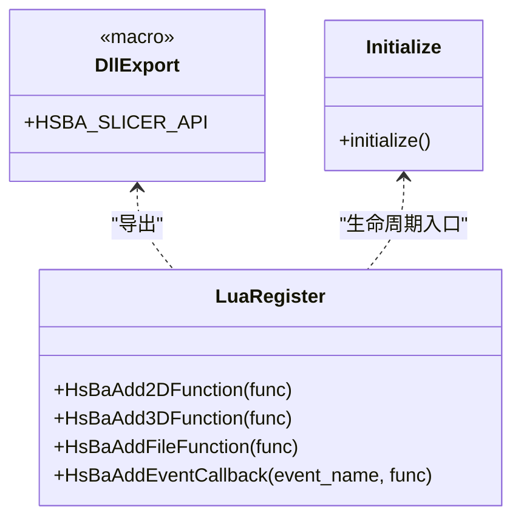
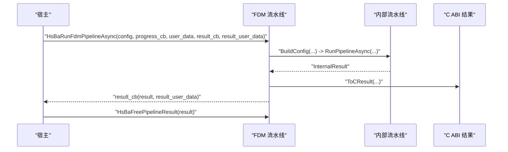
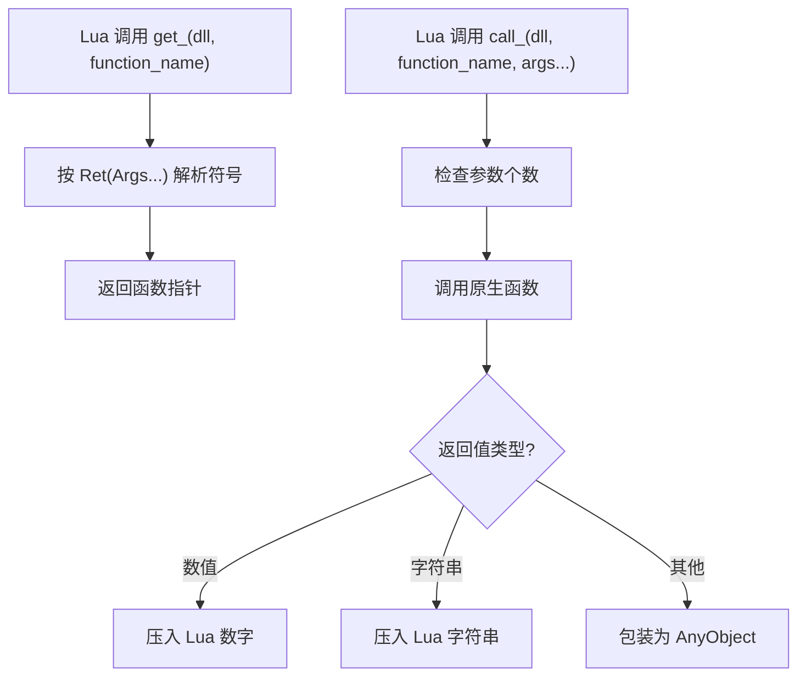
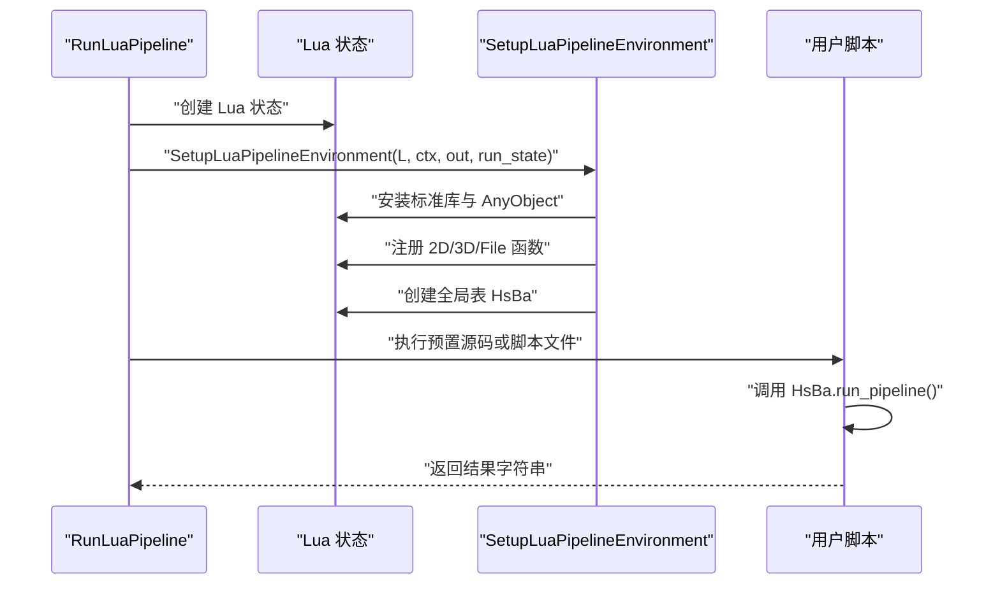
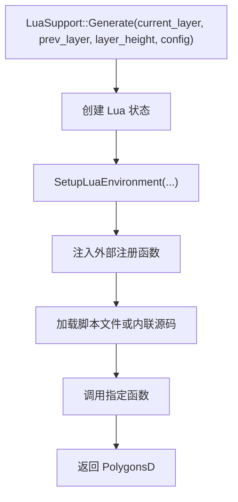
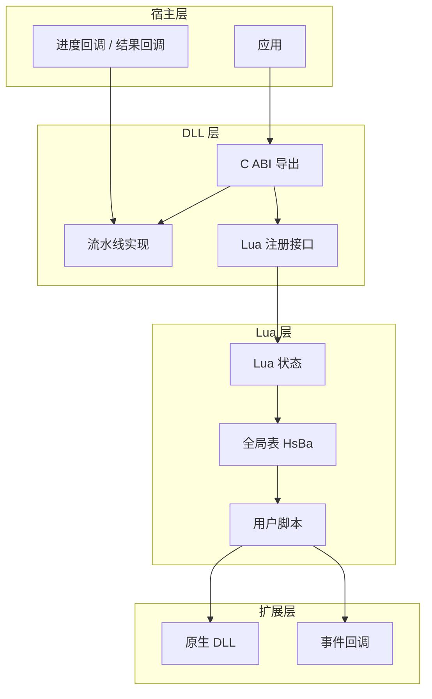

# 插件架构设计

<cite>
**本文引用的文件**   
- [README.md](file://README.md)
- [CMakeLists.txt](file://CMakeLists.txt)
- [utils/CMakeLists.txt](file://utils/CMakeLists.txt)
- [support/CMakeLists.txt](file://support/CMakeLists.txt)
- [fileoperator/CMakeLists.txt](file://fileoperator/CMakeLists.txt)
- [DllHsBaSlicer/dllexport.h](file://DllHsBaSlicer/dllexport.h)
- [DllHsBaSlicer/lua_register.h](file://DllHsBaSlicer/lua_register.h)
- [DllHsBaSlicer/initialize.cpp](file://DllHsBaSlicer/initialize.cpp)
- [DllHsBaSlicer/fdm_pipeline.cpp](file://DllHsBaSlicer/fdm_pipeline.cpp)
- [DllHsBaSlicer/slm_pipeline.cpp](file://DllHsBaSlicer/slm_pipeline.cpp)
- [DllHsBaSlicer/lom_pipeline.cpp](file://DllHsBaSlicer/lom_pipeline.cpp)
- [DllHsBaSlicer/custom_pipeline.cpp](file://DllHsBaSlicer/custom_pipeline.cpp)
- [pipelinetypes/pipeline_types.h](file://pipelinetypes/pipeline_types.h)
- [LibHsBaSlicer/Extends/LuaAddFunction.hpp](file://LibHsBaSlicer/Extends/LuaAddFunction.hpp)
- [LibHsBaSlicer/Extends/lua_pipeline.hpp](file://LibHsBaSlicer/Extends/lua_pipeline.hpp)
- [LibHsBaSlicer/Extends/lua_pipeline.cpp](file://LibHsBaSlicer/Extends/lua_pipeline.cpp)
- [support/LuaSupport.hpp](file://support/LuaSupport.hpp)
- [support/LuaSupport.cpp](file://support/LuaSupport.cpp)
- [utils/LuaDllLoader.hpp](file://utils/LuaDllLoader.hpp)
- [docs/zh/DllHsBaSlicer/game_engine_integration.md](file://docs/zh/DllHsBaSlicer/game_engine_integration.md)
- [docs/zh/DllHsBaSlicer/qt_wxwidgets_integration.md](file://docs/zh/DllHsBaSlicer/qt_wxwidgets_integration.md)
</cite>

## 目录
1. [项目概述与快速开始](#项目概述与快速开始)
2. [架构总览](#架构总览)
3. [核心概念](#核心概念)
4. [核心模块详解](#核心模块详解)
5. [高级主题](#高级主题)
6. [Lua 脚本系统](#lua-脚本系统)
7. [API 参考文档](#api-参考文档)
8. [集成指南](#集成指南)
9. [开发测试与贡献](#开发测试与贡献)
10. [扩展开发指南](#扩展开发指南)
11. [示例与教程](#示例与教程)
12. [部署故障排除与FAQ](#部署故障排除与faq)
13. [附录](#附录)

## 项目概述与快速开始
HsBaSlicer 是一个面向 3D 打印切片领域的高性能 C++ 框架，提供模块化、跨平台的切片核心能力，适用于研发与生产级别的切片流水线。其对外暴露两类主要接口：
- `DllHsBaSlicer`：导出 C ABI 的动态库，用于外部语言（Java、C#、Python 等）调用。
- `LibHsBaSlicer`：封装完整 C++ 切片能力的静态或共享库。

从插件视角看，HsBaSlicer 的“插件”既包括通过动态库加载机制在运行时解析并调用的原生函数，也包括通过 Lua 环境注入的全局表 `HsBa` 暴露的流水线构建块；同时，C ABI 配置结构体、回调函数和结果管理构成了宿主与插件之间的稳定契约。

**章节来源**
- [README.md:21-39](file://README.md#L21-L39)
- [README.md:100-124](file://README.md#L100-L124)

## 架构总览
HsBaSlicer 的插件架构由三层组成：
- 抽象层：以 C ABI 类型和回调为边界，定义配置、进度、结果和生命周期。
- 运行时层：负责动态库加载、Lua 状态创建、流水线阶段初始化、事件分发。
- 扩展层：用户提供的 Lua 脚本、自定义导出函数、以及可选的外部 DLL。

**图表来源**
- [DllHsBaSlicer/dllexport.h:1-23](file://DllHsBaSlicer/dllexport.h#L1-L23)
- [DllHsBaSlicer/lua_register.h:1-38](file://DllHsBaSlicer/lua_register.h#L1-L38)
- [LibHsBaSlicer/Extends/lua_pipeline.hpp:19-83](file://LibHsBaSlicer/Extends/lua_pipeline.hpp#L19-L83)
- [pipelinetypes/pipeline_types.h:115-140](file://pipelinetypes/pipeline_types.h#L115-L140)

**章节来源**
- [README.md:25-39](file://README.md#L25-L39)
- [README.md:104-124](file://README.md#L104-L124)

## 核心概念
### 插件化边界
- C ABI 是插件与宿主之间的稳定边界：所有配置结构体、回调函数指针、结果结构体均使用 `extern "C"` 风格类型，避免 C++ 名称修饰问题。
- Lua 插件是行为扩展边界：通过全局表 `HsBa` 暴露模型加载、切片、支撑、填充、路径输出、打包等能力，脚本决定执行顺序。

### 动态库加载机制
- 桌面平台默认启用动态库加载器；Android、iOS 和游戏主机等平台默认关闭，并通过编译宏控制。
- 加载器基于 Boost.DLL，支持按函数签名解析符号、将返回值映射到 Lua 栈，并将异常转换为 Lua 错误。

### 插件生命周期
- 初始化入口：`initialize()` 作为 DLL 初始化钩子，当前为空实现，但可作为扩展点放置一次性注册逻辑。
- 流水线生命周期：配置构建 → 异步任务执行 → 进度回调 → 结果回调 → 结果释放。

### 接口抽象层
- 配置结构体：每种流水线（FDM、SLA、SLS、SLM、LOM、TDP、WAAM、Custom）都有独立的 C 兼容配置结构体。
- 回调函数：进度回调统一为百分比、阶段描述和用户数据指针；结果回调统一为结果结构体和用户数据指针。
- 结果管理：每个流水线提供对应的释放函数，防止内存泄漏。

**章节来源**
- [CMakeLists.txt:228-240](file://CMakeLists.txt#L228-L240)
- [utils/LuaDllLoader.hpp:27-79](file://utils/LuaDllLoader.hpp#L27-L79)
- [DllHsBaSlicer/initialize.cpp:1-10](file://DllHsBaSlicer/initialize.cpp#L1-L10)
- [pipelinetypes/pipeline_types.h:130-140](file://pipelinetypes/pipeline_types.h#L130-L140)

## 核心模块详解
### C ABI 导出层
`dllexport.h` 定义跨平台导出宏，Windows 下根据是否构建 DLL 选择 `__declspec(dllexport)` 或 `__declspec(dllimport)`，非 Windows 平台无额外注解。

`lua_register.h` 暴露 C ABI 的 Lua 注册接口：
- `HsBaAdd2DFunction`：支撑、填充、SLA 输出阶段可用。
- `HsBaAdd3DFunction`：切片、支撑阶段可用。
- `HsBaAddFileFunction`：SLS 输出、SLA 输出阶段可用。
- `HsBaAddEventCallback`：按事件名注册回调，例如压缩事件。

**图表来源**
- [DllHsBaSlicer/dllexport.h:1-23](file://DllHsBaSlicer/dllexport.h#L1-L23)
- [DllHsBaSlicer/lua_register.h:1-38](file://DllHsBaSlicer/lua_register.h#L1-L38)
- [DllHsBaSlicer/initialize.cpp:1-10](file://DllHsBaSlicer/initialize.cpp#L1-L10)

**章节来源**
- [DllHsBaSlicer/dllexport.h:1-23](file://DllHsBaSlicer/dllexport.h#L1-L23)
- [DllHsBaSlicer/lua_register.h:1-38](file://DllHsBaSlicer/lua_register.h#L1-L38)
- [DllHsBaSlicer/initialize.cpp:1-10](file://DllHsBaSlicer/initialize.cpp#L1-L10)

### 流水线实现层
各流水线在 `DllHsBaSlicer` 中提供同步与异步 API，内部调用 `Pipeline::Run*Async`，并通过 `ToCResult` 或 `ToCCustomResult` 转换为 C ABI 结果。

典型流程：
1. 调用 `HsBaRun*Pipeline` 或 `HsBaRun*PipelineAsync`。
2. 构建内部配置，包装进度回调与用户数据。
3. 启动协程或异步任务。
4. 完成时调用结果回调，宿主负责释放结果字符串。

**图表来源**
- [DllHsBaSlicer/fdm_pipeline.cpp:464-496](file://DllHsBaSlicer/fdm_pipeline.cpp#L464-L496)

**章节来源**
- [DllHsBaSlicer/fdm_pipeline.cpp:464-496](file://DllHsBaSlicer/fdm_pipeline.cpp#L464-L496)
- [DllHsBaSlicer/slm_pipeline.cpp:353-382](file://DllHsBaSlicer/slm_pipeline.cpp#L353-L382)
- [DllHsBaSlicer/lom_pipeline.cpp:332-353](file://DllHsBaSlicer/lom_pipeline.cpp#L332-L353)
- [DllHsBaSlicer/custom_pipeline.cpp:171-212](file://DllHsBaSlicer/custom_pipeline.cpp#L171-L212)

### 配置结构与结果管理
所有流水线的配置结构体集中在 `pipeline_types.h`，包含模型参数、切片参数、支撑参数、路径参数、Lua 定制字段和输出路径。结果结构体统一包含成功标志、层数、输出内容、错误信息和耗时。

| 流水线 | 配置结构体 | 结果结构体 | 关键 Lua 定制字段 |
|---|---|---|---|
| FDM | `HsBaFdmPipelineConfig_t` | `HsBaFdmPipelineResult_t` | `support_lua_script`、`support_lua_func`、`infill_lua_script`、`infill_lua_func` |
| SLA | `HsBaSlaPipelineConfig_t` | `HsBaSlaPipelineResult_t` | `support_lua_script`、`support_lua_func`、`floor_lua_script`、`floor_lua_func`、`export_lua_script`、`export_lua_func` |
| SLS | `HsBaSlsPipelineConfig_t` | `HsBaSlsPipelineResult_t` | `export_lua_script`、`export_lua_func` |
| SLM | `HsBaSlmPipelineConfig_t` | `HsBaSlmPipelineResult_t` | `export_lua_script`、`export_lua_func` |
| LOM | `HsBaLomPipelineConfig_t` | `HsBaLomPipelineResult_t` | `export_lua_script`、`export_lua_func` |
| TDP | `HsBaTdpPipelineConfig_t` | `HsBaTdpPipelineResult_t` | `export_lua_script`、`export_lua_func` |
| WAAM | `HsBaWaamPipelineConfig_t` | `HsBaWaamPipelineResult_t` | `path_lua_script`、`path_lua_func` |
| Custom | `HsBaCustomPipelineConfig_t` | `HsBaCustomPipelineResult_t` | `pipeline_lua_script`、`pipeline_lua_source`、`entry_func`、`config_json` |

**章节来源**
- [pipelinetypes/pipeline_types.h:56-113](file://pipelinetypes/pipeline_types.h#L56-L113)
- [pipelinetypes/pipeline_types.h:170-218](file://pipelinetypes/pipeline_types.h#L170-L218)
- [pipelinetypes/pipeline_types.h:259-283](file://pipelinetypes/pipeline_types.h#L259-L283)
- [pipelinetypes/pipeline_types.h:359-376](file://pipelinetypes/pipeline_types.h#L359-L376)
- [pipelinetypes/pipeline_types.h:419-436](file://pipelinetypes/pipeline_types.h#L419-L436)
- [pipelinetypes/pipeline_types.h:480-496](file://pipelinetypes/pipeline_types.h#L480-L496)
- [pipelinetypes/pipeline_types.h:578-600](file://pipelinetypes/pipeline_types.h#L578-L600)
- [pipelinetypes/pipeline_types.h:689-704](file://pipelinetypes/pipeline_types.h#L689-L704)

## 高级主题
### 动态库加载与依赖解析
`LuaDllLoader` 提供运行时函数解析与调用：
- 通过 `boost::dll::shared_library` 加载目标 DLL。
- 使用模板推导函数签名，按 `Ret(Args...)` 形式解析符号。
- 将 Lua 栈参数转换为原生参数，并将返回值压回 Lua 栈。
- 异常被捕获并转为 Lua 错误消息。

依赖解析策略：
- 宿主在 Lua 侧构造 `DllLoader` 对象。
- 通过 `get_<name>` 获取函数指针。
- 通过 `call_<name>` 传入参数并调用。

**图表来源**
- [utils/LuaDllLoader.hpp:44-79](file://utils/LuaDllLoader.hpp#L44-L79)
- [utils/LuaDllLoader.hpp:160-245](file://utils/LuaDllLoader.hpp#L160-L245)

**章节来源**
- [utils/LuaDllLoader.hpp:27-79](file://utils/LuaDllLoader.hpp#L27-L79)
- [utils/LuaDllLoader.hpp:160-245](file://utils/LuaDllLoader.hpp#L160-L245)

### 版本兼容性处理
- 构建期通过 vcpkg 特性检测是否链接 GPL/LGPL 内核，从而决定许可证和编译宏。
- 运行时可通过版本信息接口查询有效许可证。
- C ABI 结构体保持稳定，新增字段应向后兼容，避免破坏已有宿主。

**章节来源**
- [CMakeLists.txt:181-204](file://CMakeLists.txt#L181-L204)
- [README.md:192-210](file://README.md#L192-L210)

## Lua 脚本系统
### 全局表 `HsBa` 的暴露方式
完全由 Lua 驱动的自定义流水线通过 `SetupLuaPipelineEnvironment` 初始化 Lua 状态，安装标准库、AnyObject 类型、2D/3D/File 注册函数，并创建全局表 `HsBa`。该表暴露模型加载、切片、支撑、填充、地板、路径输出、打包等流水线构建块。

**图表来源**
- [LibHsBaSlicer/Extends/lua_pipeline.cpp:950-994](file://LibHsBaSlicer/Extends/lua_pipeline.cpp#L950-L994)
- [LibHsBaSlicer/Extends/lua_pipeline.hpp:53-83](file://LibHsBaSlicer/Extends/lua_pipeline.hpp#L53-L83)

**章节来源**
- [LibHsBaSlicer/Extends/lua_pipeline.hpp:19-83](file://LibHsBaSlicer/Extends/lua_pipeline.hpp#L19-L83)
- [LibHsBaSlicer/Extends/lua_pipeline.cpp:950-994](file://LibHsBaSlicer/Extends/lua_pipeline.cpp#L950-L994)

### 扩展点定义
- 2D 扩展点：支撑、填充、SLA 输出阶段可用的 2D 多边形操作。
- 3D 扩展点：切片、支撑阶段可用的 3D 模型操作。
- File 扩展点：SLS 输出、SLA 输出阶段可用的文件操作。
- 事件扩展点：如压缩事件、数据库查询事件等。

LibHsBaSlicer 侧通过 `LuaAddFunction.hpp` 维护三类注册函数列表和事件回调映射；DllHsBaSlicer 侧通过 `lua_register.h` 暴露 C ABI 注册接口。

**章节来源**
- [LibHsBaSlicer/Extends/LuaAddFunction.hpp:21-74](file://LibHsBaSlicer/Extends/LuaAddFunction.hpp#L21-L74)
- [DllHsBaSlicer/lua_register.h:13-31](file://DllHsBaSlicer/lua_register.h#L13-L31)

### 支撑阶段的 Lua 插件
`LuaSupport` 支持内联脚本或脚本文件，并在生成支撑前注入配置和外部注册函数。其 `Generate` 方法创建独立 Lua 状态，设置环境，执行脚本，并返回生成的多边形集合。

**图表来源**
- [support/LuaSupport.cpp:113-133](file://support/LuaSupport.cpp#L113-L133)
- [support/LuaSupport.hpp:41-81](file://support/LuaSupport.hpp#L41-L81)

**章节来源**
- [support/LuaSupport.hpp:41-81](file://support/LuaSupport.hpp#L41-L81)
- [support/LuaSupport.cpp:88-133](file://support/LuaSupport.cpp#L88-L133)

## API 参考文档
### C ABI 流水线接口
- FDM：`HsBaCreateDefaultFdmConfig`、`HsBaRunFdmPipeline`、`HsBaRunFdmPipelineAsync`、`HsBaFreePipelineResult`。
- SLA：`HsBaCreateDefaultSlaConfig`、`HsBaRunSlaPipeline`、`HsBaRunSlaPipelineAsync`、`HsBaFreeSlaPipelineResult`。
- SLS：`HsBaCreateDefaultSlsConfig`、`HsBaRunSlsPipeline`、`HsBaRunSlsPipelineAsync`、`HsBaFreeSlsPipelineResult`。
- SLM：`HsBaCreateDefaultSlmConfig`、`HsBaRunSlmPipeline`、`HsBaRunSlmPipelineAsync`、`HsBaFreeSlmPipelineResult`。
- LOM：`HsBaCreateDefaultLomConfig`、`HsBaRunLomPipeline`、`HsBaRunLomPipelineAsync`、`HsBaFreeLomPipelineResult`。
- TDP：`HsBaCreateDefaultTdpConfig`、`HsBaRunTdpPipeline`、`HsBaRunTdpPipelineAsync`、`HsBaFreeTdpPipelineResult`。
- WAAM：`HsBaCreateDefaultWaamConfig`、`HsBaRunWaamPipeline`、`HsBaRunWaamPipelineAsync`、`HsBaFreeWaamPipelineResult`。
- Custom：`HsBaCreateDefaultCustomConfig`、`HsBaRunCustomPipeline`、`HsBaRunCustomPipelineAsync`、`HsBaFreeCustomPipelineResult`。

### Lua 注册接口
- `HsBaAdd2DFunction`
- `HsBaAdd3DFunction`
- `HsBaAddFileFunction`
- `HsBaAddEventCallback`

### LibHsBaSlicer Lua 流水线接口
- `SetupLuaPipelineEnvironment`
- `RunLuaPipeline`

**章节来源**
- [pipelinetypes/pipeline_types.h:115-140](file://pipelinetypes/pipeline_types.h#L115-L140)
- [pipelinetypes/pipeline_types.h:220-245](file://pipelinetypes/pipeline_types.h#L220-L245)
- [pipelinetypes/pipeline_types.h:285-310](file://pipelinetypes/pipeline_types.h#L285-L310)
- [pipelinetypes/pipeline_types.h:378-401](file://pipelinetypes/pipeline_types.h#L378-L401)
- [pipelinetypes/pipeline_types.h:438-461](file://pipelinetypes/pipeline_types.h#L438-L461)
- [pipelinetypes/pipeline_types.h:498-521](file://pipelinetypes/pipeline_types.h#L498-L521)
- [pipelinetypes/pipeline_types.h:602-625](file://pipelinetypes/pipeline_types.h#L602-L625)
- [pipelinetypes/pipeline_types.h:706-732](file://pipelinetypes/pipeline_types.h#L706-L732)
- [DllHsBaSlicer/lua_register.h:21-31](file://DllHsBaSlicer/lua_register.h#L21-L31)
- [LibHsBaSlicer/Extends/lua_pipeline.hpp:53-83](file://LibHsBaSlicer/Extends/lua_pipeline.hpp#L53-L83)

## 集成指南
### 游戏引擎集成
Unity 等游戏引擎可通过 P/Invoke 调用 C ABI，并在进程初始化时注册 Lua 扩展函数。建议将自定义 Lua 函数编写为原生 C/C++ 插件，在 `DllMain` 或构造函数中调用 `HsBaAddXXXFunction`。

### Qt / WxWidgets 集成
在 Qt 或 WxWidgets 应用中，可在初始化阶段调用 `HsBaAdd2DFunction`、`HsBaAdd3DFunction`、`HsBaAddFileFunction` 和 `HsBaAddEventCallback`，使 Lua 脚本在对应流水线阶段获得扩展能力。

**章节来源**
- [docs/zh/DllHsBaSlicer/game_engine_integration.md:378-409](file://docs/zh/DllHsBaSlicer/game_engine_integration.md#L378-L409)
- [docs/zh/DllHsBaSlicer/qt_wxwidgets_integration.md:293-339](file://docs/zh/DllHsBaSlicer/qt_wxwidgets_integration.md#L293-L339)

## 开发测试与贡献
### 构建选项
- `HSBA_USE_DLL_LOADER`：控制是否启用动态库加载器，桌面平台默认开启，非桌面平台默认关闭。
- `HSBA_HSBA_USE_BIT7Z`：控制是否使用 bit7z 压缩库，非桌面平台默认关闭。

### 依赖管理
- 使用 vcpkg 管理依赖。
- 通过 vcpkg 特性控制 copyleft 内核是否参与构建。

**章节来源**
- [CMakeLists.txt:228-250](file://CMakeLists.txt#L228-L250)
- [utils/CMakeLists.txt:1-33](file://utils/CMakeLists.txt#L1-L33)
- [support/CMakeLists.txt:1-22](file://support/CMakeLists.txt#L1-L22)
- [fileoperator/CMakeLists.txt:1-64](file://fileoperator/CMakeLists.txt#L1-L64)

## 扩展开发指南
### 开发 Lua 插件的最佳实践
- 明确扩展点：2D 扩展用于轮廓与填充，3D 扩展用于模型与支撑，File 扩展用于输出打包。
- 保持脚本幂等：同一输入应产生相同输出，便于缓存和调试。
- 使用 `pipeline_config` 传递自由格式 JSON，避免硬编码参数。
- 通过 `progress_cb` 上报进度，提升宿主 UI 体验。
- 对异常进行捕获，将错误信息写入 `error_message`。

### 开发原生插件 DLL 的最佳实践
- 导出函数签名必须与模板推导一致，否则无法解析。
- 返回值类型应为数值、字符串或可包装为 AnyObject 的类型。
- 在 DLL 初始化阶段注册 Lua 扩展函数，确保生命周期覆盖整个进程。
- 避免在回调中持有 Lua 状态引用，除非显式保活。

### 插件发现机制与依赖解析
- 插件发现：通过宿主配置的脚本路径或 DLL 路径加载。
- 依赖解析：Lua 侧通过 `get_<name>` 获取函数指针，再通过 `call_<name>` 调用；C ABI 侧通过配置结构体中的脚本路径和函数名字符串定位。
- 版本兼容性：C ABI 结构体保持稳定，新增字段应向后兼容；Lua 脚本应容忍缺失字段并提供默认值。

**章节来源**
- [LibHsBaSlicer/Extends/lua_pipeline.hpp:29-39](file://LibHsBaSlicer/Extends/lua_pipeline.hpp#L29-L39)
- [utils/LuaDllLoader.hpp:160-245](file://utils/LuaDllLoader.hpp#L160-L245)
- [pipelinetypes/pipeline_types.h:689-704](file://pipelinetypes/pipeline_types.h#L689-L704)

## 示例与教程
### 自定义流水线示例
自定义流水线通过 `HsBaCustomPipelineConfig_t` 指定脚本路径、入口函数、配置 JSON 和模型信息。脚本内部通过 `HsBa` 表调用切片、支撑、填充、路径输出等能力，最终返回结果字符串。

### 支撑脚本示例
支撑脚本通过 `LuaSupport` 加载，接收当前层和前一层多边形、层高和配置，返回新的支撑多边形。

### 输出脚本示例
SLS、SLM、LOM、TDP、WAAM 等流水线通过配置中的 `export_lua_script` 和 `export_lua_func` 指定输出脚本，脚本决定最终文件格式和内容。

**章节来源**
- [pipelinetypes/pipeline_types.h:689-704](file://pipelinetypes/pipeline_types.h#L689-L704)
- [support/LuaSupport.hpp:41-81](file://support/LuaSupport.hpp#L41-L81)
- [pipelinetypes/pipeline_types.h:259-283](file://pipelinetypes/pipeline_types.h#L259-L283)
- [pipelinetypes/pipeline_types.h:359-376](file://pipelinetypes/pipeline_types.h#L359-L376)
- [pipelinetypes/pipeline_types.h:419-436](file://pipelinetypes/pipeline_types.h#L419-L436)
- [pipelinetypes/pipeline_types.h:480-496](file://pipelinetypes/pipeline_types.h#L480-L496)
- [pipelinetypes/pipeline_types.h:578-600](file://pipelinetypes/pipeline_types.h#L578-L600)

## 部署故障排除与FAQ
### 常见问题
- **动态库加载失败**：检查 `HSBA_USE_DLL_LOADER` 是否在非桌面平台被禁用；确认 DLL 路径正确且依赖已安装。
- **Lua 函数未找到**：确认脚本路径和函数名正确；检查是否在流水线初始化前注册了扩展函数。
- **结果内存泄漏**：务必调用对应的 `HsBaFree*PipelineResult` 释放结果字符串。
- **许可证问题**：确认是否启用了 copyleft 内核；查看构建期日志和运行时版本信息。

### 排查步骤
1. 检查构建配置和平台宏。
2. 检查 Lua 脚本路径和函数名。
3. 检查 C ABI 回调是否正确释放内存。
4. 检查动态库依赖是否满足。

**章节来源**
- [CMakeLists.txt:228-240](file://CMakeLists.txt#L228-L240)
- [DllHsBaSlicer/fdm_pipeline.cpp:488-496](file://DllHsBaSlicer/fdm_pipeline.cpp#L488-L496)
- [DllHsBaSlicer/lom_pipeline.cpp:345-353](file://DllHsBaSlicer/lom_pipeline.cpp#L345-L353)
- [DllHsBaSlicer/custom_pipeline.cpp:203-212](file://DllHsBaSlicer/custom_pipeline.cpp#L203-L212)

## 附录
### 架构图补充

**图表来源**
- [DllHsBaSlicer/dllexport.h:1-23](file://DllHsBaSlicer/dllexport.h#L1-L23)
- [DllHsBaSlicer/lua_register.h:1-38](file://DllHsBaSlicer/lua_register.h#L1-L38)
- [LibHsBaSlicer/Extends/lua_pipeline.hpp:19-83](file://LibHsBaSlicer/Extends/lua_pipeline.hpp#L19-L83)
- [utils/LuaDllLoader.hpp:27-79](file://utils/LuaDllLoader.hpp#L27-L79)